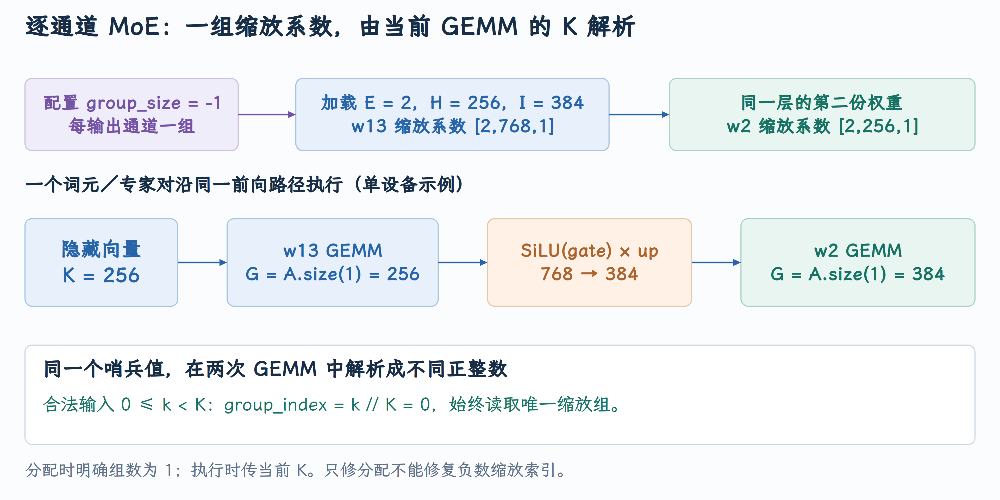

# Channelwise GPTQ MoE 的加载与 Triton 执行

PR #58513 修复了一个在模型启动时就出现的错误：channelwise GPTQ MoE 使用 `group_size=-1`，fallback 路径却把 `-1` 当作普通分组长度参与张量分配。只修分配 shape 仍不够，因为同一个值还会进入 GPU 的 scale 索引。沿这个 PR 可以把量化配置、专家权重、路由展开和两次 GEMM 串成完整链路。

本文对应 [PR #58513](https://github.com/vllm-project/vllm/pull/58513)，源码核对到提交 [`a08f2cb3c5`](https://github.com/vllm-project/vllm/commit/a08f2cb3c54605c8306f42d4cf00b62322bf804f)。截至 2026 年 10 月 5 日，PR 状态为**开放，尚未合并** 。

## 1. Fallback 要保留量化语义

MoE 路由为每个 token 选择若干专家。每个被选专家通常计算 gate/up projection、激活与 down projection，再按路由权重合并输出。专家很多，但它们的量化格式仍要由配置与 kernel 契约共同决定。

当前 [GPTQ MoE 方法选择](https://github.com/vllm-project/vllm/blob/a08f2cb3c54605c8306f42d4cf00b62322bf804f/vllm/model_executor/layers/quantization/auto_gptq.py#L235-L264) 检查 GPTQMoeMarlin 是否支持该层；不能使用时转到 `MoeWNA16Config`。WNA16 表示权重使用 N bit、激活使用 16 bit，这里的 N 可为 4 或 8，并非矩阵输出维度。

随后 [WNA16 方法与 backend 选择](https://github.com/vllm-project/vllm/blob/a08f2cb3c54605c8306f42d4cf00b62322bf804f/vllm/model_executor/layers/quantization/moe_wna16.py#L227-L264) 调用 oracle 选择后端。受设备、量化格式与并行配置影响，在本文故障中最终选中 `TritonWNA16Experts`。因此不能把“GPTQ MoE 总是使用 Triton”当作普遍规则；它是这个受约束的 fallback。

```text
AutoGPTQConfig
  → 不满足 GPTQMoeMarlin 支持条件
  → MoeWNA16Config / MoeWNA16Method
  → oracle 选中 TritonWNA16Experts
  → 专家参数创建、加载、格式转换
  → Top-K 路由与 token 分组
  → w13 GEMM → 激活 → w2 GEMM → 路由加权合并
```

## 2. Channelwise 的一组覆盖整个输入维度

用逻辑权重 $W\in\mathbb{R}^{N\times K}$ 表示一个专家 Linear，分组量化使用：

$$
\widehat W_{n,k}=s_{n,g(k)}(q_{n,k}-z_{n,g(k)}),\qquad
 g(k)=\lfloor k/G\rfloor.
$$

普通 group size `G=128` 表示同一输出通道每 128 个输入特征一组。Channelwise 表示每个输出通道只有一组，它覆盖该 Linear 的整个 K 维。配置中的 `-1` 是表达这种语义的 sentinel，不能作为负数分组长度参与分配或地址计算。

例如 `K=256` 时，channelwise scale 是 `[N,1]`，可解释为运行时 `G=256`；`K=384` 时则应解释为 `G=384`。二者都只有一组，但具体 group size 不相同。

## 3. 一个专家有两个不同的 K

固定单设备示例：专家数 `E=2`、hidden size `H=256`、每个专家 intermediate size `I=384`，采用常见的双分支 gate/up：

| 对象 | 逻辑 shape | 输入 K | Channelwise scales |
|---|---|---:|---|
| `w13`，合并 gate/up | `[E,2I,H]=[2,768,256]` | 256 | `[2,768,1]` |
| `w2`，down projection | `[E,H,I]=[2,256,384]` | 384 | `[2,256,1]` |

`w13` 的输出经过 SiLU 与另一半逐元素相乘，从 `2I` 变成 `I`，于是第二次 GEMM 的 K 变成 384。TP 环境中要使用该 rank 实际持有的 intermediate partition，这里固定单设备以免混淆。

{ width="100%" }

INT4 权重以每字节两个值打包，因此 runtime qweight 可见 `[E,N,K/2]`；如果存在零点，输出方向也有自己的打包。逻辑 shape、packed shape 和 scale shape 是三种不同表示。

## 4. 分配时把“单组”明确写成 1

原代码对分组执行整除／调整，然后使用 `hidden_size//group_size` 或 `intermediate_size//group_size` 分配 scale。`-1` 会生成负维度，最终报 `RuntimeError: zeros: Dimension size must be non-negative`。

错误首先发生在 [moe_wna16.py](https://github.com/vllm-project/vllm/blob/a08f2cb3c54605c8306f42d4cf00b62322bf804f/vllm/model_executor/layers/quantization/moe_wna16.py) 的 `MoeWNA16Method.create_weights()`。这里掌握 hidden 与 intermediate partition 的维度，所以 PR 在分配参数前先区分 channelwise 与普通分组：

```python
# 只有普通分组参与整除调整；-1 保留 channelwise 语义。
if group_size != -1:
    while (
        intermediate_size_per_partition % group_size or hidden_size % group_size
    ):
        group_size = group_size // 2
        group_size_div_factor *= 2
        assert group_size >= 32
# 保留原始语义，让后面的两次 GEMM 各自解析 K。
layer.group_size = group_size
layer.group_size_div_factor = group_size_div_factor

# 两种输入 K 分别计算 group 数，channelwise 都是单组。
hidden_scale_groups = 1 if group_size == -1 else hidden_size // group_size
intermediate_scale_groups = (
    1 if group_size == -1 else intermediate_size_per_partition // group_size
)
```

group 数不是只用于 scales：本 PR 同时把 `w13_scales`、`w2_scales`、`w13_qzeros`、`w2_qzeros` 的 group 维度改为 `hidden_scale_groups` 或 `intermediate_scale_groups`。zero point 沿输出轴的 INT4/INT8 打包因子继续使用原契约，输入 K 方向的单组轴需要同样修正。

上述两个组数随后进入四类参数的实际分配。w13 使用 hidden 的组数，w2 使用 intermediate 的组数；可选 zero point 还沿输出轴打包：

```python
# w13：输出为多分支 intermediate，输入为 hidden。
w13_scales = torch.nn.Parameter(
    torch.zeros(
        num_experts,
        self.moe.w13_num_shards * intermediate_size_per_partition,
        # w13 的输入分组轴：channelwise 为 1。
        hidden_scale_groups,
        dtype=params_dtype,
    ),
    requires_grad=False,
)
layer.register_parameter("w13_scales", w13_scales)
set_weight_attrs(w13_scales, extra_weight_attrs)

# w2：输出为 hidden，输入为 intermediate partition。
w2_scales = torch.nn.Parameter(
    torch.zeros(
        num_experts,
        hidden_size,
        # w2 的输入分组轴：channelwise 也为 1。
        intermediate_scale_groups,
        dtype=params_dtype,
    ),
    requires_grad=False,
)
layer.register_parameter("w2_scales", w2_scales)
set_weight_attrs(w2_scales, extra_weight_attrs)

# 仅有显式零点时分配 qzeros；输出维除以每字节打包数。
if self.quant_config.has_zp:
    w13_qzeros = torch.nn.Parameter(
        torch.zeros(
            num_experts,
            self.moe.w13_num_shards
            * intermediate_size_per_partition
            // bit8_pack_factor,
            hidden_scale_groups,
            dtype=torch.uint8,
        ),
        requires_grad=False,
    )
    layer.register_parameter("w13_qzeros", w13_qzeros)
    set_weight_attrs(w13_qzeros, extra_weight_attrs)

    w2_qzeros = torch.nn.Parameter(
        torch.zeros(
            num_experts,
            hidden_size // bit8_pack_factor,
            intermediate_scale_groups,
            dtype=torch.uint8,
        ),
        requires_grad=False,
    )
    layer.register_parameter("w2_qzeros", w2_qzeros)
    set_weight_attrs(w2_qzeros, extra_weight_attrs)
```

源码见 [分配 scale group 数量](https://github.com/vllm-project/vllm/blob/a08f2cb3c54605c8306f42d4cf00b62322bf804f/vllm/model_executor/layers/quantization/moe_wna16.py#L293-L304)。`layer.group_size` 仍保存 `-1`，因为一层共有两次 GEMM，加载阶段不能用某一个 K 永久替换整个层的配置。

## 5. 执行时用当前 GEMM 的 K 解析 sentinel

加载完成后，[权重格式转换与 kernel 初始化](https://github.com/vllm-project/vllm/blob/a08f2cb3c54605c8306f42d4cf00b62322bf804f/vllm/model_executor/layers/quantization/moe_wna16.py#L433-L464) 将通用参数转成选定后端的格式。正常 forward 中，路由返回 Top-K expert IDs 与权重，`moe_align_block_size` 把 token/expert 对分组并补齐工作 tile；padding 的 token/expert 对不是新增业务 token。

[Triton 专家执行能力](https://github.com/vllm-project/vllm/blob/a08f2cb3c54605c8306f42d4cf00b62322bf804f/vllm/model_executor/layers/fused_moe/experts/triton_moe.py#L755-L805) 的 `apply` 第一次调用 wrapper 时输入是 hidden states，第二次输入是激活后的 intermediate states。这就把第二处修改定位到 [fused_moe.py](https://github.com/vllm-project/vllm/blob/a08f2cb3c54605c8306f42d4cf00b62322bf804f/vllm/model_executor/layers/fused_moe/fused_moe.py) 的 `invoke_fused_moe_wna16_triton_kernel()`：它在每次启动前都能看到当前 A 的 K，适合把配置中的 -1 解析成实际分组长度：

```python
# 配置 -1 只表示 channelwise，进入执行前必须解析为本次 K。
group_size = block_shape[1]
if group_size == -1:
    group_size = A.size(1)
    # 单输出通道仅有一组 scale；存在显式零点时也必须为单组。
    assert B_scale.size(2) == 1
    assert B_zp is None or B_zp.size(2) == 1
```

解析值还必须贯穿配置选择与 GPU 执行。PR 先让 [block 配置调用](https://github.com/vllm-project/vllm/blob/a08f2cb3c54605c8306f42d4cf00b62322bf804f/vllm/model_executor/layers/fused_moe/fused_moe.py#L715-L728) 使用同一个正 group size：

```python
config = config.copy()
# block 配置接收本次 GEMM 解析出的正 group_size。
config.update(
    get_moe_wna16_block_config(
        config=config,
        use_moe_wna16_cuda=False,
        num_valid_tokens=num_tokens,
        size_k=A.size(1),
        size_n=B.size(1),
        num_experts=B.size(1),
        # 与随后 Triton launch 的 group_size 使用同一数值。
        group_size=group_size,
        real_top_k=top_k,
        block_size_m=config["BLOCK_SIZE_M"],
    )
)
```

随后 [Triton launch](https://github.com/vllm-project/vllm/blob/a08f2cb3c54605c8306f42d4cf00b62322bf804f/vllm/model_executor/layers/fused_moe/fused_moe.py#L749-L764) 也传 `group_size=group_size`。配置阶段和执行阶段必须拿到同一个正 group size；否则即使 scale 已成功分配为单组，kernel 仍会用 -1 计算错误 group 索引。修复落在共同 wrapper，便于 w13/w2 各自按当前 K 解析，也覆盖进入该 fallback 的不同模型。

见 [运行时 group size 解析](https://github.com/vllm-project/vllm/blob/a08f2cb3c54605c8306f42d4cf00b62322bf804f/vllm/model_executor/layers/fused_moe/fused_moe.py#L693-L706)。第一次得到 256，第二次得到 384，并将它同时传给 block 配置与 `fused_moe_kernel_gptq_awq`。

## 6. 为什么只修 scale shape 会留下 GPU 错误

GPU 内核根据当前输入特征位置寻找 scale 组：`group_index = k//group_size`。[scale 地址计算](https://github.com/vllm-project/vllm/blob/a08f2cb3c54605c8306f42d4cf00b62322bf804f/vllm/model_executor/layers/fused_moe/fused_moe.py#L243-L262) 把这个分组索引放进实际地址。

对 channelwise，合法 `0<=k<K` 且 `G=K`，所以所有特征的组号都是 0。若 `G=-1`，正的 K 位置会得到负组号，scale 张量即使成功分配成一组也无法挽救错误索引。另一个错误修法是把所有 GEMM 固定为 `G=H=256`：在 w2 的 `k=300`，组号会变成 1，仍超出单组范围。正确解析位置必须能够看到当前 `A.size(1)`。

输出端第一次 GEMM 保留被选专家的独立结果，激活后执行第二次 GEMM，最后使用路由权重合并 token 的专家输出。scale 规则正确只是其中一个条件，expert ID、排序索引、packed weight 和加权位置仍要共同一致。

## 7. Top-K 路由如何变成专家 GEMM 的行

多个 token 可能选中同一专家，一个 token 也可能选中多个专家。kernel 不直接对 `hidden_states[T,H]` 做一次普通 dense GEMM，而是按 token/expert pair 组织行。固定 `T=2,top_k=2,E=2`，路由如下：

| pair ID | token | Top-K 槽 | expert |
|---:|---:|---:|---:|
| 0 | 0 | 0 | 1 |
| 1 | 0 | 1 | 0 |
| 2 | 1 | 0 | 1 |
| 3 | 1 | 1 | 0 |

同一专家的 pair 排在一起。为解释 tile 对齐，暂用 `BLOCK_M=4` 的教学尺寸：expert 0 可以对应 `[1,3,pad,pad]`，expert 1 对应 `[0,2,pad,pad]`。padding 的 pair ID 使用超出有效 `T*top_k` 范围的值，由 `token_mask` 排除；它不是真实请求的额外 token。

[pair 索引、expert 与输入 gather](https://github.com/vllm-project/vllm/blob/a08f2cb3c54605c8306f42d4cf00b62322bf804f/vllm/model_executor/layers/fused_moe/fused_moe.py#L156-L188) 从 `sorted_token_ids` 读 pair ID，从 `expert_ids` 读当前 tile 的 expert。第一层 GEMM 通过 `pair_id//top_k` 找回原 hidden row：pair 0、1 都读取 token 0 的 X，但分别乘不同 expert 的 W。`sorted_token_ids` 是索引元数据，不是一份已排序复制的 hidden tensor。

输出写回则使用 pair ID，得到每个 token/专家独立的中间结果。这样“按专家聚集读取”和“按原 pair 槽存储”可以同时成立。专家并行时 expert map 还会把全局 expert ID 映射到本 rank；kernel 中 `expert_id=-1` 走零输出路径，不能当成普通权重地址。

## 8. 两次 GEMM 的 workspace 和权重寻址

采用前文 `H=256,I=384`，第一 GEMM 输出 gate/up 合并的 768 特征。runtime workspace 为 `[T,top_k,768]`，激活执行 `SiLU(gate)*up` 得到 `[T*top_k,384]`；第二 GEMM 针对每个 pair 的激活投回 256，写 `[T,top_k,256]`，随后按路由权重汇总。workspace 的安排见 [两个投影与激活的中间缓存](https://github.com/vllm-project/vllm/blob/a08f2cb3c54605c8306f42d4cf00b62322bf804f/vllm/model_executor/layers/fused_moe/experts/triton_moe.py#L738-L751)。

第一 GEMM 的 X 是原 token 行，gather 除以 top_k；第二 GEMM 的 X 已经是每 pair 一行，输入行索引不应再次折叠成原 token。第一调用传 `top_k=top_k_num`，第二调用传 `top_k=1`，让 `pair_id//top_k` 在第二层直接等于 pair ID。见 [两次 launch、激活与加权合并](https://github.com/vllm-project/vllm/blob/a08f2cb3c54605c8306f42d4cf00b62322bf804f/vllm/model_executor/layers/fused_moe/experts/triton_moe.py#L755-L808)。它们共享 sorted routing metadata，但不共享相同的输入 K 或输入行布局。

INT4 expert 权重在该路径以字节存储，逻辑 K 每两个值压成一个字节。对于当前 expert e、输出 n、逻辑 k，地址分解为：

$$
\mathrm{byteAddr}=e\,\mathrm{stride}_{e}+n\,\mathrm{stride}_{n}
+\lfloor k/2\rfloor\,\mathrm{stride}_{k},
\qquad q=(\mathrm{byte} \gg 4(k\bmod2))\ \&\ 15.
$$

这与 RDNA ExLlama 的八 nibble shuffle 是不同布局，不能因为都标注 INT4 就交换 packed buffer。当前 kernel 用 stride 表达轴顺序，见 [INT4 权重地址与 nibble 移位](https://github.com/vllm-project/vllm/blob/a08f2cb3c54605c8306f42d4cf00b62322bf804f/vllm/model_executor/layers/fused_moe/fused_moe.py#L190-L208)。

scale 地址还要加 `floor(logical_k/G)*stride_group`。Channelwise 将 G 解析为当前 GEMM 的 K：第一 GEMM 为 256，第二为 384，因此任何合法 k 的 group index 都是 0。显式 INT4 zero point 又沿输出轴每字节打包两个 z，通过 `n//2` 和 `4*(n%2)` 读取；它与权重沿 K 打包的方向也不同。**逻辑特征索引、packed 存储索引、分组索引** 是三种计数单位，必须在每个地址中分别转换。

## 9. Triton 内部反量化与融合边界

[逐 K tile 解码、scale 和 dot](https://github.com/vllm-project/vllm/blob/a08f2cb3c54605c8306f42d4cf00b62322bf804f/vllm/model_executor/layers/fused_moe/fused_moe.py#L233-L283) 先加载当前 K tile 的 packed 权重，抽取 nibble，按每个逻辑 k 的 group index 读取 scale/zero point，以 FP32 计算 `(q-z)*s`，再转为 compute type 供 `tl.dot` 使用。输出 accumulator 仍为 FP32，并跨 K tile 更新。这种写法的 scale 索引是每个 k 单独产生，不能套用“一个 K tile 只读一个 scale”的 RDNA Triton 契约。

所谓 fused MoE 并不要求路由、两次 GEMM 与激活全在一个 GPU kernel 中。这里 expert kernel 融合的是当前投影的 gather、INT4 解码、矩阵乘法以及可选路由权重乘法；激活和第二次投影仍需要中间 workspace 与后续调用。`MUL_ROUTED_WEIGHT` 为真时，dot 后按 pair 读取路由权重乘 accumulator，最后多个 Top-K 槽再合并。融合边界应由实际数据流说明。

这也解释为什么 PR 必须同时修分配与执行。分配 `[E,N,1]` 只让参数存在，若 launch 继续传 `G=-1`，logical k 的除法仍生成负 group 索引。wrapper 在每次 GEMM 将 sentinel 转为本次 K，才能让同一条 channelwise 语义贯穿参数大小、地址生成和最终乘法。
