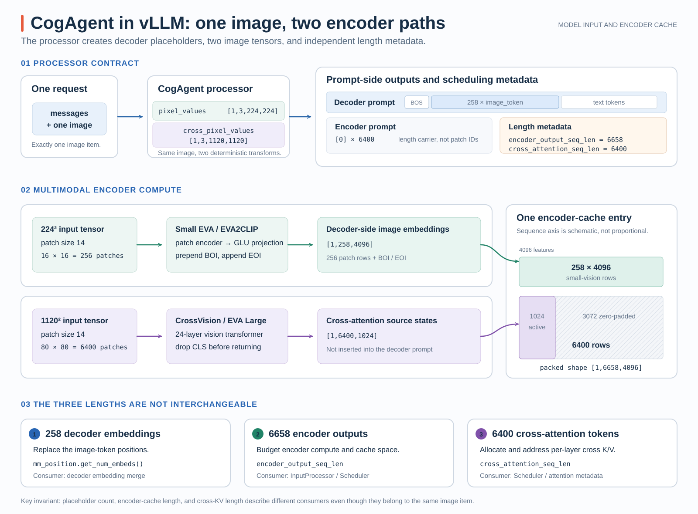
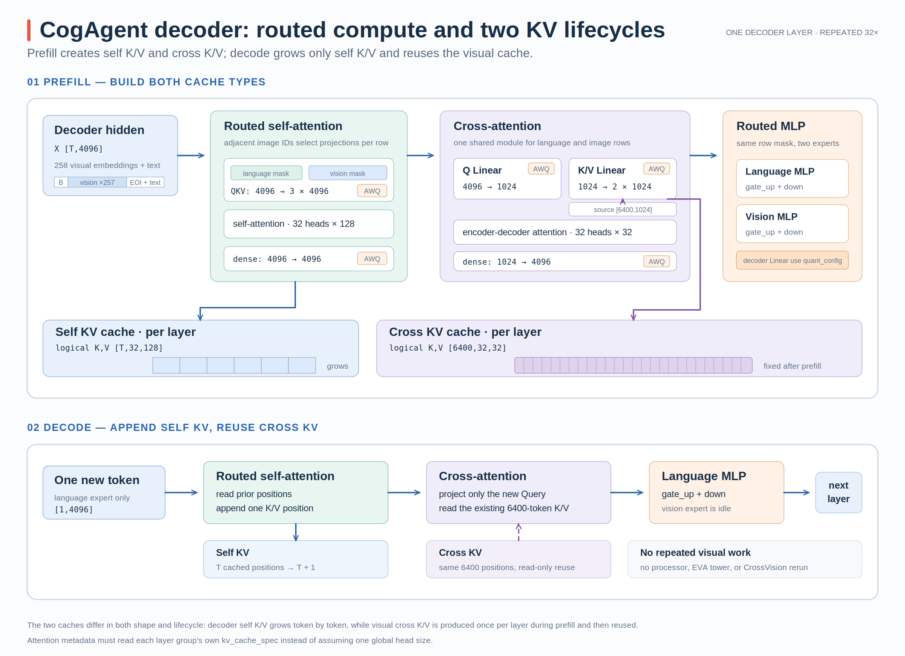

# CogAgent-18B 在 vLLM 中的模型接入与推理优化

CogAgent-18B 不是“视觉编码器输出若干 embedding，再交给普通 LLM”这一种单路径结构。同一张图片会进入两套视觉编码器：一套产生插入 decoder prompt 的视觉 embedding，另一套产生每层 cross-attention 使用的 K/V 来源。模型接入的难点因此不只在 `forward()`，还包括 processor、encoder 预算、scheduler、cross-attention KV cache 和模型专用数值语义。

本文以开发分支的最终提交为基线，聚焦模型接入、数据流、缓存和定向实现优化。AWQ 部分只说明 vLLM 内的量化范围，不展开 AMD Quark 的校准、导出或性能测试。

- 开发分支：`gfx11/cogagent-18b-support`（以下源码证据固定到最终提交）
- 本文对应源码：[`f9ddabc`](https://github.com/tangzzycc/vllm/commit/f9ddabc759c66cdb76567d22d05683ea8d30cd37)
- 模型实现：[`cogagent.py`](https://github.com/tangzzycc/vllm/blob/f9ddabc759c66cdb76567d22d05683ea8d30cd37/vllm/model_executor/models/cogagent.py)
- 多模态处理：[`cogagent_processing.py`](https://github.com/tangzzycc/vllm/blob/f9ddabc759c66cdb76567d22d05683ea8d30cd37/vllm/model_executor/models/cogagent_processing.py)
- 视觉编码器：[`cogagent_vision_encoder.py`](https://github.com/tangzzycc/vllm/blob/f9ddabc759c66cdb76567d22d05683ea8d30cd37/vllm/model_executor/models/cogagent_vision_encoder.py)

这组开发提交可以概括为：

| Commit | 主要作用 |
| --- | --- |
| [`2e361bb`](https://github.com/tangzzycc/vllm/commit/2e361bb0024562ee5d08e2ea79211eb44359878e) | 接入配置、processor、双视觉编码器、decoder、cross-attention cache 和测试 |
| [`1d57dc2`](https://github.com/tangzzycc/vllm/commit/1d57dc25b1e7de85ac804fd06773017b5b922d68) | 让 decoder Linear 接入 AWQ W4A16，并增加 gfx1151 shape 配置 |
| [`999c513`](https://github.com/tangzzycc/vllm/commit/999c513edf04ac9b45a763732c6ed858b71da244) | 让两类视觉 block 进入 vLLM 的 `torch.compile` 路径 |
| [`f06bc7a`](https://github.com/tangzzycc/vllm/commit/f06bc7ab4f0011bd39956522f838dfc667b837a2) | 为 gfx115x 增加 EVA Q/K RoPE Triton 路径 |
| [`e17aa6a`](https://github.com/tangzzycc/vllm/commit/e17aa6a0cf616aaaf626c84edb376f32934a1d68) | 合并视觉侧投影，并为 cross-vision attention 增加专用配置 |
| [`f9ddabc`](https://github.com/tangzzycc/vllm/commit/f9ddabc759c66cdb76567d22d05683ea8d30cd37) | 修正非均匀 attention head 下的 Triton metadata |

## 1. 接入边界：从 Processor 到 Runtime

CogAgent 在模型注册表中被归入 encoder-decoder 模型，并通过 `CogAgentForCausalLM` 同时声明多模态与量化能力，见 [model registry](https://github.com/tangzzycc/vllm/blob/f9ddabc759c66cdb76567d22d05683ea8d30cd37/vllm/model_executor/models/registry.py#L597-L607) 和 [模型接口声明](https://github.com/tangzzycc/vllm/blob/f9ddabc759c66cdb76567d22d05683ea8d30cd37/vllm/model_executor/models/cogagent.py#L572-L588)。一次完整接入包含以下边界：

| 层次 | CogAgent 实现承担的职责 |
| --- | --- |
| Config | 识别 `model_type=cogagent`，描述两套视觉配置、decoder 配置和 cross-attention 维度 |
| Processor | 对同一张图片生成两种分辨率的 tensor，并建立 decoder placeholder 与 encoder prompt |
| Multimodal interface | 告诉 vLLM encoder 实际输出多少条 embedding、其中多少条进入 cross-attention cache |
| Model | 运行两套视觉编码器，替换 decoder 侧图像 embedding，并执行 32 层 CogAgent decoder |
| Weight loader | 将 Hugging Face checkpoint 名称映射到 vLLM 的 fused/parallel Linear |
| Runtime | 为 encoder 输出、self-attention KV 和 cross-attention KV 分别建立正确的预算与 metadata |

模型构造期还显式收紧支持范围：当前实现要求 `use_v2_model_runner`，只支持 `TP=1`、`PP=1` 和 BF16，不支持 prompt embeddings、预计算 multimodal embeddings 或 encoder-cache transfer，见 [`CogAgentForCausalLM.__init__`](https://github.com/tangzzycc/vllm/blob/f9ddabc759c66cdb76567d22d05683ea8d30cd37/vllm/model_executor/models/cogagent.py#L590-L620)。processor 则要求每个请求恰好包含一张图片，见 [`CogAgentMultiModalProcessor.apply`](https://github.com/tangzzycc/vllm/blob/f9ddabc759c66cdb76567d22d05683ea8d30cd37/vllm/model_executor/models/cogagent_processing.py#L237-L264)。

`requires_raw_input_tokens = True` 也不是普通的能力标记。模型需要检查连续的 image token，在运行时生成 vision/language mask，从而决定每个 token 进入哪套 expert projection；如果模型只收到提前计算好的 embedding，就失去了这份路由信息。这个 mask 和“哪些位置被替换为视觉 embedding”不是同一个概念，具体边界会在 Decoder Layer 中再说明。

此外，通用 encoder-decoder 模型在 ROCm 上默认关闭 CUDAGraph。CogAgent 通过 `supports_rocm_cudagraph = True` 明确声明这条路径已经适配，通用配置检查才不会强制回退 eager，相关判断见 [`ModelConfig._verify_cuda_graph`](https://github.com/tangzzycc/vllm/blob/f9ddabc759c66cdb76567d22d05683ea8d30cd37/vllm/config/model.py#L1319-L1330)。

## 2. 双视觉路径与 258、6400、6658 三种长度

CogAgent processor 对同一张图片执行两套固定变换，分别得到 `pixel_values [batch,3,224,224]` 和 `cross_pixel_values [batch,3,1120,1120]`。两个字段仍属于同一个 image item，不是两张图片；输入系统会把它们作为同一项的两个字段交给模型，模型内部再分成两条计算路径。字段绑定见 [`_get_mm_fields_config`](https://github.com/tangzzycc/vllm/blob/f9ddabc759c66cdb76567d22d05683ea8d30cd37/vllm/model_executor/models/cogagent_processing.py#L229-L235)。

224 分辨率的 EVA2CLIP 路径使用 `patch_size=14`，形成 $16\times16=256$ 个 patch。模型在输出两侧增加 BOI/EOI embedding，最终得到 `[batch,258,4096]`。这 258 条 embedding 会替换 decoder prompt 中的 image placeholder；processor 不是简单追加 token，而是用 `BOS + 258 × image_token` 替换原 BOS 区域，并标记其中哪些位置应接收 multimodal embedding，见 [`_get_prompt_updates`](https://github.com/tangzzycc/vllm/blob/f9ddabc759c66cdb76567d22d05683ea8d30cd37/vllm/model_executor/models/cogagent_processing.py#L203-L227)。

1120 分辨率的 CrossVision 路径形成 $80\times80=6400$ 个 patch，输出 `[batch,6400,1024]`。这些 state 不插入 decoder prompt，而是作为每层 cross-attention 的 K/V 来源。为了通过统一 encoder 输出接口传递两路视觉计算结果，`embed_multimodal()` 把两路输出组合成一个 `[batch,6658,4096]` tensor：前 258 行保存 small-vision embedding，后 6400 行只使用前 1024 个通道保存 cross-vision 输出，其余通道补零。组合过程见 [`embed_multimodal`](https://github.com/tangzzycc/vllm/blob/f9ddabc759c66cdb76567d22d05683ea8d30cd37/vllm/model_executor/models/cogagent.py#L770-L794)。

{ width="95%" }

图中组合 tensor 的高度只用来表示两段 sequence，并没有按 258:6400 严格缩放；宽度则强调 CrossVision 的 1024 个有效通道如何被放入 4096 宽的输出项。这是首步 encoder 输出的容器表示，不意味着 6658 个 token 都进入 decoder self-attention。

当前 MRV2 encoder-decoder 路径直接使用 EncoderRunner 的返回值，作为 `encoder_outputs` 传给首步 forward，不将组合 tensor 长期保存在 encoder tensor cache；后续 Decode 复用各层 Cross-KV。源码见[EncoderDecoderModelState](https://github.com/tangzzycc/vllm/blob/f9ddabc759c66cdb76567d22d05683ea8d30cd37/vllm/v1/worker/gpu/model_states/encoder_decoder.py#L70-L100)。

因此同一个 image item 必须携带三个不同长度：

| 长度 | 数值 | 消费者 |
| --- | ---: | --- |
| Decoder multimodal embeddings | 258 | 替换 decoder prompt 中的 image token |
| Encoder output sequence | 6658 | encoder compute budget 与首步输出容量 |
| Cross-attention sequence | 6400 | cross-attention KV block 分配与 attention metadata |

过去的通用路径通常用 placeholder embedding 数量代表另外两种长度，对 CogAgent 会把 258、6400 和 6658 错当成同一个值。为此，`MultiModalFeatureSpec` 新增 `encoder_output_seq_len` 与 `cross_attention_seq_len`，并保留默认回退逻辑，使其他模型仍可继续使用 placeholder 长度，见 [`MultiModalFeatureSpec`](https://github.com/tangzzycc/vllm/blob/f9ddabc759c66cdb76567d22d05683ea8d30cd37/vllm/multimodal/inputs.py#L354-L381)。

CogAgent processor 分别返回 6658 和 6400；`InputProcessor` 将它们写入请求中的 multimodal feature，Scheduler 用 6658 计算 encoder 工作量，用 6400 计算 cross-KV 空间，见 [长度生成](https://github.com/tangzzycc/vllm/blob/f9ddabc759c66cdb76567d22d05683ea8d30cd37/vllm/model_executor/models/cogagent_processing.py#L152-L170)、[输入侧记录](https://github.com/tangzzycc/vllm/blob/f9ddabc759c66cdb76567d22d05683ea8d30cd37/vllm/v1/engine/input_processor.py#L194-L210) 和 [Scheduler 消费](https://github.com/tangzzycc/vllm/blob/f9ddabc759c66cdb76567d22d05683ea8d30cd37/vllm/v1/core/sched/scheduler.py#L953-L965)。

`create_encoder_prompt()` 返回的 6400 个零只是在 encoder-decoder 基础设施中表达 source sequence 长度；它们不是图像 patch 的真实 token ID，也不会替代 `cross_pixel_values` 的视觉计算。

## 3. Decoder Layer：路由、Cross KV 与 Prefill/Decode

`CogAgentForCausalLM.forward()` 接收 MRV2 传入的首步组合 encoder 输出，再切成两部分：

```text
encoder_outputs[:, :258, :]
  -> image_embeds
  -> 替换 decoder input_ids 中的 image-token embedding

encoder_outputs[:, 258:, :1024]
  -> cross_embeds
  -> 每层 cross-attention 的 K/V source
```

切分、embedding 替换和 decoder 调用位于 [`CogAgentForCausalLM.forward`](https://github.com/tangzzycc/vllm/blob/f9ddabc759c66cdb76567d22d05683ea8d30cd37/vllm/model_executor/models/cogagent.py#L679-L723)。每个 `CogAgentDecoderLayer` 的执行顺序是：

```text
RMSNorm
  -> routed self-attention
  -> residual
  -> RMSNorm
  -> cross-attention
  -> residual
  -> RMSNorm
  -> routed SwiGLU MLP
  -> residual
```

这里的 “routed” 不是 MoE router，也没有 Top-k expert 选择。`build_token_masks()` 只在“当前位置和下一位都是 image token”时标记 vision mask：258 个连续 placeholder 都会被视觉 embedding 替换，但前 257 个位置走 vision expert，最后一个 EOI 边界位置归入 language mask。两类 token 分别经过自己的投影后，结果再写回原 token 顺序。self-attention 的 QKV/output projection 和 MLP 都采用这一规则，见 [token mask](https://github.com/tangzzycc/vllm/blob/f9ddabc759c66cdb76567d22d05683ea8d30cd37/vllm/model_executor/models/cogagent.py#L670-L677)、[routed self-attention](https://github.com/tangzzycc/vllm/blob/f9ddabc759c66cdb76567d22d05683ea8d30cd37/vllm/model_executor/models/cogagent.py#L282-L323) 与 [routed MLP](https://github.com/tangzzycc/vllm/blob/f9ddabc759c66cdb76567d22d05683ea8d30cd37/vllm/model_executor/models/cogagent.py#L196-L211)。

cross-attention 不再区分 vision/language expert。它把 decoder hidden state 从 4096 投影成 1024 维 Query，把 `[6400,1024]` 的 cross-vision states 投影成 K/V，再按 32 个 head、每 head 32 维执行 encoder-decoder attention，见 [`CogAgentCrossAttention`](https://github.com/tangzzycc/vllm/blob/f9ddabc759c66cdb76567d22d05683ea8d30cd37/vllm/model_executor/models/cogagent.py#L342-L416)。

Prefill 时 `encoder_embeds` 非空，每层都用同一份 `[6400,1024]` CrossVision states 生成本层的 cross K/V，但 K/V 投影参数和 cache 都属于当前 layer。后续 decode 不再运行 processor 或两套视觉编码器；`encoder_embeds` 为 `None`，attention backend 直接读取已缓存的 cross K/V。

self-attention KV 与 cross-attention KV 因此是两套生命周期不同的 cache：前者在 prefill 写入 prompt 位置，之后每生成一个 token 就追加一个位置；后者只在 prefill 根据 6400 个 source states 建立一次，decode 期间长度保持不变。decode 的新 token 不是 image token，因而 routed self-attention 和 routed MLP 只走 language expert。

{ width="95%" }

图中的 AWQ 标记只贴在 QKV、Query、K/V、Dense 等 Linear 投影上；self-attention 和 encoder-decoder attention 运算本身仍由 attention backend 执行，不属于 AWQ Linear 的量化范围。

模型还保留了 CogAgent 自己的 position 和 BF16 RoPE 语义。图像前缀的 position id 不是普通的逐 token 递增：BOS 为 0、BOI 为 1、256 个 patch 共享 2、EOI 为 3，文本再从 4 开始继续，见 [`build_positions`](https://github.com/tangzzycc/vllm/blob/f9ddabc759c66cdb76567d22d05683ea8d30cd37/vllm/model_executor/models/cogagent.py#L105-L124)。`CogAgentRotaryEmbedding` 则先按模型 dtype 构造 frequency table，而不是先生成通用 FP32 cache 再整体 cast；这个顺序用于匹配 Hugging Face CogAgent 的 BF16 数值语义，见 [`_compute_cogagent_rope_cache`](https://github.com/tangzzycc/vllm/blob/f9ddabc759c66cdb76567d22d05683ea8d30cd37/vllm/model_executor/models/cogagent.py#L71-L102)。

## 4. AWQ W4A16 的实际量化范围

AWQ 支持没有在 CogAgent 中重新实现一套量化算法。模型通过 `SupportsQuant` 接入 vLLM 现有 quantization config，再把 `quant_config` 传给 decoder 内部的 parallel Linear。实际覆盖的是语言模型 `model.layers.*` 下的这些模块：

| Decoder 子模块 | 接入量化的 Linear |
| --- | --- |
| Self-attention language expert | `language_expert_query_key_value`、`language_expert_dense` |
| Self-attention vision expert | `vision_expert_query_key_value`、`vision_expert_dense` |
| Cross-attention | `query`、`key_value`、`dense` |
| Language MLP | `language_mlp.gate_up_proj`、`language_mlp.down_proj` |
| Vision MLP | `vision_mlp.gate_up_proj`、`vision_mlp.down_proj` |

这里的 `gate_up_proj` 是 vLLM 侧的 fused Linear，对应 checkpoint 中独立的 `gate_proj` 与 `up_proj`。权重加载器会把两者的 `weight`、`qweight`、`qzeros` 和 `scales` 分别写入 fused 参数的两个 shard，见 [`MLP.load_weights`](https://github.com/tangzzycc/vllm/blob/f9ddabc759c66cdb76567d22d05683ea8d30cd37/vllm/model_executor/models/cogagent.py#L161-L171)。

两套独立视觉塔 `vision`、`cross_vision`，以及 `embed_tokens`、RMSNorm 和 `lm_head` 没有通过这条 `quant_config` 路径量化。更准确的描述是“支持 decoder Linear 的 AWQ W4A16”，而不是“整个 CogAgent-18B 都变成 INT4”，也不是“只量化 language expert”。

ROCm 侧继续复用通用 `rdna_hybrid_w4a16` kernel。CogAgent 相关改动只为 gfx1151、BF16、group size 128 的已知 `(N,K)` 与一段 M 范围增加 tile 配置；不匹配的 shape 仍走原有 heuristic。配置按矩阵 shape 和 dtype 选择，而不是在 kernel 中判断模型名，见 [`_GFX1151_BF16_PREFILL_CONFIGS`](https://github.com/tangzzycc/vllm/blob/f9ddabc759c66cdb76567d22d05683ea8d30cd37/vllm/model_executor/kernels/linear/mixed_precision/rdna_hybrid_w4a16.py#L315-L371) 和 [dispatch](https://github.com/tangzzycc/vllm/blob/f9ddabc759c66cdb76567d22d05683ea8d30cd37/vllm/model_executor/kernels/linear/mixed_precision/rdna_hybrid_w4a16.py#L438-L473)。

## 5. 视觉路径和 Attention metadata 的定向优化

模型正确运行后，后续提交没有改变 CogAgent 数学，而是逐步把视觉路径放进更适合 vLLM 和 gfx115x 的执行方式：

| 改动 | 实现方式 | 保留的边界 |
| --- | --- | --- |
| 编译视觉 block | 给 `EVALargeBlock` 和 `EVATransformerLayer` 添加 `support_torch_compile`，把 batch/token 维标为动态 | 只在 vLLM 判断 multimodal encoder 适合编译时启用 |
| 融合 EVA RoPE | gfx115x 上用 Triton 同时旋转 Q/K，并直接写成 attention 需要的布局 | 只覆盖 CUDA device 上的 FP16/BF16；其他情况走 native fallback |
| 合并视觉投影 | SwiGLU 的 `w1/w2` 合并为 `MergedColumnParallelLinear`，拆分 Q/K/V 合并为 `QKVParallelLinear` | 通过 weight mapper 保持原 checkpoint 命名和 shard 语义 |
| Cross-vision attention 配置 | gfx115x、BF16、head dim 64、non-causal 使用 `BLOCK_M=128`、`BLOCK_N=32`、4 warps | 其他 dtype、head size 和 causal 路径仍使用通用选择逻辑 |
| 修正 Triton metadata | KV head 数与 head size 从当前 attention group 的 `kv_cache_spec` 读取 | 不再假设模型所有 attention layer 都等于全局 config |

视觉 block 的 compile 装饰器见 [`EVALargeBlock` 与 `EVATransformerLayer`](https://github.com/tangzzycc/vllm/blob/f9ddabc759c66cdb76567d22d05683ea8d30cd37/vllm/model_executor/models/cogagent_vision_encoder.py#L671-L755)。EVA RoPE kernel 让一个 Triton program 处理一个 `(batch, token)` 行，对每个 head 内相邻元素进行 GPT-J 风格配对；token 0 保持不旋转，并显式关闭乘加融合以匹配 native 路径的舍入顺序，见 [`_eva_rope_qk_kernel`](https://github.com/tangzzycc/vllm/blob/f9ddabc759c66cdb76567d22d05683ea8d30cd37/vllm/model_executor/models/cogagent_vision_encoder.py#L55-L133) 和 [gfx115x dispatch](https://github.com/tangzzycc/vllm/blob/f9ddabc759c66cdb76567d22d05683ea8d30cd37/vllm/model_executor/models/cogagent_vision_encoder.py#L205-L238)。

CrossVision 的 attention head dim 为 64，因此 non-causal encoder attention 可以选择专门的 `128×32` tile，见 [`_get_prefill_attention_config`](https://github.com/tangzzycc/vllm/blob/f9ddabc759c66cdb76567d22d05683ea8d30cd37/vllm/v1/attention/ops/triton_prefill_attention.py#L384-L398)。这是一条受硬件、dtype、head dim 和 causal 属性共同保护的 fast path，并未改变通用 attention 的默认配置。

最后一项 metadata 修复属于正确性条件。CogAgent 的 decoder self-attention 使用 32 个 head、head dim 128，而 cross-attention 使用 32 个 head、head dim 32；视觉 attention 又存在自己的 head 配置。Triton metadata builder 如果始终从全局 model config 推导 KV head shape，就会为非均匀 layer 分配错误的临时 buffer 或启动参数。最终实现改为从当前 attention group 的 `kv_cache_spec` 读取 `num_kv_heads` 与 `head_size`，见 [`TritonAttentionMetadataBuilder`](https://github.com/tangzzycc/vllm/blob/f9ddabc759c66cdb76567d22d05683ea8d30cd37/vllm/v1/attention/backends/triton_attn.py#L105-L123)。

因此，这组工作的核心并不是增加一个模型名称，而是让 CogAgent 的真实结构进入 vLLM 已有抽象：processor 明确三种长度，首步 encoder 输出传递两路视觉结果，decoder 用 token mask 选择 expert，cross-attention 复用固定视觉 K/V，量化通过通用 Linear 接口接入，硬件优化则由 shape、dtype 和 architecture guard 局部启用。
