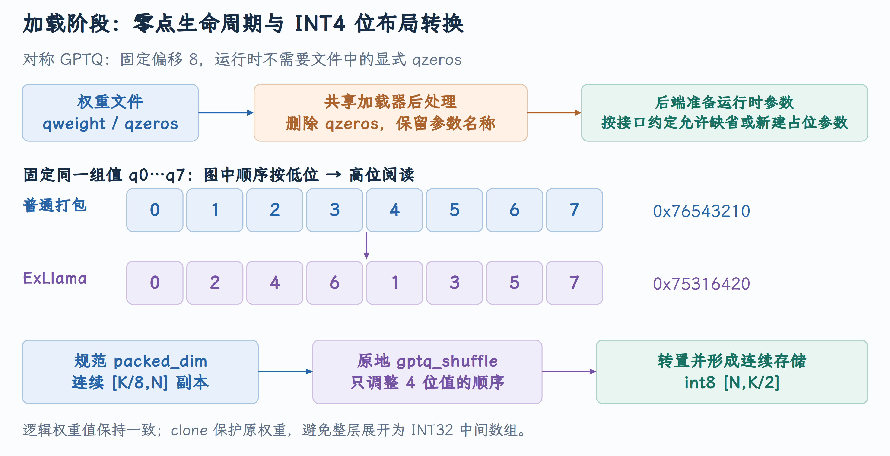

# GPTQ 权重加载与 RDNA INT4 布局重排

模型 checkpoint 中存在 `qzeros`，并不意味着选定的推理内核必须消费这份张量；同样，权重都是 INT4，也不意味着它们具有相同的打包顺序。PR #52637 同时处理这两个加载边界：清理对称 GPTQ 的冗余零点，再用 packed shuffle 减少 RDNA 权重预处理成本。两项修改共同展示了 vLLM 如何把文件表示转换成 GPU 可执行表示。

本文对应 [PR #52637](https://github.com/vllm-project/vllm/pull/52637)，源码核对到提交 [`510e42aeb1`](https://github.com/vllm-project/vllm/commit/510e42aeb1c7abcda0d31d826aadbe6e34ba8100)。截至 2026 年 10 月 5 日，PR 状态为**开放，尚未合并** 。

## 1. 加载权重是一条独立于逐 token forward 的链路

模型实例创建 Linear 时，量化配置为该层选择量化方法并分配参数。loader 按参数的加载接口写入 checkpoint 数据；加载完成后，统一后处理入口遍历各层，调用量化方法进行布局准备，最后才进入正常推理。

```text
量化配置与 Linear 构造
  → AutoGPTQLinearMethod.create_weights
  → qweight / scales / qzeros 参数注册
  → checkpoint loader 写入参数
  → process_weights_after_loading
  → 选定 MPLinearKernel 的后处理
  → apply_weights 在每次 forward 使用运行时权重
```

[模型加载后的统一处理](https://github.com/vllm-project/vllm/blob/510e42aeb1c7abcda0d31d826aadbe6e34ba8100/vllm/model_executor/model_loader/utils.py#L133-L175) 调用每层的 `quant_method.process_weights_after_loading`；[Linear 能力描述与 kernel 选择](https://github.com/vllm-project/vllm/blob/510e42aeb1c7abcda0d31d826aadbe6e34ba8100/vllm/model_executor/layers/quantization/auto_gptq.py#L337-L360) 将 full/partition shape、权重类型、激活类型与 group size 交给 selector。

加载中的 `PackedvLLMParameter` 不只有 tensor 数值，还描述 `input_dim`、`output_dim`、`packed_dim` 和 pack factor。TP 分片及布局转换都必须理解这些轴，而不能仅凭一个二维 shape 猜测输入与输出方向。

## 2. 对称 GPTQ 的零点来自哪里

4 bit 无符号存储可包含整数 `0～15`。对称 GPTQ 使用 `uint4b8`，其表示带固定偏移 8：

$$
\widehat W_{n,k}=s_{n,g(k)}(q_{n,k}-8).
$$

例如 `q=[8,9,7]`、scale 为 `0.25`，解码值为 `[0,0.25,-0.25]`。固定偏移是数值解释规则，`zero_points=False` 表示内核不需要额外显式零点张量；它不表示量化数学中不存在零点。

[GPTQ 数值类型映射](https://github.com/vllm-project/vllm/blob/510e42aeb1c7abcda0d31d826aadbe6e34ba8100/vllm/model_executor/layers/quantization/auto_gptq.py#L99-L105) 与 `create_weights` 中的 `zero_points=False` 绑定了这条语义。不过 checkpoint 仍可能保存 packed `qzeros`。原逻辑注册并加载它之后，把它保留到 kernel 后处理，最终 `_get_weight_params` 可以继续取得这份不该被使用的张量。

RDNA 显式零点的运行时布局是沿输出方向打包的 `[N/8,K/G]`；GPTQ 文件中的零点通常沿另一种方向排列。在 PR 报告的故障中，启动报错为 `Zero points must be [320,16] but got [16,320]`。这里更根本的问题不是“把零点转置一下”，而是**对称路径本来就不需要消费文件零点** 。

## 3. 在共享 loader 边界清理张量

清理的位置是 [auto_gptq.py](https://github.com/vllm-project/vllm/blob/510e42aeb1c7abcda0d31d826aadbe6e34ba8100/vllm/model_executor/layers/quantization/auto_gptq.py) 的 `AutoGPTQLinearMethod.process_weights_after_loading()`。它已经知道本层是否使用显式零点，也掌握 backend 的参数名称，因此可以在 backend 读取张量前处理冗余引用：

```python
# 对称配置无需显式零点：在 backend 处理前移除冗余 tensor。
if not self.kernel.config.zero_points:
    zp_name = self.kernel.w_zp_name
    if zp_name is not None and hasattr(layer, zp_name):
        delattr(layer, zp_name)
# 保留 kernel 参数名称，随后按后端自己的契约处理其他权重。
self.kernel.process_weights_after_loading(layer)
```

新增代码必须位于 `self.kernel.process_weights_after_loading(layer)` 之前。后者可能读取并转换 qzeros；如果先让 backend 消费错误对象、最后才删除，原来的 shape/语义问题仍会发生。`hasattr` 与 `w_zp_name is not None` 使清理只作用于实际注册的参数，显式零点路径则继续保留自己的张量。

见 [零点清理与后端处理顺序](https://github.com/vllm-project/vllm/blob/510e42aeb1c7abcda0d31d826aadbe6e34ba8100/vllm/model_executor/layers/quantization/auto_gptq.py#L438-L445)。它仍让 checkpoint loader 正常识别和加载参数，只在后端预处理前删除冗余张量。

`kernel.w_zp_name` 保留不变。[读取参数时允许零点缺省](https://github.com/vllm-project/vllm/blob/510e42aeb1c7abcda0d31d826aadbe6e34ba8100/vllm/model_executor/kernels/linear/mixed_precision/MPLinearKernel.py#L76-L87) 使用可缺省的 `getattr`；具体 backend 也可能依靠原名称创建自己的运行时 placeholder。删除 tensor 与删除参数名称是两件事，后者会破坏这些后端约定。

## 4. 八个 INT4 值怎样放入一个 INT32

一个 INT32 容纳八个 4 bit 值。按普通顺序，从低位到高位保存 `q0,q1,…,q7`，可写成：

$$
p=\sum_{i=0}^{7}q_i\,2^{4i}.
$$

RDNA hybrid 使用 ExLlama shuffle 顺序：`q0,q2,q4,q6,q1,q3,q5,q7`。固定示例 `[0,1,2,3,4,5,6,7]`：普通 word 为 `0x76543210`，shuffle 后为 `0x75316420`。变化的是 nibble 的存放位置，解码后的同一逻辑权重不能改变。

{ width="100%" }

图中的两条流程都来自同一个加载阶段；上半部分追踪零点对象的去留，下半部分追踪同一组 INT4 值。shuffle 是位布局转换，不是重新量化，也不是沿逻辑 K 维改变乘法所用的权重。

## 5. 避免展开整层 INT4 权重

原 RDNA 后处理先将所有量化整数展开为 INT32，再按 ExLlama 顺序打包。对 `N*K` 个权重，原 packed 权重约占 `N*K/2` 字节，而展开的 INT32 中间数组约占 `4*N*K` 字节，是 packed 大小的八倍。这里比较的是整数布局中间量，未包含 scales、零点和其他临时 buffer。

这项表示转换由 `rdna_hybrid_w4a16.py` 的 `RDNAHybridW4A16LinearKernel.process_weights_after_loading()` 完成。PR 删除整层解包再打包的流程，也移除相应解包工具导入，改用 `from vllm import _custom_ops as ops` 复用已有 shuffle 算子。下面是新的处理顺序：

```python
packed = w_q_raw.data
# 把 packed K 轴规范到第 0 维，供已有 GPTQ shuffle 使用。
if w_q_raw.packed_dim != 0:
    packed = packed.t()
# 连续独立副本：满足原地算子的 stride 契约，并保护原始共享存储。
packed = packed.clone(memory_format=torch.contiguous_format)
# 直接在 packed word 内重排 nibble，避免建立全层 INT32 解包数组。
ops.gptq_shuffle(packed, 4)
# 转成以输出通道为行的连续 buffer，再按字节解释。
w_q_skinny = packed.t().contiguous().view(torch.int8)
```

旧流程中随解包结果调整 output 轴的代码，也随 packed 轴规范化一并替换。修改针对重排操作的数据表示，量化数值及最终共享权重 buffer 的用途保持对应。

见 [RDNA packed 预处理](https://github.com/vllm-project/vllm/blob/510e42aeb1c7abcda0d31d826aadbe6e34ba8100/vllm/model_executor/kernels/linear/mixed_precision/rdna_hybrid_w4a16.py#L500-L525) 和 [shuffle 算子接口](https://github.com/vllm-project/vllm/blob/510e42aeb1c7abcda0d31d826aadbe6e34ba8100/vllm/_custom_ops.py#L657-L662)。

GPTQ 的 `qweight` 在当前表示中是 `[K/8,N]`；compressed-tensors 常提供 `[N,K/8]`。先根据 `packed_dim` 规范为连续 `[K/8,N]`，调用原地 shuffle，再转成连续 `[N,K/8]`，最后解释为 `int8 [N,K/2]`。

`transpose` 通常产生 view，并不保证连续；`clone(...contiguous_format)` 同时建立适合 shuffle 的存储与独立副本。独立副本防止原地 shuffle 修改 checkpoint 共享存储。最后的 `.contiguous()` 是为了满足运行时行布局，它可能实际复制；`.view(torch.int8)` 则解释同一 buffer 的字节。

## 6. 运行时的两条算子继续共享一份权重

HIP skinny 和 Triton 路径仍读取相同的 runtime packed buffer，scale 仍由后处理规范轴顺序，显式零点路径仍根据 `config.zero_points` 单独准备。模型 forward 的 `AutoGPTQLinearMethod.apply → kernel.apply_weights` 接口不变，PR 未修改 inference kernel 或形状分发。

因此这项优化首先影响启动和加载时间。减少一次性的重排成本，不能直接推导每 token Decode 也会变快。关于运行时形状选择，可对照 [RDNA W4A16 的形状分发与 LDS 边界](RDNA-W4A16的形状分发与LDS边界.md)；两篇分别追踪加载阶段和执行阶段。

## 7. 参数轴为什么比二维 shape 更重要

在加载阶段，逻辑权重 `W[N,K]`、文件 packed tensor 和 TP 分片后的 runtime tensor 是不同对象。GPTQ 常沿 K 轴打包为 `[K/8,N]`；另一种格式可能为 `[N,K/8]`。同样一个数值为 512 的维度，既可能代表 512 个输出通道，也可能代表 4096 个输入特征被八个一组打包后的长度。

`input_dim`、`output_dim` 描述哪条物理 tensor 轴对应逻辑特征，`packed_dim` 描述哪条轴按 pack factor 缩短。Column Parallel Linear 分输出通道时沿输出轴加载；Row Parallel Linear 分输入特征时沿输入轴加载，并要把逻辑切片长度转换为 packed 单位。以逻辑 `K=4096,N=2048` 的 GPTQ 权重为例，文件 qweight 是 `[512,2048]`；沿输出分成两份，可得到各 `[512,1024]`，沿输入分成两份则是各 `[256,2048]`。这是整除、对齐的示意；实际 loader 还处理 fused projections 与并行配置。

[full shape 与 partition shape 的 kernel 配置](https://github.com/vllm-project/vllm/blob/510e42aeb1c7abcda0d31d826aadbe6e34ba8100/vllm/model_executor/layers/quantization/auto_gptq.py#L337-L360) 同时传入完整形状和当前分片形状。完整形状用于解释模型层，当前分片决定本设备上的真实 K/N 和算子支持条件。TP 越大，kernel 看到的矩阵不一定只是“相同矩阵的更小 batch”，某个特征轴会真正改变。RDNA 后处理依照参数轴转置 packed tensor，正是为了把不同文件表示收敛到统一的 runtime 契约。

## 8. Shuffle kernel 只在 packed word 内移动 nibble

`gptq_shuffle` 的 4 bit 路径把一个线程分配给一个输出通道 n，沿 packed K 行遍历。连续线程读取同一 packed 行的相邻输出通道，下一行地址增加 `size_n`。每次读取一个 word，重排后原地写回。见 [shuffle 的线程与 word 遍历](https://github.com/vllm-project/vllm/blob/510e42aeb1c7abcda0d31d826aadbe6e34ba8100/csrc/libtorch_stable/quantization/gptq/q_gemm.cu#L1381-L1391)。

最关键的位变换在 [shuffle_4bit_8](https://github.com/vllm-project/vllm/blob/510e42aeb1c7abcda0d31d826aadbe6e34ba8100/csrc/libtorch_stable/quantization/gptq/qdq_4.cuh#L16-L29)：每轮取低字节中的一对 nibble，将偶数位置放到 word 低 16 bit，奇数位置放到高 16 bit，再右移原 word 8 bit。

```cpp
for (int i = 0; i < 4; ++i) {
    even = qa & 0x0f;
    odd  = (qa & 0xf0) >> 4;
    qa >>= 8;
    qb |= even << (4*i);
    qb |= odd  << (4*i+16);
}
```

固定 `[q0,…,q7]=[0,…,7]`，`0x76543210` 的四次迭代分别抽出 `(0,1)、(2,3)、(4,5)、(6,7)`。低半 word 得到 `0x6420`，高半 word 得到 `0x7531`，合起来是 `0x75316420`。所有 nibble 恰好被读取和写入一次，没有重新拟合 scale 或改变 q 的数值。

这也解释避免整层解包的意义：变换只需要寄存器中的 `qa/qb` 和 packed 张量的读写；如果先建立 `[N,K]` INT32 中间数组，就为了 rearrangement 临时把每个 4 bit 值变成 32 bit。`N=4096,K=12288` 时，packed 权重为 24 MiB，完整 INT32 解包则为 192 MiB。新流程仍可能有 24 MiB 级 clone/contiguous 副本，但避免了 192 MiB 级解包对象及相关全层读写。

## 9. 文件参数、运行时参数与共享存储的生命周期

原地 shuffle 要求独立副本，因为 `tensor.data`、transpose view 或与 checkpoint 共享的 storage 都可能引用相同字节。先 clone 再 shuffle，才能让“文件中的 packed 值”与“后端准备后的 packed 值”同时具有确定语义。仅写 `packed=w_q_raw.data` 并不建立独立存储。

最后的 transpose 把 `[K/8,N]` 改为 `[N,K/8]`，但 stride 仍来自旧轴；`.contiguous()` 重新按输出通道行组织数据，让一次 K chunk 读取对应连续字节。`.view(torch.int8)` 将同一 storage 的 32 bit word 拆成字节视图，它只改变 dtype/shape 解释。若后端以后把这份内存 `view(torch.int32)`，得到的仍是刚才的 packed word，不会自动“还原普通 nibble 顺序”。

零点清理也是对象生命周期问题。`delattr(layer,zp_name)` 删除 layer 对该参数的注册引用，`w_zp_name` 字符串仍留在 kernel 中作为接口名称；`_get_weight_params` 用缺省读取将其解释为 None，具体后端再决定是否准备 placeholder。它不等同于主动清空 GPU allocator 的缓存，也不保证字节立即返还操作系统。关于参数的引用是否仍存在、allocator 是否缓存 freed memory、kernel 是否需要零点，应分别理解。

文件加载完成后进入后端准备，是这两项变化的共同边界：此时可以清理冗余文件对象、重排存储与规范 scale 轴；逐 token forward 随后复用已准备的权重。PR 因而能帮助理解 vLLM 量化层的分工：配置描述数值语义，loader 识别文件参数，后处理建立执行布局，kernel 才消费 GPU 指针。
