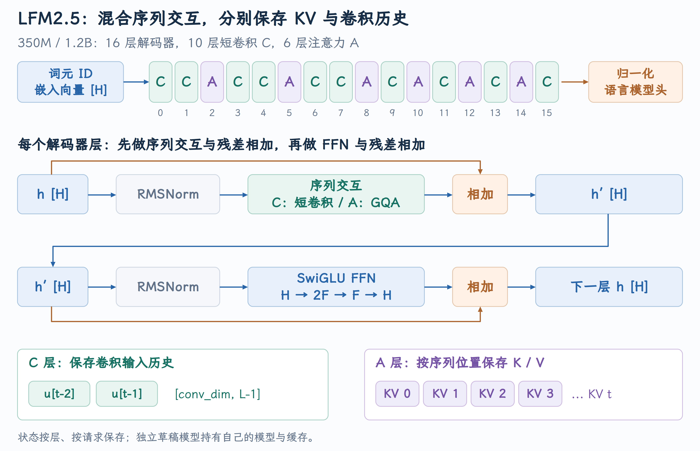
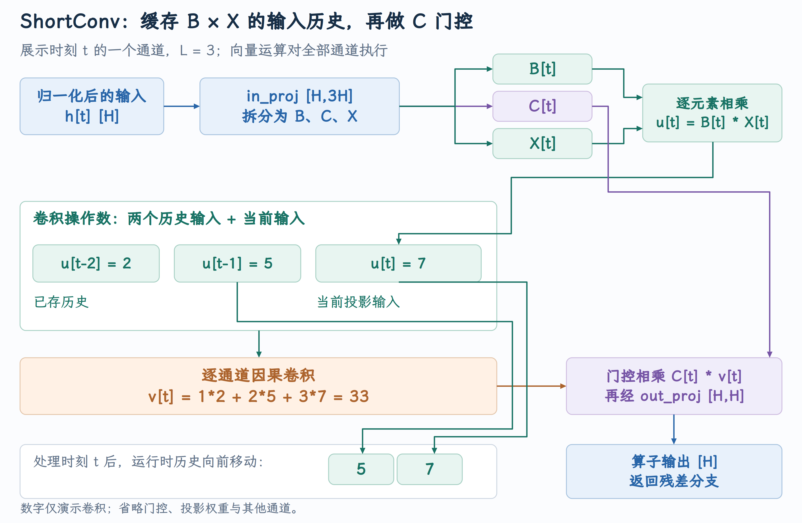
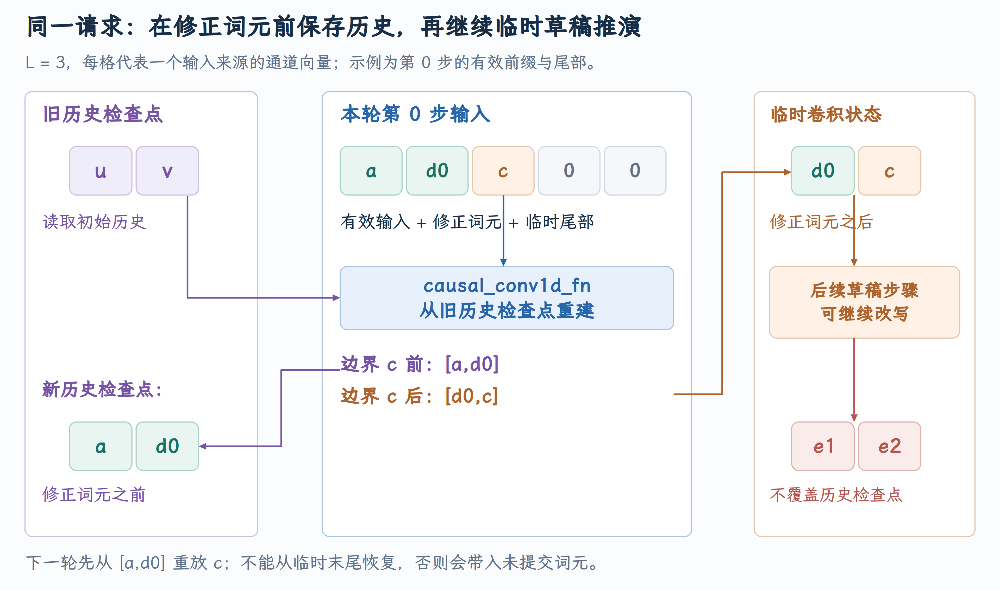

# MRV2 投机解码中的 ShortConv 历史恢复

LFM2.5 用 Attention 层与 ShortConv 层共同处理序列。Attention 保存按 token 位置组织的 K/V，ShortConv 保存不断向前移动的输入历史。当 drafter 提前算过后来被拒绝的候选，两类状态不能用同一种方式继续推进。PR #59600 为 MRV2 的独立 draft-model 路径建立 correction 前的卷积 checkpoint，让下一轮从有效历史重建，而不是沿用上轮预测到最后的临时状态。

本文对应 [PR #59600](https://github.com/vllm-project/vllm/pull/59600)，vLLM 实现核对到提交 [`359db8bc61`](https://github.com/vllm-project/vllm/commit/359db8bc6143f1d89fd6390b5ac30f6bc85b0165)。模型结构参照文中链接的固定版本配置。截至 2026 年 10 月 5 日，PR 状态为**开放，尚未合并** 。

## 1. LFM2.5 的 target 与 drafter 采用什么模型结构

PR 涉及 `LiquidAI/LFM2.5-1.2B-Instruct` target 与 `LiquidAI/LFM2.5-350M` drafter。这里 target 负责最终验证与采样，drafter 负责提出候选。两者都是文本自回归模型，配置中的架构名称为 `Lfm2ForCausalLM`，在所选 vLLM 版本中沿 LFM2 实现加载。

这条 draft-model 路径让 drafter 独立执行 embedding、所有模型层、最终 norm 和 logits。它有自己的权重、hidden states、Attention KV 与卷积历史，不能借用 target 同位置的 hidden state 来代替自己的前向。模型输出接口见 [LFM2 embedding、backbone 与 logits](https://github.com/vllm-project/vllm/blob/359db8bc6143f1d89fd6390b5ac30f6bc85b0165/vllm/model_executor/models/lfm2.py#L463-L501)。

固定版本配置为 [350M config](https://huggingface.co/LiquidAI/LFM2.5-350M/blob/9e6c6ccf47cd318696e137d381a7ded8fe4df09f/config.json) 和 [1.2B Instruct config](https://huggingface.co/LiquidAI/LFM2.5-1.2B-Instruct/blob/0f604ada3f766f9f257460c4c9f0b5d6f69d431b/config.json)。下面比较其单设备逻辑结构：

| 配置 | 350M drafter | 1.2B Instruct target |
|---|---:|---:|
| hidden size / conv dim | 1024 | 2048 |
| decoder 层数 | 16 | 16 |
| ShortConv / Attention 层数 | 10 / 6 | 10 / 6 |
| Query head / KV head | 16 / 8 | 32 / 8 |
| Attention head dim | 64 | 64 |
| 卷积 kernel 长度 L | 3 | 3 |
| vocab size | 65536 | 65536 |

这两个配置的层类型顺序相同，从第 0 层到第 15 层为：

```text
C C A C C A C C A C A C A C A C
C = ShortConv decoder layer，A = Attention decoder layer
```

[按 layer_types 创建不同 decoder 层](https://github.com/vllm-project/vllm/blob/359db8bc6143f1d89fd6390b5ac30f6bc85b0165/vllm/model_executor/models/lfm2.py#L329-L345) 根据每个位置是否为 `full_attention`，选出 `Lfm2AttentionDecoderLayer` 或 `Lfm2ShortConvDecoderLayer`。因此混合结构是配置驱动的，不能把这份 10/6 排列推广到所有 LFM 家族模型。

{ width="100%" }

图沿同一 token 经过 16 层。C 层与 A 层的 token mixing 不同，但都接一个 gated FFN；每层状态来自该层自己的输入变换，同一 token 在不同层留下的数值并不相同。

## 2. 一个 LFM2.5 decoder block 如何更新 hidden states

两类 decoder 都是 residual block，主要区别在第一个 token-mixing operator：Attention 或 ShortConv。用 n 与 n' 表示两处 RMSNorm 后的 hidden states，忽略 vLLM 的 residual/norm 融合细节，可以表示为：

$$
\begin{aligned}
n&=\operatorname{RMSNorm}(h),\\
h'&=h+\operatorname{Operator}(n),\\
n'&=\operatorname{RMSNorm}(h'),\\
h_{\rm next}&=h'+\operatorname{FFN}(n').
\end{aligned}
$$

Attention block 的实现见 [Attention block 的 operator 与 FFN](https://github.com/vllm-project/vllm/blob/359db8bc6143f1d89fd6390b5ac30f6bc85b0165/vllm/model_executor/models/lfm2.py#L225-L239)，卷积 block 见 [ShortConv block 的 operator 与 FFN](https://github.com/vllm-project/vllm/blob/359db8bc6143f1d89fd6390b5ac30f6bc85b0165/vllm/model_executor/models/lfm2.py#L276-L294)。`operator_norm` 为 token mixing 准备输入，`ffn_norm` 在融合 residual 后为 FFN 准备输入。最终模型还有 `embedding_norm`，再通过与 embedding 绑定的 LM head 产生词表 logits。

### Attention 层建立按位置索引的 KV

Attention 层将 hidden states 投影成 Q/K/V，对 Q/K 做 head 内 RMSNorm，再应用 RoPE，最后进行 GQA 与输出投影。见 [head 形状与 Attention 构造](https://github.com/vllm-project/vllm/blob/359db8bc6143f1d89fd6390b5ac30f6bc85b0165/vllm/model_executor/models/lfm2.py#L124-L162) 和 [QK norm、RoPE 与前向](https://github.com/vllm-project/vllm/blob/359db8bc6143f1d89fd6390b5ac30f6bc85b0165/vllm/model_executor/models/lfm2.py#L164-L181)。

350M 的每行 Q 为 `[16,64]`、K/V 各为 `[8,64]`；1.2B 的 Q 为 `[32,64]`、K/V 仍各为 `[8,64]`。一组 KV head 分别服务 2 或 4 个 Query head。历史长度增加时，K/V 随序列位置增长，并由分页缓存管理。

### 两类层都使用 SwiGLU FFN

[LFM2 FFN 宽度调整与 SwiGLU](https://github.com/vllm-project/vllm/blob/359db8bc6143f1d89fd6390b5ac30f6bc85b0165/vllm/model_executor/models/lfm2.py#L49-L90) 合并计算 gate/up，再用 `SiLU(gate)*up` 和 down projection。它逐 token 变换特征，不额外保存跨 token 的 FFN 历史。

配置字段 `intermediate_size` 不能直接当作这里的实际 gate/up 宽度。`block_auto_adjust_ff_dim=True` 时，vLLM 先乘 2/3，再按 multiplier 调整，最后向上对齐到 `block_multiple_of=256`。两个配置的实际 FFN 宽度为：

$$
F_{350M}=256\left\lceil\frac{\lfloor(2/3)6656\rfloor}{256}\right\rceil=4608,
$$

$$
F_{1.2B}=256\left\lceil\frac{(2/3)12288}{256}\right\rceil=8192.
$$

第一投影输出 `2F`，乘法激活压回 F，第二投影回 H。这个形状调整属于模型实现契约，后面的卷积 history 则只依赖 conv dim 和卷积长度。

## 3. ShortConv 中真正被缓存的是什么

ShortConv 不只是一层对原 token 做卷积的操作。[卷积、三路输入投影与输出投影](https://github.com/vllm-project/vllm/blob/359db8bc6143f1d89fd6390b5ac30f6bc85b0165/vllm/model_executor/layers/mamba/short_conv.py#L49-L80) 先将每行 hidden states 投影成 B、C、X 三组特征：

$$
\begin{aligned}
[T,H]&\xrightarrow{\rm in\_proj}[T,3H],\\
B,C,X&\xleftarrow{\rm split}[T,3H],\\
B,C,X&\in\mathbb R^{T\times H}.
\end{aligned}
$$

对 channel d，先将 B 与 X 逐元素相乘产生卷积输入 u，再做因果 depthwise 卷积与输出门控：

$$
\begin{aligned}
u_{t,d}&=B_{t,d}X_{t,d},\\
v_{t,d}&=\sum_{j=0}^{L-1}a_{d,j}\,u_{t-L+1+j,d},\\
o_t&=W_{\rm out}(C_t\odot v_t).
\end{aligned}
$$

Depthwise 表示每个 channel 使用自己的 L 个卷积系数，卷积步骤不把不同 channel 混起来；前后的 Linear 负责跨 channel 变换。B/C 是学习到的调制特征，不应直接称为 sigmoid 概率。正常 CUDA 路径在卷积调用中传 `activation=None`，外围 FFN 的 SiLU 是另一处运算，见 [三路特征、因果卷积与 C 门控](https://github.com/vllm-project/vllm/blob/359db8bc6143f1d89fd6390b5ac30f6bc85b0165/vllm/model_executor/layers/mamba/short_conv.py#L248-L304)。

{ width="100%" }

图中的 history 保存在 `B*X` 之后、卷积之前。它不是 token ID、模型 hidden state，也不是卷积输出，更不是 Attention 的 K/V。

### L=3 时，每 channel 只需两个此前输入

对两个 LFM2.5 配置，`conv_L_cache=3` 表示卷积 kernel 有三个位置：此前两个输入加当前输入。因而最小有效历史长度为 `L-1=2`。名字含 cache 不代表“只用过去三枚 token、不含当前输入”。

固定一个 channel，系数从旧到新为 `[1,2,3]`。若此前输入为 `[2,5]`，当前输入为 7，则卷积输出为 `1*2+2*5+3*7=33`；计算后历史窗口移动为 `[5,7]`。其他 channel 同时维护各自两个数值；输出门控 C 和 out projection 再将 v 转回模型层的结果。

以单设备 350M、BF16 为例，每个 ShortConv 层的两值 history 为 `[1024,2]`，载荷是 `1024*2*2=4096` 字节；十层合计每请求 40 KiB。下面新增的 checkpoint 也是这样的最小窗口。物理 runtime state 可能为执行模式预留更多位置，因此这个数字只描述有效历史/checkpoint 的数值载荷，不代表完整 cache 分配量。

| 跨轮对象 | Attention KV | ShortConv history |
|---|---|---|
| 数值来源 | 当前层的 K/V projection | 当前层的 B*X |
| 逻辑组织 | 按序列位置索引 | 固定长度移动窗口 |
| 长度增长 | 随历史 token 增长 | 有效窗口为 L-1 |
| 拒绝候选后的处理 | 按有效位置与缓存规则管理 | 从可信边界恢复、重放有效输入 |

这样的混合结构把两类 token mixing 分配到不同层：ShortConv 在每个 channel 上只处理 L 个局部输入，Attention 在六个层位置读取更长的上下文。单步卷积的混合工作随 `H*L` 增长，Attention 的历史读取则随上下文长度增长；前后 Linear 与 FFN 还有各自的计算成本，不能只凭卷积窗口小就断言整个模型必然更快。

L=3 也不表示模型只能记住三枚 token。卷积的输入来自本层的 B/X 投影，而本层 hidden states 已经过前面所有层：前面的 Attention 可以将远处信息带入当前位置，连续卷积层也会逐层扩大对原始 token 的依赖。固定窗口描述的是一个 ShortConv 算子的直接输入依赖；整个模型的上下文能力来自这些层的组合。

ShortConv 在 vLLM 复用 Mamba 的状态与 metadata 体系，但这里的数学算子是短卷积，没有因为继承 `MambaBase` 就变成完整 SSM。[混合模型的状态接口](https://github.com/vllm-project/vllm/blob/359db8bc6143f1d89fd6390b5ac30f6bc85b0165/vllm/model_executor/models/lfm2.py#L395-L454) 将这种卷积状态接入统一缓存管理。

## 4. 一轮投机解码怎样使卷积历史失效

MRV2 是 v2 GPU model runner；本文使用其独立 `draft_model` speculator。drafter 从当前有效输入 a 出发提出 d0、d1、d2；target 将 `[a,d0,d1,d2]` 作为本轮验证输入，sampler 只接受 d0，拒绝 d1、d2，并产生 correction c。

注意“输入”和“提议的下一个 token”之间有一位错开：drafter 消费 a 后预测 d0，消费 d0 后预测 d1，消费 d1 后预测 d2。算出了候选 d2，不等于已经把 d2 当输入消费。无论临时状态走到了哪一步，其中都可能含有后来被拒绝候选的特征，不能自动成为下一轮基准。

最终推进的有效路径是 `[a,d0,c]`。目标模型负责接受/拒绝与最终采样，draft 提案并未直接提交给用户。[target 后调用独立 drafter](https://github.com/vllm-project/vllm/blob/359db8bc6143f1d89fd6390b5ac30f6bc85b0165/vllm/v1/worker/gpu/model_runner.py#L2224-L2245) 将 `num_sampled`、`num_rejected`、最后采样 token 与 prompt lookahead 交给 speculator，为下一轮构造输入。

回到上一节的卷积手算，a/d0 的卷积输入特征为 2、5，c 为 7。正确输出为 33；如果错误沿用拒绝候选或 padding 形成的 `[11,13]` 历史，输出变成 `11+2*13+3*7=58`。从一个 channel 的卷积误差出发，C 门控、out projection、FFN 和后续层都会继续传播它，最后影响 draft logits。

所以仅保证 token ID 与 target 一致还不够：drafter 必须用自己沿有效前缀计算出的各层状态，才能正确处理 correction。即使 target/drafter 权重相同，也不能用相同权重弥补错位的输入历史。

## 5. Correction 前 checkpoint 与 correction 后临时状态

原来的 kernel 从 `conv_states` 读取历史，其数值会随 draft 预测和 expanded 输入不断变化。保存可信边界的职责先落在 [speculator.py](https://github.com/vllm-project/vllm/blob/359db8bc6143f1d89fd6390b5ac30f6bc85b0165/vllm/v1/worker/gpu/spec_decode/draft_model/speculator.py)：`PlainDraftModelSpeculator.__init__()` 新增 `self.conv_checkpoints: dict[str, torch.Tensor] = {}`，按层持有历史。随后 `set_attn()` 识别 ShortConv 层并分配对应窗口，见 [新增 checkpoint 分配](https://github.com/vllm-project/vllm/blob/359db8bc6143f1d89fd6390b5ac30f6bc85b0165/vllm/v1/worker/gpu/spec_decode/draft_model/speculator.py#L99-L117)：

```python
# 逐层识别 drafter 的 ShortConv，而不是给 Attention 分配卷积历史。
layers = self.vllm_config.compilation_config.static_forward_context
for name in self.draft_attn_layer_names:
    layer = layers[name]
    if not isinstance(layer, ShortConv):
        continue
    # 该恢复路径只支持指定的 cache mode 与关闭 prefix caching。
    if self.vllm_config.cache_config.mamba_cache_mode != "none":
        raise ValueError(
            "ShortConv draft models require mamba_cache_mode='none'."
        )
    if self.vllm_config.cache_config.enable_prefix_caching:
        raise ValueError(
            "ShortConv draft models require prefix caching to be disabled."
        )
    # 每个 ShortConv 层单独保存稳定 request slot 的可信历史。
    self.conv_checkpoints[name] = torch.empty(
        self.max_num_reqs,
        # 本 rank 的 channel 数；最小历史宽度为 L-1。
        layer.conv.weight.shape[0],
        layer.L_cache - 1,
        dtype=layer.get_state_dtype()[0],
        device=self.device,
    )
```

这里以 request slot × 本地 channel × 最小历史宽度组织，后续轮次复用存储。checkpoint 不是整份 hidden states 的快照，而是下面定义的 correction 前窗口。

若 H(p) 表示消费绝对位置 `[0,p)` 后的卷积历史，correction c 位于绝对位置 $p_c$。step 0 必须同时建立：

| 状态 | 精确边界 | 后续用途 |
|---|---|---|
| `draft_checkpoint` | H($p_c$)，未消费 c | 下一轮 step 0 从 c 开始重放 |
| `conv_states` 有效部分 | H($p_c+1$)，已消费 c | 本轮继续生成新 draft |

两份状态的差异只有一步，职责却不同。下一轮 target 验证输入从 c 开始，drafter step 0 会再次消费 c；如果 checkpoint 保存 correction 后状态，就会把 c 消费两次。后续自回归 draft 需要立即从 c 的输出继续，所以临时 runtime history 又必须已经包含 c。

沿固定 L=3 的来源例子：旧 checkpoint 为 `[u,v]`，有效输入重放 `[a,d0,c]`，新 checkpoint 为 `[a,d0]`，runtime state 为 `[d0,c]`。

{ width="100%" }

图中的 token 名称仅标识卷积输入特征的来源，每个 history 格包含该层所有 channel 的数值。当前例子的三枚有效输入共同决定两份窗口，不需要为每个拒绝位置保存全模型副本。

随后 drafter 消费 e0/e1，runtime history 可以从 `[d0,c]` 变为 `[c,e0]`、再变为 `[e0,e1]`；checkpoint 保持 `[a,d0]`。下轮 target 判断接受哪些 e 候选后，再从 checkpoint 重放 c 与被接受的输入，建立新的 correction 边界。

## 6. Step 0 为什么还包含被拒绝位置的 padding

[step-0 expanded 输入构造](https://github.com/vllm-project/vllm/blob/359db8bc6143f1d89fd6390b5ac30f6bc85b0165/vllm/v1/worker/gpu/spec_decode/draft_model/speculator.py#L441-L508) 用 target 的 Query 长度和拒绝数计算有效输入：

```python
num_valid = query_len - num_rejected
out_start = query_start_loc[req_idx] + req_idx
```

每请求额外分配一个 correction slot，所以 expanded batch 总长度是 `src_tokens+num_reqs`。以 `query_len=4,num_rejected=2` 为例：

| 对象 | 当前请求的行内容 | 含义 |
|---|---|---|
| target Query 输入 | `[a,d0,d1,d2]` | 批量验证的候选路径 |
| 有效 target 输入 | `[a,d0]` | 本轮重放需要的有效前缀 |
| drafter expanded 行 | `[a,d0,c,0,0]` | 有效输入 + correction + 临时尾部 |
| correction 局部索引 | 2 | 为 history 指定可信边界 |

`last_token_indices` 指向 c，c 位置的 hidden state 产生第一枚新 draft。最后两个 0 是执行布局中的 padding，不能作为业务 token 或可信历史。若缓存更新仅按 expanded 行最后两个槽位取窗口，反而会保存 padding，并把错误带入下一轮。

expanded `seq_lens` 使用 `target_seq_lens+1`，描述当前执行布局；已提交进度由接受/拒绝信息维护。有效长度、tensor 容量、绝对 position 与 correction 局部索引分别描述不同对象。这个区别与 [PIECEWISE 填充及启动 Profiling](MRV2的PIECEWISE填充与投机解码启动Profiling.md) 中的预算问题相通。

## 7. 卷积 kernel 如何从同一组输入写出两个窗口

窗口的数值最终由 [causal_conv1d.py](https://github.com/vllm-project/vllm/blob/359db8bc6143f1d89fd6390b5ac30f6bc85b0165/vllm/model_executor/layers/mamba/ops/causal_conv1d.py) 中的 `_causal_conv1d_fwd_kernel` 读取和写回。原来它从 runtime state 初始化、按执行尾部更新历史；PR 要把这两处边界都改到 correction 上。

### 7.1 先从可信历史初始化卷积

启用 `HAS_DRAFT_CHECKPOINT` 时，kernel 根据稳定 request slot 定位逐层 checkpoint；普通调用继续使用 runtime state。初始基址与历史列的 stride 必须成对切换，见 [初始历史来源](https://github.com/vllm-project/vllm/blob/359db8bc6143f1d89fd6390b5ac30f6bc85b0165/vllm/model_executor/layers/mamba/ops/causal_conv1d.py#L161-L177)：

```python
# 按稳定 request slot 访问本层可信窗口。
if HAS_DRAFT_CHECKPOINT:
    request_idx = tl.load(draft_request_indices_ptr + idx_seq).to(tl.int64)
    checkpoint_base = (
        draft_checkpoint_ptr
        + request_idx * stride_checkpoint_seq
        + idx_feats * stride_checkpoint_dim
    )
    # 初始历史从 checkpoint 读，与 runtime state 的物理槽分开。
    initial_states_base = checkpoint_base
    initial_states_stride = stride_checkpoint_token
# 普通卷积调用继续读取原来的 runtime state。
else:
    initial_states_base = conv_states_base
    initial_states_stride = stride_conv_state_tok
```

checkpoint 与 runtime state 的物理布局可能不同，所以仅替换基址还不够。PR 把后面的 [旧列读取](https://github.com/vllm-project/vllm/blob/359db8bc6143f1d89fd6390b5ac30f6bc85b0165/vllm/model_executor/layers/mamba/ops/causal_conv1d.py#L181-L209) 统一改用 `initial_states_stride`。下面展示共同的最后一列地址与 width=3 分支，width=2/4 及普通路径的 width=5 分支也使用同一规则：

```python
# 定位初始历史的最后一列，不假定 checkpoint 与 runtime stride 相同。
prior_tokens = initial_states_base + (state_len - 1) * initial_states_stride
mask_w = idx_feats < dim
```

```python
# 先取最近列 col1，再回退一个 checkpoint 历史步长取 col0。
if KERNEL_WIDTH == 3:
    conv_states_ptrs = prior_tokens
    col1 = tl.load(conv_states_ptrs, mask_w, 0.0)
    conv_states_ptrs = prior_tokens - 1 * initial_states_stride
    col0 = tl.load(conv_states_ptrs, mask_w, 0.0)
```

`col0、col1` 在当前 program 内保存旧窗口。这既是卷积计算的初始值，也是 correction 靠近 chunk 起点时补齐负位置的来源。

### 7.2 用 correction 定位两份窗口

令 correction 的请求内局部索引为 r，卷积宽度为 L，历史长度为 L-1。两份窗口合起来只需要 L 个来源位置：

$$
t=r-(L-1)+\mathrm{state\_col},\qquad \mathrm{state\_col}=0,…,L-1.
$$

其中前 L-1 个来源写 checkpoint，后 L-1 个来源写 runtime state。对 L=3、r=2，读到 `[a,d0,c]`，分别写 `[a,d0]` 与 `[d0,c]`，后方 padding 不会进入历史。

### Correction 靠近起点时，负索引来自旧历史

若 r=0，需要的 t 是 -2、-1、0。负位置指本 chunk 之前的有效卷积输入，不能读 X 的负地址，也不能无条件补零。kernel 因而对 X load 加 `token>=0` 条件，再用已经读入的 col 值补齐，得到 `[old[-2],old[-1],c]`。

[correction 分支](https://github.com/vllm-project/vllm/blob/359db8bc6143f1d89fd6390b5ac30f6bc85b0165/vllm/model_executor/layers/mamba/ops/causal_conv1d.py#L224-L256) 把读取、负位置补齐与两份写回连在同一个循环中。下面是修改后的实现；`correction` 的全局输入索引先减本请求起点，转为局部位置：

```python
if HAS_DRAFT_CHECKPOINT:
    # batch 全局索引减本请求起点，得到局部 correction 位置。
    correction = (
        tl.load(draft_correction_indices_ptr + idx_seq) - sequence_start_index
    )
    # 确保复用旧列后再写 checkpoint。
    tl.debug_barrier()
    for state_col in tl.static_range(KERNEL_WIDTH):
        # 读取覆盖 correction 的 L 个输入来源。
        token = correction - state_len + state_col
        value = tl.load(
            x_base + token * stride_x_token,
            (idx_feats < dim) & (token >= 0),
            other=0.0,
        )
        # 本 chunk 之前的负位置来自旧历史，不能读负 X 地址。
        prior = col0
        if KERNEL_WIDTH >= 3:
            prior = tl.where(token == -1, col1, prior)
        if KERNEL_WIDTH >= 4:
            prior = tl.where(token == -2, col1, prior)
            prior = tl.where(token == -1, col2, prior)
        # 有效新输入与旧历史按来源合并。
        value = tl.where(token < 0, prior, value)
        # 前 L-1 列写 correction 前的 checkpoint。
        if state_col < state_len:
            tl.store(
                checkpoint_base + state_col * stride_checkpoint_token,
                value,
                idx_feats < dim,
            )
        # 后 L-1 列写 correction 后的 runtime state，供本轮继续预测。
        if state_col > 0:
            tl.store(
                conv_states_base + (state_col - 1) * stride_conv_state_tok,
                value,
                idx_feats < dim,
            )
```

两个 store 的条件交错一列，正好保存 correction 前与 correction 后的窗口。`chunk_offset=0` 的 program 负责持久状态写回，后续 chunk 使用本次 X 内的前置输入计算，避免多个 chunk 竞争更新 history。旧列在改写前已读入 program，barrier 位于这两步之间。

### 7.3 把恢复参数交给 GPU

同一文件的 Python 入口 `causal_conv1d_fn()` 新增 `draft_checkpoint`、`draft_request_indices`、`draft_correction_indices` 三个可选参数，缺省均为 None。[入口参数与状态说明](https://github.com/vllm-project/vllm/blob/359db8bc6143f1d89fd6390b5ac30f6bc85b0165/vllm/model_executor/layers/mamba/ops/causal_conv1d.py#L551-L608) 明确前者保存 correction 前窗口，runtime state 保存 correction 后窗口。

有 checkpoint 时，两份索引必须同时提供；它还不能与 APC 的另一套更新边界 `block_idx_last_scheduled_token` 同时生效。入口通过 [参数检查](https://github.com/vllm-project/vllm/blob/359db8bc6143f1d89fd6390b5ac30f6bc85b0165/vllm/model_executor/layers/mamba/ops/causal_conv1d.py#L613-L617) 约束这个契约：

```python
# 启用 checkpoint 必须同时给出请求身份与 correction 边界。
if draft_checkpoint is not None:
    assert draft_request_indices is not None
    assert draft_correction_indices is not None
    # 避免与 APC 的另一套状态更新边界同时生效。
    assert block_idx_last_scheduled_token is None
```

补旧列分支目前只实现宽度 2～4，因此启用该路径时还 [检查 width](https://github.com/vllm-project/vllm/blob/359db8bc6143f1d89fd6390b5ac30f6bc85b0165/vllm/model_executor/layers/mamba/ops/causal_conv1d.py#L640-L646)：

```python
is_channel_last = (x.stride(0) == 1) & (x.stride(1) > 1)
dim, cu_seqlen = x.shape
_, width = weight.shape
# 双窗口补旧列分支当前只实现 width 2～4。
if draft_checkpoint is not None:
    assert 2 <= width <= 4
state_len = width - 1
np2_statelen = triton.next_power_of_2(state_len)
```

最后，[Triton launch](https://github.com/vllm-project/vllm/blob/359db8bc6143f1d89fd6390b5ac30f6bc85b0165/vllm/model_executor/layers/mamba/ops/causal_conv1d.py#L790-L825) 传入三份 tensor、checkpoint 的三个实际 stride 与 `HAS_DRAFT_CHECKPOINT`。下面节选新增参数；`...` 省略沿用的位置参数：

```python
_causal_conv1d_fwd_kernel[grid](
    ...,  # 省略位于 checkpoint 前的原有位置参数。
    draft_checkpoint,
    draft_request_indices,
    draft_correction_indices,
    ...,  # 省略 out、矩阵维度以及原有输入/状态 stride。
    # 三个轴分别定位稳定请求 slot、channel 和历史列。
    draft_checkpoint.stride(0) if draft_checkpoint is not None else 0,
    draft_checkpoint.stride(1) if draft_checkpoint is not None else 0,
    draft_checkpoint.stride(2) if draft_checkpoint is not None else 0,
    ...,  # 省略原有输出 stride、边界值和其他编译参数。
    HAS_DRAFT_CHECKPOINT=draft_checkpoint is not None,
)
```

[GPU 签名](https://github.com/vllm-project/vllm/blob/359db8bc6143f1d89fd6390b5ac30f6bc85b0165/vllm/model_executor/layers/mamba/ops/causal_conv1d.py#L31-L68) 同步增加三份指针、三个 stride 和编译开关，普通调用缺省 None 时仍编译原来的 state 分支。这样 Python 保存的恢复信息才真正决定卷积读什么、向哪里写。

## 8. 每层 checkpoint 怎样跨越动态 batch 重排

当前 batch 行号不是稳定 request slot。假设当前 batch 为 `[A,B]`、下轮为 `[B,C]`，B 的行号由 1 变成 0，history 仍要属于 B。`input_batch.idx_mapping` 将本轮行号映射到稳定 request slot。另一份 runtime `conv_states` 则按 cache metadata 中的物理 state index 定位。

| 索引 | 指向什么 | 不能替代什么 |
|---|---|---|
| batch row | 本轮 Query 与拒绝数 | 跨轮的请求身份 |
| request slot | drafter checkpoint | 物理 cache 地址 |
| physical state slot | 当前层 conv_states buffer | checkpoint 的请求索引 |
| correction index | expanded 输入中的边界 | tensor 最后一个位置 |

这些索引必须跟随本轮逐层执行，而不能让模型层自行猜测。PR 在 [short_conv_attn.py](https://github.com/vllm-project/vllm/blob/359db8bc6143f1d89fd6390b5ac30f6bc85b0165/vllm/v1/attention/backends/short_conv_attn.py) 的 [ShortConvAttentionMetadata](https://github.com/vllm-project/vllm/blob/359db8bc6143f1d89fd6390b5ac30f6bc85b0165/vllm/v1/attention/backends/short_conv_attn.py#L40-L46) 中增加三份可缺省引用，原来这里仅继承通用 Mamba metadata：

```python
@dataclass
# 为逐层执行显式携带三份恢复信息，普通调用缺省为 None。
class ShortConvAttentionMetadata(BaseMambaAttentionMetadata):
    # correction 前窗口；其余两字段分别定位请求身份与本轮边界。
    draft_checkpoint: torch.Tensor | None = None
    draft_request_indices: torch.Tensor | None = None
    draft_correction_indices: torch.Tensor | None = None
```

step 0 准备好 expanded 输入后，`speculator.py` 的 `_prefill()` 用 `dataclasses.replace()` 为每层绑定独立 checkpoint 和本轮两份索引，见 [逐层 metadata 绑定](https://github.com/vllm-project/vllm/blob/359db8bc6143f1d89fd6390b5ac30f6bc85b0165/vllm/v1/worker/gpu/spec_decode/draft_model/speculator.py#L250-L265)。这也解释了新增 `dataclasses` 与 ShortConv metadata 类型的导入：

```python
# 每层使用自己的 checkpoint，不共享不同层的 B*X 历史。
for name, checkpoint in self.conv_checkpoints.items():
    assert prefill_attn_md is not None
    metadata = prefill_attn_md[name]
    assert isinstance(metadata, ShortConvAttentionMetadata)
    # step 0 使用 expanded Prefill 布局。
    assert metadata.num_decodes == 0
    prefill_attn_md[name] = dataclasses.replace(
        metadata,
        draft_checkpoint=checkpoint,
        # batch 行映射到跨轮稳定的请求身份。
        draft_request_indices=input_batch.idx_mapping[:num_reqs],
        # 该请求 expanded 输入中 correction 的全局行索引。
        draft_correction_indices=self.last_token_indices[:num_reqs],
    )
```

这一步只更换 metadata 中的引用，既不会复制历史数值，也不会直接执行卷积。接下来 [short_conv.py](https://github.com/vllm-project/vllm/blob/359db8bc6143f1d89fd6390b5ac30f6bc85b0165/vllm/model_executor/layers/mamba/short_conv.py) 的 `ShortConv.forward_cuda()` 将这三个字段显式传给 `causal_conv1d_fn()`。调用节选如下：

```python
Bx = causal_conv1d_fn(
    Bx_p,
    conv_weights,
    self.conv.bias,
    ...,  # 省略沿用的 cache、Query 和 metadata 参数。
    # 把 speculator 绑定的逐层恢复信息传到真正执行卷积的 kernel。
    draft_checkpoint=attn_metadata.draft_checkpoint,
    draft_request_indices=attn_metadata.draft_request_indices,
    draft_correction_indices=attn_metadata.draft_correction_indices,
).transpose(0, 1)[:num_prefill_tokens]
```

新增数据由此沿 speculator → 逐层 metadata → ShortConv 层 → 卷积 kernel 传递。checkpoint 按请求身份定位，runtime state 仍按原 cache metadata 的物理槽定位，二者不需要占据相同编号的槽位。

每层持有自己的历史，是因为各层 B/X 投影得到的数值不同。target 与 drafter 也各自拥有状态。请求结束后物理 state slot 可以复用，新请求仍要按初始化与有效历史标记处理。

## 9. Chunked Prefill 的下一输入与恢复边界

当 prompt 尚未处理完，target 可能没有采样回复 token。drafter 的统一追加位置仍存在，但这时应放下一枚 prompt token，而非旧 `last_sampled_tokens`。

原来的 correction 来源无条件读取最后采样 token，PR 按本轮 `num_sampled` 改为两种来源：

```python
# 有最终采样时追加 correction；prompt 尚未处理完时追加真实下一输入。
if tl.load(num_sampled_ptr + req_idx) > 0:
    correction_token = tl.load(last_sampled_ptr + req_state_idx).to(tl.int32)
else:
    correction_token = tl.load(next_prefill_tokens_ptr + req_state_idx).to(tl.int32)
```

`prepare_prefill_inputs()` 的 seq_lens 注释也改为 `target_seq_lens+1`：新增的一枚输入槽位属于 expanded 执行布局，不代表已经提交了一枚回复。

这次选择还需要两份输入从调用方一路抵达 GPU。`speculator.py` 的 `propose()` 已收到 `num_sampled` 与 `next_prefill_tokens`，PR 将它们加入 `_prefill()`、`prepare_prefill_inputs()` 和 `_prepare_prefill_inputs_kernel` 的参数，并在各次调用中继续传递。下面节选 Python 输入准备与 GPU launch 中相应的两次传递：

```python
total_expanded = prepare_prefill_inputs(
    ...,  # 省略沿用的 Query、expanded buffer 与采样参数。
    num_sampled=num_sampled,
    next_prefill_tokens=next_prefill_tokens,
)
```

```python
_prepare_prefill_inputs_kernel[(num_reqs,)](
    ...,  # 省略这两个新增指针之前的原有位置参数。
    num_sampled,
    next_prefill_tokens,
    max_num_reqs,
    max_model_len,
    BLOCK_SIZE=BLOCK_SIZE,
)
```

签名与调用同时修改，GPU 才能按本轮是否采样选择输入；[_prefill 传递](https://github.com/vllm-project/vllm/blob/359db8bc6143f1d89fd6390b5ac30f6bc85b0165/vllm/v1/worker/gpu/spec_decode/draft_model/speculator.py#L184-L223)、[propose 调用](https://github.com/vllm-project/vllm/blob/359db8bc6143f1d89fd6390b5ac30f6bc85b0165/vllm/v1/worker/gpu/spec_decode/draft_model/speculator.py#L419-L426)与[输入准备接口及 launch](https://github.com/vllm-project/vllm/blob/359db8bc6143f1d89fd6390b5ac30f6bc85b0165/vllm/v1/worker/gpu/spec_decode/draft_model/speculator.py#L537-L575)对应这条链路。

见 [采样结果与 prompt lookahead 的选择](https://github.com/vllm-project/vllm/blob/359db8bc6143f1d89fd6390b5ac30f6bc85b0165/vllm/v1/worker/gpu/spec_decode/draft_model/speculator.py#L481-L488)。假设 prompt `[p0,p1,p2,p3,p4]` 本轮只计算到 p2，追加位置应是 p3；它用于保持 draft 输入和真实 prompt 对齐，不是已经发给用户的生成结果。

这个位置在执行接口里仍叫 correction，但数值来源会随请求阶段改变。history 应按实际追加输入的边界重建，不能把非最终 Prefill 与 Decode 都解释成“target 刚生成了一枚回复”。

新的 GPU checkpoint 路径支持卷积宽度 2～4；该独立 draft 模式要求 `mamba_cache_mode='none'`，并关闭 prefix caching，见 [draft 状态模式的支持条件](https://github.com/vllm-project/vllm/blob/359db8bc6143f1d89fd6390b5ac30f6bc85b0165/vllm/v1/worker/gpu/spec_decode/draft_model/speculator.py#L99-L117)。这里的 `none` 指特定 Mamba cache mode 配置，不表示 ShortConv 不保存历史：`conv_states` 和新增 checkpoint 仍参与运行。

LFM2.5 的混合模型结构让这条修复的意义更清楚：提前生成候选可以提高计算利用，但各层状态的可信进度仍取决于 target 接受的前缀。Attention KV 按位置管理，ShortConv 按 correction 前窗口重建，FFN 不维护跨 token 历史；这三种不同的数据依赖共同组成一次正确的独立 drafter 前向。
