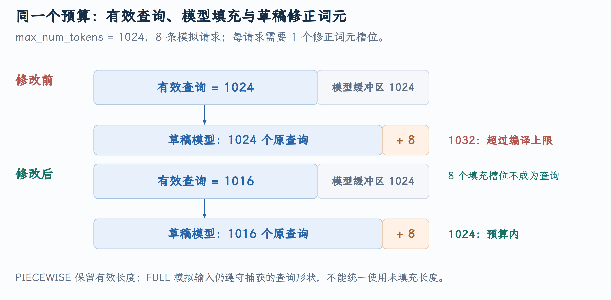

# MRV2 的 PIECEWISE 填充与投机解码启动 Profiling

服务还没有收到真实请求，为什么 draft-model 自适应验证就报 `1032 outside [1,1024]`？PR #60049 修复了启动 profiling 中一次 token 计数的语义丢失：原本为每请求 correction 预留的空间，在 PIECEWISE padding 后又被算成有效 Query。沿这个 PR 可以理解 vLLM 的 dummy forward、图形状分发、InputBatch 与投机扩展之间的契约。

本文对应 [PR #60049](https://github.com/vllm-project/vllm/pull/60049)，源码核对到提交 [`aeaa5018bc`](https://github.com/vllm-project/vllm/commit/aeaa5018bc7a4f901e3a44298ec8d11541ec01cd)。截至 2026 年 10 月 5 日，PR 状态为**开放，尚未合并** 。

## 1. 启动阶段也需要执行模型

vLLM 启动不只加载权重，还需进行内存 profiling、kernel warmup、编译和 graph capture。自适应验证在此基础上采集 step cost，为不同 drafter／target 工作量建立成本曲线，运行时据此调整验证与 draft 预算。

这些执行使用 dummy batch：构造可运行的张量形状和 metadata，但没有真实 HTTP 请求。它们仍会经过模型、Attention 和 drafter，错误形状一样会触发底层编译约束。

[启动成本采集的调用位置](https://github.com/vllm-project/vllm/blob/aeaa5018bc7a4f901e3a44298ec8d11541ec01cd/vllm/v1/worker/gpu/model_runner.py#L1085-L1096) 在 capture 流程中遍历 profiling batch，调用 `_dummy_run`，再把采集结果交给 `set_initial_cost_curves`。[dummy profiling 的采样形状](https://github.com/vllm-project/vllm/blob/aeaa5018bc7a4f901e3a44298ec8d11541ec01cd/vllm/v1/worker/gpu/spec_decode/adaptive_verification.py#L188-L212) 选择 capture sizes 和尾部 sizes；[成本曲线的输入](https://github.com/vllm-project/vllm/blob/aeaa5018bc7a4f901e3a44298ec8d11541ec01cd/vllm/v1/worker/gpu/spec_decode/adaptive_verification.py#L212-L233) 分别按 drafter 请求数与 target token 数归集时间。这里的 startup bug 在请求调度之前，不能靠修改实际请求 prompt 来解释。

## 2. Token 数、Query 数与 buffer 长度

MRV2 `InputBatch` 是本轮执行数据，不是基础篇经典 runner 中常驻的完整 `InputBatch`。本 PR 涉及的三个量分别是：

| 字段／对象 | 含义 |
|---|---|
| `num_tokens` | 当前有效 Query token 数 |
| `query_start_loc` 与 `num_scheduled_tokens` | 有效 Query 属于哪些请求 |
| `num_tokens_after_padding` | 模型输入 buffer／所选图形状长度 |

正常执行里模型输入可以比有效 Query 多，额外槽位需要明确标成 padding。`seq_lens` 是每请求上下文长度，`positions` 是 token 的序列位置，它们也不能从 padded buffer 长度直接推导。

`idx_mapping` 则描述本轮 batch 行到稳定 request slot 的映射。这里即使是 dummy 请求，也需要构造一致的 Query 边界与执行 metadata。

## 3. PIECEWISE 与 FULL 对 dummy batch 的要求不同

PIECEWISE 捕获编译片段，Attention 等边界仍使用本轮实际 metadata。其模型输入可向捕获大小补齐，但这不应该增加有效 Query。

FULL 捕获完整执行，dummy 形状需要满足捕获 descriptor 的请求与 Query 布局。PR 保留 FULL 的重塑行为，例如 `28→32` 的 FULL varlen 控制中，dummy 有效 Query 按捕获的 32 个槽位构造，不能机械套用 PIECEWISE 的保留规则。

[执行 descriptor](https://github.com/vllm-project/vllm/blob/aeaa5018bc7a4f901e3a44298ec8d11541ec01cd/vllm/v1/worker/gpu/cudagraph_utils.py#L66-L97) 保存图模式、padding 后 token 数和请求／Query 约束；[图形状兼容性判定](https://github.com/vllm-project/vllm/blob/aeaa5018bc7a4f901e3a44298ec8d11541ec01cd/vllm/v1/worker/gpu/cudagraph_utils.py#L106-L136) 允许 descriptor 接受不超过其容量的输入。shape 兼容只是输入空间的约束，不能替代 Query metadata 的语义。

## 4. 1024 的预算怎样被放大成 1032

独立 draft model 的 step 0 为每条请求添加一个 correction slot。[独立 drafter 的额外 Query 数](https://github.com/vllm-project/vllm/blob/aeaa5018bc7a4f901e3a44298ec8d11541ec01cd/vllm/v1/worker/gpu/spec_decode/draft_model/speculator.py#L38-L44) 声明这项需求。

固定 PR 的复现：最大 token 预算为 1024，请求数为 8。`_dummy_run` 已经做过预留：

$$
T_{\rm valid}=1024-8\times1=1016.
$$

`1016/8=127`，因此每个 dummy 请求可以有 127 个 Query。PIECEWISE dispatcher 随后选中模型 buffer 长度 1024 的 descriptor。

旧逻辑把 descriptor 的 `1024` 再送给 `make_dummy`，生成 1024 个有效 Query。Drafter step 0 添加八个 correction 后，expanded 长度成为：

$$
1024+8=1032>1024.
$$

正确逻辑应该保留有效 1016、模型 buffer 1024，让 drafter 只根据有效 Query 扩展：`1016+8=1024`。这八个原有 padding slot 是 buffer 容量，不是业务或 dummy Query。

{ width="100%" }

图中条带按来源区分有效 Query、模型 padding 和 drafter correction；它们发生在不同阶段，不表示八个 padding slot 被直接原地改写成 correction。drafter 使用自己的 expanded 输入布局。

## 5. 修复沿两条信息同时传递

选择 descriptor 的 `GPUModelRunner.execute_model()` 同时拥有 `num_toks` 与 `batch_desc.num_tokens`，所以长度分离先在 [model_runner.py](https://github.com/vllm-project/vllm/blob/aeaa5018bc7a4f901e3a44298ec8d11541ec01cd/vllm/v1/worker/gpu/model_runner.py) 完成。[修改后的 dummy 分支](https://github.com/vllm-project/vllm/blob/aeaa5018bc7a4f901e3a44298ec8d11541ec01cd/vllm/v1/worker/gpu/model_runner.py#L1819-L1840) 在 PIECEWISE 下保留 `num_toks`，再单独传入模型所需的 padded 长度：

```python
# PIECEWISE 保留有效 Query 数；其他图模式保留 descriptor 布局。
dummy_num_tokens = (
    num_toks
    if batch_desc.cg_mode == CUDAGraphMode.PIECEWISE
    else batch_desc.num_tokens
)
input_batch = InputBatch.make_dummy(
    dummy_num_reqs,
    dummy_num_tokens,
    self.input_buffers,
    max_query_len=batch_desc.max_query_len,
    is_padding=not is_profile,
    # 模型仍接收 graph 需要的完整容量。
    num_tokens_after_padding=batch_desc.num_tokens,
)
```

这两个实参必须配套传递。如果只减小前一个，模型输入就可能失去 graph 要求的容量；如果只有后一参数而有效数仍用 padded 数，drafter 仍会额外扩展 padding。调用者根据 PIECEWISE/FULL 模式决定有效数，`make_dummy` 负责忠实保存两份数值。

消费者位于 [input_batch.py](https://github.com/vllm-project/vllm/blob/aeaa5018bc7a4f901e3a44298ec8d11541ec01cd/vllm/v1/worker/gpu/input_batch.py) 的 `InputBatch.make_dummy()`。它原来用一个长度同时建立 Query 与输入切片，PR 增加可选容量参数，把这两个职责拆开：

```python
def make_dummy(
    cls,
    num_reqs: int,
    num_tokens: int,
    input_buffers: InputBuffers,
    max_query_len: int | None = None,
    is_padding: bool = True,
    # 独立表示模型输入容量，省略时与有效 Query 数一致。
    num_tokens_after_padding: int | None = None,
) -> "InputBatch":
    assert 0 < num_reqs <= num_tokens
    # 保留原调用行为，同时禁止 padded capacity 小于有效长度或超出 buffer。
    if num_tokens_after_padding is None:
        num_tokens_after_padding = num_tokens
    assert num_tokens <= num_tokens_after_padding <= input_buffers.max_num_tokens
```

`make_dummy` 继续用有效长度建立每请求 token 分配和 `query_start_loc`，输入切片则使用 padded 长度，见 [有效与填充长度的分离](https://github.com/vllm-project/vllm/blob/aeaa5018bc7a4f901e3a44298ec8d11541ec01cd/vllm/v1/worker/gpu/input_batch.py#L127-L209)。`num_scheduled_tokens`、`query_start_loc` 与 logits 索引仍由有效数建立；`input_ids`、`positions` 和 padding 标记要覆盖模型输入容量：

```python
# 模型输入与 positions 都按 padded capacity 切片，而 Query 仍按有效长度建立。
input_ids = input_buffers.input_ids[:num_tokens_after_padding].zero_()
positions = input_buffers.positions[:num_tokens_after_padding].zero_()

# 有效 dummy token 是否作为 padding 由调用者决定。
input_buffers.is_padding[:num_tokens].fill_(is_padding)
# 填充尾部始终为 True，不能参与专家路由或被当成 Query。
input_buffers.is_padding[num_tokens:num_tokens_after_padding].fill_(True)
is_padding = input_buffers.is_padding[:num_tokens_after_padding]
```

返回的 InputBatch 也要保留两种长度。下面节选构造参数，其他索引、缓存和采样字段省略：

```python
return cls(
    ...,  # 省略已有请求身份、索引与缓存字段。
    num_tokens=num_tokens,
    num_tokens_after_padding=num_tokens_after_padding,
)
```

入口的容量检查由此落实到输入表示：

$$
0<T_{\rm valid}\le T_{\rm padded}\le\text{buffer capacity}.
$$

Profiling 用 `is_padding=False` 让有效 dummy token 真正参与 MoE 路由，以测量对应内存和算子成本；这不允许 trailing padding 也成为专家工作量。

## 6. Context positions 只写有效 Query

自适应 profiling 会给 dummy 请求添加模拟 context。若一个请求的 Query 起点为 `s_i`，行内位置为 `j-s_i`，绝对位置应为 `context_len+j-s_i`。

`set_dummy_context` 原本对整个 `positions` tensor 做 copy；区分 padded 长度后，它必须只写有效前缀，见 [有效 positions 的更新](https://github.com/vllm-project/vllm/blob/aeaa5018bc7a4f901e3a44298ec8d11541ec01cd/vllm/v1/worker/gpu/input_batch.py#L257-L263)。

与新的 buffer 形状配套，positions copy 的实际修改为：

```python
# 右侧只有有效 Query 的位置数，左侧也只写有效前缀。
input_batch.positions[: input_batch.num_tokens].copy_(
    torch.from_numpy(local_pos + context_len)
)
```

右侧 local_pos 只有有效 Query 的元素数，左侧也必须切到有效长度。否则这里会出现 shape 不匹配，或者错误地把模拟 context 位置写到尾部 padding。

小例子使用两条请求，每条三个 Query，`T_valid=6,T_padded=8,context_len=4`：

```text
query_start_loc = [0,3,6]
positions       = [4,5,6,4,5,6,0,0]
is_padding      = [F,F,F,F,F,F,T,T]  # 有效部分指定 is_padding=False
seq_lens        = [7,7]
```

最后两个槽位没有请求内位置，不能让它们贡献 seq_len 或 Query 边界。`set_dummy_context` 还构造可读取的 block table；其物理 KV 值只是 profiling 所需的模拟数据，未代表真实请求的历史。

## 7. 启动 cost curves 如何影响运行时预算

这里的 profiling 是服务启动机制：自适应策略要知道不同请求数和 target token 数对应的 step cost，才能决定本轮应该验证多少 draft。`set_initial_cost_curves` 从启动采集的 step timing 建立 draft 与 verify 曲线，随后构造可直接索引的 cost table。[成本曲线与 graph padding 成本表](https://github.com/vllm-project/vllm/blob/aeaa5018bc7a4f901e3a44298ec8d11541ec01cd/vllm/v1/worker/gpu/spec_decode/adaptive_verification.py#L80-L129) 特别区分 capture limit 内外。

在图捕获范围内，真实 batch 可能向上填充到某个 bucket。如果 1016 和 1024 都进入长度 1024 的图，那么二者的模型执行形状相同，成本表应呈台阶；平滑插值会虚构 bucket 内不存在的每 token 增量成本。超出捕获范围后，执行模式与成本关系又可能改变，源码只对相应范围内的样本插值，并处理超出样本的外推。

因此前面的 1016/1024 区分也影响成本建模：有效工作决定 Query、draft 扩展和 logits 预算，padding 形状决定实际捕获/执行的成本。把两者混成一个字段，会同时破坏张量长度和策略对工作量的解释。

## 8. 自适应验证怎样用 confidence 选择 draft 数

[有效候选与预算目标函数](https://github.com/vllm-project/vllm/blob/aeaa5018bc7a4f901e3a44298ec8d11541ec01cd/vllm/v1/worker/gpu/spec_decode/adaptive_verification.py#L282-L345) 从每请求已调度 token 数减去 draft 数，得到 non-draft token 的基础工作量。它按稳定 request slot 读取近期 confidence，对每条 draft chain 做 cumulative product，作为不同长度前缀继续存活的概率估计。

固定两个请求 A/B、各两个 draft。假设 A 的逐位置 confidence 为 `[0.9,0.8]`，B 为 `[0.6,0.5]`，则：

```text
A：第 1 枚存活分数 0.9，第 2 枚前缀存活分数 0.9*0.8=0.72
B：第 1 枚存活分数 0.6，第 2 枚前缀存活分数 0.6*0.5=0.30
排序：0.9，0.72，0.6，0.30
```

第二枚只有在前一枚也存活时才有收益，所以需要累计乘积，不能直接把孤立位置的 confidence 都当作可接受概率。源码只保留当前真实 scheduled draft 的位置，并受 logits/token 预算限制；不存在的候选不能靠高 confidence 被算进可验证量。

对于候选总预算 b，目标函数为：

$$
\mathrm{utility}(b)=
\frac{\mathrm{sampling\ requests}+\sum_{i=1}^{b}\mathrm{score}_i}
{\mathrm{draft\ cost}(R)+\mathrm{verify\ cost}(T_{\rm base}+b)}.
$$

分子估计本轮能推进的 token，分母估计本轮耗时。处于非最终 Prefill 的请求未必产生采样输出，因此基础分子使用满足 sampling 条件的请求数，不总等于 batch 中请求数。

用假设成本说明选择过程：两个请求本轮都可采样，基础 target token 数为 2；draft cost 为 1 ms，verify cost 在总长度 2/3/4/5/6 时分别为 `1/1.5/2/3/4 ms`。

| draft 预算 b | 预计推进 token | 总成本 ms | 预计 token/ms |
|---:|---:|---:|---:|
| 0 | 2 | 2 | 1.000 |
| 1 | 2.9 | 2.5 | 1.160 |
| 2 | 3.62 | 3 | 1.207 |
| 3 | 4.22 | 4 | 1.055 |
| 4 | 4.52 | 5 | 0.904 |

这组教学数字中 b=2 最优，继续增加候选虽然能提高预计推进量，成本增长却更快。实际服务使用启动采集并准备的 cost table，数值不来自这张示意表。`get_num_tokens` 选择总预算并缓存 `_batch_budget`，后续 `reallocate_drafts` 再落实每请求的候选分配；“决定总量”与“把总量分给请求”是两个步骤。

这些 confidence 是策略估计，CPU 路径还可能使用异步传回的近期值。它们不会把 draft 自动提交为正确输出；target 仍执行验证与采样规则。自适应改变的是验证多少候选及如何分配计算，而不是跳过目标模型的正确性约束。

## 9. Dummy batch 的身份与 padding 的身份

dummy token 用模拟输入触发模型执行，它可以被设为有效以让 MoE 路由等算子产生实际工作。padding token 则只为满足执行形状保留位置，不属于请求有效 Query。二者都不是用户请求，但在框架中承担不同职责，不能仅凭“都不是业务 token”一并处理。

一个 tensor 长度为 1024，能说明 buffer 有 1024 个位置；只有 `query_start_loc[-1]`、请求内 token 分配及 `is_padding` 等元数据才能说明多少位置组成有效输入。PIECEWISE 分发之后保留这两种长度，让 model buffer 满足捕获形状，同时让 drafter 的每请求 correction 只扩展真实 dummy Query。

FULL 模式的既有 dummy 构造继续采用 descriptor 的执行长度，不能把 PIECEWISE 的修复无条件推广到所有模式。mode 是接口契约的一部分，和 `max_query_len`、uniform batch、graph eligibility 一起决定 dummy metadata 应如何建立。

这条启动故障借助一个 1032 的越界，把 vLLM 的执行形状、有效 token 计数、投机扩展和成本策略联系起来。修复后的信息流保留有效 Query 数及 padded capacity，下游各自消费所需的量，预留 correction 预算才不会在 dispatcher 后被重新当成工作量。
