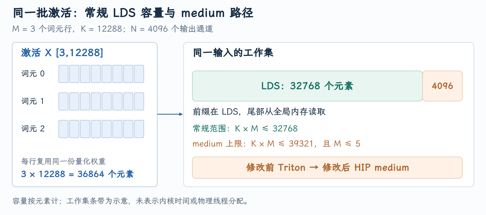
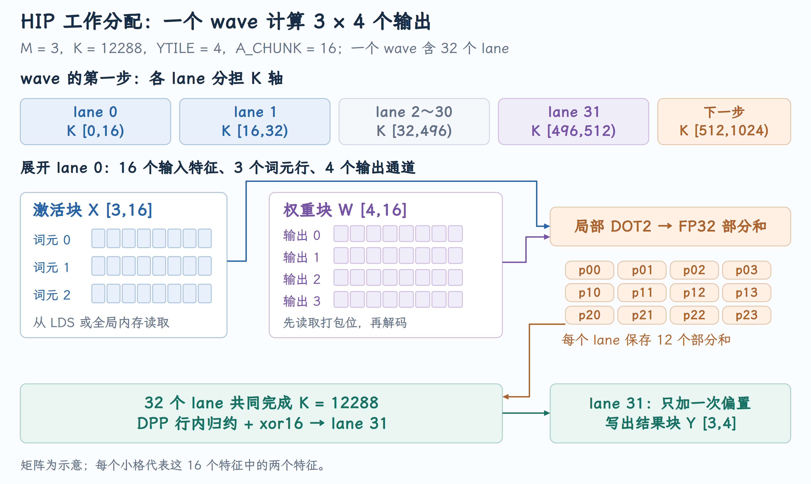
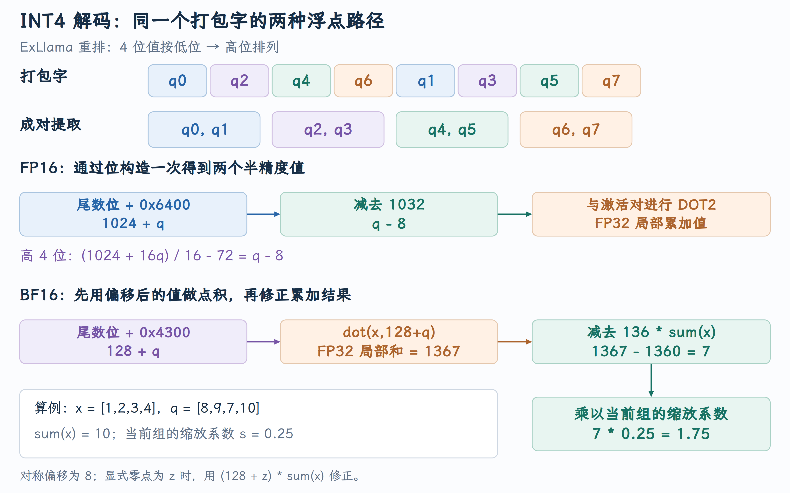

# RDNA W4A16 的形状分发与 LDS 边界

同样是 INT4 模型的 Decode，为什么增加到三个并发请求后，有些 Linear 突然转向较慢的实现？PR #52619 暴露的原因在模型层与 GPU 算子之间：Python 只开放了常规 LDS 容量内的形状，而已有 HIP 内核还支持略大的 medium 范围。理解这个修改，需要把当前批次的 token 数、Linear 的收缩维度、量化权重布局和两层算子分发连起来。

本文对应 [PR #52619](https://github.com/vllm-project/vllm/pull/52619)，源码核对到提交 [`e8b32863a7`](https://github.com/vllm-project/vllm/commit/e8b32863a7e70f8331446ffe43192cf293053603)。截至 2026 年 10 月 5 日，PR 状态为**开放，尚未合并** 。

## 1. 一个 Decode 批次怎样变成 Linear 的形状

Scheduler 为本轮分配 token 预算，Worker 将多个请求的输入展开为 token 行，模型逐层执行。对于普通 Decode，一条活跃请求通常贡献一行；Chunked Prefill 和投机验证则可以让一条请求贡献多行。因此 GPU GEMM 的 `M` 是**当前 forward 的 token 行数** ，不能在所有场景中直接当作请求数。

本文统一使用 $X\in\mathbb{R}^{M\times K}$、$W\in\mathbb{R}^{N\times K}$：

$$
Y=XW^T+b,\qquad Y\in\mathbb{R}^{M\times N}.
$$

`K` 是输入特征数，`N` 是输出通道数。MLP 的 down projection 将中间维度投回 hidden size，常出现较大的 `K`。例如 PR 中 Qwen3-8B 的一次三请求普通 Decode：`M=3, K=12288, N=4096`。这时需要计算三条长度 12288 的输入向量，而不是一张大型 Prefill 矩阵。

在 vLLM 中，Linear 的模型接口由 `quant_method.apply` 承接。[Linear 的量化执行入口](https://github.com/vllm-project/vllm/blob/e8b32863a7e70f8331446ffe43192cf293053603/vllm/model_executor/layers/linear.py#L610-L619) 调用选定的量化方法；GPTQ 的 [AutoGPTQLinearMethod](https://github.com/vllm-project/vllm/blob/e8b32863a7e70f8331446ffe43192cf293053603/vllm/model_executor/layers/quantization/auto_gptq.py#L301-L324) 负责将该层交给混合精度 kernel。调度器决定执行哪些 token，模型层提供张量形状，kernel selector 才决定用哪个算子。

## 2. W4A16 为什么有两种执行路径

W4A16 表示权重以 4 bit 保存，激活以 FP16 或 BF16 使用。以对称 INT4 为例，一组权重可写成：

$$
\widehat W_{n,k}=s_{n,g(k)}(q_{n,k}-8),\qquad g(k)=\lfloor k/G\rfloor.
$$

`q` 是存储中的 4 bit 整数，`G` 是 group size，`s` 是每组 scale。计算需要恢复相应数值，但没有必要先把全层权重展开成 FP16 再存一份。HIP 和 Triton 路径都在使用时解码量化值。

[RDNAHybridW4A16LinearKernel](https://github.com/vllm-project/vllm/blob/e8b32863a7e70f8331446ffe43192cf293053603/vllm/model_executor/kernels/linear/mixed_precision/rdna_hybrid_w4a16.py#L448-L466) 在加载后只保存一份 ExLlama shuffle 格式的权重：`int8 [N,K/2]`。HIP 直接读取这份 packed buffer；Triton 将相同内存解释为 `int32 [N,K/8]`。这里的 `view` 改变元素解释与形状，未创建第二份权重。

小 `M` 时，HIP skinny kernel 专门组织少量向量与大量权重的计算；大 `M` 时，Triton W4A16 GEMM 处理较宽的矩阵批次。这是**由形状决定的分发** ，不是根据请求被命名为 Prefill 还是 Decode 来选算子。

## 3. LDS 限制约束的是激活工作集

LDS 是 AMD workgroup 内可共享的片上存储。这里讨论的内核按 64 KiB workgroup LDS 容量计算，FP16/BF16 每个元素占 2 字节，所以常规容量为：

$$
64\times1024/2=32768\text{ 个激活元素}.
$$

把同一小批次的输入暂存到 LDS，可以让处理不同输出通道的线程复用输入。对应的元素数是 `K*M`，而不是 INT4 权重的 `N*K`。权重仍从全局内存读取；不能把这条阈值解释为“整层权重能否放入 LDS”。

已有 medium kernel 允许激活元素数达到 `int(32768*1.2)=39321`。它把前缀留在 LDS，余下部分从全局内存读取，因而并未要求增加 LDS 的物理容量。[medium 内核中的 LDS／全局内存读取分支](https://github.com/vllm-project/vllm/blob/e8b32863a7e70f8331446ffe43192cf293053603/csrc/rocm/skinny_gemms_int4.cu#L449-L463) 展示了这两种读取来源。

{ width="100%" }

图中固定 `M=3,K=12288`，激活总量是 36864 个元素；分区展示元素容量关系，不表示 GPU 实测时间。`N=4096` 决定输出列数，但不进入这条激活容量判断。

## 4. Python 门槛与 C++ 契约必须一致

PR 修改前，Python 条件为 `M<=5 and K*M<=32768`。C++ 已允许最多五行激活，并检查 `K_in*N_in<=39321`。这两个表达式约束同一对象，只是变量命名不同：

| 含义 | Python 混合 kernel | C++ `wvSplitK_int4_g` |
|---|---|---|
| token 行数 | `M` | `N_in` |
| 输出通道数 | `N` | `M_in` |
| 输入特征数 | `K` | `K_in` |

因此不能拿 C++ 的 `M_in` 直接代入 Python 的容量公式。[C++ 的输入形状定义](https://github.com/vllm-project/vllm/blob/e8b32863a7e70f8331446ffe43192cf293053603/csrc/rocm/skinny_gemms_int4.cu#L644-L659) 和 [medium 容量校验](https://github.com/vllm-project/vllm/blob/e8b32863a7e70f8331446ffe43192cf293053603/csrc/rocm/skinny_gemms_int4.cu#L704-L709) 给出了实际契约。

因此修改应落在 [rdna_hybrid_w4a16.py](https://github.com/vllm-project/vllm/blob/e8b32863a7e70f8331446ffe43192cf293053603/vllm/model_executor/kernels/linear/mixed_precision/rdna_hybrid_w4a16.py)：保留物理 LDS 容量，另设允许进入 medium 实现的总工作集上限：

```python
# 物理 LDS 容量仍为 32768 个 16 bit 元素。
LDS_CAPACITY_ELEMENTS = 64 * 1024 // 2
# medium 总工作集可略大于 LDS：39321；没有增大物理 LDS。
MEDIUM_SKINNY_LIMIT_ELEMENTS = int(LDS_CAPACITY_ELEMENTS * 1.2)
```

`_rdna_hybrid_w4a16_apply_impl()` 随后使用新上限选择 HIP 路径，行数仍由 `MAX_SKINNY_BATCH_SIZE=5` 限制：

```python
K = x_2d.shape[1]
N = w_q.shape[0]

# M 限制行数，K*M 限制总激活工作集；medium 尾部由全局内存提供。
if M <= MAX_SKINNY_BATCH_SIZE and K * M <= MEDIUM_SKINNY_LIMIT_ELEMENTS:
    ctx = (
        nullcontext()
        if torch.compiler.is_compiling()
        else torch.profiler.record_function(f"wvsplitk_int4 {M}x{N}x{K}")
    )
    with ctx:
        # 具体 small/medium 模板由 C++ host 根据形状选择。
        return ops.wvSplitK_int4_g(w_q, x_2d, w_s, cu_count, group_size, w_zp, bias)
```

新增常量位于 [LDS 与 medium 门槛定义](https://github.com/vllm-project/vllm/blob/e8b32863a7e70f8331446ffe43192cf293053603/vllm/model_executor/kernels/linear/mixed_precision/rdna_hybrid_w4a16.py#L60-L69)。这两个容量需要分别保留：32768 描述常规 LDS 工作集，39321 描述允许进入既有 medium 实现的总激活工作集。把物理 LDS 常量本身改大，会混淆内核真正能在片上存放的数量。

代码位于 [Python 形状分发](https://github.com/vllm-project/vllm/blob/e8b32863a7e70f8331446ffe43192cf293053603/vllm/model_executor/kernels/linear/mixed_precision/rdna_hybrid_w4a16.py#L378-L416)。Python 先选 HIP 或 Triton，进入 HIP 后 C++ 再选 small 或 medium 模板。模块开头的分发说明也随之改成同时检查 M 与 K*M；容量注释交代 medium 尾部读全局内存。这样代码与说明都对应两层分发，后面的 HIP 优化是已有实现提供的依据。

| 形状 | `K*M` | 原 Python 路径 | PR 路径 |
|---|---:|---|---|
| `M=3,K=12288` | 36864 | Triton | HIP medium |
| `M=4,K=9728` | 38912 | Triton | HIP medium |
| `M=4,K=12288` | 49152 | Triton | Triton |
| `M=6,K=1024` | 6144 | Triton | Triton，行数超限 |

[加载时的 kernel 能力检查](https://github.com/vllm-project/vllm/blob/e8b32863a7e70f8331446ffe43192cf293053603/vllm/model_executor/kernels/linear/mixed_precision/rdna_hybrid_w4a16.py#L468-L505) 仍检查 ROCm、gfx11/gfx12、量化类型、激活类型、group size 与 `K` 的整除条件。放宽一个运行时门槛，不能绕过这些加载时约束。

## 5. 从 PyTorch 张量进入 HIP launch

Python 调用的 `ops.wvSplitK_int4_g` 最终进入 C++ host 函数。Host 函数在 CPU 上读取 shape、检查契约、分配输出，并把 GPU 指针及维度送入 launch；`__global__` 函数才在 GPU 上执行。这是阅读 HIP 代码首先要区分的两个位置。文件使用 `cudaStream_t` 等兼容接口，但内部包含 AMD 的 `__builtin_amdgcn_*` 指令，并由 gfx11/gfx12 宏选择 RDNA 实现。

沿贯穿例子 `X[3,12288]、W[4096,12288]、G=128`，实际对象如下：

| 对象 | GPU 存储形状 | 作用 |
|---|---|---|
| activation | FP16/BF16 `[3,12288]` | 每个输出通道都要使用的输入 |
| packed weight | INT8 `[4096,6144]` | 每字节保存两个量化整数 |
| scales | FP16/BF16 `[4096,96]` | 每输出通道、每 128 个 K 元素一个 scale |
| optional zeros | INT32 `[512,96]` | 若启用显式零点，每 word 沿输出方向保存 8 个 zero point |
| output | FP16/BF16 `[3,4096]` | Host 分配，kernel 填写 |

这里 INT8 是对 packed 字节的存储解释，不是将量化精度改成 8 bit。C++ 通过 `uint8_t*` 或 `uint32_t*` 读位；量化整数的含义由后面的解码决定。Host 检查 group size 只能为 32、64、128，`K` 必须整除 group size 和 16，scale 的类型要与激活相同。见 [张量与分组契约](https://github.com/vllm-project/vllm/blob/e8b32863a7e70f8331446ffe43192cf293053603/csrc/rocm/skinny_gemms_int4.cu#L662-L702)。

[输出分配、stream 与 launch](https://github.com/vllm-project/vllm/blob/e8b32863a7e70f8331446ffe43192cf293053603/csrc/rocm/skinny_gemms_int4.cu#L706-L746) 在当前设备、当前 PyTorch stream 上启动计算。stream 决定与前后 GPU 操作的执行顺序；调用 kernel 后不需要为了让 Python 拿到返回对象就等待 GPU 完成，返回 tensor 的数值由 stream 上排队的工作填入。

这次 launch 的结构可以简化成：

```cpp
dim3 grid(CuCount);
dim3 block(32, 16);
kernel<scalar_t, 32, YTILE, 16, 16, UNRL, M, G, HAS_ZP>
    <<<grid, block, 0, stream>>>(...);
```

一共启动 `CuCount` 个 workgroup，每组 512 个线程。grid 数取 CU 数，是工作量分解的选择，HIP 调度器仍负责把组分配到计算单元；`blockIdx.x` 不是一个被指定绑定的物理 CU 编号。block 的第三个 launch 参数为 0，表示没有额外的动态共享内存，kernel 内的静态 LDS 数组仍占用 64 KiB。

类型、token 行数、group size、有无零点以及 tile 参数被放入模板，让编译器为组合生成专用代码。`if constexpr` 可以消除不属于当前类型或量化模式的分支，`#pragma unroll` 可以展开固定长度循环。这也说明为什么 Python 的支持条件必须限制在已准备的模板集合内：这里 token 行数的 switch 只有 1～5，不能任意扩大。

## 6. 一个 wave 如何承担输出与 K 方向的工作

RDNA 这条实现使用 wave32。`threadIdx.x=0…31` 是 wave 内 lane，`threadIdx.y=0…15` 区分同一 workgroup 的 16 个 wave。Host 通过 `mindiv_int4` 选择运行时活跃 wave 数 `_WvPrGrp`，尽量在输出轮数不变的情况下减少不必要的 wave 工作；实际仍启动 16 个 wave，部分在完成协作搬运后退出。

统一回到本文的 `M=token 行数、N=输出通道数`。设活跃 wave 数为 `V`，输出 tile 大小为 `YTILE`。一个 wave 初始承担的输出起点为：

$$
n_0=(\mathrm{blockIdx.x}\,V+\mathrm{threadIdx.y})\,\mathrm{YTILE}.
$$

完成后输出起点加 `CuCount*V*YTILE`，继续处理下一块输出。一个 wave 为**所有 M 个 token 行** 计算 `YTILE` 个输出通道，因而每个 lane 保存 `float sum[M][YTILE]`。原代码把这个模板行数叫作 `N`，输出起点叫作 `m`；下面的伪代码改回本文符号，避免把两套名称混起来。

```text
每个活跃 wave：
  for 输出 tile 起点 n0，步长 CuCount * V * YTILE:
    清零 sum[M,YTILE]
    for k1，步长 32 * 16 * UNRL:
      for k2 in [0,UNRL):
        k_begin = k1 + k2 * 512 + lane * 16
        读取该 lane 的 16 个输入及相应 packed 权重
        累加所有 M × YTILE 个输出的局部贡献
    对每个输出做 wave 归约
    lane 31 加 bias 并写回
```

`A_CHUNK=16` 表示每 lane 每步处理 16 个连续 K 特征，因此一次 wave step 覆盖 512 个 K 特征。lane 0 负责 `[0,16)`，lane 1 负责 `[16,32)`，lane 31 负责 `[496,512)`；下一展开步覆盖 `[512,1024)`。以 `K=12288` 为例，共需 24 个这样的 wave step；若 `UNRL=2`，外层主循环是 12 轮。

{ width="100%" }

图固定 `YTILE=4` 展示一个 wave：同一份 16 元素输入 chunk 用于四个输出通道，同一份权重 chunk 又用于三个 token 行。其他 wave 处理其他输出通道；它们不需要合并这个 wave 的结果。映射与寄存器数组见 [medium kernel 的输出与 K 映射](https://github.com/vllm-project/vllm/blob/e8b32863a7e70f8331446ffe43192cf293053603/csrc/rocm/skinny_gemms_int4.cu#L392-L455)。

虽然函数名包含 SplitK，这条实现没有把同一输出的 K 分给多个 workgroup，再用全局 atomic 合并。它在一个 wave 内分配 K，遍历完整 K 后进行 wave 归约。阅读 kernel 时应沿 `sum`、归约和写回地址确认任务所有权；名字本身不能说明是否存在跨组 reduction。

## 7. LDS 搬运、同步与 medium 的精确边界

每个 workgroup 都有自己的 `__shared__ scalar_t s[32768]`。它不是整个 GPU 共用的一份缓存，也不是从全局内存直接改为片上存储的 view：kernel 必须执行实际读取和写入，把激活前缀拷贝到该组的 LDS。

协作搬运使用展平线程编号 `threadIdx.y*32+threadIdx.x`。每线程搬 16 个连续元素，一轮 512 个线程覆盖 8192 个元素。搬满 32768 个元素需要四轮。相邻 lane 的区间连续，避免所有线程独立、零散地重复搬同一输入。大数组分块读取写成 `bigTypeA`，表达一次装载一组连续值的意图；最终机器指令宽度仍由编译器决定。

搬运后的 `__syncthreads()` 是 workgroup 屏障：所有线程都完成 LDS 写入后，计算线程才可以读其他线程搬来的值。这里有一个重要的控制流顺序：**inactive wave 必须在屏障之后 return** 。它们虽然不拥有输出，仍参与输入搬运；若提前退出，其他 wave 可能读到尚未填入的 LDS 数据，并破坏整个组对屏障的共同参与。源码顺序见 [协作复制与屏障](https://github.com/vllm-project/vllm/blob/e8b32863a7e70f8331446ffe43192cf293053603/csrc/rocm/skinny_gemms_int4.cu#L402-L414)。

medium 按**整个 X 的展平前缀** 划分存储。对 `M=3,K=12288`：

| token 行 | 展平元素范围 | 该行局部 K 的读取来源 |
|---|---|---|
| token 0 | `[0,12288)` | 全部 LDS |
| token 1 | `[12288,24576)` | 全部 LDS |
| token 2 | `[24576,36864)` | `[0,8192)` 来自 LDS，`[8192,12288)` 来自 global |

读取条件是 `k_begin + row*K < 32768`，不是每行都截掉相同长度。第三行最后 4096 个元素合计 8 KiB，会在需要时直接从全局激活 tensor 读取。`K` 与容量边界均与 chunk 16 对齐，因此这里一次 chunk load 不会以“起点在 LDS、尾端越出 LDS”的方式跨越分界。

这种设计用少量重复 global 读取换取专用 skinny 算子的覆盖范围，但只有 margin 较小时才合理。超出部分仍被多个输出 wave 使用，可能造成更多 global 请求；硬件 cache 可以缓解重复访问，不能在成本推导中把它等同于免费 LDS 读取。`1.2` 是当前实现接受的范围，不是 AMD 硬件对共享内存的额外容量保证。

small/medium 还处理另一个边界：输出通道是否整除 `YTILE`。Host 只有在激活能全部放入 LDS **且 `N%YTILE==0`** 时用 small，否则用 medium。medium 的 `commitColumn` 允许尾 tile 回退到 `N-YTILE`，将与前一 tile 重叠的列标为不写回。比如支持形状中 `N=10,YTILE=4`，尾 tile 起点从 8 回退到 6，计算列 6～9，只提交 8、9，防止越界访问及重复 writer。见 [尾输出 tile 的提交掩码](https://github.com/vllm-project/vllm/blob/e8b32863a7e70f8331446ffe43192cf293053603/csrc/rocm/skinny_gemms_int4.cu#L389-L400)。因此 medium 不只代表 LDS 溢出，它也承担输出尾部的处理。

## 8. Packed INT4 怎样直接变成 FP16／BF16 操作数

权重在 global 中是 4 bit，点积指令需要 16 bit 操作数。最直接的写法是逐个 `shift → mask → integer-to-float → subtract`，但每输出 tile 的循环会反复付出这些指令成本。这里的实现借助浮点格式本身，用整数位操作构造可参与双元素运算的浮点值。

先看顺序。一个 word 的 nibble 从低位到高位是 `[q0,q2,q4,q6,q1,q3,q5,q7]`。`0x000F000F` 同时取两段相距 16 bit 的低 nibble，得到逻辑上的 `q0,q1`；`0x00F000F0` 得到仍左移四位的 `q2,q3`。word 再右移 8 bit 后，以同样方式得到 `q4,q5`、`q6,q7`。这正是 ExLlama shuffle 要服务的**成对解码顺序** 。只改权重 packing 而不改消费它的掩码，会把不同 K 位置配错。

### FP16：把整数放进 1024 附近的 mantissa

FP16 由 1 bit 符号、5 bit 指数和 10 bit mantissa 组成。`0x6400` 表示 1024，即 2 的 10 次方；在这个指数下，10 bit mantissa 最低位对应数值 1。因此往低 mantissa 位放 q，得到的恰好是 `1024+q`，无需执行 integer-to-float 转换。把两个 half 的 magic 拼成 `0x64006400`，用 OR 把两个 nibble 放入 mantissa，就能同时准备一对值：

$$
(1024+q)-(1024+8)=q-8.
$$

对于没有右移的高 nibble，构造值是 `1024+16q`，于是对称路径使用：

$$
(1024+16q)\times\frac1{16}-72=q-8.
$$

源码中的 `SCALE16=0x2C002C00` 是一对 `1/16`，`BIAS_HI=0xD480D480` 是一对 `-72`。`__hsub2` 一次减两个 half，`__hfma2` 一次为两个 half 做乘加。它们使解码与偏移调整成为成对浮点操作，见 [FP16 magic 解码](https://github.com/vllm-project/vllm/blob/e8b32863a7e70f8331446ffe43192cf293053603/csrc/rocm/skinny_gemms_int4.cu#L468-L498)。

若启用显式 zero point，低位改为减 1024，高位改为乘 `1/16` 后减 64，先得到原始 q；随后减本输出通道、当前组的 z。对称和非对称两条路径共享 packing，但不共享固定偏移 8 的解释。

### BF16：把偏移留在乘法里，再修正 FP32 部分和

BF16 有 8 bit 指数和 7 bit mantissa。`0x4300` 表示 128，即 2 的 7 次方，这时 mantissa 最低位也对应 1，因此 `128+q` 精确可表示。实现直接构造这些移位后的值参与点积，不为每个 q 先算 `q-8`：

$$
\sum_i x_i(q_i-8)
=\sum_i x_i(128+q_i)-136\sum_i x_i.
$$

对显式零点，把 136 改为 `128+z`。修正在 FP32 partial accumulator 上做。它增加了输入和的计算，但避免了对每个 BF16 解码值逐个减偏移及其类型转换；这是根据该路径指令成本做的代数改写。源码见 [BF16 位构造](https://github.com/vllm-project/vllm/blob/e8b32863a7e70f8331446ffe43192cf293053603/csrc/rocm/skinny_gemms_int4.cu#L500-L521) 与 [BF16 部分和修正与 scale](https://github.com/vllm-project/vllm/blob/e8b32863a7e70f8331446ffe43192cf293053603/csrc/rocm/skinny_gemms_int4.cu#L538-L568)。

用四个值缩小展示一个 chunk 内的代数：`x=[1,2,3,4]、q=[8,9,7,10]、scale=0.25`。

```text
sum(x)                     = 10
128+q                      = [136,137,135,138]
dot(x,128+q)               = 136+274+405+552 = 1367
扣除 136*sum(x)             = 1367-1360 = 7
乘 scale                   = 7*0.25 = 1.75
直接计算 dot(x,q-8)*scale   = (0+2-3+8)*0.25 = 1.75
```

这是精确数值的小例子。真实激活上，浮点点积、修正和归约具有有限精度，代数等价不保证逐 bit 相同；消去较大的偏移项也可能产生舍入误差。

{ width="100%" }

读取权重时使用的 `bigTypeW.f` 需要特别注意：这里的 `float` 字段只是装载 32 bit 原始位的容器，不能把它理解成已经反量化的 float 权重。后续通过 union 的 `u32` 字段取 nibble。`loadnt` 使用 nontemporal load builtin，表达流式读取的 cache 提示；它没有绕过所有 cache 或保证某种确定的带宽收益。

## 9. Group scale、DOT2 与 wave 归约

每个 lane 的 chunk 有 16 个元素，允许的 `G=32/64/128` 都是 16 的倍数。chunk 起点也按 16 对齐，因此 chunk 内只有一个 group。可以先算：

$$
P_{r,n,c}=\sum_{k\in\mathrm{chunk}(c)}X_{r,k}(q_{n,k}-z_{n,g(c)}),
\qquad
S_{r,n}\mathrel{+}=s_{n,g(c)}P_{r,n,c}.
$$

这种“先点积再乘 scale”以组内 scale 不变为前提。不能跨越组边界后只乘其中一组 scale，也不能把所有 K 的 partial 求和后只乘一个 scale。公共 `wvSplitK_int4_g` 接受正 group size，沿每 chunk 应用 scale；源码里 `GROUP_SIZE=0` 的内部模板属于另外的按通道分支，不是本 PR 开放 channelwise `-1` 的入口。

`DOT2C` 在 FP16 路径调用 AMD `fdot2`，BF16 路径调用 `fdot2_f32_bf16`：每次处理一对 16 bit 乘法输入，累加到 FP32。这里沿向量 chunk 做点积，没有使用 WMMA 矩阵 tile 指令。见 [双元素点积宏](https://github.com/vllm-project/vllm/blob/e8b32863a7e70f8331446ffe43192cf293053603/csrc/rocm/skinny_gemms_int4.cu#L76-L85)。

完成 K 遍历时，每 lane 只持有自身 K 子集的贡献，还不能直接写 `Y`。[DPP wave32 归约](https://github.com/vllm-project/vllm/blob/e8b32863a7e70f8331446ffe43192cf293053603/csrc/rocm/skinny_gemms_int4.cu#L87-L99) 先在每个 16-lane row 内做 shift 8、4、2、1 的累加，再用 `__shfl_xor(...,16)` 合并两个 row。最终 lane 15 和 31 的位置可以合并两个半 wave 的完整和，writer 选择 lane 31。不能把所有 lane 都当成归约后的完整输出。

用每 lane 局部值为 1 的简化例子，lane 31 在 row 内累加后持有 16，lane 15 也持有另一个 row 的 16；xor16 后 lane 31 得到 32。一般情况下两部分分别是各自 16 个 lane 的局部贡献总和。

Writer 再加一次 bias，把 FP32 转成目标 FP16/BF16，写入 `C[row*N+channel]`。Bias 若在每 lane 的 partial 上添加，会被归约重复计算 32 次；放在最终 writer 才符合 `XWᵀ+b`。这条路径也不需要临时全局 partial buffer 或 atomic 累加，输出 ownership 已由 wave 映射确定。

## 10. Tile 与展开参数为何不能越大越好

前面的实现同时利用三种复用：workgroup 内不同 wave 从 LDS 复用 X；同一 wave 的输入 chunk 用于 `YTILE` 个输出通道；同一份 packed weight 用于 M 个 token 行。扩大 M 或 `YTILE` 能提高输入/权重复用，却也要保存更多 accumulator 和操作数。

以 `M=3,YTILE=4,UNRL=2,A_CHUNK=16` 为例，每 lane 的源码数组至少包含：

| 源码数组 | 内容规模 | 字节数 |
|---|---:|---:|
| `sum[M][YTILE]` | 12 个 FP32 累加值 | 48 |
| `bigA[M][UNRL]` | 6 组、每组 16 个 16 bit 激活 | 192 |
| `bigB[YTILE][UNRL]` | 8 组、每组 16 个 INT4 权重 | 64 |

这些是源码数组的载荷规模，不是最终 VGPR 用量报告。编译器还要保存解码值、索引、scale、zero point，并可能复用或消除中间寄存器。若寄存器需求超过可分配范围，部分值会 spill 到 scratch，额外读写可能吃掉展开带来的收益。

`UNRL` 让多步权重装载和输入装载提前排布，减少循环控制并给编译器更多指令调度空间；它不是源码实现了独立 DMA 与计算双缓冲的证明。更大展开可能增加同时存活的值。`YTILE` 扩大输出复用，也扩大 `sum` 和权重数组。Host 针对超 LDS 的 medium 路径选 `YTILE=4`，根据 `sYT=ceil(N/(CuCount*4))` 选 `UNRL=1` 或 2；其他 small 形状还组合 token 行数、K 和输出工作量，见 [tile 与展开分发条件](https://github.com/vllm-project/vllm/blob/e8b32863a7e70f8331446ffe43192cf293053603/csrc/rocm/skinny_gemms_int4.cu#L744-L765)。

LDS 也限制 occupancy。Occupancy 描述一个计算单元上可同时驻留的 wave 数，受寄存器、LDS 和线程等资源共同限制。每组固定 64 KiB LDS，即使实际输入较少也按静态数组申请；能同时放多少组需要考虑具体设备资源。`__launch_bounds__(512)` 给编译器线程数约束，不代表一定能得到最高 occupancy。对本来只有几行输入的 kernel，较低的驻留组数、较好的复用和较少的 launch 工作可能仍是合理组合，不能单看 occupancy 决定效率。

权重流量还能解释 skinny 设计的方向。若每个权重只从 global 读一次并服务 M 行，计算量约为 `2MNK` FLOP，packed 权重约为 `NK/2` 字节，忽略 scales、激活与其他流量时算术强度为：

$$
I_{\rm weight}\approx\frac{2MNK}{NK/2}=4M\ \mathrm{FLOP/byte}.
$$

`M=3` 时这个简化比值为 12。M 较小意味着相对权重读取的计算量仍有限，因此避免完整反量化写回、连续读取 packed 权重及跨 token 复用权重都很有意义。该比值是成本模型，不是设备测出的带宽或运行时加速倍数。

## 11. Triton fallback 为什么采用另一种分块

当行数超过 5 或激活超过 medium 范围，Python 进入 Triton kernel。较多 token 可以沿 M 方向组成矩阵 tile：一个 program 计算 `[BLOCK_M,BLOCK_N]` 输出，循环 K tile，加载 X `[BLOCK_M,BLOCK_K]` 与 packed W `[BLOCK_N,BLOCK_K/8]`。

packed word 被重复 interleave 到逻辑 K 的位置，使用逆排列 shifts `[0,16,4,20,8,24,12,28]` 取出 `q0…q7`。反量化的局部 W tile 转成 `[BLOCK_K,BLOCK_N]`，随后 `tl.dot` 与 X 相乘，FP32 accumulator 在 program 内跨 K tile 累加。整个层的 FP16 权重矩阵仍没有额外写入 global。见 [Triton 解码、分组与矩阵点积](https://github.com/vllm-project/vllm/blob/e8b32863a7e70f8331446ffe43192cf293053603/vllm/model_executor/kernels/linear/mixed_precision/rdna_hybrid_w4a16.py#L116-L169)。

Triton 每个 K tile 只为一个输出通道读一个 scale，所以 wrapper 将 `BLOCK_K` 限制到不超过 G。当前选用的是整除 G 的 2 的幂大小，并从整倍数边界启动，因此 tile 不跨量化组。单独说 `BLOCK_K<=G` 对任意起点和任意整数 tile 都不充分，**组边界对齐** 同样是条件。

HIP 与 Triton 的复用方式不同：HIP 在少量向量上展开输出与 K，并用 wave reduction；Triton 在二维矩阵 tile 内复用 X 和 W，用 `tl.dot` 组织乘法。两者都在相同的 packed buffer 上计算，但分块、scale 所处的运算阶段与浮点顺序可能不同。形状分发的价值就是让实际工作量进入适合它的并行组织。

## 12. 自定义算子如何回到 vLLM 的编译与模型执行

这一层还通过 `direct_register_custom_op` 注册 `rdna_hybrid_w4a16_apply`，把实现函数与 fake implementation 一起交给 PyTorch。[fake 输出与自定义算子注册](https://github.com/vllm-project/vllm/blob/e8b32863a7e70f8331446ffe43192cf293053603/vllm/model_executor/kernels/linear/mixed_precision/rdna_hybrid_w4a16.py#L424-L445) 里的 fake 只描述输出 `[M,N]`、dtype、device，帮助编译追踪得到 tensor metadata，不执行 INT4 解码或 GPU 点积。实际运行才进入 HIP/Triton 分发。

实现中编译追踪时使用 `nullcontext()`，普通运行可以用 `record_function` 标注实际形状，避免 profiling 上下文阻碍 tracing。这是算子接入框架所需的执行接口，不属于 kernel 内线程优化。

`apply_weights` 将输入展平成二维，执行后恢复原前置维度与输出通道，见 [Linear 输入展平与输出恢复](https://github.com/vllm-project/vllm/blob/e8b32863a7e70f8331446ffe43192cf293053603/vllm/model_executor/kernels/linear/mixed_precision/rdna_hybrid_w4a16.py#L535-L560)。MLP 收到同样形状的 hidden states，再进入后续层、logits 和 sampler。PR 放宽 Python 门槛，实际启用了 C++ 已有的 medium 实现；理解这项改动，就能连起 vLLM 的量化层抽象、packed 数据契约、GPU 工作分配和形状选择之间的关系。
