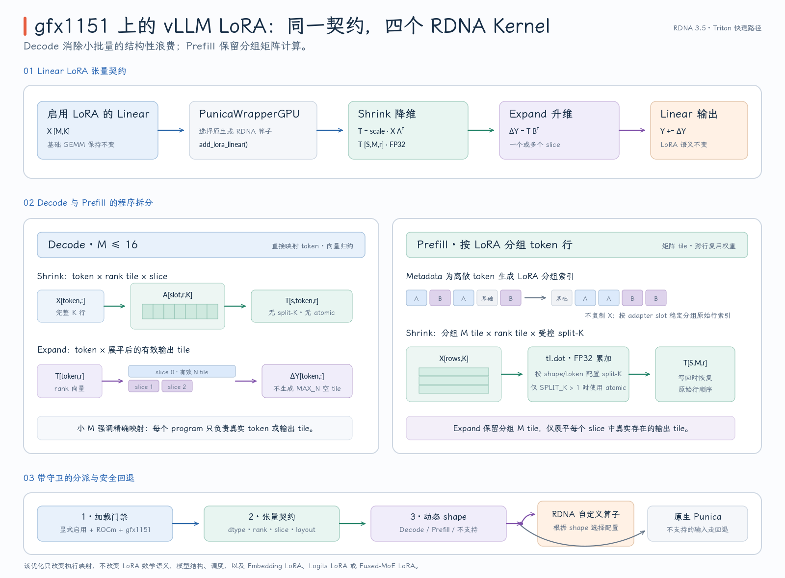
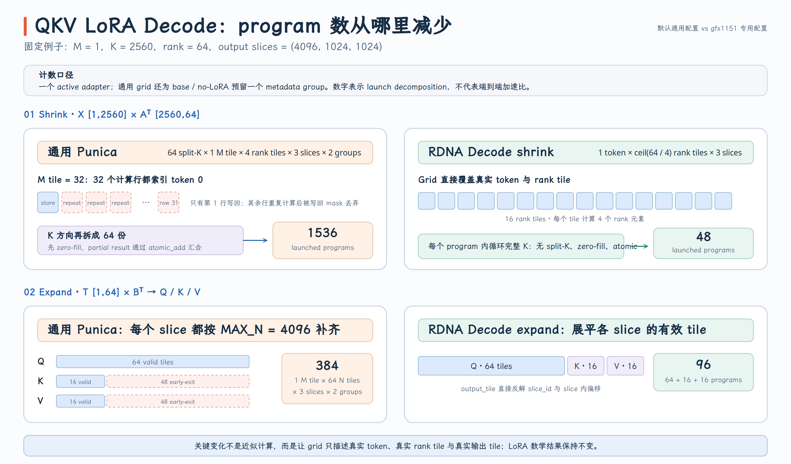

# RDNA 3.5 上的 vLLM LoRA Kernel 优化

vLLM 的 Multi-LoRA 并不是为每个请求单独运行一套模型，而是在基座 Linear 的输出上，按 token 选择对应 adapter，并累加低秩增量。通用 Punica kernel 必须同时覆盖多种 GPU、动态 batch、多个 adapter、不同 rank 和 fused projection；在 gfx1151 这类 RDNA 3.5 设备的小批量推理中，这种通用性也会带来多余的 tile、split-K、原子累加和 metadata 成本。

本文以开发分支中的 LoRA kernel 提交为基线，沿 `LoRA Linear → Punica wrapper → shrink/expand → Triton kernel` 解释这条专用路径如何接入 vLLM。内容只讨论实现机制、正确性边界和 fallback，不展开 benchmark 数字，也不讨论该分支后续的优先级抢占功能。Multi-LoRA 的权重管理与基础调度概念可先参考 [vLLM Multi-LoRA 推理](../../../../ai-infra/vLLM Multi-LoRA推理.md)。

- 开发分支：`gfx11/lora-priority-preemption`（本文核对时的分支快照为 [`5bdd3cc58d`](https://github.com/tangzzycc/vllm/commit/5bdd3cc58d8985c2c2ebcb21377b3526335b5741)）
- Kernel 基线：[`f393507827`](https://github.com/tangzzycc/vllm/commit/f3935078271e4931a89619c725561bf4ecabb104)
- Shrink 实现：[`rdna_lora_shrink.py`](https://github.com/tangzzycc/vllm/blob/f3935078271e4931a89619c725561bf4ecabb104/vllm/lora/ops/triton_ops/rdna_lora_shrink.py)
- Expand 实现：[`rdna_lora_expand.py`](https://github.com/tangzzycc/vllm/blob/f3935078271e4931a89619c725561bf4ecabb104/vllm/lora/ops/triton_ops/rdna_lora_expand.py)

## 1. 优化对象：Linear 后面的两段低秩计算

对一个基础 Linear，vLLM 先计算基座输出，再把 LoRA 增量加回去：

$$
Y = XW^T + \mathrm{scale}\cdot(XA^T)B^T
$$

其中 $X\in\mathbb{R}^{M\times K}$，$A\in\mathbb{R}^{r\times K}$，$B\in\mathbb{R}^{N\times r}$。vLLM 将增量拆成两个算子：

```text
shrink: X [M,K] × Aᵀ [K,r] → T [M,r]
expand: T [M,r] × Bᵀ [r,N] → ΔY [M,N]
output: Y ← Y + ΔY
```

`M` 是当前 forward 中的 token 数，`r` 是 LoRA rank。对于 QKV、gate/up 这类 fused Linear，同一个输入会对应多个 LoRA slice，因此实际的中间张量是 `T [S,M,r]`，`S` 为 slice 数。

模型加载后，带 LoRA 的 Linear 会在 forward 中调用 `PunicaWrapperGPU.add_lora_linear()`；wrapper 创建 FP32 中间 buffer，依次执行 `add_shrink()` 和 `add_expand()`，相关入口见 [`BaseLinearLayerWithLoRA._apply_lora_to_output`](https://github.com/tangzzycc/vllm/blob/f3935078271e4931a89619c725561bf4ecabb104/vllm/lora/layers/base_linear.py#L205-L238) 和 [`PunicaWrapperGPU.add_lora_linear`](https://github.com/tangzzycc/vllm/blob/f3935078271e4931a89619c725561bf4ecabb104/vllm/lora/punica_wrapper/punica_gpu.py#L296-L357)。LoRA scale 在 shrink 的 FP32 累加结果上乘入，expand 不再重复缩放。

这次优化没有替换基座 GEMM，也没有修改 LoRA 数学。它只为 Linear LoRA 的 shrink/expand 增加 gfx1151 fast path；embedding、logits 和 fused-MoE LoRA 仍走各自原有实现。例如 embedding 与 logits 路径仍直接调用通用 `lora_expand` / `lora_shrink`，见 [`add_lora_embedding` 与 `add_lora_logits`](https://github.com/tangzzycc/vllm/blob/f3935078271e4931a89619c725561bf4ecabb104/vllm/lora/punica_wrapper/punica_gpu.py#L261-L413)。

开发时用 Qwen3-VL-4B 的真实 Linear shape 覆盖了四种典型组合，但 selector 只看张量形状，不判断模型名称：

| Projection | Shrink 的 $K$ | Expand 的 `output_slices` | Slice 数 |
| --- | ---: | --- | ---: |
| QKV | 2560 | `(4096, 1024, 1024)` | 3 |
| O projection | 4096 | `(2560,)` | 1 |
| Gate/Up | 2560 | `(9728, 9728)` | 2 |
| Down | 9728 | `(2560,)` | 1 |

因此同样的 kernel 配置也能被其他具有相同 rank 和 Linear shape 的模型复用。

{ width="95%" }

图中的两条路径改变的是 Triton program 如何覆盖 token、rank、K 和输出 slice，不改变每个 token 使用哪个 LoRA，也不改变最终的 $Y + \Delta Y$ 语义。

## 2. Decode 与 Prefill 为什么必须分开

通用 Punica shrink 以 `SPLIT_K × M tile × rank tile` 为第一维，再乘 slice 和 LoRA metadata group。它先清零输出，多个 K 分片再通过 atomic 累加到同一个 FP32 buffer；源码中的 grid 与 zero-fill 见 [`lora_shrink_op.py`](https://github.com/tangzzycc/vllm/blob/f3935078271e4931a89619c725561bf4ecabb104/vllm/lora/ops/triton_ops/lora_shrink_op.py#L193-L228)。这种组织适合覆盖广泛形状，却不一定适合只有少量 token 的 Decode：当 $M=1$ 时，通用 kernel 会用取模将 M tile 中的多个 lane 都指向同一行，最后只写回真实存在的行；这意味着 tile 内仍有重复计算，而较高的 split-K 还会增加 program、zero-fill 和 atomic reduction，见 [`_lora_shrink_kernel` 的行映射](https://github.com/tangzzycc/vllm/blob/f3935078271e4931a89619c725561bf4ecabb104/vllm/lora/ops/triton_ops/lora_shrink_op.py#L79-L109) 与 [`do_shrink_kernel` 的写回 mask](https://github.com/tangzzycc/vllm/blob/f3935078271e4931a89619c725561bf4ecabb104/vllm/lora/ops/triton_ops/kernel_utils.py#L324-L340)。

以 QKV shrink 的 `M=1, K=2560, r=64, S=3` 为例。通用 kernel 在默认 `BLOCK_M=32, BLOCK_N=16, SPLIT_K=64` 下，若 metadata grid 覆盖一个 active adapter 和预留的 base group，会启动：

$$
64\times\left\lceil\frac{1}{32}\right\rceil\times
\left\lceil\frac{64}{16}\right\rceil\times 3\times 2
=1536
$$

个 program。RDNA Decode shrink 的该 shape 配置使用 `BLOCK_RANK=4`，grid 只是 `(M × ceil(r/4), S)`，即 $16\times3=48$ 个 program。这不是一个通用加速比，而是两种 program decomposition 在该形状下的启动规模对照：专用路径把“真实 token 和 rank tile”直接变成 grid，不再用大 M tile 和 64 个 K 分片制造并行度。通用默认配置见 [`get_lora_op_configs`](https://github.com/tangzzycc/vllm/blob/f3935078271e4931a89619c725561bf4ecabb104/vllm/lora/ops/triton_ops/utils.py#L207-L244)，RDNA 配置与 grid 见 [`rdna_lora_shrink.py`](https://github.com/tangzzycc/vllm/blob/f3935078271e4931a89619c725561bf4ecabb104/vllm/lora/ops/triton_ops/rdna_lora_shrink.py#L30-L45) 和 [`_rdna_lora_shrink`](https://github.com/tangzzycc/vllm/blob/f3935078271e4931a89619c725561bf4ecabb104/vllm/lora/ops/triton_ops/rdna_lora_shrink.py#L573-L602)。

通用 expand 则按所有 slice 中最大的 `MAX_N` 建立 N 方向 grid，再把 slice 作为独立 grid 维。对于 `(4096,1024,1024)` 这样的不等长 QKV 输出，较短的 K/V slice 也会按 4096 对应的 tile 数启动，进入 kernel 后才提前退出，见 [`lora_expand_op.py`](https://github.com/tangzzycc/vllm/blob/f3935078271e4931a89619c725561bf4ecabb104/vllm/lora/ops/triton_ops/lora_expand_op.py#L196-L245)。继续使用 `M=1,r=64` 的 QKV 例子，通用默认 `BLOCK_M=64,BLOCK_N=64` 且 grid 包含两个 metadata group 时，会启动 $1\times64\times3\times2=384$ 个 program。RDNA Decode expand 同样选用 `BLOCK_N=64`，但它只展平真实存在的 $64+16+16=96$ 个输出 tile，因而 grid 为 $1\times96$。这里对比的仍是 launch decomposition，不是端到端性能比例；通用 expand 默认配置见 [`get_lora_op_configs`](https://github.com/tangzzycc/vllm/blob/f3935078271e4931a89619c725561bf4ecabb104/vllm/lora/ops/triton_ops/utils.py#L272-L290)，RDNA 配置与 grid 见 [`rdna_lora_expand.py`](https://github.com/tangzzycc/vllm/blob/f3935078271e4931a89619c725561bf4ecabb104/vllm/lora/ops/triton_ops/rdna_lora_expand.py#L29-L41) 和 [`_rdna_lora_expand`](https://github.com/tangzzycc/vllm/blob/f3935078271e4931a89619c725561bf4ecabb104/vllm/lora/ops/triton_ops/rdna_lora_expand.py#L617-L648)。

{ width="95%" }

但 Prefill 不能简单照搬 Decode 的逐 token 向量归约。较大的 $M$ 能让同一 adapter 的多行 token 组成矩阵 tile，复用 A/B 权重并使用 `tl.dot`；如果仍让每个 token 独立遍历 K 或 N，反而会丢掉矩阵化带来的并行度和数据复用。因此实现保留同一组 tensor contract，却分别提供 Decode shrink、Decode expand、Prefill shrink 和 Prefill expand 四条 kernel。

## 3. 四条 RDNA Kernel 如何组织工作

**Decode shrink：每个 program 负责一个真实 token 的一段 rank。** Grid 为 `token × rank_tile` 和 `slice` 两维。program 直接读取 `token_lora_mapping[token_id]` 选择 adapter slot，在内部循环遍历完整 K，并将结果写入 `[slice, token, rank_tile]`。由于一个 program 完成自己的完整 K reduction，这条路径不需要 split-K、预清零和 atomic，也不依赖按 LoRA 排序后的 token index。实现见 [`_rdna_lora_shrink_decode_kernel`](https://github.com/tangzzycc/vllm/blob/f3935078271e4931a89619c725561bf4ecabb104/vllm/lora/ops/triton_ops/rdna_lora_shrink.py#L313-L385)。

**Decode expand：只为实际存在的输出 tile 启动 program。** Host 端先分别计算每个 slice 的 `ceil(output_size / BLOCK_N)`，再把这些有效 tile 展平成一维。kernel 根据 `output_tile` 反推出 `slice_id`、slice 内 tile 和输出偏移，读取 `[slice,token,r]` 的 rank vector 与相应 B 权重，最后选择累加到原输出或写入 LoRA-only 输出。这避免了用最大 N 为每个 slice 补齐 grid，见 [`_rdna_lora_expand_decode_kernel`](https://github.com/tangzzycc/vllm/blob/f3935078271e4931a89619c725561bf4ecabb104/vllm/lora/ops/triton_ops/rdna_lora_expand.py#L278-L378)。

Expand 不会把 FP32 中间 buffer 当成全程 FP32 GEMM 的输入。Decode 路径先将 rank vector 转为 B 权重的 FP16/BF16 dtype，再转回 FP32 做显式乘加；Prefill 路径则把它转为 B 的 dtype 后交给 `tl.dot(..., out_dtype=tl.float32)`。两条路径都用 FP32 累加，但乘法输入遵循 B 权重精度，最后再转为目标输出 dtype；这也是测试 reference 显式执行 `inputs.to(dtype).float()` 的原因，见 [`test_rdna_lora_expand_parity`](https://github.com/tangzzycc/vllm/blob/f3935078271e4931a89619c725561bf4ecabb104/tests/lora/test_rdna_lora_ops.py#L481-L544)。

**Prefill shrink：按 adapter 分组 token，并保留受控 split-K。** Metadata 提供当前 LoRA group 的 token 数、起点和原始行号；kernel 先取得一组属于同一 adapter 的 row，再对 `[BLOCK_M,BLOCK_K] × [BLOCK_K,BLOCK_N]` 使用 `tl.dot`。Host 端不会为每个 group 另建一个紧凑的 $X$：M 方向 grid 仍按本轮总 token 数建立，各 group 在 kernel 内读取自己的 `lora_m_size`，再通过 sorted row index gather 原始输入并 mask 掉越界行。

rank 较小时，完全取消 split-K 可能不足以填满设备，因此配置可以保留较小的 `SPLIT_K`。Host 进入 Prefill 路径时会先清零整个 FP32 buffer；kernel 在 `SPLIT_K=1` 时直接 `store`，只有 `SPLIT_K>1` 才使用 `atomic_add`。因此“原子累加是按配置开启的”，但不能进一步说当前实现只在 split-K 时才 zero-fill。实现见 [`_rdna_lora_shrink_prefill_kernel`](https://github.com/tangzzycc/vllm/blob/f3935078271e4931a89619c725561bf4ecabb104/vllm/lora/ops/triton_ops/rdna_lora_shrink.py#L387-L485) 与 [Prefill 启动路径](https://github.com/tangzzycc/vllm/blob/f3935078271e4931a89619c725561bf4ecabb104/vllm/lora/ops/triton_ops/rdna_lora_shrink.py#L529-L570)。

**Prefill expand：组合 grouped M tile 与有效输出 tile。** 第一维仍按本轮总 token 数计算 `ceil(M/BLOCK_M)`，第二维覆盖所有 slice 的有效 N tile，第三维覆盖 LoRA group。每个 group 再用自己的 `lora_m_size` 屏蔽多余行；program 通过 `tl.dot` 计算一个 `[BLOCK_M,BLOCK_N]` 输出块，并按 sorted row index 写回原 token 位置。因此它是“单次 launch 中按索引分组”，而不是为每个 adapter 复制一份紧凑输入，见 [`_rdna_lora_expand_prefill_kernel`](https://github.com/tangzzycc/vllm/blob/f3935078271e4931a89619c725561bf4ecabb104/vllm/lora/ops/triton_ops/rdna_lora_expand.py#L380-L501) 与 [Prefill 启动路径](https://github.com/tangzzycc/vllm/blob/f3935078271e4931a89619c725561bf4ecabb104/vllm/lora/ops/triton_ops/rdna_lora_expand.py#L560-L597)。

四条 kernel 使用不同的配置维度：

| Kernel | 配置选择的主要输入 | 配置内容 |
| --- | --- | --- |
| Decode shrink | `rank, hidden_size, num_slices` | `BLOCK_RANK, BLOCK_K, warps, stages` |
| Decode expand | `rank, output_sizes` | `BLOCK_N, warps, stages` |
| Prefill shrink | token 档位、`rank, hidden_size, num_slices` | `BLOCK_M, BLOCK_N, BLOCK_K, SPLIT_K, warps` |
| Prefill expand | token 档位、`rank, output_sizes` | `BLOCK_M, BLOCK_N, BLOCK_K, warps, stages` |

Shrink 的配置表与 heuristic 位于 [`rdna_lora_shrink.py`](https://github.com/tangzzycc/vllm/blob/f3935078271e4931a89619c725561bf4ecabb104/vllm/lora/ops/triton_ops/rdna_lora_shrink.py#L30-L184)，Expand 则按 `(rank, tuple(output_sizes))` 保存已调优组合，见 [`rdna_lora_expand.py`](https://github.com/tangzzycc/vllm/blob/f3935078271e4931a89619c725561bf4ecabb104/vllm/lora/ops/triton_ops/rdna_lora_expand.py#L29-L183)。未命中专项表不一定回退 Native：只要仍满足支持范围，就可以使用 RDNA heuristic；只有 tensor contract 或动态执行范围不支持时才回退。

## 4. 三层 Dispatch 把专用优化限制在安全范围

RDNA fast path 是显式 opt-in，而不是替换所有 ROCm LoRA kernel。两项环境变量默认关闭；只有启用对应开关、运行在 ROCm 且 `on_gfx1151()` 为真时，wrapper 才导入专用实现，见 [`PunicaWrapperGPU` 的条件导入](https://github.com/tangzzycc/vllm/blob/f3935078271e4931a89619c725561bf4ecabb104/vllm/lora/punica_wrapper/punica_gpu.py#L24-L56) 和 [`envs.py`](https://github.com/tangzzycc/vllm/blob/f3935078271e4931a89619c725561bf4ecabb104/vllm/envs.py#L2111-L2117)：

```bash
export VLLM_ROCM_USE_RDNA_LORA_SHRINK=1
export VLLM_ROCM_USE_RDNA_LORA_EXPAND=1
```

一次调用会依次经过三层判断：

| 层次 | 判断内容 | 不满足时的行为 |
| --- | --- | --- |
| 模块加载门 | Triton、环境变量、ROCm、gfx1151 | RDNA op 不导入，始终使用 Native |
| Wrapper tensor contract | 权重/I/O 维度、dtype、连续性、device、slice、offset | 本次调用直接选择 Native |
| Custom-op 动态判断 | 当前 token 数、rank、hidden/output shape、Prefill dtype | custom op 内调用 Native |

Wrapper 的 shrink/expand 选择位于 [`add_shrink`](https://github.com/tangzzycc/vllm/blob/f3935078271e4931a89619c725561bf4ecabb104/vllm/lora/punica_wrapper/punica_gpu.py#L150-L195) 与 [`add_expand`](https://github.com/tangzzycc/vllm/blob/f3935078271e4931a89619c725561bf4ecabb104/vllm/lora/punica_wrapper/punica_gpu.py#L197-L258)。这里先把 RDNA custom op 作为候选；真正依赖动态 $M$ 的 Decode、Prefill 与 fallback 分流仍放在 opaque custom op 内部，使一份动态 `torch.compile` graph 可以覆盖不同阶段，而 HIP Graph 最终记录当次具体的 kernel launch。Shrink 的动态分流见 [`_rdna_lora_shrink`](https://github.com/tangzzycc/vllm/blob/f3935078271e4931a89619c725561bf4ecabb104/vllm/lora/ops/triton_ops/rdna_lora_shrink.py#L487-L603)，Expand 对应 [`_rdna_lora_expand`](https://github.com/tangzzycc/vllm/blob/f3935078271e4931a89619c725561bf4ecabb104/vllm/lora/ops/triton_ops/rdna_lora_expand.py#L503-L649)。

当前实现边界应理解为“经过验证的 gfx1151 子集”，而不是整个 RDNA 3.5 平台上的任意 LoRA shape：

| 维度 | 当前范围 |
| --- | --- |
| Decode | `1 ≤ M ≤ 16`，rank 为 16/32/64/128，权重为 FP16 或 BF16 |
| Prefill | BF16，`M ≤ 1024`；通常从 128 token 开始，专项 shape 可从 64 开始 |
| Slice | 1–4 |
| Shrink hidden size | 2048、6144，以及专项 rank 下的 2560、4096、9728 |
| Expand output shape | 专项表覆盖常见 Qwen3-VL shape，其他兼容 shape 使用 heuristic |

Shrink 还有若干小 token、rank 和 hidden-size 组合的显式排除，完整条件应以 [`_can_run_rdna_lora_shrink_kernel`](https://github.com/tangzzycc/vllm/blob/f3935078271e4931a89619c725561bf4ecabb104/vllm/lora/ops/triton_ops/rdna_lora_shrink.py#L186-L228) 为准。这里的 fallback 只表示代码识别出当前输入不在支持范围；实现没有捕获任意 Triton 编译或运行时异常后再次执行 Native，因此不能把它描述成“任何失败都会自动回退”。

## 5. Metadata、HIP Graph 与正确性边界

Multi-LoRA kernel 除了输入和权重，还需要知道每个 token 使用哪个 adapter。`LoRAKernelMeta` 维护以下信息：

| Tensor | 含义 |
| --- | --- |
| `token_lora_mapping` | 每个 token 对应的 LoRA slot，`-1` 表示 base/no-LoRA |
| `token_indices_sorted_by_lora_ids` | 按 adapter 分组后的原始 token index |
| `active_lora_ids` | 本轮 metadata 中的 adapter/base group |
| `num_tokens_per_lora` | 每个 group 包含多少 token |
| `lora_token_start_loc` | 每个 group 在 sorted indices 中的起始位置 |

例如 `mapping = [0,1,0,-1,1]` 会得到近似如下的分组表示：

```text
sorted token index = [3,0,2,1,4]
active group       = [-1,0,1]
token count        = [1,2,2]
start location     = [0,1,3,5]
```

Decode token 很少，可以直接按 `token_lora_mapping[token_id]` 读取 slot；Prefill 则用 sorted indices 将同一 adapter 的 token 组成矩阵 tile。这里并不会先复制或重排 $X$：metadata 只保存按 LoRA ID 稳定分组后的原始行索引，kernel 按索引 gather 输入，再直接写回原 token 行。通用 metadata 路径通过 stable sort、unique/count 和 cumulative sum 构造这些张量，见 [`LoRAKernelMeta.prepare_tensors`](https://github.com/tangzzycc/vllm/blob/f3935078271e4931a89619c725561bf4ecabb104/vllm/lora/ops/triton_ops/lora_kernel_metadata.py#L157-L221)。

当一个 batch 的所有 token 都使用同一个 adapter 时，结构已经完全确定，不需要再执行通用 sort/unique/cumsum。在至少一条 RDNA 算子已加载时，Wrapper 会先检测 uniform mapping，再调用一个轻量 Triton kernel 直接填写 mapping、active ID、count 和 start location，见 [`update_metadata`](https://github.com/tangzzycc/vllm/blob/f3935078271e4931a89619c725561bf4ecabb104/vllm/lora/punica_wrapper/punica_gpu.py#L102-L148) 与 [`prepare_tensors_uniform`](https://github.com/tangzzycc/vllm/blob/f3935078271e4931a89619c725561bf4ecabb104/vllm/lora/ops/triton_ops/lora_kernel_metadata.py#L223-L259)。Mixed-LoRA 或未加载 RDNA 算子时仍走通用分组路径，这项优化没有改变调度语义。

Graph replay 还要求 metadata buffer 在不同 batch 之间保持干净。新 batch 比上一次更短时，旧 mapping 的尾部必须恢复为 `-1`；无 LoRA 时还要重置 active IDs、count 和 start location，否则固定 buffer 可能残留上一次请求的 slot。kernel grid 通过 `get_lora_kernel_grid_dim()` 为可能出现的 base group 预留位置，并受已分配的 metadata slot 数限制，见 [`utils.py`](https://github.com/tangzzycc/vllm/blob/f3935078271e4931a89619c725561bf4ecabb104/vllm/lora/ops/triton_ops/utils.py#L25-L32)。

对应测试没有只比较一个最终文本，而是从 contract 到 graph replay 分层覆盖：

- shape gate 与 wrapper 是否真正选择 RDNA op；
- uniform metadata 与通用 metadata 是否一致，以及 batch 缩短后的 stale tail 是否清理；
- inactive/base token、越界 adapter ID 与 `add_inputs` 语义；
- FP16/BF16 Decode、BF16 Prefill、多 rank、多 slice 和 Qwen3-VL shape；
- eager 与 HIP Graph capture/replay 的容差一致性。

这些用例集中在 [`test_rdna_lora_ops.py`](https://github.com/tangzzycc/vllm/blob/f3935078271e4931a89619c725561bf4ecabb104/tests/lora/test_rdna_lora_ops.py#L49-L772)。数值用例先与显式矩阵计算 reference 对比，HIP Graph 用例再将 replay 结果与 eager 路径对比。Prefill shrink 在 `SPLIT_K > 1` 时使用原子累加，浮点加法顺序可能变化，因此正确性目标是在规定容差内与 reference 或 eager 结果一致，而不是逐 bit 相同。

这项实现的核心可以归纳为：保持 vLLM 原有 LoRA tensor contract 与 Native fallback，只针对 gfx1151 重新设计 program decomposition。Decode 直接围绕真实 token 和有效输出 tile 工作；Prefill 保留按 adapter 分组后的矩阵化计算；metadata fast path、custom-op 内动态分流与 HIP Graph 状态清理，则负责让这四条 kernel 真正安全地进入 serving 路径。
