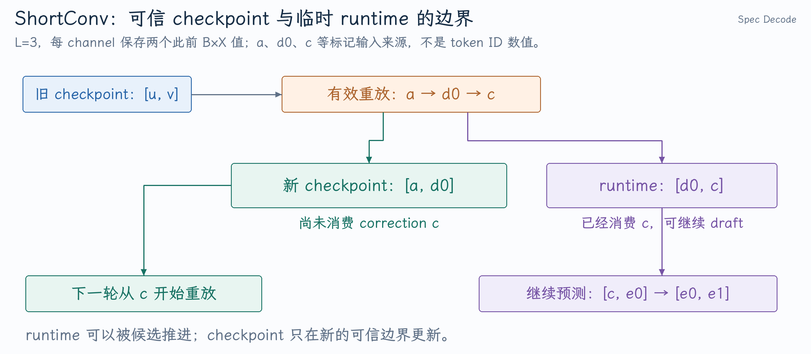

# 从 ShortConv 修复追问投机解码与混合模型状态

PR #59600 修复的不只是一个 token 输入错误，而是投机执行后的有效前缀、卷积历史和下一轮重放边界不一致。理解这项贡献，需要把“生成候选”“接受输出”“临时 GPU 写入”和“可继续使用的状态”分开。

本文核对到 [`359db8bc61`](https://github.com/vllm-project/vllm/commit/359db8bc6143f1d89fd6390b5ac30f6bc85b0165)，使用 MRV2 独立 `draft_model` 路径。完整改动与模型配置见[ShortConv 开发笔记](../../../../../vllm/开发实践/MRV2投机解码中的ShortConv历史恢复.md)。

## 1. 投机解码为什么可能更快，最终由谁决定输出？

自回归生成要求下一个 token 依赖已提交前缀，不能直接让大模型同时凭空预测多个未知 token。Drafter 先给出候选后，target 就有了已知验证输入，可以像 teacher forcing 一样一次计算这些行。

例如本轮 target 输入 `[a,d0,d1,d2]`。a 是已有输出边界上的有效输入，三个 d 是候选。若只接受 d0，最终新输出是 d0 与 correction c；d1/d2 不会提交。Target 已经算过它们，不等于它们成为可信历史。

[Runner 调用独立 drafter](https://github.com/vllm-project/vllm/blob/359db8bc6143f1d89fd6390b5ac30f6bc85b0165/vllm/v1/worker/gpu/model_runner.py#L2224-L2245)将采样数、拒绝数和有效下一输入传递给 speculator。对应的 drafter 自己执行 [LFM2 backbone 与 logits](https://github.com/vllm-project/vllm/blob/359db8bc6143f1d89fd6390b5ac30f6bc85b0165/vllm/model_executor/models/lfm2.py#L463-L501)。

**追问：接受一个 draft 就只输出一个 token 吗？** 通常还有 correction，因此可输出 `接受数+1`；若全部接受，则额外采样 bonus。EOS、输出长度限制等可能裁剪可见结果，要把验证计数与最终客户端输出区分。

**追问：draft_model、EAGLE、MTP 是一回事吗？** 它们都是候选生成方式，但独立 draft_model 有自己的 embedding、backbone 和状态；EAGLE 等方法可能消费 target 特征；MTP 使用模型定义的多 token 预测模块。PR 支持独立 ShortConv drafter不能直接证明其他方式都覆盖。

## 2. 投机解码怎样保持 target 的输出语义？

标准逐 token rejection sampling 中，令 p 是 target 分布，q 是 drafter 提案分布，候选 x 按 q 采样，接受概率为：

$$
\min(1,p(x)/q(x)).
$$

拒绝后从归一化的 `max(p-q,0)` 采样。某 token v 的被接受质量是 `min(p(v),q(v))`，残差补足 `max(p(v)-q(v),0)`，二者相加为 p(v)，这是分布保持的关键。

例如词表 `{A,B}`，`p=(0.7,0.3)`、`q=(0.4,0.6)`：A 提案总接受，B 接受概率 0.5。接受质量为 `(0.4,0.3)`，总拒绝质量为 0.3，残差仅落在 A，最终正好 `(0.7,0.3)`。

这个例子解释标准算法。所选版本还包含 one-hot draft、block verification 等分支，不能把这条简式替代所有生产模式。见[greedy 验证分支](https://github.com/vllm-project/vllm/blob/359db8bc6143f1d89fd6390b5ac30f6bc85b0165/vllm/v1/worker/gpu/spec_decode/rejection_sampler_utils.py#L549-L589)和[拒绝后 resample](https://github.com/vllm-project/vllm/blob/359db8bc6143f1d89fd6390b5ac30f6bc85b0165/vllm/v1/worker/gpu/spec_decode/rejection_sampler_utils.py#L812-L889)。

**追问：保持分布就意味着相同 seed 输出逐 token 相同吗？** 不意味着。随机数消耗次序与数值误差都可能改变具体抽样路径。Greedy 可用于强对照，随机路径应同时核查算法契约、数值和统计行为。

**追问：第一个候选被拒绝，后面的能继续接受吗？** 标准线性前缀验证不能，因为后面的候选条件在已经失效的前缀上。树形或其他验证算法需按自己的分支结构说明。

## 3. 接受率高就一定加速吗？

在无 EOS 裁剪、每轮最多 k 个候选的简化条件下，平均提交量为 `1+E[接受前缀长度]`。若独立同概率 α 的条件假设成立：

$$
E[接受前缀长度]=\sum_{i=1}^{k}\alpha^i.
$$

实际各位置的条件接受率并不一定相同。α=0.8、k=3 时平均提交 `1+0.8+0.64+0.512=2.952` 个 token；若普通 target 一步为 10 ms，投机整轮为 20 ms，则简化速度提升为 `2.952*10/20=1.476` 倍。若整轮涨到 35 ms，即便接受率相同也会变慢。

**追问：为什么会自适应验证长度？** 不同 batch、上下文与模型形态下单位验证成本不同，接受率也不同。需要估算新增候选的收益和成本；启动 profiling 的有效行错误会污染成本输入，所以 #60049 不只是“多分几行”的问题。

## 4. LFM2.5 为什么不能只恢复 Attention KV 的长度？

[LFM2 按 layer_types 建层](https://github.com/vllm-project/vllm/blob/359db8bc6143f1d89fd6390b5ac30f6bc85b0165/vllm/model_executor/models/lfm2.py#L329-L345)使两类状态同时存在。ShortConv 先把 hidden states 投影成 B/C/X，保存的是卷积输入 `B*X` 的历史，见[三路输入与卷积](https://github.com/vllm-project/vllm/blob/359db8bc6143f1d89fd6390b5ac30f6bc85b0165/vllm/model_executor/layers/mamba/short_conv.py#L248-L304)。它不是 token IDs、Attention KV 或卷积输出。

长度 L=3 的 depthwise causal conv 每 channel 直接依赖当前值和此前两个输入。不同 channel 有独立卷积系数，前后 Linear 才混合 channel。Attention token KV 与固定窗口历史有不同的数据可恢复性。

**追问：ShortConv 属于 Mamba，就一定是 SSM 吗？** 这里复用 Mamba 的框架接口和状态体系，但数学上是短卷积。类继承或 backend 名称不能替代算子定义。

**追问：L=3 就只能记住三个原始 token 吗？** 这是该层直接输入的局部窗口。它的输入 hidden states 已经过前面的 Attention/卷积层，整个模型的依赖范围来自层的组合，不能直接把局部 kernel 长度当作模型上下文长度。

## 5. Checkpoint 为什么必须在 correction 前？

以下 a/d0/c/u/v 表示某个 channel 的 `B*X` 数值来源，不表示所有层的值都等于 token ID。旧 checkpoint 为 `[u,v]`；本轮有效重放 `[a,d0,c]`，新 checkpoint 为 `[a,d0]`，runtime 为 `[d0,c]`。

{ width="100%" }

若 H(p) 表示消费位置 `[0,p)` 后的历史，correction 位于 p，那么 checkpoint 是 H(p)，runtime 是 H(p+1)。继续 draft 可能把 runtime 改成 `[c,e0]`、`[e0,e1]`，checkpoint 仍保留 `[a,d0]`。下轮从 checkpoint 重放 c 和已接受 e，再建立下一个可信边界。

该 PR [分配 checkpoint](https://github.com/vllm-project/vllm/blob/359db8bc6143f1d89fd6390b5ac30f6bc85b0165/vllm/v1/worker/gpu/spec_decode/draft_model/speculator.py#L99-L117)为 `request slot × channel × (L_cache-1)`，由 [causal_conv1d kernel](https://github.com/vllm-project/vllm/blob/359db8bc6143f1d89fd6390b5ac30f6bc85b0165/vllm/model_executor/layers/mamba/ops/causal_conv1d.py)读取旧窗口并写出两种边界。

**追问：直接保存 runtime 为什么不行？** 它可能已经包含拒绝候选；即使恰好位于 correction 后，下一轮再次消费 c 也会重复推进。保存数值还必须保存正确语义边界。

**追问：为什么不存每一步完整状态？** 会增加存储、写入与管理成本。这个短卷积可利用最小窗口和有效输入重放恢复；其他递归状态不一定适用同一方法，要按状态更新可重建性选择 checkpoint 粒度。

## 6. Expanded batch 为什么还有被拒绝位置？

target Query 长 4、拒绝 2 行时，`num_valid=4-2=2`，expanded 总长 5：

| 对象 | 内容 |
|---|---|
| Target 验证输入 | `[a,d0,d1,d2]` |
| Drafter step 0 | `[a,d0,c,pad,pad]` |
| Correction 局部索引 | 2 |
| 最后有效历史 | checkpoint `[a,d0]`，runtime `[d0,c]` |

[step-0 构造](https://github.com/vllm-project/vllm/blob/359db8bc6143f1d89fd6390b5ac30f6bc85b0165/vllm/v1/worker/gpu/spec_decode/draft_model/speculator.py#L441-L512)将 `last_token_indices` 指向 correction；expanded `seq_lens` 反映执行布局，而接受/拒绝信息决定有效推进。临时 KV 尾部需要后续覆盖或屏蔽，不能进入可信缓存。

**追问：有效前缀很短，history 的来源索引为负怎么办？** 负位置表示所需值仍在旧 checkpoint，不能用它访问当前输入，也不能统一补零。L=3、仅一个有效前 correction 输入 a 时，新窗口可能是 `[v,a]`，v 来自旧历史。

## 7. Chunked Prefill 没有采样时，下一输入从哪里来？

Prompt `[p0,p1,p2,p3,p4,p5]` 本轮只处理 p0～p2，下一输入是 p3。不能把另一次生成留下的 `last_sampled=42` 当作 correction。Kernel [根据 num_sampled 选择输入](https://github.com/vllm-project/vllm/blob/359db8bc6143f1d89fd6390b5ac30f6bc85b0165/vllm/v1/worker/gpu/spec_decode/draft_model/speculator.py#L479-L488)在采样数为零时使用 `next_prefill_tokens`。

**追问：只看 token 数是否为一够吗？** 一行可能是 Decode，也可能是 Prefill 的最后一小块。要用已计算 prompt 进度和实际采样状态，不能只靠形状猜测输入来源。

## 8. 如何证明连续多轮与请求重排都正确？

本轮 A 在 batch row 0、state slot 7，下轮到 row 1，checkpoint 仍应按 slot 7 读取。A 结束后 B 复用 slot 7，初始化必须排除 A 的旧历史。抢占重算则必须按新执行状态重建，不能误用重算前 checkpoint。

**追问：这个 PR 是否支持所有混合模型缓存模式？** 不支持这样泛化。该实现明确要求 `mamba_cache_mode='none'` 且关闭 prefix caching，见[初始化检查](https://github.com/vllm-project/vllm/blob/359db8bc6143f1d89fd6390b5ac30f6bc85b0165/vllm/v1/worker/gpu/spec_decode/draft_model/speculator.py#L99-L111)。支持 prefix caching 还需让 cache hit 恢复每类层的同一可信前缀。

**追问：正确性修复会提升接受率吗？** 清除污染后 drafter 提案质量可能恢复，但这是需要单独测量的结果。状态对照证明恢复正确，接受率证明提案行为，端到端时间证明加速，三者不能互相替代。
