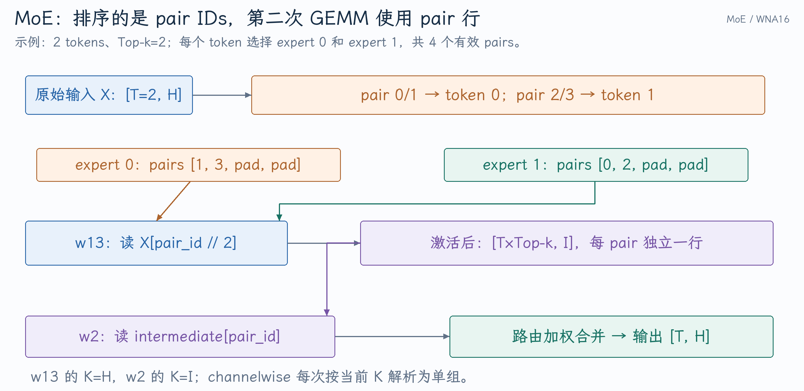

# 从 channelwise GPTQ 追问 MoE 路由与量化执行

PR #58513 的触发配置是 `group_size=-1`。面试官可以继续问：为什么同一专家层需要两个实际 group size，token 如何按专家分组，为什么第二次 GEMM 的索引规则不同，以及 fallback 究竟保留了哪些语义。

本文核对到 [`a08f2cb3c5`](https://github.com/vllm-project/vllm/commit/a08f2cb3c54605c8306f42d4cf00b62322bf804f)。完整源码说明见[Channelwise GPTQ MoE](../../../../../vllm/开发实践/Channelwise-GPTQ-MoE的加载与Triton执行.md)。

## 1. MoE 跟 Dense MLP 的区别在哪里？

常见 routed MoE 表示为 `y_t=Σ_r w_(t,r)*Expert_(e_(t,r))(x_t)`。Top-k 不同于 batch size，expert ID 不同于 token ID。一条 token 选两个专家，就产生两份专家计算。

[AutoGPTQ MoE 方法选择](https://github.com/vllm-project/vllm/blob/a08f2cb3c54605c8306f42d4cf00b62322bf804f/vllm/model_executor/layers/quantization/auto_gptq.py#L235-L264)检查专用实现支持，不能使用时进入 WNA16 fallback；[backend 选择](https://github.com/vllm-project/vllm/blob/a08f2cb3c54605c8306f42d4cf00b62322bf804f/vllm/model_executor/layers/quantization/moe_wna16.py#L227-L264)进一步根据设备和配置选择执行方式。本文讨论的是选中 TritonWNA16Experts 的路径。

**追问：为什么不能把全部 experts 做成一个普通 dense GEMM？** 每个 token 选择的专家不同；要么做很多不需要的计算，要么需要依据路由组织 grouped GEMM。执行成本取决于 token/expert 分布，而不仅是总 T。

**追问：路由是否总是 softmax 后取 Top-k？** 不同模型可使用 softmax、sigmoid、分组限制、归一化或偏置等规则。这里只用 Top-k IDs/weights 作为执行接口，具体 router 数学必须看模型。

## 2. token/expert pair 怎样进入两个 GEMM？

设 T=2、Top-k=2，路由为：

| pair ID | token | Top-k 槽 | expert |
|---:|---:|---:|---:|
| 0 | 0 | 0 | 1 |
| 1 | 0 | 1 | 0 |
| 2 | 1 | 0 | 1 |
| 3 | 1 | 1 | 0 |

专家 0 的 pair 为 `[1,3]`，专家 1 为 `[0,2]`。教学上取 BLOCK_M=4，分别补成 `[1,3,pad,pad]` 与 `[0,2,pad,pad]`。排序的是索引元数据，不代表已经把整份 X 复制为专家顺序。

{ width="100%" }

[输入 gather 与 pair 索引](https://github.com/vllm-project/vllm/blob/a08f2cb3c54605c8306f42d4cf00b62322bf804f/vllm/model_executor/layers/fused_moe/fused_moe.py#L156-L188)在第一 GEMM 用 `pair_id//top_k` 找 X。pair 1 读取 X[0]；pair 3 读取 X[1]，都乘 expert 0 的权重。

**追问：第二 GEMM 为何传 `top_k=1`？** 激活输入已为 pair 1、pair 3 各保留独立行，第二层需读 `intermediate[pair_id]`。传 1 使同一索引公式不再折叠，见[两次 launch 与合并](https://github.com/vllm-project/vllm/blob/a08f2cb3c54605c8306f42d4cf00b62322bf804f/vllm/model_executor/layers/fused_moe/experts/triton_moe.py#L755-L808)。这不表示 router 从 Top-2 改成 Top-1。

**追问：padding pair 是不是新增 token？** 它只是对齐 kernel tile 的执行槽，由 mask 排除；不计业务输出。它与 Graph token padding 都说明执行容量与有效工作不同，但属于两个不同层次。

## 3. 为什么 w13 与 w2 的输入 K 不一样？

单设备 E=2、H=256、I=384：

| 张量 | 逻辑权重 shape | Channelwise scales | 运行 K |
|---|---|---|---:|
| w13 | `[2,768,256]` | `[2,768,1]` | 256 |
| w2 | `[2,256,384]` | `[2,256,1]` | 384 |

Workspace 对应 `[T,top_k,768]` → `SiLU(gate)*up` → `[T*top_k,384]` → `[T,top_k,256]` → 加权输出 `[T,256]`，见[中间缓存](https://github.com/vllm-project/vllm/blob/a08f2cb3c54605c8306f42d4cf00b62322bf804f/vllm/model_executor/layers/fused_moe/experts/triton_moe.py#L738-L749)。

**追问：G=H 一次改好不行吗？** w2 的 `k=300` 若用 G=256 会得到 group 1，但它只有 group 0 的 scale，导致越界或错误取值。Channelwise 的“一组”不意味着所有 GEMM 的 G 都是相同常数。

## 4. PR 为什么既修改分配，也修改 runtime wrapper？

[参数创建](https://github.com/vllm-project/vllm/blob/a08f2cb3c54605c8306f42d4cf00b62322bf804f/vllm/model_executor/layers/quantization/moe_wna16.py#L275-L299)对 channelwise 跳过普通 group 调整，`hidden_scale_groups` 与 `intermediate_scale_groups` 都设为 1，保留 `layer.group_size=-1`。

[runtime wrapper](https://github.com/vllm-project/vllm/blob/a08f2cb3c54605c8306f42d4cf00b62322bf804f/vllm/model_executor/layers/fused_moe/fused_moe.py#L690-L705)每次用 `A.size(1)` 解析 G，并检查 scale/zero point 的单组维；该正值继续传给 block config 与 kernel launch。

**追问：把 `-1` 改成 `abs(-1)=1` 行不行？** G=1 表示每个输入特征一组，与一整个 K 一组完全不同。修 sentinel 要还原语义，不能只让数字变正。

**追问：为什么 fallback 也要理解原量化语义？** Fallback 更换执行实现，不应随意改变 group、zero point 或逻辑量化值。成功启动只能证明分配没报错；数值执行仍需要相同格式解释。

## 5. Triton 如何反量化当前专家的 INT4 权重？

此路径逻辑两个 K 值压成一个 byte：

$$
\text{byteAddr}=e\,s_e+n\,s_n+\lfloor k/2\rfloor s_k,\quad
q=(\text{byte}\gg4(k\bmod2))\ \&\ 15.
$$

[packed 地址与 nibble](https://github.com/vllm-project/vllm/blob/a08f2cb3c54605c8306f42d4cf00b62322bf804f/vllm/model_executor/layers/fused_moe/fused_moe.py#L190-L208)、[scale 和 dot](https://github.com/vllm-project/vllm/blob/a08f2cb3c54605c8306f42d4cf00b62322bf804f/vllm/model_executor/layers/fused_moe/fused_moe.py#L233-L283)共同建立数值路径。Channelwise 时 `0<=k<K,G=K`，组号始终为 0。

**追问：一个 K tile 只用一个 scale 吗？** 该 kernel 按每个 k 计算 group 索引。Tile 可能跨 group，不可套用其他 kernel 的 tile/group 对齐假设。Scale 的寻址也要包含 expert 与输出通道。

## 6. Expert Parallel、TP 和 shared expert 有什么区别？

EP 需要处理 global expert ID 到本地 ID 的映射。[kernel 的 expert 与 token metadata](https://github.com/vllm-project/vllm/blob/a08f2cb3c54605c8306f42d4cf00b62322bf804f/vllm/model_executor/layers/fused_moe/fused_moe.py#L156-L188)包含对应地址与 mask；本 rank 不处理的专家不能形成普通权重地址。端到端通信路径取决于 backend，本文这个 fallback 的单设备例子不证明多卡 EP 性能。

**追问：为什么 MoE 会有负载不均？** 不同 token 的路由可能集中到少数专家，造成某些 rank 或 GEMM tile 很忙，其他部分闲置。扩大 batch 可能改善 tile 利用，也可能因热点或通信加重尾延迟，要观察每专家 token 分布。

**追问：专家激活参数少，为何 Decode 不一定更快？** 小 batch 的每专家 token 很少，矩阵效率可能差；还需读取不同专家权重、执行 router、gather/scatter、合并与通信。理论 FLOPs 不足以决定实际速度。

## 7. 应怎样验证这个修复？

**追问：为什么测试 H=I 会漏错？** 错误地用 H 解析 w2 在该特例中也得到正确 G。H=256/I=384 以及 `k>H` 的数据才能暴露这个问题。

**追问：测试路由全部相同够吗？** 不够。至少要有 token 选不同专家、一条 token 选多个专家、非均匀路由权重和 tile padding，才能暴露 pair 索引与加权合并错误。
