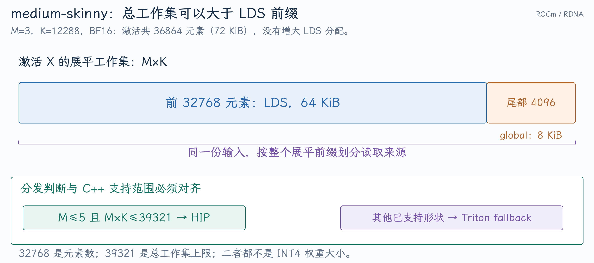

# 从 GEMM 分发 PR 追问 ROCm 算子、性能与验证

PR #53283 与 #52619 都复用了已有 HIP kernel，主要补齐 Python 分发条件。面试时需要说清：为何原条件漏掉合法 shape，底层执行究竟怎样组织，以及为什么局部加速不会按同一比例传到整个模型。

本文实现核对到 [`e8b32863a7`](https://github.com/vllm-project/vllm/commit/e8b32863a7e70f8331446ffe43192cf293053603)，该版本包含 medium-skinny 调整和单输出分支。历史 PR 测量分别引用[单输出 GEMM 开发笔记](../../../../../vllm/开发实践/单输出GEMM与Shared-Expert门控的ROCm优化.md)、[W4A16 分发开发笔记](../../../../../vllm/开发实践/RDNA-W4A16的形状分发与LDS边界.md)，不将两套实验混为一次联合测量。

## 1. 从模型 Linear 到 ROCm kernel 有哪些边界？

[未量化 ROCm wrapper](https://github.com/vllm-project/vllm/blob/e8b32863a7e70f8331446ffe43192cf293053603/vllm/model_executor/layers/utils.py#L291-L315)读取实际输入维度；[单输出分支](https://github.com/vllm-project/vllm/blob/e8b32863a7e70f8331446ffe43192cf293053603/vllm/model_executor/layers/utils.py#L350-L354)调用 `ops.wvSplitK`。量化路径则由 [RDNA apply](https://github.com/vllm-project/vllm/blob/e8b32863a7e70f8331446ffe43192cf293053603/vllm/model_executor/kernels/linear/mixed_precision/rdna_hybrid_w4a16.py#L378-L422)在 HIP skinny 与 Triton 间选择。

**追问：有 custom op 就不能 compile/Graph 吗？** 需要正确的算子注册、fake/meta shape 行为、mutability 与稳定执行契约。Custom op 可以成为图中的节点，但动态分配、隐含 CPU 同步或不一致 metadata 仍可能限制捕获。该量化 wrapper 用 compile-aware 的 profiling 分支避免 `record_function` 破坏 trace，不能将“有 fake 实现”当作完整 Graph 正确性证明。

**追问：为什么不是 Scheduler 来选 kernel？** Scheduler 决定 token 工作量，真实 M/K/N、量化布局与设备能力在模型和算子边界才完整可见。调度策略可影响 shape 分布，但不应替代底层的支持条件检查。

## 2. 单输出 GEMM 的 M/N 为什么容易说反？

`shared_expert_gate` 从 hidden vector 输出一个标量，[模型构造](https://github.com/vllm-project/vllm/blob/e8b32863a7e70f8331446ffe43192cf293053603/vllm/model_executor/models/qwen3_moe.py#L179-L193)设置输出 1、`quant_config=None`。因此整个模型量化为 INT4，这个 gate 仍可能使用 BF16/FP16 GEMM。

Wrapper 原条件为 `m>8 and 0<n<=5`，排除了输出为 1；修改为 `(m==1 or m>8) and 0<n<=5`，复用已有单输出模板。普通三请求 Decode 可是 `M=3,N=1,K=2048`；输入 `[2,3,2048]` 展平有 6 行，超出五行条件，不能因为外层 batch 是 2 就宣称可走该分支。

**追问：它与 routed expert gate 是同一个东西吗？** Routed gate 选专家及路由权重，shared gate 以 sigmoid 标量缩放共享 MLP 输出。若 MLP 输出 `[2,-1,4]`，gate logit 为 0，缩放后 `[1,-0.5,2]`；它没有决定 Top-k。

## 3. 小 GEMM 为什么不能只依赖通用大矩阵 kernel？

单输出 gate 权重 `N=1,K=2048`、BF16 只有 4 KiB。它的瓶颈可能是提交及执行固定成本，而不是大权重读带宽。模型每层重复这个节点，局部小开销会累积成可观延迟。

在该版本 [gfx1151 模板](https://github.com/vllm-project/vllm/blob/e8b32863a7e70f8331446ffe43192cf293053603/csrc/rocm/skinny_gemms.cu#L1257-L1273)中，wave width、每组 waves、输出 tile 和展开因子由 host 选择。名字叫 SplitK 并不足以说明实现用了跨 workgroup atomic；应读归约和 writer 的实际归属。

**追问：wave 和 workgroup 有什么区别？** Wave 是按 SIMD/SIMT 方式共同执行指令的一组 lane，workgroup 包含一个或多个 wave，拥有组内 LDS 与屏障。该 RDNA 路径使用 wave32，不应把它推广到全部 AMD GPU 或所有 kernel。

**追问：occupancy 越高越好吗？** 更多驻留 wave 可隐藏延迟，但寄存器、LDS、执行资源与数据复用可能形成权衡。优化要看 stall、吞吐和真实时间，不能只以一个 occupancy 百分比下结论。

## 4. medium-skinny 为什么允许输入超过 64 KiB LDS？

FP16/BF16 每元素 2 字节，`64*1024/2=32768` 个元素。Medium 总工作集上限为 `int(32768*1.2)=39321` 个元素，约束的是 `M*K`，不是 INT4 权重 `N*K`。

`M=3,K=12288` 时输入为 36864 元素，即 72 KiB。前 32768 元素（64 KiB）从 LDS 读，后 4096 元素（8 KiB）从全局读，仍未增加 LDS 分配。见[两种读取来源](https://github.com/vllm-project/vllm/blob/e8b32863a7e70f8331446ffe43192cf293053603/csrc/rocm/skinny_gemms_int4.cu#L449-L453)和[C++ 上限检查](https://github.com/vllm-project/vllm/blob/e8b32863a7e70f8331446ffe43192cf293053603/csrc/rocm/skinny_gemms_int4.cu#L704-L709)。

{ width="100%" }

**追问：怎么避免 Python/C++ 的维度名混淆？** Python 的 `M=token rows,N=out channels,K=in features` 对应 host 的 `N_in,M_in,K_in`。这里 `K_in*N_in` 和 Python `K*M` 是同一工作集，不是两条不同容量规则。

**追问：为何不能顺便支持 M=6？** Host 模板只准备了当前支持的行数，单纯扩大 Python 条件可能 launch 不支持的情况。阈值还要满足 dtype、K 对齐、group size 和 packed layout 等前置条件。

**追问：协作搬运为什么需要屏障？** 各 lane 只写入部分 LDS，其他 lane 的计算会读取这些位置。必须在读之前完成组内同步；inactive wave 若参与搬运，也应在屏障之后退出。见[搬运与同步顺序](https://github.com/vllm-project/vllm/blob/e8b32863a7e70f8331446ffe43192cf293053603/csrc/rocm/skinny_gemms_int4.cu#L402-L414)。

## 5. Prefill 是 compute-bound，Decode 是 memory-bound，可以直接这样回答吗？

Dense GEMM 约需 `2MNK` FLOPs。若小 M 下权重 BF16 读取约 `2NK` 字节主导，理想算术强度约 M FLOP/byte；若 INT4 读取约 `NK/2` 字节主导，理想值约 4M FLOP/byte，但未计 scales、activation/output、反量化与缓存复用。

Roofline 用 `min(算力上限,带宽*算术强度)`估计性能上界；小 kernel 的固定成本或并行不足可能让它远低于两条上界。这些计算帮助提出瓶颈假设，实际需要 profiler 与微基准验证。

**追问：大 batch 为什么可能改善 Decode 吞吐但变差 ITL？** 每轮生成更多 token、提高权重复用，但每轮工作也更多。系统总 token/s 可以上升，单请求等待每轮完成的间隔也可增加，不能只报系统吞吐。

## 6. 37.8 倍 kernel 加速为什么只有 12.79% 模型收益？

若优化部分原占时间比例 f、局部加速 s，其他部分不变，整体速度比是：

$$
S=\frac1{(1-f)+f/s}.
$$

教学上令 f=0.12、s=37.8，得到约 `1/0.88317=1.132` 倍，即吞吐约 +13.2%。这是假设下的算例，不是由 PR 测量反推出真实 gate 占比。

已有 PR 记录报告特定 BF16 单输出 shape 约 37.8 倍算子加速，对应 Qwen3.5 MoE 配置纯 Decode 吞吐约 +12.79%；medium-skinny 记录包含 Qwen3-8B batch 3 约 +63.43%、Qwen3-4B batch 4 约 +6.31%。这些不同模型、batch 和实验口径不能合并成统一收益区间，也不能外推到所有 ROCm 部署。

**追问：“提升 1.13 倍”和“提升 13%”怎样说准确？** “速度达到基线 1.13 倍”或“速度提升 13%”。若耗时降低 20%，相同工作吞吐为 `1/0.8=1.25` 倍，不能写成吞吐也提升 20%。

## 7. 怎么用 profiler 证明优化真的生效？

如果 Python 条件扩大了，但实际 batch 让 M 始终超过 5，优化不会被触发。应记录真实 token 行，而非仅记客户端并发。Torch profiler 的 `record_function` 可标识 wrapper 区间，GPU 活动与 ROCm profiler 可核对 launch、资源和执行时间；标记区间包含 wrapper 成本，不一定等于单个 kernel 的设备时间。

**追问：怎么测异步 GPU kernel 的时间？** CPU wall time 围绕 launch 主要测到提交，应使用设备 events 或 profiler。测量前 warmup，明确是否包括分配、repack、Graph replay 和同步，重复测量并看波动。对短 kernel，timing 工具的开销也要校准。

**追问：trace 里两个 stream 时间条重叠就能证明同时占用 CU 吗？** 它证明记录层面的执行重叠；如果需要确认资源占用或并发效率，还要结合设备活动和计数器。对 P/D 项目尤其要同时检查 overlap、Decode step 与客户端 ITL，避免把时间重叠直接等同于加速。

## 8. TTFT、ITL、TPOT、throughput 和 goodput 怎么区分？

请求在 0 ms 提交，五个输出 token 到达时间为 `[200,220,240,340,360]` ms：TTFT=200 ms，ITL=`[20,20,100,20]` ms，TPOT=`(360-200)/(5-1)=40` ms。平均生成速度为 25 token/s，但中间一次停顿为 100 ms。

单请求端到端为 360 ms。系统 output throughput 应用整个测量窗口的总输出 token 计算，不能直接把每请求速度相加而忽略并发与时间窗。Input+output throughput 与仅 output throughput 也不同。

**追问：P95 ITL 和 P95 TPOT 是同一指标吗？** 不是。前者可以对 token 间隔取分位，后者对请求均值取分位；长停顿在请求均值中可能被稀释。流式 chunk 还可能包含多个 token，必须确认工具如何映射时间戳。

**追问：goodput 的单位是什么？** 取决于定义，可为符合 SLO 的 requests/s 或 tokens/s。必须写清 TTFT/ITL/端到端阈值、计数方式与负载；没有 SLO 的“goodput 提升”无法核查。详细指标见[P/D 指标笔记](../../../projects/vllm-pd/01-论文与推理指标.md)。

## 9. 怎样设计 A/B，避免把启动和 batch 变化当作 kernel 收益？

**追问：并发为 128 就是 batch 128 吗？** 并发包括排队、Prefill 和等待输出的请求，实际 GPU batch 由调度决定。投机验证还让一条请求贡献多行。应同时看客户端并发、请求数、GPU token rows 和各类执行轮次。

**追问：为什么要关掉或固定 prefix caching？** 命中会改变 Prefill 计算量、入场与实际 batch。若 A/B 的命中率不同，不能将总收益归因于 kernel。固定缓存状态或分别报告冷/热结果。

**追问：只测一个小 batch 可以证明 dispatch 范围吗？** 不可以。应覆盖合法阈值附近、明确落入 fallback 的情况、dtype、bias、量化 group、K/N 对齐与 layout。用 representative 模型 shape 检查实际收益，避免每扩大一条条件就宣称全范围更快。

## 10. 面试官问“为什么 upstream 会接受这类 PR”，怎么答？

几行 diff 也可能修复重要行为，关键在真实影响与证据。#53283/#52619 复用已有 kernel，价值是让支持的 shape 到达正确路径；不能说成自己重新设计了全部 GEMM。量化和 Attention PR 则需解释为何接口语义影响实际数值。

**追问：回归测试应该放在哪层？** 分配与配置契约尽量用单元测试；索引和 mask 用 GPU 数值 reference；模型接入用必要集成/评测；性能微基准放 benchmarks。优先选择能捕获该失败、成本最低的层，而不是为每项变化都加大型端到端套件。

**追问：如果 reviewer 要求缩小范围呢？** 按最终改动重写问题、支持范围和验证结论，保留实质修复的证据。尚未合并就说当前状态，性能数字标明对应实验；PR 状态和代码实现能力是两个独立事实。
