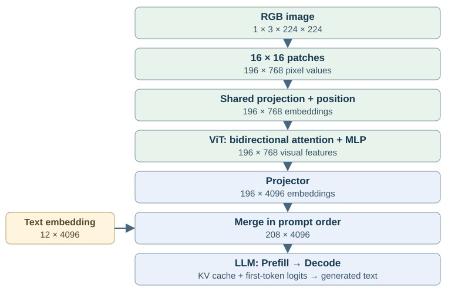

# Image → Patch Embedding → ViT → LLM：视觉输入与语言生成

来源：本次补充的多模态流程面试题；对应模型结构[第 1 题](../index.md#q14)。沿一张图像说明视觉特征怎样产生、接入语言模型并参与生成。先使用保留 patch token 的序列拼接路径，再比较 cross-attention 与视觉 token 压缩。

## 1. 从像素追踪到 LLM 输入 {#image-to-llm}

一张图片不会直接作为 JPEG 字节进入 Transformer。Processor 先解码图片，并按照视觉 encoder 的训练配置做颜色转换、缩放/裁剪、像素缩放和通道归一化，形成图像 tensor。以单张 224×224 RGB 图片为例，输入为 `[1,3,224,224]`。

下面是一组 **教学形状** ，用于说明 ViT/16 风格的 patch encoder 和 LLaVA 类序列接入；不表示某一个实际模型同时采用所有这些配置。设 patch size 为 16，视觉隐藏维度为 768，LLM 隐藏维度为 4096，文本长度为 12。图像高宽能被 patch size 整除，暂不使用多裁剪、CLS 和额外图像分隔符。

| 阶段 | 输入/输出形状 | 这一阶段新增了什么 |
| --- | --- | --- |
| Image preprocessing | `[1,3,224,224]` | 与训练配置一致的像素与几何布局 |
| Patch 划分 | `[1,196,768]` | 196 个 patch，每个包含 `16×16×3=768` 个像素值 |
| Patch Embedding + 位置编码 | `[1,196,768]` | 每个 patch 的可学习表示与空间位置 |
| ViT | `[1,196,768]` | 经过全图上下文混合的视觉特征 |
| Projector | `[1,196,4096]` | 与 LLM 隐藏维度兼容的视觉 embedding |
| Text Embedding | `[1,12,4096]` | 词表 token ID 对应的文本 embedding |
| 多模态序列合并 | `[1,208,4096]` | 按模型模板排列的图像与文本位置 |
| LLM | `[1,208,4096]` → 最后位置 logits `[1,V]` | 条件于图像和 prompt 的下一个文本 token 分布，V 为词表大小 |

Patch 的像素维度和视觉隐藏维度恰好都为 768，是这组配置的巧合：前者由 `P²C` 决定，后者由模型设置决定。若视觉维度改成 1024，Patch Embedding 就执行 `768→1024` 的映射。

{ width="100%" }

<strong class="study-key">图像被编码为连续视觉向量，LLM 使用这些向量作为条件；中间不要求先生成一段图片描述，也不要求给每个 patch 分配一个词表 ID。</strong>
{.study-core}

返回面试题：[01](../index.md#q14)
{.study-source}

## 2. Patch Embedding 为什么是可学习投影？ {#patch-embedding}

将图像划分为不重叠的 patch 网格：

$$
N=\frac{H}{P}\frac{W}{P}=\frac{224}{16}\frac{224}{16}=196.
$$

每个 patch 展平为行向量 `x_i[1,P²C]`。所有 patch 使用同一个投影矩阵 `W_E[P²C,D_v]` 和 bias `b_E[1,D_v]`：

$$
e_i=x_iW_E+b_E,\qquad z_i^{(0)}=e_i+p_i.
$$

`p_i` 是该网格位置的位置表示。共享投影学习局部图像模式，不同位置的 patch 不各自拥有一套投影权重。位置表示则帮助模型区分相同局部图案出现在哪里。

这个步骤可由 `Conv2d(C,D_v,kernel_size=P,stride=P)` 实现：输出 `[1,D_v,14,14]`，把空间轴展平并移到序列轴后得到 `[1,196,D_v]`。卷积核在所有网格位置共享；当 flatten 顺序和权重排列匹配时，它与逐 patch 的线性投影等价。实现不一定真的先物化 `[1,196,P²C]` 的中间 tensor。

“切 patch”只改变数据组织；“Patch Embedding”才引入可学习参数。Patch 刚投影出来时主要编码局部信息，跨 patch 的上下文来自后续 ViT。

### CLS、位置编码与图像分辨率怎样影响长度？

原始 ViT 分类结构可以添加一个可学习 CLS token，序列长度从 196 变成 197。但多模态模型不一定把 CLS 送给 LLM：可能选择某层 hidden states，去掉 CLS 并保留 patch tokens，也可能使用带 pooling 的特征或其他视觉 encoder。必须查模型的 feature selection 配置，不能默认“ViT 输出只有一个分类向量”。

位置表示可能是可学习的绝对位置，也可能采用其他二维位置机制。动态分辨率改变网格时，要遵守模型对位置插值、padding、resize 与裁剪的规则；插值位置向量本身不保证模型在任意分辨率下保持原有质量。

预处理也属于模型输入契约。若缩放、归一化或裁剪方式改变，同一张原图的视觉表示会改变；拉伸可改变物体比例，裁剪可能移除关键文字，padding 则需要相应有效区域处理。

## 3. ViT 如何把局部 patch 变成全图特征？ {#vit-context}

ViT 的输入 `Z[1,N,D_v]` 是一组局部表示。以常见 pre-norm Transformer block 为例：

$$
U=Z+\operatorname{MHA}(\operatorname{LN}(Z)),\qquad
Z'=U+\operatorname{MLP}(\operatorname{LN}(U)).
$$

这里的 MHA 指普通多头注意力。设有 12 个 heads、head width 为 64，`D_v=12×64=768`。Q/K/V 投影后，每组形状为 `[1,12,196,64]`，每个 head 的打分矩阵为 `[1,196,196]`：

$$
A=\operatorname{softmax}\left(\frac{QK^\top}{\sqrt{64}}+M\right),\qquad O=AV.
$$

普通图像 encoder 的 self-attention 通常是**双向** 的：一块文字 patch 可以根据同图中的按钮、边框和周围文字更新自己的表示。此处没有语言生成的未来标签问题，因为整张图片已经给定；若有 padding，mask `M` 还要处理无效位置。实际结构也可能采用窗口或其他稀疏组织，不能把全局 Attention 强加给所有视觉 encoder。

Attention 负责跨位置取信息；MLP 通常逐位置变换通道；残差保留和更新原有表示。经过多层后，一个视觉 token 仍对应某个输入位置，但其数值已含其他 patch 的上下文，不能再理解成那块像素的独立编码。

视觉 encoder 采用双向 Attention，不表示后面的 LLM 自动使用双向 mask。**两者分别遵守各自模型的可见性规则。**
{.study-mechanism}

## 4. Projector 怎样衔接视觉与语言表示？ {#projector}

ViT 特征宽度是 `D_v=768`，语言 embedding 宽度是 `D_l=4096`，无法直接在序列轴拼接。因此一个简单 connector 可以是线性投影：

$$
F[196,768]W_P[768,4096]+b_P[4096]
=E_{\mathrm{image}}[196,4096].
$$

也可以使用两层 MLP：`Linear → GELU → Linear`。这些逐 token connector 改变特征维度，通常保留 196 个视觉位置；它们本身不一定减少视觉 token 数。

维度兼容只是接口条件。Connector 需要通过图文训练或其他对齐过程，让输出被 LLM 用于预测相应的文本。把随机初始化的 768→4096 矩阵接到已训练 LLM 上，形状虽然合法，却不能保证 LLM 理解图像。视觉编码、connector 与 LLM 共同决定语义表现。

### 为什么还会出现 Resampler、Q-Former 或 Patch Merger？

若视觉网格很大，可用固定数目的 query 从视觉特征中提取较短序列。BLIP-2 的 Q-Former 就通过可学习 query 与视觉特征交互，输出较少的表示供语言侧使用；这与单纯逐 token 改维度的 projector 不同。Patch Merger 则可按空间邻域合并位置，例如每 2×2 个 patch 合并为一个，196 个位置变成 49 个，实际特征拼接和投影由模型定义。

减少 token 可以降低语言侧计算和缓存，但也压缩空间细节。OCR、细小目标和定位任务是否受影响，需要看训练、压缩方式与输入分辨率；不能认为“投影到了更宽的维度”就补回了被丢弃的位置细节。

## 5. 视觉特征怎样进入 LLM？ {#llm-integration}

### 序列拼接：占位符代表一段连续向量

设模板概念上是“图片 + 请描述这张图”。文本先 tokenizer 成词表 ID，再经 LLM embedding table 查出文本向量；图像经过视觉 encoder 和 connector 产生视觉向量。模型按模板规定的位置，将图像占位符展开或替换为一段视觉 embedding。

教学例子的图像 196 个、文本 12 个，合并后 `inputs_embeds[1,208,4096]`。真实模板可能包含 BOS、图像边界、新行、crop 标记等，实际总长度要按最终展开序列统计。**196 个视觉 embedding 不表示 tokenizer 生成了 196 个有视觉语义的词表 token。**

LLM 第一层再从这份混合 embedding 计算 Q/K/V。Projector 的输出不是 KV Cache：各层先经过本层计算与投影，才建立各自的 K/V；不能直接把视觉 encoder 的 K/V 写进语言 self-attention cache。

语言侧还需生成正确的 positions 和 attention mask。采用普通 causal decoder 时，位于图片后的问题和回答可以读取此前视觉位置；一些模型允许同图像区间内部双向 Attention，或使用多维 RoPE 编码空间位置，这些是明确的模型设计。ViT 输出有位置表示，并不替代 LLM 自己的位置机制。

### Cross-attention：视觉特征可作为单独的 memory

另一种接入方式保留视觉特征 `F[N_v,D_v]`，让 decoder 某些层从当前语言状态产生 Query，并对视觉 memory 产生 Key/Value：

$$
Q_l=H_lW_{Q,l},\qquad K_l^{\mathrm{vision}}=FW_{K,l},\qquad
V_l^{\mathrm{vision}}=FW_{V,l}.
$$

图像特征不必全部扩展成语言 self-attention 序列位置，但会带来 cross-attention 的计算与缓存。视觉特征 `F` 可以共享，层特定投影后的 cross K/V 通常不同。

CogAgent 同时有两路视觉编码：低分辨率特征融入 decoder 输入，高分辨率特征通过逐层 cross-attention 提供细节。详见现有[CogAgent 模型接入与缓存生命周期](../../../projects/vllm-rocm/01-CogAgent模型接入与量化推理.md)。这里以它说明混合接入，不把其特定长度套到前面的 224×224 教学例子。

| 接入方式 | 语言 self-attention 序列 | 需要关注的状态 |
| --- | --- | --- |
| 视觉 embedding 拼接 | 增加视觉位置 | 各 decoder 层的 self KV |
| 单独 cross-attention | 不要求按视觉 token 数增加语言位置 | 视觉 memory、层特定 cross KV、语言 self KV |
| 混合接入 | 两类开销同时存在 | 分别统计视觉输入位置和 cross memory 长度 |

## 6. Prefill 与 Decode 分别执行什么？ {#prefill-decode}

在前面的序列拼接例子中，第一次请求的输入包含 196 个视觉位置和 12 个文本位置。LLM **Prefill** 处理 208 个已知位置，按 mask 建立各层 KV，并用最后一个有效 prompt 位置的 logits 预测第一个回答 token `y₁`。

若这个实例使用 32 层、8 个 KV heads、head width 128、BF16，额外 196 个视觉位置的 self KV 数值载荷为：

$$
32\times2\times196\times8\times128\times2
=25{,}690{,}112\ \mathrm{bytes}=24.5\ \mathrm{MiB}.
$$

这里只计算 decoder 中视觉位置的 K/V；未包括文本 KV、权重、ViT 中间激活、cross KV、对齐和分页浪费。把 ViT 的 768 维乘上视觉 token 数，算出来的是视觉特征容量，不能代替上述语言 KV。

采样 `y₁` 后，下一次 **Decode** 输入 `y₁`，读取已有 208 个位置的 KV，建立 `y₁` 自己的 KV，再预测 `y₂`。对于标准一步 Decode：

| 阶段 | 当前模型输入 | 完成本次前向后的 KV 长度 | 由当前 logits 预测 |
| --- | --- | ---: | --- |
| Prefill | 图像位置 + 文本 prompt，共 208 个 | 208 | `y₁` |
| 第一次 Decode | `y₁` | 209 | `y₂` |
| 第二次 Decode | `y₂` | 210 | `y₃` |

刚采样出来的 token 要在下一次前向中计算各层状态，不能把“已经采样 y₁”当成“KV 已经包含 y₁”。EOS、停止条件或投机推理会改变后续执行安排，表格只描述普通自回归路径。

固定图片在本次生成中通常不再执行 ViT；图像位置信息通过语言 KV，或视觉 memory/cross KV，持续被 Decode 消费。**不重新编码图片不等于 Decode 不读取视觉相关状态。**
{.study-mechanism}

跨请求复用视觉特征或多模态 prefix KV，还要核对图片、预处理、模型、adapter、位置和 mask 等兼容条件。同一个 `<image>` 占位 token 可以对应不同图片，不能仅凭文本 token IDs 判定图像缓存相同。

返回面试题：[01](../index.md#q14)
{.study-source}

## 7. 分辨率与视觉 token 为什么影响推理性能？ {#performance}

固定 patch size，将 224×224 增大到 448×448，网格从 14×14 变为 28×28，patch 数从 196 变成 784，即 **4 倍** 。若采用相同 dense ViT 层，QK/PV 的位置配对项按 `N²` 增长，理论工作量变为 **16 倍** ；线性投影、MLP 等项通常按 N 增长。这不表示整套 ViT 的耗时必然增加 16 倍。

经典多头 dense Attention 的 QK 与 PV 两次乘法合计约 `4N²D_v` FLOPs；QKV/输出投影和 MLP 还包含 `ND_v²`、`ND_vD_ff` 量级的项。FlashAttention 可以避免完整物化分数矩阵，减少显存读写，但保持同样 dense 可见性时，位置对的计算规模仍在。

图像接入序列后，LLM 的有效 prompt 长度为 `S=T+N_v+特殊位置`。标准 dense causal Prefill 的 Attention 成本含 S² 项，线性层工作与 S 相关；Decode 每步仍需读取允许访问的视觉 KV。因此图像预处理、ViT、connector、LLM Prefill 和后续 Decode 都可能影响体验，不能只测一个视觉 kernel。

多裁剪/高分辨率策略还可能把一张原图转换成多个视图，各视图分别编码并按空间关系合并。部署时应查看 processor 实际输出的 crop 数、patch 数、connector 后长度和最终 prompt 长度，分别计量视觉编码时间、TTFT 与 Decode 速度。

**可见性和缓存边界也决定优化是否成立。** 若语言侧图像区间具有双向依赖，早图像位置可能依赖后图像位置；把图像任意切成小块就发布前半段 prefix KV，可能与整段计算不等价。Chunked Prefill 必须遵守模型的调度和依赖规则。
{.study-caution}

## 8. 对齐训练让这条链路具备什么能力？ {#alignment}

ViT 提供图像表示，connector 把表示接到语言空间，LLM 学习在这些条件下生成正确文本。以 LLaVA 类训练为例，可以先使用图文数据学习 connector 对齐，再通过多模态指令数据训练问答能力；冻结哪些模块、是否更新视觉 encoder 或 LLM 取决于具体方案。

对于以回答文本为监督的自回归训练，视觉位置通常提供条件，损失主要计算在模型规定的文本目标位置；不是每个 patch 都要被监督成一个文字标签。训练时可能使用真实的较早答案 token 作为输入，推理时则使用已生成 token，视觉条件在两种情况下都要按相同输入规则接入。

面试追问“为什么 LLM 能理解图片”时，可以沿这条因果链回答：**预训练视觉 encoder 提取可用图像信息，connector 与图文训练建立接口和语义对齐，语言模型在视觉条件下学习文本预测。** 仅调整 tensor 维度不能提供全部能力，先 OCR 或先生成 caption 也不是所有视觉语言模型的必经流程。

机制依据：[ViT](https://arxiv.org/abs/2010.11929)、[LLaVA / Visual Instruction Tuning](https://arxiv.org/abs/2304.08485)、[BLIP-2](https://arxiv.org/abs/2301.12597)、[CogAgent](https://arxiv.org/abs/2312.08914)。具体 CogAgent 接入证据沿用链接的项目分析。

