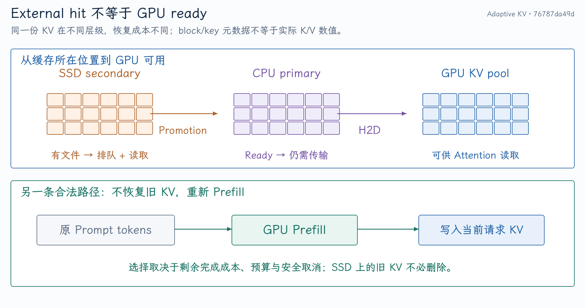
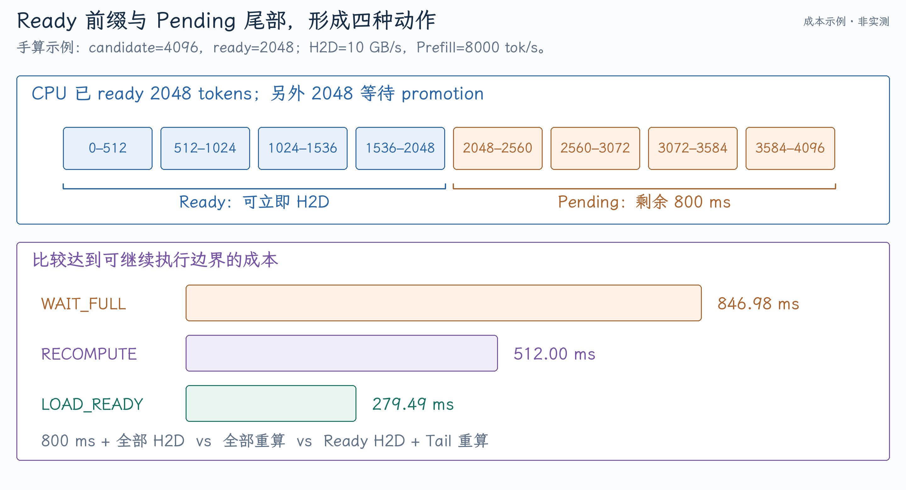
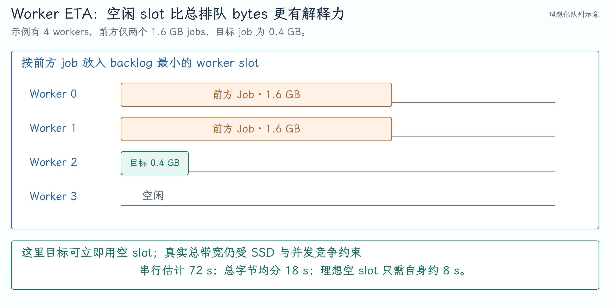

# Adaptive KV Offload：分层缓存与 Load-vs-Recompute 成本

缓存命中省掉了 KV 的生成，但不一定省掉请求等待。若 KV 还在 SSD，必须经过存储队列、SSD→CPU promotion 和 CPU→GPU H2D 才能被 attention 使用。短 prefix 的重新 Prefill 有时比恢复旧 KV 更快；本项目围绕这个时间差，在 vLLM 的 external prefix lookup 阶段选择恢复或重算。

实现依据 [`76787da49d`](https://github.com/tangzzycc/vllm/commit/76787da49dba2016e9feebca4980c18cb7694a71)，对应 `feature/adaptive-kv-recompute-v2`。本文解释决策所需的基础与成本模型；[第二篇](02-调度接入与异步生命周期.md)追踪动作如何改变请求状态；[第三篇](03-性能证据与面试问答.md)讨论实验与服务级取舍。

## 1. KV Cache 到底省掉了什么

自回归 decoder 的每层 attention 在位置 t 需要当前 Query 和此前位置的 K/V。把过去的 K/V 保存下来，Decode 不必反复为整个历史计算投影，但仍需读取历史 KV 并执行 attention。

Prefix caching 进一步让新请求复用相同前缀的 KV。KV 属于具体模型、token prefix、位置、adapter 和其他影响计算的条件，不是看到某段文字相似就能共享。Hash 体系通常把前序 block hash 与当前 tokens、额外 key 组合起来，形成有顺序的前缀身份。

例如 token 序列 `[a,b,c,d,e,f]`，block size=2，可有 `[a,b]→[c,d]→[e,f]` 三个关联 hash。请求 `[a,b,c,d,x,y]` 可命中前两块，后两 token 仍需计算；中间缺一块的普通 full attention prefix 不能随意跳过后面的“局部命中”。Sliding-window 或 hybrid 模型有不同需求，恢复范围必须按 cache group 规则计算。

### 三种容易混淆的“缓存”

| 名称 | 保存对象 | 命中后的意义 |
| --- | --- | --- |
| GPU prefix cache | GPU 上已有的完整 KV blocks | 可以直接跳过对应 Prefill |
| External KV cache | CPU 或 secondary tier 中的 KV | 还需恢复到 GPU |
| Model weight offload | 模型参数 | 为模型权重腾空间，和 prefix reuse 不同 |

本项目是 external KV 恢复策略，不是 LoRA 权重卸载，也不是 P/D 之间的 GPU IPC 共享。

## 2. GPU、CPU、SSD 三层为什么都有价值

{ width="100%" }

GPU KV 可直接用，但容量最受约束；CPU 层便于 H2D，但速度与 NUMA、pinned memory、总线有关；SSD 容量大，却有文件访问、排队、读取和 CPU staging 成本。

Offload store 是把已算 KV 向外保存；load 是新请求或重用路径把 KV 恢复。当前优化主要作用于 load 选择，并没有重新实现整个多层缓存系统。既有 tiering 框架负责 primary tier、secondary tier、promotion、store cascade 和请求资源管理。

上游背景可读 [KV Offloading Connector 设计文章](https://vllm.ai/blog/2026-01-08-kv-offloading-connector)。当前分支的使用契约见 [KV offloading usage](https://github.com/tangzzycc/vllm/blob/76787da49dba2016e9feebca4980c18cb7694a71/docs/features/kv_offloading_usage.md)。

### 缓存命中率为什么不能单独证明性能

假设方案 A 命中率 95%，但命中请求都等 SSD 2 秒；方案 B 命中率 90%，未命中的短请求只花 0.4 秒重算。A 的命中率更高，用户 TTFT 仍可能更差。

命中至少需要配合位置层级、恢复 bytes、ready 时间、排队与最终 TTFT。提高命中率不等于提高满足 SLO 的 goodput。

## 3. 从模型结构算出需要恢复多少 bytes

普通 full-attention KV、所有层同结构时，每 token 的数值容量是：

$$
\mathrm{KVBytesPerToken}
=L\times2\times H_{kv}\times D_h\times b,
$$

L 为层数，2 为 K/V，$H_{kv}$ 为 KV heads，$D_h$ 为 head dim，b 为每元素字节数。GQA 要用 KV heads，不能用 Query heads；权重 FP8/INT4 也不自动改变 KV dtype。

以归档中的 Qwen3-0.6B BF16 KV 为例：

$$
28\times2\times8\times128\times2=114\,688\ \mathrm{bytes/token}.
$$

因此：

| Prefix | KV 数值量 | 二进制单位 |
| --- | ---: | ---: |
| 4096 tokens | 469,762,048 bytes | 448 MiB |
| 16,384 tokens | 1,879,048,192 bytes | 1792 MiB |

4K prefix 的 KV 接近半 GB，而 Prefill 只要数百毫秒时，深 I/O 队列就可能让重算更便宜。

### 实际实现按 block 与 group 计算

不能把所有模型都当作这条公式。TP 分片、多种 attention group、滑窗、Mamba state、不同 block size，会改变每 worker 实际恢复的 bytes。

分支在 [`_estimate_h2d_bytes()`](https://github.com/tangzzycc/vllm/blob/76787da49dba2016e9feebca4980c18cb7694a71/vllm/distributed/kv_transfer/kv_connector/v1/offloading/scheduler.py#L644-L682) 中逐 group 计算：从 local computed position 到候选边界，按 `tokens_per_block` 上取整 block 数，再受该 group 的 load window 限制，乘 `worker_kv_bytes_per_block` 后求和。

这里估的是 worker transfer bytes，不是把整个 TP4 模型的 KV 总量重复放进每个 worker。Block table 是位置映射，GPU tensors 是真实值，offload keys 是恢复身份，三者的大小也不同。

## 4. 为什么比较剩余完成成本而不是纯带宽

系统设计上需要比较：

$$
T_{load}=T_{secondary\ queue}+T_{SSD\ read}+T_{H2D\ queue}+T_{H2D},
$$

$$
T_{recompute}=T_{GPU\ queue}+T_{Prefill}.
$$

双方最终都需要恢复到一个可继续执行的位置。只用“SSD 带宽 3 GB/s”和“GPU 很快”无法判断前面排了多少请求、GPU 有没有余量。

**当前 V2 只近似建模其中一部分**：load 包含 promotion ETA、H2D backlog 与传输，recompute 使用静态 Prefill TPS 加 fixed overhead；没有直接预测实时 GPU queue 和对其他请求的边际干扰。这个缺口决定了它仍需要 admission budget，也决定了单请求预测正确不保证全服务更快。

## 5. Ready frontier 与 candidate frontier 怎样提供四种选择

Ready 是已经在 CPU primary 可加载的连续前缀；candidate 还包括正在 secondary promotion 的候选前缀。两者从当前 local GPU 已计算位置向后计数。

| 动作 | 条件与行为 |
| --- | --- |
| `LOAD_FULL` | CPU 已 ready，加载完整 candidate |
| `WAIT_FULL` | candidate 仍 pending，等完整恢复 |
| `LOAD_READY` | 加载 ready 部分，仅重算尾部 |
| `RECOMPUTE` | 放弃本次 external hit，重算候选区间 |

其中 `LOAD_FULL/WAIT_FULL` 是原 load 路径的两种状态，不是额外的两个加速 kernel。决策对象保留 action、baseline action、成本、重算 tokens 和 reason，见 [AdaptiveDecision 与 policy](https://github.com/tangzzycc/vllm/blob/76787da49dba2016e9feebca4980c18cb7694a71/vllm/v1/kv_offload/adaptive_policy.py)。

### 一个完整的成本例子

以下是假设参数，用于手算，不是某轮 profiler 实测：

- Candidate=4096 tokens，ready=2048 tokens。
- 完整 KV=448 MiB，ready=224 MiB。
- H2D 有效带宽=10 GB/s，前方 backlog=0。
- 剩余 promotion ETA=800 ms。
- Prefill TPS=8000 tok/s，fixed overhead=0。

得到：

$$
T_{wait}=800+469\,762\,048/10^{10}\times1000\approx846.98\ \mathrm{ms},
$$

$$
T_{recompute}=4096/8000\times1000=512\ \mathrm{ms},
$$

$$
T_{ready}=234\,881\,024/10^{10}\times1000+2048/8000\times1000
\approx279.49\ \mathrm{ms}.
$$

最便宜的是 `LOAD_READY`。若 safety factor=1.15、min savings=50 ms，必须满足：

$$
T_{wait}>1.15\times T_{selected}+50
\approx371.41\ \mathrm{ms}.
$$

846.98 ms 超过阈值，可提出加载 ready+重算 tail 的决策。若 promotion 只剩 100 ms，则 wait 约 146.98 ms，保留正常 load。

{ width="100%" }

动作提出后还要通过预算和取消检查；cost model 的建议不是最终执行路径。

## 6. 多 worker 队列为什么不能按字节简单串行累加

假设有 4 个 load worker，前方两个 job 各 1.6 GB，目标 job 0.4 GB，单 worker 50 MB/s。

把全部串行累加会估成 $(1.6+1.6+0.4)/0.05=72$ 秒。直接除以 worker 数又会估成 18 秒。但是仍有两个 worker 空闲，理想情况下目标 job 的排队接近零，只需自身约 8 秒。

V2 将前方 job 按字节依次放入当前 backlog 最小的 worker slot：`[1.6,1.6,0,0]` GB，目标等待最小 slot 为 0。再加自身传输时间，并减已消耗 elapsed。

{ width="100%" }

实现见 [`_promotion_seconds()`](https://github.com/tangzzycc/vllm/blob/76787da49dba2016e9feebca4980c18cb7694a71/vllm/distributed/kv_transfer/kv_connector/v1/offloading/scheduler.py#L760-L788)。Filesystem 的 read-priority 和 write-priority threads 都能在自己的首选队列为空时帮助另一个队列，因此 `load_parallelism` 包括两组 worker。

### 这个 ETA 仍是近似

真实 filesystem job 由多条 per-block tasks 组成，worker 共享盘的带宽；slot 模型把 job 字节作为调度单元，不是精确模拟所有 tasks。磁盘总带宽不会因为线程数翻倍而无条件翻倍，write backlog 也会减少可用 load worker。`elapsed` 是近似剩余时间修正，不是逐 block 的精确进度条。

该模型比简单 aggregate queue 更能表达空闲 slot，但需要用实际 trace 校准。不能把 worker count 当作免费的带宽倍数。

## 7. 带宽估计怎样处理冷启动和噪声

[TransferRateEstimator](https://github.com/tangzzycc/vllm/blob/76787da49dba2016e9feebca4980c18cb7694a71/vllm/v1/kv_offload/transfer_estimator.py) 保存有界 `(bytes,elapsed)` 窗口；样本达到最少数量后用：

$$
\widehat B=\frac{\sum bytes}{\sum elapsed}.
$$

它不是对各次 `bytes/elapsed` 做算术均值，也不是 EWMA。比如 1 GB/1 s 与 9 GB/3 s，聚合速率为 2.5 GB/s，两个速率的算术平均为 2 GB/s。

少于最少样本时使用 seed；seed 也缺失则成本不可用，策略保持 baseline。零大小、非正时间、无穷或 NaN 时间不进入估计。H2D 与 secondary 分别观察，Prefill TPS 当前由配置提供。

并发 job 的 duration sum 可能大于 wall time，因此估出的“服务速率”也不一定等于整块 SSD 的带宽。它适合该成本模型的近似输入，要结合 worker 语义理解。

## 8. Admission 为什么需要三种预算

单请求重算获益不代表允许所有请求同时重算。多个 4K Prefill 会形成新的 GPU backlog，影响 Decode、继续 load 的请求和后续到达者。

| 预算 | 控制什么 | 单独使用的不足 |
| --- | --- | --- |
| Active requests | 同时重算的请求数 | 请求长度差异大 |
| Active tokens | 已接纳、尚未到调度完成边界的重算工作量 | 边界推进后释放，可连续再接很多 |
| Rolling-window tokens | 最近窗口累计接纳的工作量 | 仍需 active 限制瞬时拥塞 |

假设 10 秒窗口允许 8192 tokens。两个 4K 请求先后推进到重算边界，active 可以归零，但窗口预算仍用满；不能再接第三个 4K，直到历史记录过期。**Release 释放 active 预算，不立即归还已经实际接纳的窗口预算。** 若取消失败导致根本没开始重算，则 rollback 同时撤销 active 和本次 window reservation。

当前 active 计数按 Scheduler 可见进度释放：某轮 scheduled tokens 已覆盖 bypass 目标，就可以清 reservation。它不是基于 GPU 完成 event 的精确在途计数。尤其在异步执行中，已提交的末批 GPU 工作仍可能未完成；滚动预算仍有约束价值，但不能把 active tokens 等同于此刻 GPU 上全部重算工作。

配置支持 `off/observe/enforce`：off 保留原行为，observe 记录建议但不执行，enforce 才启用动作。Safety factor、最小收益、最小/最大重算长度降低噪声误判；预算则控制新增 GPU 工作。它们都不等同于已经实现在线 SLO 反馈控制。

## 9. 理论收益与当前工程实现的分界

可以把这个项目解释为两类资源之间的请求路由：I/O 忙而 GPU 有余量时，给少量请求用计算替代数据恢复；GPU 忙而缓存恢复快时，继续 load。

当前具体做法是静态 Prefill 成本、在线 transfer 观察、近似 worker ETA、四种 prefix 动作和有界 admission。它没有对同一请求同时启动 load/recompute 后抢 winner，也没有自动感知全部 GPU 压力并自适应调整 budget。

后续动态预算可以利用 GPU queue、running/waiting 数、batch 饱和度、Decode 延迟和 storage backlog。但要先保持现有取消、预算与 block 生命周期的不变量，再增加反馈信号。先解决策略正确落地，再谈控制器稳定性。
