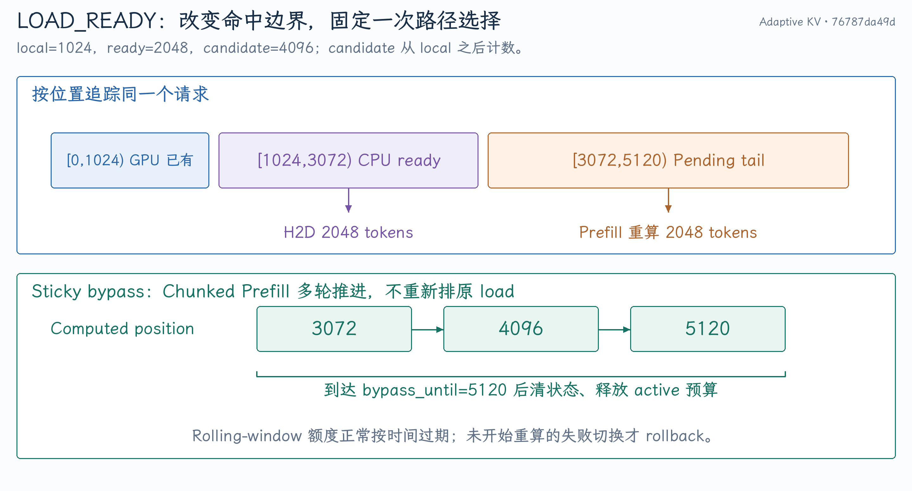
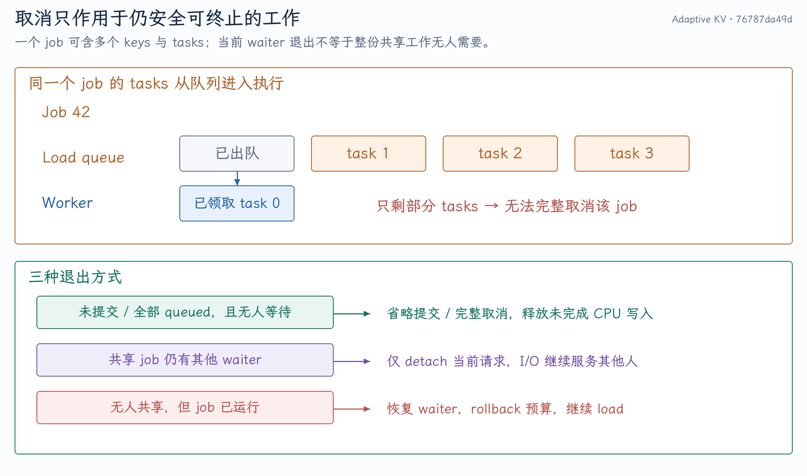
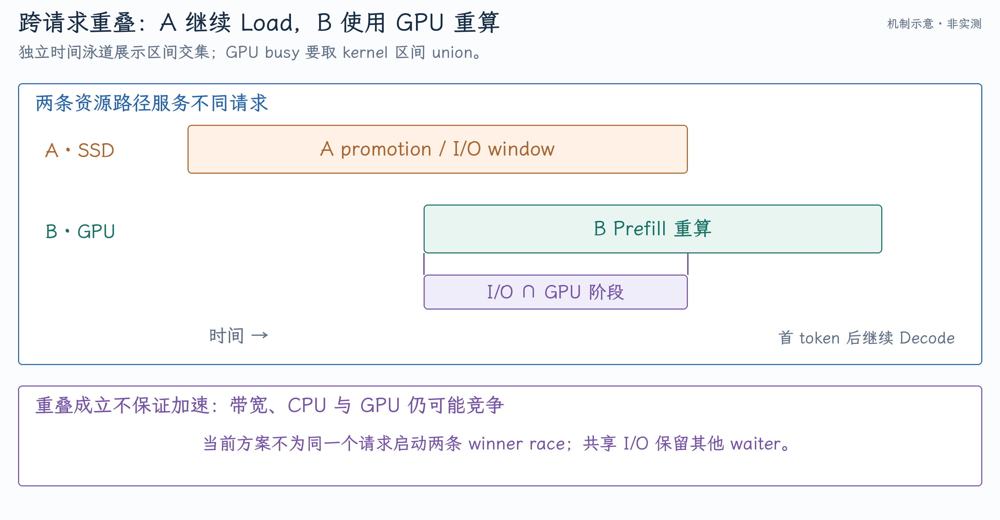

# Adaptive KV Offload：调度接入、取消与缓存生命周期

Load-vs-Recompute 的成本比较只是第一步。真正的工程难点是：lookup 可能已经预留 CPU slot，promotion 可能被多个请求等待，I/O job 可能部分开始，GPU load 也可能在途。切换路径时必须明确谁还会读写这份缓存，何时能释放，以及取消失败后如何回到正常 load。

源码依据 [`76787da49d`](https://github.com/tangzzycc/vllm/commit/76787da49dba2016e9feebca4980c18cb7694a71)。[第一篇](01-KV分层缓存与重算成本.md)解释四种动作和成本，[第三篇](03-性能证据与面试问答.md)给出实验、Profiler 证据及追问。

## 1. 策略放在请求链路的哪个位置

```text
V1 Scheduler 获取本地 GPU prefix 命中
  → OffloadingConnector scheduler 查询 external prefix
  → Tiering manager 查询 CPU/secondary 并推进 promotion
  → 形成 ready/candidate/wait_reason
  → adaptive cost + admission + detach/cancel
  → 返回 external matched-token 边界
  → V1 Scheduler 分配 GPU blocks，决定 load/Prefill 工作
  → Worker 提交 H2D 或执行模型
  → 完成通知、状态更新与资源回收
```

修改发生在 external prefix 匹配阶段，**GPU H2D job 创建之前**。已进入 GPU load 的请求不会被任意改成另一条写入路径。成本策略不直接 launch 模型，也不直接修改所有 GPU KV tensors。

调用入口和决策实现位于 [Offloading connector scheduler](https://github.com/tangzzycc/vllm/blob/76787da49dba2016e9feebca4980c18cb7694a71/vllm/distributed/kv_transfer/kv_connector/v1/offloading/scheduler.py)。

### 谁负责哪一种状态

| 所有者 | 状态与职责 |
| --- | --- |
| V1 Scheduler | 请求可执行性、token budget、GPU block 分配与模型调度 |
| Offloading scheduler | external 命中边界、load/store job、adaptive bypass |
| AdaptiveOffloadPolicy | 成本建议、active/window admission |
| TieringOffloadingManager | CPU slot、secondary promotion、waiter 与完成收尾 |
| Filesystem manager/thread pool | 实际 per-block I/O、队列与可取消性 |
| Worker | 实际 H2D/D2H、GPU tensors 与完成 ACK |

逻辑 KV block ID、CPU chunk ID 和 offload key 不是同一身份。策略选择重算，也不意味着立即删除 SSD 中所有已保存 KV。

## 2. Lookup 为什么需要结构化结果

原路径的“命中多少 token / None 表示等待”不足以告诉策略：CPU 已准备多少、secondary 还差多少、现在等待的是 lookup 还是 GPU load。

分支增加 `OffloadLookupResult` 等结构，将 ready tokens、candidate tokens、partial-tail boundary、pending keys 与 wait reason 放在同一份结果中。`RequestOffloadState` 记录 local computed position、各 group 的命中状态及 bypass 信息。见 [结构与 lookup](https://github.com/tangzzycc/vllm/blob/76787da49dba2016e9feebca4980c18cb7694a71/vllm/distributed/kv_transfer/kv_connector/v1/offloading/scheduler.py)。

| 等待原因 | 能否进入成本选择 | 原因 |
| --- | --- | --- |
| NONE | 可以 | CPU ready，可比较 H2D 与 Prefill |
| PROMOTION | ETA 可用时可以 | secondary→CPU 仍 pending |
| RETRY | 保持等待 | 当前 lookup 尚不能形成可靠候选 |
| GPU_LOAD | 保持等待 | 已处于 GPU load 生命周期 |

普通 full attention 取连续 prefix；滑窗、hybrid group 的 lookup 还要在不同 chunk/token span 间收敛。Partial tail 要按最终选择边界记录，不能先选择 ready 再继续 touch 完整 candidate 的范围。

## 3. 从 1K 本地 KV、2K ready 到 4K candidate

用 token 区间解释，不混用“总位置”和“新增 external 长度”：

- GPU 已有位置 `[0,1024)`，local computed=1024。
- 从位置 1024 向后，ready=2048 tokens，结束于 3072。
- Candidate=4096 tokens，结束于 5120。
- `[3072,5120)` 的 2048 tokens 仍在 promotion。

若选择 `LOAD_READY`：

```text
[0,1024)       GPU KV 直接复用
[1024,3072)    加载 CPU ready KV
[3072,5120)    普通 Prefill 重算
```

预留重算 2048 tokens，`adaptive_bypass_until=1024+4096=5120`。选择 `RECOMPUTE` 则 external hit 返回 0，预留 4096 tokens；本地已有 1K KV 仍有效，不是把整请求从位置 0 强制重算。

{ width="100%" }

`LOAD_READY` 返回 ready tokens 并要求加载，`RECOMPUTE` 返回 0 且不创建外部 load。V1 Scheduler 继续采用已有 Prefill 路径为缺失区间生成 KV。见 [`_apply_adaptive_policy()`](https://github.com/tangzzycc/vllm/blob/76787da49dba2016e9feebca4980c18cb7694a71/vllm/distributed/kv_transfer/kv_connector/v1/offloading/scheduler.py#L790-L869)。

### Sticky bypass 为什么必要

Chunked Prefill 可能多轮才能算到 5120。如果下一轮又查询原 external key，可能重新排同一个 promotion，出现 load/recompute 来回切换，或一边重算一边重复恢复。

Bypass 在目标边界前持续让请求走既定路线；达到边界后释放 active 预算并清状态。它稳定一次选择，不是永久关闭这个请求的全部缓存，也不是基于延迟反馈的 hysteresis 控制器。

这里“达到边界”包含调度进度：`_update_req_states()`发现 `num_computed_tokens + scheduled_tokens >= bypass_until` 时就会释放。它不等待本批 GPU 完成 event；active budget 控制尚未调度到边界的 reservation，不能当作精确 GPU 在途工作计数。

## 4. Promotion 从 lookup 到真正 I/O 有几个阶段

Tiering manager 先为待恢复 key 预留 CPU primary slot，将其标记为 in-flight，再延迟到`on_schedule_end()`统一提交。这能让同 step 的后续 lookup 看到 pending，避免重复申请同一个 key。

当前按`(tier,request)`组成 batched promotion，job 内可含多个 keys 和 CPU chunk IDs。`PromotionState`记录创建/提交时间、job ID 和 waiter 集合。见 [`_initiate_promotion()`与 flush](https://github.com/tangzzycc/vllm/blob/76787da49dba2016e9feebca4980c18cb7694a71/vllm/v1/kv_offload/tiering/manager.py#L447-L556)。

{ width="100%" }

| 状态 | 已有物理动作 | 本请求退出时 |
| --- | --- | --- |
| Prepared/unsubmitted | CPU slot 已预留，I/O 还未提交 | 移除 waiter，flush 省略无人需要的 key |
| Queued | job 已入队，所有 tasks 仍未开始 | 无人需要时可取消整个 job |
| Running/partially started | 至少一条 I/O task 已领取 | 无法保证取消完整 job；按 guard 处理 |
| Shared | 其他请求仍等待同 key/job | 只移除当前 waiter，保留其他人的工作 |
| Completed | CPU cache 已 ready | 正常加载或缓存复用，完成收尾 |

“请求取消”和“取消共享 I/O job”是不同操作，不能只用一个布尔变量替代两者。

## 5. 先 reserve，再 detach，失败时 rollback

[`_start_adaptive_bypass()`](https://github.com/tangzzycc/vllm/blob/76787da49dba2016e9feebca4980c18cb7694a71/vllm/distributed/kv_transfer/kv_connector/v1/offloading/scheduler.py#L682-L712)的次序是：

1. 尝试预留重算请求数、tokens 和窗口额度；失败保持 baseline。
2. 有 pending keys 时调用 manager 移除当前 waiter 并处理取消。
3. Detach 失败：恢复等待关系，rollback 本次预算，记录`promotion_in_flight` rejection。
4. 成功后记录 bypass 边界、reserved tokens 与 action，返回新的命中结果。

若先放弃 load 再检查预算，可能既没有重算名额，又失去了原恢复路径。若只 release active 而不 rollback 窗口预算，失败请求也会消耗最近窗口额度。

这是一段明确的状态事务，不是 GPU 内存数据库事务；回滚的范围是本次 reservation 与相关 waiter 关系。

## 6. Queued job 为什么必须完整取消

Filesystem pool 包含 load/store 两条队列，两组线程优先服务自己的队列，空闲时也帮助另一条。每个 batched job 分成多条 per-block task，共享`JobState`计数。

`cancel_load(job_id)`持有 condition lock，统计该 job 仍在 load queue 里的 task 数。仅当数量等于 job 总 tasks，才证明没有 task 被 worker 取走，可以整体移除并减少 inflight job 数。

若已有一条 task 运行，队列里只剩部分 task，返回 False。不能只删除剩余 tasks 然后假装 job 取消成功，因为已运行 task 可能继续写 CPU slot，完成计数也会失衡。见 [DualQueueThreadPool](https://github.com/tangzzycc/vllm/blob/76787da49dba2016e9feebca4980c18cb7694a71/vllm/v1/kv_offload/tiering/fs/thread_pool.py)。

Manager 取消成功后，从 job 表删除 metadata，调用 primary`complete_write(...False)`撤销未完成写入，并清 promotion 记录。这样不会把未写完的 CPU slot 发布成 ready。

### 共享 promotion 是重要例外

[`detach_pending_load()`](https://github.com/tangzzycc/vllm/blob/76787da49dba2016e9feebca4980c18cb7694a71/vllm/v1/kv_offload/tiering/manager.py#L633-L677)先移除当前请求 waiter。若同 job 的任意 key 仍有其他 waiter，保留该 job，当前请求可以脱离等待；这时 I/O 继续服务别人。

因此不能说“所有 running promotion 都禁止当前请求重算”。准确规则是：**无人需要且要终止的 job，若已经开始而不能完整取消，则当前切换失败；仍被其他请求需要的共享 job 可以继续运行，当前请求只退出自己的等待。**

共享 job 继续写的是其 CPU primary slots，重算写的是当前请求 GPU KV；必须维持各自所有权。共享 I/O 存在不等同于同一请求同时启动两条竞赛路径。

## 7. Finish、preemption、reset 怎样收尾

`_finish_adaptive_bypass()`释放 active requests/tokens，并清 bypass/action/reservation。它出现在达到目标边界、请求结束、抢占和 reset 等路径。窗口历史按照时间过期，正常完成不马上退回累计额度。

请求 finish 也通知 manager 清除 pending 等待关系；manager 仍要等与该 context 关联的 store/load 工作完成，才能最终清理。Worker ACK 控制在途 GPU 传输；不能仅因 HTTP 请求断开就回收仍被传输引用的 blocks。

关键不变量：

- 同 key 的 CPU slot 不因重复 lookup 被重复 promotion。
- CPU 写入失败或取消后不能发布 ready KV。
- 共享 key 的 waiter 只删除当前请求身份。
- 取消失败不能留下“无 load 也无 recompute”的请求。
- 一个 bypass reservation 只结束一次；未执行切换不消耗窗口额度。
- 完成/取消通知必须匹配仍在管理的 job，不能重复释放已复用的 slot。
- Sliding-window touch/load 范围以最终 selected frontier 为准。

这些比“有没有异常日志”更能解释异步缓存工程的正确性。

## 8. 指标如何证明决策落地

| 指标/证据 | 说明什么 | 不能直接说明什么 |
| --- | --- | --- |
| Decision counter | Scheduler 做了多少次成本判断 | 独立重算请求数 |
| Admission rejection | 哪个 budget/cancel gate 挡住建议 | 策略必然错误 |
| Wait/selected cost histogram | 模型预测的候选成本 | 实际客户端 TTFT |
| Active requests/tokens gauge | 当前预留工作量 | 最近窗口累计工作 |
| Cached tokens 与逐请求路径 | 实际命中/重算行为 | 完整 GPU 与 I/O 时间线 |
| SSD read 与 H2D bytes | 是否消除对应恢复流量 | 用户整体服务收益 |
| Profiler+I/O trace | 不同资源是否时间重叠 | 无 instrumentation 的加速比 |

同一个 pending 请求每轮会被重新评估，所以 326 次`recompute/lower_cost`可能只对应 10 个获准请求。必须结合 response、bytes 和完成记录判断最终行为。

新增指标定义见 [Offloading metrics](https://github.com/tangzzycc/vllm/blob/76787da49dba2016e9feebca4980c18cb7694a71/vllm/distributed/kv_transfer/kv_connector/v1/offloading/metrics.py)。Scheduler 记录的 predicted wait/selected time 不是 TTFT 测量，不能拿它给简历做 P99。

## 9. Profiler 怎样证明跨请求重叠

要同时收集两种时间线：Filesystem 在统一 monotonic clock 上记录 job/task 起止，rocprofv3 记录 kernel 与 memcpy。先确认时间基准映射，再求区间交集。

例如某 I/O window 为`[8,16]s`，请求 B 的重算阶段为`[12,18]s`，交集是`[12,16]s`。窗口内多个 kernel 可能互相重叠，GPU busy 要取区间 union，不能把所有 kernel durations 直接相加。

进一步核对 GPU kernel 属于 B 的 Prefill 还是其他请求的 Decode。仅有 GPU busy 无法证明特定 B 正在重算；需要 request 时段、cached-token 路径或范围标记支撑。

{ width="100%" }

图为机制示意；归档 trace 中的实测交集和版本边界放在第三篇。当前方案让 A 等待 I/O、B 用 GPU 重算，分别利用两类资源，不为同一个请求争抢 winner。

## 10. 源码测试怎样覆盖生命周期

| 测试入口 | 覆盖重点 |
| --- | --- |
| [Policy tests](https://github.com/tangzzycc/vllm/blob/76787da49dba2016e9feebca4980c18cb7694a71/tests/v1/kv_offload/test_adaptive_policy.py) | 四种成本、seed、最小收益、active/window 与 rollback |
| [Connector scheduler tests](https://github.com/tangzzycc/vllm/blob/76787da49dba2016e9feebca4980c18cb7694a71/tests/v1/kv_connector/unit/offloading_connector/test_scheduler.py) | sticky、ready tail、worker ETA、running guard、finish/reset |
| [Tiering tests](https://github.com/tangzzycc/vllm/blob/76787da49dba2016e9feebca4980c18cb7694a71/tests/v1/kv_offload/tiering/test_tiering_offloading.py) | 未提交省略、共享 waiter、取消、失败恢复身份 |
| [Filesystem tests](https://github.com/tangzzycc/vllm/blob/76787da49dba2016e9feebca4980c18cb7694a71/tests/v1/kv_offload/tiering/test_fs_tier.py) | 两组 worker 并行度、完整 queued 取消、部分开始拒绝 |

测试应验证可观察状态和资源结果，不只 mock 一个函数“被调用”。本次笔记整理核对测试源码，未重新运行 GPU 服务或上述完整测试。

面试可以用一个请求的边界变化讲明策略，用一个 shared/queued/running 例子讲明工程复杂度。成本模型回答“值不值得重算”，状态机回答“现在能不能安全切换”，两者都成立才会执行。
