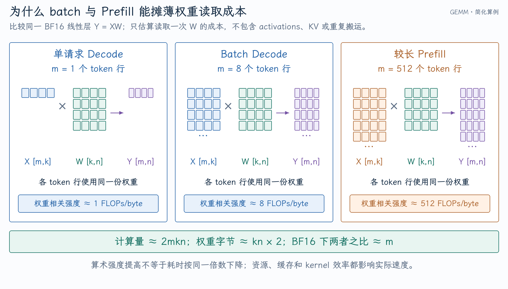
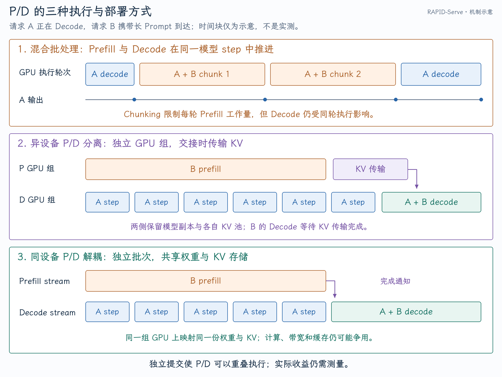
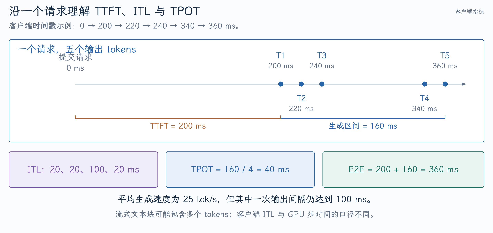

# RAPID-Serve 论文与大模型推理指标

逐节阅读原论文可查看 [RAPID-Serve 论文完整中文翻译](RAPID-Serve论文完整中文翻译.md)，全部原图和中文图注均在正文对应位置。

“vLLM P/D 解耦与调度优化”的核心问题是：长 Prompt 的 Prefill 到来时，如何让已有请求继续平稳生成，同时保持设备利用率？RAPID-Serve 给出的路径是在同一组 GPU 上拆开 P/D 的调度与执行，共享权重和 KV，再按负载分配计算资源。

本文依据 [RAPID-Serve 原论文 v1](https://arxiv.org/html/2601.11822v1)，arXiv 编号 `2601.11822`，首次提交于 **2026 年 1 月 16 日** 。论文题目是 *Resource-efficient and Accelerated P/D Intra-GPU Disaggregation*。当前项目的代码机制见 [V1/MRV2 实现](02-V1-MRV2实现与设计取舍.md)，实测口径见 [性能证据与面试问答](03-性能证据与面试问答.md)。

## 1. Prefill 与 Decode 为什么会互相影响

自回归模型处理一个请求时，先计算 Prompt 中全部 token 的隐藏状态和 KV，再逐个生成后续 token。

- **Prefill** ：一次处理很多输入 token，矩阵乘通常有较高算术强度，较容易利用 GPU 的计算能力；生成首个输出 token 也通常包含在这次执行与采样中。
- **Decode** ：每个活跃请求通常每步处理一个 token，复用已有 KV；小 batch 时权重读取、KV 访问和提交开销往往比计算量更突出。

这是一种常见的性能倾向。随着模型、上下文、batch 和后端变化，Decode 也可能受计算限制，Prefill 也可能受带宽限制。MoE 的路由和专家访问进一步改变资源需求。

在 continuous batching 中，旧请求还在生成，新请求已经可以入场。若一个执行批次同时包含旧请求的 Decode token 和新请求的 Prefill token，两类请求都由同一次模型执行推动。长 Prefill 会拉长这一轮，旧请求下一次输出也随之推迟。

Chunked Prefill 把长 Prompt 切成多个片段，在每轮优先安排 Decode，再填入 Prefill token。它控制了单轮长度，但没有消除同一轮内的耦合：P 片段仍影响 D 步时间。小片段往往有利于 ITL，却增加 Prefill 的调度、提交和重复权重访问成本，可能拉长 TTFT、降低吞吐。可结合已有的 [Chunked Prefill 笔记](<../../../../vllm/基础篇/Chunked Prefill.md>) 理解。

### 1.1 为什么 Prefill 往往偏计算，Decode 往往偏带宽

{ width="100%" }

图中的格子只示意输入行与共享权重的关系，行列数由形状标签确定，不代表模型实际维度或 kernel tile 数。

先只看一个线性层 \(Y=XW\)：\(X\) 为 \([m,k]\)，\(W\) 为 \([k,n]\)，\(m\) 表示本次处理的 token 行数。粗略计算量为 \(2mkn\) FLOPs，单次读取权重约为 \(knb\) bytes，其中 \(b\) 是权重元素字节数。

忽略输入输出、缓存命中和重复搬运时，权重相关的算术强度约为：

\[
I_W\approx\frac{2mkn}{knb}=\frac{2m}{b}\quad\mathrm{FLOPs/byte}
\]

BF16 下 \(b=2\)，于是这个简化强度约为 \(m\)。单请求 Decode 的 m=1，多个请求 batch 后 m 增大；Prefill 一次处理数百至数千行，更容易用计算摊薄权重读取成本。这解释了 batch 为什么能提升 Decode 系统吞吐，也解释了长 P 与小 D 的互补性来源。

这不是完整性能模型。长上下文 Decode 还要读大量 KV，MoE 不同 token 可能访问不同专家，activation 和缓存层次也不可忽略。Roofline 的近似关系是：

\[
\mathrm{可达吞吐}\lesssim\min(\mathrm{计算上限},\ \mathrm{带宽}\times\mathrm{算术强度})
\]

论文 §3.3 使用 Llama-3.1-70B 的 up projection GEMM，在 MI300X 上比较不同 token 行数与 CU 数量。较大输入的 P 性能更随 CU 数变化，小输入 D 在部分配置中减少到约 40%–50% CUs 仍接近原性能。这支持试探分区的动机，但不是“所有 Decode 用一半 CU 都不变慢”的定律。

### 1.2 并行之后为什么仍可能变慢

设单独 P 耗时为 \(T_P\)，期间有若干 D 步，总耗时为 \(\sum T_D\)。完全串行时约为 \(T_P+\sum T_D\)；理想无干扰重叠时约为 \(\max(T_P,\sum T_D)\)。

真实并行可能让双方耗时变为 \(T'_P,T'_D\)，还增加进程消息、同步依赖和私有状态开销。只有减少的等待大于新增干扰，整条路径才更快。同设备缓存共享减少的是交接成本，计算重叠减少的是串行等待，两者分别作用于不同成本。

例如单独 P 为 100 ms、D 累计 80 ms，理想串行 180 ms、重叠 100 ms；若争用后 P 变为 170 ms，即使 D 仍能持续输出，整段收益也很小。若 P 更慢，新请求更晚入场，还可能使总体输出吞吐下降。这与本地 8B P512 的负结果相符，但该算例本身不是实测。

## 2. 三种部署方式各解决了什么

| 方式 | GPU 与执行组织 | 主要收益 | 主要代价 |
| --- | --- | --- | --- |
| 混合批处理 / Chunked Prefill | 同一组 GPU、一个调度与执行批次包含 P/D | 权重与 KV 共用，批处理效率高 | P/D 在批次中同步推进，长 P 影响 D |
| 传统异设备 P/D 分离 | P 使用一组 GPU，D 使用另一组 GPU | 两侧可独立调度、配置和扩容，D 获得更强隔离 | KV 交接、两侧模型副本与容量不均，需要跨组通信 |
| RAPID-Serve | 同一组 GPU 上两个进程、独立 P/D 批次 | 减少批次耦合，共享权重与 KV，避免跨组 KV 交接 | 仍争用同一设备资源，需要处理跨进程正确性与计算资源调度 |

{ width="100%" }

图表示资源关系，不表示实际 kernel 的固定执行次序。传统 P/D 也能部署在同一台八卡服务器上：例如 P 为 TP4、D 为 TP4。区别在于这两组 GPU 各自持有缓存，交接需要传 KV；RAPID-Serve 让 P/D 使用同一组设备上的缓存，通过通知交接。

传统 P/D 并非没有价值。它支持独立扩容、异构硬件和更强的隔离，大规模服务可以用多组 P/D 实例调节容量。RAPID-Serve 更关注共享设备条件下的资源效率与延迟折中。

## 3. 论文如何把“独立执行”落到系统里

### 3.1 两个进程减少主机提交上的耦合

论文 §4.3 使用独立 P/D 进程。GPU 并行还需要 CPU 能够持续准备输入、调度请求和提交工作。若主机端串行执行这些任务，GPU timeline 会出现空隙；Python GIL 也限制了多个线程同时执行 Python 调度逻辑。

独立进程使两侧拥有各自的调度和提交路径。不过两个进程本身不保证 GPU 重叠，仍需要可并发的队列、足够资源，以及正确的依赖关系。异步提交、GPU 并行和资源隔离是三个不同条件。

### 3.2 共享物理存储，Decode 统一管理逻辑 KV

论文 §4.4–§4.5.1 的请求链路是：

1. D 接收请求，将其放入等待队列，按输入长度分配 KV blocks。
2. D 把请求与 block IDs 通知 P。
3. P 在这些已分配的块中写入 Prompt KV。
4. P 完成后通知 D；D 将请求加入生成批次，继续读写同一份 KV。

模型权重与 KV tensors 通过 IPC handles 被两个进程映射。**共享的是底层存储，分配决策只由 D 做** 。P 无需再维护一套 KV 分配器，也无需和 D 争夺分配器锁。

“D 管理 KV”指逻辑所有权，不要求物理 tensor 必须由 D 创建。当前 MRV2 项目就由 P 分配物理缓存、D 导入映射，同时由 D 的 Scheduler/KVCacheManager 决定 block 归属。

论文称其设计减少锁和串行化，但仍有必要依赖：某个请求的 D 必须等自己的 P 写入完成。可以并行的是“请求 A 的 Decode”和“请求 B 的 Prefill”，不能让 A 的 D 读取 A 尚未完成的 KV。

### 3.3 为什么显存利用率也会改变

异设备分离中，P 侧处理完 Prompt 后可能释放自己的缓存，D 侧却要长期保留大量活跃请求 KV。两侧需求不同，可能出现 D 因显存不足限制并发，而 P 仍有空余的情况。共享缓存池让这部分容量不再按角色固定分割。

常见的标准 attention KV 容量估算为：

\[
M_{KV}=2\times L\times S\times H_{KV}\times d_h\times b
\]

其中 2 表示 K 和 V，\(L\) 是层数，\(S\) 是缓存 token 数，\(H_{KV}\) 是 KV heads 数，\(d_h\) 是 head dimension，\(b\) 是每元素字节数。GQA 应使用 KV heads，而不是 query heads；TP 还要按实际分片方式估算每卡容量。

以 Qwen3-0.6B 的 BF16 配置为例：28 层、8 个 KV heads、head dimension 128，每 token KV 为 \(2\times28\times8\times128\times2=114688\) bytes，即 112 KiB。缓存 1280 tokens 约需 140 MiB，未包含 block 尾部浪费、运行时 buffer 和 Graph 内存。若 block size 为 16，逻辑块数为 \(\lceil S/16\rceil\)。

参数量不直接决定 KV 大小；MoE 的全部专家权重也不意味着 KV 按专家数量倍增。DeepSeek 的 MLA 缓存布局不同，不能直接套用这条普通 attention 公式。

IPC 避免的是交接时复制整份 KV，attention 仍然会从显存读取 KV，两个进程也仍有各自的 activation、workspace、Graph 和可变 buffer。“共享权重”不能表述成“两进程总显存与单进程完全一样”。

### 3.4 异步调度与 HIP Graph 减少执行空隙

论文 §4.5.2 让调度器在上一轮 GPU 执行尚未完成时准备下一轮。Decode 可以利用占位 token 提前组织批次；若上一轮请求实际已结束，可能多执行一步，输出和回收阶段要正确处理。

HIP Graph 通过重放已捕获的执行图减少逐 kernel 提交开销。它优化主机提交，不自动解决 P/D 干扰，也不意味着所有 batch size 都无需准备或捕获。

论文的 P 使用 **整段 Prefill** ，没有 Prompt chunking；当前项目同时支持分块与整段 P，目的是适配 MRV2 的容量和负载条件。因此“遵循核心思想”与“完全复现所有实现选择”应分别说明。

## 4. CU Mask 与自适应资源管理

### 4.1 全 CU 共享与互补分区

ROCm 可为 command queue / stream 设置 CU bit mask。每个 bit 决定该队列的 workgroups 能否调度到相应计算单元，无需修改模型 kernel。

- **P100/D100** ：两侧都可使用全部 CU，硬件调度器决定谁实际获得资源。两侧不会同时各拥有物理意义上的 100%。
- **互补分区** ：例如 P50/D50，各自仅使用一半 CU，减少计算调度上的相互影响。

分区不等于独立 GPU。HBM/统一内存带宽、缓存和其他硬件资源仍可能共享，CU Mask 也不提供强制抢占。论文 §3.4 对测试中的 attention 干扰仍观察到平均约 2%–5% 的影响，不能把它讲成完全隔离。

GPU IPC 也不是 AMD 专有：CUDA 和 HIP 都有相应跨进程机制；本文的 CU Mask 调度路径则依赖 ROCm，不能把这两个概念混为一谈。

### 4.2 为什么不能一直五五分

低 Decode 负载时，D 很快结束，留给 D 的 CU 可能闲置，而 P 仍在计算。若 P 已在受限队列上运行，这一轮不能临时接管所有闲置 CU。此时 P100/D100 更容易保持利用率。

高 Decode 负载时，全 CU 争用可能使 D 超过 ITL SLO，分区则能保护其计算资源。论文 §4.5.3 通过 **离线 profiling** ，找出不同 Decode batch 下满足 ITL SLO 的最少 D CUs；运行时参考负载分配，余下资源给 P。

当前 MRV2 实现采用“全 CU 基线 → 在线试探一个候选比例 → D 变慢则回退”，并非论文的离线多比例查询表，也不是已证明能找到全局最优比例的控制器。

### 4.3 从论文设计到当前实现，哪些结论可以迁移

论文解决的是系统级等待、缓存容量与设备资源配置，完整方案包含多个相互配合的选择。当前项目能借鉴“独立执行与共享存储”这一结构，再用 MRV2 提供的异步状态与 Graph 管理实现；它不要求所有 P 都整段，也没有采用论文离线 profile 表。

| 论文证据 | 能支持的推论 | 仍需本地验证的事项 |
| --- | --- | --- |
| P/D 在部分 GEMM 上资源需求不同 | 可能存在资源互补空间 | 新模型、不同 batch/上下文下的最佳 CU 比例 |
| 共享 KV 免跨组交接 | 可移除该交接的 tensor 复制 | IPC 生命周期、布局一致与完成依赖 |
| 双进程与异步减少 GPU gaps | 主机路径也是优化对象 | 当前 MRV2 是否真的 host-bound、实际空隙与 IPC 开销 |
| 全 CU / 分区随负载切换 | 静态比例并非普遍适合 | 在线信号是否可靠、切换开销、客户端延迟达标 |

论文 §3.2.1 在当时的八卡 4P/4D 路径中报告 KV 传输相关吞吐与 TTFT 代价，还指出该 vLLM V1 路径在 D 侧重新计算首 token。因此交接成本会进入首 token 的关键路径。这个执行细节与具体 connector/版本有关，不能概括为“所有传统 P/D 都必须重新生成首 token”。当前项目由 P 返回首 token，D 继续处理下一步。

## 5. 面试中必须讲清的推理指标

### 5.1 沿一个请求计算 TTFT、ITL、TPOT 与端到端延迟

设请求在 \(t_0\) 提交，客户端分别在 \(t_1,\ldots,t_N\) 收到 N 个输出 token。下面先假设一条流事件对应一个 token，网络和文本缓冲影响已经包含在时间戳中。

\[
\mathrm{TTFT}=t_1-t_0,\qquad
\mathrm{ITL}_i=t_i-t_{i-1}\ (i\ge2)
\]

\[
\mathrm{TPOT}=\frac{t_N-t_1}{N-1},\qquad
\mathrm{E2E}=t_N-t_0=\mathrm{TTFT}+(N-1)\mathrm{TPOT}
\]

TPOT 不含首 token，N=1 时不能按此式除法。客户端 E2E 若计到结束通知而非最后一个 token，还会包含协议收尾时间。

{ width="100%" }

这个请求的 TTFT 为 200 ms，ITL 为 20、20、100、20 ms，TPOT 为 40 ms，E2E 为 360 ms。平均生成速度为 25 tok/s，但其中出现了一次 100 ms 停顿；这正是 TPOT 与尾部 ITL 同时有用的原因。

| 指标 | 观察什么 | P/D 项目中的解释 |
| --- | --- | --- |
| TTFT | 用户等待首次输出的时间 | 含排队、入场、P 执行、采样及传输；不等于纯 Prefill kernel 时间 |
| ITL | 连续输出之间的间隔 | 反映生成停顿；P/D 解耦主要希望缓解 P 对已有 D 的阻塞 |
| TPOT | 单请求平均生成间隔 | 与每用户平均生成速度相关，可能掩盖少量长停顿 |
| E2E / E2EL | 从提交到完成的整段时间 | 同时受 TTFT、输出长度和生成速度影响 |
| P95 / P99 | 指标分布的高百分位 | 反映尾部体验，不是最大值，也不是平均值乘某个常数 |

P95 ITL 的样本可以是所有请求的 token 间隔，也可以先按请求计算再聚合，结果不相同。当前本地 InferenceX 客户端汇总成功请求中的流间隔样本；两轮实验的 P95 在报告中先各自计算再取均值，不能称为把所有样本合并后的总体 P95。

更细的测量边界是：HTTP 文本流可能一次携带多个 token，也可能因 detokenization 暂时不发送文本。客户端 ITL 实际记录的是非空文本流块之间的时间。GPU event 记录的 D 步执行时间是内部代理指标，二者不能直接等同。

### 5.2 吞吐、QPS 与每用户生成速度

设完整测量窗口为 T，成功请求输出 token 总数为 O，输入 token 总数为 I，完成请求数为 R。

\[
\text{输出吞吐}=O/T,\quad
\text{总 token 吞吐}=(I+O)/T,\quad
\text{请求吞吐}=R/T
\]

三者分别是 output tok/s、total tok/s 和 requests/s。固定 1024 输入 / 256 输出时，总 token 吞吐恰为输出吞吐的 5 倍，不能因为数字更大就说生成能力提升了 5 倍。

InferenceX 曲线常将系统吞吐与 **Interactivity（tok/s/user）** 放在两个轴上，展示容量和单用户体验的折中。本地报告的 `mean_intvty` 使用 \(1000/\mathrm{mean\_TPOT}_{ms}\)；“均值的倒数”和“每请求倒数再平均”一般不相等。外部图还可能使用 tok/s/GPU，需要先明确 token 统计与按卡归一化口径。

客户端 concurrency 是同时在途的请求数，GPU decode batch 是某一次执行实际包含的请求数，P token budget 则是某轮 P 可安排的输入 token 总量。**并发 128 不保证每轮执行 batch 128** 。

Open-loop 固定到达率测试可以让请求持续排队；closed-loop 测试达到并发上限后，通常完成一个才补发一个，实际发送速度会受服务时间约束。稳定条件下 Little 定律 \(L=\lambda W\) 连接平均在途请求、完成率与服务时间，但不能据一个瞬时 batch 反推最大容量。

### 5.3 Goodput 与延迟 SLO

吞吐统计“完成多少”，goodput 还要求“在规定延迟下完成多少”。一个常用定义是满足所有指定 SLO 的请求数除以时间，单位 requests/s；也有研究使用达标请求的 token/s 或在特定 SLO attainment 下可支持的最大到达率，应遵循来源定义。

例如 10 秒内完成 100 个请求，其中 70 个同时满足 TTFT≤1 s、TPOT≤50 ms，则请求吞吐为 10 req/s，请求 goodput 为 7 req/s。不能只检查 TPOT 就称为 TTFT 与生成延迟都达标。

论文 §5.2 定义 goodput 为满足 SLO attainment 目标的最大可服务请求率，并报告 p95 goodput 曲线；条件包括 Llama-3.1-70B ITL 100 ms、Mixtral ITL 50 ms，以及按输入长度增长的 TTFT 上限：0–1000 tokens 为 1 s，1000–2000 为 2 s，依此增长。它另报告仅约束 ITL 的 goodput。

本地 InferenceX 客户端可按 `ttft/tpot/e2el` 条件计算 `request_goodput`。这与论文按 ITL、p95 attainment 的口径不能直接互换；现有本地扫描也没有由这些数据建立生产 SLO 容量结论。

### 5.4 排队、平均间隔和尾部指标为何不能互相替代

把 TTFT 拆为概念上的几个阶段，可以定位问题：

\[
\mathrm{TTFT}\approx T_{入口与预处理}+T_{等待入场}+T_{P执行与间隙}+T_{首token采样与返回}
\]

高到达率下，\(T_{等待入场}\) 可能远大于单次 forward。论文中 TTFT 大比值包含排队影响；优化入场和容量可使 TTFT 大幅下降，即使 kernel 本身只改善少量时间。

P95 ITL 也不是“95% 请求都满足 SLO”的直接证明。若把所有流间隔合并，输出 1000 tokens 的请求贡献的样本远多于输出 10 tokens 的请求；某个请求仍可能有超长最大间隔。要评估请求达标率，应先定义该请求是按平均 TPOT、P95 ITL、最大 ITL，还是别的条件判定。

端到端延迟同样受输出长度影响。输出从 128 变为 256 tokens，即使 TTFT 与 TPOT 完全不变，E2E 也会明显增加。因此 A/B 要固定生成目标，或明确按长度分桶；不能把模型提前 EOS、截断或答案更短造成的完成更快当成纯引擎加速。

### 5.5 延迟—吞吐曲线为什么比一个峰值更有价值

部署选择通常有多个目标：单位 GPU 的输出吞吐、单用户速度、TTFT 和尾部停顿。增加 concurrency 可能提高吞吐，却降低单用户速度；提高 P budget 可能加快新请求处理，却增加 D 争用。

比较时应看同一延迟约束下谁能支持更多吞吐，或者相近吞吐下谁的体验更好。若某配置在吞吐更高且延迟更低的意义上被另一配置全面超过，它没有成为首选的理由；若两者各有优势，就要根据 SLO 选择。这是公开 InferenceX 曲线横向比较“相近吞吐处 3.6 倍 interactivity”的含义。

单个 closed-loop 点只能说明该并发与有限窗口的行为。用它报告峰值时，还要明确 warmup、计时边界、请求长度、成功数、错误、重试及完成后的收尾；按卡归一化也应使用实际参与服务的 GPU 总数。

### 5.6 “提升百分比”与“达到几倍”怎样换算

吞吐改善用 \((X_{new}/X_{base}-1)\times100\%\)，延迟下降用 \((1-L_{new}/L_{base})\times100\%\)。

| 表达 | 数学含义 | 常见误读 |
| --- | --- | --- |
| 吞吐达到 1.5 倍 | +50% | 不是 +150% |
| Goodput 达到 4.7 倍 | +370% | 不是每个请求快了 4.7 倍 |
| 单用户速度达到 3.6 倍 | +260% | 不代表系统吞吐也达到 3.6 倍 |
| 速度达到 3.6 倍对应间隔 | 在严格倒数关系下间隔降至 1/3.6，即约 -72.2% | 不能直接转换为 P95 ITL 降幅 |
| Decode 吞吐达到 5.28 倍 | +428% | 应保留具体基线与精度条件 |

简历另一项的 TTFT -47.4%、E2E -76.1%、Decode 5.28 倍针对的是 CogAgent 最初 HF BF16 Eager 基线；LoRA 的 +18.6%–24.8% 针对多 LoRA 算子对照。它们帮助理解指标，但不属于本 P/D 项目的测试数据。模型、精度与执行模式改变时，应解释整条优化路径，不能全部归给某一个算子。

## 6. 论文究竟报告了什么效果

论文 §4 的实现基于 **vLLM V1 v0.10.2rc3** ，§5 基线为 v0.10.2；实验为单机 **8×MI300X、ROCm 6.4** ，模型为 Llama-3.1-70B 与 Mixtral-8×7B。LMSYS、arXiv、Loogle 的平均 Prompt 长度约为 2K、8K、20K，实验扫描输入 QPS。

传统 P/D 基线是 **P 为 TP4、D 为 TP4（4P/4D）** 。论文未测试 Mixtral 的传统 P/D 基线，原因是当时 vLLM 的相关 MoE 分离路径尚不支持。因此与传统 P/D 的平均比值不能自行扩大到所有模型。

| 论文汇总指标 | 相对 Chunked Hybrid | 相对传统 P/D |
| --- | --- | --- |
| 无约束吞吐 | 最高 4.1 倍，平均 1.7 倍 | 最高 2.9 倍，平均 1.5 倍 |
| TTFT 与 ITL 双约束 goodput | 最高 32 倍，平均 4.9 倍 | 最高 13.7 倍，平均 4.7 倍 |
| 仅 ITL 约束 goodput | 最高 5.9 倍，平均 2 倍 | 最高 2.4 倍，平均 1.4 倍 |
| P95 ITL | 最多降低至 1/6，平均降低至约 1/1.9 | 传统 P/D 平均约为 RAPID-Serve 的 1/2 |
| P95 TTFT，Llama-3.1-70B | 最大比值 220，平均比值 53 | 最大比值 486，平均比值 55 |

Goodput 的上述倍数只统计论文所说“基线 goodput 不可忽略”的情况；基线接近零时不应拿除法制造巨大收益。TTFT 的大比值也包含高负载排队及调度变化，不能解释成单次 Prompt forward 变快几十倍。

论文同时报告计算利用率相对混合批处理最高 +77%、相对传统 P/D 最高 +111%，相对传统 P/D 的显存利用率最高 +37%。利用率提升指资源被更有效使用，**不等于显存占用减少 37%** 。

论文并没有证明所有指标同时最优：传统分离的平均 P95 ITL 更低，而 RAPID-Serve 的吞吐和 TTFT 更有优势。判断部署收益，应在可比到达率、模型与资源总量下，同时查看吞吐、TTFT、ITL 和达标率。

## 7. 对论文的简洁复述

> RAPID-Serve 解决的是混合批处理的 P/D 同步推进与传统分离的 KV 传输、容量不均之间的折中。它在同一组 GPU 上用独立进程执行 P/D，共享权重与 KV，由 D 管理缓存归属；通过异步调度减少 GPU 空隙，通过 CU Mask 在低负载全资源共享、高负载计算资源分区之间调节。实验表明它能提升吞吐和 SLO goodput，但传统分离在部分 ITL 指标上仍有优势。

解释自己项目时，再补上实际改造：在当前 V1/MRV2 上实现租约和在途保护、支持 P 独立预算与分块/整段执行、保留 D Graph，并以在线试探和事件依赖完成资源切换。论文结论与这些实现效果分别由原文和本地测试支撑。
