# P/D 解耦项目详解

这个项目在 **vLLM V1 + ModelRunner V2（MRV2）** 中实现同设备 Prefill/Decode 解耦。两阶段运行在同一组 GPU 上，分别组批、提交计算，通过 IPC 访问同一份权重和 KV Cache。D 侧保留完整的请求调度与 KV 分配权，P 侧负责执行被授权的上下文计算。

以 **DeepSeek-V3 的单机 TP 推理** 为例，P 处理长输入，D 持续推进生成；每张卡上的两侧 worker 共享本卡模型分片和 MLA 压缩缓存，同时各自维护请求状态、临时 buffers、执行 stream 和 kernel 对象。项目的核心是将这两条执行链接入 vLLM，使请求交接、异步完成与缓存回收保持一致。

本文依据项目分支 `feat/rapidserve-mrv2` 的最终实现 **`e3e07d9`**，源码核对日期为 **2026-10-22**。模型维度采用 DeepSeek-V3 官方配置，重点展开常驻模型、纯 TP、greedy 生成路径。面试口述见 [面试问题与回答](面试问题与回答.md)。

## 一、整体架构：同一组 GPU 上的两条执行链 {#architecture}

### 1、Prefill 为什么会干扰正在生成的请求

假设请求 A 已经进入 Decode，每轮只计算一个新 token；此时请求 B 带着长 Prompt 到达。常规混合批次同时处理 A 的生成 token 和 B 的一段输入，A 的输出需要等整个批次执行结束。Chunked Prefill 可以缩短单轮输入计算，却仍让两阶段共享同一次模型执行的节奏：chunk 大时生成间隔可能变长，chunk 小时又增加调度、输入准备和执行提交次数。

这套实现让 B 的上下文计算进入 P 执行链，A 的生成进入 D 执行链。Coordinator 将 B 交给 P 后可以继续推进 A；B 自己则在 Prompt KV 和首 token 都完成后进入 D。

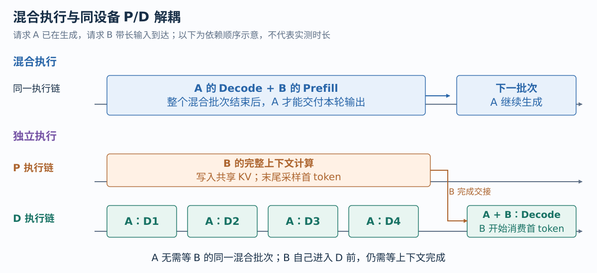{ width="1000" }

**两阶段能够独立提交，实际计算仍竞争同一组设备资源。** 长输入适合大矩阵计算，小批次 Decode 更容易受权重和 KV 读取影响。解耦允许二者采用不同批次和执行策略，CU 分配进一步限制资源争用，Decode Graph 减少重复提交开销。吞吐和生成延迟的收益取决于模型、负载与硬件上的实际重叠情况。

### 2、请求经过哪些模块

API Server 将请求交给 EngineCore，输出仍沿原有通道返回。EngineCore 中的 **PairedCoordinator** 负责推进两侧工作，**DecodeScheduler** 决定请求执行资格并统一分配 KV，**PairedExecutor** 连接 P 控制进程和 D 执行组。最终两侧都调用 SharedModelWorker 内的 MRV2，复用 DeepSeek 模型与 Attention backend。

| 模块 | 在整条执行路径中的职责 |
| --- | --- |
| EngineCore / PairedCoordinator | 接入请求与取消，派发 P 授权，提交 D，回收完成并交付结果 |
| DecodeScheduler / KVCacheManager | 维护业务请求、分配逻辑 KV blocks，管理 P 使用权和 D 在途引用 |
| PairedExecutor | 建立执行组与共享初始化协议，提供进程通道和 TP 执行接口 |
| PrefillEngine | 接收已授权的上下文，按 P 预算组批并跟踪局部计算进度 |
| SharedModelWorker / MRV2 | 建立本地执行状态，将调度计划转为 GPU 输入，执行模型与采样 |
| DeepSeek 模型 / Attention backend | 执行 MLA、Dense/MoE、TP 通信，读写本卡实际 KV tensors |

模块职责和进程边界并不完全重合。Coordinator 与 Scheduler 位于 EngineCore 主线程；PrefillEngine 位于独立 P 控制进程；TP 模式的两侧分别管理自己的 worker 进程。发送线程、RPC 响应线程处理 CPU 通道等待，GPU stream 则约束设备上的提交顺序。

### 3、多卡时如何配对与共享

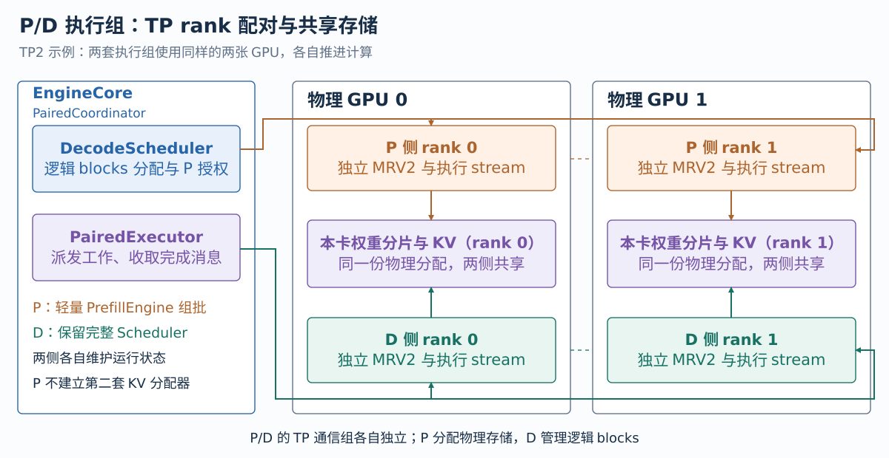{ width="1000" }

TP8 使用 8 张物理 GPU，P 和 D 各有 8 个 workers。P rank 0 与 D rank 0 位于 GPU 0，共享本卡权重和 KV；其余 rank 同样一一配对。两侧分别建立 TP 通信组，因此 P 可以按自己的批次执行 collective，D 也按自己的生成批次执行 collective。

**共享的范围是 rank 本地的大块存储。** P/D 的 RequestState、BlockTables、输入 buffers、workspace、采样器和 streams 分别建立，两组执行状态仍会占用额外显存。单卡路径使用本地 UniProcExecutor，TP 路径使用两组 MultiprocExecutor，模型的 TP 数学运算保持原有实现。

P worker 是实际 GPU 存储的 owner，负责加载权重、创建 KV、导出 IPC 并保持 storage 存活。D 的 KVCacheManager 掌握逻辑分配权，决定哪些 block IDs 属于哪个请求、何时可以复用。P 没有第二个 KV 分配器，它只能写入 D 授权的块表。

源码：[执行组建立](https://github.com/tangzzycc/vllm/blob/e3e07d9732a0c6f951117f0c125c76f9e9370baf/vllm/v1/rapidserve/executor.py#L75-L148)、[P 控制进程](https://github.com/tangzzycc/vllm/blob/e3e07d9732a0c6f951117f0c125c76f9e9370baf/vllm/v1/rapidserve/process.py#L21-L59)、[rank 配对](https://github.com/tangzzycc/vllm/blob/e3e07d9732a0c6f951117f0c125c76f9e9370baf/vllm/v1/rapidserve/worker.py#L41-L67)。

## 二、DeepSeek-V3：模型怎样在两侧执行 {#deepseek}

### 1、从 Decoder Layer 看模型结构

DeepSeek-V3 在这版源码中复用 `deepseek_v2.py`：`DeepseekV3ForCausalLM` 继承 `DeepseekV2ForCausalLM`，MLA 和 MoE 类也沿用 V2 名称。模型入口将 token IDs 转成 hidden states，依次执行 Decoder Layers，最后经过 RMSNorm、LM Head 和采样。

官方 DeepSeek-V3 配置包含 **61 层、hidden size 7168、128 个 Attention heads**。前 3 层使用 Dense MLP，其余层使用 MoE；每个 MoE 层有 256 个 routed experts，每 token 选择其中 8 个，另有 1 个始终参与计算的 shared expert。

一个 Decoder Layer 的主干按下列顺序执行。层输出与 residual 分别传递，下一次 RMSNorm 完成相加：

```text
hidden states + residual
  → RMSNorm
  → MLA Attention
  → RMSNorm + residual
  → Dense MLP（前 3 层）或 MoE（其余层）
  → 交给下一层
```

源码通过独立 `residual` 保存残差，并在后续 RMSNorm 中融合相加，避免每次都单独生成一份残差相加结果。P/D 调用同一模型结构，区别来自当前输入 token 数、Attention metadata 和执行资源策略。

源码：[V3 模型入口](https://github.com/tangzzycc/vllm/blob/e3e07d9732a0c6f951117f0c125c76f9e9370baf/vllm/model_executor/models/deepseek_v2.py#L1872-L2006)、[模型 forward](https://github.com/tangzzycc/vllm/blob/e3e07d9732a0c6f951117f0c125c76f9e9370baf/vllm/model_executor/models/deepseek_v2.py#L1508-L1593)、[Decoder Layer 的 MLA/MoE 选择](https://github.com/tangzzycc/vllm/blob/e3e07d9732a0c6f951117f0c125c76f9e9370baf/vllm/model_executor/models/deepseek_v2.py#L1249-L1319)、[层内 forward](https://github.com/tangzzycc/vllm/blob/e3e07d9732a0c6f951117f0c125c76f9e9370baf/vllm/model_executor/models/deepseek_v2.py#L1352-L1423)。维度参考 [DeepSeek-V3 官方配置](https://huggingface.co/deepseek-ai/DeepSeek-V3/blob/main/config.json)。

### 2、MLA 投影与 TP 切分

MLA 将 KV 压缩为较小的 latent，再从中构造各个 head 需要的 Key 和 Value。DeepSeek-V3 中 KV latent 宽度为 512，独立 RoPE Key 宽度为 64，因此每层、每 token 长期缓存的逻辑数据为：

$$
[c^{KV},\;k^{R}]\in\mathbb{R}^{512+64}.
$$

这份 **576 维的压缩 KV 在每个 TP rank 保留完整逻辑宽度**。TP 切的是 head 对应的投影和计算，压缩 latent 由各 heads 共同使用，不能直接套用普通 MHA 的“KV heads 除以 TP”来计算缓存大小。

| 投影或数据 | DeepSeek-V3 的逻辑维度 | TP8 每个 rank |
| --- | --- | --- |
| 融合 A 投影 | hidden 7168 → Query latent 1536 + KV latent 512 + RoPE Key 64 | 输出保留完整 2112 维 |
| `q_b_proj` | Query latent 1536 → 128 heads × 192 | 16 heads × 192 |
| `kv_b_proj` | KV latent 512 → 128 heads × (Key 128 + Value 128) | 16 heads × 256 |
| 长期 MLA KV | 每 token 512 + 64 | 完整 576 维 |
| `o_proj` | 128 heads × Value 128 → hidden 7168 | 由本地 16 heads 贡献 partial，TP 归约 |

`DeepSeekV2FusedQkvAProjLinear` 明确设置 `disable_tp=True`，所以 A 投影在各卡保留完整输出。Wrapper 将其拆成 Query latent 和 KV 分支，分别进行 RMSNorm；Query 经 `q_b_proj` 得到本地 heads，RoPE 只作用于其中的位置维度以及独立 Key。随后 MLA backend 处理 Attention，`o_proj` 将本地 head 输出投回 hidden size。

```python
# DeepSeekV2FusedQkvAProjLinear.__init__：A 投影保留完整 latent。
super().__init__(
    input_size,
    output_size,
    bias=False,
    quant_config=quant_config,
    disable_tp=True,
    prefix=prefix,
)
```

这里的 `q_lora_rank`、`kv_lora_rank` 是模型低秩投影维度；paired 请求路径使用固定模型权重。FP8 权重量化、KV dtype、Attention 临时计算 dtype 也由各自配置决定，576 表示逻辑宽度，并不直接代表固定字节数。

源码：[融合 A 投影](https://github.com/tangzzycc/vllm/blob/e3e07d9732a0c6f951117f0c125c76f9e9370baf/vllm/model_executor/models/deepseek_v2.py#L953-L999)、[MLA 投影构造](https://github.com/tangzzycc/vllm/blob/e3e07d9732a0c6f951117f0c125c76f9e9370baf/vllm/model_executor/models/deepseek_v2.py#L1038-L1114)、[latent 拆分、RMSNorm 与 RoPE](https://github.com/tangzzycc/vllm/blob/e3e07d9732a0c6f951117f0c125c76f9e9370baf/vllm/model_executor/layers/mla.py#L175-L255)。

### 3、Prefill 展开 K/V，Decode 使用吸收权重

P 处理一整段输入时，同一层有许多 Query tokens。`forward_mha()` 将当前输入的 KV latent 经 `kv_b_proj` 展开成本地 heads 的 Key 和 Value，再调用 Prefill Attention backend。对于 TP8、40-token Prompt，本地临时 K 的逻辑形状为 $[40,16,192]$，V 为 $[40,16,128]$。

**展开的 K/V 服务于当前 Attention 计算，长期 cache 仍保存压缩 latent 和 RoPE Key。** 若启用 chunked Prefill，后续 chunk 还要读取既有压缩上下文，通过 workspace 计算历史部分，并与当前 chunk 的结果按 softmax 统计量合并。项目默认整段 Prefill，首次输入没有这段历史合并。

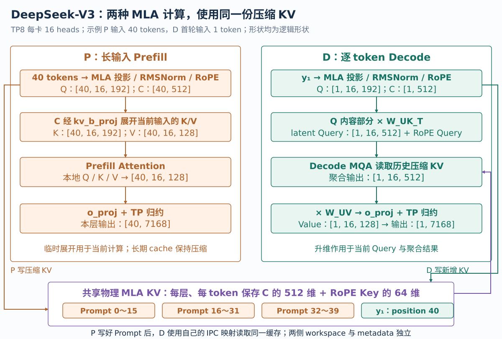{ width="1000" }

D 每次只处理每条请求的一个新 token。若每轮先将所有历史 latent 展开成各个 head 的 K/V，会增加计算与内存流量。Decode 利用矩阵乘法的结合律，把 Key 的升维权重作用到当前 Query，把 Value 的升维推迟到 Attention 聚合之后。

用一个 head 说明。缓存范围包含本轮已写入的当前 token。$C\in\mathbb{R}^{N\times512}$ 表示历史 KV latent，$K_R\in\mathbb{R}^{N\times64}$ 表示历史 RoPE Key；当前 Query 的内容部分 $q_C\in\mathbb{R}^{1\times128}$、位置部分 $q_R\in\mathbb{R}^{1\times64}$。Key 和 Value 升维矩阵分别为 $W_K,W_V\in\mathbb{R}^{512\times128}$：

$$
\begin{aligned}
\widetilde q &= q_C W_K^\mathsf{T},\\
s &= \widetilde q C^\mathsf{T}+q_R K_R^\mathsf{T},\\
a &= \operatorname{softmax}(\alpha s),\\
o &= (aC)W_V.
\end{aligned}
$$

$\alpha$ 使用模型设定的 Attention scale，包含相应位置缩放配置。吸收后的 512 维 Query 是等价变换的中间结果，不能据此重新按 512 修改 softmax 的缩放因子。

代码中的 `W_UK_T` 对应 Query 到 latent 的变换，`W_UV` 对应聚合结果到 Value 的变换。Decode 先得到本地 heads 的 latent Query，`forward_mqa()` 直接读取共享压缩 KV，得到 latent Attention 输出，`_v_up_proj()` 再将其投到每 head 的 128 维 Value。最后进入同一 `o_proj`。

具体 FP8 backend 可能将这些权重组织为 `W_K/W_V` 加 scales，使用对应 BMM kernel；逻辑关系相同，实际布局由 backend 决定。P/D 共享这些后处理权重，但 Attention metadata 和 workspace 在各自进程中建立。

源码：[压缩 KV 写入](https://github.com/tangzzycc/vllm/blob/e3e07d9732a0c6f951117f0c125c76f9e9370baf/vllm/model_executor/layers/attention/mla_attention.py#L813-L880)、[Prefill 展开与历史合并](https://github.com/tangzzycc/vllm/blob/e3e07d9732a0c6f951117f0c125c76f9e9370baf/vllm/model_executor/layers/attention/mla_attention.py#L3177-L3263)、[Decode Query 变换与 MQA](https://github.com/tangzzycc/vllm/blob/e3e07d9732a0c6f951117f0c125c76f9e9370baf/vllm/model_executor/layers/attention/mla_attention.py#L1016-L1178)、[吸收权重生成](https://github.com/tangzzycc/vllm/blob/e3e07d9732a0c6f951117f0c125c76f9e9370baf/vllm/model_executor/layers/attention/mla_attention.py#L1220-L1335)、[Value 升维](https://github.com/tangzzycc/vllm/blob/e3e07d9732a0c6f951117f0c125c76f9e9370baf/vllm/model_executor/layers/attention/mla_attention.py#L1386-L1445)。

### 4、MoE 的路由与纯 TP 执行

MLA 输出经过残差和 RMSNorm 后进入 MoE。Gate 将 hidden states 映射为 256 个专家分数；DeepSeek-V3 使用 sigmoid 和带 correction bias 的分组 Top-K：专家分为 8 组，先选 4 组，再在允许的组内选出 8 个 routed experts。**Bias 影响专家选择，输出加权使用原始分数，再按配置归一化与缩放。** Shared expert 另行参与计算，可能与 routed experts 在 backend 中融合执行。

模型层将 Gate 交给 FusedMoE；实际 Gate 计算可能发生在 MoERunner 内。因此看到 `router_logits=hidden_states` 时，要继续看 runner 对 Gate 的调用，不能将这一参数误读为已经完成路由的 logits。

本项目的多卡模型路径采用 **纯 TP，EP size 为 1**。TP8 时每个 rank 都持有全部 256 个 routed experts 的权重分片，每个专家 intermediate size 从 2048 切为 256。相同 token 的选中专家在各 rank 计算各自分片，得到 hidden size 7168 的 partial，最终进行 TP 合并。

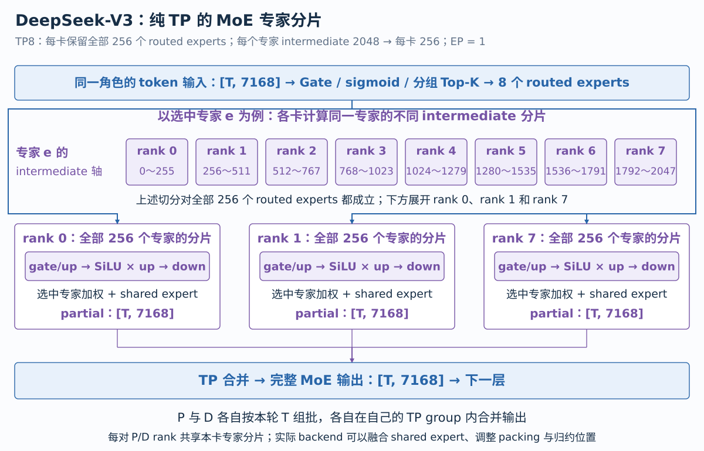{ width="1000" }

忽略 backend 的 padding、packing 和融合 shared expert 的存储后，单 rank 的 routed expert 权重可按如下逻辑形状理解：

$$
\begin{aligned}
W_{\mathrm{gate/up}} &: [256,\;2\times256,\;7168],\\
W_{\mathrm{down}} &: [256,\;7168,\;256].
\end{aligned}
$$

第一维 256 是所有 routed experts；第二个 256 是单专家被 TP 切分后的 intermediate 宽度，两者含义不同。输入先经过 gate/up 投影与 SiLU 乘法，再经 down 投影返回 hidden size，选中专家的输出按路由权重合并。

这条路径没有跨 EP rank 的 dispatch/combine A2A。各卡在本地组织选中专家的 tokens，模型输出按 TP 语义归约。普通路径的 shared 和 routed partial 可以先相加再 AllReduce，也可能由 backend 提前归约；源码另有可选 sequence-parallel MoE 路径，其 token 切分与归约由相应逻辑处理。下文的 paired 请求交接不依赖这一可选 SP 机制。

P 的长输入包含较多 tokens，专家 GEMM 的规模通常较大；D 的每轮 token 数来自活跃生成请求，同一轮落到某个专家的 tokens 可能很少。两侧独立组批改变了这些 GEMM 的输入规模，**模型路由规则、专家分片和输出语义仍然一致**。

源码：[DeepSeek MoE 构造与 forward](https://github.com/tangzzycc/vllm/blob/e3e07d9732a0c6f951117f0c125c76f9e9370baf/vllm/model_executor/models/deepseek_v2.py#L291-L435)、[分组 Top-K](https://github.com/tangzzycc/vllm/blob/e3e07d9732a0c6f951117f0c125c76f9e9370baf/vllm/model_executor/layers/fused_moe/router/grouped_topk_router.py#L110-L165)、[Gate 的实际调用](https://github.com/tangzzycc/vllm/blob/e3e07d9732a0c6f951117f0c125c76f9e9370baf/vllm/model_executor/layers/fused_moe/runner/moe_runner.py#L868-L944)、[纯 TP 配置](https://github.com/tangzzycc/vllm/blob/e3e07d9732a0c6f951117f0c125c76f9e9370baf/vllm/model_executor/layers/fused_moe/config.py#L1189-L1216)、[单专家 intermediate 切分](https://github.com/tangzzycc/vllm/blob/e3e07d9732a0c6f951117f0c125c76f9e9370baf/vllm/model_executor/layers/fused_moe/config.py#L1338-L1342)、[MoE 输出归约](https://github.com/tangzzycc/vllm/blob/e3e07d9732a0c6f951117f0c125c76f9e9370baf/vllm/model_executor/layers/fused_moe/runner/moe_runner.py#L450-L515)。

## 三、共享初始化：把同一份 DeepSeek 模型接到两侧 {#bootstrap}

### 1、P 加载真实模型，D 建立本地执行骨架

DeepSeek-V3 的权重规模很大，P/D 在同卡分别加载完整模型会重复占用模型显存。PairedExecutor 先启动 P，完成 checkpoint 加载、量化后处理和 MLA 吸收权重生成；随后 D 在 meta device 上构造相同模型骨架，从 P 导出的 manifest 中恢复本卡权重视图。

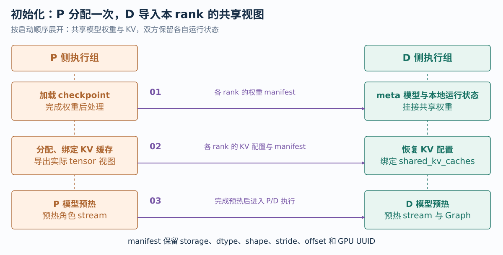{ width="1000" }

D 不再读取一遍 checkpoint。它导入共享参数后调用 MRV2 的 `initialize_model_components()`，建立依赖实际模型的本地组件。P 的 Attention 注册上下文也单独建立，防止复制配置时沿用 D 的 `static_forward_context`。

两侧使用同一份固定 `kv_cache_memory_bytes` 预算：EngineCore 根据模型 KV spec 和后端布局生成 KVCacheConfig，P 创建真实 cache tensors，D 调用 `initialize_kv_cache(..., shared_kv_caches=...)` 绑定已有 tensors。底层 `init_kv_cache()` 跳过物理分配，将 cache 接到 D 本地 Attention 层。

**Graph 捕获发生在共享权重与 KV 地址绑定完成之后。** P 配置使用 eager，关闭 compilation 与 Graph；D 在正式地址上预热、捕获 Decode Graph。固定 KV 预算跳过部分 profiling，因此执行状态、workspace、Graph 和采样器预热需要在启动链路中单独处理。

源码：[角色配置与模型导入](https://github.com/tangzzycc/vllm/blob/e3e07d9732a0c6f951117f0c125c76f9e9370baf/vllm/v1/rapidserve/executor.py#L39-L148)、[KV 共享与预热](https://github.com/tangzzycc/vllm/blob/e3e07d9732a0c6f951117f0c125c76f9e9370baf/vllm/v1/rapidserve/executor.py#L180-L215)、[D Worker 初始化](https://github.com/tangzzycc/vllm/blob/e3e07d9732a0c6f951117f0c125c76f9e9370baf/vllm/v1/rapidserve/worker.py#L201-L246)、[MRV2 本地组件](https://github.com/tangzzycc/vllm/blob/e3e07d9732a0c6f951117f0c125c76f9e9370baf/vllm/v1/worker/gpu/model_runner.py#L438-L537)、[已有 KV 绑定](https://github.com/tangzzycc/vllm/blob/e3e07d9732a0c6f951117f0c125c76f9e9370baf/vllm/v1/worker/gpu/attn_utils.py#L380-L438)。

### 2、IPC 传递 storage 和 view

一个 tensor 的名字与 shape 不足以恢复共享关系。同一 storage 可能被多个参数引用，也可能存在带 offset、stride 的不同视图。`TensorViews.export()` 按 `untyped_storage()._cdata` 去重，为每个底层分配导出一次 IPC 信息，并为每个 tensor 保存视图描述：

```python
views[name] = (
    indices[key],
    tensor.dtype,
    tuple(tensor.shape),
    tuple(tensor.stride()),
    tensor.storage_offset(),
)
```

D 先根据 IPC handle 映射 storage，再通过 `set_()` 恢复 dtype、shape、stride 和 offset。导入检查物理 GPU UUID，将进程内 device index 调整到 D 的本地设备。两进程的虚拟指针可以不同，底层分配和视图语义保持一致。

P 保留 `_owners` 中的 tensor 引用，保证导出的分配在 D 使用期间存活；这份 owner 列表不会序列化给 D。完全相同的参数视图复用别名，不同切片则按完整 view 信息区分。这样，FP8 packed 权重及关联 scales 也能保留实际运行布局。

源码：[storage 导出与视图恢复](https://github.com/tangzzycc/vllm/blob/e3e07d9732a0c6f951117f0c125c76f9e9370baf/vllm/v1/rapidserve/ipc.py#L25-L97)、[参数别名恢复](https://github.com/tangzzycc/vllm/blob/e3e07d9732a0c6f951117f0c125c76f9e9370baf/vllm/v1/rapidserve/ipc.py#L202-L247)。

### 3、MLA、FP8 和 router 必须恢复运行时状态

P 完成加载后，模型已经不只是 checkpoint 中的参数集合。MLA 生成了吸收权重；FP8 MoE 可能 shuffle、transpose、消费 scales 或删除参数槽位；普通 router 对象还保存了 correction bias 的引用。**D 需要恢复的是这份可执行状态。**

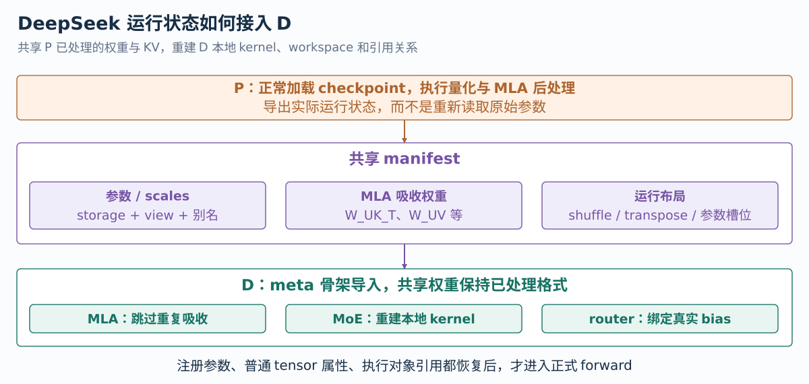{ width="1000" }

`export_model()` 同时收集参数、buffers 和普通 tensor attributes，记录布局标记以及实际 `_parameters` 槽位。导入时，共享参数与 `W_` 开头的吸收权重，clone 可能变化的 buffers 和其他普通 tensor 属性；kernel、workspace、sampler 则在 D 本地建立。

当前 FP8 checkpoint 路径要求 **128 × 128 block weight quantization、dynamic activation**，支持 auto、Triton 或 AITER MoE backend。D 恢复 `is_shuffled`、`is_transposed` 和参数槽位后，在 `weights_already_processed()` 上下文调用 post-load hooks。FP8 MoE 只重建本地 kernel，MLA 在吸收结果已存在时跳过重复处理，避免新分配覆盖共享运行权重。

Router 引用还要额外重绑。meta 骨架构造时，`e_score_correction_bias` 已经传给普通 router 对象；替换 module 参数不会自动改变它保存的旧引用：

```python
module.router.e_score_correction_bias = (
    module.routed_experts.e_score_correction_bias
)
```

否则 module 中的参数可能已经正确，真正路由时却仍读取 meta tensor。导入最后检查参数、buffers 和普通 tensor attributes 是否残留 meta，将执行对象与共享参数引用对应起来。

源码：[manifest 导出](https://github.com/tangzzycc/vllm/blob/e3e07d9732a0c6f951117f0c125c76f9e9370baf/vllm/v1/rapidserve/ipc.py#L101-L136)、[完整模型恢复](https://github.com/tangzzycc/vllm/blob/e3e07d9732a0c6f951117f0c125c76f9e9370baf/vllm/v1/rapidserve/ipc.py#L202-L271)、[MLA 跳过重复吸收](https://github.com/tangzzycc/vllm/blob/e3e07d9732a0c6f951117f0c125c76f9e9370baf/vllm/model_executor/layers/attention/mla_attention.py#L1220-L1225)、[FP8 本地 kernel 初始化](https://github.com/tangzzycc/vllm/blob/e3e07d9732a0c6f951117f0c125c76f9e9370baf/vllm/model_executor/layers/quantization/fp8.py#L708-L713)。

## 四、EngineCore：两阶段怎样持续推进 {#enginecore}

### 1、PairedCoordinator 接管引擎 step

EngineCore 初始化检查 `additional_config["rapidserve"]`，启用后由 `configure()` 选择 PairedExecutor，并根据异步调度配置选择 DecodeScheduler 或 AsyncDecodeScheduler。缓存和 Scheduler 初始化完成后，EngineCore 将 `step_fn` 交给 PairedCoordinator。

```python
paired = isinstance(
    vllm_config.additional_config, dict
) and vllm_config.additional_config.get("rapidserve", False)
if paired:
    from vllm.v1.rapidserve.engine import configure

    executor_class = configure(vllm_config)
```

请求解析和流式输出继续使用原有 EngineCore 接口。Coordinator 在中间组织 P/D 执行，把两侧结果更新成正常 EngineCoreOutputs，输出端不需要区分首 token 来自 P 还是后续 token 来自 D。

源码：[EngineCore 接入](https://github.com/tangzzycc/vllm/blob/e3e07d9732a0c6f951117f0c125c76f9e9370baf/vllm/v1/engine/core.py#L139-L147)、[Executor 与 Scheduler 选择](https://github.com/tangzzycc/vllm/blob/e3e07d9732a0c6f951117f0c125c76f9e9370baf/vllm/v1/rapidserve/engine.py#L22-L31)、[step_fn](https://github.com/tangzzycc/vllm/blob/e3e07d9732a0c6f951117f0c125c76f9e9370baf/vllm/v1/engine/core.py#L256-L266)。

### 2、先接受完成，再派发新的工作

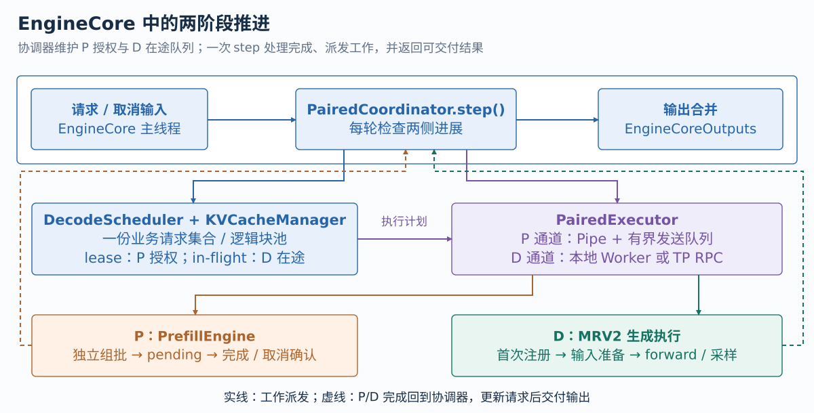{ width="1000" }

一次 `step()` 先检查执行组健康并处理取消，收取 P 的 `prefill_done` 与策略 ACK，再检查 D pending 队首是否完成。已完成输出更新请求、解除对应在途引用，并进入本轮输出集合。随后根据 P/D 压力调整资源策略，获取新的 P 授权，调度 D batch，最后返回可交付结果。

P 完成和 D 完成都以可查询对象进入推进循环。请求 B 的 Prefill 还在运行时，Coordinator 可以收取 A 的生成结果并提交下一轮。D pending 按提交顺序回收，与同一角色内的自回归关系一致；异步提交深度由 `max_concurrent_batches` 限制。

这里保留的是全局业务推进顺序，实际设备等待由输出线程和完成 Future 处理。Coordinator 也维护 D 已注册请求集合、P 取消身份和策略 epoch，使交接与控制消息对应当前状态。

### 3、P 通道的背压如何处理

启动时用 Pipe 同步交换权重、KV 和预热结果。服务阶段则使用 **容量为 4 的发送队列与 sender 线程**，将 work、cancel 和策略消息送到 P 进程。

P 如果读取变慢，主线程的直接 Pipe 发送可能阻塞 D 推进。有界队列将背压暴露为 `can_send()`：协调器暂缓新的 P 派发，继续检查已提交 D 工作。P 在途 batch 上限、P resident 容量和通道队列容量分别约束 GPU 工作、本地请求状态与 CPU 消息积压。

源码：[Coordinator 主循环](https://github.com/tangzzycc/vllm/blob/e3e07d9732a0c6f951117f0c125c76f9e9370baf/vllm/v1/rapidserve/engine.py#L73-L267)、[P 发送队列](https://github.com/tangzzycc/vllm/blob/e3e07d9732a0c6f951117f0c125c76f9e9370baf/vllm/v1/rapidserve/executor.py#L153-L178)。

## 五、调度与 Prefill：一份块池，两套组批预算 {#scheduler}

### 1、D Scheduler 决定请求执行资格

DecodeScheduler 继承基础 Scheduler，复用请求队列、KVCacheManager 与结果更新逻辑，通过 `_is_request_eligible()` 和 `_can_schedule_waiting()` 区分上下文授权与 Decode 执行。

```python
def needs_prefill(request: Request) -> bool:
    return request.num_computed_tokens < max(
        request.num_prompt_tokens, request.num_tokens - 1
    )
```

新请求的 Prompt 尚未计算，需要 P。请求被抢占后，已有生成 tokens 也可能构成要重建的上下文，因此条件包含 `num_tokens - 1`，将最后一个 token 留作下一轮生成输入。

P 选择模式接入需要上下文的请求；正常 D 调度选择已具备上下文、没有 P lease 的请求。D 不直接从 waiting 接入长 Prompt。未开启异步调度时，资格判断还会阻止同一请求同时存在 D 在途计算。

源码：[执行资格](https://github.com/tangzzycc/vllm/blob/e3e07d9732a0c6f951117f0c125c76f9e9370baf/vllm/v1/rapidserve/scheduler.py#L70-L88)、[基础 Scheduler 扩展点](https://github.com/tangzzycc/vllm/blob/e3e07d9732a0c6f951117f0c125c76f9e9370baf/vllm/v1/core/sched/scheduler.py#L1565-L1570)。

### 2、授权包含历史、块表和计算范围

`grant_prefills()` 临时切入 P 选择模式，将入场预算扩大到 `max_model_len × max_num_running_reqs`，关闭长 Prefill 截断，并扣除 retired 请求占用的入场额度。基础 `schedule()` 完成请求入场和整段上下文的 KV 容量检查后，配置在 finally 中恢复。

这个预算用于保留上下文空间，P 的真实 batch 大小由它自己的预算控制。每个选中请求生成一份 PrefillWork：

```python
request = self.requests[req_id]
data = NewRequestData.from_request(
    request,
    self.kv_cache_manager.get_block_ids(req_id),
    list(request._all_token_ids),
)
data.num_computed_tokens -= count
self.sequence += 1
work = PrefillWork(self.session, self.sequence, data, count)
```

基础 Scheduler 在安排工作时已推进 computed-token 计数，传给 P 前扣回本次 count，恢复计算起点。否则 P 会跳过“已经调度、尚未实际计算”的输入。

**PrefillWork 是 D 对共享 KV 的一次使用授权。** 它携带完整 history、block IDs、起始位置与 token 数，以 session/sequence 标识身份。Scheduler 保存相应 lease 和单请求 SchedulerOutput：lease 期间 B 不进入 D，也不能释放 blocks，其他已在生成的请求照常推进。完成时用保存的 SchedulerOutput 接回基础结果处理，旧身份和重复消息不会更新新的授权。

源码：[入场与授权](https://github.com/tangzzycc/vllm/blob/e3e07d9732a0c6f951117f0c125c76f9e9370baf/vllm/v1/rapidserve/scheduler.py#L117-L159)、[完成身份匹配](https://github.com/tangzzycc/vllm/blob/e3e07d9732a0c6f951117f0c125c76f9e9370baf/vllm/v1/rapidserve/scheduler.py#L176-L190)。

### 3、PrefillEngine 根据独立预算组批 {#prefill-engine}

P 收到已经分配好块表的工作后，只负责执行组织。`waiting` 保存工作和局部进度，`pending` 保存已提交 batches 与完成对象，`resident` 限制占用 P Runner 容量的授权数。当前 P 最多保留 2 个在途 batches，resident 上限来自 P 的最大请求数。

默认 `rapidserve_chunked_prefill=False`，P 预算至少覆盖最大上下文。一份完整工作若放不进当前 batch 的剩余预算，就留到下一轮。P 可以组少量长输入，D 可以组较多生成请求，两套预算各自服务于模型的执行规模。

以 B 的 40-token Prompt 为例，整段模式一次执行 40 tokens。若开启 chunking 且 P 预算为 16，则计算 16 → 16 → 8；中间完成只更新 P 局部进度，最后一个 chunk 才交付首 token。整个过程使用同一份授权块表。

提交时，PrefillEngine 将本次起点设置为“授权起点 + 已完成数”，构造 SchedulerOutput 的 `scheduled_new_reqs` 和 scheduled tokens，交给共用 `submit_batch()`。同一套 MRV2 输入准备支持整段或分段执行。chunk 路径会携带更新后的 NewRequestData 重新注册本地状态，resident 表示容量占用，并不要求本地状态行号始终不变。

P 回收 pending 队首时查询完成对象。最后一段结束后取出输出，发布 `prefill_done`，并将本地状态清理按执行通道顺序排在后续工作之前。这一清理不会释放 D 分配的真实 KV blocks；消息发送也不阻塞等待清理 ACK。

源码：[P 状态与完成处理](https://github.com/tangzzycc/vllm/blob/e3e07d9732a0c6f951117f0c125c76f9e9370baf/vllm/v1/rapidserve/prefill.py#L20-L106)、[P 组批与提交](https://github.com/tangzzycc/vllm/blob/e3e07d9732a0c6f951117f0c125c76f9e9370baf/vllm/v1/rapidserve/prefill.py#L117-L158)。

## 六、请求交接：首 token 怎样进入 Decode {#handoff}

### 1、P 写好上下文，并产生首 token

仍以 B 的 40-token Prompt 为例。D 为它分配块表 `[7,12,19]`，块大小为 16，授权 P 计算 position 0～39。P 在每层写入这些位置的压缩 MLA KV，模型最后一个输入位置的输出经 LM Head 和采样得到首 token $y_1$。

此时 KV 中有 **40 个输入 tokens，$y_1$ 还没有经过模型 forward**。D 接受 P 结果后，业务请求包含 Prompt 与 $y_1$，computed tokens 为 40。首 token 可以沿正常输出通道交付客户端；下一轮 D 以 $y_1$ 为输入，写入 position 40 的 KV，再产生 $y_2$。

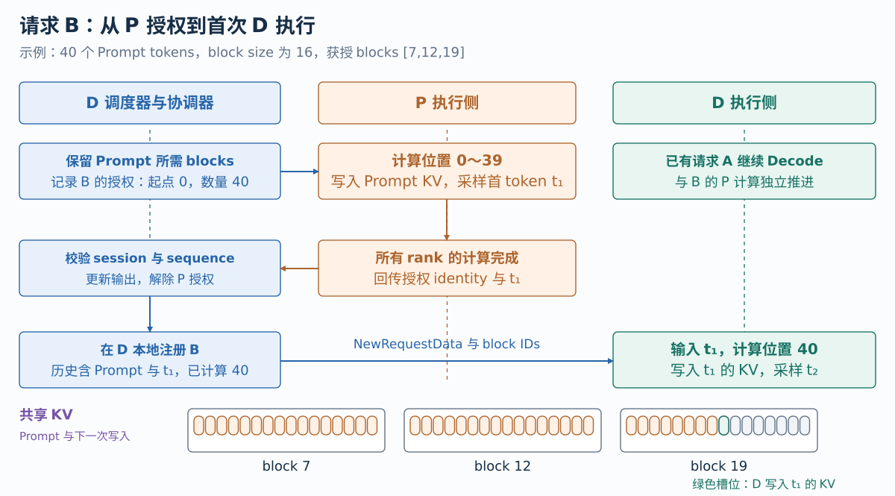{ width="1000" }

交接传递的是身份、块表、计算进度和输出。长上下文 KV 已位于同卡共享存储，D 通过自己的映射直接读取。若 `max_tokens=1`，请求接受 $y_1$ 后已经结束，无需执行首轮 D。

### 2、D 建立自己的请求状态

P Runner 的本地状态不会自动出现在 D。Coordinator 用 `registered` 跟踪哪些请求已经安装到 D；首次调度 B 时补一份 NewRequestData：

```python
for req_id in batch.num_scheduled_tokens:
    if req_id in self.registered:
        continue
    request = scheduler.requests[req_id]
    data = NewRequestData.from_request(
        request,
        scheduler.kv_cache_manager.get_block_ids(req_id),
        list(request._all_token_ids),
    )
    data.num_computed_tokens -= batch.num_scheduled_tokens[req_id]
    additions.append(data)
```

这里带上完整 history、同一块表和本轮开始前的 computed 位置，并去掉该请求重复的 cached 条目。D 随后沿 MRV2 的注册路径建立本地状态，后续 batches 使用 cached request 增量更新。请求结束或被抢占时移除 registered 记录，恢复后可以重新经过 P 与 D 注册。

对于 B，D 注册的 history 长度为 41、computed 为 40，只剩 $y_1$ 待计算。MRV2 从 history 中准备这个 token，并识别“已有上下文、仅扩展一个 token”的情形，允许选择 Decode Graph；D 无需重跑 Prompt，也无需继承 P 的采样器内部状态。

源码：[P 完成通知](https://github.com/tangzzycc/vllm/blob/e3e07d9732a0c6f951117f0c125c76f9e9370baf/vllm/v1/rapidserve/prefill.py#L73-L106)、[D 接受首 token](https://github.com/tangzzycc/vllm/blob/e3e07d9732a0c6f951117f0c125c76f9e9370baf/vllm/v1/rapidserve/scheduler.py#L176-L190)、[D 首次注册](https://github.com/tangzzycc/vllm/blob/e3e07d9732a0c6f951117f0c125c76f9e9370baf/vllm/v1/rapidserve/engine.py#L206-L253)。

## 七、MRV2：调度计划如何变成 GPU 输入 {#model-runner}

### 1、每个 Runner 维护自己的请求状态

Scheduler 用 `req_id` 表示业务请求，MRV2 为预分配数组分配本地 `req_state_idx`。B 在 P 中可能位于行 2，在 D 中可能位于行 6；batch 内排序又会得到不同的 `batch_idx`。

**共享 KV 不要求两侧本地行号相同。** 它们根据同一份授权 block IDs 寻址，持久状态行与临时输入的索引由各自 Runner 维护。

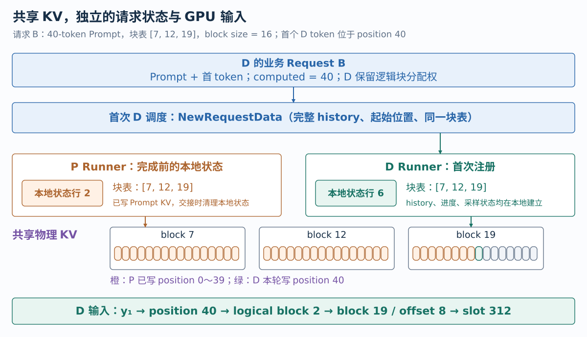{ width="1000" }

MRV2 先同步请求与块表，再准备当前 batch，最后执行和采样：

```text
execute_model(SchedulerOutput)
  → finish_requests / free_states
  → add_requests / update_requests
  → block_tables.apply_staged_writes()
  → gather_batch_req_state()
  → 选择本轮 eager / Graph descriptor
  → prepare_inputs()
  → prepare_attn()
  → 模型 forward
sample_tokens()
  → logits / sampler
  → GPU token 状态更新
  → 异步输出回拷
```

`add_requests()` 安装 history、computed、采样状态和 block table；`update_requests()` 为已驻留请求同步进度镜像与新增 blocks。两侧复用同一套请求更新和输入准备逻辑；D 的模型组件在共享导入后初始化，Attention 使用已经绑定的共享 KV。

源码：[本地请求更新](https://github.com/tangzzycc/vllm/blob/e3e07d9732a0c6f951117f0c125c76f9e9370baf/vllm/v1/worker/gpu/model_runner.py#L1175-L1264)、[执行主路径](https://github.com/tangzzycc/vllm/blob/e3e07d9732a0c6f951117f0c125c76f9e9370baf/vllm/v1/worker/gpu/model_runner.py#L1713-L1823)。

### 2、从 req_id 到 batch 输入

`gather_batch_req_state()` 根据本轮 scheduled tokens 找到执行请求，排列 batch，并建立 `idx_mapping_np`：

```text
batch_idx → req_id → req_state_idx
```

`prepare_inputs()` 再按每请求 token 数累计 `query_start_loc`，将不等长输入压成连续 token 数组，并生成 positions。例如 P batch 中只有 B，40 tokens 的边界为 `[0,40]`；首次 D batch 中 B 只计算 1 token，它的 position 为 40。

P 输入从完整 history 中取本段 tokens；D 后续生成依赖 GPU 上的 last sampled tokens 和计算进度，避免每轮等 CPU 输出回来再准备下一步。

MRV2 将首次注册的 B 记录为 `prefill_len=41`、`computed=40`，输入准备从 history 中取出 $y_1$。`gather_batch_req_state()` 识别这种既有上下文上的单 token 扩展，仍允许选择 Decode Graph；输入来源与 Attention 执行类型在这里分别判断。

Graph descriptor 决定本轮真实 token 数与 padding 后容量。padding 影响 buffers 和 kernel 输入，但不会成为真实请求的新 token，也不应写有效 KV slots。

### 3、block table 与 slot mapping

block table 保存历史上下文的物理 block IDs；slot mapping 指定当前新增 token 的 KV 写入位置。

MRV2 按 batch 的 `idx_mapping` gather 对应块表，再结合 positions 计算本轮 slot mapping：

```python
block_tables = self.block_tables.gather_block_tables(
    input_batch.idx_mapping, num_reqs_padded=input_batch.num_reqs_after_padding
)
# Slot mappings: [num_kv_cache_groups, num_tokens_padded].
# Kernel pads beyond num_tokens with PAD_SLOT_ID.
slot_mappings = self.block_tables.compute_slot_mappings(
    input_batch.idx_mapping,
    input_batch.query_start_loc,
    input_batch.positions,
    num_tokens_padded=input_batch.num_tokens_after_padding,
)
return block_tables, slot_mappings
```

以一个 KV group、page size 16 且与后端寻址块大小一致为例：

$$
\begin{aligned}
\text{logical block} &= \left\lfloor \frac{p}{16} \right\rfloor,\\
\text{offset} &= p \bmod 16,\\
\text{slot} &= \text{block ID}[\text{logical block}]\times16+\text{offset}.
\end{aligned}
$$

B 的块表为 `[7,12,19]`，首轮 D 的 $p=40$：logical block 为 2，物理 block 为 19，offset 为 8，因此 slot 为 $19\times16+8=312$。

D 在这个槽位写入 $y_1$ 对应的 MLA latent 和 RoPE Key；读取历史时使用同一块表访问 Prompt 的压缩 KV。实际 tensor 字节地址还依赖后端的维度排列、stride 和 dtype。多 group 或不同 cache layout 使用各自 metadata，不能用这个简化公式替代所有 Attention 后端布局。

### 4、模型输出与下一轮生成状态

`prepare_attn()` 得到块表与 slot mappings 后，model state 为具体 Attention backend 构造 metadata，forward 执行投影、KV 写入、历史缓存读取和后续网络层。TP 继续进行模型原有的组内通信。

采样后，MRV2 的 `postprocess_sampled()` 更新 GPU 上的 computed tokens、last sampled tokens 和 token history。AsyncScheduler 的占位表示 CPU 尚未拿到结果，下一轮仍按 stream 顺序消费 GPU 上的真实 token。

CPU 可以提前推进调度，GPU 上仍保留严格的自回归依赖。资源切 stream 时也必须维持这层依赖，不能让下一轮在新 stream 越过上一轮。

源码：[batch 状态投影](https://github.com/tangzzycc/vllm/blob/e3e07d9732a0c6f951117f0c125c76f9e9370baf/vllm/v1/worker/gpu/model_runner.py#L1266-L1346)、[输入准备](https://github.com/tangzzycc/vllm/blob/e3e07d9732a0c6f951117f0c125c76f9e9370baf/vllm/v1/worker/gpu/model_runner.py#L1348-L1547)、[Attention 寻址](https://github.com/tangzzycc/vllm/blob/e3e07d9732a0c6f951117f0c125c76f9e9370baf/vllm/v1/worker/gpu/model_runner.py#L1550-L1568)、[GPU 采样状态更新](https://github.com/tangzzycc/vllm/blob/e3e07d9732a0c6f951117f0c125c76f9e9370baf/vllm/v1/worker/gpu/model_runner.py#L1673-L1701)。

## 八、多卡执行：广播与全 rank 完成汇聚 {#tensor-parallel}

### 1、复用 MultiprocExecutor 的通信

ParallelWorker 为 paired 路径提供一致的执行接口，底层使用 `collective_rpc("execute_paired_batch", batch)` 将同一角色的计划广播到全部 TP workers。

P/D 通信组的 rendezvous 各自独立：需要 TCP store 时使用不同端口，否则使用独立 file store。组内模型通信仍由原 TP 实现负责。

每个 SharedModelWorker 执行模型、采样并记录本地完成 event：

```python
def execute_paired_batch(self, batch, timed=False):
    """Return through WorkerProc's copy thread after local KV writes finish."""
    start = torch.cuda.Event(enable_timing=True) if timed else None
    if start is not None:
        start.record()
    self.execute_model(batch)
    output = self.sample_tokens(None)
    event = torch.cuda.Event(enable_timing=timed)
    event.record()
    return RankOutput(output, start, event)
```

非 rank 0 即使没有业务采样输出，也返回 RankOutput，因为它仍参与 KV 写入和模型通信。

### 2、为什么不能只等 rank 0

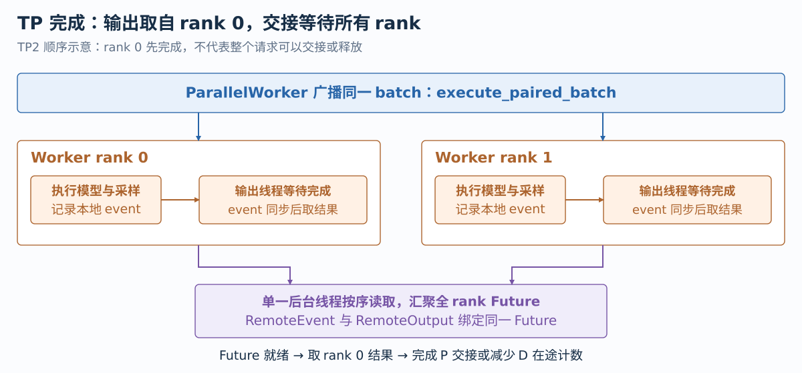{ width="1000" }

rank 0 返回首 token，只说明它的输出已产生；其他卡可能仍在访问本地共享 KV。若此时允许 D 消费或释放 blocks，会出现未完成读取与地址复用风险。

项目将完成确认分成三步：

1. 各 worker 的输出线程调用 RankOutput，等待本地 GPU event，并获取已完成回拷的输出。
2. collective RPC 收集全部 rank 响应；ParallelWorker 用唯一后台 reader 按提交顺序解析底层 Future。
3. 聚合 Future 完成后，RemoteEvent 报告 ready，RemoteOutput 才允许取 rank 0 的业务结果。

```python
class RemoteOutput(AsyncOutput):
    """Completion includes GPU work on every rank, not only rank zero's sample."""

    def __init__(self, future: Future):
        self.future = future
        self.copy_event = RemoteEvent(future)

    def get_output(self):
        return self.future.result()[0][0]
```

**输出只使用 rank 0，完成判断覆盖全部 rank。** RemoteOutput 的 copy_event 也绑定同一 Future，因此 ready 已经包含所有卡的 GPU 完成与所需输出读取。

### 3、异步等待与错误传播

等待 GPU 的操作发生在 worker 输出线程；汇聚发生在响应 reader。Coordinator 提交工作后只保留完成对象，不在提交点等待整组 GPU。

基础响应队列按 RPC 次序读取，所以适配层保持唯一 reader，避免不同线程消费错结果。RPC 或 worker 失败写入 Future，并在健康检查中传播，不应按成功完成继续交接。

TP 资源计时取各 rank 的本地 GPU 步时长最大值，反映最慢 rank。它不含完整服务排队和网络返回时间，客户端延迟需另外测量。

源码：[TP RPC 适配](https://github.com/tangzzycc/vllm/blob/e3e07d9732a0c6f951117f0c125c76f9e9370baf/vllm/v1/rapidserve/parallel.py#L15-L127)、[本地事件与输出](https://github.com/tangzzycc/vllm/blob/e3e07d9732a0c6f951117f0c125c76f9e9370baf/vllm/v1/rapidserve/worker.py#L30-L39)、[RankOutput](https://github.com/tangzzycc/vllm/blob/e3e07d9732a0c6f951117f0c125c76f9e9370baf/vllm/v1/rapidserve/worker.py#L309-L321)、[全部响应汇聚](https://github.com/tangzzycc/vllm/blob/e3e07d9732a0c6f951117f0c125c76f9e9370baf/vllm/v1/executor/multiproc_executor.py#L382-L455)、[Worker 输出线程](https://github.com/tangzzycc/vllm/blob/e3e07d9732a0c6f951117f0c125c76f9e9370baf/vllm/v1/executor/multiproc_executor.py#L984-L1045)。

## 九、执行资源：stream、CU mask 与 Decode Graph {#resources}

### 1、长输入与生成使用不同执行策略

DeepSeek-V3 的长输入包含较大的投影和专家 GEMM，Decode 则反复执行较小批次、读取共享权重与历史 KV。两侧独立运行后，还需要控制资源争用和每轮提交开销：

| 机制 | 控制什么 |
| --- | --- |
| P/D 独立组批 | 每侧执行哪些请求、多少 tokens |
| 独立 stream | 同一角色的 GPU 工作先后关系 |
| CU mask | stream 上工作允许使用的计算单元 |
| Decode Graph | 稳定生成形状的捕获与回放，减少提交开销 |

P 使用 eager，D 保留 MRV2 Decode Graph。两侧可以全 CU 提交，也可使用互补 masks；CU 分区不隔离显存带宽和 cache，效果依赖负载。

### 2、CU mask 的底层实现

`partition_cus()` 按 CU 对划分，P 使用前一部分、D 使用其余部分，保证 masks 不重叠。每个 uint32 mask word 对应 32 个 CU bits。

例如概念设备有 8 个 CU，fraction 为 0.5，得到 P mask `00001111`、D mask `11110000`。实际 CU 数、mask word 数和配对粒度由设备及校验决定。

ROCm 平台封装 `CuMaskedStream`，通过 `hipExtStreamCreateWithCUMask` 创建 HIP stream，再读回实际 mask 校验；`torch.cuda.ExternalStream` 为 PyTorch 提供非拥有包装。CuMaskedStream 保留 HIP handle 并负责最终销毁，避免将底层 stream 生命周期交给非拥有 wrapper。

### 3、固定、constrained 与 auto 策略

| 策略 | 行为 |
| --- | --- |
| fraction 0 / 全 CU | 两侧各自提交，均可使用完整设备 |
| 固定非零 fraction | 启动时使用互补 masks |
| constrained | 有 P 压力且活跃 D 请求至少 64 时取 0.5，否则全 CU |
| auto | 持续 P/D 重叠时试候选配额，按 D GPU 步时间反馈接受或回退 |

constrained 的 64 是 Scheduler 活跃 Decode 请求计数，P 压力包含授权与可入场工作；它不是实际 GPU batch 的精确大小。

auto 按实际完成 batch 大小的 bucket 保存全 CU 与分区步时间 EWMA，更新权重为旧值 0.75、新样本 0.25。默认需要基线样本与持续负载，试一个候选配额，至少有足够分区样本后检查是否超过容许变慢幅度。内部 target 虽命名 `target_itl_ms`，观测的是 GPU 步时长，客户端 TPOT/ITL 另由服务压测评估。

auto、constrained 和固定非零 fraction 有配置互斥约束。选择与切换由 Coordinator 组织，Worker 执行具体 stream 操作。

源码：[CU mask 与反馈控制](https://github.com/tangzzycc/vllm/blob/e3e07d9732a0c6f951117f0c125c76f9e9370baf/vllm/v1/rapidserve/resources.py#L10-L151)、[HIP stream 封装](https://github.com/tangzzycc/vllm/blob/e3e07d9732a0c6f951117f0c125c76f9e9370baf/vllm/platforms/rocm_stream.py#L11-L55)、[策略选择](https://github.com/tangzzycc/vllm/blob/e3e07d9732a0c6f951117f0c125c76f9e9370baf/vllm/v1/rapidserve/engine.py#L131-L177)。

### 4、切换 stream 必须保持自回归依赖

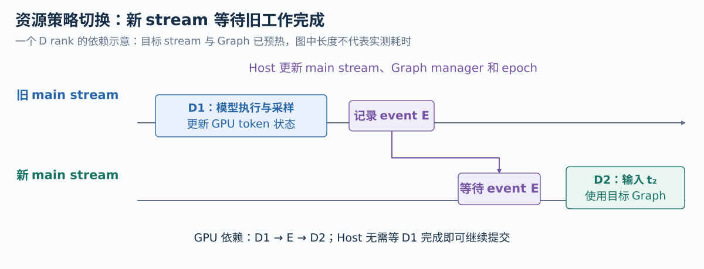{ width="1000" }

启动 `set_resource_policy()` 可以同步设备，建立候选 stream 和 D Graph manager。运行 `advance_resource_policy()` 则要求目标已预热，用 event 建立顺序：

```python
previous = torch.cuda.Event()
previous.record(runner.main_stream)
stream.wait_event(previous)
torch.cuda.set_stream(stream)
runner.main_stream = stream
runner.cudagraph_manager = manager
self.stream_owner = owner
```

旧 stream 上 D1 的计算与采样先完成，新 stream 上 D2 才继续；Host 可以提交后续工作。策略还切换对应 Graph manager，避免 stream 变了而 Graph 仍指向另一策略状态。

TP 策略与 batch 使用同一有序广播，每个 rank 保持先应用策略、后执行批次；P 控制进程等全 rank 策略 Future 完成后发布 ACK。过渡期间 P/D 可以仍有旧 epoch 工作，这套协议保证角色内依赖，没有额外建立两角色瞬时共同切换的全设备 barrier。

手动策略与 pause 走 drain：暂缓新工作，处理现有 leases 与 pending，完成后同步设置。auto/constrained 使用预热 advance 路径，避免每次排空两侧。

### 5、ROCm 的 capture 与 replay

HIP CU-masked stream 是 blocking stream，不能直接用于 PyTorch capture。Worker 建立独立 capture stream，D 捕获时使用它，replay 经当前主 stream 提交。

初始化要求 `DEBUG_HIP_FORCE_GRAPH_QUEUES=1` 与 `DEBUG_HIP_GRAPH_SEGMENT_SCHEDULING=0`，处理 Graph 队列不自然继承 launch stream CU mask 的行为。stream 和 Graph manager 按实际 mask key 保存，运行切换不临时捕获。

源码：[预热与切换](https://github.com/tangzzycc/vllm/blob/e3e07d9732a0c6f951117f0c125c76f9e9370baf/vllm/v1/rapidserve/worker.py#L80-L168)、[Graph queue 配置](https://github.com/tangzzycc/vllm/blob/e3e07d9732a0c6f951117f0c125c76f9e9370baf/vllm/v1/rapidserve/executor.py#L41-L53)、[候选策略预热](https://github.com/tangzzycc/vllm/blob/e3e07d9732a0c6f951117f0c125c76f9e9370baf/vllm/v1/rapidserve/executor.py#L194-L215)、[drain](https://github.com/tangzzycc/vllm/blob/e3e07d9732a0c6f951117f0c125c76f9e9370baf/vllm/v1/rapidserve/engine.py#L285-L303)。

## 十、生命周期：取消、迟到完成与进程退出 {#lifecycle}

### 1、请求取消后，KV 仍可能被 GPU 使用

客户端取消只改变业务状态，已提交 kernel 仍可能访问 KV。DecodeScheduler 用三类状态保护存活期：

| 状态 | 保护对象 | 解除时机 |
| --- | --- | --- |
| `leases[req_id]` | P 获得的上下文使用权 | 匹配 identity 的 P 完成或取消完成 |
| `decode_in_flight[req_id]` | D 已提交且未确认的轮次 | 每批完成减一，归零后解除 |
| `retired` | 已结束但仍在被 GPU 使用的请求 | 两类保护都解除后实际释放 blocks |

`_free_blocks()` 在仍受保护时将请求放入 retired，`_release_retired()` 才负责最后归还。B 被取消后不再调度，也不会马上把它的 block IDs 给 C。

### 2、两轮 D 在途的回收过程

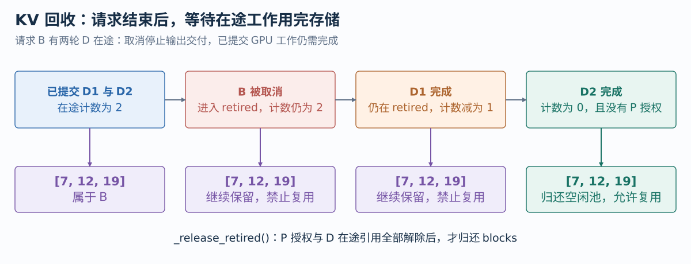{ width="1000" }

假设 B 有 D1、D2 两轮已提交，计数为 2。取消后 B 逻辑结束，但 D1、D2 仍可能访问 `[7,12,19]`：

1. B 进入 retired，blocks 保留。
2. D1 的全 rank 完成，计数降到 1，继续保留。
3. D2 的全 rank 完成，计数归零。
4. 确认没有 P lease，再调用基础 Scheduler 释放。
5. 新请求 C 此后才可得到这些 blocks。

这也是使用计数而不是布尔值的原因。retired 请求还占入场信用，防止大量取消后立即补入超出实际尚未释放容量的新 P 工作。

### 3、P 取消与迟到消息

未提交的 P 工作可以直接清理；已在 pending 中的工作必须等 GPU 完成，再返回空结果作为收尾。D 匹配 session/sequence 后解除 lease，不交付已结束请求的输出。旧授权和重复通知不会误释放新使用权。

执行异常会通过健康检查与 Future 传播，进入故障清理，不能仅删除 lease 后继续当作模型完成。正常计算完成、取消收尾、执行失败分别具有不同语义。

源码：[lease 与退休保护](https://github.com/tangzzycc/vllm/blob/e3e07d9732a0c6f951117f0c125c76f9e9370baf/vllm/v1/rapidserve/scheduler.py#L90-L113)、[完成与回收](https://github.com/tangzzycc/vllm/blob/e3e07d9732a0c6f951117f0c125c76f9e9370baf/vllm/v1/rapidserve/scheduler.py#L176-L212)、[P 取消](https://github.com/tangzzycc/vllm/blob/e3e07d9732a0c6f951117f0c125c76f9e9370baf/vllm/v1/rapidserve/prefill.py#L64-L106)。

### 4、D consumer 先退出，P owner 后释放

PairedExecutor 先关闭 D 执行组和响应 reader，再通过 P 通道发送 close、join P。P 在自身发生异常时也会先发送错误，并保留一段清理窗口等待 D 关闭共享映射。

Worker 清理顺序包含：

- 调用父类 shutdown，确保 GPU 使用结束。
- 将收集的旧 tensor 对象脱离共享 storage。
- 清理当前配置的 Graph wrappers、compiled callable/AOT 引用。
- 清理 router bias、module 参数、buffers 和普通 tensor 属性。
- 关闭 masked streams，释放导出 owners 和本地引用。

编译函数和普通执行对象可能在 model 删除后仍保留 tensor。显式清理这些引用，保证消费者真正结束使用后，拥有者才能释放。

源码：[D 先于 P 关闭](https://github.com/tangzzycc/vllm/blob/e3e07d9732a0c6f951117f0c125c76f9e9370baf/vllm/v1/rapidserve/executor.py#L334-L371)、[Worker 清理共享引用](https://github.com/tangzzycc/vllm/blob/e3e07d9732a0c6f951117f0c125c76f9e9370baf/vllm/v1/rapidserve/worker.py#L248-L306)、[P 故障保活](https://github.com/tangzzycc/vllm/blob/e3e07d9732a0c6f951117f0c125c76f9e9370baf/vllm/v1/rapidserve/process.py#L89-L116)。

### 5、部署边界

当前 paired 路径支持单机常驻文本模型、纯 TP、greedy 请求，并校验 DeepSeek-V3/R1 的 MLA/MoE/FP8 格式。prefix caching、独立 EP/EPLB、DP/PP/上下文并行、多模态、LoRA、speculative decoding、offload 和外部 KV connector 等组合在配置阶段拒绝。

这些边界直接关系共享状态的一致性。例如 EPLB 会调整专家布局，外部 KV connector 引入另一套传输生命周期，都需要相应的两侧状态协议。本文中的 DeepSeek-V3 解释对应固定专家映射、本卡共享 KV 与独立 TP 执行组。

源码测试覆盖调度 lease 与在途回收、全 rank Future、共享视图和 DeepSeek 运行状态恢复。设备验证还需检查连续生成、取消、初始化和退出；性能比较则保持模型精度、TP、KV 容量、硬件与负载一致，观察吞吐、TTFT 和生成间隔。测试口径见 [性能验证回答](面试问题与回答.md#performance-validation)。

源码：[能力校验](https://github.com/tangzzycc/vllm/blob/e3e07d9732a0c6f951117f0c125c76f9e9370baf/vllm/v1/rapidserve/ipc.py#L139-L198)、[调度生命周期测试](https://github.com/tangzzycc/vllm/blob/e3e07d9732a0c6f951117f0c125c76f9e9370baf/tests/v1/core/test_scheduler.py#L7549-L7730)、[TP 完成测试](https://github.com/tangzzycc/vllm/blob/e3e07d9732a0c6f951117f0c125c76f9e9370baf/tests/v1/executor/test_executor.py#L74-L186)、[共享与 DeepSeek 测试](https://github.com/tangzzycc/vllm/blob/e3e07d9732a0c6f951117f0c125c76f9e9370baf/tests/v1/worker/test_kv_cache_allocation_scope.py#L175-L571)。
