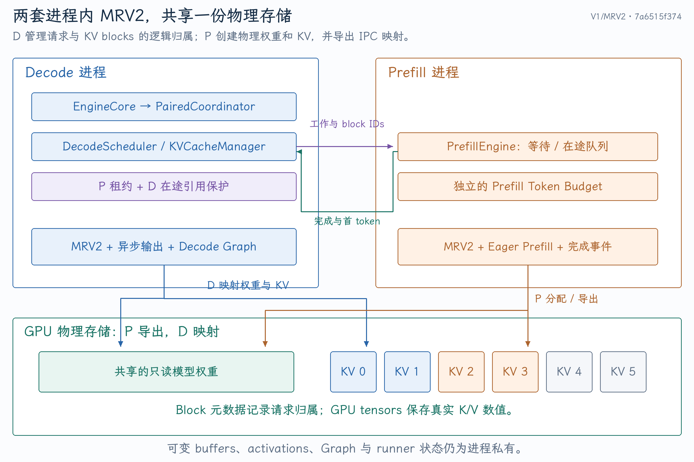
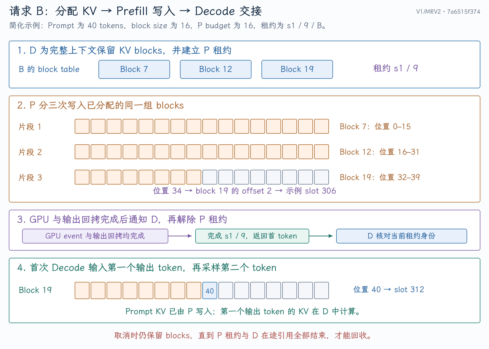
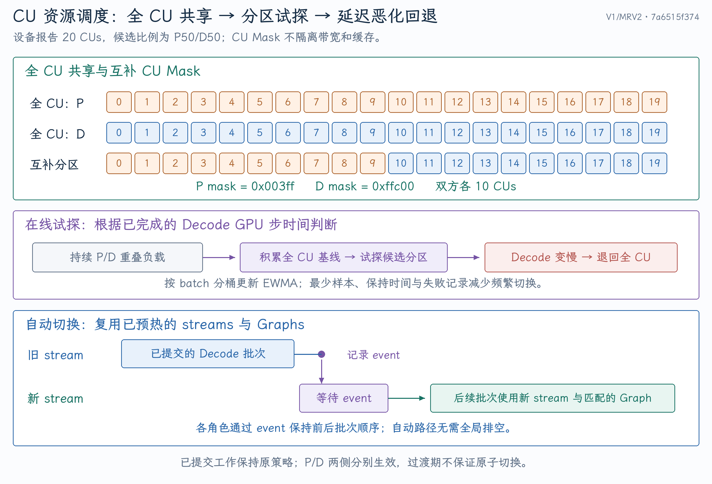

# vLLM V1/MRV2 下的 P/D 解耦实现与设计取舍

当前项目把“P/D 在同一设备独立推进、共享 KV”接入 vLLM V1 的请求生命周期，复用 MRV2 的输入准备、执行与异步输出。实现难点集中在三件事：共享存储的生命周期、跨进程请求交接的正确性，以及切换资源时保持 Decode 连续提交。

本文固定分析 `feat/rapidserve-mrv2` 分支的提交 **`7a6515f3748a2a12f842fd67667e5a4cc4a7ee86`** 。源码链接均指向这一版本；研究动机见 [论文与指标](01-论文与推理指标.md)，实测与回答模板见 [性能证据与面试问答](03-性能证据与面试问答.md)。

## 1. 接入位置与当前能力边界

V1 是引擎架构，MRV2 是第二版 GPU ModelRunner，两者不是两个互斥的框架。EngineCore 接收请求，Scheduler 决定执行哪些 token，Executor/Worker 调用 ModelRunner，后者准备设备输入并运行模型。可先参考 [V1 整体架构](<../../../../vllm/基础篇/vLLM V1整体架构.md>)。

当 `additional_config["rapidserve"]` 开启时，[EngineCore 配置入口](https://github.com/tangzzycc/vllm/blob/7a6515f3748a2a12f842fd67667e5a4cc4a7ee86/vllm/v1/engine/core.py#L142-L147) 选择专用 Scheduler 和 Executor；初始化结束后，[EngineCore step 接入](https://github.com/tangzzycc/vllm/blob/7a6515f3748a2a12f842fd67667e5a4cc4a7ee86/vllm/v1/engine/core.py#L263-L266) 改为 `PairedCoordinator.step`。离线推理与 HTTP 服务仍通过现有引擎请求链路进入。

当前实际支持的是 **单设备、TP1/DP1、常驻未量化的文本生成模型** ，请求主要为 greedy decoding；已接入 Dense 与 Qwen3 MoE 的 Triton 路径。不是任意模型、任意 vLLM feature 都自动兼容。

[模型校验](https://github.com/tangzzycc/vllm/blob/7a6515f3748a2a12f842fd67667e5a4cc4a7ee86/vllm/v1/rapidserve/ipc.py#L116-L158) 明确限制了多卡、LoRA、多模态、量化、speculative decoding、hybrid 模型、外部 KV connector、offload、EPLB 等组合；[请求校验](https://github.com/tangzzycc/vllm/blob/7a6515f3748a2a12f842fd67667e5a4cc4a7ee86/vllm/v1/rapidserve/scheduler.py#L47-L66) 限制结构化输出、logprobs、prompt embeddings、resumable 等请求。Prefix caching 在 [configure](https://github.com/tangzzycc/vllm/blob/7a6515f3748a2a12f842fd67667e5a4cc4a7ee86/vllm/v1/rapidserve/engine.py#L22-L31) 中被拒绝。

论文描述同一组 GPU 的方案，可以覆盖单机多卡；当前分支没有完成 TP 扩展。因此面试可以讲同设备组方案的扩展方向，不能把理论可扩展性说成当前多卡能力。

## 2. 谁负责调度，谁拥有物理存储

{ width="100%" }

| 组件 | 决策或状态 | 不应混淆的边界 |
| --- | --- | --- |
| `DecodeScheduler` | 请求入场、逻辑 KV 分配、P 租约、D 在途计数 | 不负责创建每个 attention kernel |
| `PrefillEngine` | 将授予的 P 工作组合为实际批次，处理完成与取消 | 不拥有第二套 KV block 分配器 |
| `PairedCoordinator` | 驱动双方、收集输出、注册 D 请求、推进策略 | 不把两个角色重新拼回一个混合模型批次 |
| `PairedExecutor` | 启动 P、控制消息、存储导出导入、健康与退出 | 继承 UniProcExecutor，当前不是 TP executor |
| `SharedModelWorker` | 共享存储映射、执行 stream、Graph、策略 epoch | Worker 内仍有进程私有 buffer 和状态 |
| MRV2 ModelRunner | 输入准备、执行、采样与异步输出 | 收到的是调度元数据，不是 Scheduler 直接产生的全部 GPU tensors |

### 2.1 不能只按文件名理解“拆 P/D”

这里拆开的不是两个完整 HTTP 服务，也不是把 Prefill 的 Transformer 层换成另一套计算公式。上层仍看到一个 EngineCore 的请求集合，协调器把需要补上下文的请求授予 P，把已具备上下文的请求交给 D；两侧各有独立 MRV2 runner state，底层模型权重和 KV 共享。

一个请求先在 P runner 占用本地 request slot，完成后从 P runner 清理，再在 D runner 注册。P 的 slot index 与 D 的 slot index 可以不同；跨进程身份靠 `req_id/session/sequence`，历史 KV 寻址靠 block IDs，不能把某一侧的临时 row index 当作另一侧的稳定身份。

独立调度也不意味着缓存不受统一 admission 控制。D 在授予 P 前先保证完整上下文有空间，P 才执行；如果 KV 无法分配，不能让 P 擅自写入“稍后会有”的块。入场、执行和回收分别对应三个状态变化。

## 3. 启动时如何避免加载第二份模型

[PairedExecutor 初始化](https://github.com/tangzzycc/vllm/blob/7a6515f3748a2a12f842fd67667e5a4cc4a7ee86/vllm/v1/rapidserve/executor.py#L24-L109) 先验证配置，要求 `spawn` 和固定 `kv_cache_memory_bytes`，再复制配置启动 P。P 使用 eager、关闭 compilation 与 Graph；D 保留自身的 MRV2、异步调度和 Decode Graph 配置。

顺序是：

1. P 进程加载模型，得到已处理为运行格式的权重。
2. P 导出权重 manifest；D 创建 meta model，导入共享 tensor views。
3. P 按引擎给出的 KV 配置分配实际缓存，导出缓存 manifest；D 导入同一份缓存。
4. 双方完成预热；若启用自动 CU 策略，还要预先准备全 CU 与候选分区的 stream 和 D Graph。

KV 初始化和预热调用见 [initialize_from_config / compile_or_warm_up_model](https://github.com/tangzzycc/vllm/blob/7a6515f3748a2a12f842fd67667e5a4cc4a7ee86/vllm/v1/rapidserve/executor.py#L152-L170)。固定 KV 预算避免两侧分别按显存比例建立独立池，也使初始化的共享内存口径更明确；这仍需要给 activation、Graph、workspace 留空间。

### 3.1 一个 storage 可以有多个 tensor views

[TensorViews.export / import_tensors](https://github.com/tangzzycc/vllm/blob/7a6515f3748a2a12f842fd67667e5a4cc4a7ee86/vllm/v1/rapidserve/ipc.py#L20-L87) 按底层 storage 去重，而不是对每个参数单独导出一次。Manifest 为每个具名 tensor 保留：storage index、dtype、shape、stride 与 storage offset。

例如 tied embedding 和输出投影可能是同一 storage 的别名。如果只按 tensor 名处理，容易把别名当成两份权重；如果导入时遗漏 stride/offset，也可能把一个切片还原成错误布局。当前导入据这些信息重新构造视图，并检查物理 GPU UUID，防止把设备编号相同但物理设备不同的映射误用。

P 用 `_owners` 持有导出 storage，序列化不会把 owner tensor 复制给 D。两进程各自虚拟地址不一定相同，重要的是映射同一物理存储；不能用跨进程 `data_ptr()` 相等作为共享成立的必要条件。

### 3.2 权重共享，运行时可变状态保持私有

[import_model](https://github.com/tangzzycc/vllm/blob/7a6515f3748a2a12f842fd67667e5a4cc4a7ee86/vllm/v1/rapidserve/ipc.py#L161-L205) 在 meta device 构建模型，然后用导入的参数替换 meta parameters；对等价别名复用 Parameter 对象。RoPE cache 等 buffers 和普通 tensor attributes 则 clone，避免双方 forward 修改同一个可变状态。

所以“零额外权重加载”是核心收益，“所有模型状态零复制”不是当前设计。D 的 `model_memory_usage=0` 是本地新增模型权重分配的记账口径，不表示共享权重不占实际设备内存。

### 3.3 共享内存正确性的四个条件

共享存储不能仅靠“成功导入 handle”判定正确，还需要同时成立：

| 条件 | 当前实现如何处理 | 失败后果 |
| --- | --- | --- |
| 映射对象正确 | storage 去重、UUID、dtype/shape/stride/offset 还原 | 读错设备、权重别名或 KV layout |
| 写入先于读取 | P 完成 GPU event 与 copy event 后通知，D 再安排该请求 | D 读到未写完的 KV |
| 最后一次使用先于回收 | P lease、D in-flight 与 retired 共同 pin | 旧 kernel 写坏新请求的 blocks |
| producer 生命周期足够长 | 导出 owners 保持引用，正常退出先关 consumer | D 引用的分配提前失效 |

这四个条件分别是身份、顺序、回收和存储存活问题。一个 event 不负责跨请求 block 分配，一个 Python 引用计数也不自动代表 GPU 已经停止使用存储。将这些职责分开，异常路径才容易验证。

## 4. P 预算为什么必须独立

常规混合批处理中，公共 token budget 同时约束 P/D。双进程拆开后，如果仍让 P 只处理很少 token，D 虽能继续生成，P 却可能因频繁分块和提交而变慢，新请求更晚进入 D。

[configure_prefill](https://github.com/tangzzycc/vllm/blob/7a6515f3748a2a12f842fd67667e5a4cc4a7ee86/vllm/v1/rapidserve/prefill.py#L15-L31) 将 `rapidserve_prefill_max_num_batched_tokens` 写入 P 的 SchedulerConfig 和 ModelRunner 容量。它既影响调度上限，也影响输入 buffer 尺寸；只改调度字段、没有扩大 runner 容量会产生不一致。

| 配置 | 含义 |
| --- | --- |
| `max_num_batched_tokens` | D 配置的公共预算；普通模式中是混合预算 |
| `rapidserve_prefill_max_num_batched_tokens` | P 一次实际执行的 aggregate token budget |
| `rapidserve_chunked_prefill=true` | 剩余预算不足时允许切分请求 |
| `rapidserve_chunked_prefill=false` | 单请求剩余 P 工作必须完整放入一次批次 |

P512 指一批 P 的总 token 上限为 512，不是“最多 512 个请求”。纯 D 每请求每步一个 token 时，D512 才可以理解为最多安排 512 个 token，仍同时受 `max_num_seqs`、KV 和在途深度约束。

整段模式未指定 P 预算时，默认至少覆盖 `max_model_len`，显式不合法预算由配置校验拒绝。在 [PrefillEngine.step](https://github.com/tangzzycc/vllm/blob/7a6515f3748a2a12f842fd67667e5a4cc4a7ee86/vllm/v1/rapidserve/prefill.py#L109-L156) 中，整段请求若放不进当前批次剩余预算，就留在队首等待下一批。

例如 P6144，先装入一个 1024-token 请求，再遇到另一个 4096-token 请求，两者可同批；如果剩余只有 3072，则分块模式可处理 4096 请求的前 3072，而整段模式要等下一批。**预算大不自动代表整段执行** ，还要看模式和当时批次的剩余空间。

### 4.1 从实际配置理解这几种开关

下面按本地测试的设置列出 Qwen3-0.6B paired 分块配置，帮助把概念对应到现有入口。它不是新的性能结果，模型路径与环境需与本机一致；Python 命令仍从仓库 `.venv/bin/python` 执行。

```python
from vllm import LLM, SamplingParams

llm = LLM(
    model="/home/tang/models/Qwen3-0.6B",
    dtype="bfloat16",
    max_model_len=4096,
    max_num_seqs=16,
    max_num_batched_tokens=512,
    kv_cache_memory_bytes=4 * 1024**3,
    enable_prefix_caching=False,
    async_scheduling=True,
    attention_config={"backend": "TRITON_ATTN"},
    additional_config={
        "rapidserve": True,
        "rapidserve_prefill_max_num_batched_tokens": 2048,
        "rapidserve_chunked_prefill": True,
        "rapidserve_cu_fraction": 0.0,
        "rapidserve_auto_cu": False,
    },
    compilation_config={
        "mode": 0,
        "cudagraph_mode": "FULL_DECODE_ONLY",
        "cudagraph_capture_sizes": [1, 2, 4, 8, 16],
    },
)
outputs = llm.generate("Explain KV Cache.", SamplingParams(temperature=0))
```

启动环境要设置 `VLLM_USE_V2_MODEL_RUNNER=1`、`VLLM_WORKER_MULTIPROC_METHOD=spawn`；ROCm Graph queue 约束见第 8 节。脚本方式运行时，应把模型初始化放在 `if __name__ == "__main__":` 下，避免 spawn 的子进程再次执行初始化。

要测试整段 P，需要同时设 `rapidserve_chunked_prefill=False` 和足以覆盖允许上下文的 P 预算。要自动试探，full CU 起点保持 fraction=0，将 `rapidserve_auto_cu` 设为含 `prefill_fraction/min_decode_batch` 等字段的字典；它与固定非零 `rapidserve_cu_fraction` 不能同时配置。当前 full-CU 性能表没有开启 auto。

这个例子保持 D Graph 而没有设置全局 `enforce_eager=True`。若为了方便全局开启 eager，会同时改变 D 执行路径，失去与已有 Graph 基线的可比性。

## 5. 用一个请求走完 KV 与首 token 交接 {#request-handoff}

假设请求 A 已在 D 中生成，新请求 B 的 Prompt 有 40 tokens，block size=16，P budget=16；为突出机制，忽略实际模型的最小配置限制与对齐开销。

### 5.1 D 分配块并授予租约

[grant_prefills](https://github.com/tangzzycc/vllm/blob/7a6515f3748a2a12f842fd67667e5a4cc4a7ee86/vllm/v1/rapidserve/scheduler.py#L115-L159) 暂时扩大基类 Scheduler 的选择预算，使其为 B 的完整待重算上下文分配空间，随后在 `finally` 恢复普通配置。这个临时预算用于 **完整上下文的保留与选取** ，不是一次 P 实际执行的预算。

假设 B 获得 block IDs `[7, 12, 19]`，身份为 `(session=s1, sequence=9, req_id=B)`。D 保存 `PrefillWork` 与对应的 `SchedulerOutput`，记录在 `leases[B]` 中，再发送 token history、computed offset 和 block IDs 给 P。

租约表示：这份 KV 正被外部 P 使用，D 不得提前回收，也不得为同一个 B 安排依赖这些 KV 的 D 步。它是软件生命周期记录，不是操作系统内存租约。

### 5.2 P 分三次写入已分配位置

| P 片段 | 逻辑 token 位置 | 物理块 | 完成后的处理 |
| --- | --- | --- | --- |
| 第 1 次，16 tokens | 0–15 | block 7 | 保存已计算长度 16，重新排入等待 |
| 第 2 次，16 tokens | 16–31 | block 12 | 保存已计算长度 32，重新排入等待 |
| 第 3 次，8 tokens | 32–39 | block 19 的前 8 个槽位 | 返回最终首 token 与完成通知 |

`block_table` 描述逻辑 block 到物理 block 的映射，用于读取历史 KV；`slot_mapping` 指定本次新增 token 写到哪里。例如逻辑位置 34 对应 block 19、offset 2，在这个简化布局下物理 slot 为 \(19\times16+2=306\)。实际后端的 K/V tensor 布局和多层分组各有细节，不能把这个槽位编号当成统一物理字节地址。

Scheduler 传的是 block IDs 等元数据，MRV2 和 attention backend 根据它们准备输入与写入映射；KVCacheBlock 对象自身不保存 K/V 数值。

每次 P 提交后将 `(selected, AsyncOutput, GPU event)` 放入 pending 队列。只有 GPU event 与输出 copy event 均完成，才取回结果；尚未完成全部 40 tokens 时继续排队，最后才通知 D。逻辑见 [P 完成处理](https://github.com/tangzzycc/vllm/blob/7a6515f3748a2a12f842fd67667e5a4cc4a7ee86/vllm/v1/rapidserve/prefill.py#L69-L108)。

### 5.3 D 接受匹配的完成，再生成第二个 token

[complete_prefill](https://github.com/tangzzycc/vllm/blob/7a6515f3748a2a12f842fd67667e5a4cc4a7ee86/vllm/v1/rapidserve/scheduler.py#L176-L191) 核对 session 与 sequence；匹配后删除租约，用保存的 SchedulerOutput 更新请求状态并交付首 token。较早工作的重复或迟到完成被忽略，不能只靠 `req_id` 判断。

B 的 Prompt KV 此时覆盖逻辑位置 0–39。P 采样的首个输出 token 尚未作为输入写入 KV；D 的首次执行以它作为位置 40 的输入，写入 block 19 的 offset 8，即示例 slot 312，并生成第二个输出 token。

如果 B 只要求 `max_tokens=1`，交付 P 的首 token 后即可结束，不应再多生成一个用户可见 token。A 在这整个过程中可以继续提交自己的 D 步，不需要等 B 的三次 P 全部完成。

{ width="100%" }

消息通知本身不能替代 GPU 完成条件。当前由 P 在 GPU 与输出回拷完成后发通知，D 收到匹配通知后再提交 B；没有在每次交接时搬运整份 KV，也没有依靠全设备同步保证普通交接。

## 6. 异步 D 如何保留正确的请求状态

[PairedCoordinator.step](https://github.com/tangzzycc/vllm/blob/7a6515f3748a2a12f842fd67667e5a4cc4a7ee86/vllm/v1/rapidserve/engine.py#L71-L123) 每轮检查 P 健康、处理取消、收集 P 完成，再检查 D pending 的队首是否已完成。GPU event 保证执行完成，`AsyncOutput.copy_event` 保证 CPU 读取输出安全。

调度到首次 D 的请求需要加入 D runner 的本地 request state，因为它原先只在 P runner 中执行过。协调器使用 `NewRequestData` 注册，并移除同一批次中重复的 cached request 条目；随后调用 `execute_model` 和 `sample_tokens`。见 [D 注册与提交](https://github.com/tangzzycc/vllm/blob/7a6515f3748a2a12f842fd67667e5a4cc4a7ee86/vllm/v1/rapidserve/engine.py#L185-L246)。

`AsyncDecodeScheduler` 组合现有 AsyncScheduler 的 GPU token placeholders，同时用 `decode_in_flight` 保护尚未执行完成的请求。异步开启时允许 D pipeline 继续推进，但不会因为 Scheduler 已预测请求完成，就提前释放最后几个 batch 仍引用的 KV。

空批次若仅包含 finished/preempted 元数据，协调器只处理 runner 清理和 Scheduler 更新；不为“没有 token 的批次”无意义地执行/采样，避免轮转异步 buffer 状态。

### 6.1 Scheduler 的元数据如何变成 GPU 输入

以两条纯 D 请求 A、B 为例，Scheduler 决定 `num_scheduled_tokens={A:1,B:1}`，并携带请求状态与 block 增量。它尚未创建完整 `input_ids/positions/slot_mapping`。

[MRV2 execute_model](https://github.com/tangzzycc/vllm/blob/7a6515f3748a2a12f842fd67667e5a4cc4a7ee86/vllm/v1/worker/gpu/model_runner.py#L1713-L1741) 先处理结束、抢占、新注册和已有请求更新。随后 [gather_batch_req_state](https://github.com/tangzzycc/vllm/blob/7a6515f3748a2a12f842fd67667e5a4cc4a7ee86/vllm/v1/worker/gpu/model_runner.py#L1267-L1346) 排出本批 request 顺序，建立 `batch_idx → persistent req_state_idx`，收集各请求的计算进度与 scheduled tokens。

若本批顺序是 `[B,A]`，每请求一行，那么 `query_start_loc=[0,1,2]`；若 B 是 8-token P 片段、A 是 1-token D，则对应 `[0,8,9]`。这个数组划定扁平输入中每个请求的 token 范围，不能把 9 行输入理解成 9 个请求。

[prepare_inputs](https://github.com/tangzzycc/vllm/blob/7a6515f3748a2a12f842fd67667e5a4cc4a7ee86/vllm/v1/worker/gpu/model_runner.py#L1420-L1478) 组织 token IDs、positions 和 seq_lens；D 的输入可以直接读设备上的 `last_sampled_tokens`。随后 [prepare_attn](https://github.com/tangzzycc/vllm/blob/7a6515f3748a2a12f842fd67667e5a4cc4a7ee86/vllm/v1/worker/gpu/model_runner.py#L1557-L1568) 从持久 block tables 收集本批历史映射，并计算新增 token 的 slot mappings，交给 attention backend。

这就是独立 P 容量必须与 runner 一致的原因：改变 token 预算会改变扁平输入行数，不能只让 Scheduler 宣称可以执行 8192 tokens，却保留只能容纳 512 行的输入缓冲。

### 6.2 没拿到上一轮 CPU token，为什么能准备下一轮

普通自回归关系仍成立：第 n+1 个 token 需要第 n 个实际 token 作为输入。异步调度只是让 **CPU 不必等待 token 拷回后才准备后续工作** ，没有提前猜测用户会生成什么。

[AsyncScheduler](https://github.com/tangzzycc/vllm/blob/7a6515f3748a2a12f842fd67667e5a4cc4a7ee86/vllm/v1/core/sched/async_scheduler.py#L26-L78) 在完成本轮调度后增加 output placeholders，预测后续还有一个待计算位置。MRV2 的 [postprocess_sampled](https://github.com/tangzzycc/vllm/blob/7a6515f3748a2a12f842fd67667e5a4cc4a7ee86/vllm/v1/worker/gpu/model_runner.py#L1673-L1701) 在 GPU 上更新 `last_sampled_tokens` 与 computed state；下轮执行按 stream 顺序读取实际设备结果。

例如 Prompt 已计算 40 tokens，首输出已知。D1 提交后，Scheduler 可预留 D2 所需的下一位置；即使 D1 输出尚未回到 CPU，D2 的输入准备在 GPU 顺序中仍发生于 D1 采样与状态更新之后。占位表示“有多少后续位置”，不是 token ID，也不是把未经计算的 KV 视为有效。

CPU 收到真实结果后，更新输出长度、stop 状态并减少占位。请求结束时，已提交的后续一步可能需要丢弃用户输出；它的 GPU 引用仍须结束后才释放。这正是该项目在现有 async 之上增加 in-flight pin 的原因。

### 6.3 为什么等待执行 event 之后还检查 copy event

MRV2 [AsyncOutput](https://github.com/tangzzycc/vllm/blob/7a6515f3748a2a12f842fd67667e5a4cc4a7ee86/vllm/v1/worker/gpu/async_utils.py#L115-L184) 在独立 copy stream 上等待 main stream，再将 sampled token IDs 等输出异步复制到 CPU，并记录 copy event。`get_output()` 本身会同步该 copy event；协调器先 query，避免在尚未完成时主动阻塞主机。

主 stream 的完成 event 与 copy stream 的完成 event 代表不同工作。尤其当前采样路径 [先创建 AsyncOutput，再执行 postprocess](https://github.com/tangzzycc/vllm/blob/7a6515f3748a2a12f842fd67667e5a4cc4a7ee86/vllm/v1/worker/gpu/model_runner.py#L2175-L2218)，输出回拷与部分后处理可以重叠。不能因为某个 main-stream event 已完成，就认为 CPU 输出数组一定可读取。

P 交接需要 KV 已完成且首 token 结果可用；D 更新也需要 GPU 引用结束且输出可读，因此两条完成条件都保留。它们是有限依赖的检查，不是每轮对整个设备做同步。

## 7. 取消、抢占与退出为什么比正常交接更难

### 7.1 取消确认必须晚于最后一次 GPU 使用

最危险的情况是：B 被取消时，P kernel 还在向 block 7 写入；若 D 立刻把 block 7 分配给 C，P 的迟到写入就会破坏 C 的缓存。

[回收保护](https://github.com/tangzzycc/vllm/blob/7a6515f3748a2a12f842fd67667e5a4cc4a7ee86/vllm/v1/rapidserve/scheduler.py#L91-L113) 在存在 P lease 或 D in-flight 时保留块，并把请求记入 `retired`。取消是“停止继续接纳与交付输出”，不能理解为强制停止已提交的 GPU kernel。

P 尚在等待的取消工作可直接结束；已经在途的工作必须等 event 和 copy event 完成后丢弃输出、发送完成确认。D 收到匹配确认、最后一个 D 引用也结束后，才释放 retired blocks。retired 还要占用 admission capacity，防止逻辑已取消但物理未回收的请求绕过容量限制。

可以把 B 的异常链路看成以下状态变化；状态名是解释用语，对应数据结构在表中列出：

| 阶段 | 逻辑请求 | GPU / 外部引用 | blocks 能否复用 |
| --- | --- | --- | --- |
| 已授予 P，未取消 | 活跃，`leases[B]` 存在 | P 可能尚在排队或已提交 | 否 |
| D 收到取消 | 标记 finished，回收被推迟，进入 `retired` | 原 P 工作仍可能写入 | 否 |
| P 处理取消 | 未提交工作直接清理；在途工作等完成再丢弃结果 | 直到 event / copy ready 才确认 | 否 |
| D 收到匹配确认 | 删除当前 lease，旧代通知不能修改新请求 | 再检查 `decode_in_flight[B]` | 仅最后一次引用结束后可以 |
| 完全回收 | runner/request 元数据清理，retired 解除 | 无 P/D 活跃引用 | 可以授予其他请求 |

两个容易遗漏的边界是：取消后不能把内存容量立即算回可用；完成通知丢失时也不能无限假装请求已回收。当前 producer 错误会使引擎失败，完整超时重试与 producer 重启不在现有协议中。

### 7.2 为什么身份要包含 session 和 sequence

用户可以在前一个请求完全退出后复用 `req_id=B`，但旧 P 完成可能迟到。只比较名字会把旧输出应用到新请求。Session 区分调度会话，sequence 区分工作代次；只有当前租约匹配时才更新状态。

正常取消、重复通知与请求 ID 复用必须一起考虑，否则“正常推理能跑通”并不能证明交接协议安全。

### 7.3 抢占之后重算的不一定只有 Prompt

[needs_prefill](https://github.com/tangzzycc/vllm/blob/7a6515f3748a2a12f842fd67667e5a4cc4a7ee86/vllm/v1/rapidserve/scheduler.py#L69-L72) 检查：

```python
num_computed_tokens < max(num_prompt_tokens, num_tokens - 1)
```

若请求已有生成历史、KV 因抢占需要重算，待重建上下文包含历史输出。只判断 Prompt 长度会把这类请求直接交给 D，读取缺失 KV。授予 P 时传完整 token history 与 computed offset，才能重建当前上下文；仍需等待此前 GPU 引用释放才能安全重用缓存。

### 7.4 消息背压不能拖住 D 提交

[运行期发送队列](https://github.com/tangzzycc/vllm/blob/7a6515f3748a2a12f842fd67667e5a4cc4a7ee86/vllm/v1/rapidserve/executor.py#L122-L147) 用有界 Queue（容量 4）与 sender thread 写 Pipe。协调器用 `can_send()` 避免持续授予新工作；Pipe 写阻塞时，D 的正常提交路径不直接堵在 `connection.send()` 上。

P pending 深度最多为 2，`resident` 还限制 runner 中驻留请求数。pending 上限与 resident 上限不同：前者控制在途批次，后者防止上一批仍使用输入槽位时，新请求复用该槽位。

有界队列主要限制消息项数，不自动按 token 或字节限流；请求入场、完整 KV 保留、runner capacity 和 resident 保护共同限制资源。P 退出或 IPC 失败时由 executor 健康检查与失败回调使引擎失败，当前没有 producer 自动重启协议。

[退出流程](https://github.com/tangzzycc/vllm/blob/7a6515f3748a2a12f842fd67667e5a4cc4a7ee86/vllm/v1/rapidserve/executor.py#L253) 先销毁 D consumer 的执行状态与导入引用，再关闭 P producer，避免生产者的共享分配生命周期提前终止。正常关闭与异常退出都要考虑 GPU 引用，不能仅关闭 Pipe。

## 8. 自动 CU 调度具体做了什么

{ width="100%" }

### 8.1 控制器只试探一个候选分区

[ResourcePolicyConfig / ResourceController](https://github.com/tangzzycc/vllm/blob/7a6515f3748a2a12f842fd67667e5a4cc4a7ee86/vllm/v1/rapidserve/resources.py#L10-L139) 默认从 full CU 开始：

| 参数 | 默认值 | 作用 |
| --- | ---:| --- |
| `prefill_fraction` | 0.5 | 试探给 P 的比例，D 使用其余 CU |
| `min_decode_batch` | 64 | D 活跃负载达到阈值才考虑分区 |
| `enter_seconds` | 0.5 s | 重叠持续达到时长后试探 |
| `hold_seconds` | 2 s | 减少频繁切换；严重 D 恶化可提前回退 |
| `retry_seconds` | 30 s | 延迟恶化后的重试间隔 |
| `max_decode_slowdown` | 0.1 | 相对 full 基线允许的 D 步时间恶化 |
| `target_itl_ms` | 0 | 可选绝对步时间阈值，0 表示禁用 |

控制器按 `batch_size.bit_length()` 分桶，更新 EWMA：75% 旧均值、25% 新样本。比如 batch 8–15 同桶，16 是下一桶；这是粗粒度负载比较，不保证桶内具有完全相同的计算成本。

存在可执行 P 与足够 D、重叠持续、当前 bucket 至少有 4 个 full-CU 样本时，尝试候选分区。分区中至少获得 4 个有效样本后，若超过 baseline 的 1.1 倍或绝对目标，则回退；仅一侧活跃时也回到全 CU。受害 bucket 记录为 rejected，空闲时清理；它不是每 30 秒对同一受害 bucket 无限重复试探。

[resource_pressure](https://github.com/tangzzycc/vllm/blob/7a6515f3748a2a12f842fd67667e5a4cc4a7ee86/vllm/v1/rapidserve/scheduler.py#L161-L174) 返回 P 是否有压力、活跃 D 请求数，这不一定就是下一批真实 GPU batch。完成步样本则按实际 batch 记录，负载估计与实际执行可能不同。

例如自定义 `min_decode_batch=8`，batch=8 的 full-CU bucket 已累计 4 个样本，EWMA 为 20 ms；P/D 重叠持续 0.5 s 且满足 hold 条件后，尝试候选分区。若分区获得 4 个有效样本后 EWMA 为 23 ms，超过 \(20\times1.1=22\) ms，则回退并记录该 bucket。这个过程展示的是局部保护，不是搜索所有比例；baseline 还可能受当时 P 强度、上下文和缓存状态影响。

默认阈值 64 在 B16 实验中不会触发；看到配置 `auto=true` 不能直接说“已经做过动态分区”。要检查 switches、fallbacks、reason 与有效样本数，区分开关打开、真的试探、实际改善三件事。

### 8.2 反馈信号是 GPU 步时间

当前 [event timing 与 epoch 过滤](https://github.com/tangzzycc/vllm/blob/7a6515f3748a2a12f842fd67667e5a4cc4a7ee86/vllm/v1/rapidserve/engine.py#L101-L156) 测量 D 步开始 event 到完成 event 的 elapsed time。策略变更期间或旧 epoch 的样本不用于当前策略评价，避免混入切换前执行。

字段 `target_itl_ms` 的命名来自优化目标，但观察量并非客户端实际 ITL：它未直接覆盖网络、文本流缓冲、所有主机排队和用户感知停顿。此策略是局部性能保护，不能承诺端到端 P95 ITL SLO 已被严格控制。

### 8.3 自动切换不用全局排空

启动阶段通过 [预热策略](https://github.com/tangzzycc/vllm/blob/7a6515f3748a2a12f842fd67667e5a4cc4a7ee86/vllm/v1/rapidserve/executor.py#L161-L170) 建立候选 stream 与对应 D Graph；运行时用 [advance_resource_policy](https://github.com/tangzzycc/vllm/blob/7a6515f3748a2a12f842fd67667e5a4cc4a7ee86/vllm/v1/rapidserve/worker.py#L96-L132) 切换：

1. 在旧 main stream 记录 event。
2. 新 stream 等待旧 event，保持本角色前后批次的依赖。
3. 更新 main stream、Graph manager、resource key 和 epoch。
4. 后续批次提交到新 stream，主机无需 `synchronize()` 等待。

协调器发送 P 策略消息，同时切换本地 D，等待 P ack 期间仍可推进正常工作。两侧在各自顺序点生效，**不是原子地同时改变两侧所有 kernel** ，过渡期可能暂时使用不同策略。已提交的 kernel 不会被重新分配或抢占。

手动策略路径不同：它先停止接纳相关新工作，等待 P leases 与 D pending 排空，再调用同步 `set_resource_policy`。不能从该函数中的同步推断“自动策略每次都全局排空”，旧实验描述需要按本版本区分。

### 8.4 Graph 与 CU Mask 为什么需要绑定

CU Mask 随 stream/queue 生效，而 HIP Graph 可能使用内部执行队列。如果重放路径不继承 launch stream 的 mask，表面配置了分区，实际 kernel 仍可能全 CU 执行。

当前 executor 要求 `DEBUG_HIP_FORCE_GRAPH_QUEUES=1`、`DEBUG_HIP_GRAPH_SEGMENT_SCHEDULING=0`，Worker 按 resource key 缓存 stream 与 Graph manager，使用独立 capture stream 完成捕获。这是当前 ROCm 路径的约束，不应当成所有 CUDA/HIP 版本的通用结论。

[partition_cus](https://github.com/tangzzycc/vllm/blob/7a6515f3748a2a12f842fd67667e5a4cc4a7ee86/vllm/v1/rapidserve/resources.py#L141-L151) 按 CU pair 取整并保证双方至少 2 个 CU。设备报告 20 CUs、P fraction=0.5 时，P mask 为 `0x003ff`，D mask 为 `0xffc00`，分别覆盖 0–9 和 10–19，互不相交；比例会受到 CU 粒度限制。

## 9. MoE 接入为什么不只是把模型名换掉

Qwen3-30B-A3B 总参数约 30B，每 token 激活约 3B，但所有专家权重仍需常驻；路由、token dispatch 与专家 GEMM 也具有独立运行时状态。

P 导出的是已进入运行格式的专家权重。D 重新初始化模型时，需要导入同一布局，建立本进程 kernel 状态；若再次执行权重 repack，可能重复分配或者改变共享权重布局。

当前模型校验只接受 `qwen3_moe`，executor 强制 Triton MoE；`import_model` 用 `weights_already_processed()` 包裹 `process_weights_after_loading`，在保留已处理权重的条件下建立 D 的私有执行状态。对应行为见 [MoE 导入验证](https://github.com/tangzzycc/vllm/blob/7a6515f3748a2a12f842fd67667e5a4cc4a7ee86/tests/v1/worker/test_kv_cache_allocation_scope.py#L255)。

这证明了指定 MoE 路径的可行性，没有自动覆盖所有专家并行、量化 MoE 或 EPLB。MoE 对小 P budget 和固定 CU 比例的敏感性由独立测试解释，不应从 Dense 模型收益直接外推。

## 10. 与论文、ATOM 的关系怎样回答

| 设计点 | 论文 | ATOM 公开实现 | 当前 MRV2 项目 |
| --- | --- | --- | --- |
| 同设备 P/D 独立进程 | 核心设计 | 已实现 | 已实现，接入现有 EngineCore |
| 权重与 KV IPC 共享 | 核心设计 | 已实现 | storage 去重、view 还原、生命周期保护 |
| D 统一 KV 分配 | 核心设计 | 已实现 | 复用 V1 Scheduler/KVCacheManager |
| P 执行 | 整段，无 chunking | 整段 P，eager | 可配置分块/整段、独立 runner 容量 |
| 异步与 Graph | 双方异步，讨论 Graph | 自有执行栈 | P 自有异步 pending，D 保留 MRV2 Graph/异步 |
| 资源策略 | 离线 profile，多负载资源映射 | 公开路径有 D<64 全 CU，否则 P/D 各 50% 的规则 | 单候选在线试探，按 D 步时间回退，预热 stream/Graph 后事件切换 |
| 多卡 | 同一组 GPU 的实验 | 有 TP 场景 | 当前限制 TP1/DP1 |

ATOM 是另一套实现栈。[ROCm/ATOM PR #860](https://github.com/ROCm/ATOM/pull/860) 可参考进程组织、共享权重与整段 P 的处理方式；接入 vLLM 时要遵循当前 MRV2 请求状态、async output、缓存分配和 Graph 生命周期，不能直接把它的 runner 复制过来。

面试回答可以强调：核心思想是共享设备上的 P/D 解耦，自己的工程工作是把它融入 MRV2 的状态机与执行路径，重点完成交接安全、资源切换和 Dense/MoE 验证。当前项目与论文的差别也是有意识的适配选择。

## 11. 代码证据与尚未证明的事项

已有测试覆盖了正常链路之外的关键行为：

- [P 租约期间 pin KV](https://github.com/tangzzycc/vllm/blob/7a6515f3748a2a12f842fd67667e5a4cc4a7ee86/tests/v1/core/test_scheduler.py#L7549)、[D 不等待其他请求 P](https://github.com/tangzzycc/vllm/blob/7a6515f3748a2a12f842fd67667e5a4cc4a7ee86/tests/v1/core/test_scheduler.py#L7574)、[迟到完成](https://github.com/tangzzycc/vllm/blob/7a6515f3748a2a12f842fd67667e5a4cc4a7ee86/tests/v1/core/test_scheduler.py#L7597)、[max_tokens=1](https://github.com/tangzzycc/vllm/blob/7a6515f3748a2a12f842fd67667e5a4cc4a7ee86/tests/v1/core/test_scheduler.py#L7619)。
- [取消确认后回收](https://github.com/tangzzycc/vllm/blob/7a6515f3748a2a12f842fd67667e5a4cc4a7ee86/tests/v1/core/test_scheduler.py#L7641)、[retired 容量保护](https://github.com/tangzzycc/vllm/blob/7a6515f3748a2a12f842fd67667e5a4cc4a7ee86/tests/v1/core/test_scheduler.py#L7658)、[异步 D 在途保护](https://github.com/tangzzycc/vllm/blob/7a6515f3748a2a12f842fd67667e5a4cc4a7ee86/tests/v1/core/test_scheduler.py#L7695)。
- [自动策略延迟回退](https://github.com/tangzzycc/vllm/blob/7a6515f3748a2a12f842fd67667e5a4cc4a7ee86/tests/v1/core/test_scheduler.py#L7808)、[切换时继续 D](https://github.com/tangzzycc/vllm/blob/7a6515f3748a2a12f842fd67667e5a4cc4a7ee86/tests/v1/core/test_scheduler.py#L7894)、[预热切换无需同步](https://github.com/tangzzycc/vllm/blob/7a6515f3748a2a12f842fd67667e5a4cc4a7ee86/tests/v1/executor/test_executor.py#L113)。

测试能证明这些状态与调用行为，不自动证明真实硬件始终重叠、客户端 SLO 达标、完整模型质量等价或者所有负载更快。Profiler、HTTP 客户端性能实验与模型质量评测分别回答这些不同问题。
