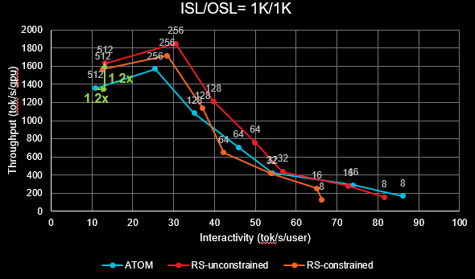
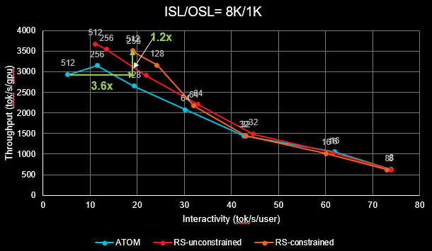
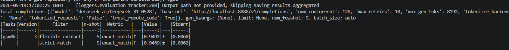
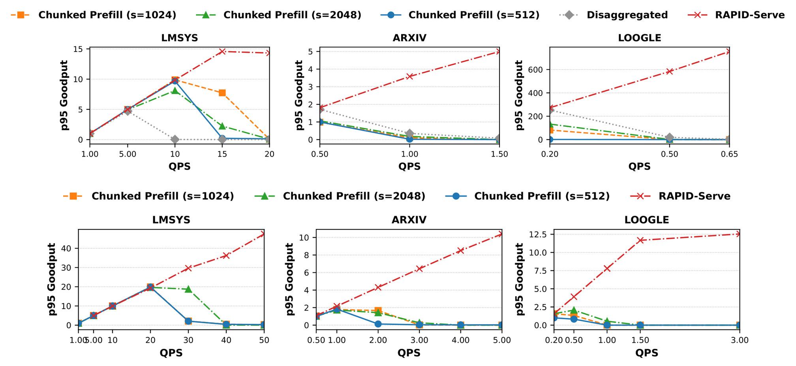

# ATOM RAPID-Serve：框架层开发与多卡 DeepSeek 适配

<div class="interview-notes" markdown="1">

本文围绕“项目为什么做、框架层具体改了什么”两问，解释 [ROCm/ATOM PR #860](https://github.com/ROCm/ATOM/pull/860) 的开发内容，重点是 **TP 多卡、DeepSeek MLA/MoE 和 P/D 请求交接**。最后核对 PR 的性能证据，解释 InferenceX 压测和论文实验如何进行。口述部分用于组织这套实现的讲法，具体个人贡献按实际参与范围说明。

源码固定在 PR 最终 head [`91e6dac`](https://github.com/ROCm/ATOM/tree/91e6dacd203deb07f619d4f3e83c26ba44931d84)，同时对照 PR 的最终 diff。PR 已合并；下文讨论这一版本，避免把后续主干能力混入本次改动。你自己的 V1/MRV2 实现见[vLLM 面试回答](面试问题与回答.md)。
{.interview-source}

## 一、这个项目的目标是什么，为什么在同一组 GPU 上拆开 P/D？ {#project-introduction}

**面试口述，约 1 分钟**

这项开发把 RAPID-Serve 的同设备 P/D 解耦接入 ATOM，目标是 **长 Prompt 的 Prefill 到来时，已有 Decode 请求仍能持续生成，同时提高 GPU 利用率**。

普通混合批次里，Prefill 和 Decode 随同一次模型执行推进。Chunked Prefill 能缩短单轮输入计算，但两类任务仍有批次完成依赖。传统异设备分离可以隔离两阶段，却需要分别放置模型、迁移 KV，并处理两边资源容量不均的问题。

这个 PR 在同一组 GPU 上建立两套独立进程和执行 stream，P 专门处理上下文，D 专门持续生成；两侧通过 IPC 共享各卡的模型权重和 KV。D 统一分配请求的 blocks，P 根据授权写入缓存，完成后把首 token 和计算进度交给 D。

多卡时，两侧各有一套 TP worker。比如 TP8，P rank 0 和 D rank 0 同在 GPU0，直到 rank 7 对应 GPU7；每对共享本卡的权重分片和 KV，P、D 各自在自己的通信组内完成模型计算。DeepSeek 的特殊适配主要集中在 **MLA 吸收权重、压缩 KV 的绑定，以及多卡 handle 的交换**。

PR 还提供两种执行模式：普通独立 stream 的 unconstrained，以及使用 CU mask 分区的 constrained。公开测试使用 8 张 MI355X 和 DeepSeek-R1，具体收益随输入长度和模式变化。

**目标中的“共享”要讲准确**

共享减少的是 **同一卡上 P/D 两份权重和 KV 分配的重复**。TP8 仍需要 8 张卡承载完整模型；两侧的输入 buffer、Attention metadata、通信对象、workspace 和 Graph 也有各自的运行状态。

PR 页面报告：1K/1K unconstrained 的吞吐与 interactivity 约提高 20%；8K/1K constrained 的吞吐约提高 25%，interactivity 约为原来的 3.6 倍。曲线的吞吐口径与 **输入加输出的总 token 吞吐 / GPU** 相符；提升来自曲线上的不同工作点，不能理解为每个并发点同时获得上述改善。具体读法见[性能测试](#performance-evaluation)。
{.interview-source}

## 二、这个 PR 在框架层主要改了哪些代码？多卡与 DeepSeek 如何接入？ {#framework-work}

### 约 3 分钟的完整讲解 {#framework-answer}

这个 PR 的框架层工作可以按四条线讲：**进程和请求组织、共享存储初始化、多卡 rank 配对、DeepSeek 运行状态与执行 stream 适配**。

**第一条是把原来的 EngineCore 拆成独立的 P、D 两条推进路径。** 入口选择 DisaggCoreManager，启动 PrefillEngineCore 和 DecodeEngineCore，每个新请求都发送到两边。D 的 DecodeScheduler 负责 BlockManager，先分配 Prompt 所需 blocks，再用 BlockAssignment 发给 P。P 的 PrefillScheduler 没有块分配器，只选择已经收到块表的请求，执行整段剩余上下文。P 完成后返回 PrefillDone，D 更新缓存长度、追加首个生成 token，再把请求放入 Decode 批次。因此两侧独立组批，缓存分配权集中在 D。

**第二条是重构初始化，避免两侧各加载一份完整模型。** 新增 RapidServeModelRunner，通过覆盖模型构建、预热和 KV 分配入口区分两种角色。P 正常加载并处理权重；D 构建参数在 meta 上的模型骨架，随后导入 P 的权重。初始化分两轮：先交换权重 handle 并确认，再由 P 计算 KV 容量、分配缓存，D 导入并绑定缓存，最后才捕获 D 的 Graph、创建 DecodeScheduler。这里共享的是已经进入运行格式的权重，D 的 RoPE 等本地状态仍单独建立。

**第三条是把单卡共享扩展到 TP 多卡，最关键的是按 rank 交换 handle。** 两侧各启动一套 TP worker，P 使用独立 rendezvous 端口，让两组通信分别建立。原有 RPC 广播给所有 worker，但普通返回值只来自 rank 0，拿不到其他卡的 handle。因此 PR 让每个 P rank 把本地 handle 写入带 session 和 rank 的临时文件，rank 0 收集路径，经 EngineCore 发给 D；每个 D rank 只读取自己对应的文件。这样 GPU0 共享 GPU0 的权重和 KV，其他卡也按同样方式配对。

**第四条是补齐 DeepSeek 在共享执行中的特殊状态。** MLA 加载后会生成 W_K、W_V 和量化 scales，它们是普通 tensor 属性，单独遍历参数会漏掉，所以 IPC 同时导出参数、buffers 和 tensor 属性。MoE 的路由修正 bias 还可能在 gate 和 experts 下重复注册，要导出所有名字，避免 D 的某个槽位留在 meta。KV 导入后，runner 将每层 MLA 缓存重新绑定成 576 维的压缩视图，并登记到 forward context。MLA 的数学计算和 MoE 路由沿用已有实现。

执行方面，P 在独立 stream 计算、采样并同步后再通知 D；D 在自己的 stream 跑模型，用事件连接准备、计算和后处理。PR 还调整 MLA metadata 的准备路径，在 rapidserve 模式下使用当前 stream，减少辅助 stream 的额外等待；需要资源隔离时，再选择预建的 CU-masked stream。

这套开发最核心的工作，是 **把同设备的共享权重和 KV 接到两套 TP 执行栈，并让请求从分配、Prefill 到 Decode 正确衔接**。

### 先按文件定位改动 {#changed-files}

| 修改位置 | 新增或调整的组件 | 框架层解决的问题 |
| --- | --- | --- |
| `atom/config.py`、`model_engine/arg_utils.py` | rapidserve 开关、角色与 IPC 地址、constrained 配置 | 让已有入口选择新执行模式 |
| `model_engine/llm_engine.py`、`engine_core_mgr.py` | `DisaggCoreManager` | 启动两套 EngineCore，请求发给两侧，输出回到上层 |
| `model_engine/engine_core.py` | `PrefillEngineCore`、`DecodeEngineCore`、初始化 hook | 权重/KV 两轮 bootstrap，blocks 授权与完成通知 |
| `model_engine/scheduler.py` | `PrefillScheduler`、`DecodeScheduler`、batch 的 CU 字段 | P 整段组批，D 统一分配 KV、管理交接和 Decode |
| `model_engine/disagg_types.py` | `BlockAssignment`、`PrefillDone` | 定义 P/D 控制消息 |
| `model_engine/ipc_utils.py` | tensor、权重和 KV 的导出/导入 | 共享 GPU 存储，补全 MLA 和 MoE 的具名状态 |
| `model_engine/model_runner.py` | `RapidServeModelRunner` 与基类初始化 hook | D 跳过加载/分配、按 rank 交换 handle、绑定 KV、管理 stream |
| `model_ops/attentions/aiter_mla.py` | `prepare_decode()` 的 rapidserve 分支 | 将 metadata 准备接到实际 Decode stream |

模型文件 `models/deepseek_v2.py`、MLA 数学实现 `model_ops/attention_mla.py` 和通用 worker 管理 `async_proc.py` 是这条调用链的重要依赖，**不在这个 PR 最终 diff 的修改文件中**。阅读它们是为了判断新路径复用了什么，以及共享适配需要覆盖哪些状态。

最终入口为 `--enable-rapidserve`，附加 `--disagg-constrained` 开启 CU 分区；PR 早期描述的 `--enable-disagg` 已更名。配置同时选择 `RapidServeModelRunner`，P 可通过 `--disagg-prefill-max-num-seqs` 单独控制请求数上限。

源码：[配置与 runner 选择](https://github.com/ROCm/ATOM/blob/91e6dacd203deb07f619d4f3e83c26ba44931d84/atom/config.py#L1245-L1306)、[CLI](https://github.com/ROCm/ATOM/blob/91e6dacd203deb07f619d4f3e83c26ba44931d84/atom/model_engine/arg_utils.py#L327-L349)、[引擎入口](https://github.com/ROCm/ATOM/blob/91e6dacd203deb07f619d4f3e83c26ba44931d84/atom/model_engine/llm_engine.py#L129-L132)。
{.interview-source}

### 引擎与调度：D 授权，P 写入，D 接手 {#request-path}

`DisaggCoreManager.add_request()` 将请求分别发送到 D 和 P。D 保留原来的输出长度与请求参数，P 收到的副本将 `max_tokens` 设为 1，只完成 Prompt 和首 token 的计算；最终持续输出由 D 侧返回。

D 的请求状态依次经过 **waiting → prefill_waiting → prefill_done → running**：

1. `allocate_waiting()` 调用 BlockManager 检查空间、分配 blocks，将请求放进 `prefill_waiting`。
2. `DecodeEngineCore` 发送 `BlockAssignment`，包含请求 ID、block table、已有缓存长度与上下文长度。
3. P 接收授权，在自己的 waiting 请求中填入块表；`PrefillScheduler.schedule()` 只选块表已就绪的请求。
4. P 完成上下文计算和采样，发送 `PrefillDone`，带计算 token 数与首 token。
5. D 的接收线程调用 `on_prefill_done()`，更新缓存长度、追加首 token，放入完成队列；D 主循环再将其转为 running，组成 Decode-only 批次。

P 侧的这个 Scheduler 是轻量组批器，没有 BlockManager。D 一处决定物理 block IDs，两侧的 Attention 根据各自批次准备块表和 slot mapping，读写本卡共享缓存。

P 的最终实现选择 **整段剩余上下文**：单个请求需要的 token 必须全部放入当前预算，放不下则等待，不会在这里切成多个 chunk。首 token 由 P 采样，但 P 的普通 Scheduler postprocess 是空操作，结果通过完成消息交给 D。

```text
LLMEngine → DisaggCoreManager
                 ├─ P EngineCore → PrefillScheduler → P TP workers
                 └─ D EngineCore → DecodeScheduler → D TP workers
                         │                           ↑
                         └─ BlockAssignment → P ─ PrefillDone

同一请求：分配 blocks → P 写完 Prompt KV、采样首 token → D 后续生成
不同请求：B 在 P 处理上下文时，A 可继续沿 D 执行
```

源码：[请求 fan-out](https://github.com/ROCm/ATOM/blob/91e6dacd203deb07f619d4f3e83c26ba44931d84/atom/model_engine/engine_core_mgr.py#L1026-L1057)、[P 组批](https://github.com/ROCm/ATOM/blob/91e6dacd203deb07f619d4f3e83c26ba44931d84/atom/model_engine/scheduler.py#L2204-L2264)、[D 授权与接手](https://github.com/ROCm/ATOM/blob/91e6dacd203deb07f619d4f3e83c26ba44931d84/atom/model_engine/scheduler.py#L2333-L2393)、[消息字段](https://github.com/ROCm/ATOM/blob/91e6dacd203deb07f619d4f3e83c26ba44931d84/atom/model_engine/disagg_types.py#L28-L52)。
{.interview-source}

### 多卡：两套 TP worker，每卡 P/D 按相同 rank 配对 {#tp-topology}

以 **单机、DP1、PCP1、TP8** 为例，每个 EngineCore 都通过既有 `AsyncIOProcManager` 启动 8 个 worker。P 和 D 各有 8 个 GPU worker，物理上仍是同一组 8 张卡。

| 物理设备 | P worker | D worker | 共享的内容 |
| --- | --- | --- | --- |
| GPU0 | P rank 0 | D rank 0 | GPU0 的本地权重分片与 KV |
| GPU1 | P rank 1 | D rank 1 | GPU1 的本地权重分片与 KV |
| … | … | … | … |
| GPU7 | P rank 7 | D rank 7 | GPU7 的本地权重分片与 KV |

两侧沿用同一设备映射，分别初始化 distributed environment。Manager 给 P 配置另一个 rendezvous 端口，从而建立 **P 自己的 TP 通信组和 D 自己的 TP 通信组**。两侧的 token 数与批次形状不同，需要各自在本角色的 ranks 内一致推进。

这里要分清三类通信：**P/D 控制消息走 CPU ZMQ，P rank 与 D rank 的本卡存储共享走 GPU IPC，每个角色的 TP 计算通信继续使用既有 collective**。共享 KV 不会消除 Attention/MLP 等模型内部的 TP 通信。

源码：[两侧配置与独立端口](https://github.com/ROCm/ATOM/blob/91e6dacd203deb07f619d4f3e83c26ba44931d84/atom/model_engine/engine_core_mgr.py#L859-L893)、[worker 创建](https://github.com/ROCm/ATOM/blob/91e6dacd203deb07f619d4f3e83c26ba44931d84/atom/model_engine/engine_core.py#L74-L86)、[本地设备与 distributed 初始化](https://github.com/ROCm/ATOM/blob/91e6dacd203deb07f619d4f3e83c26ba44931d84/atom/model_engine/model_runner.py#L952-L993)。
{.interview-source}

**为什么多卡要增加“按 rank 的 handle 文件”**

`AsyncIOProcManager.call_func()` 会把 RPC 广播给所有 worker，但普通输出 socket 只接 rank 0。单卡时一个返回值足够；TP8 时若只返回 rank 0 的权重/KV handle，其余七张卡没有自己的共享映射。

PR 在 `RapidServeModelRunner` 中增加以下交换流程：

- 每个 P rank 导出本卡 handle，写入带 session、类型和 rank 的临时文件。
- P rank 0 等到所有 rank 文件存在，返回按 rank 排列的路径列表。
- P EngineCore 将路径列表通过 ZMQ 发送给 D EngineCore。
- D EngineCore 广播导入 RPC；每个 D rank 读取 `paths[self.rank]`，导入后删除对应文件。

文件中是 **IPC handle 和 tensor 元数据**，不是模型权重或 KV 数值。session 从本轮 IPC 地址派生，用于隔离不同引擎运行的临时文件。这是一条依赖本机共享临时目录的 bootstrap 路径。

这个改动解决的是 **通用 RPC 只有 rank 0 返回值时，怎样汇集并分发所有设备的 handle**。它没有在每次推理中通过文件搬运 KV。

源码：[原有 RPC 输出语义](https://github.com/ROCm/ATOM/blob/91e6dacd203deb07f619d4f3e83c26ba44931d84/atom/model_engine/async_proc.py#L287-L304)、[`call_func`](https://github.com/ROCm/ATOM/blob/91e6dacd203deb07f619d4f3e83c26ba44931d84/atom/model_engine/async_proc.py#L402-L411)、[rank 文件汇集与导入](https://github.com/ROCm/ATOM/blob/91e6dacd203deb07f619d4f3e83c26ba44931d84/atom/model_engine/model_runner.py#L4155-L4300)。
{.interview-source}

### 初始化：先权重，后 KV，最后建立 D 的执行条件 {#bootstrap}

两轮 bootstrap 是多卡大模型能够共享存储的核心。

| 阶段 | P 侧 | D 侧 | 为什么这样安排 |
| --- | --- | --- | --- |
| 模型构建 | 正常加载与后处理本卡权重 | 构建参数在 meta 的模型骨架 | 避免常驻第二份完整权重 |
| 权重交换 | 导出各 rank 权重 handle，等待 ACK | 按 rank 导入并回 ACK | 先完成共享权重映射，再计算 KV 预算 |
| KV 交换 | 估算容量、分配缓存，导出 handle 和 block 数 | 跳过自有分配，导入已有缓存 | 双方使用同一池，block 数一致 |
| D 完成初始化 | P eager 执行 | 绑定 Attention cache、捕获 Graph、创建 DecodeScheduler | Graph 与 BlockManager 需要真实缓存与有效容量 |

基类 ModelRunner 把模型加载、预热和 KV 额外保留空间拆成覆盖入口。`RapidServeModelRunner` 在 D 侧跳过 checkpoint 加载、初期 warmup 与 KV 分配；EngineCore 也推迟 D Scheduler 的创建，因为还没收到 block 数时，BlockManager 无法按有效容量初始化。

**D 的 meta 构建是一个具体工程折中。** PR 临时替换 `Module.register_parameter()`，将注册的参数转到 meta，同时保留默认设备，允许 RoPE 等显式 GPU buffer 正常建立。单个参数可能先短暂在真实设备创建再替换，避免的是累计第二份完整权重；它不是“D 构建时所有对象都零 GPU 分配”。

KV 预算还额外保留设备总内存约 8% 的空间，给双进程的通信和系统分配留余量。权重导入后有回 ACK 和初始化等待；这些属于启动顺序处理。

源码：[runner 初始化覆盖](https://github.com/ROCm/ATOM/blob/91e6dacd203deb07f619d4f3e83c26ba44931d84/atom/model_engine/model_runner.py#L4034-L4104)、[P 权重/KV bootstrap](https://github.com/ROCm/ATOM/blob/91e6dacd203deb07f619d4f3e83c26ba44931d84/atom/model_engine/engine_core.py#L662-L708)、[D 导入后创建 Graph 与 Scheduler](https://github.com/ROCm/ATOM/blob/91e6dacd203deb07f619d4f3e83c26ba44931d84/atom/model_engine/engine_core.py#L882-L924)、[D 权重确认](https://github.com/ROCm/ATOM/blob/91e6dacd203deb07f619d4f3e83c26ba44931d84/atom/model_engine/engine_core.py#L926-L954)。
{.interview-source}

### DeepSeek：适配 MLA 与 MoE 的实际运行状态 {#deepseek}

**第一项：导出 MLA 的吸收权重和 scales**

DeepSeek 的 MLA 将历史 KV 保存在低秩空间。Decode 计算需要把 query 映射到 latent 空间，并将 latent attention 输出映射回各 head 的 value 空间；模型加载后的后处理准备了用于这些 BMM 的 `W_K`、`W_V` 及对应 scales。

在 ATOM 中，这些是 **普通 tensor 属性**，不一定是 `nn.Parameter` 或注册 buffer。只遍历 `named_parameters()` 会让 D 导入了原始投影参数，却缺少真正执行时读取的派生权重。

因此 `ipc_utils.py` 分三类导出：参数使用 `__param__`，buffers 使用 `__buf__`，普通 GPU tensor 属性使用 `__attr__`。D 导入时分别挂到 `_parameters`、`_buffers` 和普通属性位置。P 已经经过加载与权重后处理，D 得到的是运行格式数据，随后继续使用原有 MLA kernel。

以 R1/V3 常见的 128 query heads、TP8 为例，本地是 16 heads。派生权重也对应这些本地 heads，必须读取本 rank 的 manifest；不能让所有 D ranks 共用 P rank 0 的投影分片。FP8 BMM 路径中，派生权重及其 scales 要一起恢复。

源码：[MLA 派生权重后处理](https://github.com/ROCm/ATOM/blob/91e6dacd203deb07f619d4f3e83c26ba44931d84/atom/model_ops/attention_mla.py#L316-L361)、[query 与 latent 的 BMM](https://github.com/ROCm/ATOM/blob/91e6dacd203deb07f619d4f3e83c26ba44931d84/atom/model_ops/attention_mla.py#L386-L420)、[参数、buffer、属性导出与恢复](https://github.com/ROCm/ATOM/blob/91e6dacd203deb07f619d4f3e83c26ba44931d84/atom/model_engine/ipc_utils.py#L92-L183)。
{.interview-source}

**第二项：保留 MoE 的所有参数注册名字**

DeepSeek 的路由修正 `e_score_correction_bias` 由 gate 持有，又传给 experts，可能在两个模块路径下注册同一个 Parameter。默认 `named_parameters()` 去重后只返回一个名字，但 D 的 meta 模型中两个参数槽位都需要恢复。

PR 在导出和导入时使用 `remove_duplicate=False`，覆盖每一个具名注册；导入还允许创建 P 后处理新增、而 D 构建时尚不存在的参数槽位。否则可能出现“gate 已恢复，experts 对应参数仍在 meta”的错误。

**MoE 的 grouped top-k、修正 bias、共享专家和 expert GEMM 复用模型原有逻辑。** PR 的工作是让这条逻辑在 D 进程中拿到完整、正确的参数。它没有另写一套 DeepSeek 路由，也没有在这个改动中重新设计 EP 或 EPLB。

源码：[DeepSeek gate 与 experts 的 bias 关联](https://github.com/ROCm/ATOM/blob/91e6dacd203deb07f619d4f3e83c26ba44931d84/atom/models/deepseek_v2.py#L1081-L1110)、[IPC 的重复注册处理](https://github.com/ROCm/ATOM/blob/91e6dacd203deb07f619d4f3e83c26ba44931d84/atom/model_engine/ipc_utils.py#L102-L108)、[具名参数恢复](https://github.com/ROCm/ATOM/blob/91e6dacd203deb07f619d4f3e83c26ba44931d84/atom/model_engine/ipc_utils.py#L140-L156)。
{.interview-source}

**第三项：KV 导入后重新绑定每层的 576 维 MLA cache**

D 跳过了普通 `allocate_kv_cache()`，也就跳过了原有 builder 在分配后绑定 Attention cache 的流程。因此仅导入 `self.kv_cache` 不够，还必须让每层 Attention 和 forward context 指向它。

`_bind_kv_cache_to_modules()` 增加 MLA 分支，将每层共享缓存组织为：

$$
[\text{物理 block 数}\times\text{block size},\ 1,\ 576]
$$

576 对应这条 R1/V3 缓存路径的 **512 维 KV latent 加 64 维 RoPE key**。它不是每个 query head 的完整 K/V，也不分出传统的独立 V cache。函数将视图赋给 Attention 的 `kv_cache`，建立 `KVCacheTensor`，最后通过 `set_kv_cache_data()` 登记到本地 forward context。

TP8 切的是本地 query heads 和相应权重。这个 MLA latent cache 由本 rank 的 heads 共用，**不能将 576 再除以 8，或者按普通 MHA 估算每卡 KV 自动缩成八分之一**。P/D 共享的是每卡已有的 MLA cache。

普通 MHA 分支则恢复每层 K/V 分开的布局；存在 FP8 KV 的独立 scale tensor 时，通用 IPC helper 也可以一并导入。MLA 的压缩布局与普通 MHA 的 scale 布局要分别看。

源码：[KV 导入与物理 block 换算](https://github.com/ROCm/ATOM/blob/91e6dacd203deb07f619d4f3e83c26ba44931d84/atom/model_engine/model_runner.py#L4268-L4300)、[MLA 与 MHA 重新绑定](https://github.com/ROCm/ATOM/blob/91e6dacd203deb07f619d4f3e83c26ba44931d84/atom/model_engine/model_runner.py#L4301-L4383)、[既有 MLA cache 分配布局](https://github.com/ROCm/ATOM/blob/91e6dacd203deb07f619d4f3e83c26ba44931d84/atom/model_ops/attentions/aiter_mla.py#L742-L823)。
{.interview-source}

**第四项：调整 MLA metadata 的 stream 依赖**

普通 MLA Decode 会在辅助 `prep_stream` 上进行部分 H2D 拷贝和 KV indices 生成，再让主 stream 等待准备完成。PR 增加 rapidserve 分支，把这些准备放在 **当前 Decode stream** 上，普通模式仍保留辅助准备路径。

这是对实际执行依赖的调整：Decode 已经切换到独立或 CU-masked stream，再引入辅助队列的等待可能增加每步延迟。将 metadata 准备与模型计算按同一 stream 排序，避免这一层额外往返；它没有取消所有同步，也不代表所有 backend 都应该这样处理。

源码：[MLA metadata 准备的 rapidserve 分支](https://github.com/ROCm/ATOM/blob/91e6dacd203deb07f619d4f3e83c26ba44931d84/atom/model_ops/attentions/aiter_mla.py#L1343-L1401)。
{.interview-source}

### 执行 stream 与 CU 分区：实际顺序如何保证 {#execution-streams}

**P 的完成路径是同步确认后通知**

最终 `prefill_forward()` 在选定 stream 上准备输入、运行模型、采样并读取首 token，随后调用 `stream.synchronize()` 再返回。P EngineCore 等 RPC 返回后才发 `PrefillDone`。P 主机线程等待本角色这轮执行，但另一个 D 进程仍能推进自己的批次。

源码注释中仍有“P 不采样”“event watcher 异步通知”“P 从 D 导入 KV”等早期描述；最终函数实际是 **P 采样、P 持有分配、D 导入、P 同步后发完成**。

**D 用 event 连接准备、模型和后处理**

D 的 `forward()` 在当前 stream 记录事件，让选定 Decode stream 等待它；输入准备和模型计算放在 Decode stream 上。计算后记录 model-forward event，再让原 stream 等待，随后做采样与异步输出处理。这样本角色前后的依赖有序，P/D 的两套提交队列仍保持独立。

**constrained 采用预建的 50% CU 分区**

unconstrained 只建立普通独立 stream。constrained 另外建立 P 使用低区间、D 使用高区间的互补 mask stream，当前候选比例只有 0.5。

实际 `_optimal_cu_fraction()` 是一个简单规则：有 P token，且传入的 D 负载值达到 64 时返回 0.5，否则返回 None。4 字节 CPU 共享内存存的是 D 调度 token 数，P 根据它和当前 P batch 选择比例；D 的比例在有新 P 完成交接的轮次更新并沿用。它没有采集 GPU 步时间、EWMA 或延迟回退，这些属于前一篇 vLLM 分支的另一套实现。

源码：[P 完成与同步](https://github.com/ROCm/ATOM/blob/91e6dacd203deb07f619d4f3e83c26ba44931d84/atom/model_engine/model_runner.py#L4484-L4516)、[D event 顺序](https://github.com/ROCm/ATOM/blob/91e6dacd203deb07f619d4f3e83c26ba44931d84/atom/model_engine/model_runner.py#L4105-L4142)、[mask 与 stream 池](https://github.com/ROCm/ATOM/blob/91e6dacd203deb07f619d4f3e83c26ba44931d84/atom/model_engine/model_runner.py#L4390-L4482)、[比例规则](https://github.com/ROCm/ATOM/blob/91e6dacd203deb07f619d4f3e83c26ba44931d84/atom/model_engine/scheduler.py#L231-L252)、[D token 共享与比例更新](https://github.com/ROCm/ATOM/blob/91e6dacd203deb07f619d4f3e83c26ba44931d84/atom/model_engine/scheduler.py#L2435-L2457)。
{.interview-source}

### 用 TP8 的一次请求交接串起开发内容 {#worked-example}

假设 A 已在 D 中生成，B 新到达，Prompt 为 1K token。

1. **请求进入两侧。** Manager 给 P 和 D 各发一份 B。D 的 BlockManager 分配 B 的逻辑块表，P 先等待授权。
2. **D 发块表。** P EngineCore 把授权写入本地请求，再将 B 的 Prefill batch 广播给自己的 8 个 workers。
3. **P 各 rank 写本卡 KV。** 每个 P worker 用自己的权重分片处理本地 heads，执行本角色的 TP 通信，把 B 的 latent/RoPE cache 写入本卡共享分配。
4. **A 沿 D 执行。** D 的 8 个 workers 在另一套通信组与 stream 上继续处理已有请求 A。B 尚未进入 D 的 running 集合。
5. **P 返回首 token。** P worker 完成本地 stream 同步；普通 RPC 将 rank 0 的采样结果送回 P EngineCore，由它发 `PrefillDone`。
6. **D 接手 B。** D 更新 B 的缓存长度、追加首 token，再广播 A/B 的 Decode batch。D rank i 读取此前从 P rank i 导入的本卡 KV，以首 token 为新输入生成下一 token。

**多卡完成确认还要分清“当前代码”和“更强保证”。** 当前普通 `call_func(wait_out=True)` 等的是 rank 0 输出；每个 P worker 本地同步，不等于 EngineCore 已收齐所有 rank 的 GPU 完成 ACK。TP collective 提供了模型执行中的协同，但这个 PR 没有新增专门覆盖所有 rank 最后 KV 写入的完成汇聚。源码讲解可以明确它的实际路径，不能把它说成已经建立严格的全 rank 完成屏障。bootstrap 导入 ACK 也沿同样的普通 RPC 返回语义。

### 面试讲解中应保留的实现边界 {#implementation-boundaries}

这些边界直接关系到多卡与 DeepSeek 的回答是否符合源码：

- **多卡讲 TP 配对。** Manager 建立一对 P/D 引擎，不是多个 DP 副本的资源池。基础框架有 DP/PCP 能力，也不等于 rapidserve 这条新增路径已完整适配这些组合；rank 文件按 TP 的 `self.world_size` 收集。
- **DeepSeek 讲 R1/V3 的 MLA+MoE 路径。** 既有 builder 对 V3.2 还有独立 index cache，但新 IPC 只明确导出 `kv_cache` 与可选 `kv_scale`，重绑定函数也没有恢复 index cache。因此不能据此直接宣称 sparse V3.2 已完整支持。
- **共享讲运行格式与本卡映射。** `_export_tensor()` 会先调用 `contiguous()`，非连续 tensor 可能产生额外分配；这份 helper 也没有前一篇 vLLM 分支那样的显式 storage 去重。正确表述是主要权重与 KV 通过 IPC 共享，保留实际布局处理的细节。
- **交接讲实际完成路径。** `PrefillDone` 只有 seq ID、计算长度和首 token，没有 vLLM 分支的 session/sequence lease 协议；PR 有 ABORT 消息，但不能据此说它包含同等的 P lease、D in-flight 与安全退休回收机制。

PR 新增的调度和消息测试覆盖块表就绪、P 预算、消息序列化和两种模式的 shared-memory 配置；这些 CPU 测试不直接证明多卡 IPC、所有 rank 完成顺序或真实 kernel 重叠。公开 DeepSeek 测试与源码结构分别提供不同层面的证据。

源码：[按 tensor 导出](https://github.com/ROCm/ATOM/blob/91e6dacd203deb07f619d4f3e83c26ba44931d84/atom/model_engine/ipc_utils.py#L28-L56)、[P Scheduler 测试](https://github.com/ROCm/ATOM/blob/91e6dacd203deb07f619d4f3e83c26ba44931d84/tests/test_prefill_scheduler.py)、[两种模式测试范围](https://github.com/ROCm/ATOM/blob/91e6dacd203deb07f619d4f3e83c26ba44931d84/tests/test_disagg_modes.py#L4-L8)。
{.interview-source}

## 三、PR 的性能数据如何理解，InferenceX 和论文怎样测试？ {#performance-evaluation}

### PR 提交的性能结果 {#pr-results}

PR 正文给出的实验平台是 **8×MI355X**，性能曲线标注模型为 **DeepSeek-R1**。质量测试截图明确使用 DeepSeek-R1-0528；性能图没有完整的模型 revision、精度、服务启动参数和客户端版本，引用时保留正文的模型名称。

| 负载：输入 / 输出长度 | 模式 | PR 正文报告的吞吐改善 | PR 正文报告的 interactivity 改善 |
| --- | --- | --- | --- |
| 1K / 1K | unconstrained | 约 +20% | 约 +20% |
| 8K / 1K | constrained | 约 +25% | 约为基线的 3.6 倍 |

这里的 K 表示 token 长度，不是字符数。unconstrained 让两侧独立 stream 使用全 CU；constrained 使用 CU mask 控制两侧的计算资源，执行方式见[上一节](#execution-streams)。

{ width="610" }

{ width="610" }

两图来自 PR 的原始附件，已逐字节核对本地副本。青色为普通 ATOM，红色为 RAPID-Serve unconstrained，橙色为 constrained。

**先读坐标，再读提升倍数。**

- **横轴 Interactivity，tok/s/user：** 一个用户进入生成阶段后的出字速度，越往右越快。它由 TPOT 换算，不包含等待首 token 的时间。
- **纵轴 Throughput，tok/s/GPU：** 每张物理 GPU 分摊的 token 吞吐。PR 图没有写明 input/output；历史 JSON 与 InferenceX 的结果处理源码均支持这里使用 **输入加输出** 的总吞吐，核对过程见下文。
- **点旁的 8、16、32、64、128、256、512：** 客户端并发数。同一条曲线通过改变并发得到不同工作点；并发升高一般提高总吞吐，同时让每个用户生成变慢。

图上的两个方向分别回答两个问题：**保持相近交互速度，吞吐能提高多少；保持相近吞吐，用户能生成得更快多少。** 也可以比较相同并发的两个点，但那是另一种比较条件。

在 1K 图中，普通 ATOM 的峰值约为 1570 tok/s/GPU，unconstrained 峰值约为 1860，两者都在并发 256 附近，约提高 19%。对应横轴约从 25.5 到 30.7 tok/s/user，也接近 +20%。这些是图上读数，精确值需要逐点原始结果。

8K 图的青色峰值约为 3140，橙色峰值约为 3500 tok/s/GPU；正文报告 +25%，图上的吞吐箭头写 **1.2×**，并未给出其精确比较点。**因此 +25% 应表述为“PR 正文报告”，不能将图上近似峰值重新包装成精确 +25%。** 标注 3.6× 的横向箭头则位于约 2900 tok/s/GPU 的相近吞吐水平，比较不同并发下的交互速度，不能说成“固定并发 512 的每个用户快了 3.6 倍”。

Interactivity 提高 3.6 倍，对应 TPOT 变为原来的 $1/3.6\approx27.8\%$，即降低约 72.2%。它没有直接说明 TTFT 或整条请求的完成时间改善了同样倍数。

### 为什么能判断纵轴是总 token 吞吐？ {#pr-throughput-definition}

PR 的[历史提交 `643079d`](https://github.com/ROCm/ATOM/commit/643079d225bdfc570f908ad4d19e7daa1b06ea87) 曾加入若干原始结果 JSON，后续清理时删除。选取的四条记录保存在[历史指标附件](evidence/atom-pr860-historical-metrics.json)，保留原始字段、文件名和来源提交。

其中 `20260417-191112` 的 DeepSeek-R1 记录为并发 256，完成 2560 个请求：

| 字段 | 原始值或换算 |
| --- | ---: |
| 输入 tokens | 2,357,789 |
| 输出 tokens | 2,360,070 |
| 测试时长 | 375.281 s |
| `output_throughput` | 6288.80 tok/s |
| `total_token_throughput` | 12571.53 tok/s |
| `mean_tpot_ms` | 39.198 ms |
| 输出吞吐 / 8 GPU | 786.10 tok/s/GPU |
| 总吞吐 / 8 GPU | **1571.44 tok/s/GPU** |
| $1000/\mathrm{mean\_tpot\_ms}$ | **25.51 tok/s/user** |

最后两项与 1K 图青色并发 256 的坐标相符。另一条 8K 记录 `20260417-200730` 换算为 **3150.46 总 tok/s/GPU、11.50 tok/s/user**，也与 8K 图青色并发 256 的位置相符。1K 记录的实际平均输入、输出约 921、922 tokens，说明标注 1K 的负载不必然是每个请求固定 1024 tokens。

这些记录能帮助核对 **指标公式与部分坐标**，但缺少每条记录对应的服务启动配置，不能把它们全部认定为最终图的基线、unconstrained、constrained 三套原始数据。PR 清理过的 `scripts/performance/benchmark.sh` 也使用随机长度、并发上限和无限请求率，但默认模型与长度不是正文两图的完整配置。

**总吞吐与输出吞吐不能混用。** 同样完成一个 1K 输出请求，8K 输入的实验会计入约 9K 总 tokens，1K 输入只计入约 2K。8K 图的纵轴更高，不代表出字更快。比较相同长度分布的 A/B 时，总吞吐有意义；跨输入长度比较时，应同时查看输出吞吐、请求吞吐和延迟。

两侧虽然有两套 TP worker，分母仍是 **8 张物理 GPU**，因为 P/D 共享同一组设备。

### 质量测试的“约 95%”具体是什么？ {#pr-quality}

{ width="100%" }

截图显示，lm-evaluation-harness 通过本地 `/v1/completions` 调用 DeepSeek-R1-0528，测试为 **GSM8K v3、5-shot**：

| 答案提取方式 | Exact match | 截图中的标准误差 |
| --- | ---: | ---: |
| flexible-extract | **94.92%** | 0.60 个百分点 |
| strict-match | **94.69%** | 0.62 个百分点 |

flexible-extract 与 strict-match 使用不同答案提取规则，随后比较提取出的答案是否精确匹配。截图还显示 `limit: None`、最大生成长度 8192、客户端并发 128。因此 PR 的“约 95% accuracy”有明确的 **数学问答任务和 few-shot 设置**，不能说成模型在所有任务上的准确率为 95%。

质量评测用于检查新执行路径能正常回答任务；性能压测用于测速度。单份 GSM8K 截图没有基线配对结果，不能单独证明输出逐 token 等价或质量完全不变。

### InferenceX 实际在测哪一层？ {#inferencex-workflow}

[InferenceX](https://github.com/SemiAnalysisAI/InferenceX) 是持续评估推理系统的平台，包含服务部署、配置扫描、压测客户端、质量评测和结果汇总。这里重点讲固定输入/输出长度的 **端到端 Serving benchmark**：客户端通过 HTTP 请求模型服务，记录流式响应，测到的是调度、GPU 执行、服务端输出和网络共同作用后的表现。

它不是仅给一个 GEMM kernel 计时。RAPID-Serve 改的是双引擎、独立调度和资源分配，端到端测试才能观察这些改动如何影响吞吐和用户体验。

以下客户端与指标公式对照固定版本 [`c801c9f`](https://github.com/SemiAnalysisAI/InferenceX/tree/c801c9f2dbbd4d2aa8b32efbb83fbaa2a70a16f0)。这是笔记用于解释和本地实验的版本，**PR 没有公开其 InferenceX commit，不能说它就是当时使用的版本**。PR 历史 ATOM 客户端的 TPOT、输出吞吐、总吞吐公式与此一致。

一次并发扫描通常包含以下步骤：

1. **固定服务配置。** 确定模型、权重精度、GPU 数、TP/EP、KV 容量、最大序列数、Prefill token budget、Graph 和缓存开关。A/B 应明确哪些配置随新架构变化。
2. **生成输入。** random dataset 按 tokenizer 生成指定范围的 prompt；ISL/OSL 控制输入和输出长度。`random-range-ratio=1.0` 表示固定目标长度，0.8 表示在目标长度的约 80%～100% 之间采样，最终以实际 token 计数为准。
3. **预热。** 先发可用性请求，再按 `num-warmups` 执行预热，尽量将 kernel 编译、Graph 和初始分配移出正式窗口。预热与 prefix caching 的设置也要一致。
4. **发正式请求。** 并发上限限制正在执行 HTTP 调用的数量；一个请求结束后释放名额，后续请求补入。
5. **记录流式时间。** 从真正发起 HTTP 请求开始计时，记录首个 token-bearing 响应、后续响应间隔以及最后一次生成响应时间。
6. **汇总并扫描。** 统计请求数、实际 tokens、吞吐和延迟分位数，再对多个并发重复测试，将工作点连成曲线。

`--backend vllm` 在这里选择 OpenAI-compatible 请求适配器，**不代表被测服务一定是 vLLM**；ATOM 也可以暴露兼容的 `/v1/completions`。

下面是一组 **用于说明方法的 1K/1K 命令**，服务需要事先启动；它不冒充 PR 两图的复现脚本：

```bash
python -m infx.bench_serving.benchmark_serving \
  --backend vllm --base-url http://127.0.0.1:8000 \
  --endpoint /v1/completions --model deepseek-ai/DeepSeek-R1 \
  --dataset-name random \
  --random-input-len 1024 --random-output-len 1024 \
  --random-range-ratio 1.0 --seed 0 --ignore-eos \
  --request-rate inf --max-concurrency 128 --num-prompts 1280 \
  --num-warmups 128 \
  --percentile-metrics ttft,tpot,itl,e2el \
  --metric-percentiles 50,90,95,99 \
  --save-result --save-detailed
```

固定输出长度时，`ignore-eos` 尽量避免模型提前停止，让 A/B 承担相近生成工作量。random 输入适合控制性能负载，生成内容是否答对问题应由独立质量测试判断。

### 并发扫描与 QPS 扫描有什么区别？ {#concurrency-vs-qps}

**并发扫描：保持有 C 个请求在途，测试吞吐和生成速度的取舍。**

`request-rate=inf` 不设置请求间隔，配合 `max-concurrency=C` 后，客户端 semaphore 控制实际发出的调用，空出名额便继续发。这是并发受限、持续补请求的压测。它常被称为 closed-loop：系统变慢后，完成请求与补请求也随之变慢。

等待客户端 semaphore 的时间 **不计入单请求 TTFT**，因为请求计时器在获取名额之后启动；整场 benchmark 的时长则包含有限请求集合的爬升和收尾。短测试不能自动代表长期稳态。

**QPS 扫描：控制外部请求的到达速度，观察什么时候开始排队或违反 SLO。**

将 `request-rate` 设为有限值 $\lambda$，并且不额外用较小并发上限改变负载，客户端便按到达间隔投递请求。该版本间隔来自 Gamma 分布，`burstiness=1` 时是指数间隔，对应 Poisson 到达；小于 1 更突发，大于 1 更均匀。平均间隔为 $1/\lambda$。

服务实际完成的请求数 / 秒可能低于 offered QPS。达到容量后，继续提高到达率会积累队列并拉长 TTFT；这正是评估服务 SLO 容量需要关注的现象。

| 比较方式 | 主要控制量 | 主要回答的问题 |
| --- | --- | --- |
| 并发扫描 | 在途请求数 C | GPU 能达到多大吞吐，每个用户生成多快 |
| QPS 扫描 | 外部到达率 $\lambda$ | 给定负载能否满足延迟要求，服务容量在哪里 |

客户端并发 128 **不等于每次 GPU Decode batch 都有 128 个请求**：有些请求还在排队或 Prefill，服务端也可能受 KV 和 `max_num_seqs` 限制。框架层优化可以通过更快入场、维持更大有效 batch 提高吞吐，不能仅凭总吞吐判断某个 Decode kernel 加速了多少。

### TTFT、TPOT、ITL、interactivity 怎样计算？ {#benchmark-metrics}

对成功请求 $i$，令 $t_{i,0}$ 为客户端实际发起 HTTP 的时刻，$t_{i,1}$ 为收到首个生成响应的时刻，$t_{i,\mathrm{last}}$ 为最后生成响应时刻，$n_i$ 为实际输出 token 数：

$$
\begin{aligned}
\mathrm{TTFT}_i &= t_{i,1}-t_{i,0}, \\
\mathrm{E2EL}_i &= t_{i,\mathrm{last}}-t_{i,0}, \\
\mathrm{TPOT}_i &= \frac{\mathrm{E2EL}_i-\mathrm{TTFT}_i}{n_i-1},\qquad n_i>1.
\end{aligned}
$$

**TTFT 是等多久开始出字；TPOT 是开始后平均多久出一个 token。** 前者包含服务端排队、Prefill 和链路开销，后者概括整个生成阶段，二者应同时看。

该版本先计算各请求的 TPOT，再求算术平均，固定序列结果处理器取其倒数得到 mean interactivity：

$$
\mathrm{mean\ interactivity}
=\frac{1}{\mathrm{mean\ TPOT\ in\ seconds}}
=\frac{1000}{\mathrm{mean\ TPOT\ in\ milliseconds}}.
$$

例如 TTFT 为 0.45 s，输出 1024 tokens，首个到最后响应经历 10.23 s，则 TPOT 为 10 ms，interactivity 为 100 tok/s/user，E2EL 为 10.68 s。即使用户在出字后体验很好，也仍可能因为 TTFT 很长而等待很久。

这里 **平均 TPOT 的倒数不等于每个请求生成速度的平均值**。同样，$1000/\mathrm{P95\ TPOT}_{\mathrm{ms}}$ 表示对慢 TPOT 尾部的换算，不能称为“P95 的最快用户速度”。PR 没有给出绘图脚本，历史记录与部分坐标相符的是 mean TPOT 的倒数。

**ITL 要注意观测粒度。** 客户端将相邻 token-bearing 流式响应的到达时间差存入 `itl`。若一次 SSE 响应打包多个 tokens，这个间隔就不是严格的一次模型 token 步时间。该版本将所有成功请求的间隔拼在一起计算 P95/P99，也不是“各请求 P95 的平均”。服务端逐 token 时间或 profiler 可以补充解释流式间隔。

吞吐则使用整场正式窗口 $T$。令 $m_i$ 为输入 token 数、$N_{\mathrm{ok}}$ 为成功请求数、$G$ 为物理 GPU 数：

$$
\begin{aligned}
\mathrm{request\ throughput} &= \frac{N_{\mathrm{ok}}}{T}, \\
\mathrm{output\ throughput} &= \frac{\sum_{i\in\mathrm{ok}}n_i}{T}, \\
\mathrm{total\ token\ throughput} &= \frac{\sum_{i\in\mathrm{ok}}(m_i+n_i)}{T}, \\
\mathrm{total\ throughput/GPU} &= \frac{\mathrm{total\ token\ throughput}}{G}.
\end{aligned}
$$

客户端优先使用服务端 usage 返回的输出 token 数，缺失时重新 tokenize 生成文本。因此保留实际 `input_lens`、`output_lens`、错误和逐请求延迟，有助于判断提前停止、截断或输出计数偏差。

源码：[HTTP 流式计时](https://github.com/SemiAnalysisAI/InferenceX/blob/c801c9f2dbbd4d2aa8b32efbb83fbaa2a70a16f0/inferencex-e2e/infx/bench_serving/backend_request_func.py#L232-L304)、[到达间隔与指标汇总](https://github.com/SemiAnalysisAI/InferenceX/blob/c801c9f2dbbd4d2aa8b32efbb83fbaa2a70a16f0/inferencex-e2e/infx/bench_serving/benchmark_serving.py#L378-L500)、[并发限制与正式窗口](https://github.com/SemiAnalysisAI/InferenceX/blob/c801c9f2dbbd4d2aa8b32efbb83fbaa2a70a16f0/inferencex-e2e/infx/bench_serving/benchmark_serving.py#L610-L679)、[每 GPU 吞吐与 interactivity 换算](https://github.com/SemiAnalysisAI/InferenceX/blob/c801c9f2dbbd4d2aa8b32efbb83fbaa2a70a16f0/inferencex-e2e/infx/results/fixed_sequence.py#L180-L208)、[PR 历史 ATOM 指标公式](https://github.com/ROCm/ATOM/blob/643079d225bdfc570f908ad4d19e7daa1b06ea87/atom/benchmarks/benchmark_serving.py#L230-L321)。
{.interview-source}

### 论文采用的实验设置 {#paper-experiments}

RAPID-Serve [论文 v1，§5](https://arxiv.org/html/2601.11822v1#S5) 是另一套实验，全文没有将其称为 InferenceX 测试。论文使用 **真实任务数据集的长度分布和 offered QPS 扫描**，PR 两图则固定在两类长度负载上展示吞吐—交互速度曲线。

| 设置 | 论文 v1 |
| --- | --- |
| 平台 | 单节点 8×MI300X，ROCm 6.4 |
| 基线框架 | vLLM 0.10.2，V1 |
| 模型 | Llama-3.1-70B，Mixtral-8×7B |
| LMSYS | 平均输入约 2K tokens，交互式请求 |
| arXiv | 平均输入约 8K tokens，长文本任务 |
| Loogle | 平均输入约 20K tokens，长上下文摘要 |
| 数据规模 | LMSYS、arXiv 按输入长度分层采样，各截取 10K 条 |
| 负载扫描 | 从低负载到饱和，改变输入 QPS |
| 混合调度基线 | Chunked Prefill，chunk 为 512、1024、2048 tokens |
| 传统异设备 P/D 基线 | 4 卡 P、4 卡 D，两侧各 TP4 |

Mixtral 当时未做传统异设备 P/D 对照，因此“优于传统 P/D”的统计不能外推到该模型。论文 §5.1 也没有给出统一固定 OSL、请求到达分布、warmup 次数或完整客户端命令；不能为它补上一套未经公开的 InferenceX 参数。

**图 8 测实际请求吞吐。** 横轴是外部 offered QPS，纵轴为完成请求吞吐的归一化值；归一化参照是同一子图最低 QPS 下、chunk=512 的基线。纵轴 25 不代表 25 tok/s/GPU，各子图的绝对量也不能直接比较。

**图 9 再要求请求满足 TTFT 与 ITL 的 SLO。** 吞吐高但用户等太久或出字卡顿，不能全部算作有效服务能力。

{ width="100%" }

论文给出的约束是：

- **ITL：** Llama-3.1-70B 为 100 ms，Mixtral 为 50 ms。
- **TTFT：** 按输入长度放宽，0～1000 tokens 要求 1 s 内首 token，1000～2000 要求 2 s，之后依次增加。

直观理解：同样有 100 个请求在 10 秒完成，如果只有 60 个同时达到两项要求，普通请求吞吐是 10 req/s，按达标请求计的 goodput 为 6 req/s。扫到达率后，还能找出满足既定达标率要求时的最大服务容量。

论文将 goodput 定义为满足 SLO 达标目标的最大请求速率，并将图中结果称为 **P95 goodput**；正文未充分交代逐请求 ITL 如何聚合、95% 达标目标与逐负载曲线怎样结合。上述例子用于解释 goodput 的意义，不冒充论文评测脚本的精确定义。复现时需要补齐这些细节。

InferenceX 这个固定版本的 `--goodput` 则按 **逐请求 TTFT、平均 TPOT 或 E2EL** 的指定阈值计数，结果为达标请求数 / 测试时长；它没有在这个入口直接使用逐间隔 P95 ITL，也没有自动执行论文的按输入长度变化的 TTFT 规则。因此简单设置 `--goodput ttft:1000 tpot:100`，不等于复现论文图 9。

**图 10 只保留 ITL SLO。** 它展示“已经开始生成的用户是否流畅”，而图 9 同时约束“开始前是否等太久”。高负载下，普通系统可能持续完成请求，却因排队或 Prefill 干扰让达标比例下降；这时 goodput 的改善会远大于原始吞吐的改善。

| 论文比较 | 对 Chunked Prefill | 对传统异设备 P/D |
| --- | --- | --- |
| 无 SLO 的请求吞吐 | 平均 1.7×，最高 4.1× | 平均 1.5×，最高 2.9× |
| TTFT + ITL 约束的 goodput | 平均 4.9×，最高 32× | 平均 4.7×，最高 13.7× |
| 仅 ITL 约束的 goodput | 平均 2.0×，最高 5.9× | 平均 1.4×，最高 2.4× |

论文对 goodput 比值只统计基线值不可忽略的情况。**32× 是某些负载下的达标服务能力改善，不是 GEMM 或原始输出吞吐快了 32 倍。** §5.3 还报告传统 P/D 的 P95 ITL 平均更低，但其吞吐也更低，说明延迟和吞吐需要结合工作点判断。

论文的硬件、模型、框架与测试协议均不同于 ATOM PR。面试中应分别说明“论文结果”和“ATOM 接入测试”，也与自己的本地 vLLM 实验分开。

### 面试中怎样说明性能验证？ {#performance-answer}

> 性能验证分成正确性和 Serving 两部分。PR 的正确性结果是 8 张 MI355X 上，DeepSeek-R1-0528 的 GSM8K 5-shot exact match 约 95%。Serving 则使用 InferenceX 方法，对 DeepSeek-R1 扫客户端并发，比较总 token 吞吐 / GPU 与每用户生成速度形成的曲线。PR 报告 1K/1K 的 unconstrained 模式吞吐与交互速度约提升 20%；8K/1K constrained 模式报告吞吐提升 25%，相近吞吐工作点的交互速度约为基线 3.6 倍。框架改动的作用是让 P/D 独立推进，减少长 Prefill 对已有生成的阻塞，并更充分利用同一组 GPU。论文进一步通过到达率扫描和 TTFT、ITL 约束，评估高负载下的有效服务能力。我会保留每个结果的比较条件，区分并发、实际 batch、平均生成速度和尾延迟。

PR 公布了结果文字、曲线和质量截图，但没有与最终曲线完整对应的逐点原始结果、运行命令、重复次数和绘图程序。现有证据支持描述公开收益和指标口径，尚不足以重算所有提升或把它归因于某一处代码；验证 CU 策略、共享路径和调度各自的贡献，还需要消融测试与 GPU trace。

</div>
