# RAPID-Serve：资源高效、加速的 GPU 内部 P/D 解耦

*RAPID-Serve: Resource-efficient and Accelerated P/D Intra-GPU Disaggregation*

作者：Amna Masood、Pratishtha Gaur[^author-note]、Nuwan Jayasena。三位作者的单位均为 Advanced Micro Devices（AMD）。

作者邮箱：`amna.masood@amd.com`、`pratishtha.gaur@amd.com`、`nuwan.jayasena@amd.com`。

原文：arXiv:2601.11822v1，2026 年 1 月 16 日；[PDF](https://arxiv.org/pdf/2601.11822v1)。本译文以用户提供的仓库根目录 `2601.11822v1.pdf` 为底稿，保留原文章节、段落顺序、公式编号、图号、图注及参考文献编号。图像直接提取自该 PDF，图内英文标注保留，图注译为中文。原文没有独立的数据表或附录。

[^author-note]: 该工作完成于作者在 AMD Research and Advanced Development 实习期间。

## 摘要 {#abstract}

<!-- source: abstract1.1 -->
当前大语言模型（LLM）推理服务系统广泛采用的两种技术是混合批处理和解耦式服务。混合批次将不同请求的预填充（Prefill）Token 与解码（Decode）Token 合并在同一个批次中，以提高资源利用率和吞吐量，代价是每个 Token 的延迟增加。相比之下，解耦式服务将计算受限的 Prefill 阶段与带宽受限的 Decode 阶段分开，以优化服务等级目标（SLO），代价是资源利用不足以及 KV 缓存传输开销。为解决这些技术的局限，我们提出 RAPID-Serve：在同一个 GPU 或同一组 GPU 上并发执行 Prefill 与 Decode，在满足延迟 SLO 的同时，保持高吞吐量和高效的资源利用。此外，我们提出自适应资源管理，在运行时分配计算资源，并可选择使用 CU Masking——AMD Instinct™ GPU 上的一项细粒度计算单元分区功能。RAPID-Serve 在无 SLO 约束时将吞吐量提升至最高 4.1 倍、平均 1.7 倍；在 SLO 约束下，吞吐量可提升至 32 倍及以上、平均 4.9 倍。这表明，相比当前先进方法，它是一种有效的策略，尤其适用于资源受限的环境。

## 1 引言 {#S1}

<!-- source: S1.p1.1 -->
大语言模型（LLM）越来越多地被部署到编程助手、聊天机器人和实时决策工具等交互式应用中。关于交互式 LLM 服务的已有研究 [[19]](#ref-19) 强调，为保证用户体验，LLM 应用的 Token 间延迟（ITL）应处于人类阅读速度对应的范围内，约为每 Token 150～300 毫秒。然而，测试时扩展、思维链推理和多步规划等新兴技术，需要生成大量用户看不到的内部“思考”Token。在这些场景中，延迟的衡量标准从用户能够以多快的速度阅读 Token，转变为系统能够以多高的效率处理大量中间生成结果。因此，仅优化用户感知的流式输出速度已不够；系统设计必须越来越重视高吞吐量的 Token 生成，同时提高 GPU 资源利用率，因为内部推理很容易占据计算需求和内存压力的主要部分。这一变化要求 LLM 服务系统提供更低的 Token 间延迟、更高的吞吐量，并高效利用有限的加速器资源。

<!-- source: S1.p2.1 -->
在 LLM 推理中，请求执行包含两个主要阶段：Prefill 处理输入提示词并初始化 KV 缓存；Decode 以自回归方式生成输出 Token。这两个阶段具有不同的性能瓶颈。实际服务系统主要依靠两种广泛使用的方法来平衡延迟与吞吐量：混合批处理和解耦式服务。混合批处理 [[16]](#ref-16) 将 Prefill 与 Decode Token 合并到一个执行批次中，提高整体利用率。然而，这种耦合会增加正在执行的请求的 Token 间延迟，因而难以满足严格的 ITL SLO。分块 Prefill 技术 [[1]](#ref-1) [[14]](#ref-14) 将长 Prefill 切分成较小片段，以减轻延迟，但由于 Prefill 与 Decode 仍然同步推进，Decode 延迟依然会被放大。解耦式服务尝试在不同硬件上分别执行 Prefill 与 Decode，从而完全消除阶段间干扰。不过，能否在吞吐量与延迟之间达到最佳平衡，取决于模型大小、架构、流量模式和带宽敏感性等多个设计因素。因此，复杂的优化空间和系统级协调需求，仍限制着解耦式服务在实际中的采用 [[12]](#ref-12)。

<!-- source: S1.p3.1 -->
对于延迟敏感的工作负载，这些约束使现有系统难以同时实现低延迟和高吞吐量，尤其是在资源受限的环境中。

<!-- source: S1.p4.1 -->
我们的关键认识是：让 Prefill 和 Decode 在每个 GPU 上并发推进，就可以同时实现可预测的 Token 间延迟和高吞吐量。这为重叠执行两个阶段创造了新的机会，同时无需引入协调开销或 KV 缓存传输。从整体上看，受控的 GPU 内部 Prefill/Decode（P/D）并发，打破了混合批处理中导致延迟升高的严格阶段耦合，同时保留了共享执行的资源效率。

<!-- source: S1.p5.1 -->
为实现这一认识，RAPID-Serve 并发执行不同请求的 Prefill 和 Decode 阶段，而不将它们合并成一个批次，使各阶段能够独立推进。根据当前工作负载，可以为两个阶段分配不同的计算资源，以尽量减少干扰、满足延迟 SLO，同时保持高吞吐量。为适应不同的工作负载强度，系统动态调整分配给各阶段的计算资源数量。这种灵活的分配模型避免了传统解耦设计的刚性约束，消除了 KV 缓存传输开销，并维持了批处理效率，从而显著提高整体服务性能和资源利用率。

<!-- source: S1.p6.1 -->
本文的贡献如下：

- 提出一种名为 RAPID-Serve 的新服务引擎，使 Prefill 与 Decode 在同一设备或同一组设备上重叠执行。 <!-- source: S1.I1.i1.p1.1 -->
- 分析现有服务方案的性能特征，量化 P/D 耦合及 KV 缓存传输造成的开销。 <!-- source: S1.I1.i2.p1.1 -->
- 分析 LLM 推理不同阶段各自的性能特征与需求。 <!-- source: S1.I1.i3.p1.1 -->
- 提出一种由性能剖析驱动的资源分配技术，选择能以最少资源满足延迟 SLO 的配置。 <!-- source: S1.I1.i4.p1.1 -->
- 评估所提出的方案，表明 RAPID-Serve 在实际 LLM 服务部署的多种工作负载上，能够提供低延迟和高吞吐量。 <!-- source: S1.I1.i5.p1.1 -->

## 2 背景 {#S2}

### 2.1 LLM 推理 {#S2.SS1}

<!-- source: S2.SS1.p1.1 -->
LLM 推理的两个阶段具有截然不同的资源需求。Prefill 阶段处理完整输入提示词，生成第一个输出 Token。由于所有 Prompt Token 可以并行计算，Prefill 主要由大规模、计算密集的矩阵乘法和自注意力操作构成。这个阶段通常具有较高的算术强度，并受益于 GPU 计算单元上的大规模并行。Prefill 产生的键值（KV）条目存入 KV 缓存，供后续 Token 生成使用。

<!-- source: S2.SS1.p2.1 -->
Decode 阶段通常以自回归方式运行，一次生成一个输出 Token。与 Prefill 不同，Decode 按顺序执行，对每个新 Token 都需要在累积的 KV 缓存上进行自注意力计算。这使工作负载转向算术强度更低的矩阵向量运算，并对内存带宽和缓存复用更加敏感。即使将多个 Decode 请求组成批次，Attention 等操作仍需要为每个请求读取大量 KV 缓存。

<!-- source: S2.SS1.p3.1 -->
KV 缓存是 Decode 阶段内存消耗和系统压力的主要来源之一。其大小随批大小和序列长度线性增长，还取决于模型架构，例如层数、隐藏维度、注意力头数和头共享策略。对于采用多头注意力（MHA）、多查询注意力（MQA）或分组查询注意力（GQA）的模型，每个请求的 KV 缓存大小可近似为：

$$
\text{KV cache bytes}=2\cdot L\cdot S\cdot H\cdot D\cdot E \tag{1}
$$

<!-- source: S2.SS1.p3.2 -->
其中，$L$ 是层数，$S$ 是序列长度，$H$ 是 KV 头数，$D$ 是每个头的隐藏维度，$E$ 是每个元素占用的字节数，由数值精度决定。因子 2 表示需要同时保存键和对应的值。

<!-- source: S2.SS1.p4.1 -->
两个阶段不同的性能特征形成了不同的优化目标，因此，设计一个能够同时高效优化两个阶段的服务系统具有挑战性。

[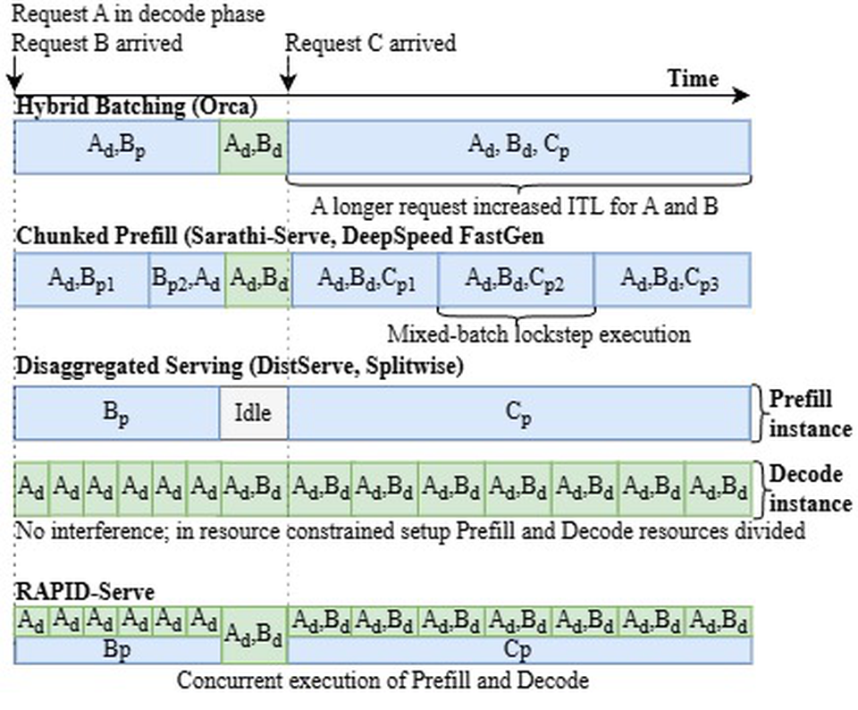{ width="72%" }](images/rapidserve-paper-v1/figure-01.png)

**图 1：调度方法。** 考虑请求 A 正处于 Decode 阶段、此时请求 B 到达的场景；$B_p$ 表示请求 B 的 Prefill，$A_d$ 表示请求 A 的 Decode，$B_{p1}$ 表示采用分块 Prefill 时，B 的第一个 Prefill 分块。

### 2.2 混合批处理 {#S2.SS2}

<!-- source: S2.SS2.p1.1 -->
早期 LLM 服务方案之一 Orca [[16]](#ref-16) 引入了迭代级批处理：将多个请求的 Prefill 和 Decode Token 合并为一个批次，执行一次模型迭代。每次迭代为各个活跃请求生成 Token。在 Orca 之前，vLLM 等服务系统通常只对 Decode 阶段组批，而每个请求的 Prefill 则在到达后独立执行，实际上采用的是 Prefill 优先策略。FasterTransformer [[13]](#ref-13) 则类似地优先执行 Decode 批次。

<!-- source: S2.SS2.p2.1 -->
后续工作，包括 Sarathi [[1]](#ref-1) 和 DeepSpeed-FastGen [[7]](#ref-7)，发现并处理了上述调度策略中固有的 Prefill/Decode 停顿问题。在 Decode 优先的系统中，Prefill 操作会被延后；在 Prefill 优先的系统中，当请求到达率较高时，Decode 步骤会停顿。在 Orca 中，由于 Prefill 和 Decode 被合并到同一批次，执行时间较长的 Prefill 请求会增加批次内所有 Decode 请求的 ITL。如[图 1](#S2.F1) 所示，请求 C 的长 Prefill 会延迟 Decode 请求 $A_d$ 和 $B_d$。Sarathi 采用搭载策略解决这一问题：为每次迭代定义一个最大 Token 预算，先将所有活跃 Decode Token 加入批次，再将剩余容量分配给 Prefill Token。如果一个 Prefill 请求超过可用预算，就把它的 Prompt 划分成多个称为“分块”的片段。为支持分块，Sarathi 引入 KV 缓存管理机制，将中间分块结果保存为 KV 缓存条目，见[图 1](#S2.F1)。尽管这种方法减轻了停顿，它仍受到 Prefill 与 Decode 阶段间干扰的影响。在 Decode 较重的工作负载中，Prefill 请求可能被拆成许多细小分块，产生额外的 KV 缓存加载和存储操作。相反，在 Prefill 较重、Decode 批次较小的工作负载中，Decode Token 会频繁与 Prefill 同批执行，从而增加 Decode ITL。ITL 恶化幅度可能达到 2～30 倍 [[3]](#ref-3)。Medha [[2]](#ref-2) 引入自适应 Prefill 分块大小，以提高 GPU 利用率，并为长上下文请求提供细粒度抢占。然而，Prefill 和 Decode 仍共享相同的执行周期；面对长 Prompt，或自适应策略在负载增加时扩大分块大小的情况，较强的干扰使自适应分块无法提供稳定或较低的 Decode ITL。进一步分析见[第 3.1 节](#S3.SS1)。RAPID-Serve 打破了 Prefill 与 Decode 同步推进的依赖，在保持高吞吐量的同时，尽量降低 ITL。

### 2.3 解耦式服务 {#S2.SS3}

<!-- source: S2.SS3.p1.1 -->
为减轻 Prefill 与 Decode 阶段之间的干扰，近期研究 [[14]](#ref-14)、[[18]](#ref-18) 提出了解耦式服务：如[图 2(b)](#S2.F2) 所示，Prefill 与 Decode 在不同的 Worker 资源池中执行，而非共置于同一设备或同一组设备上。新请求首先被路由到 Prefill 实例，由它对完整 Prompt 执行计算密集的前向传播，并生成初始 KV 缓存条目。随后，生成的 KV 缓存通过网络或互连传送至 Decode 实例，后者经过多次迭代生成 Token。这种设计消除了两个阶段之间的直接资源争用，并允许根据各阶段需求配置和扩展对应集群。不过，解耦也将 KV 缓存变成了必须在关键路径上跨机器移动的生产者—消费者数据。后续工作聚焦于降低 KV 缓存移动成本。Mooncake [[15]](#ref-15) 和 LMCache [[4]](#ref-4) 等系统探索了分层缓存放置、压缩表示和选择性淘汰策略等技术，以尽量降低数据传输开销。

<!-- source: S2.SS3.p2.1 -->
然而，这些设计隐含地假设集群具有一定规模、充足的 GPU 和高带宽互连，能够为 Prefill 和 Decode 分别配置资源池，并将新增的网络跳转开销分摊到大量请求上。在只有一个或少数几个节点的资源受限部署中，将 Prefill 与 Decode 解耦可能适得其反 [[12]](#ref-12)，因为对于较小模型和生成较重的工作负载，解耦收益会下降。此外，解耦的效果从根本上受到互连与硬件带宽的约束：Prefill 和 Decode 阶段间 KV 缓存传输的成本，不能成为整体推理延迟的瓶颈。

[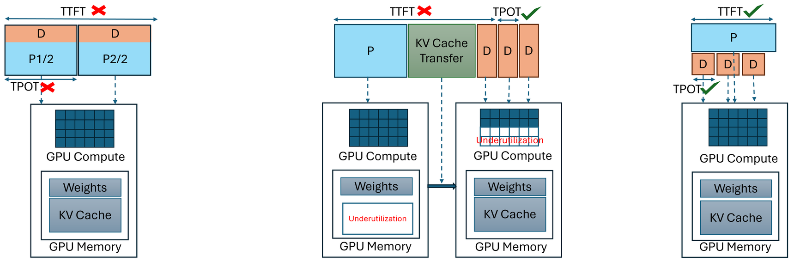{ width="100%" }](images/rapidserve-paper-v1/figure-02.png)

子图按从左到右排列：**(a)** 采用分块 Prefill 的混合批处理；**(b)** 解耦式服务；**(c)** RAPID-Serve。

**图 2：不同的服务技术。**

## 3 设计考量 {#S3}

### 3.1 混合批处理的开销 {#S3.SS1}

<!-- source: S3.SS1.p1.1 -->
将 Prefill 与 Decode 请求合并到一个批次中，会在吞吐量与延迟之间形成权衡，见[图 2(a)](#S2.F2)。为保持高吞吐量，通常倾向于使用较大的分块，但代价是每次迭代延迟增加，直接表现为更高的 ITL。另一方面，严格的 ITL SLO 要求较小的分块，从而降低有效 GPU 利用率和吞吐量。我们的实验表明，相比 512 Token 的分块，1K Token 分块平均提高了 20% 的吞吐量，但 ITL 增加了 30%。这一权衡要求根据工作负载精心安排分块大小。

### 3.2 解耦式服务的开销 {#S3.SS2}

<!-- source: S3.SS2.p1.1 -->
解耦式服务被提出作为混合批处理的替代方案，允许 Prefill 和 Decode 阶段分别在针对各阶段优化的计算实例上执行。然而，在资源总量固定的情况下，相比聚合式服务，解耦式服务会产生多种开销。

#### 3.2.1 KV 传输 {#S3.SS2.SSS1}

<!-- source: S3.SS2.SSS1.p1.1 -->
在解耦式服务系统中，新请求首先被路由至 Prefill 实例，完成 Prompt 处理和初始 KV 缓存填充。随后，请求及其对应的 KV 缓存数据被送到 Decode 实例，用于生成输出 Token。KV 缓存传输开销取决于互连或网络带宽、KV 缓存大小、Prefill/Decode 实例配置等多个因素。在配备 8 个 AMD Instinct™ MI300X GPU 的节点上评估 vLLM 解耦式服务，采用 4P-4D 配置，结果显示 KV 传输使吞吐量平均承受 1.4 倍的开销，首 Token 时间（TTFT）平均承受 1.9 倍的开销。对于较短 Prompt，这些开销通常更大，因为传输与 Prompt 计算能够重叠的机会更少。需要注意，在 vLLM V1 中，Decode 实例收到 KV 缓存后会重新计算首 Token；因此，KV 传输开销影响的是第一个 Token 的生成，而不是第二个。

[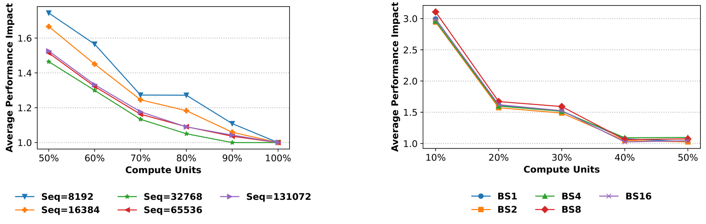{ width="100%" }](images/rapidserve-paper-v1/figure-03.png)

**(a)** 计算受限的 Prefill 阶段，其性能与计算资源数量直接相关。

**(b)** 内存带宽受限的 Decode 只使用 40%～50% 的计算资源，也能达到相近性能；BS 表示批大小。

**图 3：推理阶段的资源需求。** 纵轴表示相对于使用 100% 计算单元时性能的归一化性能退化程度，越低越好，1 表示峰值性能。

#### 3.2.2 内存利用不足 {#S3.SS2.SSS2}

<!-- source: S3.SS2.SSS2.p1.1 -->
传输结束后，在持续时间较长的 Decode 阶段中，KV 缓存数据驻留于 Decode 实例的内存，而 Prefill 实例的内存被释放。这造成了实例之间内存利用率的不平衡：Decode 实例会在较长时间内保存更多数据，而 Prefill 实例的内存容量利用不足。在 Prefill 和 Decode 分配相同数量、相似 GPU 的简单情况下，这种不平衡意味着最多 50% 的内存容量未被充分利用。因此，对于受内存容量限制的推理工作负载，吞吐量损失也可能达到 50%，因为只有一半内存容量，就意味着单个实例只能同时执行一半数量的请求。

### 3.3 各阶段的资源需求 {#S3.SS3}

<!-- source: S3.SS3.p1.1 -->
LLM 推理的两个阶段具有不同的性能特征：处理输入 Prompt 的 Prefill 阶段受计算能力限制，而生成或 Decode 阶段通常受内存带宽限制。不过，当前 GPU 同时具备强大的计算能力、较大的内存容量和较高的内存带宽。计算受限的工作负载不能充分利用内存带宽，而 Decode 阶段又不需要全部计算资源。RAPID-Serve 提议并发执行 Prefill 和 Decode，以充分利用 GPU 的能力。

<!-- source: S3.SS3.p2.1 -->
[图 3](#S3.F3) 展示了为 Prefill 和 Decode 分配不同计算资源的影响。在该实验中，我们在 AMD Instinct™ MI300X 上执行了一个矩阵乘法 Kernel，它对应于 LlaMA-3.1 70B 模型 Transformer 层的 Up Projection；用较小输入规模模拟 Decode，用较大输入规模模拟 Prefill。随后，利用 CU Masking 为这些 Kernel 分配指定的计算资源；这是一个支持细粒度计算单元分配的功能，见[第 4.2 节](#S4.SS2)。[图 3(a)](#S3.F3) 表明，随着计算资源减少，Prefill 工作负载的性能下降，证实了 Prefill Kernel 受计算能力限制。另一方面，即使计算资源减半，Decode Kernel 仍能达到相近性能，见[图 3(b)](#S3.F3)，说明内存带宽受限的 Decode 未充分利用计算资源。并发执行这两个阶段，是提高 GPU 资源利用率的一种可行方案。

### 3.4 内存子系统干扰 {#S3.SS4}

<!-- source: S3.SS4.p1.1 -->
在同一设备上并发执行多个 Kernel 时，另一类干扰来自内存子系统的争用。虽然 CU Masking 能为并发 Kernel 分配不同的计算资源，但对于包含缓存、片上网络、内存通道与控制器的内存子系统，无法进行同样的分配。对这些资源的争用会造成内存干扰。不过，预计这种干扰不会显著影响计算受限 Kernel 的性能。基于 Attention Kernel 的实验表明，内存干扰对 Prefill Kernel 的性能影响最高仅为 2%，较为轻微，可以接受。Decode Kernel 的内存干扰平均为 2%～5%。使用 GEMM Kernel 重复同一实验时，我们观察到 Decode Kernel 受到更大的内存干扰。然而，如果不对 GPU 进行虚拟化，AMD Instinct™ GPU 上目前没有可用机制，可以在并发 Kernel 之间划分内存资源。因此，RAPID-Serve 没有缓解由内存子系统造成的性能退化。

## 4 RAPID-Serve 实现 {#S4}

<!-- source: S4.p1.1 -->
RAPID-Serve 旨在解决现有服务技术的局限。实现基于 vLLM V1，版本为 v0.10.2rc3。本节详细介绍实现中的选择。

### 4.1 概述 {#S4.SS1}

<!-- source: S4.SS1.p1.1 -->
RAPID-Serve 的设计直觉是在同一设备或同一组设备上，同时发挥混合分块与解耦式服务的优势：前者通过并发执行 P/D 获得较高的资源利用率，后者通过分离两个阶段满足延迟 SLO。我们的设计目标如下：

- 保持 GPU 计算和内存资源的高利用率。 <!-- source: S4.I1.i1.p1.1 -->
- 尽量减少 GPU 执行中的空隙，保持 Prefill 和 Decode 的高并发度。 <!-- source: S4.I1.i2.p1.1 -->
- 满足 Prefill 和 Decode 两个阶段的延迟 SLO。 <!-- source: S4.I1.i3.p1.1 -->
- 保持混合分块与解耦式服务的优势，同时减轻它们的开销。 <!-- source: S4.I1.i4.p1.1 -->

<!-- source: S4.SS1.p2.1 -->
如[第 3.1 节](#S3.SS1) 所述，虽然混合批处理提供了较高的吞吐量，但其主要缺点是将 Decode 和 Prefill 请求合并到一个批次，使两阶段计算同步推进，导致延迟超过严格的 SLO，见[图 2(a)](#S2.F2)。RAPID-Serve 并行执行 Prefill 和 Decode 阶段，但不将它们合并到同一批次，从而解决这一局限。这意味着 Prefill 和 Decode 在不同进程中执行，使用独立的 GPU Kernel，但这些 Kernel 的执行相互重叠。RAPID-Serve 消除了混合批处理的同步推进，同时仍提供吞吐量优势，见[图 2(c)](#S2.F2)。

<!-- source: S4.SS1.p3.1 -->
RAPID-Serve 在同一设备上并发执行 Prefill 和 Decode，对应设计目标 1，并让两者共享 KV 缓存，因而避免了所有跨设备 KV 缓存传输，从设计上消除了[第 3.2.1 节](#S3.SS2.SSS1) 中解耦式服务的 KV 缓存传输开销。此外，KV 缓存与 Prefill、Decode 驻留在同一设备上，因此不会像解耦式服务那样出现内存容量利用不平衡，见[图 2](#S2.F2)。

### 4.2 CU Masking {#S4.SS2}

<!-- source: S4.SS2.p1.1 -->
RAPID-Serve 的设计使用了 AMD Instinct™ GPU 暴露的一种硬件机制，称为 CU Masking，它允许将 Kernel 执行限制在计算单元的一个子集中。启用 CU Masking 后，每个命令队列关联一个位掩码，其中每一位对应一个指定的 CU。当 Kernel 被加入具有 CU Mask 的命令队列时，其工作组只能在指定的 CU 上执行。这一功能对应用是透明的：不需要修改 Kernel 代码，被掩码排除的 CU 对工作负载不可见。CU Masking 提供的是对 GPU 计算资源的空间控制，与 Kernel 优先级或 GPU 虚拟化等其他优化机制相互独立。

### 4.3 多进程与多线程 {#S4.SS3}

<!-- source: S4.SS3.p1.1 -->
尽管 LLM 推理通常是 GPU 受限的任务，实现 GPU 并发也要求主机 CPU 任务并行运行。CPU 负责处理到达的请求与返回的响应、调度 GPU 请求、对输出进行后处理，以及管理 KV 缓存。CPU 工作串行化可能造成 GPU 执行空隙，限制并发度，见[图 6(a)](#S4.F6)。由于 Python 中的全局解释器锁（GIL）限制了多个线程的并发执行，RAPID-Serve 采用多进程方式，让不同进程分别执行 Prefill 和 Decode，以实现 CPU 任务真正并发，避免不同线程之间的干扰，对应设计目标 2。

[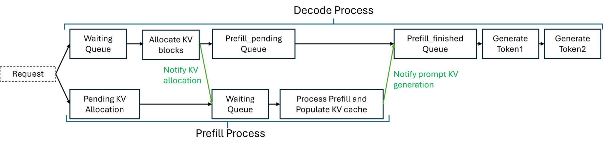{ width="100%" }](images/rapidserve-paper-v1/figure-04.png)

**图 4：单个请求的流程。**

### 4.4 请求流程 {#S4.SS4}

<!-- source: S4.SS4.p1.1 -->
[图 4](#S4.F4) 展示了一个请求到达 RAPID-Serve 引擎后的执行流程。每个请求同时被送至 Prefill 和 Decode 进程。在 Decode 进程中，请求首先加入 `waiting queue`，随后分配所需的 KV 缓存块。Prompt 所需分配的块数可根据输入上下文长度确定。已分配块的 ID 随后传给 Prefill 实例。此时，在 Prefill 进程中，请求从 `pending_kv queue` 移入 `waiting_prefill queue`，由 Prefill 实例处理。Prompt 处理完毕、KV 缓存填充完成后，Prefill 进程通知 Decode 进程。这里没有 KV 缓存传输，只有从 Prefill 进程发往 Decode 进程的通知。Decode 进程收到通知后，将请求移入 `prefill_finished queue`，随后加入正在运行的 Decode 批次，开始生成输出 Token。两个进程之间没有锁或串行化，因此整个流程完全异步。在任意时刻，系统中都有多个请求；Prefill 进程不需要暂停正在执行的请求，来等待 Decode 进程的通知，反之亦然。

### 4.5 服务端组件 {#S4.SS5}

[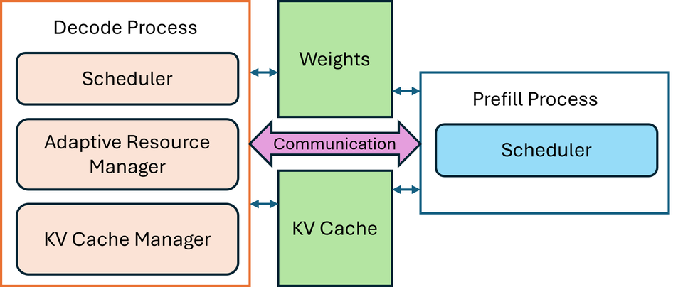{ width="100%" }](images/rapidserve-paper-v1/figure-05.png)

**图 5：RAPID-Serve 的主要组件。**

<!-- source: S4.SS5.p1.1 -->
RAPID-Serve 引擎有两个并发进程：Prefill 和 Decode。模型权重与 KV 缓存通过进程间通信（IPC）句柄在两个进程间共享。进程利用共享存储进行通信，发送特定事件的通知以及其他信息。[图 5](#S4.F5) 展示了 RAPID-Serve 设计的主要组件，下面各节介绍这些组件的细节。

#### 4.5.1 KV 缓存管理器 {#S4.SS5.SSS1}

<!-- source: S4.SS5.SSS1.p1.1 -->
RAPID-Serve 的 KV 缓存管理器基于 vLLM 的 KV 缓存管理器，支持 PagedAttention [[10]](#ref-10)，以高效管理各请求的 KV 缓存“块”分配。它也负责在请求生命周期结束或被抢占时释放不再使用的块。在 RAPID-Serve 中，只有 Decode 进程拥有这个组件。这样做是为了避免两个进程同时管理 KV 缓存：否则，所有 KV 缓存操作都必须放在由锁管理的临界区中，这会在两个进程之间引入额外的串行化和依赖，违反设计目标 2。因此，只有 Decode 实例负责管理 KV 缓存。原因是，Prompt 所需的 KV 缓存块数可以根据输入上下文长度计算，而生成文本对应的 Decode 缓存需求无法这样计算，因为输出 Token 数事先未知。如[图 4](#S4.F4) 所示，Decode 进程为 Prompt 分配 KV 缓存块并通知 Prefill，之后 Prefill 进程才能开始执行，从而避免使用锁。

#### 4.5.2 调度器 {#S4.SS5.SSS2}

[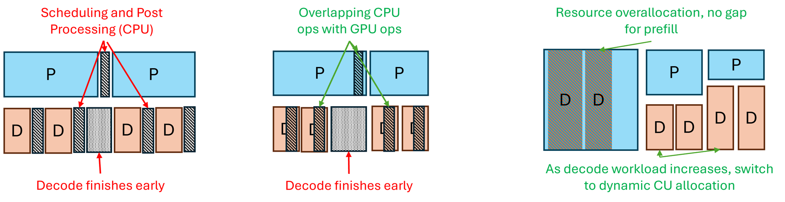{ width="100%" }](images/rapidserve-paper-v1/figure-06.png)

子图按从左到右排列：**(a)** 朴素的调度与资源分配；**(b)** 异步调度 `async_scheduling`；**(c)** 自适应资源分配，图中未展示 CPU 工作。

**图 6：RAPID-Serve 使用的调度与资源分配策略。**

<!-- source: S4.SS5.SSS2.p1.1 -->
RAPID-Serve 的调度器，包括 Prefill 和 Decode 两侧，均采用先来先服务（FCFS）策略，即按照请求到达顺序确定优先级。为提高 GPU 利用率并减少调度造成的空隙，见[图 6(a)](#S4.F6)，我们启用异步调度 `async_scheduling`，见[图 6(b)](#S4.F6)。该技术由 Nanoflow [[19]](#ref-19) 引入：调度器领先 GPU 执行一步运行，将下一个 Token 视作占位符。如果请求在当前步骤结束，由于异步调度器在安排下一步时——当前步骤仍在执行中——并不知道请求已经结束，因此下一步会额外生成一个 Token。不过，这不是显著的开销，因为 Decode 请求是批处理的，每个请求多生成一个 Token 的影响并不大。异步调度显著减少了 CPU 时间，特别是在 Decode 实例上，因为 Decode 的 GPU 执行时间较短，CPU 时间的相对占比更高。Prefill 也启用了异步调度，并且不会产生额外生成一个 Token 的开销，因为假设 Prefill 请求会在一步中完成，不进行 Prefill 分块。总体而言，异步调度减少了 GPU 执行中的空隙，有助于维持较高的资源利用率。

#### 4.5.3 自适应资源管理器 {#S4.SS5.SSS3}

<!-- source: S4.SS5.SSS3.p1.1 -->
自适应资源管理器负责根据当前工作负载和 SLO 分配计算资源。如前文所述，RAPID-Serve 使用 CU Masking 为 Prefill 和 Decode 分配不同资源。然而，当 Decode 请求数量较少时，可能出现 Decode 提前结束，而 Prefill 仍在运行的情况，此时分配给 Decode 的 CU 在当前 Prefill 迭代剩余时间内会闲置，见[图 6(b)](#S4.F6)。RAPID-Serve 使用 HIP Graph 减少 GPU Kernel 的启动开销，因此 Graph 一旦启动，就无法更改命令队列或与其关联的 CU Mask。相反的情况，即 Prefill 迭代早于 Decode 结束，并不是很大的问题：Decode 迭代时间远小于 Prefill，因此下一步可以把所有 CU 分配给 Decode。

<!-- source: S4.SS5.SSS3.p2.1 -->
为避免这种情况，当 Decode 工作负载较轻时，自适应资源管理器采用计算单元超额分配，同时为 Prefill 和 Decode 各授予 100% 的计算资源。Prefill 与 Decode Kernel 会竞争资源，依赖 GPU 的硬件调度器，将工作组调度到任意可用的计算单元。这种方案最大化了 GPU 利用率，因为硬件调度器可以不受限制地将任意工作组分配到任意 CU。如果 Decode 结束时 Prefill 迭代仍在进行，Prefill 工作组就能够使用所有 CU，减轻[图 6(c)](#S4.F6) 所示的空隙。

[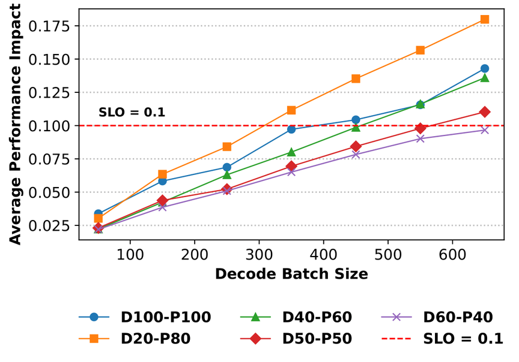{ width="80%" }](images/rapidserve-paper-v1/figure-07.png)

**图 7：不同资源分配方案下，Decode 延迟随批大小的变化。** DXX 表示向 Decode 分配 XX% 的 CU，PYY 表示向 Prefill 分配 YY% 的 CU。

<!-- source: S4.SS5.SSS3.p3.1 -->
在请求到达率较高或工作负载较重时，超额分配方案下的 Decode 请求无法满足 SLO。原因是 Prefill 与 Decode 竞争相同资源，引入了[图 7](#S4.F7) 测量到的流间干扰。P100-D100 配置，即 Prefill 使用 100%、Decode 也使用 100% 的资源，代表超额分配场景；在较大的 Decode 批大小下，该配置开始超过 SLO。图中也显示，在较大的批大小下，为 Prefill 和 Decode 分配不同的计算资源，可以消除流间干扰，使 Decode 满足 SLO。

<!-- source: S4.SS5.SSS3.p4.1 -->
根据[图 7](#S4.F7) 中的观察，自适应资源调度器依据 Decode 工作负载与严格的 ITL SLO，切换到不同的 CU 分配方案。系统通过离线性能剖析，确定不同 Decode 批大小满足 SLO 所需的最少计算单元数。运行时，管理器只向 Decode 分配满足 SLO 所必需的 CU，尽量避免对 Prefill 性能造成过多影响；计算受限的 Prefill 获得剩余 CU，其性能也会随之变化。随着 Decode 工作负载增减，资源管理器可以调整资源数量，在满足 SLO 的同时维持高吞吐量和高 CU 利用率。

## 5 评估 {#S5}

### 5.1 实验设置 {#S5.SS1}

<!-- source: S5.SS1.p1.1 -->
所有实验均在一个配备 8 个 AMD Instinct™ MI300X GPU 的节点上进行，使用 ROCm 6.4。基线服务系统为 vLLM v0.10.2。评估采用两个 LLM：LlaMA-3 70B 代表稠密 Transformer 工作负载，Mixtral 8×7B 代表混合专家工作负载。综合评估使用三个具有代表性的数据集：LMSYS [[17]](#ref-17) 轨迹的 Prompt 较短，反映了真实部署中观察到的交互式请求模式，平均 Prompt 长度为 2000 Token。对于长上下文工作负载，采用 arXiV [[5]](#ref-5) 数据集，平均 Prompt 长度为 8K Token，以及 Loogle 摘要数据集 [[11]](#ref-11)，平均 Prompt 长度为 20K Token，以施加内存压力。LMSYS 和 arXiV 数据集按 Prompt 长度分层采样，各截取至 10K 个数据点。实验通过改变输入每秒查询数（QPS），扫描从资源利用不足到饱和的负载范围。由于混合批处理性能随分块大小变化，RAPID-Serve 与三种不同分块大小的混合批处理进行比较。解耦式服务也基于 vLLM V1，Prefill 与 Decode 实例的张量并行度均为 4，各使用 4 个 GPU。Mixtral 8×7B 未在解耦配置下评估，因为当时 vLLM 尚不支持 MoE 模型的解耦式服务。

### 5.2 吞吐量与有效吞吐量 {#S5.SS2}

[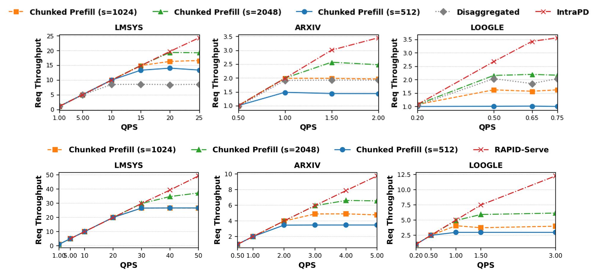{ width="100%" }](images/rapidserve-paper-v1/figure-08.png)

**图 8：LlaMA-3.1 70B（上）和 Mixtral-8×7B（下）在各工作负载上的吞吐量。** 每幅图展示输入负载（QPS）与实际吞吐量的关系，对比三种 Prefill 分块大小的混合批处理、解耦式服务以及 RAPID-Serve。结果均相对于最低 QPS 下、分块大小 $s=512$ 的分块方法实际吞吐量进行归一化。

[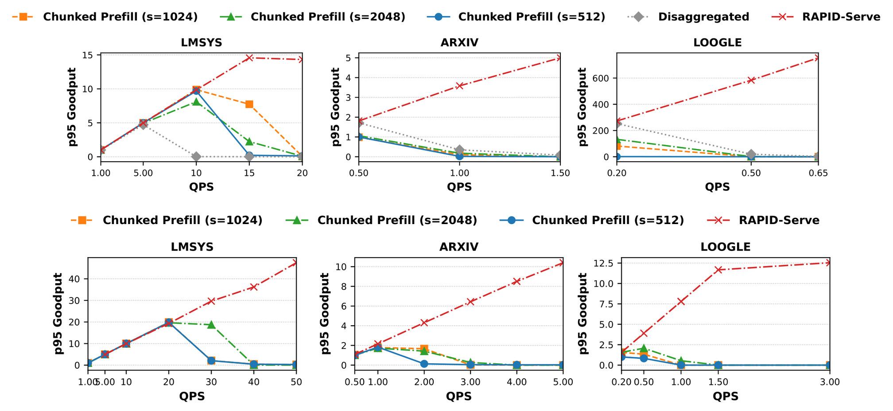{ width="100%" }](images/rapidserve-paper-v1/figure-09.png)

**图 9：LlaMA-3.1 70B（上）和 Mixtral-8×7B（下）在各工作负载上的有效吞吐量。** 每幅图展示输入负载（QPS）与实际有效吞吐量的关系，对比三种 Prefill 分块大小、解耦式服务以及 RAPID-Serve。结果均相对于最低 QPS 下、分块大小 $s=512$ 的分块方法实际有效吞吐量进行归一化。

<!-- source: S5.SS2.p1.1 -->
[图 8](#S5.F8) 展示了 RAPID-Serve 在不同请求负载下的吞吐量，并与混合批处理和解耦式服务比较。所有结果均相对于最低输入 QPS 下、分块大小为 512 Token 的混合批处理吞吐量进行归一化。结果表明，RAPID-Serve 的无约束吞吐量等于或优于基线：相比分块混合批处理，最高达到 4.1 倍、平均 1.7 倍；相比解耦式服务，最高达到 2.9 倍、平均 1.5 倍。这是因为 RAPID-Serve 实现了较高的并发度，减少了空隙，并保证了较高的计算利用率。

<!-- source: S5.SS2.p2.1 -->
有效吞吐量（Goodput）被定义为“在达到 SLO 达标目标的前提下，能够服务的最大请求速率” [[18]](#ref-18)。一个请求同时满足两个延迟约束时，才被视为成功。首先，其 ITL 不能超过 SLO：LlaMA-3.1 70B 为 100 毫秒，Mixtral 8×7B 为 50 毫秒。其次，其 TTFT 必须保持在随长度变化的上限内：输入上下文长度为 0～1000 Token 的请求需在 1 秒内产生首 Token，1000～2000 Token 的请求需在 2 秒内产生首 Token，之后按比例增加。

<!-- source: S5.SS2.p3.1 -->
[图 9](#S5.F9) 表明，在达到饱和点之前，RAPID-Serve 持续取得等于或更好的 P95 有效吞吐量。饱和点指 GPU 已被最大程度利用时的请求负载；继续增加负载，只会引入调度延迟，主要影响 TTFT。从[图 9](#S5.F9) 可以看出，在较高请求负载下，即使尚未达到饱和点，基线也已经无法满足 SLO，表现为 $\mathrm{goodput}\approx 0$，而 RAPID-Serve 仍能保持较高的有效吞吐量。在基线有效吞吐量不可忽略的情况下，RAPID-Serve 相比分块混合批处理的有效吞吐量最高达到 32 倍、平均 4.9 倍；相比解耦式服务，最高达到 13.7 倍、平均 4.7 倍。

[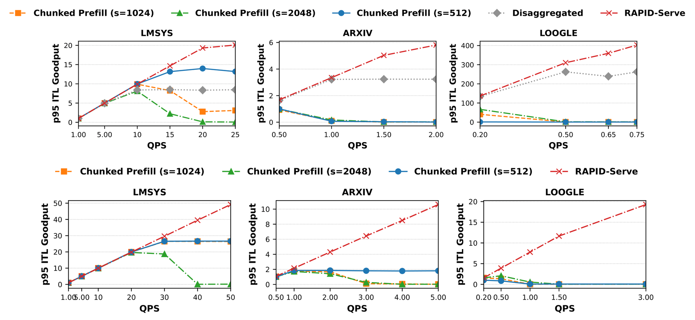{ width="100%" }](images/rapidserve-paper-v1/figure-10.png)

**图 10：LlaMA-3.1 70B（上）和 Mixtral-8×7B（下）在各工作负载上的 ITL P95 有效吞吐量。** 每幅图展示输入负载与实际 ITL P95 有效吞吐量的关系，对比三种 Prefill 分块大小、解耦基线和 RAPID-Serve。结果均相对于最低 QPS 下、分块大小 $s=512$ 的分块方法实际有效吞吐量进行归一化。

<!-- source: S5.SS2.p4.1 -->
在达到饱和点后，排队和调度延迟使 TTFT 变长，因此我们也仅施加 ITL SLO 约束来测量有效吞吐量，见[图 10](#S5.F10)。只考虑基线有效吞吐量不可忽略的情况，相比分块混合批处理，RAPID-Serve 的 ITL 有效吞吐量最高达到 5.9 倍、平均 2 倍；相比解耦式服务，最高达到 2.4 倍、平均 1.4 倍。在其他情况下，即使基线无法满足 SLO，RAPID-Serve 仍能获得较高的有效吞吐量。这得益于 RAPID-Serve 的自适应资源管理策略：它为 P/D 分配不同资源，在保持高吞吐量的同时满足 ITL 条件。

### 5.3 尾延迟 {#S5.SS3}

<!-- source: S5.SS3.p1.1 -->
RAPID-Serve 力求在 TTFT、ITL 与吞吐量之间取得平衡。尾延迟是判断请求 SLO 达标情况的重要指标。如[图 11](#S5.F11) 所示，LlaMA-3.1 70B 模型的 P95 TTFT 相比分块基线，最高降低至其 1/220、平均约为其 1/53；相比解耦基线，最高降低至其 1/486、平均约为其 1/55。TTFT 改善源于以下因素：1）RAPID-Serve 不对 Prefill 分块，因此没有反复调度、模型加载和 Kernel 启动等开销；2）生成首 Token 时没有 KV 缓存传输。

<!-- source: S5.SS3.p2.1 -->
P95 ITL 相比分块混合批处理，最高降低至其 1/6、平均约为其 1/1.9。解耦式服务的 P95 ITL 平均为 RAPID-Serve 的一半；不过，这一更低的 ITL 可以归因于解耦式服务同时具有更低的吞吐量。

### 5.4 资源利用率 {#S5.SS4}

<!-- source: S5.SS4.p1.1 -->
RAPID-Serve 通过 Prefill 与 Decode 并发执行、异步调度和无锁设计，减轻 GPU 空闲间隙，从而提高 GPU 资源利用率。计算利用率通过硬件性能计数器测量：用各计算单元忙碌周期之和与 GPU 忙碌周期数的比值，近似表示活跃计算单元数。相较于混合批处理，RAPID-Serve 的 GPU 计算利用率最高提高 77%；相较于解耦式服务，最高提高 111%。此外，RAPID-Serve 通过共享 KV 缓存，避免解耦式服务中的内存利用不平衡，内存利用率最高提高 37%。

[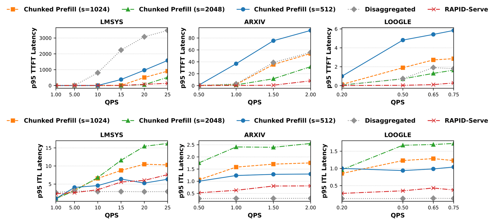{ width="100%" }](images/rapidserve-paper-v1/figure-11.png)

**图 11：LlaMA-3.1 70B 的 P95 TTFT 和 ITL。** 相对于最低 QPS 下、分块大小 $s=512$ 的分块方法延迟进行归一化。

[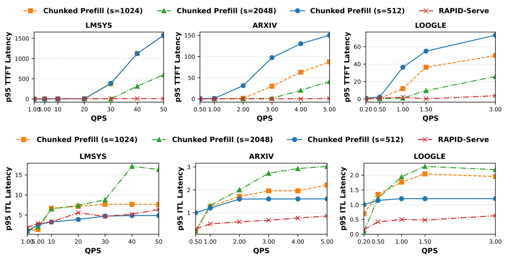{ width="100%" }](images/rapidserve-paper-v1/figure-12.png)

**图 12：Mixtral 8×7B 的 P95 TTFT 和 ITL。** 相对于最低 QPS 下、分块大小 $s=512$ 的分块方法延迟进行归一化。

## 6 相关工作 {#S6}

<!-- source: S6.p1.1 -->
已有多种方法尝试解决当前服务系统面临的问题。PODAttention [[9]](#ref-9) 提出一种统一 Attention Kernel，将 Prefill 和 Decode Attention 合并。然而，该方法专门面向混合批处理，没有解决本文讨论的服务方法本身固有的问题。Nanoflow [[19]](#ref-19) 采用另一种方式实现 Kernel 重叠并提高 GPU 利用率：将每个批次划分成多个“Nano-Batch”，并发执行，以提高资源利用率。不过，P/D 仍然耦合，Nanoflow 没有解决由此产生的每 Token 延迟退化。

<!-- source: S6.p2.1 -->
DRIFT [[6]](#ref-6) 和 Semi-PD [[8]](#ref-8) 在同一组设备上重叠执行 Prefill 与 Decode。DRIFT 使用 NVIDIA 的 GreenContext 机制进行资源分配，Semi-PD 则通过 NVIDIA MPS 实现。这些方法为 Prefill 与 Decode 分配不同资源，导致执行期间出现气泡。RAPID-Serve 根据工作负载采用资源超额分配，确保当 Decode 或 Prefill 任一阶段未运行时，GPU 不会利用不足。DRIFT 只评估 ITL SLO 约束，而 RAPID-Serve 的自适应资源调度在 Prefill 与 Decode 之间取得平衡，同时满足 TTFT 和 ITL 约束。此外，RAPID-Serve 的无锁、无同步方式减轻了 Prefill 与 Decode 之间的串行化和同步，提高了性能和吞吐量。

## 7 结论 {#S7}

<!-- source: S7.p1.1 -->
RAPID-Serve 为当前 LLM 推理服务方案的性能局限提供了有效解决方法，在满足 SLO 约束的同时提供高吞吐量。混合批处理将 Prefill 和 Decode 请求耦合，可能导致请求超过延迟 SLO；RAPID-Serve 则重叠执行 Prefill 与 Decode，而不将它们合并到同一阶段。这使 RAPID-Serve 能够在满足 SLO 的同时保持高吞吐量。此外，RAPID-Serve 还避免了解耦式服务的 KV 缓存传输开销和内存容量利用不足。评估表明，RAPID-Serve 带来了显著的性能提升：无约束吞吐量最高达到 4.1 倍，有效吞吐量最高达到 32 倍。这些结果表明，并发执行 Prefill 和 Decode 阶段能够有效利用可用 GPU 资源。

## 参考文献 {#references}

[1] Amey Agrawal、Nitin Kedia、Ashish Panwar、Jayashree Mohan、Nipun Kwatra、Bhargav S. Gulavani、Alexey Tumanov、Ramachandran Ramjee。**通过 Sarathi-Serve 调和 LLM 推理中的吞吐量与延迟权衡**（Taming throughput-latency tradeoff in LLM inference with Sarathi-Serve）。载于《第 18 届 USENIX 操作系统设计与实现研讨会论文集》（OSDI ’24），2024 年。

[2] Amey Agrawal、Haoran Qiu、Junda Chen、Íñigo Goiri、Chaojie Zhang、Rayyan Shahid、Ramachandran Ramjee、Alexey Tumanov、Esha Choukse。**Medha：无需近似，高效服务数百万 Token 上下文长度的 LLM 推理请求**（Medha: Efficiently serving multi-million context length LLM inference requests without approximations）。arXiv 预印本，arXiv:2409.17264，2024 年。链接：<https://arxiv.org/abs/2409.17264>。

[3] Junda Chen、Yonghao Zhuang、Hao Zhang。**解耦式推理：18 个月之后**（Disaggregated inference: 18 months later）。<https://hao-ai-lab.github.io/blogs/distserve-retro/>，2025 年 11 月。访问日期：2025-11-29。

[4] Yihua Cheng、Yuhan Liu、Jiayi Yao、Yuwei An、Xiaokun Chen、Shaoting Feng、Yuyang Huang、Samuel Shen、Kuntai Du、Junchen Jiang。**LMCache：面向企业规模 LLM 推理的高效 KV 缓存层**（LMCache: An efficient KV cache layer for enterprise-scale LLM inference）。CoRR，abs/2510.09665，2025 年。

[5] Arman Cohan、Franck Dernoncourt、Doo Soon Kim、Trung Bui、Seokhwan Kim、Walter Chang、Nazli Goharian。**用于长文档生成式摘要的篇章感知注意力模型**（A discourse-aware attention model for abstractive summarization of long documents）。载于《2018 年计算语言学协会北美分会会议论文集：人类语言技术》第 2 卷（短论文），第 615～621 页，美国路易斯安那州新奥尔良，2018 年 6 月。计算语言学协会。

[6] Weihao Cui、Yukang Chen、Han Zhao、Ziyi Xu、Quan Chen、Xusheng Chen、Yangjie Zhou、Shixuan Sun、Minyi Guo。**通过 P/D 复用优化面向 SLO 的 LLM 服务**（Optimizing SLO-oriented LLM serving with PD-multiplexing），2025 年。

[7] Christian Holmes、Masahiro Tanaka、Matthew Wyatt、A. A. Awan、Jeff Rasley、Samyam Rajbhandari、其他作者、Yuxiong He。**DeepSpeed-FastGen：通过 MII 和 DeepSpeed-Inference 实现 LLM 高吞吐量文本生成**（DeepSpeed-FastGen: High-throughput text generation for LLMs via MII and DeepSpeed-Inference）。arXiv 预印本，arXiv:2401.08671，2024 年。

[8] Ke Hong、Lufang Chen、Zhong Wang、Xiuhong Li、Qiuli Mao、Jianping Ma、Chao Xiong、Guanyu Wu、Buhe Han、Guohao Dai、Yun Liang、Yu Wang。**semi-pd：通过按阶段解耦计算与统一存储，实现高效 LLM 服务**（semi-pd: Towards efficient LLM serving via phase-wise disaggregated computation and unified storage），2025 年。

[9] Abhijith Kalyan Kamath、Rakesh Prabhu、Jatin Mohan、Sajan Peter、Radhika Ramjee、Animesh Panwar。**POD-Attention：实现 Prefill 与 Decode 的完全重叠，加速 LLM 推理**（POD-Attention: Unlocking full prefill-decode overlap for faster LLM inference）。arXiv 预印本，arXiv:2410.18038，2024 年。

[10] Woosuk Kwon、Zhuohan Li、Siyuan Zhuang、Ying Sheng、Lianmin Zheng、Cody Hao Yu、Joseph E. Gonzalez、Hao Zhang、Ion Stoica。**利用 PagedAttention 实现大语言模型服务的高效内存管理**（Efficient memory management for large language model serving with PagedAttention），2023 年。

[11] Xinyu Li、Lianwei Wu、Haotian Zhang 等。**Loogle：用于大语言模型评估的长上下文数据集**（Loogle: A long-context dataset for large language model evaluation），2023 年。

[12] Tiyasa Mitra、Ritika Borkar、Nidhi Bhatia、Ramon Matas、Shivam Raj、Dheevatsa Mudigere、Ritchie Zhao、Maximilian Golub、Arpan Dutta、Sailaja Madduri、Dharmesh Jani、Brian Pharris、Bita Darvish Rouhani。**热议之外：对推理解耦的务实看法**（Beyond the buzz: A pragmatic take on inference disaggregation）。arXiv 预印本，arXiv:2506.05508，2025 年。

[13] NVIDIA。**FasterTransformer**。<https://github.com/NVIDIA/FasterTransformer>，2024 年。

[14] Parijat Patel、Ekta Choukse、Chi Zhang、Aman Shah、Inigo Goiri、Saeed Maleki、Ricardo Bianchini。**Splitwise：利用阶段拆分实现高效生成式 LLM 推理**（Splitwise: Efficient generative LLM inference using phase splitting）。载于《2024 年 ACM/IEEE 第 51 届国际计算机体系结构研讨会》（ISCA），第 118～132 页。IEEE，2024 年。

[15] Ruoyu Qin、Zheming Li、Weiran He、Jialei Cui、Feng Ren、Mingxing Zhang、Yongwei Wu、Weimin Zheng、Xinran Xu。**Mooncake：以更多存储换取更少计算——面向 LLM 聊天机器人服务的 KVCache 中心架构**（Mooncake: Trading more storage for less computation — a KVCache-centric architecture for serving LLM chatbot）。载于《第 23 届 USENIX 文件与存储技术会议》（FAST 25），第 155～170 页，美国加利福尼亚州圣克拉拉，2025 年 2 月。USENIX 协会。

[16] Gyeong-In Yu、Joo Seong Jeong、Geon-Woo Kim、Soojeong Kim、Byung-Gon Chun。**Orca：面向 Transformer 生成模型的分布式服务系统**（Orca: A distributed serving system for Transformer-based generative models）。载于《第 16 届 USENIX 操作系统设计与实现研讨会》（OSDI ’22），第 521～538 页，美国加利福尼亚州卡尔斯巴德，2022 年。USENIX 协会。

[17] Lianmin Zheng、Wei-Lin Chiang、Ying Sheng、Sodaice Zhuang、Ztao Wu、Zhe Lin 等。**Chatbot Arena：通过人类偏好评估 LLM 的开放平台**（Chatbot Arena: An open platform for evaluating LLMs by human preference），2023 年。

[18] Yinmin Zhong、Shengyu Liu、Junda Chen、Jianbo Hu、Yibo Zhu、Xuanzhe Liu、Xin Jin、Hao Zhang。**DistServe：解耦 Prefill 与 Decode，优化大语言模型服务的有效吞吐量**（DistServe: Disaggregating prefill and decoding for goodput-optimized large language model serving）。载于《第 18 届 USENIX 操作系统设计与实现研讨会论文集》（OSDI ’24），2024 年。

[19] Kaiyuan Zhu、Yizhou Zhao、Li Zhao、Guangming Zuo、Yongbin Gu、Dongyan Xie、其他作者、Baris Kasikci。**Nanoflow：迈向最优的大语言模型服务吞吐量**（Nanoflow: Towards optimal large language model serving throughput）。arXiv 预印本，arXiv:2408.12757，2024 年。
