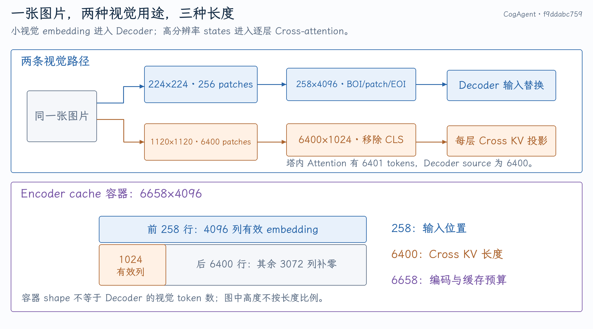
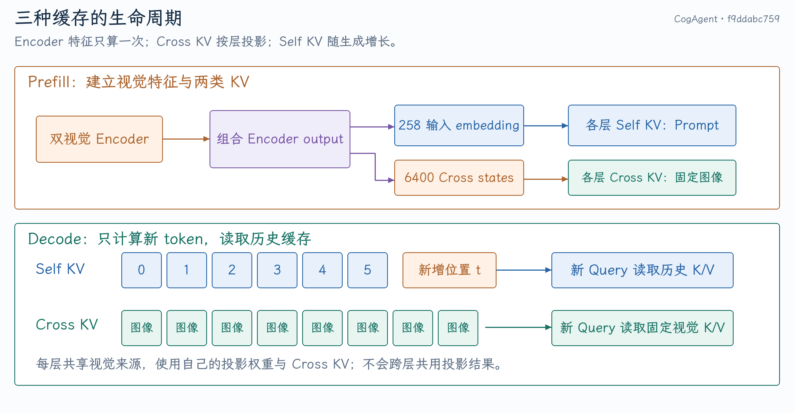

# CogAgent-18B：模型接入、数值对齐与量化推理

CogAgent 接入的核心是把模型的真实数据流映射到 vLLM 的输入、调度、缓存和执行接口。它同时有两套视觉编码器、两类 token 投影，以及逐层 cross-attention；只实现一个能计算 logits 的 `forward()`，仍不足以成为可调度、可缓存、可编译的推理模型。

本文依据 [`f9ddabc759`](https://github.com/tangzzycc/vllm/commit/f9ddabc759c66cdb76567d22d05683ea8d30cd37)。对应开发分支为 `gfx11/cogagent-18b-support`，源码链接固定到该提交。性能数字及其比较条件见 [性能证据与面试问答](03-性能证据与面试问答.md)，LoRA 实现见 [LoRA 算子与优先级调度](02-LoRA算子与优先级调度.md)。

## 1. 从一张图片追踪到首个输出 token

### 原模型为什么采用双视觉结构

[CogAgent 论文](https://arxiv.org/abs/2312.08914)面向 GUI 理解与操作。界面里有小文字、图标、布局和定位需求，仅用低分辨率视觉输入会丢失细节；直接把大量高分辨率 patches 全放进语言 token 流，又会扩大语言 decoder 的计算与缓存成本。模型用低分辨率路径融入语言表示，高分辨率路径经逐层 cross-attention 提供细节。

这解释了为何接入不能把两套塔简化成普通“单塔+projector”结构。当前分支复现的是该模型架构与 checkpoint 的计算，不代表同时实现了完整 GUI agent 的工具调用、动作执行和环境反馈。

### 在 vLLM 中的一次请求

以一张图片和一句“描述图片内容”为例，一次请求经过这些步骤：

1. Chat template 和 tokenizer 构造文本序列，processor 生成两种分辨率的图像 tensor。
2. InputProcessor 保存 multimodal feature，并区分 decoder placeholder、encoder output 和 cross-attention 的长度。
3. Scheduler 为视觉计算、encoder cache 和 decoder KV 分配预算；MRV2 执行两套视觉编码器。
4. 小视觉塔的输出替换 decoder 中的 image-token embedding；高分辨率视觉输出进入每层 cross-attention。
5. Decoder Prefill 建立 self KV 与每层 cross KV，计算最后位置的 logits，采样首个输出 token。
6. 后续 Decode 输入上一个生成 token，读取两类 KV，不重新执行图像编码。

这里的“逐层视觉特征注入”指 decoder 每层都有 cross-attention。视觉塔输出只算一次，不代表每层都重新做图像编码。

### 接入包含哪些接口

| 接口 | 为什么需要 | 漏掉后的典型现象 |
| --- | --- | --- |
| Config 与 registry | 识别模型类型、维度、能力与执行路径 | 无法加载或选择错误 runner |
| HF processor 与 chat template | 复现输入格式、图像处理和特殊 token | 同权重但输入语义不同 |
| Multimodal processor | 描述 placeholder 和视觉输出的对应关系 | embedding 替换越界、预算不足 |
| Model 与 weight loader | 复现数学并映射 fused/parallel 权重 | 分片或投影顺序错误 |
| KV 与 attention metadata | 区分 self/cross 的形状与生命周期 | 内存不足、错误 stride 或 head size |
| Compile/Graph capability | 将合法路径交给执行优化 | 初始化失败或被迫 Eager |

对应入口是 [模型注册](https://github.com/tangzzycc/vllm/blob/f9ddabc759c66cdb76567d22d05683ea8d30cd37/vllm/model_executor/models/registry.py)、[多模态处理](https://github.com/tangzzycc/vllm/blob/f9ddabc759c66cdb76567d22d05683ea8d30cd37/vllm/model_executor/models/cogagent_processing.py) 和 [模型实现](https://github.com/tangzzycc/vllm/blob/f9ddabc759c66cdb76567d22d05683ea8d30cd37/vllm/model_executor/models/cogagent.py)。

## 2. 258、6400、6658 为什么不能合成一个长度

### 两种分辨率对应两种用途

同一个 image item 产生 `pixel_values [1,3,224,224]` 和 `cross_pixel_values [1,3,1120,1120]`。字段是同一图片的两种表示，不是请求带了两张图片。

小视觉塔按 14×14 patch 划分：

$$
(224/14)^2=256.
$$

输出加上 BOI/EOI 后是 `[1,258,4096]`，替换 decoder prompt 中的 258 个 image placeholder。高分辨率视觉塔有：

$$
(1120/14)^2=6400.
$$

塔内部 attention 带 CLS，sequence 是 6401；最终去掉 CLS，向 decoder 提供 `[1,6400,1024]` cross states。**6401 是视觉塔内部序列长度，6400 是 decoder cross-attention 的 source 长度。**

{ width="100%" }

为了复用 vLLM encoder cache，`embed_multimodal()` 将两路输出组合成 `[1,6658,4096]`：前 258 行保存小视觉 embedding，后 6400 行的前 1024 列保存 cross states，剩余通道补零。组合 tensor 是框架容器，并没有给 cross states 增加信息，也不表示 decoder self-attention 有 6658 个视觉 token。

具体组合见 [`embed_multimodal()`](https://github.com/tangzzycc/vllm/blob/f9ddabc759c66cdb76567d22d05683ea8d30cd37/vllm/model_executor/models/cogagent.py#L770-L794)，字段与长度定义见 [processor](https://github.com/tangzzycc/vllm/blob/f9ddabc759c66cdb76567d22d05683ea8d30cd37/vllm/model_executor/models/cogagent_processing.py#L152-L235)。

| 逻辑对象 | 长度 | 用于哪里 |
| --- | ---: | --- |
| Decoder image embedding | 258 | decoder 输入替换 |
| Encoder output | 6658 | 视觉计算预算、encoder cache |
| Cross-attention source | 6400 | 每层 cross KV 分配与读取 |

原通用路径往往从 placeholder 长度推导另外两种长度。这次在 [MultiModalFeatureSpec](https://github.com/tangzzycc/vllm/blob/f9ddabc759c66cdb76567d22d05683ea8d30cd37/vllm/multimodal/inputs.py) 增加 `encoder_output_seq_len` 和 `cross_attention_seq_len`，由 [InputProcessor](https://github.com/tangzzycc/vllm/blob/f9ddabc759c66cdb76567d22d05683ea8d30cd37/vllm/v1/engine/input_processor.py) 写入，交给 [Scheduler](https://github.com/tangzzycc/vllm/blob/f9ddabc759c66cdb76567d22d05683ea8d30cd37/vllm/v1/core/sched/scheduler.py) 消费。其他模型未声明新长度时保留默认行为。

`create_encoder_prompt()` 返回的零 token 只是 source 长度占位；真正的图像内容来自图像 tensor。

### 为什么接受容器里的补零开销

同一宽度的组合输出能进入现有 encoder cache，减少为一种模型新增另一套缓存管线的改动。但存储有冗余：

$$
6658\times4096\times2=54\,542\,336\ \mathrm{bytes}
\approx52.02\ \mathrm{MiB}.
$$

若两路分别紧凑存储，只需要：

$$
258\times4096\times2+6400\times1024\times2
=15\,220\,736\ \mathrm{bytes}\approx14.52\ \mathrm{MiB}.
$$

当前选择是用约 37.5 MiB/图片的额外容器空间换取接入现有接口的简洁性。这是可讨论的工程取舍，不能称为“零拷贝紧凑存储”。

## 3. Decoder 怎样同时处理视觉与语言 token

每层执行顺序是：

```text
RMSNorm → routed self-attention → residual
        → RMSNorm → cross-attention → residual
        → RMSNorm → routed SwiGLU MLP → residual
```

### Token mask 是结构规则，不是学习到的 MoE router

CogAgent 为视觉和语言分别保留 QKV、output projection 和 MLP。`build_token_masks()` 根据原始 token IDs 生成 mask：当前位置与下一位置均是 image token，才归入 vision 路径。

因此 258 个 image embedding 都会替换进去，但其中前 257 个位置走 vision expert，最后的 EOI 边界走 language expert。Decode token 为语言 token，只走 language 路径。这里没有 Top-k gate、expert capacity 或跨设备 All-to-All。

模型声明 `requires_raw_input_tokens=True`，因为光有 embedding 无法可靠恢复这份 token 分类。投影输出写回原 token 顺序，attention 仍能看到完整上下文。见 [mask 与顶层 forward](https://github.com/tangzzycc/vllm/blob/f9ddabc759c66cdb76567d22d05683ea8d30cd37/vllm/model_executor/models/cogagent.py#L670-L723)。

### Self-attention 与 cross-attention 的形状不同

Decoder hidden size 是 4096，self-attention 有 32 heads，head dim 为 128。Cross-attention 将 Query 投影到 1024 维，也有 32 heads，head dim 为 32；K/V 来源是 6400×1024 的高分辨率视觉 states。

第 $l$ 层可写成：

$$
Q_l=H_lW_{Q,l},\qquad K_l=EW_{K,l},\qquad V_l=EW_{V,l},
$$

其中 $H_l$ 是本层 decoder state，$E$ 是共享的视觉塔输出。各层共享 $E$，但 **投影权重和投影后的 cross KV 属于各自 layer**。不能把“视觉特征共享”讲成“所有层共用一份 cross KV”。实现见 [`CogAgentCrossAttention`](https://github.com/tangzzycc/vllm/blob/f9ddabc759c66cdb76567d22d05683ea8d30cd37/vllm/model_executor/models/cogagent.py#L342-L416)。

## 4. 三类缓存怎样建立、增长和释放

{ width="100%" }

| 缓存 | 保存什么 | Prefill | Decode |
| --- | --- | --- | --- |
| Encoder cache | 两路视觉编码结果的组合 tensor | 计算或命中 | 不重新编码图片 |
| Self-attention KV | decoder 各位置的 K/V | 写入 prompt 位置 | 每 step 追加新位置 |
| Cross-attention KV | 各层对 6400 个视觉 state 投影的 K/V | 每层建立 | 长度固定，持续读取 |

Encoder cache 的输出是一份特征；KV block 元数据管理位置和所有权；GPU KV tensors 保存真实数值。三者不可混用。

在 BF16、32 层、32 cross heads、head dim 32 的简化容量计算中：

$$
\mathrm{CrossKV}=32\times2\times6400\times32\times32\times2
=838\,860\,800\ \mathrm{bytes}=800\ \mathrm{MiB}.
$$

Self KV 每个 decoder token 为：

$$
32\times2\times32\times128\times2
=524\,288\ \mathrm{bytes}=512\ \mathrm{KiB}.
$$

若 decoder prompt 为 279 tokens，self KV 数值量约 139.5 MiB。Cross KV 是固定图像开销，生成越长，self KV 越多。实际分配还受 block 对齐、cache group 与框架 padding 影响；上述数值用于理解结构，不能替代启动日志的总显存。

这也解释了为什么“视觉 embedding 只有 258 个”不能用来估算完整 KV 容量。

### 非均匀 head size 为什么需要修正 metadata

Self head dim 128，decoder cross head dim 32，CrossVision 塔内部 head dim 64。如果 metadata builder 一律读取全局 model config，就可能给某一 attention group 建立错误 buffer 或 launch 参数。

该提交从当前 group 的 `kv_cache_spec` 读取 KV heads 和 head size，并从具体 layer 获取 Query heads，见 [TritonAttentionMetadataBuilder](https://github.com/tangzzycc/vllm/blob/f9ddabc759c66cdb76567d22d05683ea8d30cd37/vllm/v1/attention/backends/triton_attn.py#L105-L124)。这是模型正确接入框架的必要条件，不能只当作性能配置。

## 5. BF16 数值对齐为什么难于“公式一样”

### 先对齐输入历史，再找首个分叉

Greedy 每步选择 logits 最大的 token。两边一旦选出不同 token，之后上下文不同，继续比较最终文本无法定位根因。

实际排查顺序应是：输入 IDs/position/image tensor → 两套视觉特征 → decoder 第一层 RMSNorm/QKV → RoPE → attention → MLP → logits。将 HF 的某阶段输出注入 vLLM 后半段，能判断问题是否仍在下游。不要只把整模型误差均值当作定位结果。

### RoPE cache 的 cast 顺序改变结果

两条路径数学上都是旋转位置编码，但 BF16 舍入不满足交换律：

```text
模型参考语义：FP32 inv_freq → BF16 inv_freq → BF16 position×freq → cos/sin
通用构造语义：FP32 position×freq → FP32 cos/sin → 最后 cast BF16
```

模型专用实现保留高性能 RoPE 执行，只调整 cache 构造顺序，见 [`_compute_cogagent_rope_cache`](https://github.com/tangzzycc/vllm/blob/f9ddabc759c66cdb76567d22d05683ea8d30cd37/vllm/model_executor/models/cogagent.py#L71-L102)。图像 position 也不是简单递增：BOS=0、BOI=1、256 个 patches 共享 2、EOI=3，后续文本从 4 开始，见 [`build_positions`](https://github.com/tangzzycc/vllm/blob/f9ddabc759c66cdb76567d22d05683ea8d30cd37/vllm/model_executor/models/cogagent.py#L105-L124)。

RoPE 对相邻维或半向量的配对方式、角度生成精度、乘加顺序都可能是模型语义。优化时不能只检查输出 shape。

### 验收分三层

1. 关键算子和 cache 构造与参考计算在规定容差内一致。
2. 相同 token 历史下检查 logits、Top-k 集合和首次分叉的 margin。
3. 用独立图文请求比较 token 相似度与任务质量，不把逐 token 一致率等同于语义质量。

已有 32 条 holdout 报告显示 18/32 序列完全一致，Word F1、ROUGE-L 的差值置信区间包含零；这支持当前样本上的质量对齐，不能证明所有输入 bitwise 相同。详细口径见第三篇。

## 6. AWQ W4A16 改了哪些数值，哪些没有改

W4A16 表示主要 Linear 权重存为 4-bit，activation 仍是 FP16/BF16。它不表示整个模型的中间结果、KV Cache 和 attention 都是 INT4。

当前 `quant_config` 覆盖 decoder 的 language/vision expert QKV、output、MLP，以及 cross-attention 的 Query/KV/output Linear。独立 `vision`、`cross_vision` 视觉塔、embedding、Norm 和 LM head 没有沿这条接口量化。

模型通过 `SupportsQuant` 与 parallel Linear 接入已有量化执行，见 [CogAgent Linear 构造与 weight loader](https://github.com/tangzzycc/vllm/blob/f9ddabc759c66cdb76567d22d05683ea8d30cd37/vllm/model_executor/models/cogagent.py)。Gate/up 合并后要分别加载 `weight/qweight/qzeros/scales` 的两个 shard；只合并浮点 weight loader 不足以支持 AWQ checkpoint。

### 从一个 group 理解反量化

用简化非对称形式表示：

$$
\widehat w_{n,k}=s_{n,g(k)}\big(q_{n,k}-z_{n,g(k)}\big),\qquad q\in\{0,\ldots,15\}.
$$

例如 $s=0.25,z=8,q=[8,12,4,10]$，恢复为 `[0,1,-1,0.5]`；若输入 $x=[2,1,3,4]$，点积是 $0+1-3+2=0$。实际 checkpoint 的 zero-point 编码与 packing 必须按 loader 解释，不能凭公式猜 raw `qzeros` 的存储约定。

AWQ 的 activation-aware scaling 用校准 activation 找较合适的 channel scale。在浮点中，变换 $X'=XD^{-1},W'=WD$ 保持 $XW^T$，量化后选择 $D$ 是为了减小误差，不是推理时每个请求重新训练权重。

这一理论来自 [AWQ：Activation-aware Weight Quantization](https://arxiv.org/abs/2306.00978)。本项目没有重新发明 AWQ 校准算法，而是接入导出的量化权重与 vLLM 执行接口；ROCm shape 调优属于 runtime 实现优化，应与校准方法分别解释。

若 group size 为 128，每个输出行每 128 个权重共享参数。仅计算 INT4 加 BF16 scale、4-bit zero 的理想开销：

$$
0.5+(2+0.5)/128\approx0.5195\ \mathrm{bytes/weight},
$$

比 BF16 的 2 bytes 小约 3.85 倍。整体模型压缩率较低，是因为视觉塔等仍为 BF16，并存在实际 packing 和附加 buffer。

## 7. 为什么小 M 与大 M 采用不同量化路径

对 Linear $Y=XW^T$，$X$ 为 $M\times K$，$W$ 为 $N\times K$。这里 $M$ 是本轮 token 行数，不能直接当作请求并发。

Decode 小 M 时权重复用弱，压缩权重流量与 skinny GEMM 很关键；Prefill 大 M 能复用权重，分块计算效率和反量化成本更重要。当前 [RDNA hybrid W4A16](https://github.com/tangzzycc/vllm/blob/f9ddabc759c66cdb76567d22d05683ea8d30cd37/vllm/model_executor/kernels/linear/mixed_precision/rdna_hybrid_w4a16.py) 在小 M 使用已有 HIP skinny 路径，较大 M 使用 Triton fused dequant GEMM；配置允许时也可使用缓存的 dense dequant 权重。

这次新增的是 gfx1151/BF16/group size 128 下的 shape 配置：按 `(N,K)` 与 M 区间匹配，不按模型名 dispatch。典型 M 包括 language 22、vision 257、完整 decoder 279，以及 cross-KV projection 6400。未命中时保留通用选择。

## 8. Compile、HIP Graph 和视觉融合各解决什么

| 技术 | 降低的成本 | 仍然存在的成本 |
| --- | --- | --- |
| `torch.compile` | Python/operator 调度，部分中间 tensor 与算子边界 | 必要 GEMM/attention 数学 |
| HIP Graph | 重复 launch 与 CPU 提交开销 | 已捕获 kernel 的 GPU 工作 |
| EVA Q/K RoPE 融合 | Q/K 重复 launch、中间布局与读写 | RoPE 数学与最终 Q/K 存储 |
| QKV、gate/up 投影合并 | 多次小 GEMM launch、部分输入重复读取 | 完整投影的 FLOPs |
| Attention tile 配置 | 不合适的 workgroup 与访存组织 | 全局存储和设备资源约束 |

CogAgent 明确声明 ROCm Graph 支持，通用 encoder-decoder 的配置检查才能允许它。视觉 blocks 用 `support_torch_compile` 接入既有 encoder 编译机制。EVA Q/K kernel 在同一次 launch 里完成旋转并写入所需布局，CLS 不旋转；源码见 [视觉实现](https://github.com/tangzzycc/vllm/blob/f9ddabc759c66cdb76567d22d05683ea8d30cd37/vllm/model_executor/models/cogagent_vision_encoder.py)。

CrossVision 塔内部的 BF16、head dim 64、non-causal attention 有专项 tile，见 [prefill attention 配置](https://github.com/tangzzycc/vllm/blob/f9ddabc759c66cdb76567d22d05683ea8d30cd37/vllm/v1/attention/ops/triton_prefill_attention.py)。这个条件不要误写成 decoder cross-attention head dim 32 的专项配置。

## 9. 当前支持边界与正确性证据

固定提交显式要求 MRV2、TP=1、PP=1、BF16 compute，每请求一张图片；不支持预计算 multimodal embeddings、prompt embeddings 和 encoder-cache transfer。量化权重与 BF16 compute 可以同时成立。见 [构造期检查](https://github.com/tangzzycc/vllm/blob/f9ddabc759c66cdb76567d22d05683ea8d30cd37/vllm/model_executor/models/cogagent.py#L590-L620)。

接口里使用 parallel Linear 不代表已经验证 TP 多卡。Encoder-decoder 在该版本还有 chunked prefill/prefix caching 的限制，不能直接套用纯 decoder 的所有能力。

相关测试覆盖 processor 契约、图像布局、BOS、特殊 position、BF16 RMSNorm/RoPE、config 与模型拒绝路径：

- [CogAgent processing tests](https://github.com/tangzzycc/vllm/blob/f9ddabc759c66cdb76567d22d05683ea8d30cd37/tests/models/multimodal/processing/test_cogagent.py)
- [EVA Q/K RoPE tests](https://github.com/tangzzycc/vllm/blob/f9ddabc759c66cdb76567d22d05683ea8d30cd37/tests/kernels/core/test_cogagent_rope_qk.py)
- [RDNA W4A16 tests](https://github.com/tangzzycc/vllm/blob/f9ddabc759c66cdb76567d22d05683ea8d30cd37/tests/kernels/quantization/test_rdna_hybrid_w4a16.py)

这些说明源码具备哪些行为覆盖，本次笔记整理没有重新运行 GPU 模型实验。

需要继续追源码时，可结合已有 [CogAgent 开发实践](../../development/vllm/CogAgent-18B在vLLM中的模型接入与推理优化.md)。面试时最有价值的主线是：模型结构要求三种长度与两类 KV，接口适配保证调度正确，数值对齐保证语义，局部硬件优化再降低执行成本。
