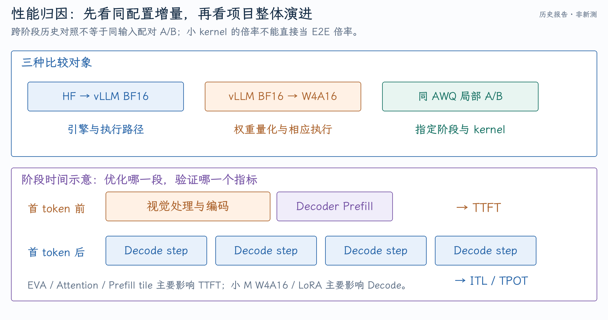

# ROCm 模型适配与优化：性能证据、归因与面试问答

这个项目可以沿三条证据链讲清：CogAgent 的结构正确进入 vLLM，量化与执行优化分别降低不同阶段成本，LoRA 专用 kernel 在真实小 Batch serving 中减少增量延迟。面试的重点是解释“为何这样设计、如何确认算对、数字比较了什么”，而不是只记加速比例。

[第一篇](01-CogAgent模型接入与量化推理.md)讲 CogAgent；[第二篇](02-LoRA算子与优先级调度.md)讲 LoRA 与调度。本篇性能表来自保存的历史报告或原始实验归档，**本次没有重新运行模型 benchmark**。源码分别以 `f9ddabc759`、`5bdd3cc58d` 为准。

## 1. 30 秒和 90 秒项目讲法

### 30 秒

> 我在 AMD RDNA 3.5 上完成 CogAgent-18B 的 vLLM 接入，重点处理双视觉输出、逐层 cross-attention、不同缓存长度和 BF16 数值语义，再接入 AWQ 与 Compile/HIP Graph，并通过 Profiler 做局部优化。另外针对小 Batch Multi-LoRA，重设 Shrink/Expand 的 Triton program 分工，减少 Decode 的无效 tile、split-K 与 metadata 成本，同时保证 adapter mapping、fallback 和 Graph replay 正确。模型接入、算子正确性、任务精度和 serving A/B 分别验证。

### 90 秒

> CogAgent 的难点不是增加一个模型名字。它的小视觉输出有 258 条 embedding，高分辨率视觉提供 6400 条 cross states，组合 encoder cache 长 6658；这些长度分别影响输入替换、视觉预算和 cross KV 分配。Decoder 的 self/cross head size 也不同，metadata 不能直接取全局配置。我还沿逐层 trace 定位 BF16 RoPE cache 的 cast 顺序，保留模型原始 position 与数值语义。
>
> 优化上，AWQ 只接入 decoder Linear，两套视觉塔等仍为 BF16；小 M Decode 复用已有 HIP skinny W4A16，Prefill 做 shape 配置，视觉侧再编译、融合 RoPE/layout 和投影。每项优化都单独看 TTFT 或 TPOT，避免把整体加速归到一个 kernel。
>
> LoRA 是另一条执行主线。通用 kernel 覆盖很广，小 M 却可能启动很多无效 program。我用直接 token 索引做 Decode，用 grouped token 矩阵计算做 Prefill，Expand 只启动实际输出 slice 的 tile。metadata 和 Graph buffer 复用需要清理旧状态，再用真实 Qwen3-VL LoRA 请求对比 Native。分支里的优先级抢占是进一步调度探索，不能和 kernel 收益混为一谈。

## 2. 测试平台与统计口径

平台是 Ryzen AI MAX+ 395、Radeon 8060S、gfx1151、128 GB UMA。UMA 意味着 CPU/GPU 共享系统内存架构，但仍有 GPU 分配、访问路径、同步与带宽竞争；不能直接等同于所有传输和缓存都没有成本。

| 证据 | 模型/输入 | 输出与并发 | 工具 |
| --- | --- | --- | --- |
| CogAgent 早期 BF16/W4A16 | 32 条独立 COCO holdout，一图一 prompt | greedy，最多 64 tokens，串行 | vLLM Serve+评估客户端 |
| CogAgent 最终周报 | 同一 640×480 图片+64 英文字母，20 次 | 5 次 warmup，最多 64 tokens，max-seqs=1 | Serve 客户端 |
| LoRA 专项 A/B | Qwen3-VL-4B AWQ，256×256 图+64 英文字母，85 prompt tokens | 固定 64 tokens，并发 1，每轮 10 次，3 轮 | `vllm bench serve` |
| Mixed/priority | 两个 adapter，请求 B 在 A 生成期间到达 | 固定 64 tokens，多轮 | 流式客户端+Scheduler 事件 |
| GPU 局部分析 | 固定 shape 或指定模型阶段 | 区分 warmup 与正式 | rocprofv3、operator trace、kernel 计时 |

TTFT 从请求提交到首 token，包含图像处理、视觉编码、排队和 decoder Prefill。`input_tokens/TTFT`只能叫首 token 折算速度，不能当作纯 GPU Prefill TPS。

$$
TPOT_i=\frac{E2E_i-TTFT_i}{N_i-1},\quad N_i>1.
$$

每请求的 Decode speed 可记为$1000/TPOT_{i,ms}$。系统 output throughput 是测量窗口总输出 tokens/wall time，含 Prefill、排队和空闲，两者不是同一个值。更完整的指标解释见 [P/D 论文与推理指标](../vllm-pd/01-论文与推理指标.md)。

## 3. CogAgent 的整体收益怎样还原

### 三个基线对应三个问题

| 阶段/报告 | TTFT P50 | TPOT P50 | Decode | E2E P50 |
| --- | ---: | ---: | ---: | ---: |
| 最初 HF BF16 Eager | 1430.39 ms | 146.08 ms/token | 6.85 tok/s | 10421.16 ms |
| 早期 vLLM BF16，32 条 holdout | 1165.09 ms | 66.49 ms/token | 15.04 tok/s | 5237.98 ms |
| 同阶段 tuned AWQ，32 条 holdout | 1164.42 ms | 27.42 ms/token | 36.47 tok/s | 2883.99 ms |
| 后续 AWQ 周报，重复 20 次固定输入 | 752.15 ms | 27.625 ms/token | 36.20 tok/s | 2491.50 ms |

HF→vLLM BF16 体现引擎与执行路径差异；同阶段 vLLM BF16→AWQ 体现权重量化及对应 kernel 路径；同模型同输入的局部优化 A/B 才适合归因具体改动。

简历的 47.4%、5.28 倍、76.1%可以从早期 HF 和后续 AWQ 周报约算出来：

$$
1-752.15/1430.39\approx47.42\%,\qquad36.20/6.85\approx5.28,
$$

$$
1-2491.50/10421.16\approx76.09\%.
$$

但两组分别为 32 条 holdout 与 20 次重复固定输入，是**跨阶段历史结果对照**。它们说明项目演进幅度，不能称为同一工作负载、同一轮严格配对 A/B。当前本地主要找到周报和汇总，部分原始 32 条 JSON 已不在原目录；[evidence 清单](evidence/manifest.json)保留来源与证据级别。

### 哪些增量对照更适合回答“你改的部分有多大收益”

| 改动 | 同配置结果 | 可以归因的阶段 |
| --- | --- | --- |
| W4A16 vs vLLM BF16 | Decode15.04→36.47 tok/s，2.42 倍；E2E -44.94% | 权重压缩与已有 skinny 执行路径 |
| AWQ Prefill tile | TTFT1239.21→1159.55 ms，-6.43%；TPOT 基本不变 | Prefill 配置消除 TTFT 回退 |
| EVA RoPE+layout | 单层约 4.14 倍；AWQ TTFT 约-1.57% | 视觉路径局部 launch/访存 |
| CrossVision attention 配置 | kernel 约 1.75 倍；AWQ TTFT 约-3.82% | 高分辨率视觉 attention |
| 投影合并 | 两轮 Serve TTFT 约-0.37%/-0.64% | CrossVision Prefill 小幅增量 |

这些历史对照来自不同阶段，不能把所有百分比简单相加或相乘，推导“最终必然提升多少”。源码的 tile 覆盖与报告中的搜索最优目录也有区别：搜索候选 1.56 倍的 kernel catalog 求和不等于落地配置的整请求加速。

{ width="100%" }

## 4. LoRA 简历数字如何核对

原报告的同轮 Native 与 RDNA 配对结果，先算各轮 P50，再取三轮 P50 中位数：

| Adapter/rank | Native Decode | RDNA Decode | 提升 | Native E2E | RDNA E2E | 降幅 |
| --- | ---: | ---: | ---: | ---: | ---: | ---: |
| Ocelot，64 | 49.61 tok/s | 61.91 tok/s | 24.79% | 1362.25 ms | 1104.09 ms | 18.95% |
| EditScore，32 | 53.57 tok/s | 64.31 tok/s | 20.05% | 1272.91 ms | 1070.83 ms | 15.87% |
| EO-Gym，16 | 55.34 tok/s | 65.62 tok/s | 18.58% | 1233.82 ms | 1050.76 ms | 14.84% |

表内数值已四舍五入，重新计算与原报告 18.57%等会有末位差异。因此简历 18.6%～24.8%、最高 19.0%与该组结果一致。

该数字是**几个 adapter 的单请求小 Batch serving 对照**，不是所有 adapter 在同一个 mixed batch 里都达到同样增益。另有 staged 五 adapter 峰值报告说明 mixed 趋势，但 phase 标签不保证五个请求在各自完整生命周期全程重叠。

Native 基线要选同轮配对结果。报告里较早的“全部 adapter 基线表”绝对值不同，不能拿早期表和后期 RDNA 表重新混算百分比。

## 5. 正确性和质量证据怎样讲

| 对照 | 保存报告中的结果 | 限制 |
| --- | --- | --- |
| HF BF16 vs vLLM BF16 | 18/32 完全一致；token 相似度 mean0.8904；Word F1/ROUGE-L 差值 CI 含 0 | 小样本、重编码后的 token 口径 |
| AWQ Prefill 调优前后 | 32 条 greedy 文本 byte-for-byte 一致 | 同 AWQ，不代表 AWQ 与 BF16 无误差 |
| 视觉投影合并前后 | 24/32 完全一致；任务指标未检出系统下降 | 舍入会改变近似并列 token |
| LoRA kernel reference | FP16/BF16、多 rank/slice/base、Graph replay 测试源码 | 本次未重跑 GPU 测试 |

“精度对齐”应讲明是中间数值、共享历史 logits、token 相似度还是任务评估。CI 包含 0 表示本次未检出差异，不等于证明两个模型在所有样本上完全等价。

## 6. 模型接入的常见追问

面试复现新增：[CogAgent 的计算流与数据流](面试问题与回答.md#q5-compute-dataflow)、[Self-KV/Cross-KV 的分组管理、分页寻址与生命周期](面试问题与回答.md#q10-kv-management)。

### Q1：这个项目最难的部分是什么？

**简答：** 把模型特有结构转成框架可调度的契约，并在优化后保留数值语义。

**展开：** 举 258/6400/6658 分别被谁消费的例子，再讲非均匀 self/cross head dim 为什么会让通用 metadata 失效。这样比“改了很多文件”更能说明架构理解。数值难点可选 BF16 RoPE cast 顺序，说明如何沿第一层找到首个差异。

### Q2：CogAgent 为什么归入 encoder-decoder？它不也是 CausalLM 吗？

**简答：** 输出仍自回归，但视觉 source 需要独立 encoder 计算与 cross-attention 缓存管理，所以在 vLLM 里采用 encoder-decoder 基础设施。

**展开：** 类名 ForCausalLM 描述输出接口，不排除 cross-attention。小视觉 embedding 进入 decoder self-attention，高分辨率输出是固定 source，二者都需要正确调度。框架分类应解释资源和执行契约，不只看模型名称。

### Q3：为什么同一图像要编码两次？

**简答：** 两套塔承担不同功能：低分辨率表示进入语言 token 流，高分辨率表示保留细粒度视觉信息供逐层 cross-attention 读取。

**展开：** 输入图片共享，但权重、分辨率、输出宽度和用途不同。Decoder 每层读取同一视觉特征来源，各自建立 cross KV，不能删掉任意一条后宣称等价。

### Q4：视觉 expert 是不是 MoE？

**简答：** 当前路由由 image token mask 决定，没有学习到的 Top-k router。

**展开：** Vision/language 使用不同投影与 MLP，是模型结构中的两套参数。MoE 通常还涉及 gate、容量、dispatch/combine 甚至 All-to-All；不能因名称 expert 就把这些机制套进来。

### Q5：为什么最后一个 image placeholder 走 language expert？

**简答：** 原模型的 mask 规则检查当前位置和下一位置是否均为 image token，EOI 边界因此归入 language。

**展开：** Placeholder 替换 mask 与 expert routing mask 用途不同。258 条视觉 embedding 全部替换，但只有前 257 条走 vision 投影；漏掉这个边界会改变数学。

### Q6：Cross KV 每轮 Decode 要重新投影吗？

**简答：** Prefill 按层建立一次，Decode 读取缓存；当前新 Query 仍每步计算。

**展开：** Cross source 与 K/V 长度固定，Query 来自变化的 decoder state；self KV 则随生成增长。相同 source 经过不同 layer 权重，得到的 KV 不能跨层通用。

### Q7：BF16 比 FP16 好在哪，为什么还会分叉？

**简答：** BF16 指数范围接近 FP32，但有效尾数较少；范围大不代表精度高。

**展开：** FP16 通常 1 符号/5 指数/10 尾数，BF16 为 1/8/7。Accumulation dtype、cast 与运算重排都影响结果；argmax 接近并列时很小误差也能改变 token，再引发后续历史分叉。

### Q8：如何证明误差来自 RoPE 而不是 attention？

**简答：** 固定共同 token 历史，比较 RoPE 前 Q/K、position 与 cache，再做单变量替换。

**展开：** 如果 RoPE 前一致、cos/sin 首先不同，替换参考 cache 后差异消失，才能建立因果。只看到最终 logits 不同无法归因。视觉特征注入可先排除上游视觉塔。

## 7. 量化与算子优化的追问

### Q9：AWQ 为什么可以提高 Decode 但 TTFT 几乎不变？

**简答：** Decode 小 M 更受权重流量影响；TTFT 还含未量化视觉塔和更大 M Prefill，反量化与 tile 效率可能抵消收益。

**展开：** 需要按阶段 trace，不假设 4-bit 带来 4 倍速度。量化释放显存后 KV 容量增加，也不是 KV dtype 改变。

### Q10：AWQ、GPTQ、FP8 分别怎么理解？

**简答：** AWQ/GPTQ 是量化方法，FP8 是数值格式；三者不处于同一分类层级。

**展开：** AWQ 用 activation-aware scaling 减小权重量化误差；GPTQ 利用二阶近似逐步量化并补偿误差；FP8 能用于权重、activation 或 KV，不同执行配置收益不同。格式、校准算法与 runtime kernel 必须分开说明。

### Q11：为什么不启动时反量化为 BF16 再推理？

**简答：** 可以降低部分大 M 计算复杂度，但会重新占用 dense 权重空间，并失去直接压缩读取的部分收益。

**展开：** 这是 memory/computation 权衡。当前 hybrid 可按配置缓存 dense 权重，但默认路径的小 M 直接读 packed INT4。不能以单个 Prefill shape 推断所有场景都应预反量化。

### Q12：小 M 为什么不一定适合 WMMA？

**简答：** 矩阵指令的 tile 可能比有效 M 大很多，数据布局、padding 和 launch 成本会压过算术吞吐优势。

**展开：** RDNA 的 wave32、寄存器/LDS 与矩阵指令布局影响 program 分工，但最终要用真实 shape 和生成代码验证。不能只看峰值 TFLOPS 选择 kernel。

### Q13：Shrink 取消 split-K 一定好吗？

**简答：** 对当前小 M Decode 有益，对大 M 或小 rank Prefill 未必。

**展开：** Split-K 提供并行度，但增加中间归约、zero-fill 和 atomic；取消后 program 少且 K 循环长，也可能占用不足。专项实现按阶段选择，而不是全局删除 split-K。

### Q14：LoRA rank 增大为什么影响推理？

**简答：** 两次增量计算与 buffer 大小随 rank 增长，program 数、寄存器和带宽成本也变化。

**展开：** FLOPs 约$2Mr(K+N)$，还要加 adapter 选择与 launch。不同 rank 的 adapter 也是不同训练产物，不能把不同 adapter 的质量/性能差异全部归因 rank。

### Q15：怎样证明 fast path 真的进入 serving？

**简答：** 验证 dispatch、Profiler 中的 kernel 名和形状，再看同配置服务 A/B。

**展开：** 设置 env 只说明意图，可能被 shape gate 挡住。Microbenchmark 快也不代表实际模型产生同 shape；需要 caller、wrapper、custom op 到 launch 的证据链。

### Q16：更少 program 为何不保证更快？

**简答：** 每个 program 可能更重，减少并行度可能增加总时间。

**展开：** 看有效工作、occupancy、register spill、LDS、memory latency 与 launch 开销。Program count 对照用于解释设计，不可直接写成几十倍加速。

### Q17：Compile 与 HIP Graph 是否重复？

**简答：** Compile 优化计算图与算子，Graph 减少重复提交开销，两者可以组合。

**展开：** Graph replay 需要固定地址、合法 shape 和更新后的 metadata；动态逻辑常放 custom op 内。Replay 不执行 Python selector，capture 与 replay 也必须分开计时。

### Q18：LoRA 为什么不直接 merge 进基座？

**简答：** 单 adapter 固定部署可以 merge，多 adapter 逐请求选择不能共享同一份已 merge 权重。

**展开：** 每 adapter 复制完整基座会丢掉 Multi-LoRA 的显存优势；动态 unmerged 执行保留共享基座，但支付低秩增量成本。量化基座 merge 也涉及重新量化与精度问题。

## 8. 调度与性能分析的追问

### Q19：优先级是不是请求发来就即时打断 GPU？

**简答：** 不是，Scheduler 在执行边界暂停未来工作，已提交 kernel 仍收尾。

**展开：** 抢占需要处理 KV、token 计数、在途输出和恢复；本分支限制同步单设备。Priority queue 排序不自动等于 running 请求主动抢占。

### Q20：保留 KV 为什么还要允许释放？

**简答：** 暂停请求仍占显存，资源不足时可能阻止高优先级请求入场。

**展开：** 先 retain 减少恢复成本，压力时释放低优先级 retained blocks 并重算。显存和调度时间分别是两类资源，暂停执行不会自动腾显存。

### Q21：怎么避免低优先级饿死？

**简答：** 当前严格优先级探索未解决完整公平性，可加入 aging、最大暂停或按优先级份额。

**展开：** 这些改变服务策略，需要说明 SLO 目标。不能声称现有源码已经具备未实现的 aging；还要保证恢复状态与资源预算一致。

### Q22：Amdahl 定律如何解释局部 kernel 很快但 E2E 只降一点？

**简答：** 加速只作用于请求的一部分。

**展开：** 若被优化部分占 10%，加速 4 倍，总速度为$1/(0.9+0.1/4)\approx1.081$，总耗时只降 7.5%。还可能出现其他 kernel 争用、launch 和 CPU 开销。局部 4.14 倍与 TTFT1.57%并不矛盾。

### Q23：量化为什么可能改变 E2E 比较的公平性？

**简答：** EOS 和 token 选择可能改变实际输出长度。

**展开：** 固定 max_tokens 不等于固定 N；自然 EOS 可能让不同方案生成不同长度。纯性能可固定输出长度或 teacher forcing，任务质量则保留自然行为并分别报告 N。不能混淆二者。

### Q24：如何确认数据没有被 warmup 和缓存污染？

**简答：** 分开初始化/JIT/capture 与正式请求，控制 prefix 缓存、输入复用和 kernel 权重 cache。

**展开：** 视觉重复输入和 32 条 holdout 不是同负载；microbench 可用 rotating 权重避免小工作集常驻 cache。Serving 要记录启动命令、revision、实际 batch 与有效请求数。

### Q25：6401 个视觉 tokens 的 attention 为什么适合分块？

**简答：** 完整 score 矩阵的存储随序列平方增长，分块和 online softmax 避免把整张矩阵写回全局内存。

**展开：** 16 heads 的 6401×6401 score 若保存 BF16，约为 $16\times6401^2\times2\approx1.22$ GiB。分块不会改变精确 attention 的数学复杂度；它维护逐行最大值、指数和与输出累积，减少中间存储和访存。CrossVision 使用 non-causal，不能直接套 causal mask。Tile 配置还影响寄存器、LDS 和并行度。

### Q26：Roofline 怎么判断 kernel 更受计算还是带宽限制？

**简答：** 用算术强度 FLOPs/bytes 对照设备算力与带宽上界，再检查实际资源使用。

**展开：** GEMM 的有效 FLOPs 约为 $2MNK$，但 bytes 取决于 tile 重用、cache 与中间结果。小 M 往往权重复用弱，大 M 可增加复用；量化减少权重 bytes，却增加解码指令。Occupancy 高也不保证快，register spill、LDS 或重复无效计算都可能让高占用的 kernel 更慢。

### Q27：多模态编译的动态 shape 难在哪里？

**简答：** 图像尺寸、patch 数、文本长度和 batch 都会改变 shape；固定 Graph capture 又要求稳定执行路径。

**展开：** CogAgent 当前使用固定两种图像分辨率并限制输入，有助于明确形状。Compile 的动态维、custom op 边界和 Graph buckets 各解决不同问题；padding tokens 要有正确 mask 与 metadata，不能因为 buffer 地址固定就把无效行当作真实请求。

## 9. 四个诊断场景

### 场景一：AWQ 的 Decode 变快，TTFT 却变慢

先看是否同输入、同输出长度、预热充分，再拆视觉编码和 decoder Prefill。检查大 M W4A16 tile、dequant 路径与 encoder backend。若 TPOT 改善但 TTFT 回退，优先检查 Prefill 而非继续调 Decode；用同 AWQ 配置 A/B 确认 tile 改动。

### 场景二：Eager 算对，HIP Graph 在 batch 缩短后错

检查固定 metadata buffer 的尾部、inactive group、base ID=-1 与 capture shape。对同 tensor 数据分别跑 eager/replay，定位首次错误而非只看文本。常见根因是旧 adapter 状态，未必是 GEMM 数学。

### 场景三：LoRA microbench 很快，服务几乎没变化

先确认 env 进入服务端且 shape gate 允许，再看 kernel 名与调用占比。基座/attention/视觉可能主导；真实模型 M/rank/slice 与 microbench 不同也会 fallback。确认最终 N 和统计口径后再用 Amdahl 解释上限。

### 场景四：高优先级 B 仍等了 1 秒

区分 CPU adapter 加载、`max_loras` admission、KV 容量、queue policy 和 running 抢占。若 B 真正执行到首 token 只有几十毫秒，大部分是排队，不能叫 Prefill 慢。严格抢占还需同步 mode 与 retain/recompute 证据。

## 10. 面试前需要能够随手还原的信息

- 一张图片的两种输入 tensor、258/6400/6658 与三种 cache。
- Self/cross head dim、token mask 与特殊 position 的含义。
- BF16 cast 顺序为什么改变 RoPE，如何找首个分叉。
- 量化范围、W4A16 的 packed weight 与小/大 M 执行区别。
- LoRA 的 M/K/N/r/S、adapter mapping、四条 kernel 与 fallback。
- 三轮 P50 中位数、单请求 Decode 和系统 throughput 的区别。
- 每个简历数字的原始比较对象，以及历史汇总证据的限制。

本目录的 [evidence/manifest.json](evidence/manifest.json)区分原始报告副本与整理后派生表。复习时优先能解释机制和配对条件，再引用数字。

可直接查阅的历史报告副本：

- [早期 HF/BF16/W4A16 周报](evidence/weekly-20260907.txt)、[后续固定输入 AWQ 周报](evidence/weekly-20260915.txt)
- [CogAgent Serving 与 BF16 质量对齐](evidence/cogagent-serving-and-parity.txt)、[视觉路径逐项优化](evidence/cross-vision-optimization.txt)
- [LoRA 配对与 Mixed Serving](evidence/lora-serving-report.txt)、[W4A16 调优与基线](evidence/w4a16-report.txt)
