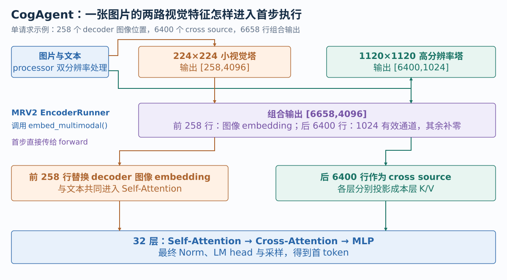
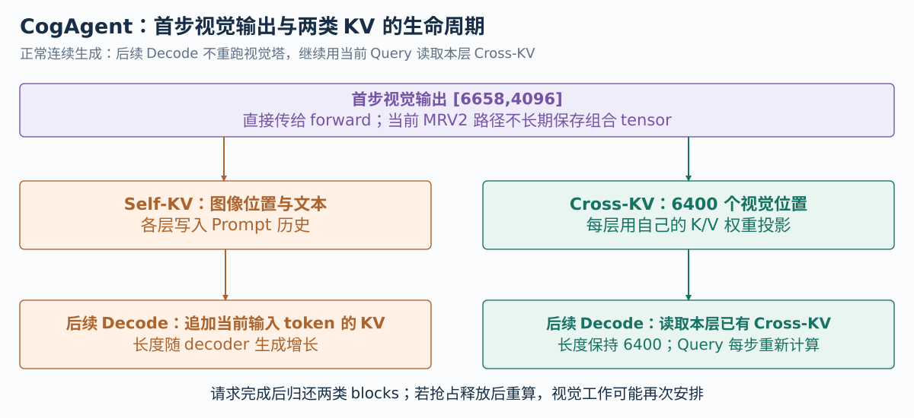

# vLLM ROCm 模型适配与优化：面试问题与回答

本文沿 **项目动机 → 框架接入 → 请求执行 → 缓存 → 数值对齐 → 量化 → 视觉优化 → LoRA → 调度 → 验证** 组织十个核心问题。每题包含 **1 分钟简答** 和 **5 分钟详细阐述**，详细版按口述顺序说明代码与设计。

CogAgent 源码固定到 `gfx11/cogagent-18b-support` 的最新提交 [`f9ddabc`](https://github.com/tangzzycc/vllm/tree/f9ddabc759c66cdb76567d22d05683ea8d30cd37)，核对日期为 **2026-10-22**。LoRA 和严格优先级调度是另一个开发分支，固定到 [`5bdd3cc`](https://github.com/tangzzycc/vllm/tree/5bdd3cc58d8985c2c2ebcb21377b3526335b5741)，使用 Qwen3-VL 验证。实现详解见[CogAgent 接入与量化](01-CogAgent模型接入与量化推理.md)和[LoRA 算子与调度](02-LoRA算子与优先级调度.md)，实验来源见[性能证据](03-性能证据与面试问答.md)。
{.interview-source}

## 一、请介绍这个项目，为什么要接入 CogAgent？ {#project-introduction}

### 1 分钟简答

我做的是 **在 AMD RDNA 3.5 平台把 CogAgent-18B 接入 vLLM，并优化模型执行和量化推理**。CogAgent 面向 GUI 理解，同一张图片经过两套视觉塔：低分辨率特征进入语言序列，高分辨率特征通过各层 Cross-Attention 提供细节。

它的结构影响 processor、encoder 预算、两类 KV 和 Attention metadata，所以接入不能只写一个 forward。我的工作先还原模型、输入和权重映射，再补齐框架的长度与缓存接口，完成 BF16 数值对齐，最后接入 decoder 的 AWQ W4A16，优化视觉 RoPE、投影和 Attention。

此外，我在 Qwen3-VL 上独立做了 Multi-LoRA 的 RDNA Shrink/Expand 优化与优先级暂停恢复。两条工作分别解决特殊模型接入和已有模型的增量执行成本。

### 5 分钟详细阐述

**先讲使用场景。** CogAgent 是一个面向 GUI 理解的视觉语言模型，输入图片和文字，输出描述、定位等文本。我的项目范围是模型推理接入与性能优化；完整 GUI Agent 的环境控制、工具调用和动作执行属于它的下游应用。目标平台是 Ryzen AI MAX+ 395、Radeon 8060S，架构 gfx1151，使用 128 GB UMA。

这个模型需要理解界面的整体布局，也需要看清小字、图标和局部细节。如果只有低分辨率图像，细节容易丢失；如果把高分辨率图像的全部 patches 都拼进语言序列，又会扩大每层 Self-Attention 和生成期间的缓存开销。CogAgent 因此保留双视觉路径：224 分辨率输出 258 个 decoder embedding，1120 分辨率输出 6400 个视觉 states，后者供每层 Cross-Attention 使用。

**我的第一阶段是接对模型和框架。** 我从参考实现确认双视觉塔、32 层 decoder 的 Self-Attention → Cross-Attention → MLP 顺序、视觉/语言两套参数路径以及特殊 position。然后补 config、registry、chat template、processor 和 checkpoint loader，复用 vLLM 的 Linear、Attention、MRV2 和采样链。

真正需要修改框架的是数据契约。低分辨率占位符长度是 258，双视觉组合输出长度是 6658，各层 cross source 长度是 6400；三者影响不同预算与缓存。把这些长度拆开之后，Scheduler 才能保留正确的资源，MRV2 才能按请求顺序把视觉输出送入模型，Attention metadata 才能描述本层的真实 heads 和 KV。

**第二阶段是对齐数值。** 同样的公式在 BF16 下，cast 顺序、RoPE 频率构造和 FMA 都可能造成差异。自回归模型一旦选出不同 token，后续历史就分叉。因此我固定输入和 token 历史，沿视觉输出、Norm、QKV、RoPE、Attention、MLP、logits 找到最早偏差，再针对模型专用 Norm 和 RoPE 保留参考语义。

**第三阶段才优化成本。** decoder Linear 接入已有 AWQ W4A16，减少权重读取；视觉 block 接编译，融合 Q/K RoPE 与布局转换，合并投影，并为 CrossVision 的实际 Attention shape 选择合适 tile。Decode 复用各层 Cross-KV，继续计算当前 Query，无需重新运行两套视觉塔。

我的性能说明按比较对象展开：HF 到 vLLM 是整条执行栈变化；vLLM BF16 到 AWQ 是精度与量化执行变化；局部融合与 tile 用相同配置 A/B 归因。不会把这些收益全部算给一个 kernel。

**另外两项工作有独立入口。** Multi-LoRA 在 Qwen3-VL 上保留 adapter 管理与 Punica 接口，优化小 batch Decode 和 Prefill 的低秩分支；严格优先级调度让高优先级请求能在调度边界获得执行机会，保留低优先级 KV 以便恢复。这些工作共同覆盖输入、模型、GPU 执行和服务调度，但各自的模型与性能数据分别引用。

## 二、你具体改了哪些框架代码，开发链是怎样推进的？

### 1 分钟简答

开发顺序是 **先还原模型语义，再接输入与缓存，完成数值验证后做优化**。初始接入补 config/registry、双图像 processor、两套视觉塔、decoder 和权重加载；框架侧新增 encoder output 和 cross source 的独立长度，经 InputProcessor、Request 传给 Scheduler，再由 MRV2 encoder-decoder state 消费。

后续提交依次加入 decoder AWQ、视觉编译、EVA Q/K RoPE 融合、投影合并和 Attention tile，最后修正非均匀 heads 下的 Triton metadata。

我复用 EngineCore、Worker、ModelRunner、采样和 KV 分配器；新增的是模型特有语义及框架无法表达的接口。最关键的是让实际数据流、资源预算和执行 metadata 对应一致。

### 5 分钟详细阐述

**先定位原有框架位置。** 请求经过输入处理成为 vLLM Request，EngineCore 中 Scheduler 决定文本 tokens、encoder 工作和 blocks，Worker/MRV2 准备 GPU 输入，调用模型，最后通过 compute_logits 和采样返回。我的改动沿这条链展开，每个字段都有生产者和消费者。

**第一步是模型和输入接入。** `CogAgentConfig` 描述两套视觉配置、decoder 和 cross 维度，registry 将模型接到 encoder-decoder 基础设施，`SupportsMultiModal` 和 `SupportsQuant` 声明接口。template/tokenizer 处理参考对话格式，processor 对一张图片生成两个 tensor，并在 decoder Prompt 中建立 258 个图像位置。

网络文件实现双视觉塔、语言/视觉投影、逐层 Cross-Attention 和特殊位置。权重加载用 WeightsMapper 和 AutoWeightsLoader 映射前缀，gate/up 等 fused Linear 按 shard 加载。并行 Linear 是复用组件，当前 CogAgent 构造校验仍要求 TP1、PP1，不能仅因为使用了这类 Linear 就说已支持多卡。

**第二步补数据契约。** `MultiModalFeatureSpec` 新增 `encoder_output_seq_len` 与 `cross_attention_seq_len`。processor 返回 6658 和 6400，InputProcessor 写入 feature，Request 暴露各自 getter。Scheduler 的 encoder budget 使用 6658，cross blocks 使用 6400。未提供新字段的其他模型保留默认回退，避免将 CogAgent 的特殊值硬编码进通用 Scheduler。

MRV2 的 `EncoderDecoderModelState` 顺序整理 scheduled encoder inputs，经 EncoderRunner 执行 `embed_multimodal()`，把结果通过 `encoder_outputs` 交给模型。Decode 不提供新的 encoder outputs，模型的 CrossAttention 直接读取历史 KV。这里不是额外创建一个服务引擎，而是在已有 model-state 接口中表达两阶段行为。

**第三步解决数值与量化。** 初始 BF16 接入有专用 RMSNorm、position 和 RoPE cache，测试覆盖 processor 契约和参考数值。AWQ 提交把 quant_config 传到 decoder Linear，补 gate/up 的量化参数加载，增加 gfx1151/BF16/group128 的 shape 配置。量化算法与底层 hybrid W4A16 组件沿用已有实现。

**第四步降低视觉执行成本。** 视觉 block 接入 torch.compile，EVA RoPE 同时处理 Q/K 并输出目标布局，合并视觉 MLP gate/up 和 QKV，并调 CrossVision Attention。每项都有硬件、dtype 或 shape 条件，未覆盖输入保持原路径。

**最后一个提交修正通用 metadata。** CogAgent decoder self head dim 为 128，cross head dim 为 32，视觉塔还用自己的维度。如果 builder 总从全局 model config 推导 shape，会给 cross group 建错 buffer。最终从当前 `kv_cache_spec` 读取 KV heads 和 head size，Query heads 从具体层获取。

可以把提交链记成六步：`2e361bb` 接入 → `1d57dc2` AWQ → `999c513` 视觉编译 → `f06bc7a` RoPE → `e17aa6a` 投影与 tile → `f9ddabc` metadata。面试展开某项时，说明原接口缺什么、在哪写入状态、谁消费它，再说明如何验证。

源码：[初始接入提交](https://github.com/tangzzycc/vllm/commit/2e361bb0024562ee5d08e2ea79211eb44359878e)、[长度字段](https://github.com/tangzzycc/vllm/blob/f9ddabc759c66cdb76567d22d05683ea8d30cd37/vllm/multimodal/inputs.py#L354-L381)、[InputProcessor 写入](https://github.com/tangzzycc/vllm/blob/f9ddabc759c66cdb76567d22d05683ea8d30cd37/vllm/v1/engine/input_processor.py#L388-L405)、[MRV2 model state](https://github.com/tangzzycc/vllm/blob/f9ddabc759c66cdb76567d22d05683ea8d30cd37/vllm/v1/worker/gpu/model_states/encoder_decoder.py#L70-L100)、[metadata 修复](https://github.com/tangzzycc/vllm/blob/f9ddabc759c66cdb76567d22d05683ea8d30cd37/vllm/v1/attention/backends/triton_attn.py#L105-L123)。
{.interview-source}

## 三、从一张图片到首 token，再到 Decode，代码怎样执行？ {#q5-compute-dataflow}

### 1 分钟简答

一张图片和文本进入 processor，生成 224、1120 两种图像 tensor，并给 decoder 加入 258 个图像占位位置。Scheduler 安排 encoder 和文本工作，MRV2 经 EncoderRunner 调用模型的 `embed_multimodal()`。

低分辨率塔输出 `[258,4096]`，高分辨率塔输出 `[6400,1024]`，组合为 `[6658,4096]` 交给首步 forward。前 258 行替换图像 embedding，后 6400 行成为各层 Cross-Attention 的 K/V 来源；decoder 顺序执行 Self-Attention、Cross-Attention 和 MLP，采样首 token。

后续 Decode 只处理新输入 token，追加 Self-KV，继续用当前 Query 读取已有 Cross-KV；两套视觉塔和 cross K/V 投影不重复执行。

### 5 分钟详细阐述

**从输入开始。** 请求包含一张图片和文本，chat template 生成参考格式，processor 将原图变换为 `pixel_values` 和 `cross_pixel_values`。两个字段仍绑定同一个 image item，不是两个独立图片请求。decoder BOS 区域被替换为 BOS 加 258 个 image token，其中这些位置接收连续视觉 embedding。

1120 路径对应 80×80 patches，共 6400；processor 同时建立长度为 6400 的 encoder prompt。里面的零是基础设施用于表达 source 长度的占位 IDs，真实图像内容仍来自 `cross_pixel_values`。

**再经过框架执行。** InputProcessor 记录多模态 feature，Scheduler 安排 encoder inputs 和 decoder tokens，MRV2 按本批请求顺序准备 encoder 工作。`EncoderDecoderModelState.get_mm_embeddings()` 经 EncoderRunner 调用模型，随后 `prepare_inputs()` 将列表作为 `encoder_outputs` 交入 forward。

{ width="1000" }

模型中 `embed_multimodal()` 先执行 CrossVision，再执行小视觉塔；两条数据分支不表示当前代码在两个 GPU streams 上同时运行。小塔的 256 个 patches 加 BOI/EOI，形成 `[258,4096]`；高塔形成 `[6400,1024]`。适配层用一个 `[6658,4096]` 容器装两路结果，高塔部分只有前 1024 个通道有效，其余补零。

**forward 再拆开消费者。** 前 258 行替换 decoder 的 image-token embeddings，和文字共同进入 Self-Attention。后 6400 行取前 1024 通道，各层投影成本层 cross K/V。它们不被拼成 6658 个 decoder 视觉 tokens。

每层依次做 RMSNorm、Self-Attention 与 residual，再做 Norm、Cross-Attention 与 residual，最后做 Norm、SwiGLU MLP 与 residual。Self-Attention 投影和 MLP 对视觉、语言 tokens 使用不同参数；注意力仍在统一 decoder 序列上计算。它不是 Top-k MoE，mask 根据原始 image IDs 的连续关系确定：258 个图像位置都替换 embedding，前 257 个走 vision 路径，最后 EOI 边界走 language 路径。

Cross-Attention Query 来自当前层 hidden，经 4096→1024 投影；K/V 来自视觉 states，注意力后再 1024→4096。32 层结束后输出 Norm、LM head 和 logits，采样首 token，结果回到 Scheduler。

**最后讲后续一步。** 首 token 在 Prompt 末尾采样出来，它自己的 Self-KV 尚未因这次采样自动写入。下一轮把它作为输入，执行新位置并采样第二个 token。此时 `encoder_outputs` 为空，model state 不重跑视觉编码，CrossAttention 的 K/V 参数为空，由 backend 读取已有 Cross-KV；Query 和 Cross-Attention 计算仍每层继续运行。

因此跨步复用的主要对象是本请求各层 Cross-KV。组合视觉 tensor 是首步传递容器，当前 MRV2 路径直接返回它用于 forward，并没有将它作为长期 encoder tensor cache 保存。

源码：[processor 占位符与字段](https://github.com/tangzzycc/vllm/blob/f9ddabc759c66cdb76567d22d05683ea8d30cd37/vllm/model_executor/models/cogagent_processing.py#L192-L264)、[双塔组合](https://github.com/tangzzycc/vllm/blob/f9ddabc759c66cdb76567d22d05683ea8d30cd37/vllm/model_executor/models/cogagent.py#L770-L794)、[顶层 forward](https://github.com/tangzzycc/vllm/blob/f9ddabc759c66cdb76567d22d05683ea8d30cd37/vllm/model_executor/models/cogagent.py#L670-L723)、[CrossAttention 执行](https://github.com/tangzzycc/vllm/blob/f9ddabc759c66cdb76567d22d05683ea8d30cd37/vllm/model_executor/models/cogagent.py#L397-L416)。
{.interview-source}

## 四、258、6658、6400 怎样影响调度，Self-KV 与 Cross-KV 怎样管理？ {#q10-kv-management}

### 1 分钟简答

**258 是 decoder 图像 embedding 数，6658 是双塔输出容器长度，6400 是 Cross-Attention source 长度。** processor 分别描述它们，InputProcessor 写入 feature，Scheduler 用 6658 管 encoder 预算，用 6400 分配 cross blocks；用同一个值会造成替换或容量错误。

首步 Self-KV 保存图像位置和文本，后续随生成增长；Cross-KV 保存每层对 6400 个视觉 states 的投影，长度固定。两类 KV 使用各自的 cache spec、block table 与写入映射。

MRV2 首步直接传递组合视觉输出，后续复用的是 Cross-KV；不应把它讲成长期缓存一份 `[6658,4096]` 就足以完成生成。

### 5 分钟详细阐述

**先明确三种长度的用途。** 小塔输出替换 decoder 占位符，长度 258 决定语言输入中的视觉位置；CrossVision 输出 6400 个 states；适配层将两者组合为 6658 行。6658 描述一次 encoder 工作的输出容量，6400 描述后续需要投影和缓存的 cross source，258 描述 decoder 序列替换范围。

`MultiModalFeatureSpec` 保留原 PlaceholderRange，另加 `encoder_output_seq_len` 和 `cross_attention_seq_len`。processor getter 生成数值，InputProcessor 建 feature，Request 的 `get_num_encoder_embeds()` 返回 encoder output 长度，`get_num_cross_attention_tokens()` 返回 cross source 长度。Scheduler 入场时用 cross 长度保留 blocks，用 encoder 长度检查计算预算与槽位。

**这样修改的目的，是让不同资源由自己的长度约束。** 比如错用 258 分配 Cross-KV，就装不下 6400 个视觉位置；错用 6658 替换 decoder 图像 embedding，又会把仅供 cross 的特征当作语言 tokens。通用 getter 在字段为空时保留默认值，其他模型不必适配 CogAgent 固定 shape。

{ width="1000" }

**再讲存储和寻址。** SelfAttentionSpec 与 CrossAttentionSpec 表达不同缓存语义，KVCacheManager 统一组织分配，各 group 有相应块表。它们可以来自底层同一个 BlockPool，但不表示两种注意力写入相同 token 槽位。Self 的逻辑位置沿 decoder Prompt 和生成推进，Cross 的逻辑位置沿视觉 source 0～6399。

MRV2 model state 为 CrossAttention groups 填 `encoder_seq_lens=6400`，普通 self group 使用 decoder seq_lens。Cross-KV 写入映射按 encoder/source 位置建立，不能沿用本步 decoder token 的 slot mapping。读取历史依靠 block table，新增 KV 写入依靠 slot mapping。

**然后讲缓存什么时候变化。** Prefill 时，小视觉 embedding 和文字产生 Self-KV；各层同时将相同视觉 source 投影成本层 Cross-KV。Decode 每层继续产生当前 Query，Self-KV 追加，Cross-KV 保持固定长度。相同 source 不代表不同层共用 KV，因为每层 K/V 权重不同。

这里还有一个源码容易读错的点：`EncoderDecoderCacheManager` 名称含 cache，但当前这类模型主要用它做调度容量记账；`get_mm_embeddings()` 直接使用 EncoderRunner 返回值，注释明确无需存入 encoder_cache。`prepare_inputs()` 传出后清空临时列表，真正长期占用的视觉条件状态是 Cross-KV。

**用容量说明影响。** 在 BF16、32 层、32 cross heads、每 head 32 维的简化计算里，cross K/V 数值量为 `32×2×6400×32×32×2` bytes，即 800 MiB。Self 每个 decoder token 是 512 KiB，所以生成越长，Self-KV 越大；Cross 是每请求固定的图像开销。实际物理分配还受 page、block 对齐与 group padding 影响。

请求正常完成后，两类 KV 都按请求归还；如果抢占释放并重算，视觉 encoder 工作可能重新安排，所以“图片只编码一次”描述正常连续执行，不能当作所有抢占恢复路径的永久承诺。

源码：[三种长度](https://github.com/tangzzycc/vllm/blob/f9ddabc759c66cdb76567d22d05683ea8d30cd37/vllm/model_executor/models/cogagent_processing.py#L152-L170)、[Request getter](https://github.com/tangzzycc/vllm/blob/f9ddabc759c66cdb76567d22d05683ea8d30cd37/vllm/v1/request.py#L313-L319)、[cross 分配长度](https://github.com/tangzzycc/vllm/blob/f9ddabc759c66cdb76567d22d05683ea8d30cd37/vllm/v1/core/sched/scheduler.py#L953-L965)、[encoder 容量记账](https://github.com/tangzzycc/vllm/blob/f9ddabc759c66cdb76567d22d05683ea8d30cd37/vllm/v1/core/encoder_cache_manager.py#L328-L390)、[Cross metadata](https://github.com/tangzzycc/vllm/blob/f9ddabc759c66cdb76567d22d05683ea8d30cd37/vllm/v1/worker/gpu/model_states/encoder_decoder.py#L158-L192)。
{.interview-source}

## 五、接入时怎样定位 BF16 数值差异，为什么 Norm、RoPE 和 metadata 都要改？

### 1 分钟简答

先固定图片、Prompt 和 token 历史，再逐层比较，找到最早出现差异的位置；自由生成后的文本分叉只能说明有问题，很难定位原因。

CogAgent 的 image positions 是 BOS=0、BOI=1、256 个 patches 共用 2、EOI=3，文本从 4 开始。RoPE 则先将 inv_freq 转为模型 dtype，再构造频率表，与最后才 cast 的通用路径有 BF16 舍入差异。RMSNorm 也保留参考的 FP32 归一化和最终 cast 顺序。

此外 self head dim 128、cross head dim 32，metadata 必须读取当前层 spec。公式、dtype 顺序、位置和缓存布局都对齐之后，再验收算子容差、同历史 logits 和图文任务质量。

### 5 分钟详细阐述

**数值排查首先要控制历史。** Greedy 每步选最大 logit，如果两个候选接近，很小差异也会使 token 不同。之后输入历史不同，最终文本差异会被放大。所以我先固定图片预处理、token IDs 和采样设置，再用相同 token 历史比较各步 logits，而不是只看最后两段文字。

排查顺序从输入、双塔特征进入 decoder，再看第一层 Norm、QKV、RoPE、Attention、MLP 和 logits。通过 hook 或注入参考中间结果，可以验证偏差在前半段还是后半段。如果把 HF 视觉结果交入 vLLM 后偏差仍在，继续检查 decoder；如果偏差消失，回到视觉塔定位。

**第一类差异是位置语义。** decoder image 前缀并非顺序位置编码。`build_positions()` 建表，forward 用 MRV2 的逻辑 positions 索引专用位置表，保证后续 Decode 也使用同一规则。图像 token IDs 同时决定 vision/language mask，所以 `requires_raw_input_tokens=True` 有实际需求；只给提前算好的 embeddings 会丢掉路由信息，这个组合被模型拒绝。

**第二类是 BF16 运算顺序。** 专用 RMSNorm 先把 hidden 转成 FP32，计算平方均值与 rsqrt，乘归一化与 weight 后转回输入 dtype。参考行为如果把不同位置先 cast 或使用另一种融合，输出可能不同。

RoPE cache 更容易被忽略。代码先在 FP32 生成 inv_freq，再转成模型 dtype，然后用该精度的 positions 和 inv_freq 构造频率表，最后计算 cos/sin。它与 FP32 做完所有计算再 cast BF16 不是同一条有限精度路径。数学公式相同，量化到有限数值集合的时机不同，角度和旋转结果就可能不同。

视觉塔 RoPE 又是另一条路径：相邻元素配对，token 0 不旋转，Triton 融合时关闭 fp fusion，保留 native 分开乘加的舍入。不能把 decoder 的频率修正与视觉 Q/K kernel 融合混成一次改动。

**第三类是执行 metadata 的结构错误。** self heads 维度 128，cross 是 32；若 global config 被用于所有 Attention groups，会建错临时 softmax buffer 或启动参数。这类错误不属于正常低精度容差，必须修改 builder，让 KV heads/head dim 来自当前 spec，Query heads 来自实际 layer。

**最后分三层验收。** 关键算子和 processor 对参考输出检查规定容差；固定 token 历史比较 logits、Top-k 与首次分叉 margin；独立图文请求看文本一致率和任务指标。历史 32 条 holdout 中 BF16 有 18 条完全一致，任务指标差值置信区间含零，支持这些样本上的对齐，但不构成全输入 bitwise 等价证明。

面试里最值得展开的是“为什么最后才 cast 不等价”，因为它说明我不仅对照 shape，还追踪低精度数据在哪一步形成；metadata 修复则说明模型语义一直追到了 backend buffer 与 launch。

源码：[RMSNorm 与 RoPE cache](https://github.com/tangzzycc/vllm/blob/f9ddabc759c66cdb76567d22d05683ea8d30cd37/vllm/model_executor/models/cogagent.py#L51-L102)、[position 表](https://github.com/tangzzycc/vllm/blob/f9ddabc759c66cdb76567d22d05683ea8d30cd37/vllm/model_executor/models/cogagent.py#L105-L124)、[视觉 RoPE 融合与舍入](https://github.com/tangzzycc/vllm/blob/f9ddabc759c66cdb76567d22d05683ea8d30cd37/vllm/model_executor/models/cogagent_vision_encoder.py#L55-L238)、[processor/参考数值测试](https://github.com/tangzzycc/vllm/blob/f9ddabc759c66cdb76567d22d05683ea8d30cd37/tests/models/multimodal/processing/test_cogagent.py)。
{.interview-source}

## 六、AWQ 接入修改了什么，为什么 Prefill 和 Decode 要用不同路径？

### 1 分钟简答

CogAgent 通过 SupportsQuant 和 quant_config 接入已有 AWQ，覆盖 decoder 的语言/视觉投影、MLP 和 Cross-Attention Linear；两套视觉塔、Norm、embedding 和 LM head 没沿这条路径量化。W4A16 表示 Linear 权重主要 4-bit、activation 为 BF16，不是 KV 或注意力计算都变成 INT4。

权重加载需要把 gate/up 的 weight、qweight、qzeros、scales 分别写入 fused Linear 两个 shard。RDNA runtime 小 M 复用 skinny 路径，大 M 用已有 fused dequant GEMM；我增加 gfx1151/BF16/group128 的 shape 和 M 区间配置，解决 AWQ Prefill 的 tile 退化，同时保留未覆盖输入的通用选择。

### 5 分钟详细阐述

**先分清量化算法与接入工作。** AWQ 通过校准 activation 选择合适缩放并量化权重；项目接入已有导出格式和 vLLM runtime，没有重新实现 AWQ 校准算法。模型声明 SupportsQuant，并把 quant_config 传到 decoder 的各类 parallel Linear，loader 再按 checkpoint 格式载入 packed weights 和量化参数。

覆盖范围包含 language/vision expert 的 QKV、输出与 MLP，也包含 cross 的 Query、K/V、输出投影。两套视觉塔独立构造，没有传入这条 quant_config；embedding、Norm 和 LM head 也不在同一路径。量化后的模型仍有较大 BF16 部分，不能按整个模型 INT4 来估算容量。

**加载阶段要保持融合语义。** vLLM 把 gate/up 合成 `gate_up_proj`，checkpoint 中却是两个模块。MLP loader 建 source-to-shard 映射，对 weight、qweight、qzeros 和 scales 都处理 shard 0/1。如果只适配 float weight，新模型 BF16 能跑，AWQ checkpoint 仍会加载错误。QKV 等融合也需要对应实际 shard 的维度和顺序。

从数学看，一组量化权重经 scale、zero point 恢复近似浮点值，再与 BF16 activation 相乘；packing 是存储形式，不表示最终用 INT4 保存 activation 或输出。group128 表示沿实际 K 维每组共享参数，kernel tile 必须正确处理 group 边界。

**小 M 与大 M 的瓶颈不同。** 这里 M 是本次 Linear 的 token 行数。Decode 通常只有少量行，权重复用弱，读 packed weights 后直接处理有机会节省流量；Prefill 行数多，矩阵化复用更重要，tile、寄存器、反量化与计算组织需要平衡。

已有 RDNA hybrid runtime 小 M 可选择 HIP skinny，较大 M 走 Triton fused dequant GEMM，配置允许时还有 dense dequant 缓存。我的改动是在已有 dispatch 里增加 gfx1151、BF16、group128 的 `(N,K)` 和 M 范围配置，而不是新写全部 W4A16 kernel。未命中配置表继续选择原 heuristic。

CogAgent 的路由让 M 很不一样：257 个视觉位置走 vision experts，文本位置走 language experts，cross K/V 是 6400 行。即使一个请求，不同 Linear 也可能分别处理小 M、几百行或几千行，所以单个统一 tile 不一定合适。

**最后用同配置数据解释收益。** 同阶段 vLLM BF16→tuned AWQ，Decode 从约 15.04 到 36.47 tok/s，TTFT 基本相同，因为视觉编码等工作仍在。另一个 AWQ Prefill tile 对照将 TTFT 从 1239.21 降到 1159.55 ms，TPOT 基本不变。前者讲量化执行收益，后者讲避免 Prefill 退化，两个实验不能混成一个百分比。

量化正确性检查还要使用独立 holdout，比较相同历史下误差与任务质量；低精度引入误差是设计取舍，不能用“跑通且更快”作为唯一验收。

源码：[量化接口与构造](https://github.com/tangzzycc/vllm/blob/f9ddabc759c66cdb76567d22d05683ea8d30cd37/vllm/model_executor/models/cogagent.py#L577-L651)、[gate/up 多种参数加载](https://github.com/tangzzycc/vllm/blob/f9ddabc759c66cdb76567d22d05683ea8d30cd37/vllm/model_executor/models/cogagent.py#L161-L171)、[RDNA shape 配置](https://github.com/tangzzycc/vllm/blob/f9ddabc759c66cdb76567d22d05683ea8d30cd37/vllm/model_executor/kernels/linear/mixed_precision/rdna_hybrid_w4a16.py#L315-L371)、[历史 W4A16 对照](evidence/w4a16-report.txt)。
{.interview-source}

## 七、视觉侧做了哪些优化，怎样判断它们真正进入执行？

### 1 分钟简答

视觉优化主要四项：给视觉 blocks 接入 torch.compile；将 Q/K 的 EVA RoPE 与目标布局写入合成一个 Triton kernel；合并部分 gate/up 和 QKV 投影；针对 gfx115x、BF16、head dim64、non-causal 的 CrossVision Attention 调整 tile。

融合前后保持 reference 的位置与舍入语义，不支持的硬件/dtype 回原路径。Compile 减少框架执行和可融合中间操作，Graph 减少重复提交成本；PREFILL 视觉与 Decode Graph 的收益分别看。

我用 operator trace 验证实际命中，microbenchmark 看局部收益，再做同配置 Serving A/B。比如视觉 Attention kernel 约 1.75×，整请求 TTFT 约降 3.82%，两者不能混用。

### 5 分钟详细阐述

**先用 profile 找阶段。** CogAgent TTFT 包含图像预处理、两套视觉塔和 decoder Prefill。AWQ 加速 decoder Decode，并不会自动加速视觉 BF16 路径。因此优化视觉侧时固定图像和模型配置，分别观察 RoPE、GEMM、Attention、中间布局转换和主机提交成本。

**第一项是编译入口。** 两类视觉 block 加 `support_torch_compile`，声明对应动态维，交给 vLLM 的 multimodal encoder 编译条件处理。这不是把整个网络写成静态 Graph；compile 可减少 Python/dispatcher 开销和融合中间操作，仍要保留动态 batch 约束。

**第二项是 EVA Q/K RoPE。** 原路径分别读取 Q/K，执行相邻维旋转，再转换到 Attention 需要的 head/token 布局。融合 kernel 以 `(batch,token)` 为行处理，加载各 head 相邻元素和 cos/sin，同时计算 Q、K，并直接写目标 storage 布局。一个 program 内处理同一 token 所需工作，减少独立提交和中间搬运。

token 0 不旋转，偶数/奇数相邻维的符号保持 reference；乘法和加法关闭融合，避免与 native 的 BF16 舍入不同。dispatch 限定 ROCm/gfx115x、GPU tensor、FP16/BF16，其他情况使用 native。decoder 的 RoPE cache 构造是另一个问题，不被这个视觉 kernel 代替。

**第三项是投影合并。** 将视觉 SwiGLU gate/up 合成 MergedColumnParallelLinear，把拆分 Q/K/V 合成 QKVParallelLinear。checkpoint loader 仍映射原名称与 shard。合并减少 GEMM 提交、共享输入读取和部分中间开销，但底层库选择和矩阵形状也变化，所以不能保证所有 shape 都按 GEMM 个数比例加速。

**第四项是 CrossVision Attention tile。** 高分辨率 tower 是约 6400 个 patches 的 non-causal Attention，head dim64。gfx115x/BF16 的专用配置采用 BLOCK_M128、BLOCK_N32 和 4 warps，其他输入沿用通用选择。这项针对视觉塔内部 Attention，不是 decoder head dim32 的 Cross-Attention。

**再讲 Graph。** CogAgent 标记支持 ROCm Graph，让原本通用 encoder-decoder 的禁用条件不会强制回退；服务配置使用 FULL_DECODE_ONLY。图片首步可走视觉编译，后续 Decode 用 Graph，它们处理不同开销。Graph 仍要求输入 buffer 地址和 metadata 正确，shape bucket 不匹配要按框架回退。

验证一项优化时，先看 trace 是否出现预期 kernel、旧操作是否减少，再用 warmup 后固定 shape 计时，最后同配置测 TTFT/TPOT 和质量。EVA RoPE 局部约 4.14×，AWQ TTFT 约降 1.57%；视觉 Attention 约 1.75×，TTFT 约降 3.82%；投影合并 Serving 小幅变化。这些结果来自不同阶段，不能直接相加推算最终收益。

源码：[EVA 融合与 guard](https://github.com/tangzzycc/vllm/blob/f9ddabc759c66cdb76567d22d05683ea8d30cd37/vllm/model_executor/models/cogagent_vision_encoder.py#L55-L238)、[视觉 block 编译](https://github.com/tangzzycc/vllm/blob/f9ddabc759c66cdb76567d22d05683ea8d30cd37/vllm/model_executor/models/cogagent_vision_encoder.py#L671-L755)、[Attention tile](https://github.com/tangzzycc/vllm/blob/f9ddabc759c66cdb76567d22d05683ea8d30cd37/vllm/v1/attention/ops/triton_prefill_attention.py#L384-L398)、[ROCm Graph 声明](https://github.com/tangzzycc/vllm/blob/f9ddabc759c66cdb76567d22d05683ea8d30cd37/vllm/model_executor/models/cogagent.py#L585-L588)、[优化与 profile 记录](evidence/cross-vision-optimization.txt)。
{.interview-source}

## 八、Multi-LoRA 优化了哪些代码，Decode 与 Prefill 为什么分开设计？ {#multi-lora}

### 1 分钟简答

这项在 Qwen3-VL 上独立验证，复用 vLLM adapter 管理和 Punica wrapper，优化 gfx1151 的 Linear 低秩分支。基座计算后先 Shrink 把 K 维压到 rank，再 Expand 到输出 N 维并累加。

小 M Decode 用 token×rank tile×slice 处理完整 K，避免 split-K 的清零和 atomic；Expand 只为真实输出 slices 建 tile，避免 fused QKV 小 slice 的空转。Prefill 按 adapter gather 多行，用矩阵 tile 复用权重。

同时补 uniform mapping、base group 和 Graph padding 清理，opt-in 与 shape/dtype guard 不满足就保留 native。Serving 对照中三个 adapter 的 Decode 提升约 18.6%～24.8%，来自算子 A/B。

### 5 分钟详细阐述

**先讲触发问题。** Multi-LoRA 共享基座，但每层 Linear 仍有额外低秩计算。小 batch Decode 中，基座算完后还要处理 Shrink、Expand、metadata 与 kernel launch，rank 较大时这部分会明显影响单 token 时间。我的工作保留同批不同 adapter 的语义，改变 GPU 并行组织。

数学上，输入 X 为 M×K，基座 W 为 N×K，adapter A 为 r×K、B 为 N×r，输出是基座结果加低秩增量。Serving 调用从 BaseLinearLayerWithLoRA 进入基座 Linear，再到 Punica `add_lora_linear()`；它创建 `[slice,M,r]` FP32 中间 buffer，Shrink 写入带 scale 的结果，Expand 累加到原输出。Scale 不在两阶段重复乘。

**Decode Shrink 的选择。** 通用 kernel 需要兼容大 M、多个 groups、rank tiles 和 split-K；M=1 时可能出现很少有效行却启动很多 programs。专用 grid 以 token×rank tile×slice 组织，每个 program 遍历完整 K 并直接 store，没有 split-K，所以不用该路径的全 buffer 清零或 atomic 合并。代价是单 program 工作和寄存器压力增加，因此只在明确范围选择。

**Expand 按真实输出 slice 组织。** Qwen3-VL 的 fused QKV 输出 widths 是 `(4096,1024,1024)`，若每个 slice 都按最大宽度建 grid，K/V 空转很多。专用路径展平有效 tile，找到 slice 内位置与 output offset，保留每个 slice 自己的 A/B。Program 数减少是组织变化，实际 speedup 仍要测。

**Prefill 改用矩阵复用。** 多行同 adapter 的 token 通过 metadata 索引 gather，执行 tl.dot；输出再按原 token 行号写回。Host 不需要先复制排序后的 X。Shrink 可保留受控 split-K，并相应清零/atomic；不能把 Decode 的“无 split-K”描述套给所有 Prefill。

**metadata 是正确性的一部分。** uniform adapter 不必每次 sort/unique/cumsum，可以用轻量填表；mixed 请求仍稳定分组。base token adapter=-1 不加增量。Graph 复用 buffer，下一批缩短或从全 LoRA 变全 base 时，尾部 mapping、active IDs、counts、starts 必须清理，避免旧 adapter 被 padding 读取。

数据精度也有边界：Shrink FP32 累加并存中间，Expand 将中间转到 B 的 FP16/BF16 后参与计算，再 FP32 累加；reference 必须包括同样 cast。支持路径以 opt-in、硬件、tensor contract、M/rank/shape 共同 guard，未覆盖输入继续 native。

**最后落到结果。** 相同平台和 workload 中，三个 adapter 的 Decode 约提升 18.6%～24.8%，E2E 最多约降 19%。这是同轮 native 与 RDNA、单请求小 batch 的配对对照；不是在 CogAgent 上启用了这些 adapters，也不是优先级调度的收益。

源码：[Punica 入口](https://github.com/tangzzycc/vllm/blob/5bdd3cc58d8985c2c2ebcb21377b3526335b5741/vllm/lora/punica_wrapper/punica_gpu.py#L296-L357)、[RDNA Shrink](https://github.com/tangzzycc/vllm/blob/5bdd3cc58d8985c2c2ebcb21377b3526335b5741/vllm/lora/ops/triton_ops/rdna_lora_shrink.py#L313-L385)、[RDNA Expand](https://github.com/tangzzycc/vllm/blob/5bdd3cc58d8985c2c2ebcb21377b3526335b5741/vllm/lora/ops/triton_ops/rdna_lora_expand.py#L278-L378)、[mapping 与 Graph metadata](https://github.com/tangzzycc/vllm/blob/5bdd3cc58d8985c2c2ebcb21377b3526335b5741/vllm/lora/ops/triton_ops/lora_kernel_metadata.py)、[Serving 配对记录](evidence/lora-serving-report.txt)。
{.interview-source}

## 九、优先级调度为什么需要暂停恢复，保留 KV 怎样接回状态机？ {#priority-scheduling}

### 1 分钟简答

只排序 waiting queue 不能处理低优先级请求已占满 running slots 的情况。严格优先级在 Scheduler 边界选出最高优先级，将较低优先级 running 请求移出，标为 PREEMPTED 并保留 KV 与 computed 位置；高优先级获得 slots，结束后低优先级可恢复。

GPU 已提交工作不会被瞬时打断，异步输出要作为 stale 处理并保持计数一致。如果保留的 KV 导致容量不足，选择低优先级 retained 请求释放 blocks，把 computed 清零，后续重算。

这里优化高优先级响应时间，代价是低优先级等待和额外状态管理。它与 LoRA 算子加速是两项独立改动，恢复延迟和抢占收益单独测试。

### 5 分钟详细阐述

**先用一个服务场景解释。** 并发 slots 很少，请求 A 优先级较低、输出很长，已经进入 running；随后请求 B 优先级更高。只对 waiting 排序，B 仍可能等 A 结束，因为 slots 被 running 占用。算子优化让 A 每步更快，但不直接解决 B 的入场条件。

`_preempt_for_strict_priority()` 在引擎正常推进时检查 running 和可入场 waiting 请求，数值较小表示更高优先级；把较低优先级 running 从活跃集合移出，调用 `_preempt_request(..., retain_kv=True)`。它保留 blocks 与 computed 位置，清理必要的 encoder 调度状态，将请求标为 PREEMPTED 并重新进入等待管理。

**暂停保留的是可恢复的上下文。** 已返回客户端的 token 历史保留，已有 KV 不需要因为让出活跃槽位立刻删除。高优先级运行期间，低优先级不继续获得新批次；恢复时将其完整状态与块表接回 runner，让后续计算从正确位置继续。

这不是硬件抢占。调度器能决定下一批有哪些请求，已经进入 GPU 的 kernel 按 stream 依赖完成。异步模式下还有已经提交、尚未返回的 token，因此 `_preempt_request()` 记录 stale 输出份额、处理 placeholders 和 in-flight 计数。默认 retain 场景中旧输出可按规则返回，但不能错误修改重置后的计数；某些需要 drop 的路径另有标记。不能简单丢掉所有旧输出后就假设 token 历史没变。

**保留 KV 也有容量成本。** slots 可让出，但保留的 blocks 仍占空闲池。如果高优先级需要更多 KV，`_release_retained_preempted_request()` 选择合适的低优先级 retained 请求，释放 blocks 并把 computed 设为零。之后通过完整历史重算上下文，这是以额外计算换当前高优先级入场空间。

因此状态机要同时处理正常恢复、KV 被释放后的重算、异步 stale 返回、结束和取消。不能只增加一个 paused 布尔值，必须明确块所有权、computed 进度与 runner 请求状态怎样变化。日志记录抢占次数、KV retain、重算与恢复延迟，便于看到实际取舍。

**验证用事件和流式结果。** 构造 A 先生成、B 后到达的请求，观察 B 到达后在哪个 Scheduler step 获得执行，A 暂停时有没有继续被安排，B 完成后 A 是否恢复并保持历史一致；再压缩 KV 预算，验证释放与重算。GPU trace 和实际客户端 token 间隔用于区分提交边界与用户响应。

严格优先级不自动解决饥饿。如果高优先级持续到达，低优先级可能长时间等待，生产使用要另加 aging、配额或截止时间机制；当前实验不要将这些尚未实现的策略说成已有能力。我的开发重点是把优先级变化接到可恢复的 KV 和异步生命周期。

源码：[严格优先级选择、释放与 preempt](https://github.com/tangzzycc/vllm/blob/5bdd3cc58d8985c2c2ebcb21377b3526335b5741/vllm/v1/core/sched/scheduler.py#L1363-L1465)、[调度实现分析](02-LoRA算子与优先级调度.md)、[请求测试与事件记录](evidence/lora-serving-report.txt)。
{.interview-source}

## 十、怎样讲性能结果和验证，哪些数字能归因自己的改动？

### 1 分钟简答

我分三类比较：HF→vLLM 说明整体执行栈变化；同阶段 vLLM BF16→AWQ 说明量化执行；同配置融合/tile A/B 说明局部改动。平台是 Radeon 8060S/gfx1151，正式测量前预热，记录模型精度、图片、长度、并发、compile 和 Graph。

同阶段 32 条 holdout，BF16→AWQ 的 Decode 约 15.04→36.47 tok/s；AWQ Prefill tile 的 TTFT 约降 6.43%；视觉 Attention 的局部约 1.75×对应 TTFT 约降 3.82%。LoRA 的 18.6%～24.8% 来自另一个 Qwen3-VL 配对实验。

正确性先测 processor 与算子，再测同历史 logits，最后看独立请求质量。局部 speedup 与整个请求收益分别报告。

### 5 分钟详细阐述

**先说明平台与协议。** CogAgent 测试平台是 Ryzen AI MAX+ 395、Radeon 8060S/gfx1151、128 GB UMA。模型是 CogAgent-18B BF16 或对应 AWQ W4A16，服务经 HTTP 流式 chat completions，max-num-seqs=1，greedy、最多 64 tokens。32 条 holdout 一图一 prompt，另一份后期周报是固定图片加 64 英文字母重复 20 次，两个 workload 不相同。

正式测试前先完成模型加载、Triton JIT、视觉编译和 Decode Graph capture，避免把冷启动混进 TTFT。LoRA 专项又是 Qwen3-VL-4B AWQ、256×256 图片、固定 64 输出、并发 1，多个重复轮次。GPU microbenchmark 还要独立记录热/冷权重和局部 shape。

**再解释指标。** TTFT 是请求到首 token，包含图像处理、视觉、排队和 decoder Prefill。TPOT 是首 token 后的平均生成间隔，Decode speed 取相应倒数。系统输出吞吐是测量窗口全部输出 tokens 除 wall time，包含 Prefill 与空闲，不等于某请求 Decode speed。input tokens/TTFT 也不是纯 GPU Prefill TPS。

**结果按对照对象讲。** 初始 HF BF16 Eager 的 Decode 约 6.85 tok/s，同阶段 vLLM BF16 约 15.04，tuned AWQ 约 36.47。HF→vLLM 包含引擎和执行组织；vLLM BF16→AWQ 约 2.42×包含精度和量化 kernel 变化，TTFT 基本相同，说明仍有视觉等未量化成本。

简历里 TTFT -47.4%、Decode5.28×、E2E -76.1% 来自最早 HF 与后期 AWQ 周报的历史对照。它们分别用 32 条 holdout 和 20 次固定输入，能够说明项目阶段变化，不能声称同轮严格配对 A/B，更不能全部归给一个融合 kernel。

更适合回答“这一项优化有多少收益”的，是同配置增量：AWQ Prefill tile TTFT -6.43%、TPOT 基本不变；EVA RoPE 局部 4.14×、TTFT 约-1.57%；CrossVision Attention 局部 1.75×、TTFT 约-3.82%；投影合并 Serving 小幅变化。这些实验分属不同阶段，不简单相加。

LoRA 采用同轮 native/RDNA 配对，三个 adapter Decode 提升 18.6%～24.8%、E2E 最多约-19%。严格优先级则看高优先级 TTFT、暂停窗口、恢复与重算事件，不能借用这组 LoRA 数字证明调度收益。

**最后讲验收方法。** processor 测 BOS、占位符、双图像 fields、固定 shape 和一图限制；数值测试覆盖 Norm、RoPE 和融合 reference；相同 token 历史检查 logits 与 margin；任务层比较独立 holdout。BF16 报告中 18/32 完全一致，Word F1/ROUGE-L 差值 CI 含零，表示该次小样本未检出系统下降，不等于所有文本相同。

trace 用于证明实际 Serving 进入目标 kernel，检查旧 kernel 消失与阶段耗时；再做 end-to-end A/B。即使局部 kernel 快很多，TTFT 其他阶段仍占时间，Amdahl 限制整体收益，这是局部 4×和整请求几个百分点同时成立的原因。

当前 CogAgent 边界为 MRV2、TP=1/PP=1、BF16 activation、一张图片；量化覆盖指定 decoder Linear，输入 embeddings 和 encoder transfer 等组合被拒绝。面试时把已实现、已测和推测收益分开，最有说服力的是 **具体场景 → 改动与执行证据 → 同条件数字 → 正确性与取舍**。

源码与数据：[processor 与数值测试](https://github.com/tangzzycc/vllm/blob/f9ddabc759c66cdb76567d22d05683ea8d30cd37/tests/models/multimodal/processing/test_cogagent.py)、[GPU EVA RoPE 测试](https://github.com/tangzzycc/vllm/blob/f9ddabc759c66cdb76567d22d05683ea8d30cd37/tests/kernels/core/test_cogagent_rope_qk.py)、[32 条 Serve 与质量记录](evidence/cogagent-serving-and-parity.txt)、[周报](evidence/weekly-20260915.txt)、[性能口径与表格](03-性能证据与面试问答.md)、[证据来源与级别](evidence/manifest.json)。
{.interview-source}

