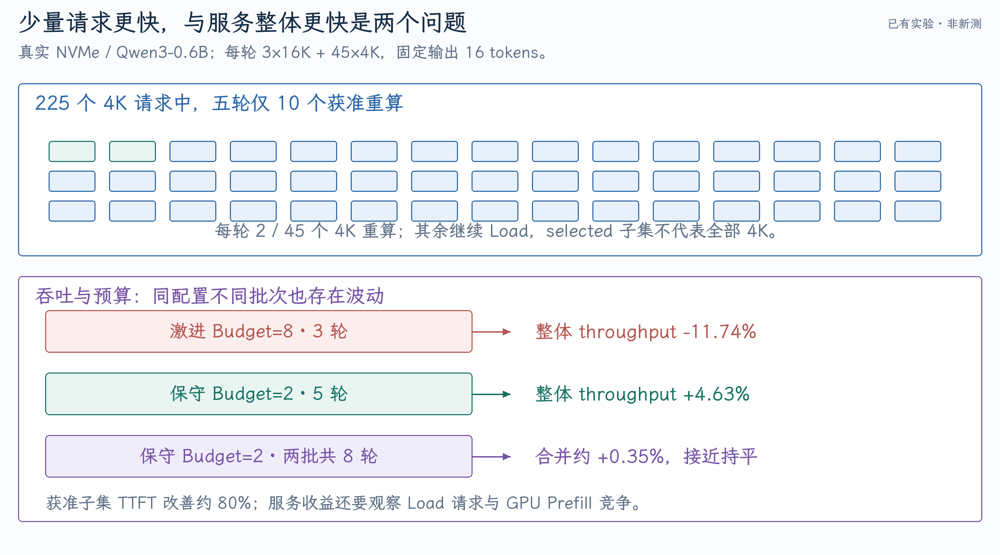

# Adaptive KV Offload：实验边界、服务优化与面试问答

当前实现最明确的收益是让少量被慢速 KV 恢复阻塞的请求提前得到首 token，同时用 admission 与安全取消控制新增 GPU 工作。服务级收益需要同时观察继续 load 的请求与整体吞吐；只报告重算子集，会隐藏资源竞争和选择偏差。

[第一篇](01-KV分层缓存与重算成本.md)讲成本，[第二篇](02-调度接入与异步生命周期.md)讲状态机。本篇核对已有归档，不重新运行 GPU benchmark。主要结果保存到本目录 [evidence](evidence/manifest.json)，便于离开原工作区后复习。

## 1. 30 秒与 90 秒讲法

### 30 秒

> External KV hit 不代表 KV 已经可用，SSD promotion 和 H2D 排队仍可能拖慢 TTFT。我在 vLLM V1 的分层 offload 路径加入 Load-vs-Recompute 选择，比较剩余恢复成本和 Prefill 成本，支持完整 load、等待、加载 ready 前缀并重算 tail、完整重算四种动作。通过 worker 队列估计、active 与滚动 token 预算，以及 queued promotion 取消和失败回滚，控制重算压力。Profiler 和 I/O bytes 验证跨请求 load/compute 重叠及恢复流量减少。

### 90 秒

> 原流程在 SSD 命中后预留 CPU slot，异步 promotion，CPU ready 后再 H2D。这条路径在长 prefix 形成深 I/O 队列时，短 prefix 重算可能更快。我把 lookup 拆成 ready 和 candidate frontier，在 GPU load 创建前选择恢复或重算。Load 成本包含 promotion ETA、H2D backlog 和带宽；当前 Prefill 成本是校准 TPS 加固定项，还没有完整实时 GPU queue 预测。
>
> 工程上，动作先通过 request/token/window admission，再退出 promotion 等待。完整 queued job 可以取消；已经运行且无人共享的 job 取消失败时，恢复 waiter 并 rollback 预算。Shared promotion 保留其他请求的工作。Sticky bypass 防止 chunked Prefill 每轮重新排同一 load，finish/preemption/reset 负责释放 active 状态。
>
> 真实 NVMe 测试确认重算请求少做了对应 SSD read/H2D，并能显著改善自身 TTFT。但预算过大时 GPU Prefill 拖慢其他请求，整体吞吐会降。保守预算把整体性能拉回接近持平，这体现了局部成本选择与服务级资源调度的区别。

## 2. 哪些测试属于当前 V2，哪些是旧版本

| 证据 | 平台/模型 | 作用 |
| --- | --- | --- |
| 当前 V2 机制压力 | gfx1151、Qwen3.5-35B-A3B GPTQ，受控慢 tier | 验证 worker ETA、budget 与路径选择 |
| 当前 V2 真实 NVMe | gfx1151、Qwen3-0.6B，48 请求 | 验证真实 I/O、取消、正确性与服务表现 |
| 独立 overlap profile | gfx1151、慢 tier、rocprofv3+I/O trace | 验证跨请求 I/O/compute 重叠，暴露旧重复 I/O |
| 四卡历史实验 | 4×RTX5090、TP4、Qwen3.6-35B-A3B-FP8 | 旧`feature/adaptive-kv-recompute`，不代表当前 V2 复测 |

代码讲解固定在`76787da49d`。真实 NVMe 报告写最终 HEAD 为该提交，但原始`metadata.json`记录`b4d6e95c...`，启动命令/日志已使用 rolling 预算等后续实现配置。因此这批属于开发期间 V2 实测，**无法仅凭归档证明是干净最终提交的严格复测**。本目录保留 metadata 和命令，未修改这处差异。

## 3. 48 请求真实 NVMe 实验如何部署

每轮：t=0 提交 3 个 16K 请求，0.5 秒后提交 45 个 4K 请求；固定生成 16 tokens、temperature=0、seed=0。每个 prefix 身份独立，避免共享 promotion 把 48 个请求合并成少量 I/O。

Baseline 开启正常 tiering offload 并继续 load；Adaptive 只改变恢复策略，不是拿“无缓存全量重算”作 baseline。两组都先 seed SSD 文件，再清 GPU/CPU prefix cache，保留 filesystem KV。

| 参数 | 值 |
| --- | --- |
| GPU | Radeon8060S，gfx1151 |
| 模型 | Qwen3-0.6B，BF16 KV |
| max-seqs / token budget | 48 / 8192 |
| max-model-len | 16464 |
| GPU memory utilization | 0.25 |
| CPU primary | 28GiB |
| FS threads | 16 read+16 write |
| 人工延迟/模拟带宽限制 | 0/0 |
| 执行 | Enforce eager；正常 prefix caching |
| Prefill calibration | 约 7920.22 tokens/s |
| Policy seed | Secondary1GB/s、H2D10GB/s |
| Safety/min savings | 1.15 / 50ms |
| 重算长度上限 | 4096tokens/request |

Filesystem 类名带`Congested`，但这轮配置的模拟延迟与限速均为零。它读取真实 NVMe 文件；仍需区分 filesystem 层与操作系统 page cache 状态，不能自动称为每次都绕过 page cache 的物理盘冷读。

两组预算：

| Budget | Active requests | Active tokens | 10 秒滚动 tokens |
| --- | ---: | ---: | ---: |
| 激进 | 8 | 32768 | 32768 |
| 保守 | 2 | 8192 | 8192 |

## 4. 服务级、4K 全体与重算子集分别怎样表现

### 五轮保守预算配对测试

Baseline 与 Adaptive 各 240 请求，结果来自原始逐请求 JSON 和 analysis：

| 指标 | Baseline | Adaptive | 变化 |
| --- | ---: | ---: | ---: |
| Request throughput | 4.510 req/s | 4.719 req/s | +4.63% |
| Output throughput | 72.168 tok/s | 75.511 tok/s | +4.63% |
| 全请求 TTFT mean | 6.822s | 6.315s | -7.43% |
| 全请求 TTFT P50 | 6.332s | 5.764s | -8.96% |
| 全请求 TTFT P99 | 9.450s | 8.908s | -5.74% |
| 4K 全体 TTFT P50 | 5.923s | 5.762s | -2.71% |
| 4K 全体 TTFT P99 | 9.112s | 7.879s | -13.54% |

225 个 4K 请求中仅 10 个实际重算。把它们按 repeat+index 对应到 baseline：TTFT mean 约 8.088→1.367s，改善 83.10%；另外 215 个仍 load。

这个 83.10%是**实际重算子集**的收益。它们本来就是策略选中的较慢 load 机会，不能冒充全部 4K 请求的平均改善。配对能避免比较不同请求，不能消除选择子集的统计偏差。

### 为什么不能只保留这五轮

此前同预算还有三轮：整体 throughput -6.09%，但被重算请求 TTFT 仍约改善 79.93%。两批共 8 轮合并，整体 request throughput 约+0.35%，TTFT mean -1.94%，E2E mean -0.66%。幅度小于批次间波动，应解释为接近持平。

激进预算的三轮则整体 throughput -11.74%、全体 TTFT P50 +49.10%。更多请求重算并没有换来更高服务收益。

{ width="100%" }

8 轮合并使用两份原 analysis 中的 round 统计；早期三轮预算 2 复用了同一 baseline，不能在统计实际发出请求数时重复计数。

表中 throughput 使用各轮 `48 / wall_seconds` 后取均值；它与“合计请求数 / 合计 wall time”的 pooled throughput 略有不同。本次按原报告口径重算，结果与 +0.35% 一致，详见 [重新核算结果](evidence/rechecked-summary.json)。

## 5. Cancellation 有哪些直接证据

4K KV 为 469,762,048bytes。三批实际重算次数分别 24、6、10，减少的 SSD read 与 H2D 为：

| 数据组 | 重算次数 | 减少 bytes |
| --- | ---: | ---: |
| 激进 3 轮 | 24 | 11,274,289,152 |
| 保守 3 轮 | 6 | 2,818,572,288 |
| 保守 5 轮 | 10 | 4,697,620,480 |
| 合计 | 40 | 18,790,481,920，约 18.79GB |

减少量等于 prefix bytes×重算次数，说明这些获准请求没有继续完成对应的重复 SSD 读取和 H2D。五轮 baseline 总 Prometheus 包含 calibration/seed，报告对正式读量扣除了 prelude；不能直接拿两份 server 启动以来的 counter 相减而忽略预热。

912 个实际正式请求全部成功，528 组 baseline/adaptive output token IDs 比较一致。数量来自 288 个激进正式请求、144 个额外保守 adaptive 请求、480 个五轮配对请求；不是三组都单独产生新 baseline。

该正确性结论属于固定模型、固定 token 数量和这批环境，不能替代更大任务质量评估或长时间生命周期压力测试。

## 6. Overlap profile 证明了什么

归档的 rocprofv3 kernel/memcpy trace 与 filesystem monotonic trace 显示：某个 SSD load 窗口与重算阶段交集长 4.406 秒，其中 GPU kernel busy union 约 3.082 秒，占约 69.95%。这支持跨请求 I/O 与 GPU compute 能够同时推进。

该 profile 来自受控慢 tier 及取消修复前的开发阶段，还观察到退出等待后旧 promotion 继续运行。它既是 overlap 证据，也是发现 wasted I/O 的依据，不能被包装成最终版本所有取消路径都已验证。

当前真实 NVMe 实验进一步用 bytes 验证 queued 取消。两类证据互相补充，但不是同一轮、同一负载。Kernel duration 相加不是 GPU busy union，instrumented 运行的耗时也不宜直接用于主性能 A/B。

## 7. 四卡历史数字与简历口径

四卡保存的两个报告分别是：

| 场景 | 输出 | 4K TTFT P50/P99 | 整体输出 throughput |
| --- | ---: | --- | --- |
| 旧版本单轮、4 并发 fallback | 8tokens | -43.5% / -7.2% | -23.3% |
| 生命周期修复后、active 上限 2 | 128tokens | -46.78% / -22.28% | -6.17% |

两组均为 4 个 16K bulk 后跟 4 个 4K latency、TP4 Qwen3.6-35B-A3B-FP8。第二组报告有完成状态和长度检查，但跨并发运行 token 序列未全部 bitwise 一致，不能改写成逐 token 一致。

当前查到的归档**没有与简历 54.7%/36.4%一一对应的原始数据**。四卡旧结果不能与当前单卡 V2 的+0.35%拼接成一组实验。若面试引用数字，应优先用本目录可追溯的数据，讲明平台、版本、子集和吞吐代价。

这不影响项目的核心实现价值：恢复成本建模、异步状态、预算与取消，都有具体源码和行为证据。

## 8. 核心设计的追问

### Q1：为什么缓存 hit 比 miss 还慢？

**简答：** External hit 仍要排队和搬运，miss 的短 Prefill 可能更快。

**展开：** 区分 GPU ready、CPU ready 和 SSD pending。比较的是最终 GPU 可用的完成时间，不是文件存在性；命中率不能替代 TTFT。

### Q2：为什么主要改善 TTFT，不保证 ITL？

**简答：** 选择发生在恢复前缀到开始执行的阶段；新增 Prefill 还可能影响正在 Decode 的请求。

**展开：** 缩短 I/O 等待主要改善首 token。Decode 仍读 KV 和权重，资源争用可能增加 ITL。必须分别报告 TTFT、ITL/TPOT 和整体 throughput，不能互相推导。

### Q3：为什么不是所有 hit 都重算？

**简答：** 长 prefix 重算很贵、CPU ready/H2D 通常快，GPU 也可能已拥塞。

**展开：** Cost、safety 与 admission 共同约束。重算是为少量 I/O 阻塞请求提供替代路线，不是放弃缓存系统。

### Q4：为什么不是同请求 load/recompute race？

**简答：** 当前做路径选择，成功退出自身等待后才重算，不启动两条竞赛路径。

**展开：** Race 会增加重复 IO/GPU 工作、winner 取消、KV 写入与一致性问题。当前跨请求并行让一批 load、少量 recompute，更贴合现有 connector 生命周期。共享 promotion 仍服务别人是另一种情况。

### Q5：LOAD_READY 为什么可能更便宜？

**简答：** 已 ready 的部分很快恢复，避免重算；只为慢 tail 付 Prefill 成本。

**展开：** Ready frontier 必须是可用的有效 prefix/group 边界。不能把任意散落缓存块拼起来宣称可跳过计算。重新计算的 tokens 与 candidate 总 tokens 不同，预算要按 tail 收取。

### Q6：为什么不直接按 request length 阈值切换？

**简答：** 同样 4K 在 CPU ready、空 SSD 队列和深 SSD 队列的完成成本不同。

**展开：** 长度只是重算和 bytes 的输入；队列、worker、带宽、已消耗时间与 GPU 预算才决定机会。固定阈值可作 fallback heuristic，但不是当前完整选择逻辑。

### Q7：Prefill TPS 能完整表示重算时间吗？

**简答：** 不能，当前是校准近似。

**展开：** 实际依赖长度、attention 复杂度、batch、cache 命中、TP 通信和 GPU queue。分桶或在线观测可以改进，但要避免将含排队 TTFT 直接当作纯算力校准。

### Q8：Safety factor 和滚动 budget 分别解决什么？

**简答：** 前者抵抗成本估计噪声，后者限制连续新增 GPU 工作。

**展开：** 大量单请求都超过收益阈值仍可造成总服务退化。Active 控制瞬时量，rolling 控制一定时间的累计量，两者不可替代。

### Q9：为什么取消失败要 rollback 而不只 release？

**简答：** 本次根本没重算，不应消耗窗口累计额度。

**展开：** Reserve 发生在 detach 前；失败要归还 active 和本次 history entry。正常重算完成只 release active，窗口额度按时间过期。

### Q10：Shared promotion 能取消吗？

**简答：** 有其他 waiter 就继续运行，当前请求只 detach；最后 waiter 退出才考虑终止 job。

**展开：** 一个 batched job 可含多个 keys，任意 key 仍被需要就不能整批取消。已经部分开始且无人需要的 job 若无法完整取消，当前切换失败并恢复等待关系。

## 9. 大模型推理与缓存知识追问

### Q11：PagedAttention 省掉了什么？

**简答：** 用固定 blocks 和逻辑映射减少连续分配造成的浪费，支持按需分配与共享。

**展开：** 它不压缩 K/V 数值，也不自动减少必须读取的历史。Block table 定位历史 KV，slot mapping 定位新写入。Internal fragmentation、block metadata 和共享引用仍有开销。

### Q12：Full attention、GQA、MLA、hybrid 的 KV 怎么算？

**简答：** 普通 attention 用 KV heads，MLA/hybrid 必须按具体缓存结构。

**展开：** GQA 减少 KV heads；MLA 可存压缩 latent 与相关位置部分，不适合直接套全 Q/K/V 宽度；Mamba 有状态、滑窗有有限恢复 window，多 group 应逐一计算。最终以 cache spec 和 worker bytes 为准。

### Q13：模型权重 FP8 为什么 KV 还可能 BF16？

**简答：** 权重、activation、KV 各有独立 dtype 与执行契约。

**展开：** KV 量化要处理 scale、精度和 backend 支持。不能看模型名称 FP8 就把 KV 每元素字节从 2 改 1。容量与 I/O 结论必须查实际 KV 配置。

### Q14：TP4 会让恢复带宽变成 4 倍吗？

**简答：** KV 可能按 worker 分片，但共享 storage/PCIe/CPU 带宽未必随卡数线性增长。

**展开：** 恢复完成受最慢 worker、总线、NUMA、文件分布和通信影响。Worker bytes 与总 bytes 分开；同一卡多 job 与多个 rank 并行恢复也不是同一种队列。

### Q15：Pinned memory 为什么影响 H2D？

**简答：** DMA 需要稳定页，pinned buffer 可支持更直接的异步传输。

**展开：** Pageable 内存可能额外 staging；NUMA 位置、PCIe、UMA、copy engine 与同步同样重要。声明 async 不代表传输和 compute 必然有效重叠。

### Q16：CPU/SSD prefix cache 和 KV eviction swap 是一回事吗？

**简答：** 都涉及 KV 搬运，但触发、所有权与目标不同。

**展开：** External prefix 复用面向未来请求命中；eviction swap 保存正在运行请求状态以腾显存；普通 preemption recompute 可能释放 KV 并重放历史。本项目在 prefix 恢复选择处切换，不代表覆盖所有 swap 策略。

### Q17：为什么最后一个 prompt token 可能仍要重算？

**简答：** 只有 KV 不一定保存了该位置的 logits，采样首 token 通常还需要一次模型执行。

**展开：** 缓存可用边界和实际 skip 数受 block 对齐、logprob 需求与 backend 规则影响。不要从文件存了完整 prefix 就断言 Prefill 完全为零；实际 cached_tokens 以实现和响应为准。

### Q18：Little 定律能怎样分析队列？

**简答：** 稳态下平均在系统请求数$L=\lambda W$，可以关联并发、吞吐和平均时间。

**展开：** 它不是 P99 公式，也不能无条件用于短波次非稳态实验。更大并发可能只扩大 W，吞吐已饱和；I/O service rate 与到达率接近时排队尤其敏感。

### Q19：为什么 P99 需要足够样本？

**简答：** 小样本的尾分位数几乎由最大几个值决定，波动大。

**展开：** 四个 4K 请求的 P99 不能代表稳定服务 tail。报告 N、轮数、计算方式；不要先平均各轮 P99 再称合并 P99。相关请求也会使简单 IID 置信区间偏乐观。

### Q20：Goodput 和 throughput 有什么区别？

**简答：** Goodput 只计满足约定 SLO 的有效工作，throughput 计全部完成工作。

**展开：** SLO 应明确定义 TTFT/ITL、请求类别与输出长度。同样吞吐下让短请求更快可能提高 goodput，但当前没有统一 SLO 计数报告，不能直接宣称 goodput 提升某倍。

### Q21：为什么选择子集有 80%收益、全体只有几%？

**简答：** 子集很小且有选择偏差，其他请求仍受资源竞争。

**展开：** 5 轮 225 个 4K 里仅 10 个重算。收益不能简单乘比例推全体，因为 queue 和 batch 有相互作用。需分别列 selected、全 4K、长请求、全体和 wall throughput。

### Q22：为什么 decision counter 不等于重算请求数？

**简答：** Scheduler 会重复评估同一 pending 请求，还可能被 budget 拒绝。

**展开：** 结合最终 cached-token 路径、read/H2D 减少和独立 request IDs 判断。Counter 适合解释控制器行为，不直接当完成量。

### Q23：为什么 read_time_sum 不能除 bytes 当作整盘吞吐？

**简答：** 多 worker 时 duration sum 包含同时发生的 job 时间。

**展开：** 整盘吞吐要用统一 wall 窗口的完成 bytes；模型估计器的 sum bytes/sum durations 是另一种服务速率口径。GPU busy 也要取 interval union，避免重复计时。

### Q24：复用相同 SSD 目录就一定公平吗？

**简答：** 不一定，还要控制 CPU/GPU cache、page cache、预热和设备负载。

**展开：** A/B 固定顺序可能让 B 更热，文件 layout 和并发后台 IO 也影响结果。交错多轮、保存命令与 metadata，并把真实盘和受控慢 tier 结果分开。

## 10. 四个排障场景

### 场景一：策略大量选择 recompute，TTFT 整体变差

先确认 selected counter 与实际请求数，再看 active/window 预算、GPU Prefill 压力、Decode ITL 和 continued-load 类别。Cost model 可能忽略 GPU queue；缩小 budget 能验证是否是新 GPU 拥塞。不能只继续提高 secondary 带宽估计以“调出好数字”。

### 场景二：重算请求更快，但 SSD read 完全没下降

检查是否只 detach waiter、job 仍 queued/running 或被共享。核对取消前是否已有 tasks 开始，是否有其他 waiter，以及 metrics 含不含 seed/warmup。旧 profile 确实暴露过这种重复 I/O；bytes 应结合 key/job 身份解释。

### 场景三：4 个 worker 仍被估成 72 秒 load

检查 bandwidth 是 per-worker 还是 aggregate、queued_job_bytes 分布、空 slot 和 load_parallelism。总 bytes/worker_count 也不够表达两个长 job 占两 slot、另两 slot 空闲；再检查 storage 总带宽是否已经饱和，避免从线程数反向夸大容量。

### 场景四：请求取消后预算一直满或 CPU cache 一直 pending

追 reservation 是否只 release 一次、rolling 额度是否应自然过期、detach 失败是否 rollback；再追 unsubmitted flush 是否省略无人等待的 key、running 完成是否正确 complete_write。HTTP 结束不等于所有 I/O 结束，提前删 context 也可能造成 late completion 找不到 job。

## 11. 如果面试官要求继续优化

可以提出三步，但明确是后续方向：

1. Prefill 成本按长度、batch 和 GPU 负载分桶，分离 queue 与 compute。
2. Budget 依据 storage backlog、GPU 占用和 Decode 延迟动态调整，保留最小样本、保持时间与回退规则。
3. 用多波次稳态负载和明确 SLO 评估，区分全体/子类/selected，并加入快速 CPU 命中、快速 SSD、多 worker 和生命周期压力负向控制。

不能只追求更多 recompute。服务优化需要控制对其他请求的边际成本，并保持现有 waiter、cancel、job 与 KV 所有权不变量。

复习时可以用“外部命中仍等待→剩余成本→四种动作→预算→异步取消→Profiler/bytes→局部与整体收益”讲项目。能够解释激进预算反例，通常比背一个最大的 TTFT 降幅更能体现推理系统判断力。

关键证据可以直接打开：

- [激进三轮分析](evidence/aggressive3/analysis.json)、[保守三轮分析](evidence/conservative3/analysis.json)、[保守五轮分析](evidence/conservative5/analysis.json)
- [原始五轮 metadata](evidence/conservative5/metadata.json)、[Adaptive 启动命令](evidence/conservative5/adaptive_server_command.json)、[启动日志节选](evidence/conservative5/startup-excerpt.txt)
- [Overlap 区间分析](evidence/overlap/overlap_analysis.json)、[Filesystem I/O trace](evidence/overlap/io_events.jsonl)
- [四卡旧版 8-token 报告](evidence/historical-tp4-8tokens/analysis.txt)、[四卡旧版 128-token 报告](evidence/historical-tp4-128tokens/analysis.txt)

以上路径保留原数据和时间戳。完整来源、SHA256 与版本限制见 [manifest](evidence/manifest.json)。
