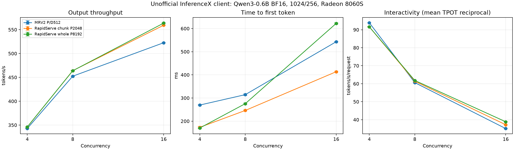
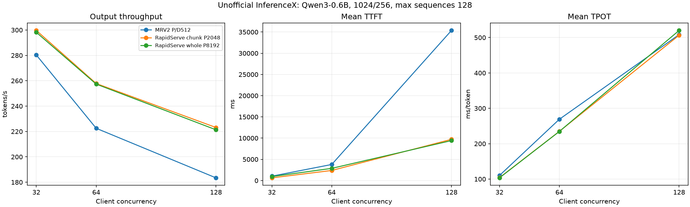
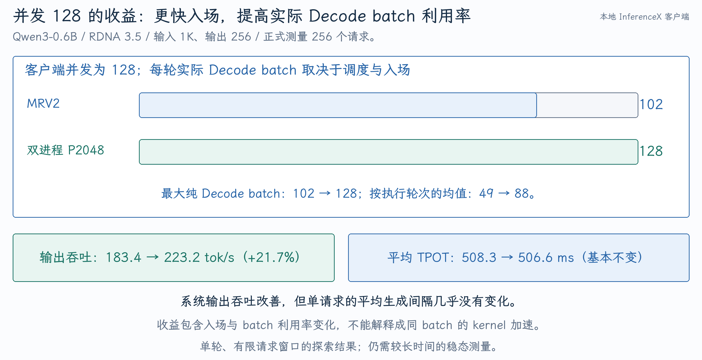
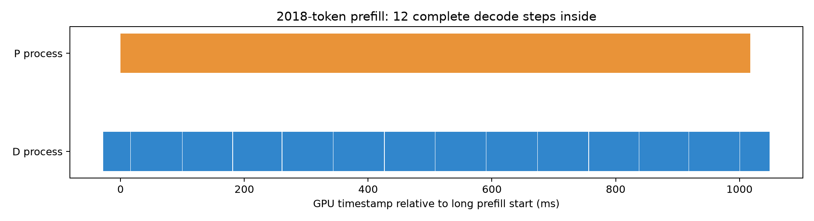
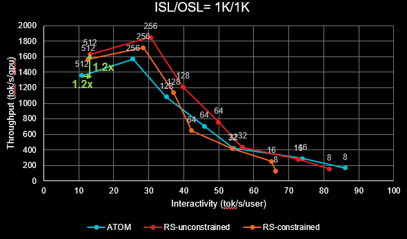
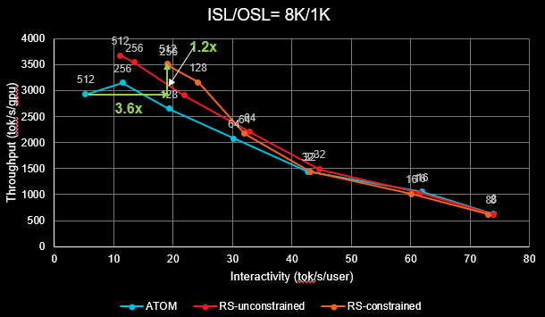
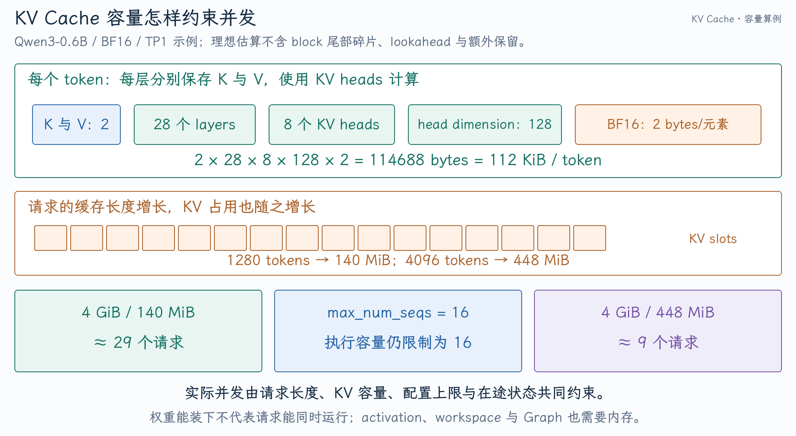

# vLLM P/D 项目的性能证据与面试问答

这个项目可以从“解决什么阻塞、怎样保证共享 KV 安全、收益在什么条件下成立”三个层次讲。当前最直接的本地证据是：在 Radeon 8060S 上，Qwen3-0.6B 的部分 HTTP 负载改善了吞吐和尾部生成间隔；Qwen3-8B 与 MoE 的测试则揭示了 P budget、batch 组成和资源争用带来的取舍。

本文整理截至 **2026-10-11** 的既有实验，没有重新运行模型。当前实现详解见 [V1/MRV2 实现](02-V1-MRV2实现与设计取舍.md)，指标与论文推导见 [论文与推理指标](01-论文与推理指标.md)。

| 复习主题 | 入口 |
| --- | --- |
| 数字与配置能否对上 | [性能来源与实验配置](#performance-sources) |
| 项目如何讲、实现追问如何答 | [开场表述](#interview-intro)、[项目追问](#project-questions) |
| 从项目追到推理基础原理 | [推理知识问答](#inference-knowledge) |
| 遇到延迟、吞吐问题如何排查 | [性能分析题](#diagnosis) |

## 1. 先把每个数字放回对应实验 {#performance-sources}

| 数据来源 | 硬件 / 模型 | 主要结果 | 面试时如何引用 |
| --- | --- | --- | --- |
| 本地 InferenceX 客户端，小并发扫描 | 单张 RDNA 3.5 / Qwen3-0.6B BF16 | C16 分块 P2048：输出吞吐 +7.0%，P95 流间隔 -44.6% | 自己当前分支的 HTTP 客户端测量 |
| 本地 InferenceX 客户端，大并发扫描 | 同设备 / Qwen3-0.6B BF16 | C128 分块 P2048：输出吞吐 +21.7% | 有限请求、单轮实验，含入场与实际 batch 利用率变化 |
| 本地离线混合负载 | 同设备 / Qwen3-8B BF16 | P512 吞吐 -14.5%，已有请求 P95 ITL -44.4% | 展示延迟与整轮吞吐的取舍 |
| 本地 MoE 扫描及整段 P 测试 | 同设备 / Qwen3-30B-A3B BF16 | P128–2048 差异明显；后续整段 P12288 约 +10.2% | 指定负载下的配置探索，基线尚未充分调优 |
| RAPID-Serve 原论文 | 8×MI300X / Llama-3.1-70B、Mixtral | 相对传统 4P/4D，吞吐平均 1.5 倍，双约束 goodput 平均 4.7 倍 | 论文的比较结果 |
| ATOM PR #860 公开测试 | 8×MI355X / DeepSeek-R1 | 1K/1K +20%，8K/1K +25%；长上下文相近吞吐处 interactivity 3.6 倍 | 同一思路的公开实现结果 |

这些数据没有同一套 A/B 配置。特别是 **1.5 倍 / 4.7 倍属于 MI300X/Llama 的论文对照，20%–25% / 3.6 倍属于 MI355X/DeepSeek-R1 的公开曲线** 。DeepSeek-R1 与 DeepSeek-V3 也不是可随意替换的同一个测试模型：即使架构有关联，权重、训练与生成行为仍不同。

如果简历文字把上述数值与另一模型或部署组合在一起，复习时应以这张映射表还原证据，在面试中使用可追溯的表述。小并发 44.6% 与大并发 21.7% 来自不同配置点，不应说成同一个 A/B 点同时达成两个改善。

## 2. InferenceX 在本地具体怎样使用

InferenceX 提供推理性能测试与对比工具。本次使用 [SemiAnalysisAI/InferenceX](https://github.com/SemiAnalysisAI/InferenceX) 的固定客户端版本 [`c801c9f2dbbd4d2aa8b32efbb83fbaa2a70a16f0`](https://github.com/SemiAnalysisAI/InferenceX/commit/c801c9f2dbbd4d2aa8b32efbb83fbaa2a70a16f0)，通过 HTTP 流式 completions 测本地 vLLM。没有修改官方客户端；测试记录分类为 **Unofficial local InferenceX client benchmark** ，不是官方榜单提交或官方硬件平台测量。

### 2.1 保持什么相同，改变什么

公共配置是 Qwen3-0.6B BF16、TP1、seed=0、随机固定输入 1024 / 输出 256、greedy、ignore EOS；关闭 prefix caching 和 AITER，启用 MRV2、async scheduling、TRITON_ATTN。D 使用 `FULL_DECODE_ONLY` Graph，关闭 Inductor。

| 模式 | P 执行 | P budget | CU 策略 |
| --- | --- | ---:| --- |
| 普通 MRV2 | 常规混合调度与分块 P | 公共 budget 512 | 全 CU |
| 双进程分块 P | 独立 eager P，可分块 | 2048 | 两侧全 CU，auto 关闭 |
| 双进程整段 P | 独立 eager P，不分块 | 8192 | 两侧全 CU，auto 关闭 |

因此性能改善支持“双进程调度加独立 P 预算”这条路径，**不证明自动 CU 策略贡献了这些收益** 。P2048 与 P8192 也同时改变预算和执行模式，不能只凭二者差异推断“整段一定优于分块”。

每点重新启动服务并预热，GPU 测试串行执行，正式计时不包含模型加载。小并发为 C4/8/16，每点 128 请求、2 轮；大并发为 C32/64/128，每点 256 请求、1 轮。

小并发统一 `max_num_seqs=16`、KV=4 GiB、Graph sizes 到 16；大并发统一 `max_num_seqs=128`、KV=32 GiB、Graph sizes 到 128。两套实验不是同一配置曲线，不能拼起来说明“并发从 16 到 32 吞吐骤降”的因果关系。

### 2.2 保留的证据与复现入口

笔记目录保存了原始汇总与逐点启动配置：

- 小并发：[summary](evidence/qwen06-small-summary.json)、[环境与模型哈希](evidence/qwen06-small-metadata.json)、[逐点命令](evidence/qwen06-small-runs.json)。
- 大并发：[summary 与 batch 分布](evidence/qwen06-large-summary.json)、[环境](evidence/qwen06-large-metadata.json)、[逐点命令](evidence/qwen06-large-runs.json)。
- 所有选取文件的范围见 [evidence manifest](evidence/manifest.json)。它们是既有实验的副本，不包含完整 server/client logs、逐请求输出及原始 profiler kernel CSV。

原始实验仍位于本机 `/home/tang/projects/vllm/build/rapidserve_mrv2_20261010/`，属于被 Git 忽略的构建目录，不随代码分支发布。下面的复现命令依赖该目录中的脚本与环境，不是仅 clone 分支即可执行的通用 benchmark 入口：

```bash
cd /home/tang/projects/vllm
source build/rapidserve_mrv2_20261010/scripts/env.sh
.venv/bin/python build/rapidserve_mrv2_20261010/inferencex_qwen06/run.py \
  --concurrencies 32 64 128 --max-seqs 128 --kv-gib 32 --prompts 256 \
  --rounds 1 --start-round 3 --observe-batches \
  --output-dir build/rapidserve_mrv2_20261010/inferencex_qwen06/large_batch
```

客户端的关键负载参数为：

```text
infx.bench_serving.benchmark_serving
--backend vllm --endpoint /v1/completions
--dataset-name random --random-input-len 1024 --random-output-len 256
--random-range-ratio 1.0 --seed 0 --ignore-eos
--request-rate inf --max-concurrency 128 --num-prompts 256
--num-warmups 256 --percentile-metrics ttft,tpot,itl,e2el
--metric-percentiles 50,90,95,99 --save-result --save-detailed
```

这是并发受限的 closed-loop 压测。想评价生产 SLO capacity，还需固定到达率、较长稳态区间、真实长度分布与明确 SLO，当前结果不替代那类测量。

## 3. 小并发：尾部间隔改善，收益随负载变化

下表为两轮的算术均值；TTFT、TPOT 单位 ms，P95 先逐轮计算再平均，吞吐只统计输出 tokens。

| 并发 | 模式 | 输出 tok/s | 相对普通 | 平均 TTFT | 平均 TPOT | P95 流间隔 |
| ---:| --- | ---:| ---:| ---:| ---:| ---:|
| 4 | 普通 MRV2 | 342.9 | — | 269.5 | 10.65 | 10.39 |
| 4 | 分块 P2048 | 345.9 | +0.9% | 173.4 | 10.92 | 11.35 |
| 4 | 整段 P8192 | 346.1 | +0.9% | 170.3 | 10.92 | 11.41 |
| 8 | 普通 MRV2 | 452.4 | — | 314.4 | 16.50 | 26.28 |
| 8 | 分块 P2048 | 464.0 | +2.6% | 246.1 | 16.29 | 32.09 |
| 8 | 整段 P8192 | 463.8 | +2.5% | 275.5 | 16.18 | 31.21 |
| 16 | 普通 MRV2 | 522.6 | — | 543.0 | 28.51 | 92.59 |
| 16 | 分块 P2048 | 559.3 | +7.0% | 413.6 | 26.89 | 51.32 |
| 16 | 整段 P8192 | 563.7 | +7.9% | 622.2 | 25.74 | 50.10 |



最适合讲清楚的点是 C16 分块 P2048：吞吐从 522.6 到 559.3，约 +7.0%；TTFT 从 543.0 到 413.6，约 -23.8%；P95 流间隔从 92.59 到 51.32，约 -44.6%。

而 C4 的 TPOT 略变差，C8 的 P95 流间隔也变差；C16 整段模式虽有更高输出吞吐，但平均 TTFT 比普通约高 14.6%。这说明系统优化需要同时看入场与生成过程，不能把单一峰值说成全配置收益。

18 个点合计 2304 条正式请求，客户端无错误、KV 抢占增量为 0、正式计时区间未发现 Triton JIT 警告。预热阶段确有 JIT 警告；“没有正式区间 JIT”不等于完全没有初始化开销。

固定输入的生成文本并非全部一致，summary 保存了配对文本相等数。性能有效性检查不是严格模型质量评测。

## 4. 大并发：21.7% 收益包含入场与 batch 利用率

| 并发 | 模式 | 输出 tok/s | 相对普通 | 平均 TTFT ms | 平均 TPOT ms | P95 流间隔 ms |
| ---:| --- | ---:| ---:| ---:| ---:| ---:|
| 32 | 普通 MRV2 | 280.3 | — | 1033.1 | 110.12 | 164.79 |
| 32 | 分块 P2048 | 299.7 | +6.9% | 635.6 | 104.05 | 129.42 |
| 32 | 整段 P8192 | 298.2 | +6.4% | 940.1 | 103.44 | 128.80 |
| 64 | 普通 MRV2 | 222.5 | — | 3788.6 | 269.04 | 368.98 |
| 64 | 分块 P2048 | 257.8 | +15.9% | 2375.9 | 234.87 | 283.65 |
| 64 | 整段 P8192 | 257.4 | +15.7% | 2874.0 | 234.57 | 286.42 |
| 128 | 普通 MRV2 | 183.4 | — | 35370.2 | 508.33 | 669.40 |
| 128 | 分块 P2048 | 223.2 | +21.7% | 9713.3 | 506.59 | 634.19 |
| 128 | 整段 P8192 | 221.3 | +20.7% | 9420.7 | 520.12 | 643.69 |



相对收益扩大，但该套配置中绝对吞吐随并发升高反而下降。当前没有大 batch profiling 证明具体 kernel、带宽或缓存根因，也没有充分调优普通 MRV2 的公共 budget；不能把这条曲线解释成已经找到最佳容量点。

Worker 执行观测帮助区分“客户端并发”和“实际 batch”：

| C128 模式 | 最大纯 D batch | 达到 128 的 D 轮数 | 平均纯 D batch |
| --- | ---:| ---:| ---:|
| 普通 MRV2 | 102 | 0 | 49.0 |
| 分块 P2048 | 128 | 126 | 88.0 |
| 整段 P8192 | 128 | 256 | 97.2 |

{ width="100%" }

观测在测试进程封装 `Worker.execute_model`，过滤正式时间段，统计每请求只调度一个 token 的轮次，排除 P worker。均值按执行轮数计算，不按时间加权；日志边界约有一秒误差。

C128 分块模式平均 TPOT 几乎未变，却更快让请求进入 D、维持更大 batch，因而提高整个窗口的输出吞吐。**21.7% 不能说成“同 batch 的 Decode kernel 加速 21.7%”** 。

本组只有一轮、256 条请求，C128 约为两波满并发，包含显著爬升与收尾。C32 的早期日志观测方式在部分模式中不对称，C64/128 使用统一 observer；正式 9 点都完成 2304 请求，无客户端错误、KV 抢占和正式区间 JIT 警告。当前结论适合作为探索性性能证据。

## 5. Profiler 能怎样支持“P/D 重叠”

仅看 CPU 上两个进程都在工作，不能证明 GPU 已并行执行。本地采用 ROCm Profiler / ROCTX，在 P/D 角色执行范围打标，再通过 HIP correlation 对应到 GPU kernel 记录。

已有 Qwen 4B trace 中，一次 2018-token Prefill 的 GPU step span 为：

\[
(25632507353000-25631490177078)\ \mathrm{ns}\approx1017.18\ \mathrm{ms}
\]

这个区间内包含 **12 个完整 Decode step spans** ，另有 14 个 D step spans 与它相交。见 [重叠分析 JSON](evidence/profiler-overlap.json) 与下图。



面试可以说：“我把 P/D 的 CPU 提交标记关联到 GPU 执行范围，在长 Prefill 的执行时间窗内观察到多步 Decode 持续推进，验证了两侧执行不再整段串行。”

这里的 span 是该 step 首个 kernel 开始到最后一个 kernel 结束，中间可能有空隙；它不是逐个 kernel 活跃区间并集，也不能由 12/14 直接计算实际硬件重叠比例。若要严格证明 kernel 同时驻留、量化重叠时长或验证 CU 分区，应进一步分析 kernel interval、硬件计数器及队列 mask。当前 trace 是全 CU 路径，也不是每个 HTTP 性能点都做过 profiler。

## 6. 8B 与 MoE：如何讲负结果和配置探索

### 6.1 Qwen3-8B P512 没有重现吞吐收益

这组实验来自较早提交 `09dbc83d269274549b69c83416d30d2be40780e8`，BF16、B32、KV8 GiB、D/P 公共预算 512、full CU、D Graph；每轮 16 个初始短请求加 4 波各 4 个 1024/4096-token 请求，每请求输出 128 tokens。每模式两次启动、合计三轮正式测试。

| 指标 | 普通 MRV2 | 双进程 P512 |
| --- | ---:| ---:|
| 输出 tok/s | 60.62 | 51.81（-14.5%） |
| 新请求平均 TTFT | 23.46 s | 32.10 s |
| 初始请求 P95 ITL | 853.90 ms | 474.84 ms（-44.4%） |
| 最大 D batch | 32 | 26 |

已有请求的生成间隔改善，但 P 更慢、新请求更晚入场，整轮吞吐下降。带宽或缓存争用是可调查的解释，尚未通过该组 profiler 确认。

该组使用离线 `engine.step()`，新增请求 TTFT 从计划到达计算，含同步调用导致的实际提交偏差；不是 HTTP 固定到达率实验。正式性能请求 96/96 的输出 token IDs 配对一致，但后续 GSM8K 前 32 题出现长度截断和一题提取差异，不能将性能请求一致外推到完整质量等价。数据见 [8B summary](evidence/qwen8b-summary.json)。

### 6.2 Qwen3-30B-A3B 的 P budget 扫描

MoE 使用官方 BF16、单设备、Triton MoE、B16、KV8 GiB、公共 budget 512。每轮 8 个短请求开始生成后，再提交 8 个长请求（1024/4096 tokens 交替），固定输出 64 tokens；双进程每组两轮，普通前后对照四轮均值。见 [MoE sweep summary](evidence/moe-sweep-summary.json)。

| 模式 | P budget | 输出 tok/s | 相对普通 |
| --- | ---:| ---:| ---:|
| 普通 MRV2 | — | 31.20 | — |
| full CU | 128 | 15.63 | -49.9% |
| full CU | 256 | 20.32 | -34.9% |
| full CU | 512 | 24.82 | -20.5% |
| full CU | 1024 | 28.62 | -8.3% |
| full CU | 2048 | 31.10 | -0.3% |
| 固定 P25/D75 | 2048 | 12.61 | -59.6% |
| 固定 P50/D50 | 2048 | 19.87 | -36.3% |
| 自动试探 P25/D75 | 2048 | 30.83 | -1.2% |

这组 20 轮、320 请求都完成且无 KV 抢占；P2048 仅接近普通，没有证明吞吐优于普通。P512→P2048 的双进程内改善约 +25.3%，包含预算调整收益，不能作为架构相对普通的收益。

固定分区让 P 太慢，D 的实际 batch 也更小；其更短 ITL 需要结合 TTFT 与吞吐解释。自动策略把触发阈值降为 D≥8，否则默认 64 在 B16 下不会触发。每轮 full→25%→full，触发 D latency fallback，说明回退路径生效，但没有增加吞吐。

### 6.3 后续更大预算与整段 P

后续保持普通公共 budget 512，对 P2048/6144/12288 与整段模式进一步比较，采用各双进程两轮、普通前后四轮平均。见 [MoE whole summary](evidence/moe-whole-summary.json)。

| 模式 | 输出 tok/s | 相对普通 | 新请求 TTFT s | 初始 P95 ITL ms |
| --- | ---:| ---:| ---:| ---:|
| 普通 MRV2 | 31.10 | — | 13.28 | 889.2 |
| 分块 P2048 | 31.90 | +2.6% | 12.83 | 474.5 |
| 分块 P6144 | 32.32 | +3.9% | 14.16 | 226.7 |
| 整段 P6144 | 31.97 | +2.8% | 14.06 | 227.7 |
| 分块 P12288 | 33.73 | +8.4% | 15.30 | 201.5 |
| 整段 P12288 | 34.28 | +10.2% | 15.82 | 202.2 |

同 budget 的整段相对分块约为 -1.1% / +1.6%，没有稳定方向；大 P budget 虽提高整轮输出吞吐，也使部分新请求首 token 更晚。整段 P12288 最大 D batch 为 8，普通为 16，尾部 ITL 差异不能当作同 batch 加速。

P audit 确认整段模式没有部分请求片段；分块模式即使 P budget 足够大仍出现 3072-token 片段。GSM8K 前 16 题普通与整段都为 15/16，是小样本冒烟，不是完整模型评测。两套 MoE 报告的 instrumentation 与采样组成有差异，应在各自 A/B 中解释，不横跨报告拼接 ITL 改善。

## 7. 公开八卡曲线与论文四四分离怎么解释

[ATOM PR #860](https://github.com/ROCm/ATOM/pull/860) 正文报告 DeepSeek-R1、8×MI355X、InferenceX，展示普通 ATOM、RS-unconstrained、RS-constrained 三条曲线：

- 1K 输入 / 1K 输出：unconstrained 高吞吐区约 +20% 吞吐、+20% interactivity。
- 8K 输入 / 1K 输出：constrained 正文写 +25% 吞吐；相近吞吐处单用户生成速度为 3.6 倍。





曲线横轴是 tok/s/user，纵轴是 tok/s/GPU；横向 3.6 倍不是 TTFT 或 P95 ITL，也不是每个点都有 3.6 倍收益。8K 图箭头近似标 1.2 倍、正文写 +25%，应保留它们的差别。

这个公开 A/B 比较的是 **普通 ATOM 与同设备组 P/D 模式** ，不是 P 为 TP4、D 为 TP4 的传统异设备分离。PR 未给完整部署命令、P budget、精度/后端、重复次数及逐请求原始结果，不能从“八卡”或曲线标签自行补齐 A/B 细节。

传统 4P/4D 对比来自论文：8×MI300X，P 与 D 各用 TP4，同节点交接 KV；RAPID-Serve 在共享设备组执行。论文平均吞吐 1.5 倍、双约束 goodput 4.7 倍反映此对照，不是上面的 MI355X/DeepSeek 测试结果。

截至本次检索，ATOM PR 已于 2026-07-23 合并；在 vLLM 上游 issue/PR 及当时 main 的源码检索中，未找到论文名称/编号对应的明确实现。作者另有公开 `rapid-serve` 仓库，但检索其当时 main 未找到完整 RAPID-Serve feature，不能把它直接称为论文 artifact。此结论受检索日期与索引范围限制。

## 8. 面试开场：怎样两分钟讲完 {#interview-intro}

> 我在 vLLM V1/MRV2 上做了 P/D 解耦与调度优化，针对长 Prefill 到来时阻塞已有生成请求的问题。传统混合批处理用 chunk 控制阻塞，但两类请求仍同步推进；异设备分离可以独立调度，却要传 KV，并且两侧容量可能不均。
>
> 我的实现让 P/D 使用独立进程和批次，在同一设备共享权重与 KV，由 D 统一分配缓存。工程上重点处理 P 租约、GPU 完成确认和 D 在途引用，保证取消、抢占和迟到消息不会导致缓存提前复用；同时保留 D 的 Graph 与异步提交，独立配置 P budget，支持分块和整段 P。
>
> 资源侧用 ROCm CU Mask 做全 CU 共享和互补分区，在线观察 D 步时间决定试探或回退；通过预热 stream/Graph 和 event 依赖切换，避免自动策略把两侧全局排空。我用 profiler 关联 CPU 标记与 GPU 执行范围，观察到长 P 期间多步 D 持续推进。
>
> 性能上用固定版本 InferenceX HTTP 客户端做本地对照。Qwen3-0.6B 在一组 C16 负载中吞吐约 +7%、P95 流间隔约 -44.6%；大并发探索最高约 +21.7%，其中包含更快入场和 batch 利用率改善。8B 与 MoE 的结果也说明收益依赖预算和资源争用，当前实现还限定单设备与部分模型路径。

如果只给 30 秒，可保留“同设备独立 P/D、共享 KV、生命周期安全、D Graph/异步、经过 profiler 与客户端测试”五个关键词，收益选一组完整 A/B 条件说明。

## 9. 高频追问与回答 {#project-questions}

### 9.1 你主要做的工程贡献是什么？

**简要回答** ：我把共享设备的 P/D 并行接入当前 MRV2，请求和缓存状态仍由 V1 管理；关键贡献是共享存储、安全交接、独立 P 容量，以及能保持 D 提交的资源切换。

**展开** ：共享 tensor 只是第一步，还要保持 alias/layout、处理 private buffer 与 MoE runtime state。请求正常结束之外，需要 P lease、D in-flight、cancel ack 和 work identity 保证回收安全。性能链路则要避免同步 Pipe 写堵住 D，保留 MRV2 async output 与 Graph，自动策略使用预热资源和 event 顺序。

### 9.2 已有 Chunked Prefill，为什么还要做这个？

**简要回答** ：Chunk 控制每轮 P 的长度，D 仍跟着混合批次推进。我把两侧提交拆开，让已有 D 可以在新 P 尚未结束时继续执行。

**展开** ：小 chunk 保护生成间隔，却增加 P 的分块开销；独立 P 允许使用更适合其计算效率的预算。但共享资源仍有争用，所以独立执行不保证所有负载更快，预算和资源策略需要实测。

### 9.3 同机八卡为什么不能直接做传统 P/D？

**简要回答** ：可以做，例如 TP4 的 P 加 TP4 的 D。我的方案区别在于两侧映射同一设备的 KV，交接只传控制信息，减少跨组传输和按角色划分的容量不均。

**展开** ：传统分离适合独立扩容和更强隔离；共享设备方案服务于另一类资源效率目标。当前分支只实现 TP1，扩展 TP 还要建立同 rank 的共享映射、保持两侧 collective 顺序、协调所有 rank 的完成与故障，不能只增加启动进程数。

### 9.4 两个进程读写同一份 KV，会不会冲突？

**简要回答** ：同一请求的 P 和 D 有明确交接点，D 等 P 完成；不同请求通过唯一的 KV 分配器获得各自 blocks。并行不意味着无依赖读写。

**展开** ：P 不分配块，只使用 D 授予的 block IDs。完成通知必须晚于 GPU 与输出 copy 完成；取消时仍保留 lease，D 在途时仍保留引用。物理写入结束且逻辑身份匹配后，才允许交接或回收。源码例子见 [请求交接](02-V1-MRV2实现与设计取舍.md#request-handoff)。

### 9.5 为什么 GPU IPC 可以免 KV 传输？会不会有隐藏复制？

**简要回答** ：两侧导入同一物理 storage，传的是 handle 和视图元数据，不是在 P 结束时复制整份 KV。模型 buffers、activation 与进程状态仍可能有私有副本。

**展开** ：Manifest 按 storage 去重，保留 dtype、shape、stride、offset，验证 GPU UUID。P 负责持有导出存储；D meta model 挂接共享参数。IPC 是 CUDA/HIP 都有的能力，ROCm CU Mask 是另一层机制。

### 9.6 为什么用双进程而不是两个线程和两个 stream？

**简要回答** ：独立进程能减少 Python 调度和输入准备受 GIL、主机执行路径影响的耦合；stream 负责设备队列，两者解决的问题不同。

**展开** ：双进程带来 IPC 与生命周期复杂度，但能分别推进 P/D host 工作。两个 stream 只是提供并发可能性，仍受队列、Graph、资源和依赖制约；是否真正重叠要用 GPU trace 验证。

GIL 的影响主要在 Python 字节码执行，PyTorch 的底层运算与部分 I/O 会释放 GIL。不能把理由说成“线程完全不能并发”，更准确的是该实现把两侧 Python 调度与 runner 状态独立推进，并用 profiler 验证设备执行效果。

### 9.7 CU 分区是不是越固定越稳？

**简要回答** ：固定分区减少计算争用，但一侧空闲时另一侧可能用不到剩余资源。我在低负载用全 CU，高负载试探分区，D 变慢就回退。

**展开** ：CU Mask 不隔离带宽和缓存，也不能抢占已提交 kernel。MoE 固定 25%/50% 在本地负载中使 P 太慢、吞吐下降，证明比例不能直接照搬公开八卡结果。控制器只试一个候选比例，并非全局最优搜索。

### 9.8 自动调度如何避免抖动，是否保障 ITL？

**简要回答** ：它按负载桶积累 full-CU 基线，用 EWMA、进入持续时间、hold 和失败记录控制切换；反馈是 D GPU 步时间，只能作为 ITL 的内部代理。

**展开** ：当前默认至少 4 个 baseline / trial 样本，允许 10% 相对步时间恶化，另可设置绝对目标。过渡 epoch 样本被过滤。HTTP queue、CPU、网络和文本流都不在这个控制量里，所以不能承诺端到端 P95 SLO；验证还需要客户端测量。

### 9.9 切换 CU Mask 不会把 Graph 打坏吗？

**简要回答** ：我在启动时预热不同策略的 stream 与 Graph，运行时选择对应 manager；旧 stream 记 event，新 stream wait event，保证本角色顺序。

**展开** ：自动切换不捕获新 Graph，也不做全局排空。P/D 分别生效，过渡期不是原子的资源切分。当前还要求 HIP Graph queue 的相关配置，防止内部队列绕过 launch stream mask；手动修改策略则使用排空后的同步路径。

### 9.10 取消和抢占分别怎么处理？

**简要回答** ：取消先停止继续交付，等最后一个 P/D GPU 引用完成再回收；抢占重算则把缺失的完整上下文重新交给 P，包括生成历史。

**展开** ：GPU 已提交的写入不能靠删除请求对象停止。retired 保护缓存和 admission capacity，P cancel ack 与 D in-flight 共同决定释放时间。work session/sequence 防止旧完成误匹配新的同名请求。模型重算不能只检查原始 Prompt 长度。

### 9.11 吞吐提升来自并行还是来自增大 P budget？

**简要回答** ：当前 A/B 同时包含调度解耦与独立 P budget，不能把全部收益归给一个因素。Profiler 支持执行重叠，性能测试支持整条路径的结果。

**展开** ：更严格的消融需要调优普通 MRV2 budget，比较多个 P budgets、同预算分块/整段、full/固定/auto CU，同时观测入场、真实 D batch 和队列；用不同负载分辨提交空隙、P 效率与计算争用。已有 MoE 同预算对照未发现整段稳定优势，C128 也显示收益包含 batch 利用率。

### 9.12 P95 ITL 降了，为什么吞吐反而会降？

**简要回答** ：已有请求生成更平稳，不代表新请求入场更快。如果 P 变慢，后续请求更晚开始生成，整个窗口吞吐仍可能下降。

**展开** ：8B P512 是直接例子：P95 ITL -44.4%，输出吞吐 -14.5%，新 TTFT 增加。D batch 也从 32 变为 26，更少请求共享 D 资源会降低间隔，却不能单独证明系统能力提高。传统 P/D 的隔离同样可改善 ITL，但会改变每侧容量与交接成本。

### 9.13 怎么证明不是测试脚本或预热造成的假收益？

**简要回答** ：我固定客户端版本、模型和环境，串行重启预热，核对请求数、token 数、错误、抢占、正式区间 JIT，并观测实际 D batch。

**展开** ：小并发有两轮，8B/MoE 有前后基线；大并发只有单轮与短窗口，仍有局限。完整稳态复测、不同到达分布和基线调优尚未完成。日志与 batch 观测可以帮助解释结果，但也需保持 instrumentation 一致，不能因检查通过就认定因果已完全隔离。

### 9.14 MoE 为什么需要单独适配和测量？

**简要回答** ：MoE 有专家权重运行布局与私有 kernel state，不能重复 repack 已共享的权重；路由和专家计算也会改变 P/D 的资源需求。

**展开** ：当前只支持 Qwen3 MoE Triton，D 在 weights-already-processed 上下文中建立本地状态；没有覆盖 EP/EPLB 或所有量化。30B-A3B 的全部专家权重仍需驻留，3B 激活参数不是总显存需求。P budget 扫描和质量冒烟分别验证性能配置与功能可行性。

### 9.15 当前实现能说“生产可用、全面等价”吗？

**简要回答** ：我会说当前指定路径已经完成实现和验证，但尚未覆盖多卡、完整功能组合、长时间压力与完整模型质量评测。

**展开** ：已有 Scheduler/Executor/Worker 测试覆盖租约、取消、迟到完成、Graph 策略和 MoE 导入；性能请求与小样本 GSM8K 不能证明所有输出等价。工程扩展优先级应是长时间故障/取消压力、真实到达率与 SLO、普通基线调优、完整质量评测，再考虑 TP 和更多模型组合。

## 10. 从项目延伸的大模型推理知识 {#inference-knowledge}

面试通常会从某个实现选择追到基础原理：共享 KV 追问为什么缓存 K/V，独立 P budget 追问 batching 和矩阵形状，CU Mask 追问计算/带宽瓶颈，MoE 接入追问 TP/EP 和专家路由。下面每题先给可口述的答案，再解释它与本项目的联系。

### 10.1 为什么缓存 K/V，不缓存所有历史 Q？

**简要回答** ：新 token 的 Query 要读取历史 token 的 Key/Value；在 causal attention 中，历史 token 的 K/V 不受未来输入影响，可以复用。历史 Q 对生成当前 token 已没有直接用途。

对第 t 个位置，一层 attention 可写成：

\[
o_t=\operatorname{softmax}\left(\frac{q_tK_{0:t}^{\mathsf T}}{\sqrt{d_h}}\right)V_{0:t}
\]

K/V 来自各层中历史位置的隐藏状态。模型处于推理模式、参数固定、位置与上下文处理一致时，causal mask 保证新增 token 不改变旧位置的输出，因此旧 KV 可以复用。当前 q_t 计算完本次输出后无需为未来 Query 继续保留。

不使用 KV Cache 时，每步可能重新计算整个前缀的线性投影和多层 forward。使用缓存后，每步只为新增输入计算 Q/K/V 与后续层，但仍要在 dense attention 中读历史 K/V；所以 KV Cache 减少重算，并未使长上下文 Decode 成为常数成本。

本项目 P 写入的是每层 Prompt 的 KV，D 读取同一份缓存并追加后续位置。KV 不等于 Prompt embedding，也不是只缓存最后一层的 hidden state。更完整的计算说明见 [Attention 机理](../../../vllm/基础篇/Attention的计算机理与vLLM实现.md)。

### 10.2 Prefill 与 Decode 的 attention 复杂度分别是多少？

**简要回答** ：长度 S 的完整 dense Prefill attention 计算大体随 S² 增长；普通单 token Decode 对已有长度 S 的 KV 做 attention，大体随 S 增长。同时还要考虑线性层和内存流量。

单层、固定 head 数和 head dimension d 时，Prefill 的 QK 与加权 V 计算为 \(O(S^2d)\)；Decode 的 Query 长度为 1，为 \(O(Sd)\)。这只描述 attention，线性投影与 MLP 还有与模型维度相关的计算。

若当前 chunk 长度为 c，已有上下文为 s，则该 chunk Query 读取 s 个历史位置及 chunk 内 causal 前缀，attention 工作量约为 \(O(csd+c^2d)\)。Chunking 限制单次工作量，没有删除该请求最终需要的历史 attention。

因此长 Prompt 不一定只是“更大 GEMM”，长上下文 D 也不一定只有权重读取瓶颈。本项目在不同输入长度下需要重新测资源分区，不能用固定 batch size 就唯一确定 D 成本。

### 10.3 PagedAttention 的“分页”究竟优化什么？

**简要回答** ：它把请求的连续逻辑 token 范围映射到不必连续的物理 KV blocks，支持按需增长、回收和共享，减少为每个请求预留最大长度的浪费。

例如两个长度 40 的请求，block size=16，可分别映射到 `[7,12,19]` 和 `[3,21,8]`。每个请求只需 3 个 block 条目，不要求 GPU 上为整个序列找到一段连续区域；层内实际 K/V pages 按后端布局存放。

每请求最后一个 block 仍可能有内部碎片：40 tokens 占 48-token 容量，浪费 8 个槽位。小 block 减少尾部浪费，却增加 block table 元数据与寻址管理成本；大 block 反过来。分页避免的是请求级连续空间和提前最大预留，不是零碎片，也不是自动压缩 KV 数值。

`block_table` 用于找到历史页，`slot_mapping` 用于确定新增 KV 写入的位置。Attention kernel 在使用它们时仍读取 K/V 实际数值。本项目复用同一个逻辑分配器与共享 tensor pool，使两侧可以使用同一份 block IDs，而无需在交接时改写为另一组设备的目标页。

### 10.4 KV Cache 有多大，怎样估算最大并发？

{ width="100%" }

**简要回答** ：标准 attention 的每 token KV 为两份 K/V 乘层数、KV heads、head dimension 和元素字节数；再乘活跃请求的实际缓存长度，并加上 block 对齐与运行时余量。

[第一篇的 Qwen3-0.6B 算例](01-论文与推理指标.md) 得到每 token 112 KiB。一个平均缓存 1280 tokens 的请求约占 140 MiB，若 KV 池为 4 GiB，在忽略尾部碎片及额外保留的理想条件下可容纳 \(\lfloor4096/140\rfloor=29\) 个这样的请求。

但小并发实验设置 `max_num_seqs=16`，因此即使理论 KV 容量够 29 个，配置仍限制最多 16 个相关活跃请求。若每请求缓存增长到 4096 tokens，仅 KV 就约 448 MiB，4 GiB 理想容量降到约 9 个。真实长度分布、lookahead、retired、prefix references 和不同 KV groups 都会改变入场能力。

**权重能装下，不代表所有请求能同时运行** 。容量预算应拆为权重、KV、activation、workspace、Graph 和运行时开销；增加 `gpu_memory_utilization` 不是增加硬件容量，未给临时工作区留余量还可能 OOM。

本地 RDNA 3.5 使用统一内存设备，带宽与容量特征不同于 MI300X/MI355X 的 HBM，不能根据“显存足够大”外推服务器 GPU 的吞吐。

### 10.5 MHA、GQA、MQA 和 MLA 有什么区别？

**简要回答** ：MHA 每个 Query head 对应自己的 K/V head；GQA 让一组 Query heads 共享 K/V，MQA 是只保留一组 K/V 的极端情况；MLA 则通过低秩 latent 等结构压缩缓存，计算布局不同。

| 结构 | Query heads 与 KV heads | 对 KV 的典型影响 | 需要注意 |
| --- | --- | --- | --- |
| MHA | \(H_Q=H_{KV}\) | 每个 head 独立保存 KV | 标准公式直接按 KV heads 算 |
| GQA | \(H_Q>H_{KV}>1\) | 同样 Q heads 下减少 KV heads | 多个 Q 共享数据，但各自计算 attention 输出 |
| MQA | \(H_{KV}=1\) | 进一步减少 KV | 小 KV head 数可能影响并行分片方式 |
| MLA | 保存 latent 与位置相关部分等 | 减少每 token 缓存维度 | 不应按普通 MHA/GQA 的完整 K/V heads 直接估算 |

Qwen3-0.6B 配置是 16 Query heads、8 KV heads，每两个 Query heads 对应一个 KV head；若错误地用 Query heads 估算 KV，容量会翻倍。对 DeepSeek 的 MLA，需以实际 backend 缓存 spec 计算，不能因为总参数更大就假定 KV 更大。

共享 KV 的原则可以用于不同布局，但本项目导出的 shape/stride、KV config 和 attention backend 必须一致。新架构能否适配需要单独验证。更详细说明见 [Decode Attention](../../../vllm/进阶篇/Decode%20Attention：Paged%20KV、GQA与Split-KV.md) 与 [MLA](../../../vllm/进阶篇/MLA：低秩压缩、矩阵吸收与解耦RoPE.md)。

### 10.6 FlashAttention 和 PagedAttention 是一个优化吗？

**简要回答** ：FlashAttention 主要减少 attention 中间矩阵在显存中的读写；PagedAttention 主要解决 KV 的非连续分配与访问。两者可以结合，P/D 解耦则改变调度和执行组织。

朴素 Prefill 会显式产生 \(S\times S\) 的 scores/probabilities，矩阵大且多次进出显存。FlashAttention 按 tile 计算，在片上维护 online softmax 的最大值、归一化和与输出累积，避免把完整中间矩阵写回；标准 dense attention 的主要 FLOPs 阶数仍为 S²。

Paged KV backend 让 kernel 根据 block tables 找到非连续历史页，它未自动减少 dense attention 必须访问的历史位置。Split-KV 又可把单 Query 的长 KV 范围拆给多个任务，再合并输出，以缓解小 batch 任务不足；任务更多也会引入归并成本，收益取决于长度与并行度。

面试可将三层分开：**KV 分配布局、attention kernel、请求调度** 。本项目主要改第三层及共享存储生命周期，继续使用现有 attention backend，没有把这些 kernel 算法改成另一套公式。可参考 [FlashAttention](../../../vllm/进阶篇/FlashAttention：分块计算与Online%20Softmax.md)。

### 10.7 Static batching、Continuous batching 与 Chunked Prefill 如何区分？

**简要回答** ：Static batching 通常固定一组请求直到这批完成；continuous batching 在迭代边界让结束请求离开、新请求加入；chunked prefill 决定某个长 Prompt 每轮推进多少 token。

假设 A 还要生成 100 tokens，B 只要 10 tokens。固定 batch 下 B 结束后，该位置可能闲置到 A 完成；continuous batching 可在迭代边界补入 C，提高批次利用率。若 C 的 Prompt 很长，chunking 再决定本轮只计算它的哪一段。

这三者分别是请求集合与工作粒度的问题，都不等于 P/D 进程分离。普通 GPU kernel 执行中不能凭新请求到达就重新组 batch；调度发生在提交边界。本项目让 P/D 各自拥有推进边界，但同一请求的自回归依赖仍存在。

相关机制可沿 [Continuous Batching](../../../vllm/基础篇/Continuous%20Batching：动态更新执行批次.md) 的请求例子复习。

### 10.8 `max_num_seqs`、Token Budget、客户端 concurrency 各控制什么？

**简要回答** ：客户端 concurrency 限制在途请求；`max_num_seqs` 限制执行侧请求容量；token budget 限制一次安排的 token 工作量。KV 空间、runner buffers 和在途保护也会进一步限制实际执行。

例如客户端 C=32，runner 最多 16 个请求，token budget=512。本轮有 8 个 D 请求，每个 1 token，另有一个新请求可贡献 Prefill tokens；概念上若其他限制允许，先放 D 后还剩 504 token budget。不能根据 C=32 就期待 D batch=32，也不能根据 512 tokens 就说能容纳 512 个长 Prompt。

双进程模式将 D 的公共预算与 P 的独立预算分开。P2048 可一次计算两个 1024-token Prompts，也可能因队首长请求、batch 剩余空间、resident 限制而用不满。预算是上限，实际 batch 是调度产生的结果。

大并发实验实际 batch 102→128 的证据正说明这一区别。调预算前应先看队列、KV 占用、实际每轮请求数和 P token 数，避免只靠客户端参数猜测执行形状。

### 10.9 Batch 增大为什么常能提高吞吐，也会拉高 ITL？

**简要回答** ：更多 token 行可以摊薄权重访问和提交成本，提高总产出；但单步工作量也增大，每个请求等待该步完成，生成间隔可能变长。

忽略 P 和动态入场，纯 D 每步 B 个请求、每请求 1 token、步时间为 \(T(B)\)，设备输出吞吐约为 \(B/T(B)\)，单请求间隔约为 \(T(B)\)。B=8、步时间 10 ms 时吞吐约 800 tok/s、每用户 100 tok/s；B=16、步时间 15 ms 时吞吐约 1067 tok/s、每用户约 66.7 tok/s。

这是说明折中的假设算例，不是本地结果。若 batch 已超过有效带宽、workspace、cache 或某 kernel 的高效区域，步时间增长可能快于 B，系统吞吐也会下降。MoE 的专家分布和通信还会使关系更复杂。

本项目不承诺“并发越大越快”。要看完整曲线，在 SLO 允许的范围中选择 throughput 与 per-user speed 的平衡点；把更小 D batch 的 ITL 改善解释成 kernel 加速会混淆资源分摊。

### 10.10 Prefix caching 与 IPC 共享 KV 有什么关系？

**简要回答** ：Prefix caching 在多个请求之间复用相同前缀的已计算 KV，减少重复 Prefill；IPC 共享让两个进程映射同一存储，避免角色交接复制。它们解决不同复用问题。

例如 system prompt 的前 1024 tokens 完全相同，第二个请求可复用已有完整 prefix blocks；若请求只共享一部分文本，tokenization、位置、模型及相关上下文仍要匹配。缓存命中后通常仍需处理未命中后缀，以及生成首 token 所需的边界工作，不能概括为“命中后 TTFT 为零”。

vLLM 的逻辑管理涉及 block hash、引用与 eviction。哈希识别的是可复用上下文，KV 值位于物理页；活动引用和空闲可复用缓存也不是同一状态。缓存收益同时取决于命中率与容量占用。

当前 paired 模式主动拒绝 prefix caching，尚未验证外部 P lease 与共享 prefix references 的全部组合。理论上可扩展：D 识别命中部分，授予 P 缺失范围，维护共享块与在途写入；但需要正确区分只读完整块、可写尾块、引用计数和异步回收，不能只打开一个 flag。

当前源码的 [get_computed_blocks](https://github.com/tangzzycc/vllm/blob/7a6515f3748a2a12f842fd67667e5a4cc4a7ee86/vllm/v1/core/kv_cache_manager.py#L264-L276) 明确以完整 computed blocks 为接口条件。理解“缓存命中数”时，要先区分完整可复用块、当前写入尾块和模型实际已计算的 token 边界。

### 10.11 KV 不足时为什么抢占重算，重算代价是什么？

**简要回答** ：KV 容量有限，系统可能撤出部分请求并释放其缓存，保留 token history，稍后重新计算上下文再继续。它用额外计算换取更可控的容量。

若请求 Prompt 为 1024、已输出 100 tokens，未来继续生成依赖的上下文远不止原 Prompt。重算通常需要恢复 Prompt 与已生成历史中应有 KV 的位置，再读取最后一个已知 token 继续生成；具体有效边界跟 runner 的计算进度有关。

重算会增加 P 工作、入场等待与重复算力，也可能拉高 TTFT/ITL。相比将 KV swap 到 CPU，再拷回 GPU，它避免或减少搬运，但长上下文重算也不一定更便宜，策略取决于框架和硬件。

当前项目 `needs_prefill` 检查 Prompt 与历史 token 的计算缺口，并用 lease/in-flight 延后释放。不要把“抢占后重算”与“用户取消后丢弃”混为一谈：前者还需要继续产生同一请求输出，后者需要结束与回收。

### 10.12 CUDA/HIP Graph、Torch Compile、kernel fusion 有何区别？

**简要回答** ：Graph 减少重复提交开销，compile 优化捕获到的程序及生成代码，kernel fusion 合并计算以减少启动和中间读写。它们可共同使用，但优化层次不同。

| 技术 | 主要作用 | 对本项目的影响 |
| --- | --- | --- |
| CUDA/HIP Graph | 捕获并重放执行，减少逐 kernel CPU launch | 小 D 更敏感；需覆盖形状并保证 buffer 与 stream/queue 条件 |
| Torch Compile | 图捕获、编译、优化及后端代码生成 | 支持情况受动态形状、模型与 backend 影响 |
| Kernel fusion | 减少中间张量与启动，改善数据局部性 | 可减少 host gaps 或访存，但未改变 P/D 生命周期协议 |

Graph 重放允许向固定输入 buffer 写入不同请求数据，改变的通常是内容而非被捕获执行的地址关系。动态 batch 可通过多个捕获尺寸和 padding 支持；若请求形状或执行条件没有兼容 Graph，可能回退 eager。

当前 MRV2 [Graph dispatch](https://github.com/tangzzycc/vllm/blob/7a6515f3748a2a12f842fd67667e5a4cc4a7ee86/vllm/v1/worker/gpu/cudagraph_utils.py#L523-L553) 会寻找兼容 descriptor，未匹配时返回 `CUDAGraphMode.NONE`。因此“启用了 Graph”不是“所有批次都命中同一 Graph”。本地测试关闭 Inductor、D 保留 `FULL_DECODE_ONLY`，二者可以同时成立；P eager 则避免复杂可变 Prompt 形状的 Graph 组合，但不保证 P eager 本身最优。

### 10.13 stream、event、async scheduling 与 GPU overlap 怎么区分？

**简要回答** ：Stream 提供队列内执行顺序，event 表达完成与依赖，async scheduling 让 CPU 准备与 GPU 执行重叠；多个 GPU 队列之间能否实际同时运行仍取决于资源与依赖。

同 stream 上的工作按其顺序约束执行，不需要每个 kernel 后主机同步。跨 stream 若有数据依赖，可 record event、在消费者 stream wait event；这种等待通常只让对应设备队列等待，不要求主机堵住整个设备。

两个 stream 的 kernel 也可能因为占满 CUs、寄存器/shared memory 或共享带宽而近似串行。Graph 内部队列、默认 stream 语义与同步 API 都可能改变并发，所以仅比较 CPU enqueue 区间不能证明 GPU 重叠。

异步调度也不等于 speculative decoding：前者仍使用已经在 GPU 上采样的真实下一 token，只提前准备主机工作；后者会提出候选并由目标模型验证。当前实现的 event 切换和 copy event 说明见 [异步执行](02-V1-MRV2实现与设计取舍.md)。

### 10.14 TP、PP、DP、EP 分别是什么，如何影响 P/D？

**简要回答** ：TP 切分层内 tensor 运算，PP 切分模型层并形成流水线，DP 运行多个模型副本处理不同请求，EP 将 MoE experts 分布到不同 ranks。P/D 则按推理阶段分工，维度与这些并行方式不同。

| 方式 | 分什么 | 主要通信或成本 |
| --- | --- | --- |
| TP | 线性层、attention heads 等 tensor 分片 | AllReduce/AllGather 等，具体随实现而变 |
| PP | 层区间与 pipeline stages | 激活传递、pipeline bubbles、跨 stage 调度 |
| DP | 不同请求批次，完整副本或并行组 | 请求路由、模型副本、某些 MoE 场景还有协调 |
| EP | 专家集合 | token dispatch/combine，常见 All-to-All 或后端等价操作 |
| P/D | Prompt 处理与后续生成 | 不同设备组要交接 KV，同设备可共享映射 |

传统 4P/4D 中“4”是每侧使用 4 张卡、TP4，不是 4 个互不关联的完整 P 模型副本。相同总卡数可以选择不同并行与阶段配置；不能只从 8 GPUs 推导某种部署。

TP 通信可粗略理解为 \(T_{comm}\approx\alpha+\mathrm{bytes}/\beta_{effective}\)，多次 collective 还要叠加延迟。小 batch D 每层计算短，通信固定延迟可能更突出；大 P 的计算更多，更容易摊薄部分成本。增加 TP 能解决模型容量，也不保证单请求延迟总下降。

把当前 paired 扩到 TP 时，同一物理 GPU 上对应的 P/D rank 共享本地权重分片与 KV；除此之外还要各自正确初始化 process groups、保持 collective 的调用顺序、协调多 rank 完成与故障。KV heads 少于 TP ranks 时还可能复制或调整分片，不能假设每卡 KV 永远严格除以 TP。

### 10.15 MoE 为什么“激活 3B”还要加载约 30B 权重？

**简要回答** ：每 token 只选择少数 experts，减少本 token 参与的计算；不同 token 可能选择不同 experts，完整服务仍需可访问全部专家权重，另有共享层和路由成本。

典型路径是 gate 对 token 选 top-k experts，按专家整理 token，执行 expert GEMM，再按路由权重合并。B 增大时，各专家收到的 token 数分布可能更不均；部分专家忙、部分闲，GEMM 尺寸、padding 与 dispatch 成本随之改变。

EP 将专家放到不同 devices，还需要把 token 发到目标 expert、再收回结果；单设备 Triton 路径与八卡 EP 后端的性能结构不同。专家负载不均不仅是进程层面 batch 不均，不能只用平均活跃请求数代表每个 kernel 的工作。

本项目 Qwen3 MoE 共享处理后的专家权重、重建私有 kernel state，当前不启用 EP/EPLB。Dense 的 full CU 收益不能直接推导 MoE 最佳比例；MoE P budget 与固定分区的负结果就体现了这种差异。

### 10.16 权重量化和 KV 量化分别能优化什么？

**简要回答** ：权重量化降低模型权重容量与读取成本，KV 量化降低随上下文增长的缓存容量与访问成本。二者量化对象、kernel 支持和误差来源不同。

W4A16 表示 4-bit 权重、16-bit activations，实际存储还包含 scales、zero points 和布局开销；推理需要支持对应的解码/计算 kernel。权重更小可能缓解 memory-bound D，但 dequantization 成本与 kernel 效率会影响实际速度，不等于吞吐按 16/4 自动达到 4 倍。

KV 使用 FP8 等格式可减少每 token 缓存，但 attention backend 必须支持格式与 scale，长上下文误差也需要验证。权重量化为 INT4 不代表 KV 同时变成 INT4。

当前 paired model 校验拒绝模型权重量化。若扩展，必须让共享 storage 保留正确 packed layout、量化元数据与 scales，并避免 D 再次改写处理后的共享权重。现有 BF16 数据不能用于承诺量化后的效果；简历中的 CogAgent AWQ 优化属于另一条已配置的模型路径。

### 10.17 Speculative decoding 能和 P/D 解耦结合吗？

**简要回答** ：原理上可结合，speculation 让 D 一次提出多个候选并验证，P/D 解耦控制新 Prompt 与生成阶段的干扰。但当前分支没有支持该组合。

Draft 模型或 MTP 模块先提出候选，target 模型批量验证，接受前缀后继续生成。正确的验证与采样规则可保持目标分布；收益取决于接受率、draft 成本、验证成本以及有效提交的 tokens 数。

接受率低时，多算许多候选也可能更慢；验证阶段 Query 长度大于 1，D 的计算与 Graph 条件也变化。本项目的 token budget、in-flight 引用、KV 有效边界、回滚、首 token 交接和资源反馈都需要重新适配，不能继续假定每个 D 请求每步只有一个有效 token。

它与 AsyncScheduler 的 output placeholder 有直接区别：placeholder 只帮助调度提前描述位置，speculative token 是需要验证、可能被拒绝的候选。

### 10.18 Greedy、temperature=0 为什么仍可能输出不同？

**简要回答** ：Greedy 去除了采样随机性，但不同 batch shape、kernel 和浮点归约次序可能带来数值差异；若最高两个 logits 很接近，微小误差就可能改变 argmax，随后自回归输出分叉。

设两个候选 logits 在一条路径为 8.0000、7.9999，另一条因舍入变为 7.9998、7.9999，greedy 选择就不同。BF16、fusion、不同 GEMM 算法、padding 和并发调度形成的形状都可能影响误差；不能只设 seed=0 就保证跨实现逐 token 恒等。

检查应分层：先验证共享布局、无 NaN/越界和请求状态，再对相同输入比较 logits/首 token、完整序列与答案；小范围差异要确定是数值分歧、停止条件、长度截断还是协议错误。数据质量评测看任务结果，token parity 则是更强但不总能达到的约束。

本地 MoE 的部分序列不同不能自动当成“正常浮点差异已解释”，现有测试没有对所有分歧做 logits 定位；也不能因为小样本 GSM8K 相同就宣布全部等价。性能结果和质量结论各有证据边界。

### 10.19 FCFS、Head-of-line blocking 与公平性怎样影响 P budget？

**简要回答** ：FCFS 容易理解但可能让队首长请求占据预算或等待完整空间，后面的短请求被拖住。Chunking、 admission 限制和 aging 等可以缓解，策略同时要考虑吞吐与公平性。

整段 P6144 若当前只剩 3072，队首 4096-token 请求必须等下一批；当前 PrefillEngine 不会为用满预算绕过它去搜后面的短请求。这是有意识保留顺序的路径，也带来可能的 head-of-line 等待。

Decode 优先的混合调度保护已有生成，但高压时新 P 可能等待很久；让 P 完全独立则缓解批次阻塞，却仍受统一 KV admission 与资源分配约束。某侧进度更快可能进一步增加另一侧压力，不能只评价一次 forward。

如果被问“是否需要最短请求优先”，应说明短请求通常有利于平均完成时间，却可能饿死长请求，也需要知道或估计输出长度。实际服务可引入 priority、aging、分层队列或 SLO 调度，但当前项目并未实现这些策略。

### 10.20 Chunked Prefill 怎样保持 RoPE 位置与 attention 正确？

**简要回答** ：分块改变本轮处理范围，不改变 token 的全局位置。每个 chunk 要从已有 computed offset 继续，读历史 KV，并保持 chunk 内 causal mask。

例如 Prompt 40 tokens 分为 16/16/8，第二段位置应为 16–31，不能重新从 0 编号；最后一段为 32–39。RoPE 将位置相关变换施加到 Q/K，不是给每个 chunk 生成一个独立位置原点。

第二段每个 Query 可读第一段历史 KV，还只能读本段中不晚于自己的位置。若 computed offset、positions、seq_lens 或 slot mapping 错误，即使写入的 storage 正确，模型语义也可能错误。

当前项目给 P 传 `work.request.num_computed_tokens + computed`，由 MRV2 准备 positions 与历史映射；因此小请求跨 chunk 的位置一致性和抢占重算都要验证。共享的是每层已处理为后端格式的 KV，不应在交接后随意再施加一次 RoPE。

### 10.21 LoRA、多模态为什么不能直接复用当前共享权重路径？

**简要回答** ：它们新增了请求相关权重或输入状态；共享基础模型参数并未自动共享 adapter 状态、视觉缓存、位置处理和调度容量。当前 paired 路径明确拒绝这些组合。

LoRA 典型计算是在基础线性输出上加 \(xAB\)，不同请求可能使用不同 adapter。接入需要 P/D 采用一致 adapter、处理载入/卸载生命周期与 Graph 形状；前缀 KV 也不能跨不同 adapter 无条件复用，因为隐藏状态与 KV 会变化。

多模态增加视觉 encoder、特征缓存与文本中的视觉 token/位置映射；P 要拿到完整的模型输入状态，D 也要保留后续生成所需元数据。若视觉计算和 P 并行，资源压力也不能只用文本 token 数代表。

这与简历另一项 CogAgent/LoRA 有知识联系，但不是已经集成到本 P/D 项目中的能力。面试可以说明扩展方案与限制，避免把两个 feature 的支持范围合并。

### 10.22 传统 P/D 的 KV 传输开销如何估算？

**简要回答** ：先按真实缓存布局估算需要搬运的字节，再用有效链路带宽估算数据时间，加上固定消息、同步和目标页准备成本；若可按层或片段重叠，关键路径还要结合 pipeline 分析。

粗略模型为 \(T_{transfer}\gtrsim\alpha+M_{KV}/\beta_{effective}\)。以每 token 112 KiB 的示例模型、8K Prompt 为例，KV 约为 896 MiB，即 0.875 GiB；若假设有效链路为 25 GiB/s，仅数据时间约为 35 ms。这里的链路与模型都只是算例，不能当作八卡实测。

多 rank 分片可以并行搬运，但也可能有拓扑瓶颈、格式转换、精度与 TP 不一致时的重新分片。共享存储移除了跨组复制这一项，却仍有本地 attention 访存、进程通知与 GPU 完成依赖；“免 KV 传输”不等于 KV 访问不消耗带宽。

## 11. 面试中的性能排查题怎么推理 {#diagnosis}

### 11.1 TTFT 突然变高，你先看什么？

先确定是所有请求还是长 Prompt/某模型/高并发才出现，再拆入口预处理、队列等待、KV admission、P 执行与首 token 返回。查看请求入队到入场时间、等待队列、KV 使用率与抢占，避免一上来只看 attention kernel。

若队列增大但 GPU 持续忙，可能是到达率超过可服务容量；若 queue 不长、GPU 却出现空隙，才优先看 CPU 调度、tokenization、IPC 背压、同步等待或 JIT。若 P GPU span 本身变长，再比较输入长度、batch/后端、计算资源和带宽争用。

本项目新请求 TTFT 增大可能来自 P budget 太小、固定 CU 限制 P 或统一 admission；图表里 TTFT 大幅下降也可能来自更快入场。先区分这些机制，才决定增大 P budget、回到 full CU 或调整并发。

### 11.2 ITL 出现周期性尖峰，你如何定位？

先保留逐间隔分布与时间序列，确认尖峰与新 Prompt 入场、P batch、Graph miss、JIT、CPU 输出回拷或发送拥塞是否同时发生。按输出长度、上下文和真实 D batch 分组，避免把正常 batch 变化误判为异常。

如果客户端尖峰但 GPU D 步稳定，问题可能在主机处理、copy/队列、文本流缓冲和网络；如果 GPU D 步也变长，再检查 P 重叠与共享资源。CU Mask 可以改善计算争用，但对共享带宽不提供保证。

Profiler 在这里用于验证某个具体假设：关联 ROCTX/HIP/GPU 时间段，检查 D 是否因 P 停止提交、等待某个依赖，或 kernel 自身变慢。不要只看到两条泳道有交叉就宣布延迟问题解决。

### 11.3 吞吐下降但 GPU “利用率很高”，说明什么？

利用率高通常说明 GPU 有工作，并不说明这些工作高效。可能是重复 P、过多 padding、低接受率 speculation、低效 kernel、内存 stall、过多小批次或专家不均；统计上的“GPU busy”与算力、带宽利用率也不同。

先看单位有效输出 token 的时间和总执行工作：真实 P/D batch、重算量、接受/拒绝 tokens、完成数与输出长度。再看计算、带宽、缓存和 host gaps。当前大并发没有用 profiler 确定吞吐随 C 下降的根因，因此回答时应提出可验证假设，而不是声称已经证明 memory-bound。

### 11.4 让你设计更严谨的 A/B，会怎样做？

比较两类目标：相同配置下改实现的直接收益，以及各路径合理调优后的部署价值。基线要扫描公共 budget，paired 要扫描 P budget；分块/整段在可比预算下对照，full/fixed/auto CU 分别测量。

固定硬件、模型 revision/精度、attention/MoE backend、Graph/compile、KV、请求分布和生成长度；串行交替运行 A/B，并设置前后基线与足够 warmup。用长时间 open-loop 扫描到达率，报告吞吐、TTFT/ITL、goodput、错误、抢占和置信区间；closed-loop 曲线可作为另一组容量/体验观察。

实际 batch 与入场变化是架构收益的一部分，不能一概“消除”；若要证明 kernel 或并行本身加速，则应另做相同执行形状的隔离测量。完整服务 A/B 与局部消融各回答一个问题。

质量上保留正确 EOS 与任务输出长度，使用完整或足够代表性的评测，定位不一致样本；性能压测使用 ignore EOS 是为了固定工作量，不替代真实生成质量与用户场景。

## 12. 面试前应记住的事实

- 一句目标：让长 P 期间已有 D 持续推进，平衡生成延迟和资源效率。
- 一条数据链：D 分配 blocks → P 写共享 KV → GPU 完成确认 → D 接受首 token 并继续生成。
- 三个保护：P lease、D in-flight、session/sequence；它们分别保护外部写入、在途读取和消息身份。
- 两种策略：低负载 full CU，高负载试探互补分区；当前 auto 观察 GPU 步时间并回退，切换使用预热资源与 event。
- 一组可完整解释的收益：Qwen3-0.6B / C16 / P2048，吞吐约 +7%、P95 流间隔约 -44.6%；C128 的 +21.7% 要说明有限窗口和 batch 变化。
- 一个反例：8B P512 延迟改善但吞吐下降；MoE 固定分区也可能伤害 P。配置选择应跟随实测。
- 两条外部结果：论文 MI300X/Llama 的 1.5 倍与 4.7 倍，公开 MI355X/R1 的 20%–25% 与 3.6 倍，来源与指标保持清楚。
