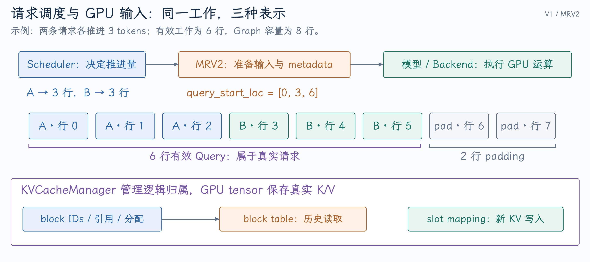

# 从 PR #60049 追问请求调度、MRV2 与 KV Cache

PR #60049 的表面问题是启动 profiling 超过 token budget，深层问题是“业务上有多少有效 Query”和“Graph buffer 能容纳多少行”被混为一谈。面试官可以从这个错误一路问到 vLLM 的请求生命周期、批次组成和缓存安全。

本文按 [`aeaa5018bc`](https://github.com/vllm-project/vllm/commit/aeaa5018bc7a4f901e3a44298ec8d11541ec01cd) 核对 V1/MRV2。PR 细节见[原开发笔记](../../../vllm/开发实践/MRV2的PIECEWISE填充与投机解码启动Profiling.md)。以下基础算例默认单设备、普通 decoder-only Attention、无 KV connector；启用投机解码、异步调度和混合状态时会另行说明。

## 1. 一个请求进入 vLLM 后，经过哪些核心模块？

**口述回答：** 前端先把输入转成 token 与引擎请求，EngineCore 接收后交给 Scheduler。Scheduler 决定本轮推进哪些请求、各推进多少 token，并向 KVCacheManager 申请空间。Executor 把调度结果交给 Worker；MRV2 根据请求状态准备张量与 Attention metadata，模型和 backend 执行 GPU 计算，再由采样与输出处理更新请求状态并返回结果。

**展开解释：** 这条链路有控制流和数据流。`SchedulerOutput` 传递请求、调度 token 数、新 block IDs 等信息，不是包含真实 K/V 的大张量；runner 才将这些信息转成 GPU 输入。不能把 EngineCore、Worker、runner 和某个 Attention kernel 说成同一个模块。

{ width="100%" }

同步 step 的实际顺序可在 [EngineCore.step](https://github.com/vllm-project/vllm/blob/aeaa5018bc7a4f901e3a44298ec8d11541ec01cd/vllm/v1/engine/core.py#L630-L659) 看到：`schedule` → `execute_model` → 必要时 `sample_tokens` → `update_from_output`。部分 executor 会在 `execute_model` 内返回完整结果，所以采样的调用形式要以该实现为准。

**追问：为什么要把 Scheduler 放在 CPU 侧？** 它处理队列、预算、请求状态、缓存归属与取消，不负责执行矩阵运算。保持这条控制边界，能让不同设备和分布式 executor 复用调度策略；热点元数据准备可以进一步搬到 GPU，但不意味着所有策略都应写成 kernel。

**追问：为什么会分多个进程？** 前端有网络、tokenization 和输出处理，EngineCore 有持续调度循环，Worker 持有设备上下文与模型。进程划分能隔离职责并支持多设备部署，代价是消息传递与状态一致性。实际部署可能合并部分组件，不能把一种进程拓扑当作唯一方式。

## 2. V1 Scheduler 是怎么统一 Prefill 和 Decode 的？

**口述回答：** 该版本主要围绕请求已经计算到哪里，以及目前有哪些 token 等待计算来调度。Prefill 是还有一段 prompt 没计算，普通 Decode 通常是已采样出一个新 token、但它的 KV 还没计算。两者都表现为待推进的 token 差额，再受 token budget、请求数、KV 空间和可执行条件约束。

**展开解释：** [Scheduler.schedule](https://github.com/vllm-project/vllm/blob/aeaa5018bc7a4f901e3a44298ec8d11541ec01cd/vllm/v1/core/sched/scheduler.py#L573-L609) 说明了这套表示。普通同步路径可以先理解为：

$$
\text{待计算数}=\text{已知 token 数}-\text{num\_computed\_tokens}.
$$

源码还包含 spec tokens、异步输出 placeholders 等状态，[实际差额与预算裁剪](https://github.com/vllm-project/vllm/blob/aeaa5018bc7a4f901e3a44298ec8d11541ec01cd/vllm/v1/core/sched/scheduler.py#L686-L706)不能在解释异步或投机路径时省略。

以预算为 8 的一轮为例：A 正在 Decode，待计算 1 行；B 的 prompt 长 12，已计算 4，待计算 8 行。若 A 在本轮先获得预算，A 可推进 1 行，B 最多推进 7 行。本轮模型输入共 8 行，B 还剩 1 行 prompt。这里是假设相应队列顺序、无其他限制的手算，并非所有配置都固定按这个顺序调度。

**追问：既然统一了，代码里为什么还有 `is_prefill_chunk`？** 统一的是基本进度表示。encoder 调度、分块策略、Graph 资格、并行节奏与采样仍需要区分不同计算形态，统一表示不会消除所有 Prefill/Decode 特例。

**追问：`max_num_seqs` 和 token budget 有什么区别？** 一个限制同时参与的请求数量，另一个限制本轮 token 工作量。八个 Decode 请求可能只有八行，一条长 Prefill 可能贡献数百行。二者都不能代替 KV 容量限制。

## 3. Continuous Batching 和 Chunked Prefill 为什么能改善服务？

**口述回答：** Continuous Batching 允许每轮重新组成批次，完成的请求退出，新的请求进入；Chunked Prefill 将长 prompt 分成多轮，使它不能一次占满很长的模型执行时间。它们改善批次利用和请求公平性，但同轮 Prefill 计算仍可能拉长 Decode 的 token 间隔。

**展开解释：** 静态 batch 往往受最长请求拖累，完成较早的请求留下空闲槽位。动态批次则持续填补槽位。Chunking 控制每次推进量，代价是同一 prompt 要经过更多轮提交，某些大矩阵效率可能下降，TTFT 也可能增加。

在上一例中，B 的余下 8 行若全部同轮执行，A 等待的是包含全部 Prefill 工作的一轮。分成 7+1 不会使 B 的总 token 数减少，但为其他请求提供了重新调度的边界。要证明 ITL 改善，需要测量客户端间隔及实际轮次时间，不能只看 prompt 被切成几段。

**追问：Chunked Prefill 是 P/D 分离吗？** 它仍可在同一个 runner、同一个模型 step 中混合执行两种工作。P/D 解耦需要额外的执行或部署边界及交接协议。见[P/D 项目的实现取舍](../vllm-pd/02-V1-MRV2实现与设计取舍.md)。

**追问：为什么不能把 chunk 越调越小？** 小 chunk 减少单轮阻塞，同时增加调度、提交与小矩阵开销，并可能降低 Prefill 吞吐。最优预算取决于 prompt 长度、并发、模型 shape 和延迟目标。

## 4. MRV2 怎么把多个请求变成一批 GPU 输入？

**口述回答：** Runner 先把本轮请求映射到稳定的请求状态槽，再将各请求调度的 token 展平成连续行。`query_start_loc` 给出每条请求在这些行中的边界，`positions` 给出 token 的绝对位置，`seq_lens` 描述它本轮可使用的序列范围；之后准备 block table、slot mapping 和 backend metadata。

**展开解释：** [InputBatch](https://github.com/vllm-project/vllm/blob/aeaa5018bc7a4f901e3a44298ec8d11541ec01cd/vllm/v1/worker/gpu/input_batch.py#L40-L97) 是该版本 MRV2 的当前 step 数据，不能直接套用旧 runner 中同名持久批次对象的全部语义。[gather_batch_req_state](https://github.com/vllm-project/vllm/blob/aeaa5018bc7a4f901e3a44298ec8d11541ec01cd/vllm/v1/worker/gpu/model_runner.py#L1252-L1283) 用 request ID 查稳定状态索引，[prepare_inputs](https://github.com/vllm-project/vllm/blob/aeaa5018bc7a4f901e3a44298ec8d11541ec01cd/vllm/v1/worker/gpu/model_runner.py#L1334-L1355) 再准备设备输入。

两条请求各有 4 个历史 token，本轮各推进 3 行，Graph 桶容量为 8：

| 字段 | 值 | 含义 |
|---|---|---|
| `num_tokens` | 6 | 当前有效 Query 总数 |
| `num_tokens_after_padding` | 8 | 模型输入的 padded 行数 |
| `query_start_loc` | `[0,3,6]` | 两条请求的有效 Query 边界 |
| `positions` | `[4,5,6,4,5,6,0,0]` | 前六行绝对位置，尾部为 padding |
| `seq_lens` | `[7,7]` | 两条请求本轮序列长度 |
| `is_padding` | `[F,F,F,F,F,F,T,T]` | 尾部两行不属于业务请求 |

**追问：position 为什么每条请求重新从 4 开始？** 它是请求内部的绝对 token 位置，不是整个 batch 的行号。把 batch row 当 position 会破坏 RoPE、缓存写入与滑动窗口语义。

**追问：`idx_mapping=[7,2]` 表示什么？** 本轮 row 0 的请求状态在 slot 7，row 1 在 slot 2。下轮 row 顺序变化时，同一请求仍应查到自己的状态。这个区别也决定[ShortConv checkpoint](03-投机解码与混合模型状态.md)为什么不能按临时 batch row 保存。

## 5. PR #60049 为什么没有直接增大 buffer？

**口述回答：** Buffer 容量并没有错，错的是 PIECEWISE dummy 构造把 padding 当作有效 Query，随后 drafter 又给每个请求补 correction 行。修复保留有效计数与 padded 容量的区别，让预算仍约束真实展开工作；简单增大 buffer 会掩盖计数错误，还可能继续扭曲 profiling。

**展开解释：** 预算为 1024，8 条请求，独立 drafter 每请求额外一行。Target 的有效 dummy 工作应为 `1024-8=1016` 行，Graph 输入可以 pad 到 1024。Drafter 根据有效 1016 行扩展后正好是 1024。旧路径先把有效数覆盖成 1024，再扩展成 1032。

| 路径 | Target 有效行 | Target padded 行 | Drafter expanded 行 |
|---|---:|---:|---:|
| 错误 PIECEWISE dummy | 1024 | 1024 | 1032 |
| 修复后 | 1016 | 1024 | 1024 |

在 [dummy_run 预留 correction](https://github.com/vllm-project/vllm/blob/aeaa5018bc7a4f901e3a44298ec8d11541ec01cd/vllm/v1/worker/gpu/model_runner.py#L815-L850) 与 [dummy execute 输入构造](https://github.com/vllm-project/vllm/blob/aeaa5018bc7a4f901e3a44298ec8d11541ec01cd/vllm/v1/worker/gpu/model_runner.py#L1800-L1842)之间，可以核对计数是否保持一致。[InputBatch.make_dummy](https://github.com/vllm-project/vllm/blob/aeaa5018bc7a4f901e3a44298ec8d11541ec01cd/vllm/v1/worker/gpu/input_batch.py#L127-L170) 接受两种 token 数，检查容量并按有效数分配请求 Query。

**追问：Graph 能不能有动态值？** 固定输入地址与可复用执行结构允许在 replay 前更新 buffer 内容。动态值并不等于动态分配或随意改变执行形状；如果更新改变捕获的依赖、kernel 分支或地址契约，就要重新判断资格。

**追问：FULL 与 PIECEWISE 有什么区别？** FULL 捕获更完整的 GPU 执行路径，要求相关 backend 支持相应批次与 metadata；PIECEWISE 只捕获可复用片段，可把不满足条件的部分留在图外。该 PR 保留 FULL dummy 的 descriptor 重塑逻辑，不能把“PIECEWISE 保留有效数”扩展成所有模式都用同一布局。

**追问：这是用户请求的吞吐优化吗？** 它首先修复启动 profiling/capture 的输入契约。启动耗时、adaptive cost curve 与运行期吞吐是不同结果，修复启动失败不自动证明 serving 更快。

## 6. KVCacheManager 管的是真实 K/V 张量吗？

**口述回答：** 它主要管理请求与缓存块的逻辑归属、命中、分配和释放。真实 K/V 在 Worker 初始化的 GPU tensor 中，block IDs 与 metadata 指示 kernel 读写其中哪些位置。`KVCacheBlock` 是资源元数据对象，创建它不会自动为每个对象单独分配一个 GPU tensor。

**展开解释：** [KVCacheBlock](https://github.com/vllm-project/vllm/blob/aeaa5018bc7a4f901e3a44298ec8d11541ec01cd/vllm/v1/core/kv_cache_utils.py#L176-L236)记录 block ID、引用和缓存身份；[KVCacheManager.allocate_slots](https://github.com/vllm-project/vllm/blob/aeaa5018bc7a4f901e3a44298ec8d11541ec01cd/vllm/v1/core/kv_cache_manager.py#L371-L413)根据新计算量、已命中块与 lookahead 等申请空间。分配成功只证明有合法写入空间，不证明相应位置的 K/V 已计算完成。

用单 KV group、block size 为 4 的简化例子，A 的逻辑页映射到物理页 `[5,9]`。位置 6 位于逻辑页 1、offset 2，对应物理页 9 的槽 `9*4+2=38`：

$$
\text{page}=\lfloor p/4\rfloor,\quad
\text{offset}=p\bmod4,\quad
\text{slot}=\text{block\_table[page]}\times4+\text{offset}.
$$

`block_table` 支持按历史位置寻找页；`slot_mapping` 给新计算的 K/V 指定写入槽。实际 backend 的 tensor 维度、head 排列、KV group 或 CP 分片会增加寻址规则，上式不表示所有 backend 的完整字节地址。[MRV2 slot 计算](https://github.com/vllm-project/vllm/blob/aeaa5018bc7a4f901e3a44298ec8d11541ec01cd/vllm/v1/worker/gpu/block_table.py#L355-L371)可以看到 page、offset 与物理编号的结合。

**追问：分页消除了所有碎片吗？** 它避免每请求预留最大连续上下文，并减轻外部碎片；尾页仍有内部浪费。例如长度 6、block size 4 占两页，最后两槽暂未使用。页大小越小，浪费越少，但元数据与访问组织成本可能上升。

**追问：KV 显存怎么估算？** 对相同 head 配置的全 Attention 模型，每 token 的 K/V 载荷约为 `2*层数*KV head数*head_dim*每元素字节数`。32 层、8 KV heads、head dim 128、BF16 为 128 KiB/token；4096 tokens 约 512 MiB。未计页尾、对齐、Graph、activations 和其他状态，混合层、MLA、KV 量化与并行分片需另算。

## 7. Prefix caching 怎么复用，为什么不能只对当前块 hash？

**口述回答：** Causal 模型某位置的 KV 依赖此前上下文。同样一段 token 接在不同前缀后，其 KV 可能不同，所以缓存身份需要表达前缀链及影响计算的附加信息。命中已有块后，请求获得对它们的引用，再为新后缀分配空间；命中不是把完整 KV 复制一份给新请求。

**展开解释：** [hash_block_tokens](https://github.com/vllm-project/vllm/blob/aeaa5018bc7a4f901e3a44298ec8d11541ec01cd/vllm/v1/core/kv_cache_utils.py#L684-L721)结合 parent hash、块内 token 与 extra keys。[附加身份](https://github.com/vllm-project/vllm/blob/aeaa5018bc7a4f901e3a44298ec8d11541ec01cd/vllm/v1/core/kv_cache_utils.py#L614-L665)涉及多模态、LoRA 等影响计算的条件。具体缓存模式还会有粒度与混合状态限制。

例如 `[A,B,C,D]` 和 `[X,Y,C,D]` 的尾段 token 虽相同，C/D 的 hidden states 依赖此前不同上下文，不能仅按 C/D 命中。相同文本占位符、不同图像内容也不能共用同一组视觉条件 KV。

**追问：`ref_cnt=0` 就说明内容没用了？** 它表示没有活跃引用，块可能仍保留可命中的缓存内容并处于可回收队列。新分配真正复用这个 block 时再驱逐旧 hash；“逻辑释放”“缓存驱逐”“GPU tensor 释放”是三件事。[BlockPool.touch 与 free_blocks](https://github.com/vllm-project/vllm/blob/aeaa5018bc7a4f901e3a44298ec8d11541ec01cd/vllm/v1/core/block_pool.py#L755-L808)体现这一区别。

**追问：命中全部 prompt 就不需要 forward 吗？** 不一定。该版本普通 lookup 将命中上界限制为 `request.num_tokens-1`，以保留必要计算和采样边界，见[get_computed_blocks](https://github.com/vllm-project/vllm/blob/aeaa5018bc7a4f901e3a44298ec8d11541ec01cd/vllm/v1/core/kv_cache_manager.py#L264-L307)。完整 KV 也不等于保存了所需的最后 logits。不要将这个具体实现限制说成缓存理论上永远不能全命中。

## 8. 抢占、取消与异步调度最容易出什么错？

**口述回答：** 抢占会改变计算进度与缓存归属，取消会终止业务请求，但已经提交的 GPU 工作可能仍在读写。必须保证状态重建与资源回收都落在正确边界；如果立即把块或状态槽分给另一个请求，就可能把旧请求的写入带到新请求中。

**展开解释：** [抢占逻辑](https://github.com/vllm-project/vllm/blob/aeaa5018bc7a4f901e3a44298ec8d11541ec01cd/vllm/v1/core/sched/scheduler.py#L1542-L1575)把请求退回可重算状态。重算需要已有 prompt 与已提交输出恢复有效上下文，不能只把当前最后 token 送给空缓存。

异步路径允许调度和输出处理重叠，[EngineCore batch queue](https://github.com/vllm-project/vllm/blob/aeaa5018bc7a4f901e3a44298ec8d11541ec01cd/vllm/v1/engine/core.py#L670-L685)保留每轮 future 与调度结果。[延期释放](https://github.com/vllm-project/vllm/blob/aeaa5018bc7a4f901e3a44298ec8d11541ec01cd/vllm/v1/core/sched/scheduler.py#L2718-L2754)使用 step fence，使仍可能被 GPU 写入的块在对应输出完成后返回池。

**追问：异步调度会同时计算同一请求两个有依赖的 token 吗？** 后一 token 仍依赖前一 token 的采样结果。异步改善的是 CPU、GPU 与批次间的流水，依赖通过设备状态、占位、队列与同步协议维持；不能解释成绕开自回归依赖。

**追问：最有价值的回归例子是什么？** 在途执行时取消 A，随后让 B 入场并复用资源，检查旧输出不污染 B；抢占后重算与不抢占对照；batch 重排后稳定状态槽仍属于原请求。对 #60049，还应验证容量桶边界、非均匀 Query、draft correction 和 PIECEWISE/FULL 的独立契约，而不是只检查一个字段等于常数。

## 9. 模型产生 hidden states 后，怎样得到用户看到的 token？

**口述回答：** Runner 选出需要输出 logits 的 hidden rows，经 LM head 得到词表分数，再应用约束、penalty、temperature 与 Top-k/Top-p 等采样规则。普通 Decode 每条请求通常采一行，投机验证可能需要多行 logits。采样后更新引擎请求，前端 detokenize 并形成用户输出。

**展开解释：** [MRV2.sample](https://github.com/vllm-project/vllm/blob/aeaa5018bc7a4f901e3a44298ec8d11541ec01cd/vllm/v1/worker/gpu/model_runner.py#L1572-L1611)用 `logits_indices` 选 hidden states，再调用 `compute_logits`。这避免每次都为全部 Prefill 行生成巨大的词表 logits；投机和 prompt logprobs 等需求会改变需要保留的行。

假设词表 logits 为 `[2,1,0]`。非零 temperature T 的基本变换是 `logits/T`：T=0.5 得 `[4,2,0]`，分布更集中；T=2 得 `[1,0.5,0]`，分布更平缓。T=0 通常走 greedy 的特殊实现，不能真的做除零。Top-k 按数量保留高分候选，Top-p 按累计概率保留候选集合；二者不负责降低模型本体的前向 FLOPs。

[sampling 参数应用](https://github.com/vllm-project/vllm/blob/aeaa5018bc7a4f901e3a44298ec8d11541ec01cd/vllm/v1/worker/gpu/sample/sampler.py#L226-L275)处理 penalty、temperature 等，[sample](https://github.com/vllm-project/vllm/blob/aeaa5018bc7a4f901e3a44298ec8d11541ec01cd/vllm/v1/worker/gpu/sample/sampler.py#L278-L325)按能力选择具体采样路径。部分规则会在 fused sampler 中完成，不能把概念上的步骤顺序说成每个 backend 都有独立 kernel。

**追问：Prefill 每行都预测下一个 token，为什么不都返回？** Prompt 是输入条件，中间位置的预测不是用户请求的生成输出。通常完整 prompt 最后位置的 logits 才用于首 token；prompt logprobs 等功能会另外取相应行。

**追问：第一个生成 token 的 KV 是在 Prefill 中算的吗？** Prefill 最后输入行产生 logits 并采样首 token，此时首 token 尚未作为模型输入。下一次 Decode 消费它，才生成它的 K/V，再采第二个 token。这是理解 `num_computed_tokens` 与输出长度相差一步的关键。

**追问：停止条件在哪里？** GPU 采样产生候选输出，EngineCore/Scheduler 的输出更新还要结合 EOS、最大生成长度和请求状态；前端也可能处理字符串 stop 与输出截断。不能只说 kernel 采出 EOS 就已经完成所有资源回收。
