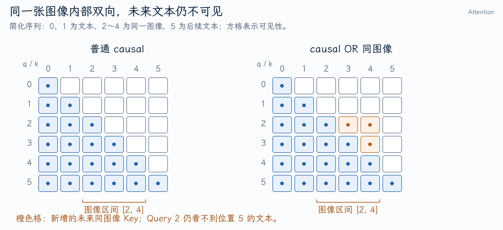

# 从 Prefix-LM 与窗口修复追问 Attention 实现

PR #60040 与 #59550 都涉及 Attention 的可见性，但面试官不会只问 mask 公式。他还可能问：QKV 从哪里来，分页后怎么读取，为什么只改 mask 不够，模型语义怎样影响 Graph，以及怎样证明数值正确。

本文核对到 [`309e622d88`](https://github.com/vllm-project/vllm/commit/309e622d88ff6606e5d71519c8a2326c1f102044)，该提交包含 Prefix-LM 接入及 `W-1` 到 `W` 的窗口转换。历史 diff 分别见[Prefix-LM](../../../vllm/开发实践/多模态Prefix-LM在ROCm-Attention中的实现.md)和[滑动窗口](../../../vllm/开发实践/ROCm-Attention滑动窗口的参数与边界.md)。

## 1. vLLM 的 Attention 层与 backend 分别负责什么？

**口述回答：** 模型层根据 hidden states 产生 Q/K/V，完成模型要求的归一化和位置编码，再调用通用 Attention 层。Backend 负责设备适配、metadata、KV layout 和 GPU 算子执行。模型决定计算语义，backend 将这些语义实现为当前硬件上的读写与计算。

**展开解释：** 普通 self-attention 可以写成：

$$
Q=XW_Q,\quad K=XW_K,\quad V=XW_V,\qquad
O=\operatorname{softmax}(QK^T/\sqrt d+\text{mask})V.
$$

这里 `X` 的行对应本轮 token；历史 K/V 从 cache 读取。模型可能使用 fused QKV projection、QK norm、soft cap 或特定 scale，不能把这条简式当作所有模型的完整 forward。

[Gemma3Attention](https://github.com/vllm-project/vllm/blob/309e622d88ff6606e5d71519c8a2326c1f102044/vllm/model_executor/models/gemma3.py#L114-L149)分别设置 Query/KV heads 与显式 `head_dim`，[forward](https://github.com/vllm-project/vllm/blob/309e622d88ff6606e5d71519c8a2326c1f102044/vllm/model_executor/models/gemma3.py#L202-L221)在 QK norm、RoPE 后调用 Attention。ROCm 则由 [metadata builder](https://github.com/vllm-project/vllm/blob/309e622d88ff6606e5d71519c8a2326c1f102044/vllm/v1/attention/backends/rocm_attn.py#L162-L177)和 [RocmAttentionImpl.forward](https://github.com/vllm-project/vllm/blob/309e622d88ff6606e5d71519c8a2326c1f102044/vllm/v1/attention/backends/rocm_attn.py#L564-L593)承接执行。

**追问：head_dim 总等于 hidden_size / num_heads 吗？** 常见模型有这个关系，但 Gemma3 使用配置里的显式 head_dim。投影后的 Q 宽度由 `num_heads*head_dim` 决定，不能仅凭 hidden size 推断 kernel shape。

**追问：为什么不缓存 Q？** 后续新 token 的 Query 是新的，它需要读取历史 K/V；一般自回归解码无需反复使用旧 Query。保存历史 Q 增加空间却不能省去新 token 的 Q 投影。特殊架构要按实际算法确认。

## 2. GQA、MQA 与 RoPE 会影响哪些缓存契约？

**口述回答：** MHA 的每个 Query head 有对应 KV head，MQA 共享一组 KV，GQA 则让若干 Query heads 共享一个 KV head。KV head 数决定缓存载荷。RoPE 按请求内部 position 旋转 Q/K，历史缓存中的 K 必须与其真实位置一致；batch 重排不能改变这些位置。

**展开解释：** 单设备假设 32 Query heads、8 KV heads、head dim 128：每四个 Query heads 共用一组 K/V。BF16 每层每 token K/V 为 `2*8*128*2=4096` 字节，若改成 32 KV heads则为 16384 字节。这个四倍空间差来自 KV heads，不是简单减少 Query 数。

RoPE 在二维特征对上按位置施加旋转，使 Q/K 的点积包含相对位置信息。它不负责决定哪些位置可见；causal、滑动窗口和图像双向仍由 mask 决定。该版本[Gemma3 的 position 与 RoPE](https://github.com/vllm-project/vllm/blob/309e622d88ff6606e5d71519c8a2326c1f102044/vllm/model_executor/models/gemma3.py#L155-L180)还区分局部与全局层的配置。

**追问：TP 后 KV heads 也总按 TP 等分吗？** 当 KV heads 足够多时可分片；TP 大于 KV heads 时该实现会复制 KV heads，见[head 分配条件](https://github.com/vllm-project/vllm/blob/309e622d88ff6606e5d71519c8a2326c1f102044/vllm/model_executor/models/gemma3.py#L114-L126)。因此不能一律把每卡 KV 显存除以 TP。

## 3. PagedAttention 与 FlashAttention 有什么区别？

**口述回答：** 分页 KV 主要解决缓存存储、分配与非连续历史访问，FlashAttention 主要通过分块和 Online Softmax 减少 Attention 中间矩阵的显存读写。二者可以同时使用：kernel 依据 block table 读取分页 K/V，再分 tile 完成 softmax 与加权求和。

**展开解释：** “PagedAttention”可以指分页缓存体系及相应执行方式，不应把它限定成某个唯一类或 kernel。“FlashAttention”也不能等同于“使用 CUDA Graph”。Graph 减少重复提交开销，FlashAttention 减少计算中的中间数据搬运。

完整 score 矩阵对 Query 长度 `Qlen`、Key 长度 `Klen` 需要 `Qlen*Klen` 个元素；分块后不必将它全部写入显存。每个 Query 行维护运行最大值 `m`、归一化和 `l` 与未归一化输出 `o`。遇到新 tile 分数 `s`：

$$
m'=\max(m,\max s),\quad
\alpha=e^{m-m'},\quad p=e^{s-m'},
$$

$$
l'=\alpha l+\sum p,\qquad o'=\alpha o+pV_{\rm tile},\qquad O=o/l.
$$

[softmax_step](https://github.com/vllm-project/vllm/blob/309e622d88ff6606e5d71519c8a2326c1f102044/vllm/v1/attention/ops/triton_attention_helpers.py#L462-L484)更新 `m/l/p/alpha`，调用方负责对输出 accumulator 做相同重缩放。逐 tile 更新保留了全局归一化关系；它不是把每个 tile 各自 softmax 后直接相加。

**追问：Decode 为什么经常需要 Split-KV？** Query 少、历史很长时，按请求和 head 的并行可能不够。把历史分段能增加并行，但需要归并各段的最大值、归一化和输出，增加 workspace 与 launch 开销。不能未经模型和并发分析就宣称分段越多越好。

**追问：FlashAttention 降低了渐近计算量吗？** 对 dense Attention，主要改变 I/O 与执行组织，核心 QK/PV 工作仍随 Q/K 长度增长。真正跳过不可见或稀疏 tile 才可能减少对应计算工作。

## 4. 滑动窗口为什么会差一个 token？

**口述回答：** 模型给的是包含当前位置的窗口总长 W，而接口可能传左跨度 W-1。若 kernel 用 `q-k<W`，就需要总长 W；把左跨度直接传入会少保留最旧的那个合法 token。修复位置应是单位与语义转换的接口。

**展开解释：** `q=7,W=4` 时合法位置为 4、5、6、7。窗口左跨度是 3，但条件需用 `7-k<4`；若误用 `<3` 就只剩 5、6、7。

该版本 [ROCm 构造窗口](https://github.com/vllm-project/vllm/blob/309e622d88ff6606e5d71519c8a2326c1f102044/vllm/v1/attention/backends/rocm_attn.py#L404-L409)保存 `(W-1,0)`，在[传给 kernel 的入口](https://github.com/vllm-project/vllm/blob/309e622d88ff6606e5d71519c8a2326c1f102044/vllm/v1/attention/backends/rocm_attn.py#L583-L585)转换回 `1+left_span`。未启用窗口时的 sentinel 也必须沿契约解释。

**追问：滑动窗口就保证少占 KV 吗？** 可见性规则与物理分配策略是不同层次。相应 KV manager 可以跳过不再需要的旧块，但全局层、混合 cache group、缓存复用与实现策略都影响实际节省。只改 mask 不能证明显存分配减少。

**追问：怎么构造最有力的数值测试？** 让窗口最左合法位置的 V 与其余位置明显不同，在 `W-1/W/W+1` 边界比较 reference。随机输入的平均误差可能掩盖“刚好少读一个位置”的错误。

## 5. 图像内部双向为什么不会泄漏未来回答？

**口述回答：** 图像 embedding 是已经给定的输入条件；允许同一图像范围内部互相读取，不等于允许读取尚未生成的文本。Prefix-LM 在 causal 可见性上增加同一图像区间，必须按每张图的具体范围判断，不能把所有 image tokens 连成一个双向集合。

**展开解释：** 简化序列为位置 0、1 的文本，位置 2、3、4 的图像，位置 5 的后续文本。Query 2 可读 0～4，不能读 5；Query 1 仍只能读 0、1。该实现图像范围使用闭区间 `[2,4]`，见[range 检查与 mask](https://github.com/vllm-project/vllm/blob/309e622d88ff6606e5d71519c8a2326c1f102044/vllm/v1/attention/ops/triton_attention_helpers.py#L399-L422)。

{ width="100%" }

用 `C` 表示 causal、`S` 表示该 causal 路径的一侧窗口 `q-k<W`、`I` 表示同图像：无窗口时是 `C OR I`，默认窗口是 `(C AND S) OR I`，clamp 模式是 `(C OR I) AND S`。见[共享 helper 的合成顺序](https://github.com/vllm-project/vllm/blob/309e622d88ff6606e5d71519c8a2326c1f102044/vllm/v1/attention/ops/triton_attention_helpers.py#L363-L422)。这里未来同图像 Key 的 `q-k` 为负，满足一侧窗口；不能自行替换为绝对距离。

**追问：图像 encoder 已经双向，为何语言模型还要双向？** Encoder 混合 patch 特征，投影后的 embedding 进入语言模型后，每层再产生新的 Q/K/V。两处计算在不同特征空间，前者不能替代后者规定的 token 交互。

**追问：Prefix-LM 就是 prefix caching 吗？** 前者决定 Attention 依赖，后者复用满足依赖条件的计算结果。若某图像 token 依赖后续同图像 embedding，把图像区间中途切开保存成“完整结果”就可能违反缓存有效性。

## 6. 为什么只改 mask，结果仍然可能错误？

**口述回答：** Mask 只能在实际加载和计算的候选 Key 中决定可见性。原 causal 遍历可能根本没访问未来同图像 Key，所以要先扩大 tile 遍历；扩大后又可能访问不合法页表，必须保护地址读取，并处理缓存残留 NaN。元数据、遍历边界与数值 mask 要一起成立。

**展开解释：** Query 2 要读图像位置 4。若循环仍在位置 2 停止，`I(2,4)=true` 没有机会执行。ROCm [chunked_prefill_paged_decode](https://github.com/vllm-project/vllm/blob/309e622d88ff6606e5d71519c8a2326c1f102044/vllm/v1/attention/ops/chunked_prefill_paged_decode.py#L319-L346)据 metadata 选择 prefix-prefill 路径；真实范围、历史 KV 和当前 Query tile 的组合在 [prefix_prefill kernel](https://github.com/vllm-project/vllm/blob/309e622d88ff6606e5d71519c8a2326c1f102044/vllm/v1/attention/ops/prefix_prefill.py)中处理。

**追问：给最终 K/V load 加 mask 为什么不够？** 如果先用越界位置读取 block table，已经产生非法页表访问。必须从页表读取的地址形成阶段就保护，然后才是 K/V 读取与语义可见性。读地址有效和 Attention 可见是不同条件。

**追问：概率为零为什么还担心 NaN？** IEEE 运算中 `0*NaN` 仍是 NaN。全 tile 不可见的缓存列可以清理为有限值；如果任何真实 Query 需要该列，就不能随意清理。Padding Query 不应参与“是否有真实行需要”判断。

**追问：分块跨过图像范围怎么处理？** 修改 metadata 和 mask 不能凭空得到尚未计算的未来图像 K/V。要核对调度分块是否满足模型依赖、runner 是否保留完整所需范围以及当前层值在哪里产生；仅拿图像范围 tensor 不能证明跨 chunk 正确。

## 7. 支持 Attention 后为什么还要验证 Graph 与完整模型？

**口述回答：** Kernel 对照证明算子在给定输入与 metadata 下数值正确，模型对照证明元数据及模型接入链正确，真实 replay 则证明 capture/replay 的输入布局和分支可复用。三者覆盖不同风险。

**展开解释：** [ROCm Graph capability 判断](https://github.com/vllm-project/vllm/blob/309e622d88ff6606e5d71519c8a2326c1f102044/vllm/v1/attention/backends/rocm_attn.py#L80-L109)对 MRV2、窗口、clamp 和图像范围处理作了约束。生成位置越过图像后，当前可见集合可能与 causal Decode 相同，但必须验证 backend 报告和 runner 筛选共同保证这件事。

**追问：只测最后 logits 是否足够？** 出错层可能被后续运算部分掩盖，随机采样也可能未表现。Kernel reference、逐层 hidden states、greedy output 和真实图像任务各有价值；采样模型不能要求不同实现每次随机输出逐 token 相同来代替数值比较。

**追问：你在 PR 中真正新增的是什么？** 可以准确回答：复用已有多模态 mask helper，接通 ROCm metadata 与执行路径，扩大合法遍历并保护读取，补足 Graph 资格与数值验证。共享 helper 原本存在，不应把所有 Prefix-LM 算法都算成自己新写。
