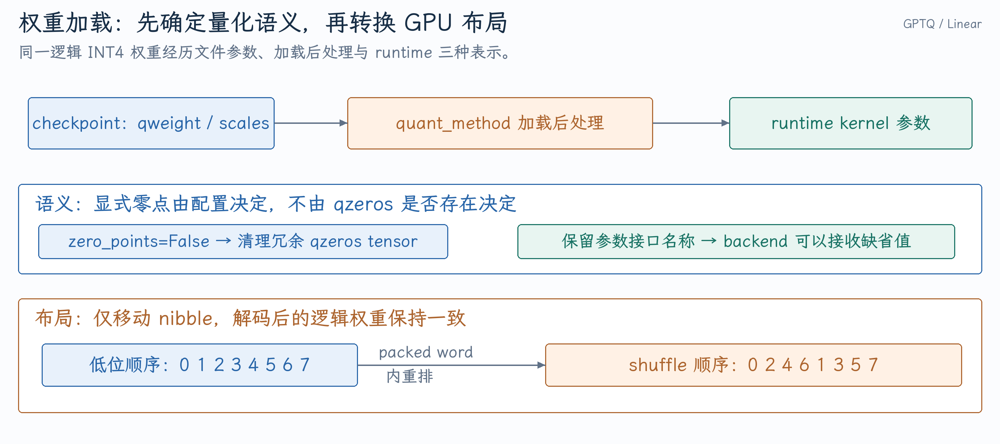

# 从 GPTQ 修复追问权重加载、量化与 Linear

PR #52637 同时处理对称 GPTQ 的冗余零点与 RDNA packed 权重重排。它适合展示一个重要框架边界：checkpoint 能读进内存，距离 GPU kernel 能正确使用它，还有量化语义、参数轴、后处理与执行分发几层契约。

本文源码核对到 [`510e42aeb1`](https://github.com/vllm-project/vllm/commit/510e42aeb1c7abcda0d31d826aadbe6e34ba8100)。具体 diff 见[GPTQ 加载与布局开发笔记](../../../vllm/开发实践/GPTQ权重加载与RDNA-INT4布局重排.md)。

## 1. vLLM 加载一个量化 Linear 的流程是什么？

**口述回答：** 量化配置先为该 Linear 选择 quant method，创建参数与 loader 属性；checkpoint loader 将文件权重写入对应参数；加载后的统一处理调用 `process_weights_after_loading`，转成选定 backend 的布局。正常 forward 再通过 `quant_method.apply` 使用运行时参数。

**展开解释：** 这条链路把“读文件”“解释格式”“执行 GEMM”分开。模型的 `load_weights` 可能还负责 fused QKV、gate/up 与 TP 分片映射，不能假设 checkpoint 名字和 runtime 参数永远一一对应。

{ width="100%" }

[统一加载后处理](https://github.com/vllm-project/vllm/blob/510e42aeb1c7abcda0d31d826aadbe6e34ba8100/vllm/model_executor/model_loader/utils.py#L133-L175)调用 quant method；[AutoGPTQ kernel 配置](https://github.com/vllm-project/vllm/blob/510e42aeb1c7abcda0d31d826aadbe6e34ba8100/vllm/model_executor/layers/quantization/auto_gptq.py#L337-L360)包含 full/partition shape、weight type、activation type 与 group size；[Linear.forward](https://github.com/vllm-project/vllm/blob/510e42aeb1c7abcda0d31d826aadbe6e34ba8100/vllm/model_executor/layers/linear.py#L603-L619)调用 `quant_method.apply`。

**追问：为什么不在每次 forward 转布局？** 权重在推理中通常固定，预处理可以一次完成并在所有 token 上复用。每步转布局增加带宽、临时内存和 launch，还可能妨碍 Graph。动态权重更新或 adapter 路径另有生命周期。

**追问：selector 是怎么选 backend 的？** 它检查设备、dtype、量化类型、group size、分片形状和对齐等能力条件。选中 backend 只表明这些条件满足；加载后的具体张量还必须满足该 backend 的实际布局契约。

## 2. W4A16、GPTQ、AWQ 分别说明什么？

**口述回答：** W4A16 描述权重 4 bit、激活 16 bit 的执行格式，GPTQ 与 AWQ 描述权重量化的算法或 checkpoint 体系。GPTQ 利用近似二阶信息降低逐层量化误差；AWQ 利用激活统计对重要通道做缩放保护。相同 W4A16 标签不能保证文件布局或运行 kernel 一样。

**展开解释：** 用逻辑权重 `W[N,K]`，分组量化的近似值是：

$$
\widehat W_{n,k}=s_{n,g(k)}(q_{n,k}-z_{n,g(k)}),\qquad
g(k)=\lfloor k/G\rfloor.
$$

q 是 packed 的量化整数，s/z 是 scale 和 zero point。W4A16 可以在 tile 被读取时反量化到激活精度，不必先将全层展开成一份 BF16 常驻权重。

对简单对称 unsigned INT4 表示，固定中心可为 8，公式为 `(q-8)*s`；其他 signed/offset 编码需按 weight type 解释。`q=11,s=0.25` 对应 0.75。更小 group 通常能细化 scale，代价是更多元数据与索引，精度和速度还受算法及 kernel 支持影响。

**追问：W4A16 会让 KV Cache 也变成 INT4 吗？** 不会。线性权重量化、activation dtype 与 KV cache dtype 是独立配置；模型仍可能有 BF16 gate、norm 或其他未量化部分。

**追问：4 bit 权重是不是一定四倍加速？** 相对 BF16 的权重载荷理论上约降四倍，但还要读 scales、做反量化，并执行 Attention、通信等工作。带宽受限形状可能明显受益，算力或反量化受限形状未必。

## 3. checkpoint 里有 qzeros，为什么要删除？

**口述回答：** 是否消费显式 zero point 由量化语义和 backend 配置决定，不能由文件里是否存在 qzeros 决定。对称路径可能将中心编码在 weight type 中，checkpoint 仍保留冗余 qzeros。应在加载后、backend 处理前清理错误的张量引用。

**展开解释：** [AutoGPTQ.process_weights_after_loading](https://github.com/vllm-project/vllm/blob/510e42aeb1c7abcda0d31d826aadbe6e34ba8100/vllm/model_executor/layers/quantization/auto_gptq.py#L438-L445)在 `kernel.config.zero_points` 为 false 时删除相应属性，再调用 kernel 后处理。让 loader 先正常接收 checkpoint 参数，可以避免把格式兼容问题分散到每个 backend。

**追问：为什么保留 `w_zp_name`？** 名称是 backend 参数接口，tensor 是具体载荷。某些 backend 会依赖名称创建自己的 placeholder；[MPLinearKernel 参数读取](https://github.com/vllm-project/vllm/blob/510e42aeb1c7abcda0d31d826aadbe6e34ba8100/vllm/model_executor/kernels/linear/mixed_precision/MPLinearKernel.py#L76-L87)允许零点缺省。删除数据引用不等于删除整个接口字段。

**追问：为什么不在每个 backend 都加判断？** 共享 loader 边界已经掌握配置和参数名，能在数据进入 backend 前建立一致契约。逐 backend 修复容易遗漏新 backend，并使相同 checkpoint 语义产生多种处理方式。

## 4. Packed layout 变了，量化值会变吗？

**口述回答：** 正确重排只改变 bit 的存放位置，不改逻辑 q、scale 和解码后的权重。GPU kernel 按自己的布局解码，所以 loader 和 kernel 必须对同一个 nibble 顺序达成一致。这是表示转换，不是重新量化。

**展开解释：** 普通 INT32 从低位到高位放 `q0,q1,...,q7`，ExLlama shuffle 放 `q0,q2,q4,q6,q1,q3,q5,q7`。输入 `[0,1,2,3,4,5,6,7]`，普通 word 为 `0x76543210`，shuffle 后为 `0x75316420`。[shuffle_4bit_8](https://github.com/vllm-project/vllm/blob/510e42aeb1c7abcda0d31d826aadbe6e34ba8100/csrc/libtorch_stable/quantization/gptq/qdq_4.cuh#L16-L29)逐对移动 nibble。

原流程先将所有 q 展开成 INT32 再重新打包。`N*K` 个 INT4 载荷约为 `N*K/2` 字节，展开整数数组为 `4*N*K` 字节，后者是前者的八倍。PR 直接在 packed word 内 shuffle，避免这个全层展开中间量；仍有必要的布局副本，不是完全零拷贝。

**追问：这是否减少每步 GEMM 的算术量？** 主要改善加载期预处理与峰值临时空间，runtime 仍读取原设计的 packed layout。不能直接把加载期内存减少换算成 Decode 加速。

**追问：两个 backend 都用 INT4 就能共享权重 buffer？** 只有逻辑轴、打包方向、nibble 顺序、scale/zero point 约定都兼容时才行。RDNA hybrid 两条执行路径按约定解释同一份存储，MoE fallback 的字节布局则不能直接互换。

## 5. transpose、contiguous、clone、view 哪些会复制？

**口述回答：** transpose 通常只改 shape/stride；contiguous 在布局不连续时复制；clone 创建独立存储；view 在满足条件时重新解释同一存储。原地 shuffle 要求连续 packed tensor，并且不能污染仍被其他参数引用的源存储，所以这里先 clone。

**展开解释：** [RDNA 后处理](https://github.com/vllm-project/vllm/blob/510e42aeb1c7abcda0d31d826aadbe6e34ba8100/vllm/model_executor/kernels/linear/mixed_precision/rdna_hybrid_w4a16.py#L500-L525)按 `packed_dim` 将输入规范为 `[K/8,N]`，clone 为连续独立副本，调用原地 shuffle，再转为连续 `[N,K/8]`，最后 `view(torch.int8)` 得到 `[N,K/2]`。

**追问：为什么不能只看 shape 判断打包轴？** 参数属性会标识 input/output/packed 维。GPTQ 和 compressed-tensors 可提供互为转置的文件表示；同一二维 shape 在不同模型维度下也可能有不同语义。读错 packed axis 会让 kernel 解码出完全不同的权重。

**追问：删除 parameter 会立刻减少显存吗？** 只有所有 tensor/view 引用都释放后，storage 才能回到 allocator；allocator 保留的 reserved memory 也可能不马上下降。要区分对象属性、活跃载荷和缓存分配器占用。

## 6. Tensor Parallel 的 Row/Column 为什么会影响量化 kernel？

**口述回答：** ColumnParallel 按输出通道分权重，各 rank 产生输出分片；RowParallel 按输入特征分权重，各 rank 产生部分和后再归约。它们改变本设备真实 K/N，因此影响 group 对齐、packed 轴和 kernel dispatch，不能只把 TP 当作多跑几份同形状 GEMM。

**展开解释：** 统一使用 `X[M,K]、W[N,K]、Y=XW^T`。TP=2、`K=8,N=6`：

| 分片方式 | 本地权重 | 本地输出 | 组合方式 |
|---|---|---|---|
| ColumnParallel | `[3,8]` | `[M,3]` | 可保持分片，或按需要 all-gather |
| RowParallel | `[6,4]` | `[M,6]` 部分和 | 按配置 all-reduce |

[Column forward](https://github.com/vllm-project/vllm/blob/510e42aeb1c7abcda0d31d826aadbe6e34ba8100/vllm/model_executor/layers/linear.py#L603-L619)只在 `gather_output` 时收集；[Row forward](https://github.com/vllm-project/vllm/blob/510e42aeb1c7abcda0d31d826aadbe6e34ba8100/vllm/model_executor/layers/linear.py#L1762-L1787)按配置处理输入分片和结果归约，并避免重复加 bias。

**追问：gate/up 合并为什么通常适合 ColumnParallel？** 两个投影从相同 X 产生中间特征，合并参数与 GEMM 可以减少 launch；激活后 down projection 再以 RowParallel 收敛回 hidden。Fused loader 还需要把 checkpoint 的两份权重放入本地正确分支区间。

**追问：单卡测试为什么不能证明 TP 正确？** TP 改变实际分片、scale 轴与组对齐，还引入通信。应覆盖输入/输出分片、不同参数轴、fused shard 和 numerical reduction；仅测试单卡 packed word 不足以覆盖这些边界。

**追问：TP、PP、DP 能不能互相替代？** TP 按层内矩阵或 head 分片，同一次前向需要相关 rank 协作；PP 按层划分，同一请求经过多个 stage；DP 用多个模型副本承接不同请求。TP/PP 可帮助放下单副本并分担计算，DP 主要扩展请求处理容量。MoE 的 EP 再按专家分布，与这些轴可以组合。通信成本、流水空洞和 replica 显存不同，应结合模型大小与服务负载选择；“有八卡就开 TP=8”并非唯一策略。

## 7. 量化 PR 怎样验证才经得起追问？

**口述回答：** 先验证加载契约，再验证布局和数值，最后验证模型。零点修复要覆盖冗余 qzeros 与真正需要显式零点两种情况；packed shuffle 要对照逻辑解码，包含轴方向与源存储保护；模型验证则检查实际加载、生成与必要的精度评测。

**展开解释：** 可以分别回答测试所证明的范围：bitwise packed 对照验证重排；dequantized weight/GEMM reference 验证数值；模型评测验证量化路径未破坏任务行为；加载时间与峰值显存验证预处理优化。与 BF16 的差异可能来自量化本身，应在相同量化 checkpoint 的修复前后比较。

**追问：能不能只测输出 shape？** Shape 正确仍可能每个 nibble 都错，或将冗余零点错误应用到所有权重。需要构造非均匀 q/scales，使读错顺序和读错 group 能在数值上明显区分。
