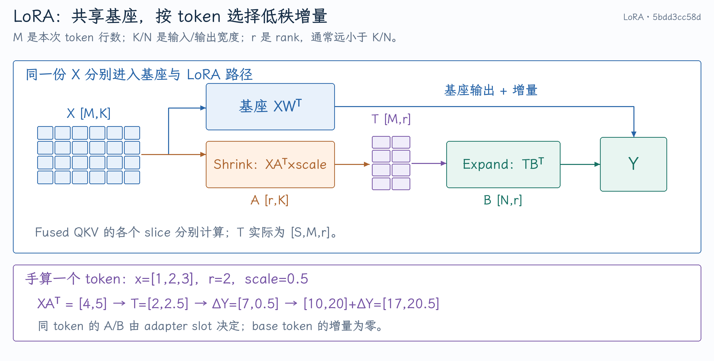
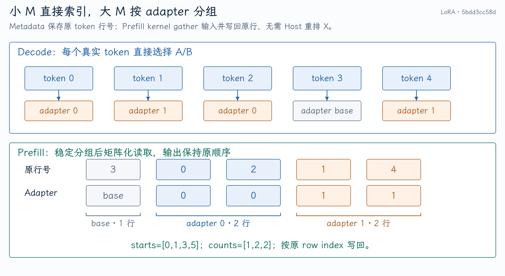
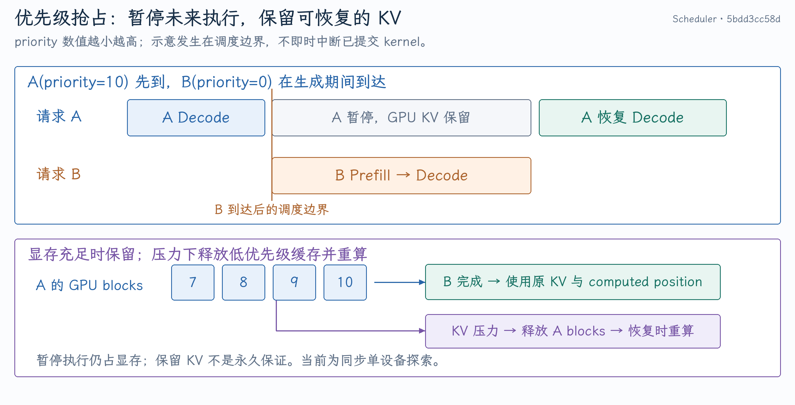

# RDNA LoRA：小 Batch 算子设计与优先级调度

LoRA 文件很小，推理增量却不一定小。每层 Linear 后的两次低秩计算、metadata 更新和 kernel launch 会反复出现；在小 Batch Decode 中，它们可能占据可观的单 token 延迟。本项目保留 vLLM 的 Multi-LoRA 语义，为 gfx1151 设计 Shrink/Expand 专用路径，并在同一分支探索高优先级请求到达时的暂停与恢复。

源码固定到 [`5bdd3cc58d`](https://github.com/tangzzycc/vllm/commit/5bdd3cc58d8985c2c2ebcb21377b3526335b5741)。其中 LoRA kernel 来自 `f393507827`，后续两个提交增加严格优先级及指标。**算子优化和调度探索是两项不同改动；简历的 18.6%～24.8% 来自算子 A/B，不来自抢占实验。** CogAgent 与 LoRA 也分别使用 CogAgent-18B 和 Qwen3-VL-4B 验证，不能讲成在 CogAgent 上运行了这组 LoRA。

## 1. 一个 Linear 为什么拆成 Shrink 与 Expand

对基座权重 $W\in\mathbb{R}^{N\times K}$，输入 $X\in\mathbb{R}^{M\times K}$，LoRA 的 $A\in\mathbb{R}^{r\times K}$、$B\in\mathbb{R}^{N\times r}$：

$$
Y=XW^T+\mathrm{scale}(XA^T)B^T.
$$

`M` 是本轮 token 数，`K/N` 是输入/输出宽度，`r` 是 rank。Shrink 得到 $T=XA^T$，从 K 维压到 r 维；Expand 得到 $TB^T$，恢复到 N 维，累加至基座输出。Scale 在 Shrink 中乘入，不能在 Expand 再乘一次。

[LoRA 原论文](https://arxiv.org/abs/2106.09685)的出发点是用低秩更新减少微调参数和训练存储。常见 scale 为 alpha/r，部分变体采用其他定义；Serving 使用 adapter 的实际配置。训练参数少不保证动态 unmerged 推理免费，本项目优化的是额外低秩计算的执行成本。

{ width="100%" }

### 手算一个 token

令 $x=[1,2,3]$，$r=2$，$N=2$：

$$
A=\begin{bmatrix}1&0&1\\0&1&1\end{bmatrix},\quad
B=\begin{bmatrix}1&2\\-1&1\end{bmatrix}.
$$

Shrink 得到 $t=[4,5]$。若 scale=0.5，存入中间 buffer 的是 `[2,2.5]`，Expand 得到 `[7,0.5]`。基座输出若为 `[10,20]`，最终为 `[17,20.5]`。

在 Multi-LoRA 中，每个 token 选自己的 A/B。Adapter 为 `-1` 的 base token 增量为零；相同输入张量可以共享，低秩结果不能在不同 adapter 之间共享。

### Serving 调用链

```text
BaseLinearLayerWithLoRA
  → 基座 Linear
  → _apply_lora_to_output
  → PunicaWrapperGPU.add_lora_linear
  → 创建 FP32 T [slice,token,rank]
  → add_shrink → add_expand
  → 原输出 + LoRA 增量
```

入口见 [LoRA Linear](https://github.com/tangzzycc/vllm/blob/5bdd3cc58d8985c2c2ebcb21377b3526335b5741/vllm/lora/layers/base_linear.py) 与 [Punica wrapper](https://github.com/tangzzycc/vllm/blob/5bdd3cc58d8985c2c2ebcb21377b3526335b5741/vllm/lora/punica_wrapper/punica_gpu.py)。Embedding、logits 与 fused-MoE LoRA 仍有自己的实现，当前 fast path 针对 Linear Shrink/Expand。

## 2. QKV 的 slice 和 GQA 形状为什么影响 grid

Fused QKV Linear 对应多个 LoRA slice。以 Qwen3-VL-4B 的实际形状为例：

| Linear | K | 输出 slices | S |
| --- | ---: | --- | ---: |
| QKV | 2560 | `(4096,1024,1024)` | 3 |
| O | 4096 | `(2560,)` | 1 |
| Gate/Up | 2560 | `(9728,9728)` | 2 |
| Down | 9728 | `(2560,)` | 1 |

Q 比 K/V 宽是 GQA 的表现，不是 shape 错误。各 slice 有自己的 A/B，中间 tensor 为 `[S,M,r]`。LoRA rank 不是 attention head dim，也不是 KV heads 数。

如果 Expand 用最大输出宽度 4096 为每个 slice 建 grid，K/V 的大部分 tile 没有有效输出。专项 kernel 展平真实 tile：

$$
\lceil4096/64\rceil+\lceil1024/64\rceil+\lceil1024/64\rceil=96.
$$

它保留 Q、K、V 的实际输出 offset，不能简单把三种权重当作一个连续且等宽的矩阵。

## 3. Decode 和 Prefill 为什么需要四条 kernel

### Decode：围绕少量真实 token 建 program

通用 Shrink 提供大 M tile、rank tile、split-K 与 adapter group，适合广泛 shape。但 M=1 时，大 tile 会出现重复或无效 lane；高 split-K 还需要预清零与 atomic reduction。

专用 Decode Shrink 的 grid 是 `(M×ceil(r/BLOCK_RANK), S)`。每个 program 负责一个 token、一段 rank、一个 slice，在内部遍历完整 K，然后直接写出结果。没有 split-K，所以不需要整 buffer zero-fill 或 atomic 累加。见 [Decode Shrink](https://github.com/tangzzycc/vllm/blob/5bdd3cc58d8985c2c2ebcb21377b3526335b5741/vllm/lora/ops/triton_ops/rdna_lora_shrink.py#L313-L385)。

Decode Expand 的 grid 是 `(M,total_valid_output_tiles)`，从 tile ID 找到 slice、slice 内位置和输出 offset，见 [Decode Expand](https://github.com/tangzzycc/vllm/blob/5bdd3cc58d8985c2c2ebcb21377b3526335b5741/vllm/lora/ops/triton_ops/rdna_lora_expand.py#L278-L378)。

在 M=1、r=64、S=3 的 QKV 示例中，专用 Shrink 可用 48 个 program，Expand 用 96 个。通用默认配置在预留 base group 时可分别达到 1536、384 个。**Program 数量比不是加速比**：单个 program 的工作量、寄存器和内存成本不同，最终仍需测量。

### Prefill：将同 adapter 的 token 组成矩阵 tile

Prefill 有更多 token，可让多行复用 A/B，通过 `tl.dot` 进行矩阵化计算。按 token 独立遍历全部权重会浪费这一机会。

{ width="100%" }

Prefill Shrink 根据 metadata gather 一组同 adapter 的 token，执行 `[BLOCK_M,BLOCK_K]×[BLOCK_K,BLOCK_N]`。仍可以用受控 split-K 增加并行度：`SPLIT_K=1` 直接 store，较大时用 atomic。当前 host 进入 Prefill 路径时仍会清零整个 FP32 buffer，即使 split-K=1 也不是免清零路径。

Prefill Expand 组合 grouped M tile 与有效输出 tile，计算后按原 token index 写回。Host 没有先复制一份按 adapter 排序的 X；分组是索引，数据读取在 kernel 内发生。

| 路径 | 主要并行单位 | A/B 读取 | Reduction |
| --- | --- | --- | --- |
| Decode Shrink | token×rank tile×slice | 直接按 token adapter 选择 | 完整 K 在 program 内归约 |
| Decode Expand | token×有效输出 tile | 同一 token rank vector | rank 上累加 |
| Prefill Shrink | group×M tile×rank tile×split-K | grouped gather、矩阵化 | 配置控制 split-K |
| Prefill Expand | group×M tile×有效输出 tile | grouped rank matrix | `tl.dot` |

实现与配置见 [Shrink](https://github.com/tangzzycc/vllm/blob/5bdd3cc58d8985c2c2ebcb21377b3526335b5741/vllm/lora/ops/triton_ops/rdna_lora_shrink.py) 和 [Expand](https://github.com/tangzzycc/vllm/blob/5bdd3cc58d8985c2c2ebcb21377b3526335b5741/vllm/lora/ops/triton_ops/rdna_lora_expand.py)。

### FP32 buffer 不等于全程 FP32 GEMM

Shrink FP32 累加并存 T。Expand 将 T 转到 B 权重的 FP16/BF16 输入精度，再进行 FP32 累加，最后转成输出 dtype。Reference 也必须包含这个 cast，否则测试会比较另一种数学精度路径。

Atomic 加法顺序、FMA、tile shape 可能改变舍入。目标是规定容差和任务质量下的正确性，不承诺所有配置逐 bit 一样。

## 4. Metadata 如何保持 adapter 身份

取 `mapping=[0,1,0,-1,1]`，每行是当前 token 的 adapter slot。稳定分组可以表示为：

```text
sorted indices = [3,0,2,1,4]
active IDs     = [-1,0,1]
counts         = [1,2,2]
starts         = [0,1,3,5]
```

第一个 group 为 base token index 3；adapter 0 读取原行 0、2；adapter 1 读取原行 1、4。写回也使用原行 index，所以输出仍与原 batch 顺序一致。见 [LoRAKernelMeta](https://github.com/tangzzycc/vllm/blob/5bdd3cc58d8985c2c2ebcb21377b3526335b5741/vllm/lora/ops/triton_ops/lora_kernel_metadata.py)。

整个 batch 只有一个 adapter 时，不需要 sort/unique/cumsum；uniform fast path 用一个轻量 kernel 填 mapping、active ID、count 和 starts。Mixed batch 保留通用分组。

### HIP Graph replay 为什么容易残留旧状态

Graph 复用固定地址的 buffer；它不会自动知道本轮 batch 更短。上一轮 `[0,0,0,0]`，下一轮只有 `[1,1]`，若尾部未清成 `-1`，padding token 可能读到旧 adapter 0。

同样，全 LoRA→全 base 时必须清 active IDs、counts 和 starts，grid 要为 base group 预留位置。这里 metadata cleanup 属于计算正确性，而不是可有可无的优化。

## 5. 三层 gate 如何把优化限制在安全范围

两项 opt-in 开关默认关闭：

```bash
export VLLM_ROCM_USE_RDNA_LORA_SHRINK=1
export VLLM_ROCM_USE_RDNA_LORA_EXPAND=1
```

| Gate | 判定 | 不满足时 |
| --- | --- | --- |
| 模块导入 | Triton、ROCm、gfx1151、对应 env | Native |
| Wrapper contract | tensor dtype、device、维度、连续性、slice/offset | Native |
| Custom op 内动态分流 | token M、rank、hidden/output shape、阶段 | Native |

当前 Decode 主要覆盖 M=1～16、rank=16/32/64/128、FP16/BF16；Prefill 为 BF16、M≤1024，通常 M≥128，专项 shape 可到 64；slice 为 1～4，另有 shape 排除。完整条件应以源码 selector 为准。

未命中专项配置表不一定回 Native，只要 contract 支持仍可用 RDNA heuristic。Fallback 是输入不在已支持范围时主动选择通用实现，并非捕获任何 GPU 异常后重试。

动态 M 分流放在 opaque custom op 内，使 `torch.compile` 可以保留同一 graph 的接口。HIP Graph 捕获的是具体 launch 路径，replay 不会重新执行 Python selector。要按 capture shape 选择图并更新其输入、metadata，不能误以为 replay 会动态切换 kernel。

## 6. LoRA admission 和优先级为什么是另一个问题

`max_loras` 限制一个 batch 可活跃的 adapter 数；`max_num_seqs` 限制请求数；CPU adapter 容量管理可缓存的权重。它们解决不同资源问题。

若 A 使用 adapter 0、priority=10，B 使用 adapter 1、priority=0，B 更高优先级。在 `max_loras=1` 下，B 不能与 A 同时执行；只对 waiting queue 排序不保证主动暂停 running A。`max_loras=2` 能让 B 快速加入，但双方仍共享计算和带宽，单请求 TPOT 可能变差。

因此同一分支增加了 opt-in 严格优先级探索，见 [Scheduler config](https://github.com/tangzzycc/vllm/blob/5bdd3cc58d8985c2c2ebcb21377b3526335b5741/vllm/config/scheduler.py) 与 [Scheduler](https://github.com/tangzzycc/vllm/blob/5bdd3cc58d8985c2c2ebcb21377b3526335b5741/vllm/v1/core/sched/scheduler.py)。

## 7. 暂停 A、执行 B、恢复 A 如何保持 KV

{ width="100%" }

每轮调度前 `_preempt_for_strict_priority()` 找到可执行请求中的最高优先级，移除较低优先级 running 请求，调用 `_preempt_request(...retain_kv=True)`：

- 请求进入 PREEMPTED/waiting，暂停未来执行；已提交 GPU kernel 不会被即时打断。
- 保留 GPU KV blocks 和 computed-token position，恢复时避免重复 Prefill。
- 不保留 speculative token IDs，encoder cache 按既有抢占路径释放。
- 在途输出仍按 Scheduler 的 stale-output 规则收尾。

普通抢占则释放 KV 并把 computed position 归零。保留 KV 的代价是暂停 A 后它仍占显存。如果 B 分配失败，`_release_retained_preempted_request()` 可以选择较低优先级的暂停请求释放 blocks，使其后续重算。

因此“可无重算恢复”是显存充足时的正常路径，不是永远保留。也没有将暂停 A 的 KV 搬到 CPU。

### 当前探索的边界

配置要求 priority policy 和同步执行，`max_concurrent_batches=1`；明确限制为同步单设备探索。低优先级长期饥饿、复杂分布式与异步抢占不是当前已解决的内容。

源码包含 pause duration、resume latency、KV retain/recompute 等指标。Resume latency 指恢复执行到输出的耗时；pause 时间不是 GPU kernel 时长。指标与模型输出测试见 [Scheduler tests](https://github.com/tangzzycc/vllm/blob/5bdd3cc58d8985c2c2ebcb21377b3526335b5741/tests/v1/core/test_scheduler.py) 和 [stats tests](https://github.com/tangzzycc/vllm/blob/5bdd3cc58d8985c2c2ebcb21377b3526335b5741/tests/v1/metrics/test_stats.py)。

## 8. 正确性验证怎样覆盖真正的失败模式

| 风险 | 有意义的验证 |
| --- | --- |
| adapter 选错 | base/mixed/inactive/越界 ID 与显式 reference |
| slice offset 错 | 不等宽 QKV、多 slice、累加与覆盖语义 |
| 精度不匹配 | 输入 cast 与 FP32 accumulate 的 reference |
| Graph 残留 | batch 缩短、LoRA→base、replay 增加 base group |
| fast path 没生效 | wrapper/shape gate 直接验证 dispatch |
| 暂停后状态错 | KV retain、压力释放、结束/取消与恢复计数 |

算子测试见 [test_rdna_lora_ops.py](https://github.com/tangzzycc/vllm/blob/5bdd3cc58d8985c2c2ebcb21377b3526335b5741/tests/lora/test_rdna_lora_ops.py)。本次只整理已有源码和证据，没有重新运行这些 GPU 测试。

面试时可以用“LoRA 数学不变→小 M 通用 tile 成本→四条 kernel→metadata 与 Graph 正确性→真实 Serving A/B”解释主 feature。优先级探索用来回答“算子优化之后，为什么高优先级请求还会排队”，并明确它需要另一套调度和资源生命周期设计。
