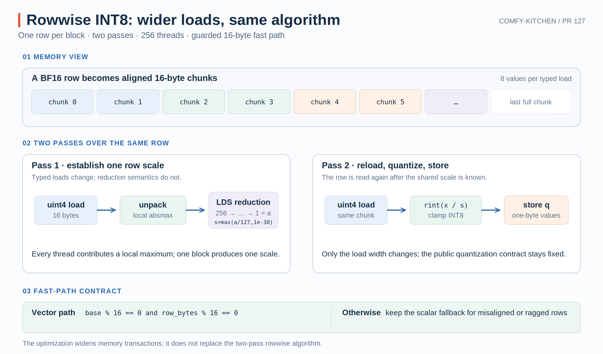

# Comfy-Kitchen PR #127：Rowwise INT8 的 16-byte 向量化

PR #127 优化的是一个看似简单、却很容易被访存拖慢的预处理 kernel：对矩阵的每一行求绝对值最大值，再用该行的 scale 量化成 INT8。

它没有改变“一行一个 block、两遍扫描、LDS 归约”的整体算法，而是把热循环中的标量读取替换为编译期定型的 16-byte 读取，同时为不满足对齐条件的输入保留原实现。

- PR：[#127 HIP: vectorize rowwise INT8 quantization with 16-byte loads](https://github.com/Comfy-Org/comfy-kitchen/pull/127)
- 本文对应源码：[`6b38b04`](https://github.com/Comfy-Org/comfy-kitchen/commit/6b38b04d8c3e6bb9c6b6a7462a7afd5eef5fbc28)
- 核心文件：[`quantize_int8.hip`](https://github.com/Comfy-Org/comfy-kitchen/blob/6b38b04d8c3e6bb9c6b6a7462a7afd5eef5fbc28/comfy_kitchen/backends/hip/ops/quantize_int8.hip)

{ width="95%" }

## 1. 算法基线：两遍扫描与行级归约

输入是 $X\in\mathbb{R}^{M\times K}$。每一行独立计算：

$$
a_m=\max_{0\le k<K}|X_{m,k}|,
\qquad
s_m=\max\left(\frac{a_m}{127},10^{-30}\right),
$$

$$
Q_{m,k}=\operatorname{clamp}
\left(\operatorname{rint}\left(\frac{X_{m,k}}{s_m}\right),-128,127\right).
$$

源码使用 `rintf`，即 round-to-nearest-even，并显式 clamp 到 INT8 范围；scale 的下界避免全零行产生除零问题。这些语义在 PR 前后没有变化，见 [`quant_round` 与 scalar kernel](https://github.com/Comfy-Org/comfy-kitchen/blob/6b38b04d8c3e6bb9c6b6a7462a7afd5eef5fbc28/comfy_kitchen/backends/hip/ops/quantize_int8.hip#L11-L48)。

量化必须分成两遍：第一遍得到整行的 $a_m$，第二遍才能使用最终 scale 量化每个元素。PR #127 优化的是每一遍怎样读取输入，而不是消除这两遍依赖。

每个 block 有 256 个线程，并独占一行：

```text
grid.x = M
block.x = 256

block m -> X[m, :]
thread t -> t, t+256, t+512, ...
```

第一遍中，每个线程对自己负责的元素求 local absmax，再把 256 个 local max 写入 LDS，通过树形归约得到整行最大值。第二遍仍按相同的 stride 重新读取输入并写出 INT8。

这个映射本身没有问题，但旧循环每次只通过运行时 `in_code` 读取一个元素。对 FP16/BF16 来说，一次逻辑读取只有 2 bytes；地址计算、类型分派和循环控制会反复出现在热路径中。

## 2. 改动核心：16-byte typed load

HIP 的 `uint4` 是四个 32-bit 无符号整数组成的 16-byte 类型。它与 INT4 量化没有关系，只是被用作一次搬运 128 bit 的载体。

新 kernel 通过输入类型在编译期计算一个 chunk 包含多少元素：

| 输入类型 | 单元素字节数 | 每个 `uint4` 包含的元素数 |
| --- | ---: | ---: |
| FP32 | 4 | 4 |
| FP16 | 2 | 8 |
| BF16 | 2 | 8 |

对应实现是 [`RowwiseVectorTraits`](https://github.com/Comfy-Org/comfy-kitchen/blob/6b38b04d8c3e6bb9c6b6a7462a7afd5eef5fbc28/comfy_kitchen/backends/hip/ops/quantize_int8.hip#L50-L60)：

```cpp
template <typename InputT>
struct RowwiseVectorTraits {
    static constexpr int kElements = sizeof(uint4) / sizeof(InputT);
};
```

线程分工也从“元素索引”变成“16-byte chunk 索引”：

```text
thread 0 -> chunk 0, 256, 512, ...
thread 1 -> chunk 1, 257, 513, ...
...
```

线程先执行一次 `uint4` load，把 16 bytes 放入寄存器，再在寄存器内展开为 4 或 8 个输入元素。第一遍用这些值更新 local max，第二遍再次以相同方式读取并量化。完整循环见 [vectorized kernel](https://github.com/Comfy-Org/comfy-kitchen/blob/6b38b04d8c3e6bb9c6b6a7462a7afd5eef5fbc28/comfy_kitchen/backends/hip/ops/quantize_int8.hip#L55-L98)。

这里应区分三个概念：

- 源码从多次窄 load 变成一次 16-byte typed load，这是可以直接确认的事实。
- 编译器是否生成预期的宽访存指令，需要检查生成 ISA。
- DRAM 实际流量还受 cache、合并访存和工作集影响，不能仅凭 `uint4` 推断。

两条路径都仍然使用：

```text
256 local maxima
  -> LDS red[256]
  -> 128 / 64 / 32 / ... / 1 的树形归约
  -> red[0]
```

也就是说，PR 的变量控制得很窄：

| 部分 | PR 前 | PR 后 |
| --- | --- | --- |
| block 与 row 的映射 | 一 block 一行 | 不变 |
| 第一次扫描 | 标量、运行时 dtype load | 16-byte、编译期 typed load |
| absmax 归约 | LDS tree reduction | 不变 |
| 第二次扫描 | 标量、运行时 dtype load | 16-byte、编译期 typed load |
| rounding / clamp | `rintf` + INT8 clamp | 不变 |

这种改法便于把性能变化归因到读取粒度和类型特化，也降低了同时引入归约错误的风险。

## 3. Fast path 的边界与寄存器取舍

launcher 只有在两个条件都成立时才进入 vectorized kernel：

1. 输入首地址按 16 bytes 对齐；
2. `K` 能被当前 dtype 的 `kElements` 整除。

最终 dispatch 见 [`launch_quantize_int8_rowwise_kernel`](https://github.com/Comfy-Org/comfy-kitchen/blob/6b38b04d8c3e6bb9c6b6a7462a7afd5eef5fbc28/comfy_kitchen/backends/hip/ops/quantize_int8.hip#L284-L310)。

第二个条件不仅用于避免尾部越界，也保证每一行的 byte stride 是 16 的倍数：

$$
\text{row address}_m
=\text{base}+m\times K\times \operatorname{sizeof}(T).
$$

若 base 对齐，但一行的字节数不是 16 的倍数，那么第二行开始仍可能失去对齐。`K % kElements == 0` 正好同时保证完整 chunk 和逐行对齐。

不满足条件时直接回到 scalar kernel，因此公开 API 不需要强迫调用者复制输入或补齐 K。测试还专门构造了 storage-offset view 与 ragged K，验证 aligned 与 fallback 输出一致，见 [`test_quantize_int8_rowwise_offset_matches_aligned`](https://github.com/Comfy-Org/comfy-kitchen/blob/6b38b04d8c3e6bb9c6b6a7462a7afd5eef5fbc28/tests/test_hip_wmma.py#L928-L943)。

既然输入会被读两遍，一个自然想法是把第一遍读到的值全部留在寄存器中。但每线程负责的元素数量随 K 增长。例如 BF16、`K=14336` 时：

```text
14336 / 256 = 56 elements per thread
```

若这 56 个 FP32 转换值跨整个 block reduction 保持活跃，会扩大 live range 和 VGPR 占用，可能降低 occupancy，甚至造成 spill。省掉第二遍源码 load 并不自动更快，因为第一遍数据还可能命中 cache。

PR #127 因而选择更保守的平衡：仍读两遍，但让每遍读取更宽、更容易被编译器专门化。

## 4. 性能结果与证据边界

PR 在 Radeon 8060S（`gfx1151`）、ROCm 7.2、aligned BF16 输入上报告：

| Shape（M × K） | Before | After | Speedup |
| --- | ---: | ---: | ---: |
| 4096 × 1024 | 0.0564 ms | 0.0269 ms | 2.09× |
| 8192 × 2048 | 0.4417 ms | 0.2196 ms | 2.01× |
| 4096 × 4096 | 0.4107 ms | 0.2268 ms | 1.81× |
| 18432 × 2048 | 0.9579 ms | 0.4999 ms | 1.92× |
| 512 × 14336 | 0.0996 ms | 0.0417 ms | 2.39× |
| 4096 × 14336 | 1.3498 ms | 0.8246 ms | 1.64× |

几何平均加速为 **1.96×**。这些数字来自 PR 的 rowwise quantizer microbenchmark，不代表后续 INT8 GEMM 或完整模型端到端也获得同样倍率。

## 5. 可以迁移到其他 kernel 的经验

这篇 PR 最值得复用的不是 `uint4` 这个类型，而是 fast path 的设计顺序：

1. 先固定 rounding、clamp、scale 下界和输出 dtype 等数学语义。
2. 保留已验证的线程映射与 reduction，只替换最热的读取循环。
3. 让 dtype 成为模板参数，减少热循环中的运行时分派。
4. 用地址对齐和 row stride 同时证明每一次 vector load 安全。
5. 保留 scalar fallback，让优化条件不泄漏成公开 API 限制。
6. 用 offset view、ragged K 和多 dtype 测试同时覆盖 fast path 与 fallback。

一句话概括：**PR #127 没有重写 rowwise quantization；它把两遍扫描中的输入读取改成了受严格对齐条件保护的 16-byte typed load。**
