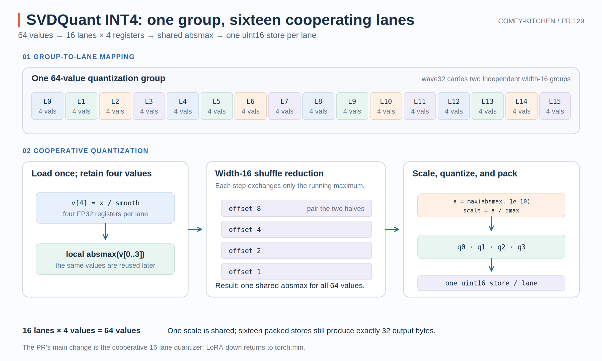

# Comfy-Kitchen PR #129：16-lane 协作的 SVDQuant INT4 Quantizer

SVDQuant 的主路径需要先把 activation 按 64 个元素一组量化成 packed INT4。旧 HIP kernel 让一个线程串行处理完整 group：扫描 64 个值求 absmax，再读一遍完成量化与 packing。

PR #129 把这个 group 交给 16 个 lane 协作：每个 lane 只保留 4 个平滑后的值，通过 width-16 shuffle 得到共同 scale，再把 4 个 INT4 nibble 合成一次 16-bit store。它同时删除专用 LoRA-down HIP kernel，改用 `torch.mm`。

- PR：[#129 HIP: optimize SVDQuant INT4 activation quantization](https://github.com/Comfy-Org/comfy-kitchen/pull/129)
- 本文对应源码：[`71fd9ed`](https://github.com/Comfy-Org/comfy-kitchen/commit/71fd9edb197eda150fd288d6a45c12a6944b0b97)
- 核心文件：[`svdquant_w4a4.hip`](https://github.com/Comfy-Org/comfy-kitchen/blob/71fd9edb197eda150fd288d6a45c12a6944b0b97/comfy_kitchen/backends/hip/ops/svdquant_w4a4.hip)

{ width="95%" }

## 1. SVDQuant 的量化语义与输出布局

可以把线性层拆成一条 INT4 主路径与一条低秩补偿路径：

```text
main path:
  x_smooth = x / smooth
  A_int4   = groupwise_quantize_int4(x_smooth)
  Y_main   = dequant(A_int4 @ W_int4^T, activation_scales, weight_scales)

low-rank path:
  L        = x @ lora_down
  Y_lora   = L @ lora_up^T

output:
  Y = Y_main + Y_lora + bias
```

PR 的主要加速数字来自第一步 activation quantizer。下游 W4A4 GEMM 解释了 packed data 和 scale 怎样被消费，但它不是这次 17–21× quantizer 加速的来源。

每行沿 K 轴按 64 个元素分组。对 group $g$ 中的元素：

$$
v_i=\frac{x_i}{\mathrm{smooth}_i},
\qquad
a=\max_i|v_i|,
\qquad
\tilde a=\max(a,10^{-10}),
\qquad
s=\frac{\tilde a}{q_{\max}},
$$

$$
q_i=\operatorname{clamp}\left(\operatorname{rint}\left(\frac{v_i}{s}\right),q_{\min},q_{\max}\right)
=\operatorname{clamp}\left(\operatorname{rint}\left(v_i\frac{q_{\max}}{\tilde a}\right),q_{\min},q_{\max}\right).
$$

| 模式 | $q_{\min}$ | $q_{\max}$ | nibble 语义 |
| --- | ---: | ---: | --- |
| signed | -7 | 7 | 保存补码的低 4 bit |
| unsigned | 0 | 15 | 保存非负 INT4 |

输出布局是：

```text
q        [M_pad, K/2]   int8 storage, two INT4 values per byte
ascales  [K/64, M_pad]  same floating dtype as x
lora_act [M_pad, R]     FP32
```

`ascales` 是 group-major，而不是常见的 `[M, K/64]`。kernel 用 `ascales[g * M_pad + m]` 写入，使下游 GEMM 沿 K group 推进时，同一 group 的各 row scale 连续。布局与 scale 写入见 [quantizer source](https://github.com/Comfy-Org/comfy-kitchen/blob/71fd9edb197eda150fd288d6a45c12a6944b0b97/comfy_kitchen/backends/hip/ops/svdquant_w4a4.hip#L75-L120)。

## 2. 从单线程两遍扫描到 16-lane 协作

scalar fallback 仍保留在最终源码中，因此可以直接看到旧映射：一个线程领取一个 64-element group。

```text
pass 1: load x and smooth 64 times -> absmax
pass 2: load x and smooth 64 times -> quantize -> pack pairs
```

这会产生四类成本：

- 64 次除法、绝对值和 max 串在同一个线程的依赖链上；
- `x` 与 `smooth` 在算法上读取两遍；
- 一个线程每次只写一个 packed byte；
- 一行 group 数少于 block 线程数时，大量线程没有任务。

以 `K=4096` 为例，一行只有 64 个 group，而 block 有 256 个线程。增加 block 线程数并不能解决 group 内部完全串行的问题。

新 kernel 使用三个编译期常量：

```cpp
kThreadsPerGroup = 16
kElemsPerThread  = 64 / 16 = 4
kGroupsPerBlock  = 256 / 16 = 16
```

线程索引被拆成：

```text
lane       = threadIdx.x % 16
group_slot = threadIdx.x / 16
```

于是一个 256-thread block 同时处理 16 个 group：

```text
threads   0..15  -> group slot 0
threads  16..31  -> group slot 1
...
threads 240..255 -> group slot 15

inside one group:
lane 0  -> elements  0.. 3
lane 1  -> elements  4.. 7
...
lane 15 -> elements 60..63
```

实际索引与循环见 [`svdquant_quant_kernel`](https://github.com/Comfy-Org/comfy-kitchen/blob/71fd9edb197eda150fd288d6a45c12a6944b0b97/comfy_kitchen/backends/hip/ops/svdquant_w4a4.hip#L79-L108)。当一行超过 16 个 group 时，同一 `group_slot` 以步长 16 继续处理后续 group。

每个 lane 读取并保存四个 `x / smooth` 结果：

```cpp
float values[4];
```

这四个值先用于 local absmax，跨过 shuffle reduction 后又直接用于量化，不需要重新读取 `x` 与 `smooth`。

它与“缓存一整行”有本质区别：每 lane 的活跃数据固定为 4 个 FP32，与 K 无关，寄存器预算可控。PR 的 code-object 检查也报告优化后的 quantizer 没有 private-memory spill。

源码能够直接证明必要 load 从两遍变为一遍，但不能把它简单等同为 DRAM 流量减半，因为旧实现的第二遍仍可能命中 cache。

每个 lane 先对自己的四个值求 local max，然后执行：

```cpp
for (int offset = 8; offset > 0; offset >>= 1) {
    absmax = fmaxf(absmax, __shfl_xor(absmax, offset, 16));
}
```

四轮 offset 为 `8, 4, 2, 1`。关键是最后一个参数 `width=16`：它把一个 wave32 分为 `[0,15]` 与 `[16,31]` 两个独立逻辑 subgroup，因此同一个物理 wave 可以同时归约两个 group，且 lane 0 不会错误地与 lane 16 交换。

这个 reduction 不需要 LDS，也不需要 block-wide barrier。结束后 16 个 lane 都持有同一个 absmax，只有逻辑 lane 0 写 group scale。对应代码见 [shuffle 与 scale 写入](https://github.com/Comfy-Org/comfy-kitchen/blob/71fd9edb197eda150fd288d6a45c12a6944b0b97/comfy_kitchen/backends/hip/ops/svdquant_w4a4.hip#L110-L120)。

每个 lane 量化四个保留值，然后按低位到高位拼成 `uint16_t`：

```text
bits  0..3  <- q0
bits  4..7  <- q1
bits  8..11 <- q2
bits 12..15 <- q3
```

完整 group 的存储守恒是：

```text
16 lanes × 4 INT4 values = 64 values
16 lanes × 2 bytes       = 32 bytes = 64 × 4 bits
```

packing 与 16-bit store 位于 [lines 122–135](https://github.com/Comfy-Org/comfy-kitchen/blob/71fd9edb197eda150fd288d6a45c12a6944b0b97/comfy_kitchen/backends/hip/ops/svdquant_w4a4.hip#L122-L135)。signed 模式下 `-1 & 0xF == 0xF`，这里只保存低四位；后续 INT4 MMA 按 signed 语义解释，不能在 packing 阶段把它改成 unsigned clamp。

## 3. Fast path、LoRA 与下游消费方式

只有 `x` 与 `smooth` dtype 相同且属于 FP32、FP16、BF16 时，launcher 才实例化 typed cooperative kernel。否则继续调用 scalar fallback，见 [dispatch](https://github.com/Comfy-Org/comfy-kitchen/blob/71fd9edb197eda150fd288d6a45c12a6944b0b97/comfy_kitchen/backends/hip/ops/svdquant_w4a4.hip#L139-L166)。

Python 正常入口会先把 `smooth` 转为 `x.dtype`，因此常规调用通常命中 fast path；native binding 仍保留 fallback 以保护低层调用。另一个不可省略的约束是 `K % 64 == 0`，因为每个 group 必须拥有完整 scale 与 32-byte packed output。

PR 的早期版本尝试过专用 LoRA-down kernel，但最终 head 删除了该实现。现在的路径是：

```python
torch.mm(lora_src, lora_down, out=lora_act_rows)
```

如果 `out=` 的 dtype/连续性条件不满足，则计算 `lora_src @ lora_down` 后复制到 FP32 `lora_act`。最终逻辑见 [`quantize_svdquant_w4a4`](https://github.com/Comfy-Org/comfy-kitchen/blob/71fd9edb197eda150fd288d6a45c12a6944b0b97/comfy_kitchen/backends/hip/__init__.py#L1227-L1275)。

这体现了一个重要工程判断：自定义 kernel 应与合理的 library baseline 比较，而不是只与旧 scalar kernel 比较。对标准矩阵乘法，成熟 BLAS 路径通常已经覆盖更多 shape、调度和硬件细节。

SVDQuant W4A4 GEMM 的 INT32 accumulator 不能跨多个 quant group 后才统一乘 scale，因为不同 group 的 activation scale 与 weight scale 不同。

对 group $g$，应当计算：

$$
Y_{m,n}\mathrel{+}=A^{(g)}_{m,n}\cdot s^A_{g,m}\cdot s^W_{g,n},
$$

其中 $A^{(g)}$ 是该 64-element group 的整数点积。最终 kernel 正是在每个 group 完成 MMA 后把 accumulator 转成 FP32 并乘对应两侧 scale，见 [`svdquant_gemm_kernel`](https://github.com/Comfy-Org/comfy-kitchen/blob/71fd9edb197eda150fd288d6a45c12a6944b0b97/comfy_kitchen/backends/hip/ops/svdquant_w4a4.hip#L217-L278)。

这部分解释了 quantizer 为什么必须输出 `[K/64, M_pad]` 的 scales；它是消费者所需的数据布局，不只是随意的转置。

## 4. 性能与验证边界

PR 在 Radeon 8060S（`gfx1151`）、ROCm 7.2 上报告的 quantizer median latency：

| dtype | Shape | Before | After | Speedup |
| --- | --- | ---: | ---: | ---: |
| FP16 | 4096 × 4096 | 3.723 ms | 0.214 ms | 17.4× |
| FP16 | 4096 × 14336 | 15.363 ms | 0.713 ms | 21.5× |
| BF16 | 4096 × 4096 | 3.731 ms | 0.212 ms | 17.6× |
| BF16 | 4096 × 14336 | 15.250 ms | 0.712 ms | 21.4× |
| FP32 | 4096 × 4096 | 2.604 ms | 0.350 ms | 7.4× |
| FP32 | 4096 × 14336 | 11.105 ms | 1.220 ms | 9.1× |

这些是 activation quantizer 的 microbenchmark，不是完整 W4A4 GEMM 或端到端模型收益。测试覆盖 signed/unsigned packing、group-major scale layout、padded rows 与 LoRA-down 对 `torch.mm` 的一致性，见 [SVDQuant tests](https://github.com/Comfy-Org/comfy-kitchen/blob/71fd9edb197eda150fd288d6a45c12a6944b0b97/tests/test_hip_wmma.py#L1979-L2027)。

一句话概括：**PR #129 把一个 64-element group 从“单线程两遍串行处理”改为“16 lanes 各持有 4 个值、shuffle 求 scale、每 lane 一次写出 4 个 nibble”，同时把标准 LoRA-down GEMM 交回 `torch.mm`。**
