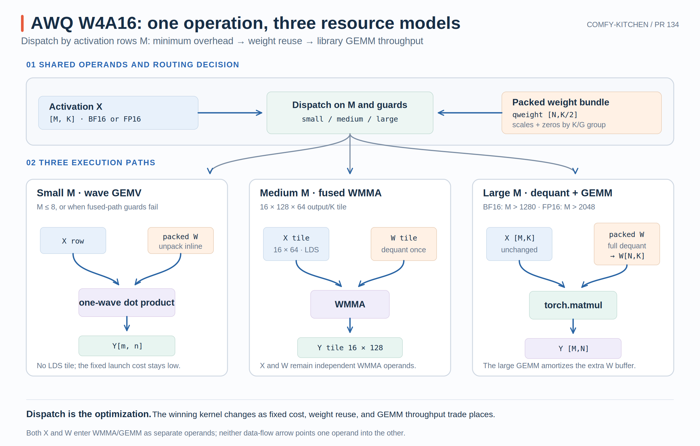

# Comfy-Kitchen PR #134：AWQ W4A16 的三级执行路径

AWQ W4A16 的计算同时包含 packed INT4 解包、按 group 反量化和浮点矩阵乘法。对不同的 activation 行数 $M$，最合适的执行方式并不相同：小 M 更在意启动与同步开销，中等 M 需要复用 weight，大 M 则适合把完整 weight 物化后交给成熟 GEMM library。

PR #134 的核心不是用 WMMA 替换所有路径，而是建立三级 dispatch：**small-M wave GEMV、medium-M fused WMMA、large-M dequant + `torch.matmul`**。

- PR：[#134 HIP: accelerate AWQ W4A16 with WMMA](https://github.com/Comfy-Org/comfy-kitchen/pull/134)
- 本文对应源码：[`a50e241`](https://github.com/Comfy-Org/comfy-kitchen/commit/a50e24175609410477fcd99f8f8d1099e029b625)
- 核心 HIP：[`gemv_awq.hip`](https://github.com/Comfy-Org/comfy-kitchen/blob/a50e24175609410477fcd99f8f8d1099e029b625/comfy_kitchen/backends/hip/ops/gemv_awq.hip)

{ width="95%" }

## 1. W4A16 计算语义与三级 dispatch

W4A16 表示 weight 以 4 bit 保存，activation 与输出使用 FP16/BF16。每个 quant group 有自己的 scale 与 zero correction：

$$
W_{n,k}=(q_{n,k}-8)s_{g,n}+z_{g,n},
\qquad g=\left\lfloor\frac{k}{G}\right\rfloor,
$$

$$
Y_{m,n}=\sum_k X_{m,k}W_{n,k}+b_n.
$$

实现中的主要布局是：

```text
x        [M, K]     FP16/BF16
qweight  [N, K/2]   each byte stores two unsigned INT4 values
wscales  [K/G, N]
wzeros   [K/G, N]
bias     [N]        optional
out      [M, N]
```

packed byte 的 low nibble 对应偶数 K，high nibble 对应奇数 K；解包后先减 8，再应用 scale 和 zero。源码中的数学定义与布局写在 [`gemv_awq.hip` 文件头](https://github.com/Comfy-Org/comfy-kitchen/blob/a50e24175609410477fcd99f8f8d1099e029b625/comfy_kitchen/backends/hip/ops/gemv_awq.hip#L4-L10)。

最终 Python 与 native dispatch 可以整理成：

```text
normalize x / scales / zeros to one compute dtype
  |
  |-- M > dtype-specific limit
  |      -> unpack and dequantize full W
  |      -> torch.matmul
  |
  `-- otherwise
         |
         |-- has_wmma && x is 16-byte aligned
         |      -> native use_wmma = true
         |           |-- M > 8, G = 64, dtype contract holds -> fused WMMA
         |           `-- otherwise                         -> wave GEMV
         |
         `-- wave GEMV
```

三个区间对应三种资源模型：

| 工作区间 | 执行路径 | 主要理由 |
| --- | --- | --- |
| 小 M，尤其 `M <= 8` | wave GEMV | 无 LDS tile，固定开销低 |
| 中等 M | fused WMMA | 一次反量化的 weight 可服务 16 行 activation |
| 很大 M | dequant + `torch.matmul` | 完整 weight 物化成本被大 GEMM 摊薄 |

最终代码中的 large-M 阈值是 **BF16: 1280，FP16: 2048**，见 [`_AWQ_W4A16_MMA_M_LIMITS`](https://github.com/Comfy-Org/comfy-kitchen/blob/a50e24175609410477fcd99f8f8d1099e029b625/comfy_kitchen/backends/hip/__init__.py#L1182-L1187)。PR 描述中的统一“`M > 2048`”是概括，阅读最终实现时应以这组 dtype-specific 阈值为准。

## 2. Small-M：一个 wave 计算一个输出

原有 GEMV kernel 的 block 是 `(wave_size, 8)`。在 wave32 设备上，一个 block 包含 8 个 wave：

```text
threadIdx.y = 0..7 -> 8 output columns
one wave           -> one (m, n) output
lane               -> a slice of K
```

每个 lane 每轮读取 4 个 packed bytes，也就是 8 个 weight：

```cpp
uchar4 packed = load(qweight[n, k/2]);
```

解包、减 8、应用当前 group 的 scale/zero，然后与对应的 8 个 activation 相乘。最后使用 wave reduction 合并 partial sum，由 lane 0 加 bias 并写出结果。完整实现见 [`gemv_awq_kernel`](https://github.com/Comfy-Org/comfy-kitchen/blob/a50e24175609410477fcd99f8f8d1099e029b625/comfy_kitchen/backends/hip/ops/gemv_awq.hip#L121-L163)。

这条路径没有 LDS tile 和 block-wide barrier，小 M 时很合适。它的问题是没有跨 activation row 复用：同一份 packed weight 会对每个 $m$ 重复执行 global load、nibble unpack 和反量化。

## 3. Medium-M：`16 × 128 × 64` fused WMMA

新增 kernel 的固定 tile 是：

```text
BM = 16
BN = 128
BK = 64
threads = 128 = 4 wave32
```

一个 block 计算 $16\times128$ 的输出 tile，沿 K 每次推进 64。`BK=64` 与 fast path 支持的 AWQ group size 相同，因此一个 K tile 内的每个 output column 只需要一组 scale 和 zero。

LDS 中的 activation buffer 为 `16 × 72`。每个线程搬运一个 16-byte `uint4`，也就是 8 个 FP16/BF16 元素：

```text
128 threads × 8 elements = 1024 elements
16 rows × 64 K           = 1024 elements
```

线程 0–7 搬 row 0 的八个 chunk，线程 8–15 搬 row 1，以此类推。最后一个 M tile 中越界的 row 写零。对应代码见 [activation staging](https://github.com/Comfy-Org/comfy-kitchen/blob/a50e24175609410477fcd99f8f8d1099e029b625/comfy_kitchen/backends/hip/ops/gemv_awq.hip#L52-L64)。

128 个线程分别负责 128 个 output column。每个线程读取当前 group 的 scale/zero，解包该列的 32 bytes packed INT4，生成 64 个浮点 weight 并写入 LDS：

```text
one thread -> one output column -> 64 dequantized weights
```

这一步本身仍有串行工作，但只执行一次；随后同一个 block 的 16 行 activation 都复用这 64 个 weight。相对 GEMV，理想的跨行反量化复用因子是 16。源码见 [weight staging](https://github.com/Comfy-Org/comfy-kitchen/blob/a50e24175609410477fcd99f8f8d1099e029b625/comfy_kitchen/backends/hip/ops/gemv_awq.hip#L66-L88)。

四个 wave 各自负责 32 个 output columns，每个 wave 内再用两个 16-column fragment：

```text
wave 0 -> columns   0..31
wave 1 -> columns  32..63
wave 2 -> columns  64..95
wave 3 -> columns 96..127
```

所有 wave 共享相同的 16-row activation tile。K 方向按 16 递增，完整 64-element group 需要四次 WMMA step。K tile 完成后，第二个 barrier 保证所有线程读完 LDS，下一轮才能覆盖 buffer，见 [WMMA loop](https://github.com/Comfy-Org/comfy-kitchen/blob/a50e24175609410477fcd99f8f8d1099e029b625/comfy_kitchen/backends/hip/ops/gemv_awq.hip#L89-L118)。

逻辑 K 宽度是 64，但两个 LDS buffer 的 row stride 都是 `64 + 8 = 72` elements。额外 8 个元素，即 16 bytes padding，用于改变相邻逻辑行在 LDS bank 上的映射，降低 WMMA fragment 读取时的冲突。

FP16/BF16 下总 LDS 占用为：

```text
activation:  16 × 72 × 2 =  2,304 bytes
weight:     128 × 72 × 2 = 18,432 bytes
total:                       20,736 bytes
```

这与 PR 的 code-object 检查结果一致。

## 4. Fast-path 边界与 large-M 路径

Python 入口先把 activation、scale 和 zero 统一到 `wscales.dtype`，然后只有在设备支持 WMMA 且 activation 指针 16-byte aligned 时才传入 `use_wmma=True`，见 [Python dispatch](https://github.com/Comfy-Org/comfy-kitchen/blob/a50e24175609410477fcd99f8f8d1099e029b625/comfy_kitchen/backends/hip/__init__.py#L1214-L1261)。

native launcher 还会再次确认：

- `M > 8`；
- `group_size == 64`；
- activation、scale 与 output dtype code 相同；
- output dtype 是 BF16 或 FP16。

否则继续走 wave GEMV。相关条件见 [native dispatch](https://github.com/Comfy-Org/comfy-kitchen/blob/a50e24175609410477fcd99f8f8d1099e029b625/comfy_kitchen/backends/hip/ops/gemv_awq.hip#L167-L218)。

这里的 fallback 不是失败路径，而是完整设计的一部分：它为 mixed dtype、非 64 group、misaligned input 和小 M 保留正确且低开销的实现。

当 M 很大时，每个 weight 会参与大量 activation rows 的计算。此时一次性执行：

```text
packed qweight
  -> unpack full [N, K]
  -> apply scale and zero
  -> x.matmul(weight.T)
```

虽然需要额外的完整浮点 weight buffer，但解包成本可被大 GEMM 摊薄，而 `torch.matmul` 能使用成熟的 library kernel。实现见 [`_awq_w4a16_dequant_then_matmul`](https://github.com/Comfy-Org/comfy-kitchen/blob/a50e24175609410477fcd99f8f8d1099e029b625/comfy_kitchen/backends/hip/__init__.py#L1190-L1211)。

因此“融合得更多”并不总是更快：中等 M 的 fused kernel 避免完整 weight materialization；大 M 的 library GEMM 则能用更强的矩阵乘法吞吐抵消这笔成本。

## 5. 性能结果与适用范围

在 Radeon 8060S（`gfx1151`）、ROCm 7.2、BF16、`N=K=4096` 上，PR 报告 medium-M 相对旧 GEMV 的结果：

| M | Before | After | Speedup |
| ---: | ---: | ---: | ---: |
| 1 | 0.119 ms | 0.119 ms | 1.00× |
| 8 | 0.757 ms | 0.757 ms | 1.00× |
| 16 | 1.493 ms | 0.149 ms | 10.05× |
| 64 | 5.947 ms | 0.609 ms | 9.76× |
| 256 | 24.117 ms | 1.228 ms | 19.64× |

`M<=8` 保持 GEMV，因此性能不变；M 增大后，weight 反量化的跨行复用开始体现。测试分别验证了 scalar fallback、misaligned input、aligned WMMA 和 dtype-specific large-M routing，见 [AWQ tests](https://github.com/Comfy-Org/comfy-kitchen/blob/a50e24175609410477fcd99f8f8d1099e029b625/tests/test_hip_wmma.py#L1538-L1667)。

一句话概括：**PR #134 的价值是把同一个 W4A16 运算按 M 划成三种资源模型，让小 M 避免固定开销、中等 M 在 LDS 中复用反量化 weight、大 M 交给完整 GEMM。**
