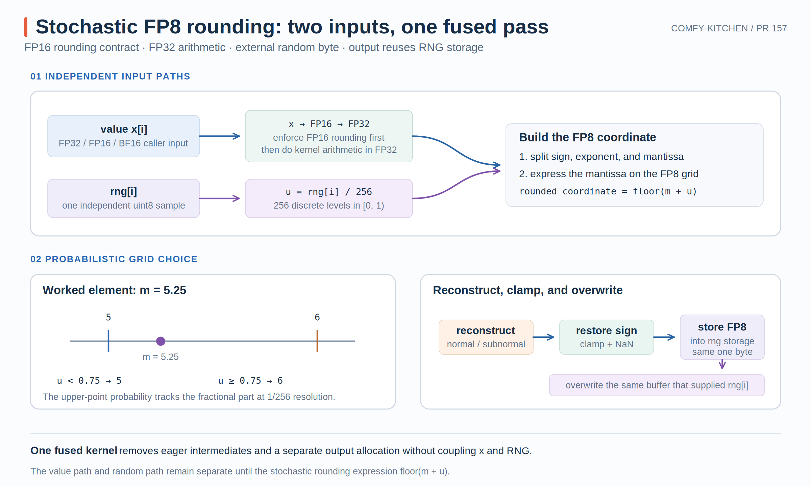

# Comfy-Kitchen PR #157：Triton 中的 FP8 随机舍入

当 native CUDA backend 不可用时，Comfy-Kitchen 原本只能用 eager 张量算子完成 FP8 stochastic rounding。那条路径会创建多个与输入同尺寸的中间 tensor，在大权重上既慢又占显存。

PR #157 增加一个 NVIDIA SM89+ 的 Triton 实现：每个元素读取一个外部提供的随机 byte，在单个 kernel 中完成 FP16 收窄、FP32 舍入计算、FP8 转换，并把结果覆盖回这块 RNG storage。

- PR：[#157 Add stochastic FP8 rounding to Triton backend](https://github.com/Comfy-Org/comfy-kitchen/pull/157)
- 本文对应源码：[`73ed759`](https://github.com/Comfy-Org/comfy-kitchen/commit/73ed759ac02d07ed2a091d834e86f8e8aa8eb89d)
- 核心文件：[`quantization.py`](https://github.com/Comfy-Org/comfy-kitchen/blob/73ed759ac02d07ed2a091d834e86f8e8aa8eb89d/comfy_kitchen/backends/triton/quantization.py)

{ width="95%" }

## 1. 接口语义与随机舍入目标

公开操作接收：

```text
x           FP32 / FP16 / BF16 tensor
rng         uint8 tensor, same shape and device as x
output_type torch.float8_e4m3fn or torch.float8_e5m2
```

它返回与 `x` 同形状的 FP8 tensor。`rng[i]` 不是 kernel 内生成的随机数，而是元素 `x[i]` 的随机舍入输入。

wrapper 会验证 device、shape 与 RNG dtype；非连续输入会先 materialize 成连续 tensor。若 RNG 本来连续，输出直接是同一 storage 的 FP8 view；若 RNG 非连续，输出复用的是新建的 contiguous copy，而不是调用者原来的 view。完整接口语义见 [`stochastic_rounding_fp8`](https://github.com/Comfy-Org/comfy-kitchen/blob/73ed759ac02d07ed2a091d834e86f8e8aa8eb89d/comfy_kitchen/backends/triton/quantization.py#L213-L279)。

设一个实数位于相邻两个可表示值 $a<b$ 之间：

$$
x=a+p(b-a),\qquad 0\le p<1.
$$

随机舍入以概率 $1-p$ 选 $a$，以概率 $p$ 选 $b$。于是：

$$
\mathbb{E}[\hat{x}]=(1-p)a+pb=x.
$$

理想的连续均匀随机数下，它不保证单次误差更小，但在未发生饱和的相邻格点之间满足无偏期望。这里实际使用一个随机 byte，因此概率只能以 $1/256$ 为步长逼近这个理想分布；饱和边界和特殊值也不属于上述无偏推导的范围。

在实现中，概率判断没有写成显式 branch，而是把随机数加到 mantissa coordinate 后取 floor。

## 2. 数值路径：先收窄到 FP16，再映射到 FP8 格点

kernel 的第一条数值语句是：

```python
x = load(...).to(tl.float16).to(tl.float32)
```

这意味着 FP32/BF16 输入不会直接以其原精度参与 FP8 stochastic rounding，而是先按 FP16 语义收窄，再转换为 FP32 完成后续算术。这样做不是 Triton 的偶然限制，而是为了匹配已有 native CUDA 路径。对应实现见 [kernel load](https://github.com/Comfy-Org/comfy-kitchen/blob/73ed759ac02d07ed2a091d834e86f8e8aa8eb89d/comfy_kitchen/backends/triton/quantization.py#L171-L184)。

因此这项操作的精确数值语义是：

```text
input dtype -> FP16 rounding -> FP32 stochastic-rounding arithmetic -> FP8
```

这也解释了为什么测试中的 reference 首先执行 `x.half().float()`，见 [reference implementation](https://github.com/Comfy-Org/comfy-kitchen/blob/73ed759ac02d07ed2a091d834e86f8e8aa8eb89d/tests/test_qdq.py#L133-L163)。

对绝对值 $|x|$，kernel 先计算并截断 biased exponent：

$$
e=\operatorname{clamp}(\lfloor\log_2|x|\rfloor+b,0,e_{\max}).
$$

其中 $b$ 是 exponent bias。两种输出格式的参数为：

| 格式 | exponent bias | mantissa bits | finite max |
| --- | ---: | ---: | ---: |
| E4M3FN | 7 | 3 | 448 |
| E5M2 | 15 | 2 | 57344 |

当 `e != 0` 时按 normal 数处理。先把数值换算成 mantissa 刻度：

$$
m_{normal}=\left(\frac{|x|}{2^{e-b}}-1\right)2^t,
$$

其中 $t$ 是 mantissa bits。

当 `e == 0` 时，隐藏的 leading 1 不存在，必须使用 subnormal 的固定最小步长：

$$
m_{sub}=\frac{|x|}{2^{-b+1-t}}.
$$

实现分别计算两个 coordinate，再用 `normal` mask 选择，见 [normal/subnormal mantissa calculation](https://github.com/Comfy-Org/comfy-kitchen/blob/73ed759ac02d07ed2a091d834e86f8e8aa8eb89d/comfy_kitchen/backends/triton/quantization.py#L186-L201)。

随机 byte $r\in[0,255]$ 被转换为：

$$
u=\frac{r}{256}\in\left\{0,\frac1{256},\ldots,\frac{255}{256}\right\}.
$$

然后计算：

$$
\hat m=\frac{\lfloor m+u\rfloor}{2^t}.
$$

例如 mantissa coordinate 为 `m = 5.25`：

```text
u < 0.75  -> floor(5.25 + u) = 5
u >= 0.75 -> floor(5.25 + u) = 6
```

因此这个例子的上舍概率恰好是 $64/256=0.25$。一般情况下，实际概率会以 $1/256$ 为分辨率逼近 mantissa 的小数部分。

`floor(m + u)` 也自然处理 mantissa carry：若结果跨过当前 exponent 的最大 mantissa，重建出的数值会落到下一个 exponent 的格点，不需要单独写“尾数溢出”分支。

kernel 先对 magnitude 做舍入，再恢复符号：

```text
x > 0 -> +1
x < 0 -> -1
x = 0 ->  0
```

得到 rounded value 后，先 clamp 到当前 FP8 格式的 finite range，再显式恢复 NaN：

```python
rounded = clamp(rounded, -fp8_max, fp8_max)
rounded = where(x != x, x, rounded)
```

显式 NaN 分支很重要，因为不同 target 上的 min/max 指令可能用有限操作数替换 NaN。相关代码位于 [reconstruction and saturation](https://github.com/Comfy-Org/comfy-kitchen/blob/73ed759ac02d07ed2a091d834e86f8e8aa8eb89d/comfy_kitchen/backends/triton/quantization.py#L203-L210)。

## 3. 存储复用与 Triton program 映射

每个元素的执行顺序是：

```text
load x[i]
load rng[i]
compute rounded FP8 value
store output[i]
```

kernel 在覆盖 `rng[i]` 之前已经把随机 byte 读入寄存器，所以 `rng_ptr` 与 `output_ptr` 可以指向同一块 storage。wrapper 使用：

```python
output = rng_flat.view(output_type)
```

`uint8` 与 FP8 都是一字节，因此 shape 与元素数不变，不需要额外 output allocation。测试不仅比较数值，还检查 contiguous RNG 的 `data_ptr()` 与输出相同，见 [buffer-reuse test](https://github.com/Comfy-Org/comfy-kitchen/blob/73ed759ac02d07ed2a091d834e86f8e8aa8eb89d/tests/test_qdq.py#L218-L246)。

“0 MiB 额外 PyTorch allocation”不等于没有内存流量：kernel 仍要读 input、读 RNG 并写 output，只是没有再分配一块同尺寸结果 tensor。

每个 Triton program 负责一段连续元素：

```text
pid -> [pid * BLOCK_SIZE, (pid + 1) * BLOCK_SIZE)
```

`pid` 被显式提升到 int64，使 `pid * block_size` 在超大 tensor 上不会按 32-bit offset 溢出。最后一个 program 使用 mask 保护越界元素。

wrapper 根据元素数选择：

| 元素数 | BLOCK_SIZE |
| ---: | ---: |
| `< 32K` | 128 |
| `< 128K` | 256 |
| `< 512K` | 512 |
| 其余 | 1024 |

这里的 `BLOCK_SIZE=1024` 表示一个 Triton program 处理 1024 个元素，不表示启动 1024 个 CUDA threads。PR 的离线编译结果显示各变体使用 4 warps。

## 4. Backend 注册边界

Triton backend 只在 CUDA 且 compute capability 至少为 8.9 时暴露这项操作，因为最终 store 需要目标支持 native FP8 conversion。约束定义见 [`_build_constraints`](https://github.com/Comfy-Org/comfy-kitchen/blob/73ed759ac02d07ed2a091d834e86f8e8aa8eb89d/comfy_kitchen/backends/triton/__init__.py#L173-L183)。

这条路径是 native CUDA extension 不可用时的高效替代，并没有取代 CUDA kernel。backend registry 会根据设备能力与可用实现选择路径。

## 5. 正确性证据与性能边界

PR 报告了两类关键验证：

- 对全部 65,536 个 FP16 bit pattern 与 256 个 RNG byte 穷举，在 E4M3FN/E5M2 上与 CUDA 实现零 mismatch；
- 在测试中覆盖 FP32/FP16/BF16 输入、两种 FP8 输出、四个 block-size 边界、NaN/Inf/zero、非连续输入与 buffer alias。

RTX 5090、BF16 → E4M3FN 的报告结果为：

| Elements | CUDA | Triton | Eager | Triton vs Eager |
| ---: | ---: | ---: | ---: | ---: |
| 1,048,576 | 0.0136 ms | 0.0266 ms | 0.3538 ms | 13.3× faster |
| 8,388,608 | 0.0329 ms | 0.0263 ms | 0.3696 ms | 14.1× faster |
| 16,777,216 | 0.0628 ms | 0.0415 ms | 0.8942 ms | 21.5× faster |

Triton 并非在所有大小上都快于 native CUDA；它的主要价值是相比 eager 消除多 kernel 与大中间 tensor，同时保持 CUDA 的舍入语义。

一句话概括：**PR #157 把外部 RNG 驱动的 FP8 随机舍入融合为一个 Triton elementwise kernel，并通过复用 RNG storage 避免独立输出分配。**
