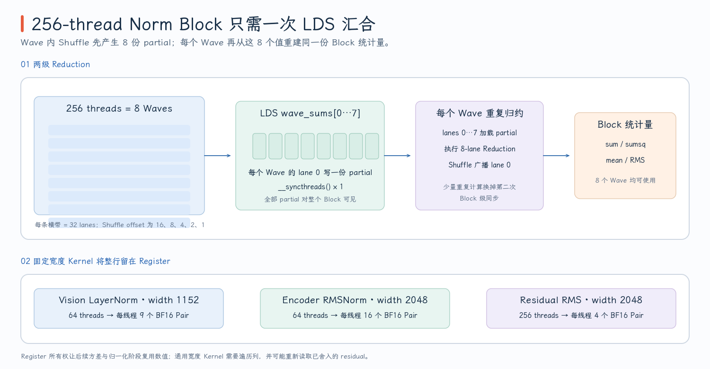
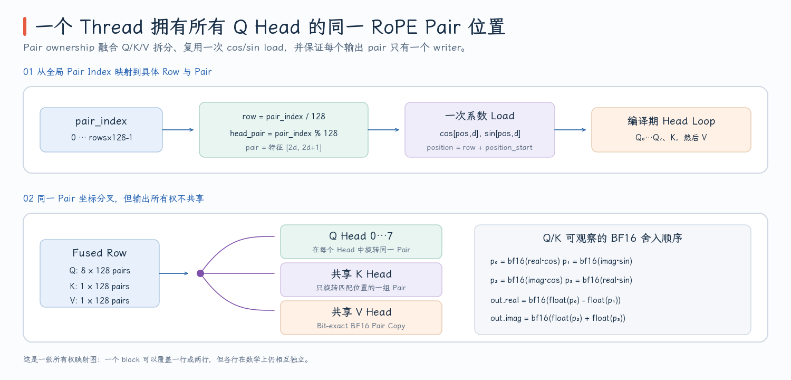
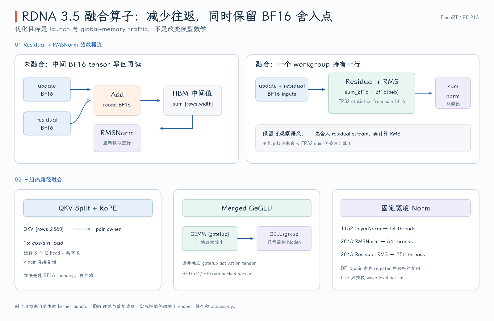

# FlashRT PR #213：RDNA 3.5 融合算子的线程映射与数值语义

Pi0.5 的主要计算量在 GEMM 和 Attention，但每层还要反复执行 RoPE、GELU/SiLU、residual 和 normalization。这些算子的 FLOPs 不高，如果每一步都单独启动 kernel、物化 BF16 中间 tensor 并再从 global memory 读回，延迟就可能主要由 launch 和数据往返决定。

这组 RDNA 3.5 实现不是把所有小算子塞进一个超大 kernel，而是根据数据流分别做三种优化：

- **数据流融合：** QKV split 与 RoPE、residual 与下一次 Norm 在同一次 launch 中完成。
- **布局融合：** gate/up 使用合并后的 `[gate | up]` 连续输出，activation 直接消费这个布局。
- **固定宽度专用化：** 1152 和 2048 宽的 Norm 让每个线程持有确定数量的 BF16 pair，并尽量跨越归约复用寄存器中的值。

下文固定到 PR #213 的合并提交 [`e2cf5d1`](https://github.com/flashrt-project/FlashRT/commit/e2cf5d1fe7209e3f4fbf212c5b6321467e8f4874)，从 Wave32 归约原语出发，再逐个拆解 RoPE、activation、residual 和 Norm 的线程 ownership、访存布局与 BF16 舍入点。

## 1. Wave32 归约是所有 Norm Kernel 的公共骨架

RDNA 的 native wavefront 是 32 lanes，而 FlashRT 原有的 CDNA 路径按 wave64 编写。PR 因此没有在旧 helper 上叠加条件分支，而是新建 [`common_hip_rdna.h`](https://github.com/flashrt-project/FlashRT/blob/e2cf5d1fe7209e3f4fbf212c5b6321467e8f4874/csrc/amd/kernels/common_hip_rdna.h#L1-L19)，把以下三个约定固定下来：

```text
wave size        = 32
BF16/FP16 input  -> FP32 arithmetic
FP32 result      -> BF16/FP16 output
```

`rdna_to_f32()` 和 `rdna_from_f32()` 把低精度转换集中在同一处，但它们不代表“kernel 内部始终是 FP32”。例如 RoPE 会在乘法后主动经过 BF16 再做加减，residual-Norm 也会先物化 BF16 sum 再统计 RMS。转换 helper 只定义基础能力，具体舍入点由每个 kernel 显式决定，见 [`common_hip_rdna.h`](https://github.com/flashrt-project/FlashRT/blob/e2cf5d1fe7209e3f4fbf212c5b6321467e8f4874/csrc/amd/kernels/common_hip_rdna.h#L21-L46)。

Wave 内 sum reduction 使用 `__shfl_down` 依次交换 16、8、4、2、1 lane 的数据：

```cpp
for (int offset = 16; offset > 0; offset >>= 1) {
    value += __shfl_down(value, offset, 32);
}
```

循环结束后 lane 0 拥有整个 wave 的和。`max` 归约的结构相同，只是把加法替换为 `fmaxf`。此外还有一组只归约 lane `[0,8)` 的 8-lane 版本，因为通用 Norm 固定使用 256 threads，最多只会生成 8 个 wave partial，见 [Wave32 reduction helpers](https://github.com/flashrt-project/FlashRT/blob/e2cf5d1fe7209e3f4fbf212c5b6321467e8f4874/csrc/amd/kernels/common_hip_rdna.h#L48-L82)。

一个 block 跨越多个 wave 时，`rdna_block_reduce_sum()` 的流程是：

1. 每个 wave 先独立完成 32-lane 归约。
2. 每个 wave 的 lane 0 把 partial 写入 LDS 中的 `wave_sums[wave]`。
3. 执行一次 `__syncthreads()`，保证所有 partial 可见。
4. 每个 wave 的 lane 0–7 都读取这些 partial，重复一次很小的 8-lane reduction。
5. 用 `__shfl(partial, 0)` 把 block 结果广播给该 wave 的全部线程。

第 4 步看起来会重复工作，但它只处理最多 8 个 float。这样每个 wave 都能自己得到 block result，不需要让 wave 0 把总结果写回 LDS、再进行第二次 block barrier。这是 [block reduction](https://github.com/flashrt-project/FlashRT/blob/e2cf5d1fe7209e3f4fbf212c5b6321467e8f4874/csrc/amd/kernels/common_hip_rdna.h#L84-L128) 中“只需一次 barrier”的真正含义；并不是说整个归约没有同步。

以 256-thread Norm block 为例，物理结构可写成：

```text
8 waves × 32 lanes
    └─ each wave lane 0 -> wave_sums[0..7]
                               └─ 8-lane reduction
                                      └─ broadcast to every wave
```

这套骨架被 LayerNorm、RMSNorm 和 AdaRMSNorm 共享。RoPE、activation 和普通 residual 没有跨元素统计量，因此完全不需要 LDS 或 block synchronization。

{ width="95%" }

## 2. QKV + RoPE：一个线程拥有一个复数 Pair

Encoder 和 Decoder 的 QKV GEMM 都直接生成一个 row-major fused tensor：

```text
qkv [rows,2560]
  = Q [rows,8,256]      # 2048 values
  | K [rows,1,256]      #  256 values
  | V [rows,1,256]      #  256 values
```

每个 head 的 256 个元素被视为 128 个复数 pair `(2d,2d+1)`。Kernel 不是让一个线程拥有一个 Q head，而是让全局线程 `pair_index` 拥有“某一行的某一个 pair 位置”：

```text
row       = pair_index / 128
head_pair = pair_index % 128
position  = row + position_start
```

对于这个 `(row,head_pair)`，线程只读取一次 `cos[position,head_pair]` 和 `sin[position,head_pair]`，然后在编译期展开的 8 次循环中处理 8 个 Q head 的同一 pair，接着处理唯一的 K head，最后原样复制 V pair。索引关系直接对应 [`qkv_rope_rdna_kernel`](https://github.com/flashrt-project/FlashRT/blob/e2cf5d1fe7209e3f4fbf212c5b6321467e8f4874/csrc/amd/kernels/rope_rdna.hip#L37-L90)：

```text
input_base = row * 1280 pairs

Q(head) = input_base + head * 128 + head_pair
K       = input_base + 1024       + head_pair
V       = input_base + 1024 + 128 + head_pair
```

这样的 ownership 同时解决了三件事：Q/K/V 的 split 不再是独立 kernel；8 个 Q head 和共享 K 复用同一份 RoPE 系数；每个输出 pair 只有一个 writer，所以不需要 LDS、atomic 或 block barrier。固定布局常量可在 [`rope_rdna.hip`](https://github.com/flashrt-project/FlashRT/blob/e2cf5d1fe7209e3f4fbf212c5b6321467e8f4874/csrc/amd/kernels/rope_rdna.hip#L25-L34) 中核对。

{ width="95%" }

启动配置又根据 rows 区分两类工作负载：

| 场景 | `rows` | threads/block | pair 数 | block 与行的关系 |
| --- | ---: | ---: | ---: | --- |
| Decoder action chunk 示例 | 10 | 256 | 1280 | 5 个 block，每个 block 恰好覆盖 2 行 |
| Encoder prefix 示例 | 559 | 128 | 71552 | 559 个 block，每个 block覆盖 1 行 |

Host 端对 `rows <= 16` 使用 256 threads，否则使用 128 threads，见 [`qkv_rope_rdna()`](https://github.com/flashrt-project/FlashRT/blob/e2cf5d1fe7209e3f4fbf212c5b6321467e8f4874/csrc/amd/kernels/rope_rdna.hip#L94-L103)。这是物理 launch 形状；“一个 block 覆盖两行”不表示两行之间有数学上的关系，它们只是连续的 pair index 恰好被同一个 block 覆盖。Pipeline 在 Encoder 和 Decoder 中都直接把 fused QKV 交给这个算子，见 [Encoder 调用点](https://github.com/flashrt-project/FlashRT/blob/e2cf5d1fe7209e3f4fbf212c5b6321467e8f4874/flash_rt/models/pi05/torch_pipeline.py#L279-L305) 与 [Decoder 调用点](https://github.com/flashrt-project/FlashRT/blob/e2cf5d1fe7209e3f4fbf212c5b6321467e8f4874/flash_rt/models/pi05/torch_pipeline.py#L400-L433)。

RoPE 的数值语义比线程映射更容易被写错。对于 `real` 和 `imag`，这个 kernel 并不是计算一次 FP32 FMA 后再输出 BF16，而是先分别舍入四个乘积：

$$
\begin{aligned}
p_0&=\operatorname{bf16}(\mathrm{real}\cdot\cos), &
p_1&=\operatorname{bf16}(\mathrm{imag}\cdot\sin),\\
p_2&=\operatorname{bf16}(\mathrm{imag}\cdot\cos), &
p_3&=\operatorname{bf16}(\mathrm{real}\cdot\sin),\\
\mathrm{out}_{\mathrm{real}}&=\operatorname{bf16}(\operatorname{float}(p_0)-\operatorname{float}(p_1)),\\
\mathrm{out}_{\mathrm{imag}}&=\operatorname{bf16}(\operatorname{float}(p_2)+\operatorname{float}(p_3)).
\end{aligned}
$$

Q 和 K 都保留这些 rounding point，V 则是 BF16 pair 的 bit-exact copy，见 [Q/K 旋转与 V copy](https://github.com/flashrt-project/FlashRT/blob/e2cf5d1fe7209e3f4fbf212c5b6321467e8f4874/csrc/amd/kernels/rope_rdna.hip#L58-L89)。因此把四个乘积合成 FP32 FMA 虽然在实数代数上等价，却不再复现原模型可观察的 BF16 计算序列。

## 3. Packed Activation、Merged GeGLU 与 Residual Ownership

Activation kernel 没有跨元素依赖：每个输出只由同一位置的输入决定。因此这里的主要问题不是归约，而是如何让一次 load/store 携带更多 BF16 值，以及如何不再为 gate 和 up 物化两个独立 activation tensor。

**GELU 公式为什么改写为 exp。** PyTorch 的 tanh approximation 可写成：

$$
\operatorname{GELU}(x)\approx\frac12x\left(1+\tanh(a)\right),
\qquad
a=\sqrt{\frac{2}{\pi}}x\left(1+0.044715x^2\right).
$$

利用 $1+\tanh(a)=2/(1+e^{-2a})$，kernel 计算：

$$
\operatorname{GELU}(x)\approx
\frac{x}{1+\exp\left(-1.5957691216057308x(1+0.044715x^2)\right)}.
$$

这不是换用另一种 GELU approximation，而是把同一个 tanh 公式代数改写成 gfx11 上更直接的 `__expf` 序列。系数与实现见 [`gelu_tanh_rdna()`](https://github.com/flashrt-project/FlashRT/blob/e2cf5d1fe7209e3f4fbf212c5b6321467e8f4874/csrc/amd/kernels/activation_rdna.hip#L30-L40)。

Host dispatch 根据 extent 是否能完整向量化选择路径，而不是在 kernel 内为最后一个不对齐元素混合复杂分支：

| 算子 | 向量路径 | 一个线程处理 | 不能完整向量化时 |
| --- | --- | ---: | --- |
| GELU | `__hip_bfloat162` | 2 个 BF16 | `size` 为奇数 |
| SiLU | `__hip_bfloat162` | 2 个 BF16 | `size` 为奇数 |
| separate GeGLU | `RdnaBf16x4` | 4 个 gate + 4 个 up | `size % 4 != 0` |
| merged GeGLU | `__hip_bfloat162` | 同一行的 2 个 gate + 2 个 up | `width` 为奇数 |

四种 host launcher 都使用 256 threads，标量路径保留完整 ABI 的 odd-tail 正确性，见 [`activation_rdna.hip`](https://github.com/flashrt-project/FlashRT/blob/e2cf5d1fe7209e3f4fbf212c5b6321467e8f4874/csrc/amd/kernels/activation_rdna.hip#L42-L163) 和 [host dispatch](https://github.com/flashrt-project/FlashRT/blob/e2cf5d1fe7209e3f4fbf212c5b6321467e8f4874/csrc/amd/kernels/activation_rdna.hip#L167-L230)。向量化改变的是指令和交易粒度，不是每个元素的 FP32 activation 公式和最终 BF16 输出。

**Merged GeGLU 如何消费 `[gate | up]`。** RDNA frontend 先把原 checkpoint 中的 gate 和 up 权重沿输出维拼接成一个 `[K,2H]` 权重，见 [`pi05_rdna35.py`](https://github.com/flashrt-project/FlashRT/blob/e2cf5d1fe7209e3f4fbf212c5b6321467e8f4874/flash_rt/amd/frontends/torch/pi05_rdna35.py#L166-L180)。一次 GEMM 于是生成：

```text
gate_up [rows,2*width] = [gate columns | up columns]
```

Merged kernel 用二维 grid，`blockIdx.y` 选 row，`blockIdx.x` 和 `threadIdx.x` 选该行中的 column pair。对于偶数 width，一个线程读取 `gate_up[base+pair]` 和 `gate_up[base+width_pairs+pair]`，然后只写一个最终 hidden pair，见 [`gelu_mul_merged_packed_rdna_kernel`](https://github.com/flashrt-project/FlashRT/blob/e2cf5d1fe7209e3f4fbf212c5b6321467e8f4874/csrc/amd/kernels/activation_rdna.hip#L103-L137)。

以 Decoder 的 `rows=10,width=4096` 为例，`width_pairs=2048`，x 方向需要 $\lceil2048/256\rceil=8$ 个 block，y 方向是 10 行，总共启动 80 个 block。每个输出 channel 仍完成 `GELU(gate) * up`；节省的是两次 GEMM launch 之间的输出分裂以及独立 activation 中间值，不是减少 GeGLU 本身的元素数。Encoder/Decoder 的实际分流在 [`torch_pipeline.py`](https://github.com/flashrt-project/FlashRT/blob/e2cf5d1fe7209e3f4fbf212c5b6321467e8f4874/flash_rt/models/pi05/torch_pipeline.py#L325-L338) 和 [`torch_pipeline.py`](https://github.com/flashrt-project/FlashRT/blob/e2cf5d1fe7209e3f4fbf212c5b6321467e8f4874/flash_rt/models/pi05/torch_pipeline.py#L463-L486) 中可以看到。

**Residual 的 pair ownership。** 普通 residual 与 gated residual 分别实现：

$$
\mathrm{out}_i=\operatorname{bf16}(\operatorname{float}(r_i)+\operatorname{float}(u_i)),
$$

$$
\mathrm{out}_{m,j}=\operatorname{bf16}
\left(\operatorname{float}(r_{m,j})+
\operatorname{float}(u_{m,j})\operatorname{float}(g_j)\right).
$$

向量路径中每个线程拥有一个 BF16x2 pair。`template<bool HasGate>` 使无 gate 版本在编译期完全移除 `pair % width_pairs`、gate load 和运行时分支；有 gate 版本则通过 modulo 让所有 row 共享同一个 width 长度的 gate。只有 `size` 或 `width` 为奇数时才使用标量尾部路径，见 [`elementwise_rdna.hip`](https://github.com/flashrt-project/FlashRT/blob/e2cf5d1fe7209e3f4fbf212c5b6321467e8f4874/csrc/amd/kernels/elementwise_rdna.hip#L22-L65) 和 [host dispatch](https://github.com/flashrt-project/FlashRT/blob/e2cf5d1fe7209e3f4fbf212c5b6321467e8f4874/csrc/amd/kernels/elementwise_rdna.hip#L69-L95)。

{ width="95%" }

## 4. Norm：一行如何被线程分摊，以及为什么要先舍入 Residual

所有 Norm kernel 都使用“一个 workgroup 负责一行”的映射。这样该行的 mean、variance 或 mean square 不需要跨 block 合并，block 内只需前面的 Wave32 + LDS 两级归约。区别在于：固定宽度 kernel 可以把整行分配到编译期已知的寄存器数组，通用 kernel 则必须用 `column += blockDim.x` 循环处理任意 width。

三个热宽度的物理分工如下：

| 路径 | width | threads | waves | 每线程持有的 BF16 pair | 每线程元素数 |
| --- | ---: | ---: | ---: | ---: | ---: |
| Vision LayerNorm | 1152 | 64 | 2 | 9 | 18 |
| Encoder RMSNorm | 2048 | 64 | 2 | 16 | 32 |
| Encoder residual + RMSNorm | 2048 | 256 | 8 | 4 | 8 |

这些数字直接来自 `kPairsPerThread = Width / (2 * Threads)`。例如 width 1152 的 LayerNorm，线程 `t` 依次读取 pair `t,t+64,...,t+8×64`，共 9 个 pair。它先把 18 个 BF16 值累加到 `local_sum`，block reduction 得到 mean；然后直接使用寄存器数组 `values[9]` 计算 variance，再次使用同一数组完成 affine 变换。中间不需要重新读取 input row，详见 [`layer_norm_wide_rdna_kernel`](https://github.com/flashrt-project/FlashRT/blob/e2cf5d1fe7209e3f4fbf212c5b6321467e8f4874/csrc/amd/kernels/norm_rdna.hip#L29-L95)。

RMSNorm 不需要减 mean，因此只累加 $\sum_jx_j^2$：

$$
\operatorname{RMS}(x)=
\sqrt{\frac1W\sum_{j=0}^{W-1}x_j^2+\epsilon},
\qquad
y_j=\operatorname{bf16}\left(\frac{x_j}{\operatorname{RMS}(x)}\right).
$$

width 2048 的专用路径让 64 个线程各持有 16 个 pair，统计完成后从寄存器直接生成输出，见 [`rms_norm_wide_rdna_kernel`](https://github.com/flashrt-project/FlashRT/blob/e2cf5d1fe7209e3f4fbf212c5b6321467e8f4874/csrc/amd/kernels/norm_rdna.hip#L97-L135)。

通用路径固定使用 256 threads。以 Decoder AdaRMS 的 width 1024 为例，线程 `t` 在每个 pass 中处理 `t,t+256,t+512,t+768` 四个标量。Modulation 布局为：

```text
modulation [3*width] = [scale | shift | gate]
                            ^        ^
                            |        └─ Python 返回给下一个 residual
                            └─ AdaRMS HIP kernel 只消费 scale/shift
```

Kernel 先对 input 计算 RMS，再执行 `normalized * (1 + scale) + shift`。`gate` 不是当前 AdaRMS 的归一化参数，而是返回给后续 residual update 的系数。这个边界在 [`adarms_rdna_kernel`](https://github.com/flashrt-project/FlashRT/blob/e2cf5d1fe7209e3f4fbf212c5b6321467e8f4874/csrc/amd/kernels/norm_rdna.hip#L241-L264) 和 [`Rdna35TensorOps.adarms`](https://github.com/flashrt-project/FlashRT/blob/e2cf5d1fe7209e3f4fbf212c5b6321467e8f4874/flash_rt/amd/hardware/rdna35/ops.py#L64-L86) 中分别体现为指针访问和 Python slice。

**Residual-Norm 融合的关键是保留 BF16 舍入点。** 未融合的计算图会先生成可见的 BF16 residual stream，下一个 Norm 再读取这个 BF16 tensor。因此融合 kernel 必须实现：

$$
s_j=\operatorname{bf16}\left(r_j+u_jg_j\right),
\qquad
\rho=\operatorname{rsqrt}\left(
\frac1W\sum_j\operatorname{float}(s_j)^2+\epsilon\right).
$$

无 gate 的 residual-RMS 只需令 $g_j=1$。对 AdaRMS，第二个输出为：

$$
n_j=\operatorname{bf16}\left(
\operatorname{float}(s_j)\rho(1+\mathrm{scale}_j)+\mathrm{shift}_j
\right).
$$

`output_sum` 返回 $s$，`output_norm` 返回 $n$。如果直接使用未舍入的 FP32 `r + u*g` 统计 RMS，即使最后再 cast 为 BF16，归一化因子也已经不同，融合路径便不再等价于“先写 BF16、再读 BF16”的原始计算图。

width 2048 的 residual-RMS 专用版本会把舍入后的 4 个 BF16 pair 留在每个线程的 `values[]` 中，因此 RMS 统计后不需要为 normalized output 重读 `output_sum`，见 [`residual_rms_wide_rdna_kernel`](https://github.com/flashrt-project/FlashRT/blob/e2cf5d1fe7209e3f4fbf212c5b6321467e8f4874/csrc/amd/kernels/norm_rdna.hip#L137-L184)。通用 residual-RMS 和 width 1024 的 residual-AdaRMS 则会在第一个 pass 写 `output_sum`，完成 block reduction 后在第二个 pass 读回它来生成 `output_norm`。它们仍然消除了独立 kernel 边界，但不应被误写成“所有融合 Norm 都不再重读 residual”，详见 [generic residual kernels](https://github.com/flashrt-project/FlashRT/blob/e2cf5d1fe7209e3f4fbf212c5b6321467e8f4874/csrc/amd/kernels/norm_rdna.hip#L266-L323) 和 [host specialization](https://github.com/flashrt-project/FlashRT/blob/e2cf5d1fe7209e3f4fbf212c5b6321467e8f4874/csrc/amd/kernels/norm_rdna.hip#L327-L383)。

## 5. Python Dispatch、Fallback 与正确性边界

HIP kernel 并不直接决定自己是否适用。`Rdna35TensorOps` 先把环境开关、固定 width 和布局条件收敛成 provider 级 dispatch，Pipeline 再根据这些 capability 选择融合图还是可读的 PyTorch 路径。因此不能只看 `*.hip` 文件就断言“所有形状都走专用 kernel”。

[`Rdna35TensorOps`](https://github.com/flashrt-project/FlashRT/blob/e2cf5d1fe7209e3f4fbf212c5b6321467e8f4874/flash_rt/amd/hardware/rdna35/ops.py#L8-L174) 的实际边界如下：

| Provider 方法 | 进入 HIP 路径的条件 | 其他情况 |
| --- | --- | --- |
| `qkv_rope` | Pipeline 的 `fused_rope` 开关已选中它；kernel 固定处理 Pi0.5 的 8Q/1K/1V、head dim 256 | Pipeline 拆分 Q/K/V，用 PyTorch RoPE 并显式 copy K/V |
| `layer_norm` | `fused_large_ops` 开启且 width=1152 | FP32 `F.layer_norm` 后转回 BF16 |
| `rms_norm` | `fused_large_ops` 开启、无 weight 且 width=2048 | PyTorch FP32 RMS；有 weight 时再乘 `1 + weight` |
| `adarms` | `fused_decoder_ops` 开启且 width=1024 | PyTorch FP32 RMS、scale 和 shift |
| `gelu` | `fused_large_ops` 开启且 width=4304 | PyTorch FP32 tanh-approximate GELU |
| `gelu_mul` | `fused_decoder_ops` 开启、width=4096，且 gate/up 连续 | PyTorch GELU 与乘法 |
| `gelu_mul_merged` | Encoder 或 Decoder 的 merged-FFN 开关开启 | 该 API 直接报错；Pipeline 应选择 separate gate/up 路径 |
| `silu` | `fused_decoder_ops` 开启且 width=1024 | PyTorch FP32 SiLU |
| `residual` | Decoder width=1024；或 `fused_large_ops` 下无 gate 的 width 1152/2048 | PyTorch FP32 计算后转 BF16 |
| `residual_rms` | `fused_large_ops` 开启且 width=2048 | 分解为 provider 的 `residual()` 和 `rms_norm()` |
| `residual_adarms` | `fused_decoder_ops` 开启、`cond is None`、已提供 modulation，且 width=1024 | 分解为 provider 的 `residual()` 和 `adarms()` |

`adarms()` 有两种入口。如果传入 `cond`，Python 先用 `torch.addmm(bias, cond, weight)` 生成 `[scale|shift|gate]`，再把 modulation 交给 HIP kernel；如果 modulation 已经由每个 diffusion step 预计算，则可以直接传入。相应地，融合 `residual_adarms()` 只融合 residual、RMS 和 modulation 应用，**没有** 把产生 modulation 的 GEMM 也塞进 HIP kernel。Decoder 中“现算 modulation”和“使用预计算 modulation”的两条路径可在 [`torch_pipeline.py`](https://github.com/flashrt-project/FlashRT/blob/e2cf5d1fe7209e3f4fbf212c5b6321467e8f4874/flash_rt/models/pi05/torch_pipeline.py#L360-L399) 与 [residual-AdaRMS 调用点](https://github.com/flashrt-project/FlashRT/blob/e2cf5d1fe7209e3f4fbf212c5b6321467e8f4874/flash_rt/models/pi05/torch_pipeline.py#L445-L512) 中对照。

这也解释了为什么“fallback”不总等于“全部回到 PyTorch”。例如 `residual_rms()` 的 fallback 会再调用 provider 内的 `residual()` 和 `rms_norm()`；它们可能因为另一组开关和 width 条件而继续选中 HIP。Fallback 的含义是“放弃当前这个融合边界”，而不是强制后续所有算子都在 ATen 中执行。

更底层的 raw HIP ABI 只接收指针、rows、width 和 stream，没有像 PyTorch operator 那样逐项验证 dtype、shape 和 stride。它依赖 frontend 预分配的 contiguous BF16 buffer 以及 provider 的固定形状 dispatch；脱离这一层约束直接调用 `data_ptr()` 入口，不是被支持的通用用法。

测试证据也需要分层解读：

- [`test_amd_rdna35_ops.py`](https://github.com/flashrt-project/FlashRT/blob/e2cf5d1fe7209e3f4fbf212c5b6321467e8f4874/tests/test_amd_rdna35_ops.py#L285-L424) 是算子级 parity。Q/K RoPE 用 `2e-2` 容差，V copy、residual sum 和普通 residual 要求 bit-exact；AdaRMS、residual-AdaRMS、separate/merged GeGLU、RMSNorm 和 LayerNorm 用 `2e-2` 级别容差。这些用例证明单算子实现在规定容差内复现 ATen 参考计算。
- [`test_optimized_path_matches_aten_fallback`](https://github.com/flashrt-project/FlashRT/blob/e2cf5d1fe7209e3f4fbf212c5b6321467e8f4874/tests/test_amd_rdna35_model.py#L83-L135) 在相同 FlashRT frontend、权重和 fixed noise 下对比 optimized 与 ATen fallback。它是很重要的端到端 regression check，但两边共享同一套前处理、权重映射和 pipeline，因此不能单独称为独立正确性 oracle。
- 真正的独立端到端 oracle 是可选的 OpenPI NPZ fixture。[`test_independent_reference_fixture`](https://github.com/flashrt-project/FlashRT/blob/e2cf5d1fe7209e3f4fbf212c5b6321467e8f4874/tests/test_amd_rdna35_model.py#L172-L205) 会检查 `producer=openpi`、上游 revision、checkpoint SHA-256、step 数与 action shape，然后比较 `raw_actions` 和最终 `actions`。没有提供这份 fixture 时测试会 skip，因此“代码中存在该测试”不等于“当前环境已经跑过独立 oracle”。

因此，这组融合算子的核心不是简单减少 kernel 数量，而是在不改变 Pi0.5 可观察 BF16 语义的前提下，为固定布局建立更精确的线程 ownership：RoPE 按 pair 分工，activation 按 packed element 分工，Norm 则由一个 workgroup 拥有完整行并通过 Wave32/LDS 完成统计量归约。Python dispatch 和分层测试把这些专用假设限制在已验证的路径中。
