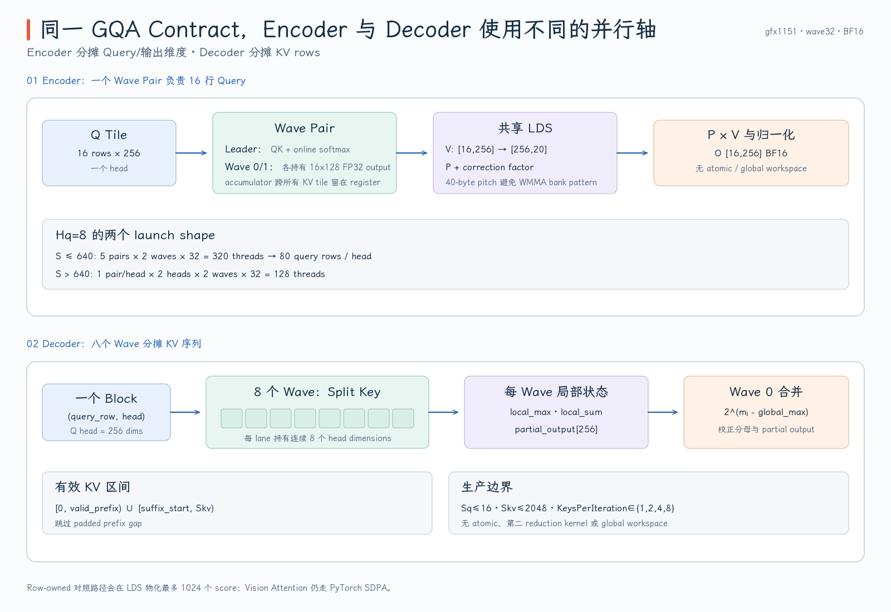
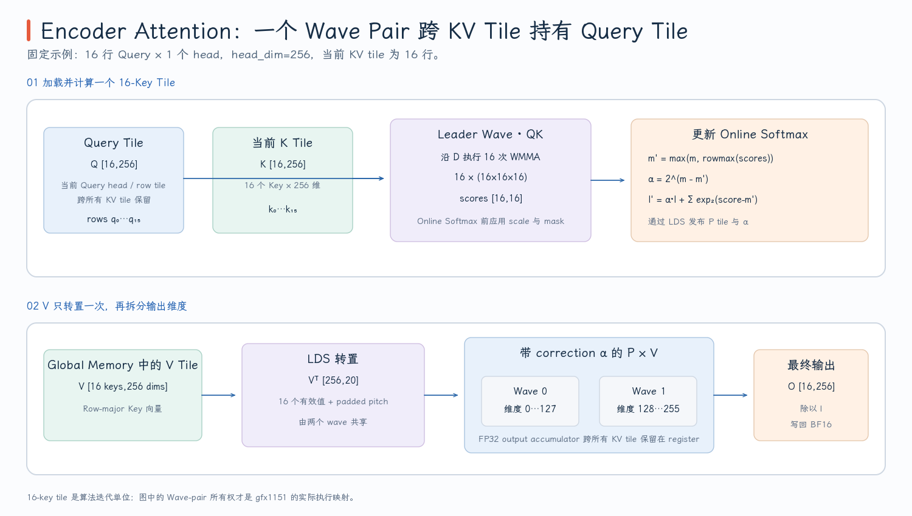
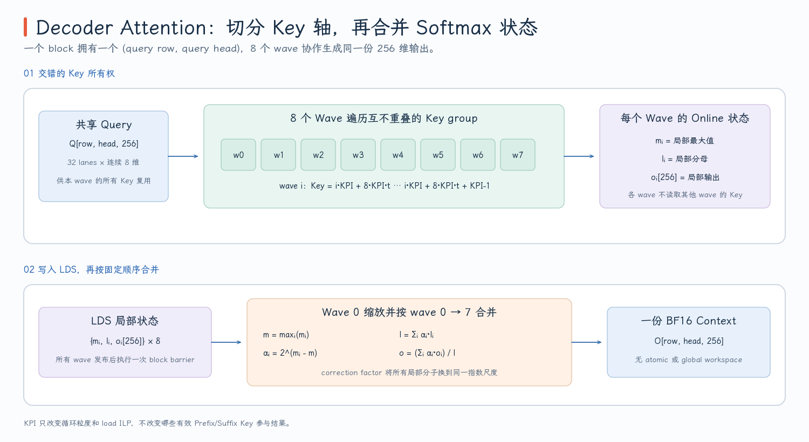

# FlashRT PR #213：RDNA 3.5 Attention Kernel

Pi0.5 的 Prefix Encoder 与 Action Decoder 都使用 GQA，但它们不是同一种 GPU 工作负载。Encoder 一次处理数百个 Query row，Q 和 K/V 的序列长度接近，适合沿 Query 分块并让多个 Query tile 共享同一块 V；Decoder 每次只有一小段 action Query，却要读取完整 Prefix K/V，适合沿 KV 序列拆分归约。PR #213 因而提供两条独立的 BF16 kernel：Encoder 使用 **wave-pair FlashAttention**，Decoder 使用 **八 wave split-key online softmax**。

- 固定源码版本：[`e2cf5d1`](https://github.com/flashrt-project/FlashRT/commit/e2cf5d1fe7209e3f4fbf212c5b6321467e8f4874)
- Encoder kernel：[`encoder_flash_rdna.hip`](https://github.com/flashrt-project/FlashRT/blob/e2cf5d1fe7209e3f4fbf212c5b6321467e8f4874/csrc/amd/attention/encoder_flash_rdna.hip)
- Decoder kernel：[`decoder_flash_rdna.hip`](https://github.com/flashrt-project/FlashRT/blob/e2cf5d1fe7209e3f4fbf212c5b6321467e8f4874/csrc/amd/attention/decoder_flash_rdna.hip)
- Python 分派：[`Rdna35AttentionBackend`](https://github.com/flashrt-project/FlashRT/blob/e2cf5d1fe7209e3f4fbf212c5b6321467e8f4874/flash_rt/amd/hardware/rdna35/attention.py#L11-L167)

## 1. 先固定 GQA、Mask 与 Online Softmax

Encoder 和 Decoder 的公共张量契约是：

```text
Q: [Sq, Hq, 256] BF16
K: [Skv, 1, 256] BF16
V: [Skv, 1, 256] BF16
O: [Sq, Hq, 256] BF16
```

`Hq` 最多为 16；Pi0.5 的固定 profile 使用 8 个 Query head 和 1 个共享 KV head。对 Query row $i$、Query head $h$ 和 Key row $j$，数学上仍是：

$$
s_{i,h,j}=\frac{q_{i,h}\cdot k_j}{\sqrt{256}},
\qquad
o_{i,h}=\sum_j \operatorname{softmax}(s_{i,h,:})_j v_j.
$$

一个 KV head 被 8 个 Query head 共享，但每个 Query head 仍有自己的 score、softmax denominator 和输出向量。实现不能因为 K/V 共享，就把不同 Query head 的归约状态合并。

Encoder Prefix 是双向 attention，参与计算的 Key row 为 `[0, valid_prefix)`。Decoder 的 K/V buffer 同时容纳 Prefix 和当前 action suffix，允许访问的区域是：

$$
[0,valid\_prefix)\ \cup\ [suffix\_start,kv\_rows).
$$

当 `compact_encoder=True` 时，`suffix_start=valid_prefix`，两个区间相邻；保留最大 Prefix 容量时，`suffix_start=prefix_capacity`，中间的 padding 区间必须屏蔽。Python provider 将 compact/padded 两种布局转换为同一个 `valid_prefix + suffix_start` contract，见 [`gqa()` 中的布局判断](https://github.com/flashrt-project/FlashRT/blob/e2cf5d1fe7209e3f4fbf212c5b6321467e8f4874/flash_rt/amd/hardware/rdna35/attention.py#L81-L95) 和 [Decoder 参数构造](https://github.com/flashrt-project/FlashRT/blob/e2cf5d1fe7209e3f4fbf212c5b6321467e8f4874/flash_rt/amd/hardware/rdna35/attention.py#L123-L147)。

{ width="95%" }

两条 kernel 都不物化完整 `Sq × Skv` score 矩阵。它们按 Key tile 或 Key 子序列逐步维护三类状态：

```text
m : 当前见过 score 的最大值
l : 以 m 为基准的 softmax 分母
o : 尚未除以 l 的加权 V 累加器
```

加入一块新 score 后，更新规则为：

$$
m' = \max(m, \max_j s_j),
$$

$$
c = e^{m-m'},\qquad
l' = c\,l + \sum_j e^{s_j-m'},
$$

$$
o' = c\,o + \sum_j e^{s_j-m'}v_j.
$$

旧的 denominator 和 output accumulator 都必须乘同一个 correction $c$。如果只更新分母、不缩放旧输出，前后两个 tile 就不再位于同一个指数基准上。代码为了使用 `exp2f`，把缩放常数预先乘上 $\log_2 e$；这只改变指数函数的底，不改变 softmax 数学。

## 2. Encoder：一个 Wave Pair 拥有 16 行 Query

Encoder kernel 的核心所有权不是“一个 wave 算一个 head”，而是 **两个 wave 组成一个 pair，共同负责同一 head 的 16 行 Query 和 256 维输出**：

```text
wave pair
  leader wave   : 计算 16×16 QK、更新 16 行 softmax 状态
  wave 0 / 1    : 各自保留 128 个输出维度的 P×V accumulator
```

常量定义把这个结构直接写进编译期：`query tile=16`、`key tile=16`、`waves per query tile=2`、`head dim=256`，见 [`kEncoderWaveQueryTile` 等常量](https://github.com/flashrt-project/FlashRT/blob/e2cf5d1fe7209e3f4fbf212c5b6321467e8f4874/csrc/amd/attention/encoder_flash_rdna.hip#L49-L60)。线程索引继续拆成：

```cpp
const int wave = tid / 32;
const int lane = tid & 31;
const int fragment_row = lane & 15;
const int wave_pair = wave / 2;
const int output_wave = wave % 2;
```

同一个 `fragment_row` 会在 wave 的上下两个 16-lane 半区各出现一次。WMMA accumulator 的 8 个元素通过：

```cpp
row = 2 * item + (lane >> 4)
```

映射到 16 行 Query：lane 0–15 负责偶数行，lane 16–31 负责奇数行。这样每个 lane 的 8 个 FP32 accumulator 元素覆盖 8 行，而整个 wave 覆盖完整 16 行。映射函数见 [`encoder_accumulator_row_rdna`](https://github.com/flashrt-project/FlashRT/blob/e2cf5d1fe7209e3f4fbf212c5b6321467e8f4874/csrc/amd/attention/encoder_flash_rdna.hip#L69-L72)。

每轮 KV tile 分三步执行。

第一步，全 workgroup 合作把 `V[16,256]` 搬入 LDS，并在写入时转置为 `[256,16]`：

```cpp
for (int vector = tid;
     vector < 16 * (256 / 8);
     vector += threads) {
  // 每次读取连续 8 个 BF16
  ...
  lds.value_transposed[dim_start + item][key_in_tile] = loaded[item];
}
```

转置不是数学操作，而是为后面的 WMMA B fragment 准备连续地址。若有多个 wave pair，它们共享这一份 V tile，不需要每个 Query tile 再从 global memory 读取一次，见 [V staging](https://github.com/flashrt-project/FlashRT/blob/e2cf5d1fe7209e3f4fbf212c5b6321467e8f4874/csrc/amd/attention/encoder_flash_rdna.hip#L144-L173)。

第二步，pair 的 leader wave 计算 `16×16` QK。head dimension 为 256，因此沿 D 方向执行 16 次 `16×16×16` BF16 WMMA：

```cpp
for (int dim = 0; dim < 256; dim += 16) {
  score_accumulator =
      wmma_bf16_16x16x16(query_head + dim,
                         key_head + dim,
                         score_accumulator);
}
```

每个 score 乘 `1/sqrt(256)=0.0625`，随后以 wave shuffle 完成 16 个 Key 上的 row max 与 row sum。这里的 XOR offset 只到 8，是因为一行的 16 个 score 分布在 16-lane 子组中，而不是整个 32-lane wave，见 [QK 与 Online Softmax 更新](https://github.com/flashrt-project/FlashRT/blob/e2cf5d1fe7209e3f4fbf212c5b6321467e8f4874/csrc/amd/attention/encoder_flash_rdna.hip#L175-L219)。leader 把两类数据发布到 LDS：

```text
probability[wave_pair][query_row][key_in_tile] : 当前 tile 的 BF16 P
output_scale[wave_pair][query_row]             : 旧 accumulator 的 correction
```

第三步，pair 中两个 wave 各自处理 8 个 16-column tile，也就是 128 个输出维度。先用 `output_scale` 修正寄存器中的旧 accumulator，再执行 `P[16,16] × V[16,16]` WMMA。两个 wave 合在一起得到 `16×256` 输出，但 accumulator 始终留在寄存器中，只有 P、V 和 correction 经过 LDS，见 [P×V 阶段](https://github.com/flashrt-project/FlashRT/blob/e2cf5d1fe7209e3f4fbf212c5b6321467e8f4874/csrc/amd/attention/encoder_flash_rdna.hip#L222-L241)。

最后一个 KV tile 完成后，leader 将每行 `1/running_sum` 写入 LDS；两个输出 wave 各自用它归一化自己的 128 维 accumulator，并一次舍入为 BF16 写回。整个过程没有 global workspace，也没有跨 block reduction。

{ width="95%" }

LDS 的 Key 方向 pitch 为 20 个 BF16，即 40 bytes，而不是紧密的 16 或常见的 `16+2`。实际数组为：

```cpp
value_transposed[256][20]
probability[5][16][20]
```

多出来的 4 个 BF16 不携带有效数据，只改变相邻行映射到 LDS bank 的方式。源码明确记录 40-byte stride 是为 gfx1151 WMMA 访问模式选择的布局；因此它是硬件映射参数，不应被解释为模型 padding，见 [`EncoderAttentionLdsRdna`](https://github.com/flashrt-project/FlashRT/blob/e2cf5d1fe7209e3f4fbf212c5b6321467e8f4874/csrc/amd/attention/encoder_flash_rdna.hip#L57-L67)。

对 Pi0.5 的 8 个 Query head，host 有两种 launch：

| Prefix rows | Workgroup | Wave pair | 每个 block 的逻辑工作 |
| --- | ---: | ---: | --- |
| `S ≤ 640` | 320 threads | 5 | 同一 head 的 `5×16=80` 行 Query |
| `S > 640` | 128 threads | 2 | 两个 head，各 16 行 Query |

第二种配置不是改变 attention 算法，而是避免 320-thread workgroup 在 padded 712-row 一类 shape 上出现 tail-wave residency 问题。其他 `Hq∈[1,16]` 也有 runtime head-stride 路径，但保持一 head/workgroup，避免最后一个 group 只填充部分 head，见 [host dispatch](https://github.com/flashrt-project/FlashRT/blob/e2cf5d1fe7209e3f4fbf212c5b6321467e8f4874/csrc/amd/attention/encoder_flash_rdna.hip#L275-L350)。

## 3. Decoder：八个 Wave 分摊同一条 KV 序列

Decoder 的 Query 很少，生产路径令一个 block 对应一个 `(query_row, query_head)`：

```text
grid.x = query_heads
grid.y = query_rows
block  = 8 waves × 32 lanes = 256 threads
```

每个 lane 持有 Query 的连续 8 个维度，因此一个 wave 恰好覆盖 `32×8=256` 维。lane 先加载自己的 `q[lane*8 : lane*8+8]`，随后 8 个 wave 按交错方式遍历 KV：

```cpp
key_start = wave * KeysPerIteration;
key_start += 8 * KeysPerIteration;
```

例如 `KeysPerIteration=4` 时，wave 0 处理 Key 0–3、32–35……，wave 1 处理 4–7、36–39……。每个 lane 计算自己的 8 维 partial dot，再通过 32-lane shuffle sum 得到完整 QK score。由于 shuffle 后每个 lane 都得到相同 score，所有 lane 可以同步更新自己拥有的 8 维输出，不需要把 Query 或 score 写入 LDS，见 [`attention_decoder_gqa_splitkey_rdna_kernel`](https://github.com/flashrt-project/FlashRT/blob/e2cf5d1fe7209e3f4fbf212c5b6321467e8f4874/csrc/amd/attention/decoder_flash_rdna.hip#L87-L147)。

每个 wave 独立维护：

```text
running_max           1 个 FP32
running_sum           1 个 FP32
output_values         每 lane 8 个 FP32，整个 wave 合计 256 维
```

无效 padding Key 不参与 max/sum：

```cpp
valid = key_row < kv_rows &&
        (key_row < valid_prefix || key_row >= suffix_start);
```

因此 padded Prefix 的空洞不会进入 softmax denominator，见 [mask 与本地 Online Softmax](https://github.com/flashrt-project/FlashRT/blob/e2cf5d1fe7209e3f4fbf212c5b6321467e8f4874/csrc/amd/attention/decoder_flash_rdna.hip#L109-L146)。

8 个 wave 完成各自的 Key 子序列后，它们拥有 8 组不同指数基准下的 partial state。LDS 只交换：

```text
maxima[8]
denominators[8]
partial_output[8][256]
```

wave 0 依次读取 8 份状态。设第 $i$ 个 wave 的状态为 $(m_i,l_i,o_i)$，先求：

$$
m=\max_i m_i,
$$

再按固定 wave 顺序合并：

$$
l=\sum_i l_i 2^{m_i-m},
\qquad
o=\sum_i o_i 2^{m_i-m}.
$$

最终输出为 $o/l$。注意 `o_i` 是未除以本地 denominator 的 numerator，所以合并时不能先把每个 wave 的输出归一化再简单求和。对应代码在 [split-key merge](https://github.com/flashrt-project/FlashRT/blob/e2cf5d1fe7209e3f4fbf212c5b6321467e8f4874/csrc/amd/attention/decoder_flash_rdna.hip#L149-L190)。

{ width="95%" }

`KeysPerIteration` 可以取 1、2、4、8，控制一个 wave 在一次外层迭代中加载多少 K/V row。它改变 load ILP 和循环次数，不改变 Key 的完整覆盖，也不改变最终合并公式。该值在 provider 构造时由 `FLASHRT_RDNA35_HIP_GQA_KEYS` 读取，HIP Graph capture 后 launch 结构保持固定，见 [环境变量读取](https://github.com/flashrt-project/FlashRT/blob/e2cf5d1fe7209e3f4fbf212c5b6321467e8f4874/flash_rt/amd/hardware/rdna35/attention.py#L14-L27) 与 [模板分派](https://github.com/flashrt-project/FlashRT/blob/e2cf5d1fe7209e3f4fbf212c5b6321467e8f4874/csrc/amd/attention/decoder_flash_rdna.hip#L337-L373)。

## 4. Row-owned 对照实现为什么需要物化 Score

文件中还保留一条 row-owned kernel。它同样让一个 block 负责一个 `(query_row, head)`，但线程职责完全不同：

1. 256 个线程先把 Query 的 256 维写入 LDS。
2. 每个线程负责若干 KV row，计算完整 256 维 dot，并把每个 score 写入 `scores[1024]`。
3. block reduction 求整行 maximum 和 denominator。
4. thread `tid` 固定负责输出维度 `tid`，遍历所有 Key 的 probability 与 `V[key,tid]`。

这条路径物化整个 score vector，需要多次 block barrier，因此 K/V 上限由 LDS 中的 `scores[1024]` 限制为 1024。它并不是 split-key 的第一阶段，而是一条独立的对照实现；完整三个阶段见 [`attention_decoder_gqa_rdna_kernel`](https://github.com/flashrt-project/FlashRT/blob/e2cf5d1fe7209e3f4fbf212c5b6321467e8f4874/csrc/amd/attention/decoder_flash_rdna.hip#L193-L310)。

## 5. Dispatch、Fallback 与验证边界

Python provider 在完整 tensor contract 已知后才选择实现：

| 输入 | 主路径 | 不满足时 |
| --- | --- | --- |
| Encoder：`Sq>16`、`Sq≤4096`、Q/K/V 连续、`Sq==Skv` | wave-pair kernel | PyTorch SDPA |
| Dense Encoder：`Sq>1024` 且有效 Prefix 也长 | 主动保留 SDPA | PyTorch SDPA |
| Padded Encoder：`valid_prefix≤640` | 可越过 dense 1024-row 阈值使用 HIP | PyTorch SDPA |
| Decoder：`Sq≤16`、`Skv≤2048` | split-key | PyTorch SDPA |
| Decoder 且关闭 split-key | row-owned，仅 `Skv≤1024` | PyTorch SDPA |

Fallback 会为 padded KV 构造布尔 mask：Prefix 区间与 suffix 区间为 `True`，中间空洞为 `False`，然后调用 `scaled_dot_product_attention(enable_gqa=True)`。这说明 HIP 与 SDPA 共用的是同一个逻辑 mask contract，而不是两套近似语义，见 [SDPA fallback](https://github.com/flashrt-project/FlashRT/blob/e2cf5d1fe7209e3f4fbf212c5b6321467e8f4874/flash_rt/amd/hardware/rdna35/attention.py#L149-L166)。Vision Attention 始终走 PyTorch SDPA，不属于这两条手写 GQA kernel。

Encoder 固定 KV tile 顺序和 WMMA 累加顺序；Decoder split-key 固定每个 wave 的 Key 子序列，并由 wave 0 按 0→7 的顺序合并。二者都没有 atomic、global reduction workspace 或第二个 reduction kernel，因此同一 launch 配置下的 graph replay 具有固定归约结构。

但固定归约结构不意味着与 SDPA 逐 bit 相同。WMMA、BF16 probability、`exp2f` 和另一套 SDPA kernel 的累加顺序不同，所以测试采用 BF16 容差，而不是 bitwise equality。测试覆盖：

- compact 与 padded KV 的相同语义；
- Decoder 多种 `KeysPerIteration`；
- Encoder 不同 row 数、有效 Prefix 长度与 Query head 数；
- eager 与 HIP Graph replay；
- 非连续输出、长度上限和环境开关对应的 fallback。

具体用例见 [`test_hip_decoder_gqa_matches_sdpa`](https://github.com/flashrt-project/FlashRT/blob/e2cf5d1fe7209e3f4fbf212c5b6321467e8f4874/tests/test_amd_rdna35_ops.py#L423-L474)、[`test_hip_encoder_gqa_matches_sdpa`](https://github.com/flashrt-project/FlashRT/blob/e2cf5d1fe7209e3f4fbf212c5b6321467e8f4874/tests/test_amd_rdna35_ops.py#L490-L515) 和 [graph replay 测试](https://github.com/flashrt-project/FlashRT/blob/e2cf5d1fe7209e3f4fbf212c5b6321467e8f4874/tests/test_amd_rdna35_ops.py#L682-L775)。这些是算子级 regression evidence；完整模型是否保持 OpenPI 语义，还要依赖独立 OpenPI fixture，而不能只用同一 shared pipeline 的 HIP/SDPA 对比替代。
