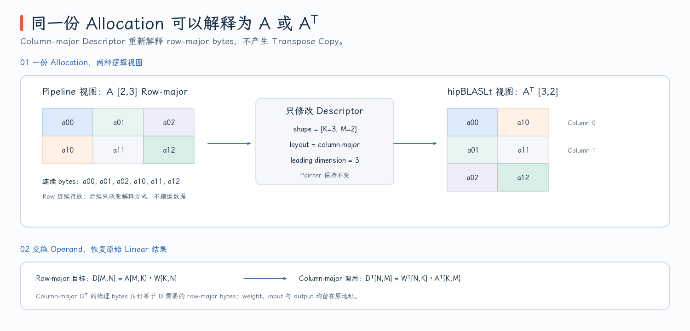
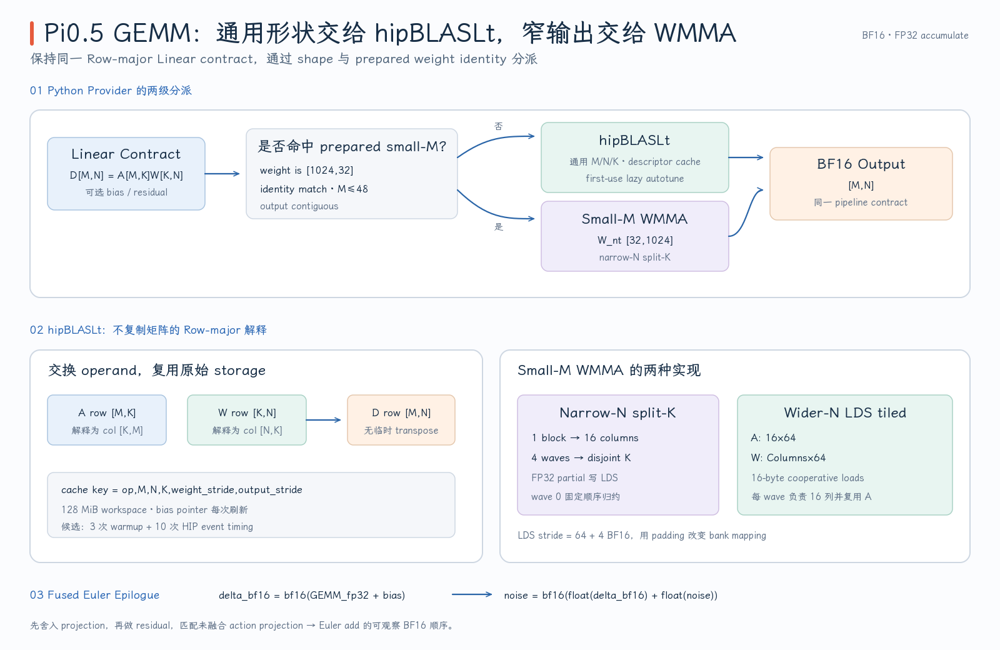
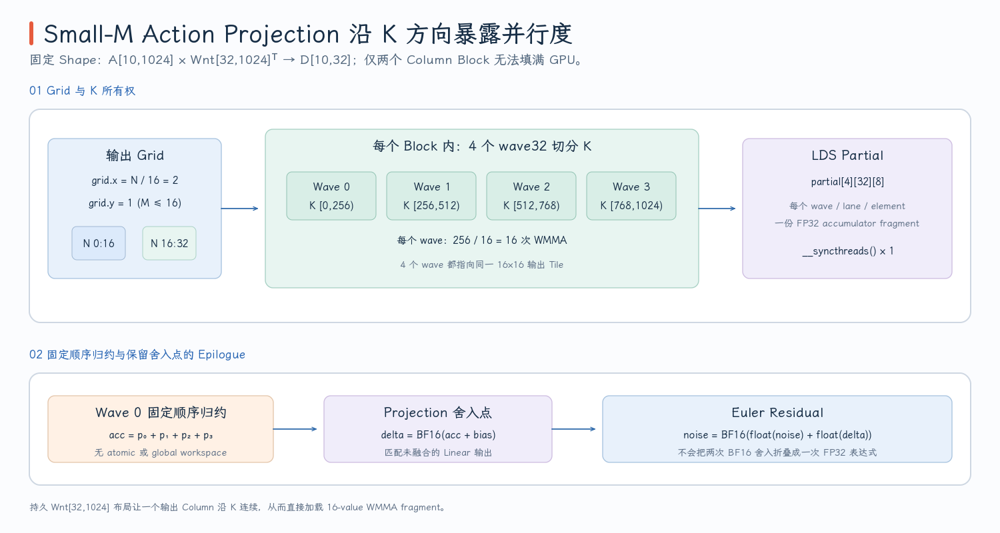

# FlashRT PR #213：RDNA 3.5 GEMM 实现

Pi0.5 的 Linear 横跨两种差异很大的形状：Vision、Prefix Encoder 与 Action Expert 的大投影适合交给成熟 GEMM library；每个去噪步末尾的 action projection 却只有 `M=horizon`、`N=32`，是典型的 small-M、narrow-N 问题。PR #213 没有尝试用一条手写 kernel 替换所有矩阵乘，而是建立两级路径：**hipBLASLt 覆盖通用 BF16 Linear，持久转置后的 wave32 WMMA 只接管经过验证的 action output projection。**

- 固定源码版本：[`e2cf5d1`](https://github.com/flashrt-project/FlashRT/commit/e2cf5d1fe7209e3f4fbf212c5b6321467e8f4874)
- 通用 runner：[`hipblaslt_runner_rdna.hip`](https://github.com/flashrt-project/FlashRT/blob/e2cf5d1fe7209e3f4fbf212c5b6321467e8f4874/csrc/amd/gemm/hipblaslt_runner_rdna.hip)
- small-M kernel：[`smallm_wmma_rdna.hip`](https://github.com/flashrt-project/FlashRT/blob/e2cf5d1fe7209e3f4fbf212c5b6321467e8f4874/csrc/amd/gemm/smallm_wmma_rdna.hip)
- Python 分派：[`Rdna35GemmBackend`](https://github.com/flashrt-project/FlashRT/blob/e2cf5d1fe7209e3f4fbf212c5b6321467e8f4874/flash_rt/amd/hardware/rdna35/gemm.py#L10-L186)

## 1. Row-major Linear 如何交给 Column-major hipBLASLt

Pipeline 只看到统一的 row-major 语义：

$$
D_{M\times N}=A_{M\times K}W_{K\times N}+bias_N.
$$

`A`、`W`、`D` 都是 BF16，hipBLASLt descriptor 使用 FP32 compute。Python provider 先检查 device、dtype、连续性、K/N 是否匹配，并把高维 batch 摊平成二维 `M×K`。它允许输出 row stride 大于 N，从而可以直接写入 packed buffer 的一个 view，见 [`linear()` 的 tensor contract](https://github.com/flashrt-project/FlashRT/blob/e2cf5d1fe7209e3f4fbf212c5b6321467e8f4874/flash_rt/amd/hardware/rdna35/gemm.py#L76-L141)。

hipBLASLt 的 matrix layout 按 column-major 描述，但实现没有在每次调用前复制或转置 tensor。关键是：同一段连续内存，换一种行列解释即可表示转置矩阵。

以 `M=2, K=3, N=4` 为例，row-major 输入在内存中是：

```text
A[2,3]
[ a00 a01 a02
  a10 a11 a12 ]

flat = [a00,a01,a02, a10,a11,a12]
```

若将同一地址描述成 column-major `[K=3, M=2]`、leading dimension 为 3，则两列分别是：

```text
column 0 = [a00,a01,a02]
column 1 = [a10,a11,a12]
```

也就是逻辑上的 $A^T$。同理，row-major `W[K,N]` 可被解释为 column-major `W^T[N,K]`。runner 交换参数顺序，让 hipBLASLt 计算：

$$
W^T_{N\times K}A^T_{K\times M}=D^T_{N\times M}.
$$

column-major `D^T[N,M]` 的物理内存恰好就是 row-major `D[M,N]`，因此不需要任何 transpose kernel。descriptor 对应代码为：

```cpp
weight : column-major [columns=N, inner=K], ld=weight_stride
input  : column-major [inner=K, rows=M],    ld=K
output : column-major [columns=N, rows=M],  ld=output_stride

hipblasLtMatmul(..., weight, input, ..., output)
```

见 [`get_or_create()` 中的三个 layout](https://github.com/flashrt-project/FlashRT/blob/e2cf5d1fe7209e3f4fbf212c5b6321467e8f4874/csrc/amd/gemm/hipblaslt_runner_rdna.hip#L103-L195) 与 [实际 matmul 参数顺序](https://github.com/flashrt-project/FlashRT/blob/e2cf5d1fe7209e3f4fbf212c5b6321467e8f4874/csrc/amd/gemm/hipblaslt_runner_rdna.hip#L198-L209)。这里的“交换操作数”是 descriptor 层面的视图转换，不会改变 pipeline 的 Linear 数学。

{ width="95%" }

## 2. Descriptor Cache 与首次 Shape Autotune

一个 `RdnaGemmRunner` 拥有一个 hipBLASLt handle、默认 128 MiB workspace，以及 instance-local cache。cache key 是：

```text
(operation, M, N, K, weight_stride, output_stride)
```

`operation` 区分无 bias 和 bias epilogue。stride 必须进入 key，因为同样的 M/N/K 可能来自紧密矩阵，也可能来自 packed gate/up 权重或带 padding 的输出 view；若复用错误 descriptor，地址步进会错。数据结构见 [`RdnaGemmRunner::Key`](https://github.com/flashrt-project/FlashRT/blob/e2cf5d1fe7209e3f4fbf212c5b6321467e8f4874/csrc/amd/gemm/hipblaslt_runner_rdna.h#L57-L109)。

bias pointer 没有进入 key。原因是同一 shape 的不同层可以共用 layout 与算法，只需在每次 biased call 前更新 `HIPBLASLT_MATMUL_DESC_BIAS_POINTER`。这既避免每层重复创建 descriptor，也不会把上一层 bias 地址错误地留给下一层，见 [`set_bias()`](https://github.com/flashrt-project/FlashRT/blob/e2cf5d1fe7209e3f4fbf212c5b6321467e8f4874/csrc/amd/gemm/hipblaslt_runner_rdna.hip#L91-L99)。

第一次遇到一个新 key 时，runner 会：

1. 创建 FP32 compute 的 matmul descriptor。
2. 创建 weight/input/output 三个 BF16 layout。
3. 请求一个可用 heuristic algorithm，作为立即可执行的默认值。
4. 若启用 lazy autotune，再从最多 16 个候选中选择当前 shape 的算法。

Autotune 对每个候选 warmup 3 次，然后用 HIP event 测量 10 次；运行失败或 stream synchronize 失败的候选被跳过，最短平均时间的算法写回 `Entry.algorithm`。`entry.tuned` 保证同一 runner、同一 key 只做一次，见 [`tune()`](https://github.com/flashrt-project/FlashRT/blob/e2cf5d1fe7209e3f4fbf212c5b6321467e8f4874/csrc/amd/gemm/hipblaslt_runner_rdna.hip#L212-L305)。

稳态路径只剩：

```cpp
entry = get_or_create(key)
if lazy_autotune and not entry.tuned:
    tune(entry)
run(entry)  // 一次 hipblasLtMatmul
```

cache 不写 CSV，不持久化 opaque algorithm ID，也不修改 process-global PyTorch TunableOp 状态。它的有效边界就是当前 model/frontend instance、当前 runtime 和当前设备。模型 warmup 应在 HIP Graph capture 前触发这些 shape，避免 event、同步和候选循环进入 capture，相关公开入口见 [`bf16_nn` 与 `bf16_nn_bias`](https://github.com/flashrt-project/FlashRT/blob/e2cf5d1fe7209e3f4fbf212c5b6321467e8f4874/csrc/amd/gemm/hipblaslt_runner_rdna.hip#L308-L334)。

## 3. 为什么 Action Projection 需要独立 Small-M Kernel

每个 flow-matching step 的最后一层把 Action Expert hidden state 投影回动作空间：

```text
A        : [horizon, 1024]
W        : [1024, 32]
D        : [horizon, 32]
典型 M   : 10
```

这个 shape 的 K 很长，但 M 和 N 都很小。通用 library 仍要经过 descriptor/algorithm 路径，而 32 个输出列也很难提供大量 N tile。PR #213 只为这一份 `decoder_action_out_proj_w [1024,32]` 准备持久转置：

{ width="95%" }

```python
self._smallm_weights[weight.data_ptr()] = (
    weight,
    weight.t().contiguous(),  # [32,1024]
)
```

持久转置发生在 frontend 初始化、graph capture 之前；额外空间为 `32×1024×2 bytes = 64 KiB`。分派不仅比较 shape，还保存原 Python weight object，并在调用时同时检查 data pointer 与 object identity，防止 allocator 复用旧地址后把无关权重误认为已准备权重，见 [`prepare_smallm_weight()` 与 identity 检查](https://github.com/flashrt-project/FlashRT/blob/e2cf5d1fe7209e3f4fbf212c5b6321467e8f4874/flash_rt/amd/hardware/rdna35/gemm.py#L56-L129)。

kernel 的数学写成：

$$
D[M,N]=A[M,K]W_{nt}[N,K]^T+bias[N].
$$

`W_nt` 中一个输出 column 的 K row 连续，因此 wave 可以直接加载 16 个 BF16 fragment。若继续使用 checkpoint 的 `[K,N]`，同一输出 column 会以 stride N 分布，手写 wave32 kernel 需要 gather，无法使用当前的连续 fragment load。

RDNA wave32 的 `16×16×16` BF16 WMMA 每个 lane 接收完整 16-element K fragment，并返回 8 个 FP32 accumulator 元素。输出行映射为：

```cpp
row = 2 * element + lane / 16;
column = column_tile_start + (lane & 15);
```

lane 0–15 和 16–31 负责相同的 16 个 column，但分别覆盖偶数行与奇数行；8 个 accumulator element 扩展到 16 行。这个映射同时用于 tiled 和 split-K 两条实现，见 [tiled epilogue](https://github.com/flashrt-project/FlashRT/blob/e2cf5d1fe7209e3f4fbf212c5b6321467e8f4874/csrc/amd/gemm/smallm_wmma_rdna.hip#L148-L166) 与 [split-K epilogue](https://github.com/flashrt-project/FlashRT/blob/e2cf5d1fe7209e3f4fbf212c5b6321467e8f4874/csrc/amd/gemm/smallm_wmma_rdna.hip#L228-L253)。

## 4. Narrow-N Split-K 与 Wider-N LDS Tiling

当 `N=32, K=1024` 时，dispatch 选择 4-wave split-K。一个 block 只负责 16 个输出 column，4 个 wave 将 K 均分为互不重叠的四段：

```text
wave 0 : K [0,256)
wave 1 : K [256,512)
wave 2 : K [512,768)
wave 3 : K [768,1024)
```

每个 wave 在自己的 K 段内每 16 个元素执行一次 WMMA，因此当前 shape 每 wave 执行 `256/16=16` 次 WMMA。4 个 wave 得到同一 `16×16` 输出 tile 的四份 partial accumulator，写入：

```cpp
partial[Waves][32 lanes][8 accumulator elements]
```

一次 block barrier 后只保留 wave 0。wave 0 按 wave 0→3 的固定顺序相加 partial，执行 bias/residual epilogue，再写回输出。没有 atomic，也没有 global split-K workspace，见 [`smallm_wmma_bf16_rdna_kernel`](https://github.com/flashrt-project/FlashRT/blob/e2cf5d1fe7209e3f4fbf212c5b6321467e8f4874/csrc/amd/gemm/smallm_wmma_rdna.hip#L183-L255)。

对典型 `M=10,N=32,K=1024`：

```text
grid.x = N / 16 = 2 blocks
grid.y = 1            # M≤16 specialization
block  = 4×32 = 128 threads
```

这里只启动两个 output-column block，但每个 block 内用 4 个 wave 暴露 K 方向并行度。这就是 narrow-N 时 split-K 的作用：不是为了支持更大的 K，而是避免仅靠两个 N block 导致并行工作不足。

{ width="95%" }

对更宽的 N，继续 split-K 会让多个 wave重复读取相同 A。tiled 路径改为一个 workgroup staging：

```text
A tile : 16×64 BF16
W tile : Columns×64 BF16
```

线程每次搬运连续 8 个 BF16，也就是 16 bytes；A 和 W 都写入 LDS。每个 wave 拥有 16 个输出 column，但所有 wave 复用同一份 A tile。K 每前进 64，先协作加载，再执行 4 次 K=16 的 WMMA，见 [`stage_wmma_tile_rdna`](https://github.com/flashrt-project/FlashRT/blob/e2cf5d1fe7209e3f4fbf212c5b6321467e8f4874/csrc/amd/gemm/smallm_wmma_rdna.hip#L59-L102) 和 [tiled 主循环](https://github.com/flashrt-project/FlashRT/blob/e2cf5d1fe7209e3f4fbf212c5b6321467e8f4874/csrc/amd/gemm/smallm_wmma_rdna.hip#L104-L146)。

LDS row stride 是 `64+4=68` 个 BF16。多出的 4 个元素不是数据 padding，而是改变相邻 row 的 bank 映射，避免所有 WMMA fragment 以相同对齐关系访问 LDS。

host dispatch 根据 shape 选择：

```text
K%64==0 且 narrow-N/指定范围  → 4-wave split-K
K%64==0 且 N≥64              → 64-column tiled，4 waves
K%64==0 且 N≥32              → 32-column tiled，2 waves
K%32==0 且 K≥256             → 2-wave split-K
其他已支持 shape             → 1-wave path
```

`M≤16` 使用不带 row-tile 算术的模板 specialization；`16<M≤48` 才通过 `grid.y=ceil(M/16)` 覆盖多个 row tile。原生入口还要求 N/K 为 16 的倍数，见 [`dispatch_smallm_wmma_bf16_rdna`](https://github.com/flashrt-project/FlashRT/blob/e2cf5d1fe7209e3f4fbf212c5b6321467e8f4874/csrc/amd/gemm/smallm_wmma_rdna.hip#L271-L331)。Python 当前只把已准备的 action projection 路由进来，因此这些更宽路径是 native kernel 的能力边界，不表示所有模型 Linear 都会自动绕过 hipBLASLt。

## 5. Residual Epilogue、Fallback 与验证边界

Action output projection 后紧接 Euler update。frontend 已把 projection weight 和 bias 预乘 `-1/num_steps`，因此 pipeline 希望执行：

```text
delta = BF16(GEMM_FP32 + bias)
noise = BF16(float(noise_BF16) + float(delta_BF16))
```

融合 kernel 不能直接执行 `BF16(GEMM_FP32 + bias + noise)`，因为未融合路径在 projection 输出处已经发生一次 BF16 舍入。tiled 与 split-K epilogue 都显式先做：

```cpp
result = bf16_to_float(float_to_bf16(result));
result += bf16_to_float(output[index]);
output[index] = float_to_bf16(result);
```

这保留了可观察的 BF16 rounding point。`linear_residual()` 只有在 weight 已准备、`M≤48`、输入输出连续且 shape 匹配时返回 `True`；否则 pipeline 调用普通 `linear()` 生成 action buffer，再执行 `noise.add_()`，见 [`linear_residual()`](https://github.com/flashrt-project/FlashRT/blob/e2cf5d1fe7209e3f4fbf212c5b6321467e8f4874/flash_rt/amd/hardware/rdna35/gemm.py#L143-L186) 与 [pipeline 的 fallback](https://github.com/flashrt-project/FlashRT/blob/e2cf5d1fe7209e3f4fbf212c5b6321467e8f4874/flash_rt/models/pi05/torch_pipeline.py#L516-L529)。

测试分别验证：

- hipBLASLt 的 BF16+bias 与 strided output row contract；
- runner 不修改全局 TunableOp 状态；
- small-M 的多种 M/K/N、bias 与 graph replay；
- prepared weight 是否真正路由到 native kernel；
- fused residual 是否保持“先 BF16 projection、再 BF16 residual”的语义；
- 非法 rank、bias 和输出布局在 raw-pointer launch 之前被拒绝。

相关用例集中在 [`test_amd_rdna35_ops.py`](https://github.com/flashrt-project/FlashRT/blob/e2cf5d1fe7209e3f4fbf212c5b6321467e8f4874/tests/test_amd_rdna35_ops.py#L131-L237) 与 [small-M/graph 测试](https://github.com/flashrt-project/FlashRT/blob/e2cf5d1fe7209e3f4fbf212c5b6321467e8f4874/tests/test_amd_rdna35_ops.py#L646-L906)。这些测试证明选定 shape 内的算子语义和 graph 安全性；它们不意味着手写 small-M kernel 对任意 GEMM shape 都优于 hipBLASLt，也不把首次 autotune 时间算进稳态执行。
