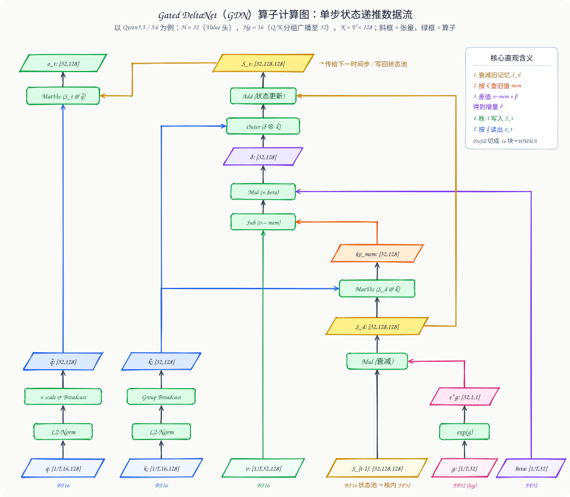
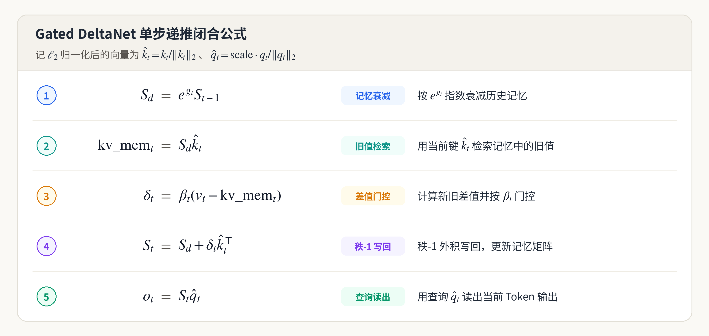
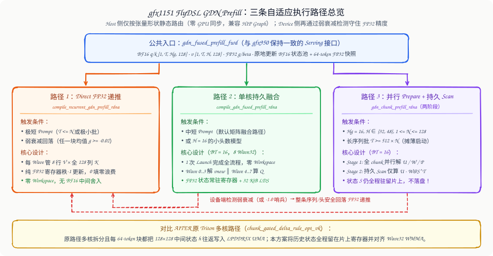
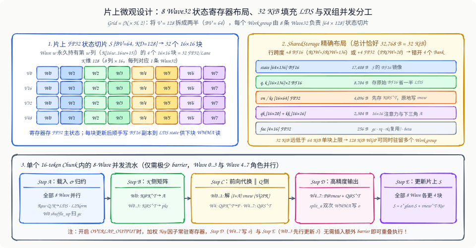
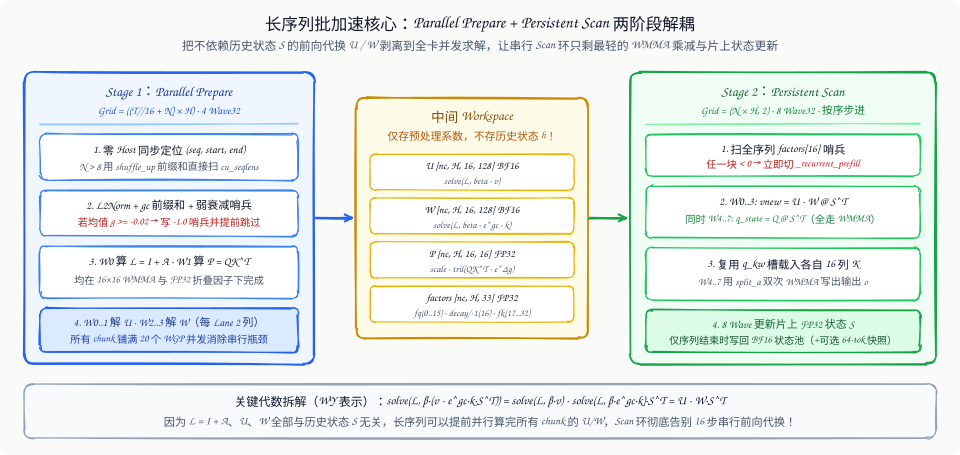

# FlyDSL 实战：gfx1151 上的 GDN Prefill 融合算子设计与优化

在 Qwen3.5、Qwen3.6 等混合线性注意力模型中，**Gated DeltaNet（GDN）** 取代了大部分标准 Softmax Attention 层，用一块固定大小的二维矩阵状态 $S \in \mathbb{R}^{V \times K}$ 持续压缩历史上下文（数学原理详见 [Recurrent / Linear Attention：GDN、KDA 与 Mamba-2](../ai-infra/LLM主流模型结构之Recurrent-Linear%20Attention.md)）。

本文围绕 [`ROCm/aiter#8371`](https://github.com/ROCm/aiter/pull/8371) 的实现，先用完整的张量计算图讲清楚 **GDN Prefill 算子到底在算什么、为什么不能逐 Token 直接算**，再深入拆解在 **AMD Radeon 8060S（`gfx1151`，RDNA 3.5，Wave32 + BF16 WMMA）** 上如何用 FlyDSL 把它做成片上常驻状态的高性能融合算子。

??? info "算子背景与目标架构"

    - **对应实现**：[`ROCm/aiter#8371`](https://github.com/ROCm/aiter/pull/8371)（`gdn_fused_prefill_fwd` 的 `gfx1151` FlyDSL 路径）。
    - **目标硬件**：AMD Radeon 8060S（`gfx1151`，RDNA 3.5，20 WGP / 40 CU，Wave32，单 Workgroup 上限 64 KiB LDS，32 MiB MALL，256 GB/s LPDDR5X UMA）。
    - **前置阅读**：[RDNA3.5 架构与 AMD GPU 基础](RDNA3.5架构与AMD%20GPU基础.md) · [FlyDSL：RDNA 3 的布局与矩阵计算](FlyDSL：RDNA3的布局与矩阵计算.md)。

---

## 1. 这个算子在算什么？从单步张量计算图到 Chunkwise 分块

### 1.1 单步 GDN 的完整张量数据流

与标准 Attention 不断把每个历史 Token 的 $K, V$ 存进 KV Cache 不同，GDN 对每个注意力头只维护一张固定尺寸的**记忆矩阵 $S \in \mathbb{R}^{128\times 128}$**。每来一个新 Token $t$，算子输入未归一化的 $q_t, k_t, v_t$（支持分组头 $H_g \to H$，例如 $16 \to 32$）、对数衰减门 $g_t \in \mathbb{R}$ 与写入门 $\beta_t \in (0, 1)$，完成“**遗忘旧记忆 → 按键查旧值 → 写入差值增量 → 按查询读出**”五步操作：

[{ width="880" }](../../assets/rocm/flydsl-gdn-prefill/gdn-operator-dataflow.svg)

把图中的每一条连线写成闭合公式，五步递推与向量归一化定义如下：

[{ width="880" }](../../assets/rocm/flydsl-gdn-prefill/gdn-closed-form-equations.png)

在真实推理 Serving 场景里，`gdn_fused_prefill_fwd` 还需要把上述纯数学算子打包进一套完整的工程契约：

- **零拷贝变长批（Varlen Packed）**：输入形状为 `q, k: [1, T, Hg, 128]`、`v: [1, T, H, 128]`（允许直接是打包 QKV 投影的非连续视图，自由 token stride），用 `cu_seqlens` 切分多条不等长序列，用 `cache_indices` 索引状态池 `ssm_states [slots, H, 128, 128]` 原地读写（负索引视作 padding 跳过）。
- **可选初始状态与 64-token 快照**：通过 `has_initial_state` 区分全新请求（零状态起步）与续写请求（加载已有槽位）；当需要 Prefix Cache 存盘时，通过 `track_state` / `track_chunk_idx` 在指定 64-token 边界导出精确的 FP32 状态快照。

### 1.2 为什么 Prefill 不能逐 Token 算，而要做成 Chunkwise 矩阵形式？

Decode 阶段每次只来 1 个 Token，只能按上面的单步图逐个做向量-矩阵乘（`MatVec`）。但 Prefill 阶段一次输入几百到几万个 Token——如果依然逐 Token 跑循环，会撞上严重的**算术强度瓶颈**：

- 每个 Token 都要读写一整张 $128\times 128$ 的状态矩阵 $S$（仅 BF16 一读一写就是 $64\text{ KiB}$，FP32 更是 $128\text{ KiB}$），却只做 2 次矩阵-向量乘和 1 次秩-1 外积（约 $6 \times 128^2 \approx 98\text{K FLOPs}$），算术强度仅约 **1.5 FLOP/Byte**，完全被 256 GB/s 显存带宽卡死，根本喂不饱 GPU 的 **WMMA 矩阵计算单元**；
- 相邻 Token 之间存在严格的强数据依赖（$S_t$ 依赖 $S_{t-1}$），无法直接跨时间维并行。

**Chunkwise WY 表示**解决的就是这个矛盾：把序列按长度 $B_T$ 切成块，先在块内把 $B_T$ 步串行递推等价展开成矩阵方程，从而把绝大多数运算转化为硬件最擅长的 **GEMM（WMMA）**，同时把中间状态 $S$ 锁在片上寄存器里彻底消除每 Token 的显存状态往返。记块内对数衰减前缀和为 $g_{c,t} = \sum_{\tau=0}^{t} g_\tau$（末位置为 $g_{c,\text{last}}$），$\operatorname{tril}_{-1}(\cdot)$ 表示严格下三角（不含主对角线），则一个长度为 $B_T$ 的块内五步方程闭合为：

$$
\begin{aligned}
A &= \operatorname{tril}_{-1}\!\left(\beta_t (\hat{k}_t \cdot \hat{k}_j) e^{g_{c,t} - g_{c,j}}\right) \in \mathbb{R}^{B_T\times B_T}, \\
v_{\text{new}} &= \operatorname{solve}\!\left(I + A,\ \beta \cdot \left(v - e^{g_c} (\hat{k} S^\top)\right)\right) \in \mathbb{R}^{B_T\times V}, \\
P &= \operatorname{scale} \cdot \operatorname{tril}\!\left((\hat{q} \hat{k}^\top) e^{g_{c,t} - g_{c,j}}\right) \in \mathbb{R}^{B_T\times B_T}, \\
o &= \operatorname{scale} \cdot e^{g_c} (\hat{q} S^\top) + P v_{\text{new}}, \\
S &\leftarrow e^{g_{c,\text{last}}} S + v_{\text{new}}^\top \left(\hat{k} \cdot e^{g_{c,\text{last}} - g_c}\right).
\end{aligned}
$$

其中 `solve(I + A, rhs)` 因为 $I + A$ 是单位下三角矩阵，只需做一次前向代换；其余 $\hat{k}\hat{k}^\top$、$\hat{k}S^\top$、$\hat{q}\hat{k}^\top$、$\hat{q}S^\top$、$P v_{\text{new}}$ 与 $v_{\text{new}}^\top \hat{k}_w$ 全部变成了稠密矩阵乘！

---

## 2. `gfx1151` 的性能痛点与三路径自适应架构

把上面的 Chunkwise 方程落到 `gfx1151`（Radeon 8060S）时，现有两套方案都水土不服：

1. **AITER 原 Triton 多核路径（`chunk_gated_delta_rule_opt_vk`）**：把 Q/K L2Norm、V 重排、WY 预处理、块间状态递推和输出拆成多个独立 Kernel，每 64 个 Token 都要把 $128\times 128$ 的中间状态 `h` 反复写回再读出 256 GB/s 的 LPDDR5X UMA，带宽与 Kernel 启动开销成为绝对瓶颈；
2. **原有 FlyDSL 单核融合版（面向 `gfx950`）**：强依赖 CDNA4 的 Wave64、MFMA 指令与 160 KiB LDS，无法直接运行在单块仅 64 KiB LDS、Wave32 的 RDNA 3.5 上。

因此，新实现的核心设计目标很明确：**用 FlyDSL 直接面向 RDNA 3.5 Wave32 BF16 WMMA 编写融合核，让历史状态 $S$ 全程驻留在片上 FP32 寄存器中绝不落盘，并针对不同序列长度与衰减特性设计三条自适应路径**：

[{ width="940" }](../../assets/rocm/flydsl-gdn-prefill/gdn-prefill-dispatch-arch.svg)

三条路径的分工与触发条件如下表所示：

| 路径 | 触发条件 | 启动网格与波配置 | 片上与显存开销 | 适用场景 |
| --- | --- | --- | --- | --- |
| Direct FP32 递推（`_recurrent_prefill`） | 极短 Prompt（如 $T \le N$）或设备端检出弱衰减块（均值 $\ge -0.02$） | 每条 Wave32 负责 8 行 $V \times 128$ 列 $K$ | 零 LDS、零 Workspace、纯 FP32 | 极短序列与弱衰减精度保底 |
| 单核持久融合（`Persistent`） | 常规中短序列，或 $H = 16$ 等小头数场景 | `Grid = (N * H, 2)`，每块 8 条 Wave32（`BV = 64`） | 32 KiB LDS、零 Workspace、1 次启动 | 中短上下文，延迟敏感场景 |
| 两阶段解耦（`Parallel Prepare + Scan`） | $H_g = 16, H \in \{32, 48\}$ 且 $T \ge 512 N$ 的长批 | Prepare 4-Wave 全块并行 + Scan 8-Wave 片上递推 | 轻量 $U/W/P$ Workspace，状态 $S$ 零落盘 | 长上下文与大吞吐 Prefill |

!!! note "零 Host 同步路由：原生兼容 HIP / CUDA Graph"

    三路径的分发逻辑（`_use_parallel_prefill` 与 `_use_recurrent_prefill`）**只依赖 Python 侧静态张量形状**（总 Token 数 $T$、请求数 $N$、头数 $H / H_g$），绝不在 Host 端同步读取 GPU 上的 `cu_seqlens` 内容；变长分块定位与弱衰减精度检测全部下沉到设备端完成，避免图捕获中断。

---

## 3. 面向 RDNA 3.5 的片上核心优化：把 `BT` 从 64 收到 16

面向 `gfx1151` 的第一个关键决策，是将内部块长从 CDNA 的 `BT = 64` 收缩为 **`BT = 16`**。这并非退让，而是精准卡位 RDNA 3.5 硬件原子后的全局最优解：

1. **1:1 咬合 `16×16×16` BF16 WMMA**：$K K^\top$ 与 $Q K^\top$ 恰好各为 **1 个 `16×16` 瓦片**，单条 Wave32 沿 $K_D = 128$ 打 8 拍 `fx.rocdl.WMMA(16, 16, 16, fx.BFloat16, fx.Float32)` 即可算完；
2. **前向代换全驻寄存器，零 LDS 回读**：解单位下三角方程 $(I + A)\,v_{\text{new}} = \text{rhs}$ 只需 16 步（`rr = 0..15`），每个线程把已解出的行直接存在寄存器列表 `solved[0..15]` 里，内层 `fx.fma(-A[rr, j], solved[j], rhs)` 完全不需反复回读 LDS；
3. **32 KiB 精确 LDS + 4-Bank 错位防冲突**：整个 `SharedStorage` 刚好占 **32,768 B（32 KiB）**，远低于 64 KiB 单块上限，让 128 KiB 的 WGP 能同时驻留多个 Workgroup；行跨度采用 `ROW = SROW = 136`（`128 + 8` 个 BF16 = +16 B）与 `PROW = 20`（`16 + 4` 个 FP32 = +16 B），相邻行自然错开 4 个 Bank 消除 Bank Conflict；同时把 `pks` 与 `pvn` 原地复用（消费完 $K S^\top$ 立刻就地覆盖为 $v_{\text{new}}$）；
4. **无缝兼容外部 64-token 快照契约**：每推进 4 个 16-token 块，在 `((start - bos) % 64 == 0) & ((start - bos) // 64 == requested)` 时直接把片上 FP32 寄存器写出到 `track_state`，对外完全透明。

单核持久路径的 **32 KiB `SharedStorage` 分区与防 Bank 冲突填充**一览：

| LDS 字段 | 逻辑形状与数据类型 | 行跨度（Padding） | 占用空间 | 作用与复用策略 |
| --- | --- | --- | --- | --- |
| `q` / `k` | $16 \times 128$ BF16 × 2 | `ROW = 136`（+16 B） | 8,704 B | 存原始 BF16 的 `q`/`k`，相邻行错开 4 Bank |
| `state` | $64 \times 128$ BF16 | `SROW = 136`（+16 B） | 17,408 B | 寄存器主状态 $S$ 的 BF16 镜像，供下一块 WMMA 读取 |
| `vn`（`pks` / `pvn` 原地复用） | $16 \times 64$ FP32 | `BV = 64` | 4,096 B | 先存 $K S^\top$，前向代换消费完立刻就地覆盖为 $v_{\text{new}}$ |
| `qk` / `kk` | $16 \times 16$ FP32 × 2 | `PROW = 20`（+16 B） / `BT = 16` | 2,304 B | 分别存块内注意力矩阵 $P$（1,280 B）与 $A$（1,024 B） |
| `fac` | $4 \times 16$ FP32 | `BT = 16` | 256 B | 存 `gc`、`rq`、`rk`、`beta` 四行标量因子 |
| **合计** | — | — | **32,768 B（恰好 32 KiB）** | 远低于 64 KiB 单块上限，支持单 WGP 多 Workgroup 驻留 |

### 三项支撑精度与片上带宽的微架构技巧

=== "1. 原始 BF16 入 LDS + 范数倒数后折叠"

    如果先做完 L2Norm 再把 FP32 存进 LDS，不仅 LDS 占用翻倍，转回 BF16 还会多一次截断误差。核内选择**直接把原始 BF16 的 `q/k` 写进 LDS**，顺手用 Wave32 内 `shuffle_xor(1,2,4,8,16)` 算出 `rq = rsqrt(||q||^2 + 1e-6)` 与 `rk = rsqrt(||k||^2 + 1e-6)` 存入 64 元素的 `fac` 数组，等 WMMA 产出 FP32 点积后再把 `rq`、`rk`、`beta` 和 `exp(gc)` 统一折叠乘回：

    ```python
    _lds_st(pq, row * ROW + lane * 4, qv, 4, fx.BFloat16)
    _lds_st(pk, row * ROW + lane * 4, kv, 4, fx.BFloat16)
    qf, kf = qv.to(fx.Float32), kv.to(fx.Float32)
    qsum = (qf * qf).reduce(fx.ReductionOp.ADD)
    ksum = (kf * kf).reduce(fx.ReductionOp.ADD)
    for shift in (1, 2, 4, 8, 16):
        qsum = qsum + qsum.shuffle_xor(shift, 32)
        ksum = ksum + ksum.shuffle_xor(shift, 32)
    if lane == 0:
        _write(pf, BT + row, fx.math.rsqrt(qsum + 1.0e-6))
        _write(pf, 2 * BT + row, fx.math.rsqrt(ksum + 1.0e-6))
    ```

=== "2. split_a 高低位残差双次 WMMA"

    输出项 $P v_{\text{new}}$ 中的块内注意力矩阵 $P \in \mathbb{R}^{16\times 16}$ 是 FP32 且动态范围跨度大，直接转 BF16 会损失尾数精度。`_mm(..., split_a=True)` 将 FP32 操作数 `av` 拆成高位 `ah = bf16(av)` 与残差 `al = bf16(av - fp32(ah))`，连续打两次 WMMA（先累残差再累高位）：

    ```python
    ah, bh = av.to(fx.BFloat16), bv.to(fx.BFloat16)
    if const_expr(split_a):
        al = (av.to(fx.Float32) - ah.to(fx.Float32)).to(fx.BFloat16)
        acc = _wmma(al, bh, acc)
    acc = _wmma(ah, bh, acc)
    ```

    因为归约维仅 `BT = 16`（循环只跑 1 拍），多打 1 条 `v_wmma` 几乎零额外延迟，却显著压低了输出误差。

=== "3. 128-bit 宽载入对齐 Wave32 WMMA 布局"

    RDNA 3.5 的 Wave32 `16×16×16` BF16 WMMA 要求：操作数 A/B 的 Lane `l` 持有行 `l % 16` 的全部 16 个连续 BF16（256 bit），且半波 `0..15` 与 `16..31` 复制相同行；累加器 C 的每条 Lane 持 8 个 FP32，位于 `[2*i + l//16, l%16]`。`_row_fragment` 用两次 128-bit LDS 向量载入凑齐 16 个 BF16，配合 `ROW = 136` 消除 Bank 冲突。

---

## 4. 单核持久融合 vs 长批两阶段解耦

### 4.1 单核持久融合：8-Wave 双组并发与状态寄存器绑定

对中短 Prompt（或 $H = 16$ 的小头数场景），`compile_gdn_fused_prefill_rdna` 以**单次启动、零 Workspace** 完成全流程。为把 20 个 WGP 吃饱，它沿 $V = 128$ 拆成两半 `BV = 64`，启动 `Grid = (N * H, 2)`、每 Block 8 条 Wave32（256 线程）：

[{ width="940" }](../../assets/rocm/flydsl-gdn-prefill/gdn-prefill-wave-state-layout.svg)

这套片上流水的核心优化集中在三点：

1. **FP32 寄存器主状态 + BF16 LDS 镜像**：$64\times 128$ 状态切片正好分成 $4\times 8 = 32$ 个 `16×16` WMMA 块，`Wave w` 永久持有第 `w` 列的 4 个块（每 Lane 仅 32 个 FP32 寄存器）。每块更新完顺手写一份 BF16 副本到 LDS `state [64×136]` 供下一块 WMMA 读取，序列结束前 `S` 从不触碰显存。
2. **用 Q 侧 WMMA 掩盖前向代换延迟**：在 Step C 中，**Wave 0..1 负责 64 列的 16 步串行前向代换**（且先把 16 行的 `v` 批量发出 load 再启动 FMA 依赖链），**同一时间 Wave 4 并发算 $Q K^\top \to P$、Wave 4..7 并发算 $Q S^\top$**，把最耗时的串行依赖藏进并行 WMMA 中。
3. **`OVERLAP_OUTPUT` 消除一次全局屏障**：在长批开启 `OVERLAP_OUTPUT` 时，加权 Key 因子留在各 Wave 私有寄存器而不复写共享 `fac` 行，使得 Step D（Wave 4..7 写回输出 `o`）与 Step E（Wave 0..3 率先开始更新状态 $S$）之间省掉一次 `gpu.barrier()`。

### 4.2 长批两阶段解耦：Parallel Prepare + Persistent Scan

当序列较长（`Hg = 16, H ∈ {32, 48}, T >= 512 * N`）时，单核持久路径会把所有 chunk 的 L2Norm、$K K^\top$、$Q K^\top$ 和 16 步前向代换全堵在同一个 Workgroup 的时间串行环里。

利用下三角求解的线性性（WY 表示），可以把不依赖历史状态 $S$ 的部分完整剥离出来：

$$
v_{\text{new}}
= \operatorname{solve}\!\left(L,\ \beta\,(v - e^{g_c} k S^\top)\right)
= \underbrace{\operatorname{solve}(L,\ \beta v)}_{U \in \mathbb{R}^{16\times V}}
- \underbrace{\operatorname{solve}(L,\ \beta e^{g_c} k)}_{W \in \mathbb{R}^{16\times K}} \cdot S^\top.
$$

于是整个算子拆成 **Stage 1（Parallel Prepare）+ Stage 2（Persistent Scan）**，把所有与 $S$ 无关的计算铺满全卡 20 个 WGP 并行算完，同时守住“**历史状态 $S$ 绝不落盘**”的红线：

[{ width="940" }](../../assets/rocm/flydsl-gdn-prefill/gdn-prefill-two-stage-pipeline.svg)

四处关键工程优化让两阶段方案既快又稳：

- **免同步 Workspace 上界 + Wave 内前缀和定位**：打包变长批的真实 chunk 总数恒满足 $\sum \lceil L_n / 16 \rceil \le \lfloor T / 16 \rfloor + N$。Host 直接按 `nc = T // 16 + N` 分配 Workspace 与启动网格（完全不读 GPU `cu_seqlens`）；核内当 `N > 8` 时，由 32 条 Lane 各认领 1 条序列，通过 5 步 `gpu.shuffle_up` 前缀和与 `shuffle_xor` 归约直接定位当前 `chunk` 对应的 `(seq, start, end)`，多余槽位直接早退。
- **4-Wave Prepare 并发求解**：`prepare` 仅用 4 条 Wave32（128 线程）——Wave 0 算 $L = I + A$、Wave 1 并发算 $P = Q K^\top$；同步后 Wave 0..1 解 $U$、Wave 2..3 解 $W$（每 Lane 用 2 宽 FP32 向量同解两列）。
- **Scan 核极简关键路径**：`scan` 的串行循环彻底告别前向代换，只需用 WMMA 算 $v_{\text{new}} = U - W S^\top$（与 Wave 4..7 的 $Q S^\top$ 并发）和状态更新。
- **`q_kw` LDS 槽分时复用**：`Q @ S^T` 读完过一次 barrier 后，`q` 的生命周期结束，**每条 Wave 只把各自 4 个状态块所需的那 16 列 `K` 搬入 `q_kw`**，既省下 4 KiB LDS，又避免了整行 `K` 的冗余加载。

---

## 5. 弱衰减精度防线与 Direct FP32 递推回落

Chunkwise BF16 WMMA 路径虽然极快，但存在一个必须守住的数值边界：**当某一段的衰减门 $e^g$ 接近 1（即对数衰减 $g \to 0$）时，BF16 矩阵乘操作数引入的微小舍入误差无法被指数衰减压掉，而是会在连续几十上百个 chunk 间不断累积放大。**

因此，核内引入了一条阈值 **`MIN_MATRIX_DECAY = 0.02`** 的设备端保护机制：

- **单核路径**：主循环开始前，`_has_weak_decay` 用半波 `shuffle_xor(1,2,4,8)` 并行统计每个 16-token 块（按实际有效 token 数计）的平均对数衰减；只要**任意一个块满足均值 $\ge -0.02$**，整条 `(seq, head)` 立刻切到纯 FP32 递推。
- **两阶段路径**：`prepare` 在发现任意弱衰减块时，向 `factors[16]` 写入 **`-1.0` 哨兵**并跳过该块 `U/W/P` 写入；`scan` 在开始前并行扫描整条序列的全部哨兵，一旦发现 `< 0` 立即对整条序列安全回落，杜绝矩阵路径污染后续弱衰减段。

!!! tip "一举两得的 Direct FP32 递推路径（`_recurrent_prefill`）"

    除弱衰减回落外，极短 Prompt（如 `T <= N` 或极小批）也会由 Host 直接路由到 `_recurrent_prefill`，避免为 1–4 个有效 Token 做大量补零的 `16×16×16` WMMA。该路径严格按照第 1 节的单步计算图执行：每条 Wave32 负责 **8 行 V × 全 128 列 K**（每 Lane 持 4 个 FP32 寄存器），逐 Token 完成纯 FP32 秩-1 状态更新与输出，全程零 LDS、零 Workspace、零 BF16 中间舍入。

---

## 6. 实测性能与精度验证（Radeon 8060S / `gfx1151`）

在单卡 **AMD Radeon 8060S（`gfx1151`）**、PyTorch 2.13.0+rocm10.0.0、Triton 3.8.0、FlyDSL 0.5.0 环境下，[`ROCm/aiter#8371`](https://github.com/ROCm/aiter/pull/8371) 对 **180 组验收用例**（153 组等长批 + 27 组混合变长批，覆盖 `H ∈ {16, 32, 48}`、单请求 128–32,768 Token、Batch 1–128、总打包长度最高 65,536 Token）进行了端到端实测。对比基线为 AITER 原 Triton 多核路径 `chunk_gated_delta_rule_opt_vk`（同样包含 Q/K L2Norm、打包 QKV 视图输入、V 重排及状态池索引更新），结果 **180/180 全部加速（1.9x–12.8x，中位数 9.2x，零回归）**。

### 6.1 等长批代表性模型实测（TP1，$H_g = 16, K = V = 128$）

| 代表模型（TP1） | Value Heads | Batch | Tokens / Req | Triton (ms) | FlyDSL (ms) | Speedup |
| --- | --- | --- | --- | --- | --- | --- |
| Qwen3.5-0.8B / 2B | 16 | 1 | 512 | 0.519 | **0.211** | **2.5x** |
| Qwen3.5-0.8B / 2B | 16 | 1 | 4,096 | 10.903 | **3.160** | **3.5x** |
| Qwen3.5-0.8B / 2B | 16 | 1 | 32,768 | 129.939 | **27.979** | **4.6x** |
| Qwen3.5-0.8B / 2B | 16 | 4 | 16,384 | 258.717 | **26.406** | **9.8x** |
| Qwen3.5-0.8B / 2B | 16 | 64 | 1,024 | 258.446 | **22.067** | **11.7x** |
| Qwen3.5-9B / 35B-A3B · Qwen3.6-35B-A3B | 32 | 1 | 512 | 1.173 | **0.196** | **6.0x** |
| Qwen3.5-9B / 35B-A3B · Qwen3.6-35B-A3B | 32 | 1 | 4,096 | 21.939 | **2.107** | **10.4x** |
| Qwen3.5-9B / 35B-A3B · Qwen3.6-35B-A3B | 32 | 1 | 32,768 | 214.691 | **16.968** | **12.7x** |
| Qwen3.5-9B / 35B-A3B · Qwen3.6-35B-A3B | 32 | 16 | 2,048 | 205.836 | **16.217** | **12.7x** |
| Qwen3.5-9B / 35B-A3B · Qwen3.6-35B-A3B | 32 | 64 | 1,024 | 402.152 | **33.198** | **12.1x** |
| Qwen3.5-27B · Qwen3.6-27B · Qwen3.8-Flash-Next | 48 | 1 | 512 | 1.716 | **0.360** | **4.8x** |
| Qwen3.5-27B · Qwen3.6-27B · Qwen3.8-Flash-Next | 48 | 1 | 4,096 | 31.409 | **3.611** | **8.7x** |
| Qwen3.5-27B · Qwen3.6-27B · Qwen3.8-Flash-Next | 48 | 1 | 32,768 | 318.025 | **29.873** | **10.6x** |
| Qwen3.5-27B · Qwen3.6-27B · Qwen3.8-Flash-Next | 48 | 4 | 16,384 | 615.295 | **48.118** | **12.8x** |
| Qwen3.5-27B · Qwen3.6-27B · Qwen3.8-Flash-Next | 48 | 32 | 1,024 | 298.954 | **23.600** | **12.7x** |

### 6.2 混合变长批（Varlen Packed）实测

混合变长批覆盖非对齐块尾（`[128, 129, 511, 513] × n`）与典型长短请求混排（大量 128-token 短请求与 8K/32K 长上下文同批打包）：

| Value Heads | Batch | 序列长度分布（Tokens） | Triton (ms) | FlyDSL (ms) | Speedup |
| --- | --- | --- | --- | --- | --- |
| 16 | 4 | [128, 129, 511, 513] × 1 | 1.841 | **0.412** | **4.5x** |
| 16 | 64 | [128, 129, 511, 513] × 16 | 76.190 | **7.226** | **10.5x** |
| 32 | 4 | 128 × 2; 2,048; 8,192 | 67.149 | **6.984** | **9.6x** |
| 32 | 64 | 128 × 62; 2,048; 32,768 | 272.313 | **32.027** | **8.5x** |
| 48 | 4 | 128 × 2; 2,048; 8,192 | 95.681 | **9.181** | **10.4x** |
| 48 | 64 | 128 × 62; 2,048; 32,768 | 409.303 | **42.560** | **9.6x** |

### 6.3 数据背后的三点架构印证

- **两阶段 WY 解耦在长上下文的威力**：`H = 32` 单请求从 512 增至 32,768 Token 时，加速比从 6.0x 一路攀升至 **12.7x**（`H = 48, B = 4, L = 16,384` 达 **12.8x**），因为 Triton 路径随长度线性累积每 64-token 块的状态落盘流量，而两阶段 FlyDSL 路径将状态无关的 $U/W/P$ 铺满 20 个 WGP 并行算完后，Scan 全程片上零落盘；
- **长短混排依然保持 8.5x–10.4x**：即便批次中 62 条 128-token 短请求与 1 条 32,768-token 长请求混排，Stage 1 按全局 `chunk` 粒度平铺，Stage 2 短请求完成后立即释放 CU 给长请求，避免了尾延迟放大；
- **数值精度与工程契约**：180 组验收用例与独立 FP32 逐 Token 递推参考对比，最差相对 $L_2$ 误差 **$< 0.003$**（阈值 $0.01$），最大输出绝对误差 **$6.14 \times 10^{-4}$**（阈值 $0.002$），并全部通过 NaN 脏槽位初始化、padding 槽位零触碰、自定义 `scale`、弱衰减回落、空输入、CUDA/HIP Graph 回放与自定义 Stream 契约校验。

---

## 7. 总结：RDNA 3.5 上写融合线性注意力算子的核心思路

回看整个算子从单步公式到 `gfx1151` FlyDSL 落地的演进，真正带来数量级收益的是四层递进的软硬协同取舍：

1. **先消灭最大的带宽敌人**：在 256 GB/s UMA 上，把 $128\times 128$ 历史状态按 `BV = 64` 拆半锁进 8 条 Wave32 的 FP32 寄存器，彻底消除每块状态落盘；
2. **用硬件原子倒推算法分块**：围绕 Wave32 `16×16×16` WMMA 与 32 KiB 填充 LDS 将 `BT` 设为 16，换来 16 步全寄存器前向代换与无 Bank 冲突访存，同时在 64-token 边界无缝兼容外部快照协议；
3. **长序列拆出状态无关计算，但绝不让状态落盘**：用 WY 线性拆解把 $U/W/P$ 提前放到 `Parallel Prepare` 铺满 20 个 WGP，同时保持 `Persistent Scan` 内的片上状态递推与 `q_kw` 复用；
4. **用轻量精度技巧守住数值边界**：`Raw BF16 + 范数后折叠`、`split_a` 高低位残差双次 WMMA 与设备端弱衰减 `-1.0` 哨兵回落，在不拖慢常规路径的前提下稳住全场景精度。

