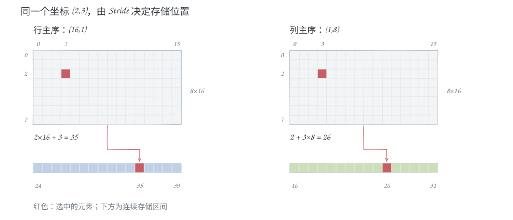
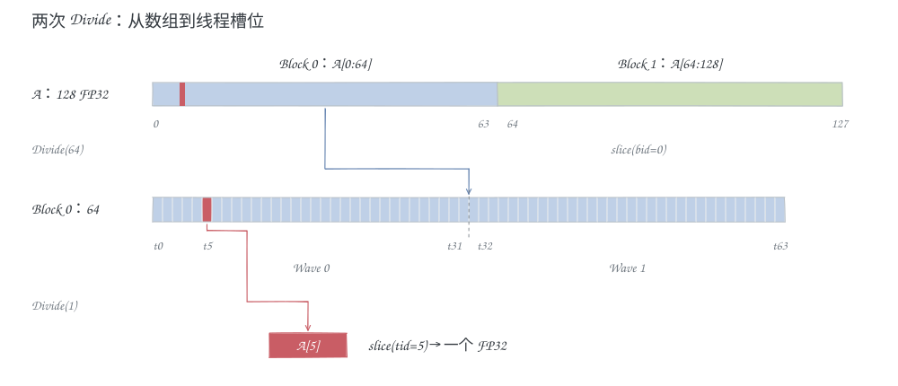
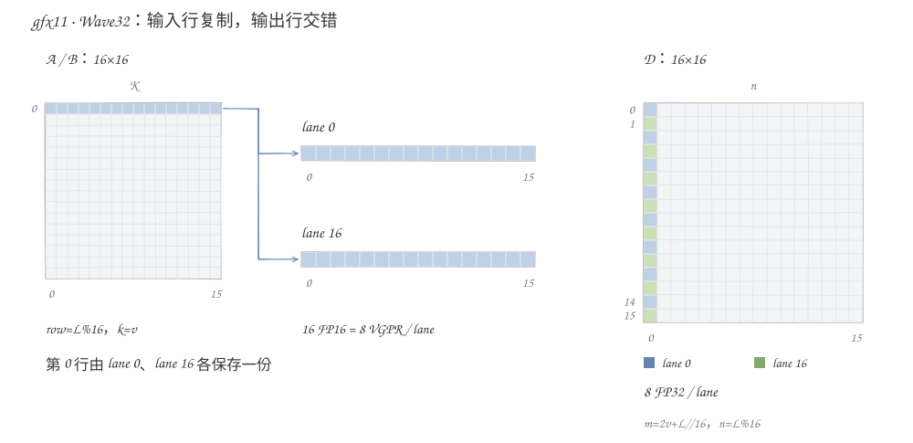
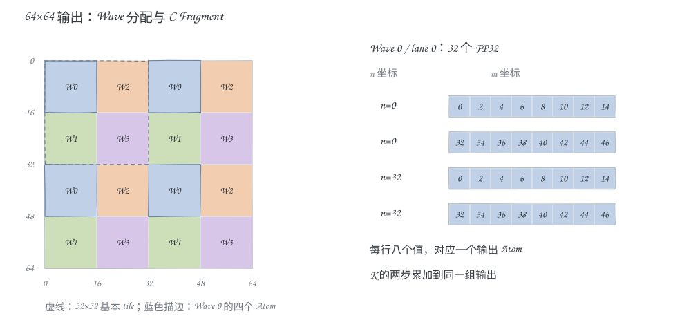
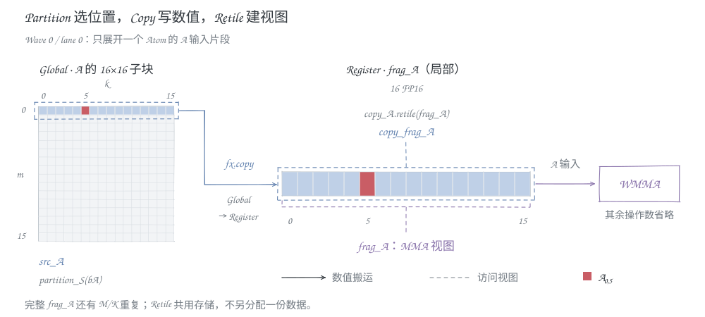
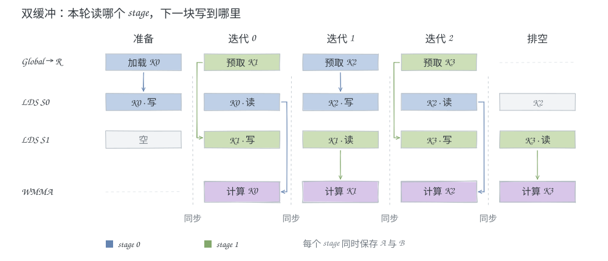

本文沿向量加、Tiled Copy、Tiled WMMA 和双缓冲 GEMM 四个例子，展开 RDNA 3 上的数据分配与矩阵计算：先用 Layout 描述元素位置，再把数据分给 Thread 与 Wave，接着准备 WMMA Fragment，最后连接 LDS、预取和编译调度。

源码说明固定到 **FlyDSL v0.5.0**。本文使用 `gfx11` 的 Wave32 路径，覆盖 RDNA 3 与 RDNA 3.5 的 `gfx1151`；架构名称、编译目标与具体设备的 ROCm 支持状态分别理解。

## 序言：计算之外，更多的是 Layout

读一个现代 GPU Kernel，会发现大部分代码并不是算术，而是 Layout：哪个线程加载哪几个元素，数据在共享内存里落在哪里，矩阵指令以什么顺序消费它们，下一个 K 块的预取如何与当前计算重叠。真正的乘法只有很小一部分，其余是数据组织和调度。

FlyDSL 是对这个观察的一种回应。它是一个用 Python 编写 GPU Kernel、以 MLIR 为骨架的编译器栈，名字展开是 **Flexible Layout python DSL**。Layout 和 tiling 都是显式的：Shape、Stride、Composition、Divide、Product、Thread-Value Layout、Tiled Copy 和 MMA Atom。它的设计继承了 NVIDIA CuTe 的许多概念，再给这些概念一个类型化的 MLIR 表达。

`!fly.layout` 是真实的 **IR（Intermediate Representation，中间表示）** 类型；Layout 代数可以被检查、组合和简化，再降为地址算术。Copy Atom 降为访存操作，MMA Atom 降为目标架构的矩阵指令。Python 前端让这些操作可以在同一个 Kernel 中组合，见上游 [README](https://github.com/ROCm/FlyDSL/blob/v0.5.0/README.md)。

四个例子依次回答同一个 Kernel 中的四个问题：元素属于哪个线程，Copy 一次搬多少数据，WMMA 要求怎样的 Lane 分布，以及下一 K 块如何接到当前计算之后。它们共用 Layout、Partition 和 Fragment 这套词汇，复杂度来自数据规模与硬件约束的逐步增加。

如果只想先理解 FlyDSL 的心智模型，可以先读 M1 的 Layout 代数与 M3 的 Tiled Copy。接着读 M4，看硬件 Fragment 如何约束 Copy；M5 则把这些零件放回一个带 K 循环的 GEMM。

## M0：四例阶梯

四个例子各增加一层需要理解的关系：

| 例子                                               | 数据与分工                               | 引入的概念                                                     |
| -------------------------------------------------- | ---------------------------------------- | -------------------------------------------------------------- |
| [01-vectorAdd.py](code/flydsl-rdna/01-vectorAdd.py) | 128 个 FP32，64 线程 Block               | `@flyc.kernel`、两级 Divide、Copy Atom、`@flyc.jit` 与启动 |
| [02-tiledCopy.py](code/flydsl-rdna/02-tiledCopy.py) | 24×120 FP32，8×24 Block tile，四个线程 | TV Layout、`partition_S/D`、向量化 Copy 与 Fragment          |
| [03-tiledWmma.py](code/flydsl-rdna/03-tiledWmma.py) | 64×64×32 FP16→FP32，四个 Wave32       | WMMA Atom、由 MMA 反推 Copy Layout、`retile`                 |
| [04-rdnaGemm.py](code/flydsl-rdna/04-rdnaGemm.py)   | 128×128×32 Block tile，四个 Wave32     | A/B 的 LDS staging、两阶段流水、Grid Swizzle 与调度提示        |

这里的 **tile（数据分块）** 是数组或矩阵的一块逻辑范围，例如 8×24 个元素；**Block / Workgroup（线程组）** 是一起执行、可以共享 LDS 并同步的线程集合。一个 Block 负责一个 tile 是这些例子的分工，tile 本身并不规定线程数。

**Thread / Work-item（线程）** 是软件中的执行者，**Wave / Wavefront（波前）** 是硬件的执行分组，**Lane** 是线程在 Wave 内的位置。本文按 Wave32 编译，一维 Block 中 `wave_id=tid//32`、`lane_id=tid%32`；128 个线程对应四个 Wave。后面的四线程 Copy 只让一个 Wave 的四个 Lane 参与，不能据此理解成四个 Wave。**LDS（Local Data Share）** 是 Workgroup 内共享的片上存储，寄存器 Fragment 则由各 Lane 持有。

向量加直接在全局数据与寄存器之间搬运；Tiled Copy 将一个二维 tile 分给一组线程；Tiled WMMA 再引入硬件规定的 Fragment。完整 GEMM 则让 A、B 先进入 LDS，在一个 K 循环中反复供给四个 Wave，并通过双缓冲连接相邻 K 块。

FlyDSL 的编译仍是一次纵向下降。Python tracing 产出 `fly`、`gpu`、`arith`、`scf`、`vector` 等 Dialect 的组合；中间 Pass 把 Layout 与 Atom 变成地址和 SSA 值；ROCDL 与 LLVM 后端生成目标设备代码，再由 HIP 运行时加载与启动。

## M1：读 Kernel 之前的语法

每一行 FlyDSL Kernel 都建立在同样的五个词上：**Shape、Stride、Layout、Divide、Slice**。后续函数名可能更长，例如 `zipped_divide`、`raked_product`、`composition`，但都在改造同一个基础映射。

### Shape、Stride 与 Layout

普通整数 Stride 的 Layout 将坐标映射为线性元素偏移：

```python
# 列主序：shape = (8, 16)，stride = (1, 8)
index = c0 * 1 + c1 * 8

# 行主序：shape = (8, 16)，stride = (16, 1)
index = c0 * 16 + c1 * 1
```

**Shape（形状）** 决定坐标的范围，**Stride（步长）** 决定每一维移动一格时偏移多少。对这里的普通内存 Layout，Stride 的单位是**元素**：FP16 的 stride 为 16，表示跨过 16 个 FP16，即 32 B。两者是独立的：同样的 8×16 Shape 可以配列主序 `(1, 8)`、行主序 `(16, 1)`、列主序 Padding `(1, 9)`，也可以用零 Stride 表达广播。

```python
layout = fx.make_layout((8, 16), (16, 1))
# 输入：结构匹配的 Shape 与 Stride；输出：Layout，不分配数组
view = fx.make_view(fx.get_iter(A), layout)
# 输入：A 的迭代器与新 Layout；输出：共用该迭代器的 Tensor 视图
```

**mode** 是 Shape 或 Layout 的一个顶层分量，**rank** 是顶层 mode 的数量。`(8,16)` 是 rank-2；`(9,(4,8))` 也是 rank-2，第二个 mode 保留了两层坐标的内部结构。它共有 `9×4×8=288` 个逻辑位置，不能把 rank 理解成所有叶子数字的数量。

`fx.size(layout)` 表示逻辑位置数，`fx.cosize(layout)` 表示地址映射需要覆盖的存储跨度。对非负整数 Stride，后者是最大元素偏移加一。例如 `(8,16):(1,9)` 有 128 个位置，末端偏移为 `7+15×9=142`，所以 cosize 为 143 个元素；FP16 的最小覆盖范围为 286 B。这 143 个位置中包含 Padding，不能用逻辑元素数代替实际地址跨度。相关定义见 [size / cosize API](https://github.com/ROCm/FlyDSL/blob/v0.5.0/python/flydsl/expr/primitive.py#L813-L829)与 [Layout 的跨度计算](https://github.com/ROCm/FlyDSL/blob/v0.5.0/include/flydsl/Core/Algebra/Layout.hpp#L1182-L1200)。

[{ width="800" }](../../assets/rocm/flydsl-rdna/flydsl-layout-addressing.svg)

图中选定 `(2,3)`：行主序偏移为 `2×16+3=35`，列主序偏移为 `2+3×8=26`。下方只展开各自包含该偏移的存储区间；Layout 决定偏移，实际读取仍由 Copy 发出。

XOR Swizzle 需要再组合一个映射，不能仅靠普通仿射 Stride 表达。更一般地，Identity Layout 可以用 Basis Stride 保留坐标结构；因此“Layout 总返回一个 flat index”只适用于上面的普通内存 Layout，不是整个代数系统的限制。

有三点值得记住：

- **Shape 可以嵌套。** `fx.make_shape(9, (4, 8))` 的顶层有两个 mode，第二个 mode 本身又是一个 tuple。嵌套结构可以表达 Block、Wave、Thread、Instruction 之间的分层。
- **静态值与动态值可以混用。** Python 整数可以在编译期折叠，SSA 值保留到运行时，类型系统记录其中哪些部分已经确定。
- **Layout 是一等公民 IR。** `!fly.layout<(8,16):(1,8)>` 不只是字符串说明，操作会消费和产出这种类型的值。

**`fx.Tensor` 是 DSL 的访问视图**，由迭代器与 Layout 组合；对普通内存 Tensor，迭代器还携带元素类型和地址空间。它与持有实际 GPU 数据的 `torch.Tensor` 位于不同层次：JIT 接收后者，再为生成的 IR 建立对应的 DSL 视图。`make_view` 改变坐标到地址的映射，不转置或复制底层数值，所选 Layout 的范围需要由原存储容纳。

`fx.Float16`、`fx.Float32` 是传给 Atom、Tensor 构造器的元素类型；`fx.Float16(0)` 则构造带该类型的表达式值。这里的 dtype 决定一个元素有多少 bit，地址空间决定它来自 Global、LDS 还是 Register。相关构造见 [make_view / make_fragment_like](https://github.com/ROCm/FlyDSL/blob/v0.5.0/python/flydsl/expr/primitive.py#L528-L552)。

Kernel 的前半部分因此是在组织访问：先构造视图，切出当前 Block，再将它分给当前线程。后续 `copy`、元素索引或 `load` 才读取数值；高性能 Kernel 也可以直接使用地址算术或 intrinsic。

上游 [Layout Guide](https://github.com/ROCm/FlyDSL/blob/v0.5.0/docs/layout_system_guide.md)系统列出了这些构造与代数操作。

### Divide 与 Slice：先分块，再选择

`logical_divide`、`zipped_divide`、`flat_divide` 都能将数据划为 tile 内部与 tile 外部的重复范围，但结果的嵌套方式不同。下面的例子只展示规则整除的情况：

```python
# A 的 Layout：128:1
tA = fx.logical_divide(A, fx.make_layout(64, 1))
# Shape：(64, 2)；64 个元素为一块，共两块

# A 的 Layout：(24, 120):(120, 1)
bA = fx.zipped_divide(A, (8, 24))
# Shape：((8, 24), (3, 5))

gA = fx.flat_divide(A, (8, 24))
# Shape：(8, 24, 3, 5)
```

`logical_divide` 保留各 mode 自己的“tile、剩余范围”结构；`zipped_divide` 将各维的 tile 合在一组、剩余范围合在另一组；`flat_divide` 将它们展开成便于分别索引的 mode。对一维数组，层次很浅；对二维矩阵，差别更加明显。

Divide 之后，用 `slice` 选择当前 Block：

```python
bA = fx.zipped_divide(A, (BM, BN))
bA = fx.slice(bA, (None, bid))

# Tensor 索引提供相同的简写
bA = fx.zipped_divide(A, (BM, BN))[None, bid]

# 保留 BM、BK，选定 M 方向的 Block，保留所有 K tile
gA_k = fx.flat_divide(A, (BM, BK))[None, None, bid_m, None]
```

`fx.slice(tensor,coord)` 始终构造选择后的视图；Tensor 的 `tensor[coord]` 简写在坐标包含 `None` 时返回视图，坐标全部选定时则读取该元素，赋值 `tensor[coord]=value` 写入对应位置。`None` 保留对应 mode，整数或坐标选定它。`bid` 为单个整数时，按照剩余 Layout 的规则展开成多维坐标；如果想直接控制行列，应传对应的坐标或分别索引各 mode。

**这些操作只构造视图，不搬运数据。** 一份全局数组不会因为 Divide 而生成若干副本；改变的是从新坐标到原始元素位置的映射。

### Thread × Value：Layout 之上的 Layout

一个 tile 只描述了数据范围，还没有说明谁处理它。GPU 上需要第二个 Layout，把每对 `(thread, value)` 映射到 tile 内的位置，这就是 **Thread-Value Layout，简称 TV Layout**：

```python
thr_layout = fx.make_layout((4, 1), (1, 1))
val_layout = fx.make_layout((1, 8), (1, 1))

tile_mn, tv_layout = fx.make_layout_tv(thr_layout, val_layout)
```

这里四个线程沿 M 方向排列，每个线程沿 N 方向负责八个值，基本覆盖范围是 4×8。`make_layout_tv(thr_layout, val_layout)` 要求两者都是静态 Layout，返回 `(tile_mn, tv_layout)`：前者是基本 tile 的各维大小，这里为 `(4,8)`；后者把 `(thread,value)` 映射到该 tile 的元素位置。见 [实现](https://github.com/ROCm/FlyDSL/blob/v0.5.0/python/flydsl/expr/derived.py#L111-L134)。

在一个 Thread Slice 上调用 `partition_S(tensor)`，得到的是当前线程的 source 视图。这个视图包含当前线程的 values，以及它们在更大 tile 内重复的范围。相应地址算术已经进入 Layout，不需要再写一套独立的线程偏移公式。

把 Layout 看成一个映射，后面的 Composition、Complement、Coalesce、Right Inverse 就成为对这个映射的改造。需要理解 Kernel 时，先看清输入与输出坐标；要扩展 Layout 代数时，再读 CuTe 的[范畴论形式化](https://arxiv.org/abs/2601.05972)。

## M2：两行计算之外，向量加的完整骨架

从一个长度为 128 的 FP32 向量开始：`C = A + B`，每个 Block 64 个线程，每个线程处理一个元素。完整代码见 [01-vectorAdd.py](code/flydsl-rdna/01-vectorAdd.py)。

```python
@flyc.kernel
def vector_add_kernel(
    A: fx.Tensor, B: fx.Tensor, C: fx.Tensor,
    block_dim: fx.Constexpr[int],
):
    bid, tid = fx.block_idx.x, fx.thread_idx.x
    A = fx.rocdl.make_buffer_tensor(A, max_size=False)

    def thread_tiles(t):
        t = fx.logical_divide(t, fx.make_layout(block_dim, 1))
        t = fx.slice(t, (None, bid))
        return fx.logical_divide(t, fx.make_layout(1, 1))

    tA, tB, tC = thread_tiles(A), thread_tiles(B), thread_tiles(C)

    buffer_atom = fx.make_copy_atom(fx.rocdl.BufferCopy32b(), fx.Float32)
    universal_atom = fx.make_copy_atom(fx.UniversalCopy32b(), fx.Float32)

    rA = fx.make_rmem_tensor(fx.make_layout(1, 1), fx.Float32)
    rB = fx.make_rmem_tensor(fx.make_layout(1, 1), fx.Float32)
    rC = fx.make_rmem_tensor(fx.make_layout(1, 1), fx.Float32)

    fx.copy_atom_call(buffer_atom, fx.slice(tA, (None, tid)), rA)
    fx.copy_atom_call(universal_atom, fx.slice(tB, (None, tid)), rB)
    rC.store(rA.load() + rB.load())
    fx.copy_atom_call(universal_atom, rC, fx.slice(tC, (None, tid)))
```

三个阶段在这里以最小规模呈现：**构造 Layout、拷入、计算与拷出**。先建立 per-thread 视图，再把全局数据搬到寄存器 Fragment，最后计算并写回。后续例子仍然是这个骨架，只是 Copy 更复杂、计算变大，或中间多一层 LDS。

### 两次 Divide：Block 的 tile，再到 Thread 的槽位

第一次切分将 128 个元素划为两个 64 元素 tile，`slice(..., (None, bid))` 选择当前 Block。第二次用 `layout(1, 1)` 将这一块分成 64 个单元素槽位，`tid` 选择当前线程。

沿 `bid=0, tid=5` 算一次：第一级视图的 Shape 是 `(64,2)`，选择 Block 0 后为 `64`；第二级 Divide 得到 `(1,64)`，`slice(...,(None,5))` 保留第一维的一个元素，选定第二维的槽位 5，最终读到 `A[5]`。同样的 `tid=5` 在 Block 1 读到 `A[64+5]=A[69]`。这里 `None` 表示保留整个 mode，作用是选择范围。

在 RDNA 3 的 Wave32 模式下，一个 64 线程 Block 有两个 Wave，但 Divide 本身不决定 Wave 宽度；执行宽度来自目标编译配置。

[{ width="800" }](../../assets/rocm/flydsl-rdna/flydsl-vector-divide.svg)

这个级联反复出现在 Kernel 中，变化的是每层 divisor 的大小，以及中间引入几层分工。例子中的每个线程只读一个 FP32；还没有向量化，也没有 LDS。

### BufferCopy 与 UniversalCopy

两个 Copy Atom 故意采用不同的访存路径：

```python
buffer_atom = fx.make_copy_atom(fx.rocdl.BufferCopy32b(), fx.Float32)
universal_atom = fx.make_copy_atom(fx.UniversalCopy32b(), fx.Float32)
```

`UniversalCopy` 使用通用指针的加载与存储语义，最终选择 Global 或 Flat 等指令，由地址空间和后端决定；不能保证它一定生成某一个 `flat_load_dword`。

**Copy Atom 是一次基本搬运的合约**：操作类型规定指针或 Buffer 等访问方式，名称中的 `32b` 规定 32-bit 位宽，第二个参数 `fx.Float32` 规定这些 bit 按 FP32 元素解释。因此这里一次 Atom 调用搬一个 FP32；128-bit FP32 Copy 则搬四个元素。`make_copy_atom` 只构造合约，`copy_atom_call(atom,src,dst)` 才发出一次基本搬运。

`BufferCopy` 使用 AMD **Buffer Resource Descriptor（缓冲资源描述符）**，其中包含基址、范围及访问控制。`make_buffer_tensor` 用 Global Tensor 的迭代器构造 descriptor，返回保留原 Layout 的新视图，底层数据不变。**v0.5.0 在 RDNA 上默认不启用资源范围越界检查**，需要显式选择：

| 写法 | Descriptor 范围 | RDNA 越界检查 |
| --- | --- | --- |
| `make_buffer_tensor(A)` | `0xFFFFFFFF` | 关闭，`OOB_SELECT=2` |
| `make_buffer_tensor(A, max_size=False)` | `cosize(A.layout) × 元素字节数` | 开启，`OOB_SELECT=3` |
| `make_buffer_tensor(A, num_records_bytes=512)` | 显式指定的 512 B | 开启，`OOB_SELECT=3` |

上面的向量加选择第二种写法：128 个连续 FP32 对应 512 B。`num_records_bytes` 的单位是**字节**，不同于 Layout 的元素单位，见 [Buffer 视图构造](https://github.com/ROCm/FlyDSL/blob/v0.5.0/python/flydsl/expr/rocdl/universal.py#L235-L315)。

启用检查后，完全越过资源范围的 raw buffer 读取返回零，写入被丢弃。但检查对象是整个资源，二维矩阵一行末尾之后仍可能落在下一行的有效存储中；跨边界向量还需要按实际宽度分析。后面的完整 tile 示例沿用默认 descriptor，并由整除条件保证访问范围。

BufferCopy 的 [Lowering](https://github.com/ROCm/FlyDSL/blob/v0.5.0/lib/Dialect/FlyROCDL/CDNA3/CopyAtom.cpp#L68-L123)生成 ROCDL raw buffer 操作。RDNA 的基础 Buffer Load/Store 走这条路径，直接向 LDS 搬运的 DMA Atom 则有独立的目标约束。

这个向量加处理完整的 64 元素 Block：A 走 Buffer，B/C 走 Universal。长度为非整块时，所有读取与写回都需要相应的边界条件，A 的 descriptor 只负责自己的资源范围。

二维向量化的 [01-vectorAdd.py](https://github.com/ROCm/FlyDSL/blob/v0.5.0/examples/01-vectorAdd.py)使用 128 个线程、每线程四个 FP32，并通过 Identity Coordinate Tensor 构造 Copy Predicate。“分块、分线程、Copy、Add、Store”的结构继续适用，边界条件则随向量宽度一起设计。

### 启动包装器与 Graph 捕获

```python
@flyc.jit
def vector_add(
    A: fx.Tensor, B: fx.Tensor, C: fx.Tensor,
    n: fx.Int32,
    block_dim: fx.Constexpr[int],
    stream: fx.Stream = fx.Stream(None),
):
    grid_x = (n + block_dim - 1) // block_dim
    vector_add_kernel(A, B, C, block_dim).launch(
        grid=(grid_x, 1, 1),
        block=(block_dim, 1, 1),
        stream=stream,
    )
```

`@flyc.kernel` 描述设备函数，调用它得到待启动的 Kernel 包装对象；`.launch(...)` 生成向运行时提交该 Kernel 的操作。`grid` 是各方向的 Block 数量，`block` 是各方向的线程数量，`stream` 指定 HIP 执行流。在这里 `n=128,block_dim=64` 得到 Grid `(2,1,1)`，每个 Block `(64,1,1)`。

`@flyc.jit` 描述构造与启动设备函数的 **Host（CPU 侧）路径**，由它生成 Launcher 并连接运行时。`fx.Int32` 标注运行时的 32-bit 整数；`fx.Constexpr[int]` 标注 tracing 时就确定的 Python 整数。**specialization（编译特化）** 是按给定静态条件生成的实现：这里 `block_dim` 进入 Divide 与启动配置，改为 128 会改变 IR；`n` 则沿运行时路径计算 Grid。Grid 向上取整只决定启动范围，不能代替 Kernel 内的边界处理。

这与 Triton 的编译期参数思路相近，但当前 FlyDSL 的最终编译缓存还会按准备好的 IR 与配置识别产物。没有改变 IR 的未使用 Constexpr，不一定产生新的二进制，M6 会再区分这些层次。

ROCm 版 PyTorch 继续使用 `torch.cuda` 与 `device="cuda"`。Graph 捕获先完成编译与预热，再在 capture 上下文中提交 Kernel：

```python
vector_add(A, B, C, 128, 64, stream=torch.cuda.current_stream())

graph = torch.cuda.CUDAGraph()
with torch.cuda.graph(graph):
    vector_add(A, B, C, 128, 64, stream=torch.cuda.current_stream())

graph.replay()
```

**Stream（执行流）** 为 GPU 工作提供提交顺序；**Graph** 保存一次捕获中的设备工作及依赖，`replay()` 再次提交这组工作。传入的 Stream 必须与正在捕获的 Stream 相同。若预先保存了 capture 外的 Stream，再把它传入 capture 内，Kernel 可能提交到另一条 Stream，得到空 Graph。图中的节点还保留捕获时使用的数据地址，重放不会重新执行 Python 来读取一套新的 Tensor。

## M3：把一个 tile 分给一组 Thread

第二个例子从 24×120 的 FP32 矩阵 A 复制到 B，Block tile 为 8×24，每个 Block 只有四个线程。这么小的线程数，是为了让完整的 TV Layout 能画在一张图上；它不是 RDNA 上推荐的高性能启动配置。

核心代码见 [02-tiledCopy.py](https://github.com/ROCm/FlyDSL/blob/v0.5.0/examples/02-tiledCopy.py)：

```python
@flyc.kernel
def copy_kernel(A: fx.Tensor, B: fx.Tensor):
    tid = fx.thread_idx.x
    bid = fx.block_idx.x

    A = fx.rocdl.make_buffer_tensor(A)
    B = fx.rocdl.make_buffer_tensor(B)

    bA = fx.zipped_divide(A, (8, 24))[None, bid]
    bB = fx.zipped_divide(B, (8, 24))[None, bid]

    thr_layout = fx.make_layout((4, 1), (1, 1))
    val_layout = fx.make_layout((1, 8), (1, 1))
    atom = fx.make_copy_atom(fx.rocdl.BufferCopy128b(), fx.Float32)

    tile_mn, tv_layout = fx.make_layout_tv(thr_layout, val_layout)
    tiled_copy = fx.make_tiled_copy(atom, tv_layout, tile_mn)
    thr_copy = tiled_copy.get_slice(tid)

    src = thr_copy.partition_S(bA)
    dst = thr_copy.partition_D(bB)
    frag = fx.make_fragment_like(src)

    fx.copy(atom, src, frag)
    fx.copy(atom, frag, dst)
```

### TV Layout 的算账

一个 8×24 tile 有 192 个元素。四个线程沿 M 排列，每个线程在 N 方向拥有八个值，基本 TV tile 是 4×8。覆盖完整 Block tile，需要在 M/N 方向分别重复：

$$
(V_M,V_N)=\left(\frac{8}{4},\frac{24}{8}\right)=(2,3).
$$

因此，每个线程拥有：

$$
V\times V_M\times V_N=8\times2\times3=48\ \text{个 FP32}.
$$

四个线程合计 192 个，刚好覆盖全部元素。但还要区分 **TV Layout 的八个逻辑 values** 与 **Copy Atom 的物理位宽**：

$$
128\ \text{bit}=16\ \text{B}=4\times\text{FP32}.
$$

每组八个 FP32 拆为两个 128-bit 向量。六个 TV 重复块对应每线程 12 次向量加载，以及 12 次向量写回；逻辑 values 的数量与单次 Copy 的位宽分别决定这两层分工。

[{ width="800" }](../../assets/rocm/flydsl-rdna/flydsl-tiled-copy-tv.svg)

线程编号 `t∈[0,4)`、基本 Value 编号 `v∈[0,8)`，对应基本 tile 的 `m=t,n=v`。完整 8×24 tile 还有重复坐标 `i∈[0,2)`、`j∈[0,3)`，于是 `m=t+4*i,n=v+8*j`。例如线程 2 的 Value 5，在 `i=1,j=2` 时对应 `(m,n)=(6,21)`。

Block 0 位于原矩阵左上角；A 的行跨度仍为 120，所以该元素的全局偏移是 `6×120+21=741`，FP32 字节偏移为 `741×4=2964 B`。**8×24 是视图形状，切块之后原矩阵的行跨度仍然保留。**

颜色表示元素所属线程，分块线表示 2×3 的 TV 重复。右侧展开线程 0 在 `m=0,n=16..23` 的八个值，括号将它们分成两次 128-bit Copy。

这四个线程仍属于一个 Wave，其他 Lane 没有对应的 Work-item。GPU 发出的是 Wave 指令，由活跃 Lane 各完成自己的访问；不能把“四个线程各搬一组数据”写成四条彼此独立的 Wave 指令。

### Partition、Fragment 与真正的 Copy

`make_tiled_copy(atom,tv_layout,tile_mn)` 将基本搬运合约与线程分工组合为 **TiledCopy**；`.get_slice(tid)` 返回绑定当前线程编号的 **ThrCopy**。它们都在描述分工，尚未读取矩阵。随后几个 API 各负责一层：

| 调用                           | 得到什么                       | 回答的问题       |
| ------------------------------ | ------------------------------ | ---------------- |
| `thr_copy.partition_S(bA)`   | Source 的 per-thread 视图      | 从哪里读         |
| `thr_copy.partition_D(bB)`   | Destination 的 per-thread 视图 | 写到哪里         |
| `fx.make_fragment_like(src)` | 相应逻辑形状的寄存器 Tensor    | 在哪里暂存       |
| `fx.copy(atom, src, frag)`   | 按 Atom 和视图发出数据搬运     | 什么时候真正读取 |

**Partition（划分）** 把完整 Tensor 按 TiledCopy 分给当前线程，返回含有迭代器与分片 Layout 的访问视图。`S/D` 分别代表 Source/Destination，是 TiledCopy 两侧的分工；它们不固定表示 Global 或 Register。这个例子把 `partition_S` 用于 A，把 `partition_D` 用于 B，所以两者是不同全局资源的视图。

**Fragment（片段）** 是当前线程持有的数据；这里用 `make_fragment_like(src)` 按 src 的逻辑形状创建 Register Tensor，元素类型默认继承 src，存储布局按寄存器使用方式重新组织。它只建立暂存空间，数值要通过 `copy` 或 `fill` 写入，见 [Fragment 类型与布局构造](https://github.com/ROCm/FlyDSL/blob/v0.5.0/lib/Dialect/Fly/IR/FlyOps.cpp#L338-L369)。

`fx.copy(atom,src,frag)` 按视图覆盖范围展开多次 Atom 搬运，方向由 src/dst 的地址空间决定：第一次为 Global→Register，第二次 `fx.copy(atom,frag,dst)` 为 Register→Global。每线程有 48 个 FP32，每次 Atom 搬四个，因而每侧展开 12 次基本搬运。与 M2 的 `copy_atom_call` 相比，区别在于展开整个分片还是只发出一次 Atom 调用。相关 [ThrCopy API](https://github.com/ROCm/FlyDSL/blob/v0.5.0/python/flydsl/expr/derived.py#L29-L55)与 [Copy 构造及调用](https://github.com/ROCm/FlyDSL/blob/v0.5.0/python/flydsl/expr/primitive.py#L1022-L1069)沿着这条访问路径连接起来。

与 M2 比较，那里用两次 Divide 和 Slice 手写 per-thread 分配，这里交给 TV Layout 与 `partition_S/D`。当线程数变大、Copy 开始向量化时，新的抽象就能替代一套很难维护的线程偏移公式。

从 `(4,1)` 改成更多线程，或者从 FP32 改成 FP16，不能只改一处数字。线程分布、Value 分布、连续维、对齐、Atom 位宽和 tile 覆盖必须一起满足要求。

## M4：第一次接触 WMMA

在 RDNA 3 上，128 个线程组成四个 Wave32，协作计算一个 64×64 输出 tile：

$$
C_{64\times64}=A_{64\times32}\,B_{64\times32}^{T},
$$

输入为 FP16，累加与输出为 FP32；一个 Block 有 128 个线程，即四个 Wave32。它仍然只演示寄存器 Fragment 与 Tiled MMA，没有 LDS，也没有跨整个大矩阵的 Global K 预取流水。

B 在接口上以 `(N,K)` 保存，公式里通过转置参与乘法。后文的 `B_T` 也是这种 `N×K` 存储，不要把它与一个 `K×N` 的行主数组混淆。

### WMMA Atom：一条指令规定怎样分配 Fragment

```python
atom = fx.make_mma_atom(
    fx.rocdl.WMMA(16, 16, 16, fx.Float16, fx.Float32)
)
tiled_mma = fx.make_tiled_mma(
    atom, fx.make_layout((2, 2, 1), (1, 2, 0))
)
thr_mma = tiled_mma.thr_slice(tid)
```

**WMMA（Wave Matrix Multiply-Accumulate）** 是一整个 Wave 协作的矩阵乘加。`WMMA(16,16,16,fx.Float16,fx.Float32)` 的前三项为单次指令的 M/N/K 尺寸，第四项为 A/B 输入类型，第五项为累加类型；`make_mma_atom(...)` 将这份单指令合约包装为可组合的 **MMA Atom**，其中 MMA 指 Matrix Multiply-Accumulate。

`make_tiled_mma(atom,atom_layout,permutation=None)` 再描述多个 Atom 执行组的分布和可选的元素排列，返回 **TiledMma**。这里每个执行组为一个 Wave32；`atom_layout` 规定四个 Wave 如何铺到 M/N/K，`permutation` 规定它们对应的 Atom 如何安排在数据坐标中。Block 的最终数据范围还由传入 Tensor 决定。`.thr_slice(tid)` 绑定的是 Block 内的线程编号，内部结合 Wave 坐标与 Atom 内 Lane 布局，得到 **ThrMma**。构造见 [TiledMma API](https://github.com/ROCm/FlyDSL/blob/v0.5.0/python/flydsl/expr/primitive.py#L1074-L1077)。

`WMMA` 根据当前目标选择架构类型。对 `gfx11`，它构造 `MmaOpGFX11_WMMAType`，见 [目标分发](https://github.com/ROCm/FlyDSL/blob/v0.5.0/python/flydsl/expr/rocdl/universal.py#L167-L204)。这一 FP16/BF16 路径使用 `M=N=K=16` 的 Atom，以 FP32 累加。

对 FP16 的 Wave32 指令，一个 Atom 计算：

$$
D_{16\times16}=A_{16\times16}\,B_{16\times16}^{T}+C_{16\times16}.
$$

这里的 A/B/C/D 指的是协作的矩阵 Fragment，不是每个 Lane 各自独立做一份 16×16 GEMM。指令要求所有 Lane 按固定布局准备数据。

**RDNA 3 的 A/B Fragment 会重复，但 C/D 的有效输出不会重复。** 对 Lane `L` 与元素序号 `v`：

- A/B：`row=L%16`，`k=v`，每个 Lane 保存 16 个 FP16，Lane 16～31 重复 Lane 0～15 的输入。
- C/D：`m=2*v+L//16`，`n=L%16`，每个 Lane 保存八个 FP32，两个半 Wave 分别负责偶数行与奇数行。

其 [TV Layout 定义](https://github.com/ROCm/FlyDSL/blob/v0.5.0/lib/Dialect/FlyROCDL/GFX11/MmaAtom.cpp#L17-L79)在列主序参考坐标空间中写成：

```text
A/B：shape = (thread=(16,2), value=16)
     stride = (thread=(1,0), value=16)

C/D：shape = (thread=(16,2), value=8)
     stride = (thread=(16,1), value=2)
```

**ABI（Application Binary Interface）** 在这里指矩阵指令对寄存器操作数的约定：每个 Lane 提供哪些元素、以什么位宽和次序传入。A/B 的零 Stride 表示两个 Lane 可以映射到同一个输入位置，这是指令 ABI 需要的复制。上面的 Stride 属于 Atom 的参考空间；实际矩阵可以是行主序，Copy 通过 Layout 组合获得实际偏移，不能把参考 Stride 直接当成 Global Memory 的行跨度。

[{ width="800" }](../../assets/rocm/flydsl-rdna/flydsl-rdna3-wmma-fragments.svg)

每个 Lane 的 16 个 FP16 输入打包在八个 32-bit VGPR 中，八个 FP32 累加元素占另外八个 VGPR。输入寄存器保存 WMMA 所需的行片段，累加寄存器保存这个 Lane 负责的输出元素。

WMMA 的 Fragment 分配属于目标指令 ABI。本文的 Shape、Stride 与寄存器数量都使用 `gfx11` 的 Wave32 规则；相关硬件机制可结合 [RDNA 3 与 RDNA 4 上的 FP16 GEMM 优化](<RDNA3与RDNA4上的FP16%20GEMM优化.md>)阅读。

### 四个 Wave 如何铺到 64×64 输出

`(2,2,1):(1,2,0)` 表示 M/N 方向各两个 Wave，K 方向只有一个 Wave 层：

| Wave | M 方向位置 | N 方向位置 |
| ---- | ---------- | ---------- |
| 0    | 0          | 0          |
| 1    | 1          | 0          |
| 2    | 0          | 1          |
| 3    | 1          | 1          |

**K 方向的 Shape 是 1，这里没有跨 Wave 的 Split-K，也没有四个 Wave 之间的结果归约。** 每个 Wave 为自己的输出位置遍历全部 K。零 Stride 不意味着“所有 Wave 的累加器一起 reduce”。

还要区分这个基本 Wave tile 和最终 Block tile。在未显式指定 Permutation 时，四个 Wave 先覆盖 32×32 的基本 tile，再将这个分配以 32 为周期重复到 64×64。因此，一个 Wave 拥有四块不相邻的 16×16 输出，不是一个连续的 32×32 象限。

[{ width="800" }](../../assets/rocm/flydsl-rdna/flydsl-tiled-wmma-waves.svg)

每个 Wave 在 M/N 方向各重复两次 Atom，在 K 方向重复两次：

$$
R_M=64/(2\times16)=2,\quad
R_N=64/(2\times16)=2,\quad
R_K=32/16=2.
$$

图中进一步展开 Wave 0 的 Lane 0：它在四个输出 Atom 中各持有八个 FP32，列坐标分别为 0 或 32，行坐标按偶数递增。每个 Lane 的 C Fragment 有 `8×2×2=32` 个 FP32；全 Block 合计 `128×32=4096` 个不同输出，恰好是 64×64。K 的两次计算累加到同一份 C，而不是将输出容量再乘二。

这个周期性分配来自 [Tiled MMA 的 Partition 代数](https://github.com/ROCm/FlyDSL/blob/v0.5.0/include/flydsl/Core/Algebra/TiledMma.hpp#L245-L313)。M5 的 GEMM 会显式提供 Permutation，把 Wave 对应的多个 Atom 排成连续的行列带；两种布局不要混画。

### 从 MMA 反推 Copy Layout

矩阵指令对输入与输出都要求固定的 Lane-to-Element 分布。装到错误 Lane 的数据依然可能是有效地址，Kernel 不一定崩溃，却会计算错误的行列组合。

FlyDSL 将构造方向反过来：让 Copy 从 MMA 的 TV Layout 推导。

```python
copy_ab = fx.make_copy_atom(fx.rocdl.BufferCopy16b(), fx.Float16)
copy_c = fx.make_copy_atom(fx.rocdl.BufferCopy32b(), fx.Float32)

copy_A = fx.make_tiled_copy_A(copy_ab, tiled_mma).get_slice(tid)
copy_B = fx.make_tiled_copy_B(copy_ab, tiled_mma).get_slice(tid)
copy_C = fx.make_tiled_copy_C(copy_c, tiled_mma).get_slice(tid)

src_A = copy_A.partition_S(bA)
src_B = copy_B.partition_S(bB)
dst_C = copy_C.partition_D(bC)
```

这里采用 16-bit 输入 Copy 与 32-bit 输出 Copy，让一次 Copy 对应一个标量，便于看清 Fragment 的分配。`make_tiled_copy_A/B/C` 将 Atom 的 Lane 布局组合到实际 Tensor 上，得到每个线程的读写位置。更宽的 Copy 还需要满足连续性与对齐条件。

### Retile：同一份寄存器数据的两种视角

`thr_mma.make_fragment_A/B/C(tensor)` 根据 TiledMma 的对应操作数分配计算每线程形状，再创建 Register Tensor；A/B 使用 Atom 的输入 dtype，C 使用累加 dtype。传入 bA/bB/bC 是为了提供 tile 形状与布局，调用本身不会把全局数值读入寄存器，也不会自动把 C 清零。

同一份 Fragment 可以供 Copy 与 WMMA 使用：Copy 希望按自己的搬运分片访问，WMMA 希望按指令 Fragment 访问。**Retile（重新分块）** 用 `copy_A.retile(frag_A)` 给 MMA Fragment 建立 Copy 一侧的视图，共用同一份寄存器数据，不额外分配第二份 Tensor：

```python
frag_A = thr_mma.make_fragment_A(bA)
frag_B = thr_mma.make_fragment_B(bB)
frag_C = thr_mma.make_fragment_C(bC)

copy_frag_A = copy_A.retile(frag_A)
copy_frag_B = copy_B.retile(frag_B)

fx.copy(copy_ab, src_A, copy_frag_A)
fx.copy(copy_ab, src_B, copy_frag_B)

frag_C.fill(0)
for ki in fx.range_constexpr(K // 16):
    fx.gemm(
        tiled_mma, frag_C,
        frag_A[None, None, ki],
        frag_B[None, None, ki],
        frag_C,
    )

fx.copy(copy_c, copy_C.retile(frag_C), dst_C)
```

[{ width="800" }](../../assets/rocm/flydsl-rdna/flydsl-partition-copy-retile.svg)

图中仅展开 Wave 0 的 Lane 0 在一个 Atom 上的 A 输入，完整 Fragment 还有 M/K 方向的重复。蓝色 Copy 视图与紫色 MMA 视图访问同一份寄存器数据；红色元素在源矩阵中的坐标为 `A[0,5]`。

`fx.gemm(tiled_mma,d,a,b,c)` 的参数顺序是 **操作合约、输出 D、输入 A、输入 B、初始累加 C**，计算 `D=A×Bᵀ+C`，这里 B 的 DSL 视图采用 `(N,K)`。这是在已有寄存器分片上展开矩阵乘加，Global Load、LDS staging 与整个矩阵的 K 流水都由外层 Kernel 组织，见 [gemm API](https://github.com/ROCm/FlyDSL/blob/v0.5.0/python/flydsl/expr/primitive.py#L1120-L1177)。

例子先将 `frag_C` 清零，再沿 K 的两个 16 元素 tile 展开循环。`frag_A[None,None,ki]` 保留 Value 与 M 重复轴，选定 K 轴；B 同理。输出 D 和初始累加 C 都传 `frag_C`，所以第一次生成 K=0～15 的部分和，第二次接着累加 K=16～31，最后只写回一次。`fx.range_constexpr(2)` 在 tracing 时展开为两段操作。

在 Tensor/IR 语义上，Retile 是视图变换，不是一次搬运。后续寄存器提升与 SSA Lowering 可以将这些视图合并到同一份值上。但“Retile 不分配副本”不等于任何组合都保证零机器指令；最终是否还出现重排或寄存器移动，应检查生成的 ISA。

至此，M2 的三段骨架仍在：准备视图、Copy 到 Fragment、计算与写回。变化的是 Fragment 的组织由硬件 Atom 反向约束，而不再只由元素连续性决定。

## M5：双缓冲 GEMM，把搬运与计算接起来

寄存器中的 WMMA Fragment 已经解决“每个 Lane 需要什么”。完整 GEMM 还要解决“这些数据如何持续到达”：把大矩阵切成 Block tile，让 A、B 经由 LDS 供给多个 Wave，并在消费当前 K 块时预取下一块。以下沿 [RDNA 3 GEMM 实现](https://github.com/ROCm/FlyDSL/blob/v0.5.0/kernels/gemm/rdna3_f16_gemm.py)展开。

默认参数为：

```python
reg_m = reg_n = 4
reg_k = 2
waves_m = waves_n = 2

BLOCK_M = 16 * reg_m * waves_m   # 128
BLOCK_N = 16 * reg_n * waves_n   # 128
BLOCK_K = 16 * reg_k            # 32
THREADS = 32 * waves_m * waves_n  # 128
```

`reg_m/reg_n` 表示**每个 Wave 在 M/N 方向重复多少个 16×16 Atom**，名字中的 `reg` 不能理解为 VGPR 数量；`reg_k` 表示一个 Block K tile 内有多少个 16 元素的计算步。默认每个 Wave 的输出带为 `64×64`，四个 Wave 组成 `128×128` Block tile。每个 Lane 持有 `8×4×4=128` 个 FP32 累加元素，全 Block 为 `128×128=16384` 个输出；A/B Fragment、暂存向量和地址还会另外使用寄存器。

一次 Block 计算一个 128×128 输出 tile，每个 K 步消费 128×32 的 A 和 128×32 的 `B_T`。默认使用 Padding LDS Layout、两个 LDS stage，`sched_hint=False`。输入可选 FP16/BF16，输出可选 FP16/BF16/FP32；本节先看 FP16 输入、FP32 输出。

可以通过工厂函数生成这条路径：

```python
from kernels.gemm.rdna3_f16_gemm import create_wmma_gemm_module

launch, bm, bn, bk = create_wmma_gemm_module(
    256, 256, 64, in_dtype="f16", out_dtype="f32"
)
launch(C, A, B_T, torch.cuda.current_stream())
```

工厂的 M/N/K 指整个问题大小，返回 Launcher 与 Block tile 尺寸 `(128,128,32)`；`launch` 接收参数的顺序是 **C、A、B_T、Stream**，写入 C，数学含义为 `C=A×B_Tᵀ`。`kernels/` 位于 v0.5.0 源码目录，安装 wheel 后还需让该源码目录可被 Python 导入。可选 `lda/ldb/ldc` 是相邻行起点之间的**元素跨度**，默认分别为 K/K/N；A/B 的跨度还需满足每行 16 B 对齐。相关 [工厂参数](https://github.com/ROCm/FlyDSL/blob/v0.5.0/kernels/gemm/rdna3_f16_gemm.py#L98-L139)与 [返回的启动入口](https://github.com/ROCm/FlyDSL/blob/v0.5.0/kernels/gemm/rdna3_f16_gemm.py#L523-L570)连接了数据视图、tile 分配与提交。

### 连续访问、共享复用与预取

| 优化问题                       | RDNA 3 实现                                                             |
| ------------------------------ | ----------------------------------------------------------------------- |
| 权重如何接到矩阵指令的输入布局 | `B_T(N,K)` 沿 K 连续，与 A 一起进入 LDS，再按 `gfx11` Fragment 加载 |
| LDS 如何组织才能改善访问       | 默认每行增加八个 FP16/BF16 的 Padding；另有 `kblock` Layout           |
| 如何隐藏下一 K 块的读取        | Global→Register 的预取与当前 LDS→Register→WMMA 计算交叠              |
| 如何交错访存与矩阵指令         | 可选 `_sched_plan`，数量随 tile 参数计算；默认关闭                    |

这四层分别约束全局访问、LDS 地址、K 循环依赖和后端调度。它们需要协同设计：增大 tile 可以提高数据复用，也会增加寄存器与 LDS 占用；增加缓冲可以延长预取距离，也会占据更多共享存储。

### 从沿 K 连续的全局向量到 LDS

接口采用行主序的 `A(M,K)` 与 `B_T(N,K)`，两者沿 K 连续。一次 Global Copy 先取得连续的向量，写入 LDS 后，再按 Wave、Lane 和 WMMA Atom 选择输入 Fragment。这让全局搬运的分工与矩阵指令的分工通过 LDS 接起来。

一个 A tile 会被不同 N 方向的 Wave 使用，一个 B tile 会被不同 M 方向的 Wave 使用。LDS 保存一份 Block 范围内的输入，各 Wave 再读取自己的行带；同一个 Wave 内，A/B 的输入重复继续遵循 `gfx11` 的 Fragment ABI。

[{ width="800" }](../../assets/rocm/flydsl-rdna/flydsl-rdna3-gemm-dataflow.svg)

图左侧是完整 K tile 的搬运，右侧展开一条 WMMA 的输入与 16×16 累加器。Global→Register Copy 通过 TV Layout 组织。默认每线程一次 Copy 搬八个 FP16，也就是 128 bit：

```python
LOAD_VEC = 8
THRS_K = BLOCK_K // LOAD_VEC       # 4
THRS_M = THREADS // THRS_K         # 32
```

基本 Copy tile 为 32×32，在 M 方向重复四次覆盖 128×32。一个线程移动的起点可以理解为：

```text
row = tid // 4
col = (tid % 4) * 8
```

对 A、B 分别执行同一套分工。在一个 K 步中，每线程各搬四个 A 向量与四个 B 向量，合计八个 128-bit 向量。这些分工在 [Tiled Copy 构造](https://github.com/ROCm/FlyDSL/blob/v0.5.0/kernels/gemm/rdna3_f16_gemm.py#L531-L554)中编码，而不只是写成手工地址表。

权重长期复用时，还可以将 Preshuffle 作为数据准备阶段：提前把目标 Fragment 的元素顺序编码进权重存储，减少 Kernel 内的布局调整。RDNA 3 的重排需要同时考虑 16 元素输入和半 Wave 复制；权重的物理 Layout 也会成为接口约定。这里的 GEMM 使用普通 `B_T(N,K)` 布局，依靠 LDS 连接全局向量与 WMMA Fragment。

### LDS：Padding、K-block Layout 与双缓冲

默认 LDS 的行跨度不是 32，而是 `32+8=40` 个 FP16/BF16。A、B 各占：

$$
128\times40\times2\ \text{B}=10240\ \text{B}.
$$

一个 stage 的 A+B 合计 20480 B，两个 stage 合计 **40960 B，即 40 KiB**。这个分配与代码中的 `LDS_TOTAL` 一致，见 [资源计算](https://github.com/ROCm/FlyDSL/blob/v0.5.0/kernels/gemm/rdna3_f16_gemm.py#L154-L190)。

LDS 以 `@fx.struct` 描述存储，再由 `fx.SharedAllocator` 分配。两个 stage 是同一份 LDS 数组中的两个范围，每次用偏移选择，不是两次独立的 Host 内存分配。

```python
@fx.struct
class SharedStorage:
    lds: fx.Array[elem_dtype, LDS_TOTAL, 16]

lds_storage = fx.SharedAllocator().allocate(SharedStorage).peek()
lds_ptr = lds_storage.lds.ptr
```

`@fx.struct` 将字段声明变成 DSL 存储结构；`fx.Array[elem_dtype,LDS_TOTAL,16]` 描述元素类型、元素个数与 16 B 对齐。`SharedAllocator()` 默认采用静态 LDS 放置，`allocate(SharedStorage)` 返回该结构的 Storage 包装，`.peek()` 得到可访问字段的结构视图，`.lds.ptr` 取得数组指针。这里 `peek` 得到的是 Array 字段视图，没有把整个 LDS 数组复制到寄存器，见 [SharedAllocator](https://github.com/ROCm/FlyDSL/blob/v0.5.0/python/flydsl/expr/gpu.py#L158-L188)与 [Storage.peek](https://github.com/ROCm/FlyDSL/blob/v0.5.0/python/flydsl/expr/struct.py#L857-L877)。

一个 **stage（缓冲阶段）** 是当前 K tile 的 A+B 存储范围。代码中的 `LDS_ONE_BUF=10240` 以 FP16 元素计，第二个 stage 的起点是元素偏移 10240，即字节偏移 20480 B；`LDS_TOTAL=20480` 个 FP16 对应前面算出的 40 KiB。

Padding 改变相邻行的起始地址，进而改变 LDS bank 映射。**bank** 是 LDS 内部的存储分区，同一条 Wave 访存的地址如何落到各 bank 会影响它的服务方式。FlyDSL 也能用 `SwizzleType.get(...)` 组合 XOR Swizzle；采用哪种地址映射，需要结合 Wave32 的实际访问集合、元素位宽和向量宽度分析。

除了默认的 Padding，`lds_layout="kblock"` 按八元素 K chunk 组织地址：

```python
# pad
index = row * row_stride + col

# kblock
index = (col // LOAD_VEC * rows + row) * LOAD_VEC + col % LOAD_VEC
```

两种 Layout 都保留相同的逻辑坐标，改变的是 LDS 地址映射。`kblock` 不加 K Padding，默认 tile 的双缓冲容量降为 32 KiB；这只说明存储成本不同，不能据此直接断定性能更好。

`gfx1151` 的 Workgroup 可用 LDS 上限为 64 KiB。双缓冲占用其中的 40 KiB，tile 大小与缓冲数量会进一步影响可驻留 Workgroup 数。硬件执行模式与 LDS 范围见 [RDNA3.5 架构笔记](<RDNA3.5架构与AMD%20GPU基础.md>)。

### 从 LDS 加载 gfx11 Fragment

默认一次 WMMA 的每个 A/B Fragment 有 16 个 FP16。实现用两次八元素加载拼接成 v16：

```python
col_lo = 16 * rk
col_hi = 16 * rk + 8

v_lo = load_v8(index(row, col_lo) // 8)
v_hi = load_v8(index(row, col_hi) // 8)
fragment = v_lo.shuffle(v_hi, list(range(16)))
```

这段是 [两次 v8 加载](https://github.com/ROCm/FlyDSL/blob/v0.5.0/kernels/gemm/rdna3_f16_gemm.py#L342-L372)的摘录表达，`load_v8` 与 `index` 对应源码中的具体 helper。A 的行由 `wave_m`、`rm` 和 `lane%16` 选择，B 的行由 `wave_n`、`rn` 和 `lane%16` 选择。

Lane 16～31 采用同样的行号，所以这里会读取与前半 Wave 相同的数据；Kernel 没有实现注释中提出的“半 Wave 加载后再广播”的优化。WMMA 的输入复制是 ABI 要求，如何形成这些复制则是可以比较的实现选择。

C 的写回通过 `make_tiled_copy_C` 表达 Lane 行列映射。计算部分手工组织向量与 WMMA intrinsic，以控制 Fragment 的读取和消费次序；写回时再把结果排列成 Tiled MMA 的 C Fragment 顺序。Layout 抽象与直接调用 intrinsic 在同一个 Kernel 中共同工作。

### 流水线：消费当前 stage，预取下一个 K tile

双缓冲首先做 Prologue：加载 K tile 0，写入 LDS stage 0，并等待数据可以读取。随后进入主循环：

```python
def one_k_tile(read_off, write_off, next_k):
    gmem_load(A, B_T, next_k)     # 下一 K 块进入暂存寄存器
    acc = compute(read_off)       # 当前 LDS 块进入 Fragment，再执行 WMMA
    lds_store(write_off)          # 将预取结果写入另一 LDS stage
    barrier()
    return acc
```

这是 [`_one_k_tile` 与 `_accumulate`](https://github.com/ROCm/FlyDSL/blob/v0.5.0/kernels/gemm/rdna3_f16_gemm.py#L421-L453)的结构化摘录。主循环的偏移为：

```python
read_off = (iv % 2) * LDS_ONE_BUF
write_off = (1 - iv % 2) * LDS_ONE_BUF
```

[{ width="800" }](../../assets/rocm/flydsl-rdna/flydsl-rdna3-ping-pong.svg)

图沿四个 K tile 展开逻辑步骤：每列标出本轮读取的 stage 与写入的 stage。代码先发出下一块的 Global Load，再计算当前块、写入另一 stage，最后执行 Barrier；Global Load 的等待因此有机会与当前计算交叠。

**A、B 在每轮都经过 LDS Write/Read。** Barrier 保证下一轮能看到完整的写入，并参与两个 stage 的交接，防止共享空间被过早覆盖。最后一个 tile 直接消费剩余 LDS stage，完成 K 方向的累加。

`gfx11` 的同步 helper 显式使用 `s_waitcnt lgkmcnt(0)` 与 `s_barrier`。**Wait** 等待当前 Wave 对应计数器记录的操作完成；这里的 `lgkmcnt` 包含 LDS 等操作。**Barrier（线程组屏障）** 让同一 Workgroup 的 Wave 在交接点汇合，防止快的 Wave 提前进入下一轮。只等待本 Wave 的 LDS 操作，不能保证其他 Wave 也已完成写入；两者在这里共同完成 stage 交接。相关 [同步 helper](https://github.com/ROCm/FlyDSL/blob/v0.5.0/kernels/gemm/rdna3_f16_gemm.py#L374-L398)与 WMMA 调用位于同一条消费路径上。

代码要求 M/N/K 按 tile 整除，K 至少有两个 tile。Buffer Descriptor 并不让这些约束消失。需要任意矩阵形状时，应增加针对整个算法的边界策略。

### Grid Swizzle 与 Atom Permutation

这里的 Grid Swizzle 与 LDS Swizzle 是两件事。`_swizzle_tile_id` 改变线性 Workgroup ID 访问输出 tile 的顺序，使同组 Workgroup 优先沿 M 方向变化，有机会复用相同 B tile 的 L2 数据。它没有在 LDS 地址上执行 XOR，也不保证 GPU 严格按 ID 次序运行。

`group_width` 必须整除 `grid_m`；源码先选择不超过 `group_m` 的有效约数，再展开 ID：

```python
group_size = group_width * grid_n
group_id = pid // group_size
within = pid % group_size

bid_m = group_id * group_width + within % group_width
bid_n = within // group_width
```

另一方面，MMA 的 Permutation 决定一个 Wave 对应的多个 Atom 在输出中的位置。默认 `reg_m=reg_n=4` 时，显式 M 维 Permutation 是：

```python
fx.make_layout((16, waves_m, reg_m), (1, 16 * reg_m, 16))
```

这让同一 Wave 的四个 M Atom 相邻，形成 64 行的连续带；N 方向同理。与 M4 未指定 Permutation 时的周期交错分配不同，这是源码主动选择的布局。

### Hot-loop Scheduler：控制的是编译调度约束

Hot loop 包含 Global Load、LDS Read、WMMA 和 LDS Write。`sched_*` 为这些指令类别建立调度组，向 LLVM 后端表达期望的交错关系。

当前 RDNA Kernel 根据 `reg_m/reg_n/reg_k` 与 G2S chunks 计算 `_sched_plan`，然后发出：

```python
emit = {
    "vmem": fx.rocdl.sched_vmem,
    "mfma": fx.rocdl.sched_mfma,
    "dsrd": fx.rocdl.sched_dsrd,
    "dswr": fx.rocdl.sched_dswr,
}
for group, count in SCHED_PLAN:
    emit[group](count)
```

这里的 `sched_mfma` 名字在 WMMA Kernel 中也会出现，它最终发出矩阵指令类的 `sched_group_barrier`，不是一次额外的 MFMA 计算。见 [调度 API](https://github.com/ROCm/FlyDSL/blob/v0.5.0/python/flydsl/expr/rocdl/__init__.py#L152-L179)与 [RDNA 的调度计划](https://github.com/ROCm/FlyDSL/blob/v0.5.0/kernels/gemm/rdna3_f16_gemm.py#L49-L76)。

默认 tile 有：

$$
\begin{aligned}
\text{WMMA count per Wave per K tile}&=4\times4\times2=32,\\
\text{LDS read count per Wave per K tile}&=2(4+4)\times2=32,\\
\text{G2S chunks per thread}&=\frac{(128+128)\times32}{128\times8}=8.
\end{aligned}
$$

这些是 `_sched_plan` 使用的计数组合。前两项以单个 Wave 为单位：四个 Wave 在一个 K tile 上各执行 32 次 WMMA，整个 Block 共完成 128 次 Atom 矩阵计算；G2S chunks 则以单线程为单位。LDS 的系数 2 来自 v16 输入需要两次 v8 读取；默认每个 `mfma` 调度组的 count 为四，32 个 WMMA 调度计数分成八组。最终指令仍由后端展开、合并和分配寄存器，count 描述调度约束。

**调度组表达的是指令顺序约束。** 后端还要满足寄存器依赖和硬件资源限制，因此一组四个矩阵操作不对应固定的四个时钟周期。ISA 中的顺序与硬件上的等待分别描述编译调度和实际执行。

此 Kernel 默认关闭 `sched_hint`。修改 tile 后，计数会随参数更新；指令依赖、寄存器活跃范围与 Occupancy 仍共同约束可采用的调度顺序。

## M6：装饰器之下，Python 到设备代码

理解四个例子之后，再读编译流水线，就能把“某个 Layout 写法”和“最后出现哪条指令”联系起来。调试时也不必只盯 Python：错误可能首次出现在 Layout Lowering、寄存器提升或目标指令选择之后。

### Tracing：Python 执行产生 MLIR

`@flyc.kernel` 包装函数并改写其 **AST（Abstract Syntax Tree，抽象语法树）**，在 tracing 上下文中执行。此时 `fx.*` 操作构造 MLIR op，而不是在 CPU 上计算一组真实 GPU 数据。设备函数在 Python 阶段就进入 `gpu.module` / `gpu.func`，见 [构造入口](https://github.com/ROCm/FlyDSL/blob/v0.5.0/python/flydsl/compiler/kernel_function.py#L26-L105)。

静态与动态控制流要分开理解：

- `if fx.const_expr(cond)` 的条件在 tracing 时决定，生成所选路径。
- AST Rewriter 将受支持的动态 `if` 改写成 SCF 控制流，分支中的结果通过 SCF 的结果值汇合。
- 把动态 DSL 值交给未被改写的 Python `bool`，依然会失败；它不能在 CPU tracing 时变成确定的真或假。
- `fx.range_constexpr(n)` 展开编译期循环；带运行时范围和 `init=[...]` 的循环产生带状态的 SCF 结构，`yield` 负责传递下一轮值。

动态 `if` 的结果变量如何汇合，由 [AST Rewriter](https://github.com/ROCm/FlyDSL/blob/v0.5.0/python/flydsl/compiler/ast_rewriter.py#L823-L885)处理。SCF Region 内产生的 SSA 值仍然必须满足 dominance，语法支持不会消除这个约束。

### Pass 流水线：Layout、SSA、ROCDL 与 Binary

**MLIR（Multi-Level Intermediate Representation）** 用不同抽象层次的 IR 表示同一段计算；**Dialect** 是其中的一组类型、操作及规则，例如 `fly` 描述 Layout 与 Atom，`gpu` 描述设备函数与启动，`scf` 描述结构化控制流。**Pass** 对 IR 做一次分析或变换，**Lowering（降低）** 逐步把高层对象变成更接近设备的操作。

**SSA（Static Single Assignment）** 让每个 IR 值只有一个定义。Register Tensor 在前端可以表现为 `load/store`，提升到 **Vector SSA** 后则由向量值及它们的依赖表达计算；它不表示把一个线程的 Tensor 分享给整个 Wave。**ROCDL** 提供 AMDGPU/ROCm 的目标操作接口，后续 LLVM 再生成机器指令。

流水线由 [`RocmBackend._pipeline_parts`](https://github.com/ROCm/FlyDSL/blob/v0.5.0/python/flydsl/compiler/backends/rocm.py#L83-L154)生成。v0.5.0 的主要顺序如下：

| 阶段 | Pass 或操作 | 主要作用 |
| --- | --- | --- |
| 函数边界 | `fly-rewrite-func-signature` | 静态部分由类型重建，动态部分打包到可传递的参数中 |
| Layout / Fly | `fly-canonicalize`、`fly-rocdl-expand-ops` | 简化 Fly 操作，展开目标相关复合操作 |
| Layout / Fly | `fly-layout-lowering` | 将坐标与 Layout 映射物化为地址计算 |
| Layout / Fly | `fly-int-swizzle-simplify`、`canonicalize` | 简化 Swizzle 算术与常量表达式 |
| Register / Atom | `fly-convert-atom-call-to-ssa-form` | 将 Atom 的寄存器读写接口转成 SSA 形式 |
| Register / Atom | `fly-promote-regmem-to-vectorssa` | 将 Register Tensor 提升为 Vector SSA |
| Target | 可选 `convert-fly-ktrace-to-rocdl`；随后 `convert-fly-to-rocdl`、`canonicalize` | 降低 tracing 操作与 Copy / MMA Atom |
| Device module | `convert-scf-to-cf`、`cse`、`convert-rocdl-fastmath-ops`、`convert-gpu-to-rocdl`、`fly-rocdl-cluster-attr` | 降低设备控制流、内建操作与相关属性 |
| 目标附加 | `rocdl-attach-target` | 附加架构、Wave 模式、ABI、数学与链接配置 |
| LLVM preparation | `convert-scf-to-cf`、`convert-cf-to-llvm`、`gpu-to-llvm` | 降低控制流、GPU 与 Launcher 操作 |
| LLVM preparation | `convert-vector-to-llvm`、`convert-arith-to-llvm`、`convert-func-to-llvm` | 将向量、算术与函数转换为 LLVM IR |
| LLVM preparation | `reconcile-unrealized-casts`，可选 Debug Info Pass | 清理转换边界，按配置附加调试信息 |
| Binary | `gpu-module-to-binary{format=fatbin}` | 由目标后端生成 HSA 设备代码对象 |

函数边界处的 Layout 包含编译期已知的 Shape/Stride，也可能包含运行时动态分量。`fly-rewrite-func-signature` 将需要传递的动态部分打包，在设备入口重新构造 DSL 对象；完全静态的部分由类型保留，见 [函数签名重写](https://github.com/ROCm/FlyDSL/blob/v0.5.0/lib/Dialect/Fly/Transforms/RewriteFuncSignature.cpp#L34-L82)。

Kernel 在 Python 阶段已进入 `gpu.module`；权威的 `#rocdl.target` 由 **`rocdl-attach-target` Pass** 在流水线中附加。对 `gfx11`，选项为 `wave64=false`，即 Wave32；还包含 `chip`、`abi=600`、`O=2` 及浮点选项。Python 的 `gpu_module_targets()` 返回空列表，由 Pass 统一设置目标，见 [目标设置](https://github.com/ROCm/FlyDSL/blob/v0.5.0/python/flydsl/compiler/backends/rocm.py#L93-L107)与 [module target 入口](https://github.com/ROCm/FlyDSL/blob/v0.5.0/python/flydsl/compiler/backends/rocm.py#L188-L198)。

`format=fatbin` 是 MLIR 的格式选项名，这条流水线输出供 HIP 加载的 AMDGPU 设备代码对象。

### 从哪一层开始读 Dump

如果 `partition_S` 得到的分片视图 Shape 不符预期，先检查 Layout Lowering 前后的 IR：当前 Shape、Stride、坐标展开与索引表达式是什么。若 Fragment 对了、结果仍错，再检查 Atom 的 SSA 输入和目标指令。

```bash
FLYDSL_DUMP_IR=1 FLYDSL_DUMP_DIR=./ir python my_kernel.py
FLYDSL_DEBUG_PRINT_AFTER_ALL=1 python my_kernel.py
```

Dump 使用带编号的阶段名，如 `00_origin`、后续 Layout Lowering 阶段；文件名与当前流水线对应，见 [Dump 实现](https://github.com/ROCm/FlyDSL/blob/v0.5.0/python/flydsl/compiler/jit_function.py#L601-L660)。阅读时按 Pass 顺序追踪同一份 Layout、Fragment 和 Atom。

看 RDNA 3 WMMA 时，可以沿这条路径检查：

1. A/B 是否是需要的 16 元素 Fragment，复制轴是否保留。
2. C/D 是否是八个 FP32，行交错是否与源码一致。
3. 是否降低到 `rocdl.wmma.f32.16x16x16.f16/bf16`。
4. 最终 ISA 的 `v_wmma_*`、LDS Read、Buffer Load、等待与 Barrier 是否符合依赖。

### 普通 JIT 调用与显式编译

**Tracing（追踪生成）** 是执行 Python 函数来构造 IR，**编译** 是把 IR 降为设备产物，**启动** 是向执行流提交 Kernel。这三件事需要分别理解：v0.5.0 的普通 `@flyc.jit` 调用先重新 tracing，再查询产物缓存；缓存命中可以复用已编译结果，仍会走 Python 的 IR 构造路径，见 [普通调用流程](https://github.com/ROCm/FlyDSL/blob/v0.5.0/python/flydsl/compiler/jit_function.py#L1182-L1207)。

要在重复调用时复用一份固定特化，可以显式取得编译对象：

```python
stream = torch.cuda.current_stream()
compiled_add = flyc.compile(vector_add, A, B, C, 128, 64, stream=stream)
compiled_add(A, B, C, 128, 64, stream)
```

`flyc.compile` 的第一项必须是 `@flyc.jit` 函数，后续参数用于生成该次特化。这里传入真实 GPU Tensor，v0.5.0 会**编译并启动一次**，再返回 **CompiledFunction（已编译调用对象）**；第二行直接复用该对象，跳过普通调用的 tracing。返回对象只接受位置参数，因此 Stream 也放在最后的位置，见 [compile](https://github.com/ROCm/FlyDSL/blob/v0.5.0/python/flydsl/compiler/jit_function.py#L1468-L1500)与 [CompiledFunction 调用](https://github.com/ROCm/FlyDSL/blob/v0.5.0/python/flydsl/compiler/jit_function.py#L1385-L1405)。

[{ width="800" }](../../assets/rocm/flydsl-rdna/flydsl-jit-compiled-call.svg)

图中对照两种调用方式：上方展开普通调用命中缓存的情形，未命中时还需编译产物；下方展示已取得 `CompiledFunction` 后的调用。虚线表示编译对象持有产物，箭头表示调用路径。

后续调用仍保留完整参数位置，但 Constexpr 值已经固化，`block_dim` 对应位置的新值会被忽略；改变 Block 大小需要重新 `compile`。运行时的指针、标量和 Stream 可以改变，同时要符合该产物已经固定的元素类型、Layout 与地址范围。`n` 可改变 Grid，却不会自动给这个无尾部掩码的向量加补上边界判断。

### JIT 缓存：IR、配置与工具链指纹

“类型签名 + Constexpr + 源码 Hash”适合解释 specialization 的来源，但不足以描述当前缓存实现。最终 [Artifact Key](https://github.com/ROCm/FlyDSL/blob/v0.5.0/python/flydsl/compiler/jit_function.py#L515-L557)包含目标、后端、流水线、LLVM 配置、相关环境和准备好的 IR；跨进程的 Disk Key 再组合工具链指纹。

当前 [工具链指纹](https://github.com/ROCm/FlyDSL/blob/v0.5.0/python/flydsl/compiler/jit_function.py#L258-L313)覆盖：

- `compiler`、`expr`、`extension`、`runtime`、`utils` 下的 Python 源文件；
- Native Library 的构建摘要；
- FlyDSL 版本、ROCm device bitcode，以及外部 LLVM 模式下的工具链；
- `FLYDSL_EXTRA_SOURCE_DIRS` 中指定的下游 Python 源码。

Native Library 通过构建摘要进入工具链指纹，v0.5.0 优先读取预存摘要，缺少或文件集合不匹配时再计算。外部 helper 通过 tracing 影响 IR，也可以通过额外源码目录进入指纹；这两条路径分别反映 Kernel 的输入与下游代码的变化。

```bash
# 调试时使用新的进程，并暂时禁用磁盘缓存
FLYDSL_RUNTIME_ENABLE_CACHE=0 python my_kernel.py

# 将下游源码目录纳入工具链指纹
FLYDSL_EXTRA_SOURCE_DIRS=/path/to/my-kernels python my_kernel.py
```

`FLYDSL_RUNTIME_ENABLE_CACHE=0` 关闭的是磁盘缓存，不是已经存在于当前进程中的全部编译对象。变更编译器后重启进程，仍然是必要的调试习惯。

## 六个调试问题

Layout 与指令正确衔接之后，仍可能遇到作用域、缓存、单位和调度上的问题。它们通常来自 Python 对象与 MLIR 值、逻辑元素与物理字节之间的边界。

### 1. 分支中的值没有正确汇合

**Region** 是 IR 中承载一组操作与控制流的区域，例如 SCF 分支或循环体；**dominance（支配关系）** 要求值的定义在所有通向使用点的路径上都已经可用。一个 SSA 值只在某个 Region 内定义，却在 Region 外直接使用，会违反这一关系。当前动态 `if` 可以构造 SCF 与结果汇合，但 helper、指针、视图和未正确携带的状态仍然可能越过 Region 边界。

把跨分支使用的值定义在合适的外层，或者作为 SCF 结果返回，不要仅通过把 Python 变量名保存下来跨越 IR 作用域。

### 2. 缓存的 Shared View 跨越循环作用域

Shared View 同时包含 Python 侧的对象和 MLIR 侧的 SSA 值。若把循环内构造的 View 缓存到外层对象，再在循环外使用，底层定义就可能不支配新的消费者。

[`SmemAllocator/SmemPtr`](https://github.com/ROCm/FlyDSL/blob/v0.5.0/python/flydsl/utils/smem_allocator.py#L1-L12)属于 Legacy API。这里使用 `fx.SharedAllocator` 与 `@fx.struct` 描述存储；依赖动态 stage 偏移的视图在当前作用域中重新构造，让 SSA 定义覆盖后续消费者。

### 3. 把 specialization 缓存与工具链缓存混为一谈

修改 Kernel 外部常量之后，先判断它是否成为 Constexpr、是否进入新的 IR、是否被工具链指纹覆盖。没有改变 IR 的值，最终可能共用产物；改了 Native Pass 却没重新构建，也不会得到新指令。

重启进程、禁用 Disk Cache、检查 Dump 的具体常量，比仅观察“这次有没有编译日志”更可靠。

### 4. BufferCopy 的 soffset 单位混淆

FlyDSL BufferCopy API 的 `soffset` 以元素为单位，Lowering 再根据元素位宽换算成设备指令需要的字节偏移。FP16/BF16 乘二，FP32 乘四；sub-byte 类型还有单独的位宽处理，见 [`computeSoffset`](https://github.com/ROCm/FlyDSL/blob/v0.5.0/lib/Dialect/FlyROCDL/CDNA3/CopyAtom.cpp#L75-L88)。

例如，FP16 的 `soffset=16` 对应 32 B。Layout Stride 以元素计数，手写 intrinsic 或字节指针偏移则遵循对应接口的单位。这里的 RDNA GEMM 通过 K tile Slice 选择全局读取范围，通过元素偏移选择 LDS stage。

### 5. MMA 遍历顺序改变了寄存器活跃范围

`fx.gemm` 的 `traversal_order` 决定 Atom 在 M/N/K 上的遍历顺序。**live range（活跃区间）** 是一个值从产生到最后一次使用之间需要保留的范围；改变遍历顺序会影响 A/B Fragment 的复用、预取距离与活跃区间。结果数学上相同，寄存器压力与生成的指令却可能不同。

KNM、MNK 等遍历顺序会改变哪些 A/B Fragment 同时活跃。基础 WMMA 例子在外层 K 循环中累加，完整 GEMM 则手工组织 `rk/rm/rn` 与 A 的下一 Fragment 预取；寄存器占用由这条实际消费次序决定。

### 6. Tile 改了，Scheduler 仍沿用旧假设

改变 `reg_m/reg_n/reg_k`、Copy 宽度或 LDS Layout，会改变每轮需要的指令与活跃 Fragment。当前 `_sched_plan` 会更新一部分计数，但计数更新不等于调度已经适合新代码。

Scheduler 的约束要与当前的 Global Load、LDS Read、WMMA 和 LDS Write 数量对应。Fragment 变大时，还要考虑更长的 live range；单纯增加某类指令的 count，无法消除数据依赖和资源限制。

## RDNA 上使用这些抽象

FlyDSL 将 Python 前端、显式 Layout 与 AMD 指令接口放在一起。Triton 的常规 Kernel 更偏向让编译器选择线程分配与部分流水结构；FlyDSL 则让作者直接表达更多 Copy/MMA 分工。CK 也提供细粒度组合，但采用 C++ 模板组织。它们的差别应落到具体 Kernel 的控制需求和维护成本，而不是用同一个峰值百分比比较所有实现。

从四个例子可以带走三条观察。

**第一，Layout 是可检查的 IR。** Shape、Stride、Partition 不是注释，Verifier 与优化 Pass 可以对它们推理。对 RDNA 3，A/B 的非单射输入分配与 C/D 的单射输出分配都能进入这个系统，而不必隐藏成一串不可追踪的 Lane 公式。

**第二，存储布局与指令布局各有职责。** 全局内存沿 K 连续，适合向量化 Copy；LDS 为 Block 内的数据复用提供共同的存储；WMMA Fragment 则按 Lane 的 ABI 排列。Tiled Copy、地址映射和 Retile 将这三层连接起来。

**第三，调度收益藏在具体的依赖关系里。** Global Load 等待、LDS 等待、寄存器依赖、Barrier 与资源限制都可能成为瓶颈。找到瓶颈后再决定是否改 Layout、加预取或加调度提示。

阅读和调优可以沿数据依赖展开：先看一个元素从全局坐标到 Fragment 的映射，再看 K tile 之间的预取、等待与同步。IR/ISA 描述实际生成路径，Thread Trace 和计数器帮助定位等待与资源瓶颈。具体工具的设备支持范围可结合 [GPU 线程追踪笔记](<GPU线程追踪（一）：ROCprof%20Compute%20Viewer.md>)阅读。

RDNA 3.5 的 `gfx1151` 使用 UMA，Global 数据来自共享系统内存。这里的 Layout 与 WMMA ABI 继续遵循 `gfx11` 路径，访存成本则需要结合系统内存、缓存和设备实际带宽理解。

## 四个例子连接起来

构造 Layout，切到当前 Block，再分给当前 Thread；分配 Fragment、Copy、可能经过 LDS、执行计算、可能与预取重叠，最后写回。这套词汇从标量向量加一直延伸到完整 GEMM。

这条路径中的约束来自 tile 大小、Copy 位宽、Wave32 分工、WMMA Fragment、Permutation 和共享存储。RDNA 3 的输入复制与输出交错将这些关系具体化：Copy 要把相同输入放到指定 Lane，写回则要把不同输出送到各自的矩阵坐标。

FlyDSL 用可组合的 Layout 与 Atom 描述这些关系，也保留手写 intrinsic 的入口。沿一个元素追踪地址与 Fragment，再沿一个 K tile 追踪缓冲与同步，就能把向量加、Tiled Copy、Tiled WMMA 与完整 GEMM 看成同一套机制的逐步展开。
