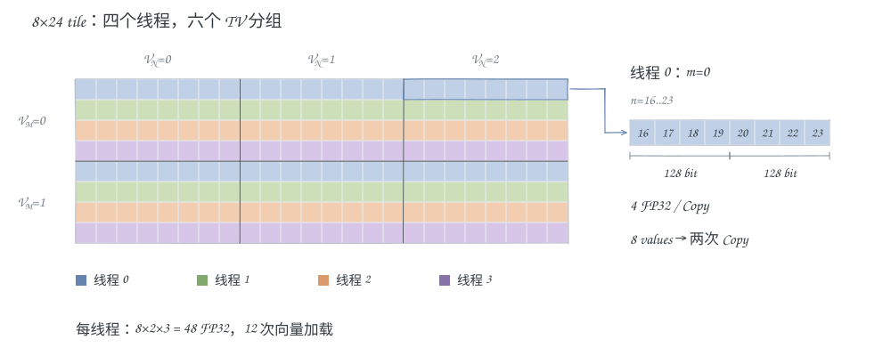
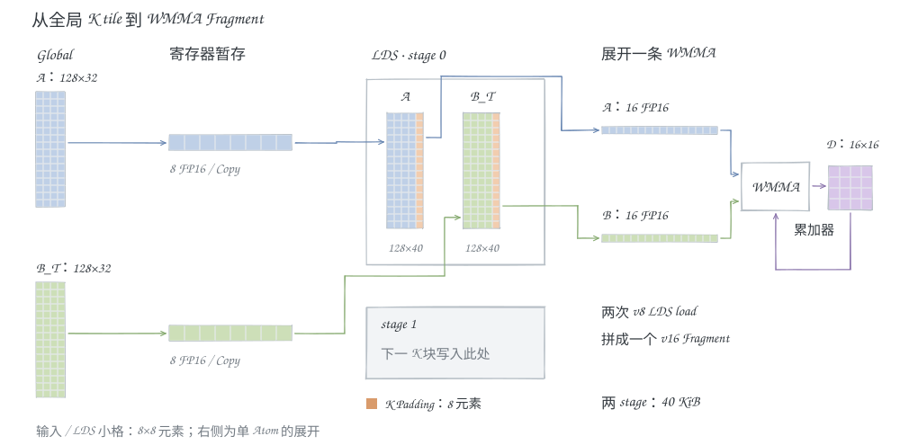
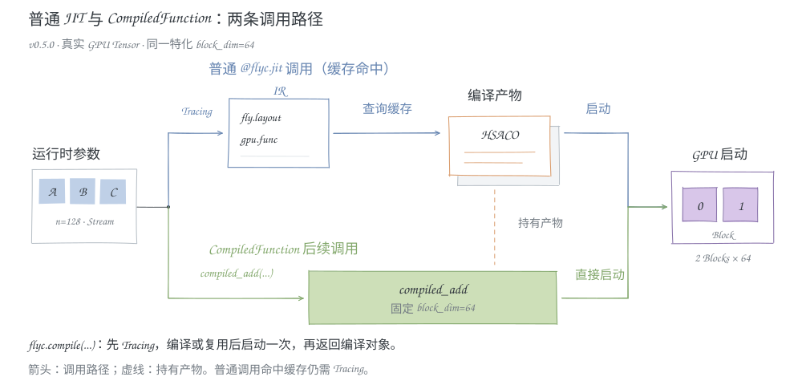

# FlyDSL：RDNA 3 的布局与矩阵计算

写一个高性能 GPU Kernel，算术指令本身往往只占很小一部分，真正难以写对和维护的，是**数据放在哪里**与**哪些线程以什么宽度去搬运和消费它**之间的耦合：全局内存怎么按 128-bit 合并访存，LDS（Local Data Share）里如何避免 Bank 冲突，矩阵指令要求每个 Lane 持有哪几个元素，以及下一块数据怎样在不覆盖当前计算的前提下完成预取。

**FlyDSL（Flexible Layout python DSL）** 正是针对这一问题设计的 Python GPU Kernel 编译器栈（[上游 README](https://github.com/ROCm/FlyDSL/blob/v0.5.0/README.md)）。它借鉴了 NVIDIA CuTe 的布局代数，但把 Layout、Copy Atom、MMA Atom 做成了 **MLIR（Multi-Level Intermediate Representation）** 中的一等公民类型（如 `!fly.layout`、`!fly.memref`）。你在 Python 里组合切分视图，编译器在 IR 层对这些代数关系做化简、校验与寄存器提升，最后直接降成目标 GPU 的机器指令。

??? info "源码版本与验证环境"

    本文源码锚点全部固定到 **FlyDSL v0.5.0**，目标为 `gfx11` 的 Wave32 路径（覆盖 RDNA 3 与 RDNA 3.5 的 `gfx1151`），文中的 IR、ISA 与运行验证均基于本机 AMD Radeon 8060S（`gfx1151`）实测结果。硬件执行模型与存储层级背景可配合 [RDNA3.5 架构与 AMD GPU 基础](<RDNA3.5架构与AMD%20GPU基础.md>) 阅读。

## M0：四例阶梯与基础心智模型

全文沿着四个逐步升级的例子展开，每个例子只引入一层新的问题与抽象，所有配套脚本均可直接在 RDNA 3 / 3.5（`gfx11` / `gfx1151`）上运行：

| 例子 | 数据规模与分工 | 本步引入的核心概念 |
| --- | --- | --- |
| [01-vectorAdd.py](code/flydsl-rdna/01-vectorAdd.py)（M2） | 128 个 FP32，64 线程 Block | `@flyc.kernel` / `@flyc.jit`、编译期常量 vs 运行期 SSA、两级 `logical_divide`、`BufferCopy` vs `UniversalCopy` |
| [02-tiledCopy.py](code/flydsl-rdna/02-tiledCopy.py)（M3） | 24×120 FP32，8×24 Block tile，4 线程 | `make_layout_tv`、TV Layout、`partition_S/D`、128-bit 向量化 `fx.copy` 与 `make_fragment_like` |
| [03-tiledWmma.py](code/flydsl-rdna/03-tiledWmma.py)（M4） | 64×64×32 FP16→FP32，4 个 Wave32 | `make_view` 静态化、WMMA Atom 硬件 ABI、由 MMA 反推 `TiledCopy` 与零拷贝 `retile` |
| [04-rdnaGemm.py](code/flydsl-rdna/04-rdnaGemm.py)（M5） | 128×128×32 Block tile，4 个 Wave32 | 高层 `TiledCopy` 与底层 intrinsic 混合编程、显式 Permutation、LDS 双缓冲、Grid Swizzle 与调度提示 |

!!! abstract "进入代码前先对齐两组基础概念"

    - **硬件与执行分工**：**tile（数据分块）** 是数组或矩阵的一块逻辑范围（如 64 个元素或 8×24 子矩阵）；**Block / Workgroup（线程组）** 是一起执行、共享同一块 **LDS（Local Data Share）** 并能用 Barrier 同步的线程集合；**Wave / Wavefront（波前）** 是 AMD GPU 的硬件执行宽度，**Lane** 是线程在 Wave 内的槽位。在 `gfx11` Wave32 下，一维 Block 中 `wave_id = tid // 32`、`lane_id = tid % 32`，因此 64 线程对应 2 个 Wave，128 线程对应 4 个 Wave（M3 的 4 线程 Copy 只使用一个 Wave 的前 4 条 Lane，不是 4 个 Wave）。
    - **FlyDSL 的三层视角**：写 Kernel 时你操作的是 Python 函数，但触发编译后 Python 会在 **Tracing（追踪）** 上下文中把 `fx.*` 构造为显式的 MLIR IR（`!fly.layout`、`!fly.memref`、`gpu`、`scf`、`vector` Dialect）；随后中间 Pass 将 Layout 代数折叠为标量地址算术、把寄存器 Tensor 提升为 Vector SSA；最后 ROCDL 与 LLVM 后端产出 `gfx11` 设备代码，由 HIP 运行时加载执行。

## M1：Layout 代数与读 Kernel 前的核心语法

几乎每一行 FlyDSL Kernel 都在操作同一套基础代数：**Shape、Stride、Layout、Composition、Complement、Divide、Slice 与 Product**。不要把它们当成黑盒 API 来背——这一节从定义出发，用极小例子把每个运算都手算到闭合。

### Shape、Stride、嵌套 mode 与地址跨度

对普通内存而言，一个 **Layout** 是由两个结构同构的整数元组组成的映射 $L = (S, D)$，其中 **Shape（形状）** $S$ 规定合法坐标范围，**Stride（步长）** $D$ 规定每一维每走一步时线性偏移增加多少个**元素**：

$$
L(c_0, c_1, \dots) = \sum_k c_k \cdot d_k.
$$

- **Stride 的单位是元素而非字节**：对 `fx.Float16`，Stride 为 16 表示跨过 16 个 FP16（即 32 B）。
- **同一 Shape 可配任意 Stride**：以 $8\times 16$ 矩阵为例，行主序 `(8, 16):(16, 1)` 与列主序 `(8, 16):(1, 8)` 拥有完全相同的逻辑坐标，但同一坐标 `(2, 3)` 算出的偏移截然不同——行主序是 $2\times 16 + 3 = 35$，列主序是 $2\times 1 + 3\times 8 = 26$。

[{ width="800" }](../../assets/rocm/flydsl-rdna/flydsl-layout-addressing.svg)

!!! note "核心约定：一维坐标始终按列主序（colexicographic）展开"

    当把一个一维整数 $i \in [0, \text{size}(S))$ 直接喂给多维 Layout $L = ((S_0, S_1), (D_0, D_1))$ 时，FlyDSL / CuTe **始终按 Shape 的列主序**把 $i$ 拆成坐标 $(i \bmod S_0,\; \lfloor i / S_0 \rfloor)$，再与 Stride 做点积：

    $$
    L(i) = (i \bmod S_0)\cdot D_0 + \lfloor i / S_0 \rfloor \cdot D_1.
    $$

    后文的 `Composition`、`Right Inverse` 和 `slice(..., (None, bid))` 的全部结果都直接由这条规则决定。

围绕上述定义，另外四个高频概念也需要一并理清：

1. **嵌套 mode 与 rank**：顶层分量的数量叫 **rank**，每个顶层分量叫一个 **mode**。`(8, 16)` 是 rank-2；`(9, (4, 8))` **依然是 rank-2**，只是第 1 个 mode 内部保留了两层层次结构（共 $9\times 4\times 8 = 288$ 个逻辑位置）。嵌套结构正是用来表达“Block → Wave → Thread → 向量内元素”的多级层次。
2. **`size` 与 `cosize`**：`fx.size(L)` 是逻辑元素总数；`fx.cosize(L)` 是地址空间需要覆盖的跨度（对非负整数 Stride，等于最大偏移加 1）。例如带行间 Padding 的列主序 Layout `(8, 16):(1, 9)`，`size = 128`，最大偏移出现在 `(7, 15)` 处为 $7\times 1 + 15\times 9 = 142$，所以 `cosize = 143`（FP16 需覆盖 286 B）。定义见 [size / cosize API](https://github.com/ROCm/FlyDSL/blob/v0.5.0/python/flydsl/expr/primitive.py#L813-L829) 与 [Layout.hpp](https://github.com/ROCm/FlyDSL/blob/v0.5.0/include/flydsl/Core/Algebra/Layout.hpp#L1182-L1200)。
3. **零 Stride 表示广播/复制**：Stride 为 0 时，沿该维移动不改变偏移，多个逻辑坐标映射到同一份底层存储。M4 中 RDNA 3 WMMA 的“半 Wave 重复读取同一行 A/B”，靠的就是一个 `stride = 0` 的 mode。
4. **视图构造与类型/值区分**：`fx.Tensor` 是由迭代器与 Layout 组成的 DSL 访问视图，`fx.make_view(fx.get_iter(A), layout)` 只替换坐标映射，不复制底层数据（见 [make_view](https://github.com/ROCm/FlyDSL/blob/v0.5.0/python/flydsl/expr/primitive.py#L528-L552)）。另外，代码里 `fx.Float16` 是传给 Atom/Tensor 构造器的**类型**，`fx.Float16(0)` 则是带该类型的**表达式值**。更一般地，Layout 的维度还可以混用静态整数与动态 `?`（运行期确定），也支持 Basis Stride（用于 Identity 坐标视图）或组合 `SwizzleType` 实现 XOR 地址映射（见上游 [Layout Guide](https://github.com/ROCm/FlyDSL/blob/v0.5.0/docs/layout_system_guide.md)）。

### 四个基础代数运算：Coalesce、Composition、Complement 与 Right Inverse

所有复杂的分块（`logical_divide`、`zipped_divide`）和线程映射（`make_layout_tv`、`partition_S`），在底层 [Layout.hpp](https://github.com/ROCm/FlyDSL/blob/v0.5.0/include/flydsl/Core/Algebra/Layout.hpp#L1585-L2165) 里都是由下面四个基础运算搭出来的（Python 接口见 [primitive.py](https://github.com/ROCm/FlyDSL/blob/v0.5.0/python/flydsl/expr/primitive.py#L898-L995)）。以下全部算例均已在本地 FlyDSL v0.5.0 实跑校验。

**1. Coalesce（合并化简）**

若相邻两个 mode $(S_0:D_0)$ 与 $(S_1:D_1)$ 满足 $D_1 = S_0 \cdot D_0$（即第一维走完后，第二维恰好无缝衔接下一段连续地址），它们可以合并成单个 mode $(S_0 S_1 : D_0)$，保持对所有一维坐标的映射值完全不变：

$$
\mathrm{coalesce}\big((2, 4):(1, 2)\big) = 8:1.
$$

**2. Composition（复合 $A \circ B$）**

函数复合定义为 $(A \circ B)(c) = A(B(c))$：先用 $B$ 把输入坐标映射到一维线性下标 $k$，再按 $A$ 的 Shape 列主序拆解 $k$ 送入 $A$。

拿一个具体矩阵算一遍：设 $A = (4, 6):(6, 1)$（$4\times 6$ 行主序矩阵，一维下标 $k \in [0, 24)$ 按列主序拆成 $(k \bmod 4, \lfloor k / 4 \rfloor)$，故 $A(k) = 6(k \bmod 4) + \lfloor k / 4 \rfloor$）。

- 取 $B_1 = 6:4$（$x \in [0, 6) \mapsto k = 4x$）：由于 $4x \bmod 4 = 0$、$\lfloor 4x / 4 \rfloor = x$，于是 $A(B_1(x)) = 6\cdot 0 + x = x$，结果正是 `6:1`——相当于从 $A$ 中按步长 4 抽出了第 0 行的全部 6 个元素。
- 取 $B_2 = (2, 3):(2, 4)$（$(u, v) \mapsto k = 2u + 4v$，其中 $u \in \{0,1\}, v \in \{0,1,2\}$）：因为 $2u < 4$，有 $k \bmod 4 = 2u$、$\lfloor k / 4 \rfloor = v$，代入得 $A(k) = 6(2u) + v = 12u + v$，所以：

$$
(4, 6):(6, 1) \circ (2, 3):(2, 4) = (2, 3):(12, 1).
$$

**3. Complement（补集 $\mathrm{complement}(T, M)$）**

如果小块 $T$ 已经占住了大小为 $M$ 的一维空间里的一部分位置，那么**如何把 $T$ 重复平移，才能不重不漏地铺满整个大小为 $M$ 的空间**？给出这个“平移步进规律”的 Layout 就是补集：

- $T = 4:1,\; M = 12$：第一块占了 $\{0,1,2,3\}$，接下来每步跨 4、重复 3 次，得 $\mathrm{complement}(4:1,\; 12) = 3:4$。
- $T = 4:2,\; M = 16$：第一块隔一个取一个，占了偶数位 $\{0,2,4,6\}$；要先偏移 $+1$ 填满奇数位 $\{1,3,5,7\}$（$2:1$），再整体跨 $+8$ 覆盖后半段 $[8, 16)$（$2:8$），得 $\mathrm{complement}(4:2,\; 16) = (2, 2):(1, 8)$。

**4. Right Inverse（右逆 $R = \mathrm{right\_inverse}(L)$）**

右逆寻找满足 $L(R(x)) = x$ 的映射 $R$——它把“输入坐标 $\to$ 输出偏移”反过来，变成“给定目标偏移 $x \to$ 应该喂给 $L$ 的输入坐标”。

以行主序 $L = (4, 8):(8, 1)$ 为例（$i \mapsto (i \bmod 4)\cdot 8 + \lfloor i / 4 \rfloor$），FlyDSL 给出 $\mathrm{right\_inverse}(L) = (8, 4):(4, 1)$。代入验证任意 $x \in [0, 32)$：

- 在 $R = (8, 4):(4, 1)$ 下，按列主序把 $x$ 拆成 $u = x \bmod 8,\; v = \lfloor x / 8 \rfloor \in [0, 4)$，算得 $i = R(x) = 4u + v$。
- 把 $i = 4u + v$ 代回 $L$：由于 $v < 4$，有 $i \bmod 4 = v$、$\lfloor i / 4 \rfloor = u$，于是 $L(R(x)) = 8v + u = 8\lfloor x / 8 \rfloor + (x \bmod 8) = x$，严格闭合。

在 M3 构造 TV Layout 时，`make_layout_tv` 正是靠右逆把“数据坐标 $\to$ `(thread, value)`”翻转成“`(thread, value)` $\to$ 数据坐标”。

### Divide、Slice 与 Product：把矩阵切成可索引的分块

有了 Composition 和 Complement，**Divide 就不再是需要死记硬背的魔法**。在 [Layout.hpp#L2081-L2165](https://github.com/ROCm/FlyDSL/blob/v0.5.0/include/flydsl/Core/Algebra/Layout.hpp#L2081-L2165) 中，一维 `logical_divide` 的定义只有一行公式：

$$
\mathrm{logical\_divide}(A, T) = A \circ \big(T,\; \mathrm{complement}(T, \mathrm{size}(A))\big).
$$

!!! example "手算验算：把 `(24, 120):(120, 1)` 按 `(8, 24)` 切块"

    对多维矩阵，按每个 mode 各自做一维 `logical_divide` 即可。以 M3 将用到的 $24\times 120$ 行主序矩阵 $A = (24, 120):(120, 1)$ 与 Block tile $(8, 24)$ 为例，把 **Shape 和 Stride** 一起算出来：

    - M 维是 $24:120$，tiler 为 $8:1$，补集是 $3:8$；复合后得 $(8, 3) : (120\times 1,\; 120\times 8) = (8, 3):(120, 960)$（块内每行跨 120，块间每跨 8 行就是 960）。
    - N 维是 $120:1$，tiler 为 $24:1$，补集是 $5:24$；复合后得 $(24, 5) : (1\times 1,\; 1\times 24) = (24, 5):(1, 24)$（块内连续，块间跨 24 列）。

三种 Divide 算的是**完全相同的元素划分**，差别只在于把各维的“块内（Tile）”和“块间（Rest）”怎样重新分组（以下类型均直接来自本地 FlyDSL v0.5.0 实测输出）：

| 操作 | 实测 `!fly.layout` 类型 | mode 组织方式 | 常见用途 |
| --- | --- | --- | --- |
| `logical_divide(A, (8, 24))` | `((8,3), (24,5)) : ((120,960), (1,24))` | 保留各维自己的 `(Tile, Rest)` | 按单维继续递归切分 |
| `zipped_divide(A, (8, 24))` | `((8,24), (3,5)) : ((120,1), (960,24))` | `((Tile_M, Tile_N), (Rest_M, Rest_N))` | 方便用单个 `bid` 一次切出当前 Block |
| `flat_divide(A, (8, 24))` | `(8, 24, 3, 5) : (120, 1, 960, 24)` | `(Tile_M, Tile_N, Rest_M, Rest_N)` | 方便用 `(bid_m, bid_n)` 分维索引 |

现在就能彻底看懂下面这行在后续 Kernel 里反复出现的代码：

```python
bA = fx.zipped_divide(A, (8, 24))[None, bid]
```

`zipped_divide` 的第 1 个顶层 mode 是块间布局 `(3, 5):(960, 24)`。传单个一维整数 `bid` 时，按前文的列主序规则自动拆成 `bid_m = bid % 3, bid_n = bid // 3`，把基址推进 `bid_m * 960 + bid_n * 24` 个元素；而第 0 个顶层 mode 用 `None` 完整保留，因此切片得到的 `bA` 实测类型为：

```mlir
!fly.memref<f32, #fly_rocdl.buffer_desc, (8,24):(120,1)>
```

注意它的行 Stride **仍然是原矩阵的 120，而不是 24**——切块只改变了起始指针和可视形状，底层全局数组分毫未动。

!!! tip "切片语法速查：`fx.slice` vs 方括号 `[]`"

    - `fx.slice(tensor, coord)` 始终返回子视图。
    - 方括号简写 `tensor[coord]` 在 `coord` 包含 `None` 时返回子视图（等价于 `slice`），在所有维度都给出具体坐标时读取元素，赋值 `tensor[coord] = val` 则写入该元素。
    - 若想直接用二维网格 `(bid_m, bid_n)` 定位块，用 `fx.flat_divide(A, (BM, BK))[None, None, bid_m, None]` 保留整条 K 维块序列更直观。

与 Divide（把大布局切出小块）对偶的运算是 **Product（把小块拼成大布局）**，例如把一个线程布局和一个值布局组合成覆盖整个基本 tile 的映射：`blocked_product` 让同一组先填满连续小块再步进，`raked_product` 则把多组交错（rake）铺开。M3 的 `make_layout_tv` 正是靠 `raked_product` 与 `right_inverse` 一举解决二维多线程向量搬运的。

## M2：向量加的完整骨架：从 Python 到 `gfx11` 指令

有了 M1 的 Layout 代数，我们立刻用最简单的 128 元素 FP32 向量加 `C = A + B`（每个 Block 64 线程，每线程处理 1 个元素，完整脚本见 [01-vectorAdd.py](code/flydsl-rdna/01-vectorAdd.py)）跑通第一个完整 Kernel，验证三个最关键的问题：**Python 代码什么时候执行、两级 Divide 到底有没有运行开销、视图与真实数据搬运怎么分开**。

### `@flyc.kernel` 与 `@flyc.jit`：编译期值与运行期 SSA

FlyDSL 把一个 GPU 任务拆成两层函数：

- **`@flyc.kernel`（Device 侧）**：定义真正在 GPU 上执行的设备函数。Python 不会在 CPU 上逐线程运行它；触发编译时，FlyDSL 在 Tracing 上下文中执行这段代码，把 `fx.*` 翻译成 MLIR 操作。
- **`@flyc.jit`（Host 侧 Launcher）**：负责计算 Grid/Block 启动参数，并调用 `kernel(...).launch(grid=..., block=..., stream=...)` 把任务提交给 HIP 运行时。

```python
@flyc.kernel
def vector_add_kernel(
    A: fx.Tensor, B: fx.Tensor, C: fx.Tensor,
    block_dim: fx.Constexpr[int],
):
    bid, tid = fx.block_idx.x, fx.thread_idx.x
    A = fx.rocdl.make_buffer_tensor(A, max_size=False)

    def thread_tiles(t):
        t = fx.logical_divide(t, fx.make_layout(block_dim, 1))
        t = fx.slice(t, (None, bid))
        return fx.logical_divide(t, fx.make_layout(1, 1))

    tA, tB, tC = thread_tiles(A), thread_tiles(B), thread_tiles(C)

    buffer_atom = fx.make_copy_atom(fx.rocdl.BufferCopy32b(), fx.Float32)
    universal_atom = fx.make_copy_atom(fx.UniversalCopy32b(), fx.Float32)

    rA = fx.make_rmem_tensor(fx.make_layout(1, 1), fx.Float32)
    rB = fx.make_rmem_tensor(fx.make_layout(1, 1), fx.Float32)
    rC = fx.make_rmem_tensor(fx.make_layout(1, 1), fx.Float32)

    fx.copy_atom_call(buffer_atom, fx.slice(tA, (None, tid)), rA)
    fx.copy_atom_call(universal_atom, fx.slice(tB, (None, tid)), rB)
    rC.store(rA.load() + rB.load())
    fx.copy_atom_call(universal_atom, rC, fx.slice(tC, (None, tid)))


@flyc.jit
def vector_add(
    A: fx.Tensor, B: fx.Tensor, C: fx.Tensor,
    n: fx.Int32,
    block_dim: fx.Constexpr[int],
    stream: fx.Stream = fx.Stream(None),
):
    grid_x = (n + block_dim - 1) // block_dim
    vector_add_kernel(A, B, C, block_dim).launch(
        grid=(grid_x, 1, 1),
        block=(block_dim, 1, 1),
        stream=stream,
    )
```

读懂这段签名，关键在于分清 **编译期常量** 与 **运行期 SSA（Static Single Assignment）值**——这是写 FlyDSL 时贯穿全程的第一条分水岭：

| 标注 | 代表什么 | 例子与影响 |
| --- | --- | --- |
| `fx.Constexpr[int]` | Tracing 阶段就确定的 Python 整数 | `block_dim=64` 直接写进 Layout 类型与 Block 配置，改成 128 会生成新的 **specialization（编译特化）** |
| `fx.Int32` | 编译进设备/Launcher 的运行期 32-bit 标量 | `n=128` 保留为运行期整数，只用来算 `grid_x`，改 `n` 不改变 IR 结构 |
| `fx.Tensor` | DSL 层的内存访问视图（迭代器 + Layout） | 由 JIT 接收 `torch.Tensor` 后自动建立，与持有显存的 PyTorch 对象位于不同层次 |
| `fx.Stream` | HIP 执行流 | 决定 Kernel 提交到哪条队列执行 |

### 两次 `logical_divide` 与真实 IR/ISA 对照

初看 `thread_tiles(t)`，很多人会疑惑：明明一行 `idx = bid * 64 + tid` 就能算出偏移，为什么要绕一圈写两次 `logical_divide` 和两次 `slice`？

先沿具体坐标 `bid = 0, tid = 5` 手算一遍这个两级切分：

1. 输入 `A` 长度 128、连续存放，Layout 为 `128:1`（编译期若来自普通 PyTorch Tensor，其长度标注为动态 `?:1`）。
2. 第一级 `logical_divide(A, 64:1)` 把数组按 64 个元素一块切开，得到 Shape `(64, 2)`（动态长度为 `(64, ?)`），Stride `(1, 64)`：第 0 维是块内元素，第 1 维是块号。
3. `slice(..., (None, bid))` 用 `None` 保留第 0 维（块内全部 64 个元素），用 `bid` 选定第 1 维（当前 Block），指针前移 `bid * 64`，得到 `64:1` 的块内视图。
4. 第二级 `logical_divide(..., 1:1)` 把 64 个元素再切成 `(1, 64):(0, 1)`，最后 `slice(..., (None, tid))` 选定槽位 `tid`，得到单元素视图。于是 `bid=0, tid=5` 选中 `A[5]`，`bid=1, tid=5` 选中 `A[64 + 5] = A[69]`。

[{ width="800" }](../../assets/rocm/flydsl-rdna/flydsl-vector-divide.svg)

!!! example "实测 IR → ISA 下降路径（`gfx1151`，`01-vectorAdd.py`）"

    在本地 `gfx1151` 上设置 `FLYDSL_DUMP_IR=1` 运行 `01-vectorAdd.py`，可以看到两级 `logical_divide` 怎样在编译期被彻底折叠：

    ```mlir
    // 1) 00_origin.mlir：Tracing 刚结束，所有切分都是显式的 !fly.memref 类型操作
    %13 = fly.logical_divide(%9, %12)
          : (!fly.memref<f32, #fly_rocdl.buffer_desc, ?:1>, !fly.layout<64:1>)
          -> !fly.memref<f32, #fly_rocdl.buffer_desc, (64,?):(1,64)>
    %15 = fly.slice(%13, %14)            // 选定 bid，得到 64:1
          -> !fly.memref<f32, #fly_rocdl.buffer_desc, 64:1>
    %19 = fly.logical_divide(%15, %18)   // 切成 (1,64):(0,1)
          -> !fly.memref<f32, #fly_rocdl.buffer_desc, (1,64):(0,1)>

    // 2) 04_fly_layout_lowering.mlir：Layout 代数全部折叠成两条标量整数指令
    %6  = arith.muli %bid, %c64_i32 : i32   // bid * 64
    %17 = arith.addi %6, %tid : i32         // bid * 64 + tid
    %19 = fly.add_offset(%5, %18)
    ```

    最终生成的 `gfx1151` 汇编（`22_final_isa.s` 核心片段）：

    ```asm
    v_lshl_or_b32    v0, s2, 6, v0               ; v0 = (bid << 6) | tid = bid * 64 + tid
    buffer_load_b32  v5, v0, s[4:7], 0 offen     ; A：BufferCopy32b -> buffer_load_b32
    global_load_b32  v3, v[3:4], off             ; B：UniversalCopy32b -> global_load_b32
    s_waitcnt        vmcnt(0)
    v_add_f32_e32    v2, v3, v5                  ; rA.load() + rB.load()
    global_store_b32 v[0:1], v2, off             ; C：UniversalCopy32b -> global_store_b32
    ```

两级 `logical_divide` 和 `slice` 在最终机器码里消失得一干二净，只剩一条 `v_lshl_or_b32` 算出 `bid * 64 + tid`——与手写偏移相比**零运行开销**。向量加的映射很简单，似乎看不出优势；但进入 M3 的二维向量化拷贝、M4 的 RDNA 3 WMMA 奇偶行交错与半 Wave 复制时，手工推导的索引公式会迅速失控，而 Layout 代数能把所有层次统一成可检查、可组合、且同样零开销的编译期变换。

### 三级存储、`BufferCopy` vs `UniversalCopy` 与 Graph 捕获

把 `vector_add_kernel` 的下半段拆开看，它已经呈现出 FlyDSL Kernel 的通用三段骨架：**建视图 → 搬入寄存器 Fragment → 计算并搬出**。

FlyDSL 里的 Tensor 分别归属三级存储空间：

- **Global（全局内存）**：入参 `A/B/C`，以及包装了 AMD Buffer 描述符的 `#fly_rocdl.buffer_desc` 视图。
- **Shared（LDS 片上共享内存）**：Workgroup 内共享，M5 双缓冲 GEMM 引入。
- **Register（线程私有寄存器）**：本例用 `fx.make_rmem_tensor(fx.make_layout(1, 1), fx.Float32)` 创建 `rA/rB/rC`。

务必区分**视图变换**与**真实搬运**：`logical_divide`、`slice`、`make_buffer_tensor` 只改写指针与 Layout，不产生任何访存指令；真正发出硬件 Load/Store 的是 `copy_atom_call`（以及后文的 `fx.copy`），真正对寄存器数值做算术的是 `rA.load() + rB.load()` 与 `rC.store(...)`。

本例故意为 `A` 和 `B/C` 选了两种 **Copy Atom（单次基本搬运合约）**：

- **`fx.make_copy_atom(fx.UniversalCopy32b(), fx.Float32)`**：通用指针语义，名字里的 `32b` 规定单次位宽，第二个参数 `fx.Float32` 规定按 FP32 解释（即 1 次搬 1 个 FP32）。后端根据地址空间选出指令，如上面的 `global_load_b32` / `global_store_b32`（不能假定它必然生成某条特定指令）。
- **`fx.make_copy_atom(fx.rocdl.BufferCopy32b(), fx.Float32)`**：使用 AMD **Buffer Resource Descriptor（缓冲资源描述符）**，在 [Lowering](https://github.com/ROCm/FlyDSL/blob/v0.5.0/lib/Dialect/FlyROCDL/CDNA3/CopyAtom.cpp#L68-L123) 中降为 ROCDL raw buffer 操作，生成上面的 `buffer_load_b32`。

!!! warning "RDNA 上 `make_buffer_tensor` 默认不开启越界检查"

    `make_buffer_tensor` 把普通 Global 视图包成 Buffer 描述符视图，不复制底层数据。**v0.5.0 在 RDNA 上默认关闭资源范围越界检查**，须按需显式指定（见 [Buffer 视图构造](https://github.com/ROCm/FlyDSL/blob/v0.5.0/python/flydsl/expr/rocdl/universal.py#L235-L315)）：

    | 写法 | Descriptor 范围 | RDNA 越界检查 |
    | --- | --- | --- |
    | `make_buffer_tensor(A)` | `0xFFFFFFFF` | 关闭，`OOB_SELECT=2` |
    | `make_buffer_tensor(A, max_size=False)` | `cosize(A.layout) × 元素字节数` | 开启，`OOB_SELECT=3` |
    | `make_buffer_tensor(A, num_records_bytes=512)` | 显式指定的 512 B（注意单位是**字节**） | 开启，`OOB_SELECT=3` |

    开启越界检查后，完全越过整个资源范围的 raw buffer 读会返回 0、写会被丢弃；但检查粒度是整个资源（本例 128×4 = 512 B），在二维矩阵里某一行末尾越界仍可能踩到下一行的有效内存，因此不能把 Buffer 越界检查直接当成通用的矩阵行列边界裁剪。

!!! tip "在 ROCm PyTorch 中捕获 `CUDAGraph`"

    在 ROCm 版 PyTorch 中捕获 `torch.cuda.CUDAGraph`（ROCm 下 PyTorch 沿用 `torch.cuda` 命名与 `device="cuda"`）时，应先在捕获外运行一次完成编译预热，并在 `with torch.cuda.graph(graph):` 内传入**正在捕获的那条当前 Stream**：

    ```python
    vector_add(A, B, C, 128, 64, stream=torch.cuda.current_stream())

    graph = torch.cuda.CUDAGraph()
    with torch.cuda.graph(graph):
        vector_add(A, B, C, 128, 64, stream=torch.cuda.current_stream())

    graph.replay()
    ```

    如果把捕获前保存的外部 Stream 传进 capture 上下文，Kernel 可能提交到另一条 Stream 导致捕获到空 Graph；同时 Graph 重放绑定的是捕获时的显存地址，不会重新执行 Python tracing。

## M3：Tiled Copy：把二维分块自动映射到一组线程与向量指令

M2 的一维向量加可以手写两次 `logical_divide`；但换成二维矩阵 `24×120`、Block tile `8×24`、每线程每次发出 128-bit 向量搬运，再用手工 `divide` 管理“线程排布 + 向量宽度 + 块内重复”就会变得极易出错。

FlyDSL 的解法是引入 **Thread-Value Layout（TV Layout）** 与 **TiledCopy**：用一套统一映射描述 `(thread, value)` 如何覆盖一个基本子块，再由编译器自动平铺到整个 Block tile。完整示例见 [02-tiledCopy.py](code/flydsl-rdna/02-tiledCopy.py)（改写自上游 [examples/02-tiledCopy.py](https://github.com/ROCm/FlyDSL/blob/v0.5.0/examples/02-tiledCopy.py)）。这里故意只用 4 个线程（仍属于一个 Wave32 的前 4 条 Lane，并非推荐的性能配置），目的是让整套映射小到可以完全手算并画在一张图上：

```python
@flyc.kernel
def copy_kernel(A: fx.Tensor, B: fx.Tensor):
    tid = fx.thread_idx.x
    bid = fx.block_idx.x

    A = fx.rocdl.make_buffer_tensor(A)
    B = fx.rocdl.make_buffer_tensor(B)

    bA = fx.zipped_divide(A, (8, 24))[None, bid]
    bB = fx.zipped_divide(B, (8, 24))[None, bid]

    thr_layout = fx.make_layout((4, 1), (1, 1))
    val_layout = fx.make_layout((1, 8), (1, 1))
    atom = fx.make_copy_atom(fx.rocdl.BufferCopy128b(), fx.Float32)

    tile_mn, tv_layout = fx.make_layout_tv(thr_layout, val_layout)
    tiled_copy = fx.make_tiled_copy(atom, tv_layout, tile_mn)
    thr_copy = tiled_copy.get_slice(tid)

    src = thr_copy.partition_S(bA)
    dst = thr_copy.partition_D(bB)
    frag = fx.make_fragment_like(src)

    fx.copy(atom, src, frag)
    fx.copy(atom, frag, dst)
```

### 解开 `make_layout_tv`：TV Layout 是怎么算出来的

打开 [derived.py#L111-L134](https://github.com/ROCm/FlyDSL/blob/v0.5.0/python/flydsl/expr/derived.py#L111-L134)，`make_layout_tv(thr_layout, val_layout)` 做的正是 M1 刚推导过的三步代数：

1. **Raked Product 铺出基本子块**：把 `thr_layout = (4, 1):(1, 1)`（4 个线程沿 M 排）与 `val_layout = (1, 8):(1, 1)`（每线程 8 个值沿 N 排）组合：
   $$
   \text{layout\_mn} = \mathrm{raked\_product}(\text{thr}, \text{val}) = \big((1, 4), (8, 1)\big) : \big((0, 1), (4, 0)\big).
   $$
   它的各维总尺寸 `tile_mn = (4, 8)`，并且把 4×8 块里的位置 $(m, n)$ 映射到唯一编号 $m + 4n \in [0, 32)$（即低位放线程号 $t \in [0,4)$，高位放值号 $v \in [0,8)$）。
2. **Right Inverse 翻转方向**：`right_inverse(layout_mn)` 得到 `32:1`，把“编号 $\to$ 4×8 列主序参考空间下标”翻回正向。
3. **Composition 拆出 `(thread, value)` 两个顶层 mode**：与 `tmp = (4, 8):(1, 4)` 复合，得到最终的 `tv_layout = (4, 8):(1, 4)`。

验证一下它的物理含义：给定任意 `(t, v)`（$t \in [0, 4),\; v \in [0, 8)$），`tv_layout(t, v) = t * 1 + v * 4`；而按 `tile_mn = (4, 8)` 的列主序参考空间展开，这个线性下标恰好对应块内坐标 `m = t, n = v`——第 `t` 号线程沿着第 `t` 行连续搬运 8 个元素。

### `partition_S/D` 与 `make_fragment_like` 的真实 Shape/Stride 对照

基本 TV tile 是 `4×8`，而 Block tile `bA` 是 `8×24`，因此需要在 M、N 两个方向分别重复：

$$
(R_M, R_N) = \left(\frac{8}{4},\; \frac{24}{8}\right) = (2, 3),
$$

每线程总共负责 $8 \times 2 \times 3 = 48$ 个 FP32（4 线程合计 192 个，正好覆盖 $8\times 24$）。同时要注意区分 **TV Layout 的 8 个逻辑 value** 与 **Copy Atom 的物理位宽**：`BufferCopy128b` + `Float32` 每次指令搬 $128 / 32 = 4$ 个 FP32，因此每组 8 个值会被自动拆成 `(AtomV=4, RestV=2)` 两次 128-bit 向量搬运。

[{ width="800" }](../../assets/rocm/flydsl-rdna/flydsl-tiled-copy-tv.svg)

对照本地 FlyDSL v0.5.0 为 `02-tiledCopy.py` 实际推导出的 `!fly.memref` 类型，每一个数字都能严丝合缝地对上：

| 变量 | 实测 `!fly.memref` 类型 | 每个 mode 与 Stride 的含义 |
| --- | --- | --- |
| `bA` | `buffer_desc, (8, 24):(120, 1)` | 当前 Block 视图，保留原矩阵行跨度 120 |
| `src = thr_copy.partition_S(bA)` | `buffer_desc, ((4, 2), 2, 3):((1, 4), 480, 8)` | `4:1` = 1 次 128-bit 向量；`2:4` = 同 TV 块第 2 次向量；`2:480` = 跨 4 行（$4\times 120$）；`3:8` = 跨 8 列 |
| `frag = make_fragment_like(src)` | `register, ((4, 2), 2, 3):((1, 4), 24, 8)` | 地址空间切到 `register`，保持相同逻辑形状，Stride 压缩为紧凑的 48 个寄存器 |

!!! example "手算闭合：验证 `(t=2, v=5, i=1, j=2)` 的全局偏移 = `741`"

    设 Block 0 内线程 `t = 2`，逻辑值 `v = 5`（即第 2 次向量 `rest_v = 1` 的第 `atom_v = 1` 个元素），重复坐标 `i = 1, j = 2`：

    - **按全局矩阵算**：`m = t + 4*i = 2 + 4 = 6`，`n = v + 8*j = 5 + 16 = 21`，全局偏移为 $6 \times 120 + 21 = 741$（字节偏移 $741 \times 4 = 2964\ \text{B}$）。
    - **按 `src` 的 Layout 算**：线程 `t = 2` 的基址已经前移了 $2 \times 120 = 240$；在 `((4, 2), 2, 3):((1, 4), 480, 8)` 中取坐标 `((1, 1), 1, 2)`，相对偏移为 $1\times 1 + 1\times 4 + 1\times 480 + 2\times 8 = 501$；合计 $240 + 501 = 741$，分毫不差。

这里的 `partition_S` / `partition_D` 分别按 Copy 的 Source / Destination 分工切分视图（见 [ThrCopy API](https://github.com/ROCm/FlyDSL/blob/v0.5.0/python/flydsl/expr/derived.py#L29-L55)），**`S/D` 不固定代表 Global 或 Register**；本例把 `partition_S` 用在 `bA`、把 `partition_D` 用在 `bB`，两者都是全局 Buffer 视图。而 `make_fragment_like(src)` 只按 `src` 的逻辑形状分配紧凑的寄存器 Tensor（见 [FlyOps.cpp#L338-L369](https://github.com/ROCm/FlyDSL/blob/v0.5.0/lib/Dialect/Fly/IR/FlyOps.cpp#L338-L369)），本身不读取数据。

### `fx.copy`、工程约束与非整除边界 Predicate

与 M2 只发出单次搬运的 `copy_atom_call` 不同，`fx.copy(atom, src, frag)` 会沿 `(RestV, R_M, R_N) = (2, 2, 3)` 自动展开全部 **12 次** 128-bit 向量加载（见 [Copy API](https://github.com/ROCm/FlyDSL/blob/v0.5.0/python/flydsl/expr/primitive.py#L1022-L1069)），搬运方向由 `src` 与 `dst` 的地址空间自动决定（第一次 `Global → Register`，第二次 `Register → Global`）。

!!! warning "扩展到真实 Kernel 时的四条硬约束"

    从这个 4 线程小例子扩展到真实 Kernel（如 128 线程、FP16）时，必须同时满足：

    1. 向量搬运的 `AtomV` 方向落在内存连续维上（`stride = 1`）；
    2. 单次向量起点满足硬件对齐要求（128-bit 需 16 B 对齐）；
    3. 基本 `tile_mn` 整除 Block tile；
    4. 若矩阵总尺寸不整除 Block tile，必须显式处理尾部边界。

!!! tip "非整除二维边界的标准写法：Identity Coordinate Tensor + Predicate"

    上游 [examples/01-vectorAdd.py#L33-L66](https://github.com/ROCm/FlyDSL/blob/v0.5.0/examples/01-vectorAdd.py#L33-L66) 给出了零显存开销的边界裁剪范式：

    ```python
    M, N = A.shape.unpack()
    idC = fx.make_view((0, 0), fx.make_identity_layout((M, N)))
    cC = fx.flat_divide(idC, TileMN)[None, None, bid_x, bid_y]
    thr_cC = thr_copy.partition_S(cC)[(0, None), None, None]   # 取每次 Atom 搬运的首元素坐标

    thr_pC = fx.make_fragment_like(thr_cC, dtype=fx.Boolean)
    for a in fx.range_constexpr(fx.size(thr_pC.shape).unpack()):
        thr_pC[a] = fx.elem_less(thr_cC[a], (M, N))

    fx.copy(copy_atom, thr_gA, thr_rA, pred=thr_pC)
    ```

    `idC` 是纯坐标映射（不占显存）；对它执行与 `A` 完全相同的 `flat_divide` 和 `partition_S`，即可算出当前线程每次 Copy Atom 对应的真实全局坐标 `(m, n)`，再用 `fx.elem_less` 填出布尔谓词传给 `fx.copy(..., pred=thr_pC)`。

## M4：Tiled WMMA：当硬件矩阵指令反过来约束 Layout

在 M3 的普通拷贝里，我们可以自由决定 `thr_layout` 和 `val_layout`；但进入矩阵计算后，**主导权翻转了**——硬件的矩阵乘加指令已经把“每个 Lane 必须放哪几个元素、按什么顺序排列”写死在指令 ABI 里。只要有一个 Lane 装错元素，Kernel 不会崩溃，却会静默算出错误结果。

这一节通过 [03-tiledWmma.py](code/flydsl-rdna/03-tiledWmma.py) 演示 FlyDSL 如何处理这种反向约束：在 RDNA 3 上用 128 线程（4 个 Wave32）协作计算一块 $64\times 64$ 输出：

$$
C_{64\times 64} = A_{64\times 32}\, B_{64\times 32}^{T},
$$

输入为 FP16、累加与输出为 FP32（不引入 LDS 与 K 预取流水，专注看懂 WMMA Fragment 与 Copy 的衔接）。注意这里的 `B` 按 `(N, K)` 存放，公式通过转置参与乘法；M5 的 `B_T` 同样是 `(N, K)` 布局，切勿与 `(K, N)` 混淆。

### 为什么先用 `make_view` 把输入静态化

先看 `03-tiledWmma.py` 的核心入口：

```python
@flyc.kernel
def tiled_wmma_kernel(A: fx.Tensor, B: fx.Tensor, C: fx.Tensor):
    tid = fx.thread_idx.x

    bA = fx.make_view(fx.get_iter(fx.rocdl.make_buffer_tensor(A)), fx.make_layout((M, K), (K, 1)))
    bB = fx.make_view(fx.get_iter(fx.rocdl.make_buffer_tensor(B)), fx.make_layout((N, K), (K, 1)))
    bC = fx.make_view(fx.get_iter(fx.rocdl.make_buffer_tensor(C)), fx.make_layout((M, N), (N, 1)))

    atom = fx.make_mma_atom(fx.rocdl.WMMA(16, 16, 16, fx.Float16, fx.Float32))
    tiled_mma = fx.make_tiled_mma(atom, fx.make_layout((2, 2, 1), (1, 2, 0)))
    thr_mma = tiled_mma.thr_slice(tid)
```

!!! question "明明传入的 `torch.Tensor` 已经是 `64×32`，为什么还要用 `make_view` 重包一层？"

    JIT 从普通 `torch.Tensor` 接收到的视图，其形状默认带动态维度 `?`；而 `thr_mma.make_fragment_A(bA)` 需要在编译期确定每个线程的静态寄存器数组大小（如 `(16, 2, 2)`）。用 `make_view` 换上编译期常量 `M=64, N=64, K=32` 构成的静态 Layout，既不复制数据，又让后续所有 TiledMma 分片与循环展开全部在编译期确定。

### RDNA 3 WMMA Atom 的硬件 ABI：半 Wave 复制与奇偶行交错

**WMMA（Wave Matrix Multiply-Accumulate）** 是整个 Wave32 协作执行的矩阵乘加指令。`fx.rocdl.WMMA(16, 16, 16, fx.Float16, fx.Float32)` 在 `gfx11` 目标下会分发到 `MmaOpGFX11_WMMAType`（见 [universal.py#L167-L204](https://github.com/ROCm/FlyDSL/blob/v0.5.0/python/flydsl/expr/rocdl/universal.py#L167-L204)），单次 Atom 计算 $D_{16\times 16} = A_{16\times 16} B_{16\times 16}^T + C_{16\times 16}$。

!!! note "RDNA 3 WMMA 指令 ABI 的两个关键特征"

    对 Wave 内编号为 $L \in [0, 32)$ 的 Lane 以及元素序号 $v$：

    - **A / B 输入在半 Wave 间重复**（每 Lane 16 个 FP16，打包进 8 个 32-bit VGPR）：$\text{row} = L \bmod 16,\; k = v$，**Lane 16～31 保存与 Lane 0～15 完全相同的行片段**。
    - **C / D 输出按奇偶行交错**（每 Lane 8 个 FP32，占 8 个 VGPR）：$m = 2v + \lfloor L / 16 \rfloor,\; n = L \bmod 16$，Lane 0～15 负责全部偶数行，Lane 16～31 负责全部奇数行，32 条 Lane × 8 元素 = 256 个互不重复的输出元素。

    打开 [MmaAtom.cpp#L17-L79](https://github.com/ROCm/FlyDSL/blob/v0.5.0/lib/Dialect/FlyROCDL/GFX11/MmaAtom.cpp#L17-L79)，FlyDSL 在列主序参考空间里正是用 M1 的 **零 Stride** 把这条硬件 ABI 精准编码成 TV Layout 的：

    ```text
    A/B：shape = (thread=(16, 2), value=16),  stride = (thread=(1, 0),  value=16)
    C/D：shape = (thread=(16, 2), value=8),   stride = (thread=(16, 1), value=2)
    ```

[{ width="800" }](../../assets/rocm/flydsl-rdna/flydsl-rdna3-wmma-fragments.svg)

注意这里的 Stride 属于 Atom 的列主序参考空间（`A/B` 里的 `stride=(1, 0)` 表示 `L%16` 选行、`L//16` 乘以 0 从而复制到后半 Wave）；实际全局矩阵可以是行主序，Copy 会通过 Layout 复合算出真实内存偏移。更细致的硬件指令背景可结合 [AMD RDNA 3 与 RDNA 4 架构上的 FP16 GEMM 优化](<RDNA3与RDNA4上的FP16%20GEMM优化.md>) 阅读。

### 四个 Wave 铺满 64×64：解构 `tv_layout_A_tiled` 与周期重复

单条 Atom 只覆盖 $16\times 16$；`fx.make_tiled_mma(atom, fx.make_layout((2, 2, 1), (1, 2, 0)))` 把 4 个 Wave32 按 `(M=2, N=2, K=1)` 排开（见 [TiledMma API](https://github.com/ROCm/FlyDSL/blob/v0.5.0/python/flydsl/expr/primitive.py#L1074-L1077)）：

| Wave | `wave_m` | `wave_n` | 共享关系 |
| --- | --- | --- | --- |
| 0 | 0 | 0 | 与 Wave 2 共享相同 A 行，与 Wave 1 共享相同 B 行 |
| 1 | 1 | 0 | 与 Wave 3 共享相同 A 行，与 Wave 0 共享相同 B 行 |
| 2 | 0 | 1 | 与 Wave 0 共享相同 A 行，与 Wave 3 共享相同 B 行 |
| 3 | 1 | 1 | 与 Wave 1 共享相同 A 行，与 Wave 2 共享相同 B 行 |

K 维 Shape 为 1，表示**没有跨 Wave 的 Split-K 归约**，每个 Wave 独立遍历全部 $K=32$。把本地 FlyDSL v0.5.0 实际生成的 `tiled_mma.tv_layout_A_tiled` 与 `tv_layout_C_tiled` 打印出来，可以把 4 层线程因子读得一清二楚：

```mlir
// 线程 128 被分解为 (lane%16=16, lane//16=2, wave_m=2, wave_n=2)
tv_layout_A_tiled : ((16, 2, 2, 2), (16, (1, 1))) : ((1,  0, 16,   0), (32, (0, 0)))
tv_layout_C_tiled : ((16, 2, 2, 2), ( 8, (1, 1))) : ((32, 1, 16, 512), ( 2, (0, 0)))
```

逐项核对 `tv_layout_A_tiled` 的线程 Stride `(1, 0, 16, 0)`：
- `lane%16` 步长 1 → 选 Atom 内的行；
- `lane//16` 步长 **0** → 半 Wave 重复；
- `wave_m` 步长 16 → 不同 M 方向 Wave 跨开 16 行（覆盖 $2\times 16 = 32$ 行）；
- `wave_n` 步长 **0** → 不同 N 方向 Wave 读取同一份 A！

再看 `64×64×32` 如何由基本 `32×32×16` tile 覆盖：

$$
R_M = \frac{64}{2\times 16} = 2,\qquad R_N = \frac{64}{2\times 16} = 2,\qquad R_K = \frac{32}{16} = 2.
$$

!!! warning "易错细节：默认未传 `permutation` 时是周期交错而非四象限"

    未显式传入 `permutation` 参数时，四个 Wave 先组成 $32\times 32$ 的基本 tile，再以 32 为周期重复铺满 $64\times 64$（见 [TiledMma.hpp#L245-L313](https://github.com/ROCm/FlyDSL/blob/v0.5.0/include/flydsl/Core/Algebra/TiledMma.hpp#L245-L313)）。因此每个 Wave 拿到的是 4 块**不相邻**的 $16\times 16$（例如 Wave 0 落在 `(0,0)`、`(32,0)`、`(0,32)`、`(32,32)`），而不是连续的 $32\times 32$ 左上象限。每条 Lane 持有 $8\times 2\times 2 = 32$ 个 FP32 输出，128 条线程合计 $128\times 32 = 4096 = 64\times 64$，K 方向的两次 Atom 累加到同一份 C 上。

[{ width="800" }](../../assets/rocm/flydsl-rdna/flydsl-tiled-wmma-waves.svg)

### 从 MMA 反推 Copy 与 `retile` 的零拷贝真相

有了 `tv_layout_A/B/C_tiled`，我们完全不必手写把数据送进每个 Lane 的偏移公式——`make_tiled_copy_A/B/C(copy_atom, tiled_mma)` 直接借用 `tiled_mma` 内部的 TV 布局构造出与之精确匹配的 `TiledCopy`（见 [derived.py#L143-L176](https://github.com/ROCm/FlyDSL/blob/v0.5.0/python/flydsl/expr/derived.py#L143-L176)）：

```python
copy_ab = fx.make_copy_atom(fx.rocdl.BufferCopy16b(), fx.Float16)
copy_c = fx.make_copy_atom(fx.rocdl.BufferCopy32b(), fx.Float32)

copy_A = fx.make_tiled_copy_A(copy_ab, tiled_mma).get_slice(tid)
copy_B = fx.make_tiled_copy_B(copy_ab, tiled_mma).get_slice(tid)
copy_C = fx.make_tiled_copy_C(copy_c, tiled_mma).get_slice(tid)

src_A, src_B, dst_C = copy_A.partition_S(bA), copy_B.partition_S(bB), copy_C.partition_D(bC)

frag_A = thr_mma.make_fragment_A(bA)
frag_B = thr_mma.make_fragment_B(bB)
frag_C = thr_mma.make_fragment_C(bC)

fx.copy(copy_ab, src_A, copy_A.retile(frag_A))
fx.copy(copy_ab, src_B, copy_B.retile(frag_B))

frag_C.fill(0)
for ki in fx.range_constexpr(K // 16):
    fx.gemm(tiled_mma, frag_C, frag_A[None, None, ki], frag_B[None, None, ki], frag_C)

fx.copy(copy_c, copy_C.retile(frag_C), dst_C)
```

这里选用 16-bit 输入 Copy 和 32-bit 输出 Copy（每次 Atom 搬 1 个标量元素），最容易看清 **为什么必须调用 `retile`**。直接把本地 FlyDSL v0.5.0 对 `03-tiledWmma.py` 生成的真实 `!fly.memref` 类型并排对照：

| 视图 | 实测 `!fly.memref` 类型 | 关键变化 |
| --- | --- | --- |
| `frag_A`（MMA 视角） | `register, (16, 2, 2):(1, 32, 16)` | `(MMA_V=16, R_M=2, R_K=2)`，共 64 个 FP16 |
| `copy_A.partition_S(bA)` | `buffer_desc, ((1, 16), 2, 2):((0, 1), 1024, 16)` | `BufferCopy16b` 的 `AtomV=1`，故第 0 维拆成 `(1, 16)`；`1024 = 32×32` 是 M 周期步长 |
| `copy_A.retile(frag_A)` | `register, ((1, 16), 2, 2):((0, 1), 32, 16)` | **零拷贝重塑视图**：把 `16` 拆成 `(1, 16)` 以对齐 `src_A`，底层仍是同一份 64 个寄存器 |
| `frag_C`（MMA 视角） | `register, (8, 2, 2):(1, 16, 8)` | `(MMA_V=8, R_M=2, R_N=2)`，共 32 个 FP32 |
| `copy_C.partition_D(bC)` | `buffer_desc, ((1, 8), 2, 2):((0, 128), 2048, 32)` | **`stride = 128 = 2 × 64` 精准体现每步跨两行的奇偶行交错**；`2048 = 32×64` |
| `copy_C.retile(frag_C)` | `register, ((1, 8), 2, 2):((0, 1), 16, 8)` | 与 `dst_C` 形状同构，可直接传给 `fx.copy` |

[{ width="800" }](../../assets/rocm/flydsl-rdna/flydsl-partition-copy-retile.svg)

!!! tip "`retile` 是 IR 层的零拷贝视图重塑"

    `frag_A` 与 `copy_A.retile(frag_A)` 指向**同一块寄存器内存**，前者按 MMA 指令消费的 `(16, 2, 2)` 视图组织，后者按 `BufferCopy16b` 要求的 `((1, 16), 2, 2)` 视图组织，不额外分配第二份 Tensor。同时保持严谨边界：在 IR 语义上 `retile` 是零拷贝视图变换，但最终硬件 ISA 是否还会因寄存器约束产生重排指令，仍需检查生成的汇编。

计算阶段，`fx.gemm(tiled_mma, d, a, b, c)` 的参数顺序是 **合约、输出 D、输入 A、输入 B、初始累加 C**（见 [gemm API](https://github.com/ROCm/FlyDSL/blob/v0.5.0/python/flydsl/expr/primitive.py#L1120-L1177)）。`frag_C.fill(0)` 清零后，`fx.range_constexpr(2)` 在编译期展开两步 K 循环：`frag_A[None, None, ki]` 选定当前 K 子块，输入累加和输出都绑定 `frag_C`，把 $K \in [0, 16)$ 与 $K \in [16, 32)$ 两次部分和累加到同一份寄存器上，最后由 `fx.copy(copy_c, copy_C.retile(frag_C), dst_C)` 一次性写回全局内存。

## M5：双缓冲 GEMM：高层 Layout 与底层硬件控制的衔接

M4 的 `03-tiledWmma.py` 每个 Wave 都直接从全局内存读取自己的 A/B，既没有块内复用，也无法隐藏长 K 维上的访存延迟。FlyDSL 上游的 RDNA 3 生产级 GEMM [kernels/gemm/rdna3_f16_gemm.py](https://github.com/ROCm/FlyDSL/blob/v0.5.0/kernels/gemm/rdna3_f16_gemm.py)（驱动脚本见 [04-rdnaGemm.py](code/flydsl-rdna/04-rdnaGemm.py)）在此基础上补齐了四块工程拼图：**LDS 块内共享复用、两阶段 Ping-Pong 双缓冲、Grid Swizzle 与编译调度提示**。

读上游源码时，很多初学者会感到突然“断档”：明明 M4 刚学了 `make_tiled_copy_A` 和 `fx.gemm`，为什么生产 GEMM 里既有 `TiledCopy`/`TiledMma`，又冒出了手写的 `_v8_load`、`shuffle` 和 `rocdl.wmma_*` intrinsic？把整个 Kernel 的四段数据通路排开，就能一眼看懂作者的工程边界：

| 阶段 | 采用的抽象层级 | 为什么这样选 |
| --- | --- | --- |
| Global → Register → LDS（G2S） | 高层 `TiledCopy` + `BufferCopy128b` | 128 线程沿 K 连续按 128-bit 合并搬运，TV Layout 与 `fx.copy` 表达最简洁 |
| LDS → Register → WMMA 热循环 | 底层 `_v8_load` + `shuffle` + `rocdl.wmma_*` | 精确控制 `pad`/`kblock` 两种 LDS 寻址、两次 v8 拼 v16 以及内循环 A Fragment 预取与调度计数 |
| C 写回（Epilogue） | 高层 `TiledMma` + `make_tiled_copy_C` + `retile` | 数值转换/随机舍入在寄存器里做完，复杂的 `2*si + L//16` 奇偶行和 Wave 分带地址全交给 `TiledCopy` 自动生成 |
| Block 调度与同步 | Grid Swizzle + `s_waitcnt`/`s_barrier` + 可选 `_sched_plan` | 贴近硬件 L2 复用与指令发射队列需求 |

!!! tip "读懂上游生产 GEMM 的关键：高层抽象与底层控制的边界"

    FlyDSL 的核心定位正是**混合编程**：高层 `TiledCopy` / `TiledMma` 帮你消灭繁琐的地址算术，而在需要锁死每一条 LDS Load 与 WMMA 发射顺序的热循环里，随时允许无缝下探到向量与 intrinsic。

### 尺寸账本、显式 Permutation 与工厂入口

默认参数配置如下：

```python
reg_m = reg_n = 4   # 每个 Wave 在 M/N 方向重复的 16×16 Atom 数（不是 VGPR 数）
reg_k = 2           # 每个 Block K tile 内的 16 元素步数
waves_m = waves_n = 2

BLOCK_M = 16 * reg_m * waves_m     # 128
BLOCK_N = 16 * reg_n * waves_n     # 128
BLOCK_K = 16 * reg_k               # 32
THREADS = 32 * waves_m * waves_n   # 128（4 个 Wave32）
```

每个 Wave 负责 `64×64` 输出带，每条 Lane 持有 $8\times 4\times 4 = 128$ 个 FP32 累加器，全 Block 共 $128\times 128 = 16384$ 个输出元素；每个 K 步消费 `128×32` 的 A 和 `128×32` 的 `B_T`。

与 M4 未指定 Permutation 时的周期交错分布不同，这里构造 `TiledMma` 时显式传入了 M/N 维的 Permutation（见 [rdna3_f16_gemm.py#L531-L554](https://github.com/ROCm/FlyDSL/blob/v0.5.0/kernels/gemm/rdna3_f16_gemm.py#L531-L554)）：

```python
fx.make_layout((16, waves_m, reg_m), (1, 16 * reg_m, 16))
```

把 `(16, 2, 4):(1, 64, 16)` 展开看：`reg_m` 步长是 16（同一 Wave 的 4 个 Atom 紧挨着拼成连续 64 行），`waves_m` 步长是 64（Wave 0 占第 0～63 行，Wave 1 占第 64～127 行）。N 方向同理，每个 Wave 最终拿到的是连续的 64×64 块。

外部通过工厂函数编译并获取启动入口（见 [工厂参数](https://github.com/ROCm/FlyDSL/blob/v0.5.0/kernels/gemm/rdna3_f16_gemm.py#L98-L139) 与 [launch 包装](https://github.com/ROCm/FlyDSL/blob/v0.5.0/kernels/gemm/rdna3_f16_gemm.py#L523-L570)）：

```python
from kernels.gemm.rdna3_f16_gemm import create_wmma_gemm_module

launch, bm, bn, bk = create_wmma_gemm_module(
    256, 256, 64, in_dtype="f16", out_dtype="f32"
)
launch(C, A, B_T, torch.cuda.current_stream())
```

`launch` 的参数顺序是 **C、A、B_T、Stream**，计算 $C = A B_T^T$。因为 `kernels/` 属于源码仓库目录，安装 wheel 后需将源码根目录加入 `PYTHONPATH` 才能导入。可选参数 `lda/ldb/ldc` 以**元素**为单位，且 A/B 的行跨度须满足 16 B 对齐；当前实现要求 M/N/K 整除 Block tile 且 K 至少包含两个 tile。

### Global → Register → LDS：沿 K 连续的 TiledCopy 与 `@fx.struct`

接口中的 `A(M, K)` 与 `B_T(N, K)` 都沿 K 维连续。全 Block 128 个线程用 128-bit（`LOAD_VEC = 8` 个 FP16）向量分工搬运一个 `128×32` 的输入 tile：

```python
LOAD_VEC = 8                    # 8 × FP16 = 128-bit
THRS_K = BLOCK_K // LOAD_VEC    # 4 个线程覆盖一行 32 元素
THRS_M = THREADS // THRS_K      # 32 个线程覆盖 32 行
```

基本 Copy tile 是 `32×32`（每线程起点 `row = tid // 4, col = (tid % 4) * 8`），沿 M 方向重复 4 次铺满 `128×32`。于是每个 K 步中，每条线程搬 4 个 A 向量和 4 个 B 向量，合计 **8 个 128-bit 向量（G2S chunks = 8）**。存入 LDS 后，A 的 128 行同时供给两个 N 方向 Wave，B 的 128 行同时供给两个 M 方向 Wave，从而把每块数据的全局访存次数减半。

[{ width="800" }](../../assets/rocm/flydsl-rdna/flydsl-rdna3-gemm-dataflow.svg)

LDS 空间用 `@fx.struct` 声明结构，再由 `fx.SharedAllocator` 静态分配（见 [SharedAllocator](https://github.com/ROCm/FlyDSL/blob/v0.5.0/python/flydsl/expr/gpu.py#L158-L188) 与 [Storage.peek](https://github.com/ROCm/FlyDSL/blob/v0.5.0/python/flydsl/expr/struct.py#L857-L877)）：

```python
@fx.struct
class SharedStorage:
    lds: fx.Array[elem_dtype, LDS_TOTAL, 16]   # 16 B 对齐

lds_storage = fx.SharedAllocator().allocate(SharedStorage).peek()
lds_ptr = lds_storage.lds.ptr
```

这里的 `.peek()` 只拿到 Array 字段视图，并不会把整块 LDS 拷进寄存器。两个双缓冲 stage 共享同一段 LDS 数组，通过元素偏移 `LDS_ONE_BUF` 切换。内核提供两种 LDS 地址映射（见 [资源计算](https://github.com/ROCm/FlyDSL/blob/v0.5.0/kernels/gemm/rdna3_f16_gemm.py#L154-L190)）：

- **默认 `pad` 布局**：每行末尾加 8 个 FP16 的 Padding，使行跨度由 32 变为 40（错开相邻行落入的 LDS Bank）。单块 A 或 B 占 $128\times 40\times 2\ \text{B} = 10240\ \text{B}$，单个 stage（A+B）占 $20480\ \text{B}$（`LDS_ONE_BUF = 10240` 个 FP16），双缓冲合计 **40 KiB**（在 `gfx1151` 每 Workgroup 64 KiB 上限之内）。
- **可选 `kblock` 布局**：按 8 元素 K chunk 重组偏移 `index = (col // 8 * rows + row) * 8 + col % 8`，取消 Padding，双缓冲容量降至 **32 KiB**（容量更小不自动等于更快，需结合实际访问模式与 Occupancy 实测）。

另外值得留意一个源码细节：把寄存器暂存写入 LDS 时，源码里的 `_lds_dst(buf_offset, ...)` 每次都会在当前作用域内重新构造依赖动态 `buf_offset` 的 Shared 视图，而不是把视图缓存到循环外——这正是为了满足 M6 将重点剖析的 MLIR SSA dominance 约束。

### LDS → Register 与两阶段 Ping-Pong 双缓冲流水

消费 LDS 时，单个 `gfx11` WMMA Atom 需要 16 个 FP16（`v16`）。[源码](https://github.com/ROCm/FlyDSL/blob/v0.5.0/kernels/gemm/rdna3_f16_gemm.py#L342-L372) 通过两次 128-bit（`v8`）LDS 读取并用 `shuffle` 拼接：

```python
col_lo, col_hi = 16 * rk, 16 * rk + 8
v_lo = load_v8(index(row, col_lo) // 8)
v_hi = load_v8(index(row, col_hi) // 8)
fragment = v_lo.shuffle(v_hi, list(range(16)))
```

A 的行号由 `wave_m`、`rm` 和 `lane % 16` 决定，B 同理。Lane 16～31 算出与 Lane 0～15 相同的行号并各自读取（源码未实现“半 Wave 加载后再广播”的优化；满足指令 ABI 复制有多种实现途径，这里选择了实现最直接的一种）。

整个 K 维累加组织成 **Prologue → 主循环 → Epilogue** 三段（见 [`_one_k_tile` 与 `_accumulate`](https://github.com/ROCm/FlyDSL/blob/v0.5.0/kernels/gemm/rdna3_f16_gemm.py#L421-L453)）：

1. **Prologue**：把 K tile 0 从 Global 读入暂存寄存器，写入 LDS stage 0，同步等待可见。
2. **主循环**（由 `for iv, state in range(..., init=...)` 与 `yield` 驱动的动态 SCF 循环）：每轮按 `read_off = (iv % 2) * LDS_ONE_BUF`、`write_off = (1 - iv % 2) * LDS_ONE_BUF` 交替读写：
   ```python
   def one_k_tile(read_off, write_off, next_k):
       gmem_load(A, B_T, next_k)   # 先发射下一 K 块的 Global Load（入暂存寄存器）
       acc = compute(read_off)     # 消费当前 LDS stage 做全部 WMMA（与 Global Load 重叠）
       lds_store(write_off)        # 把刚到的下一 K 块写入另一 LDS stage
       barrier()                   # 交接 stage，准备下一轮
       return acc
   ```
3. **Epilogue**：排空留在另一个 LDS stage 里的最后一个 K tile，完成全部累加。

[{ width="800" }](../../assets/rocm/flydsl-rdna/flydsl-rdna3-ping-pong.svg)

!!! note "为什么 `_barrier()` 必须同时发出 `s_waitcnt lgkmcnt(0)` 与 `s_barrier`？"

    [`_barrier()`](https://github.com/ROCm/FlyDSL/blob/v0.5.0/kernels/gemm/rdna3_f16_gemm.py#L374-L398) 组合了两条 `gfx11` 指令：**`s_waitcnt lgkmcnt(0)`** 只保证**当前 Wave 自己**发出的 LDS 读写已经完成，不能确保其他 3 个 Wave 也写完了 LDS；**`s_barrier`** 让同一 Workgroup 的全部 4 个 Wave 在交接点汇合，防止跑得快的 Wave 读到半成品或提前覆写另一块 stage。

### Grid Swizzle、`_store_C` 写回与 `_sched_plan` 调度提示

**Grid Swizzle 与 L2 复用**：这里的 `_swizzle_tile_id`（见 [rdna3_f16_gemm.py#L79-L97](https://github.com/ROCm/FlyDSL/blob/v0.5.0/kernels/gemm/rdna3_f16_gemm.py#L79-L97)）与 LDS XOR Swizzle 是两码事——它只改变线性 Workgroup ID 映射到输出块 `(bid_m, bid_n)` 的顺序：先选出整除 `grid_m` 且不超过 `group_m` 的 `group_width`，再按 `group_size = group_width * grid_n` 分组，使相邻 Workgroup 优先沿 M 方向推进，从而有机会在 L2 中复用相同的 B tile。

**用 `TiledCopy` 优雅收尾的 `_store_C`**：内循环算出的累加器 `accs` 是 16 个 `v8f32` 向量列表。进入 [写回阶段](https://github.com/ROCm/FlyDSL/blob/v0.5.0/kernels/gemm/rdna3_f16_gemm.py#L458-L500) 后，代码先把 `accs` 重排成 `frag_C` 要求的 `si + 8 * (rm + reg_m * rn)` 顺序并完成类型转换（或 BF16 随机舍入），然后装入 `frag_C_out`，最后直接调用：

```python
pC_g = thr_r2g_C.partition_S(tC)
frag_C_retile = thr_r2g_C.retile(frag_C_out)
frag_C_out.store(fx.Vector.from_elements(out_elems, out_elem_cls))
fx.copy(copy_out, frag_C_retile, pC_g)
```

这样一来，RDNA 3 的 `2*si + L//16` 奇偶行交错与 64 行连续 Wave 分带全部由 `tiled_mma` 派生的 `thr_r2g_C` 接管，Epilogue 中完全不需要手写复杂的输出行列公式。

**可选的 `_sched_plan` 调度提示**：打开 `sched_hint=True`（默认关闭）时，Kernel 会根据当前 tile 尺寸计算指令计数并调用 `fx.rocdl.sched_vmem / sched_mfma / sched_dsrd / sched_dswr`（见 [调度 API](https://github.com/ROCm/FlyDSL/blob/v0.5.0/python/flydsl/expr/rocdl/__init__.py#L152-L179) 与 [`_sched_plan`](https://github.com/ROCm/FlyDSL/blob/v0.5.0/kernels/gemm/rdna3_f16_gemm.py#L49-L76)）：

```python
emit = {
    "vmem": fx.rocdl.sched_vmem,
    "mfma": fx.rocdl.sched_mfma,
    "dsrd": fx.rocdl.sched_dsrd,
    "dswr": fx.rocdl.sched_dswr,
}
for group, cnt in SCHED_PLAN:
    fn = emit[group]
    fn(cnt)
```

这里的 `sched_mfma` 只是统一命名，在 `gfx11` 上发出的是矩阵指令类别的 `sched_group_barrier`，不是额外的 MFMA 计算。默认 `128×128×32` tile 的计数账本为：

$$
\begin{aligned}
\text{WMMA count per Wave per K tile} &= 4\times 4\times 2 = 32,\\
\text{LDS read count per Wave per K tile} &= 2(4 + 4)\times 2 = 32,\\
\text{G2S chunks per thread} &= \frac{(128 + 128)\times 32}{128\times 8} = 8.
\end{aligned}
$$

!!! warning "区分编译调度约束与硬件执行周期"

    前两项以单个 Wave 计（4 个 Wave 合计 128 次 Atom 计算；LDS 系数 2 来自每个 v16 拆成两次 v8 读取），第三项以单线程计。`sched_group_barrier` 只约束 LLVM 后端把哪些类别的指令交错排在一起，后端仍受寄存器依赖和硬件发射资源限制，一组 4 条 WMMA 不等于 4 个时钟周期。


## M6：编译流水线、缓存机制与实战调试指南

能把 Kernel 写出来只是第一步；真正在工程里写 FlyDSL，必须知道“一行 Python 怎么一步步变成机器码”，以及结果算错或编译报错时，应该去哪一层 IR 查什么。

### Tracing、AST 改写与静态/动态控制流

`@flyc.kernel` 在调用时会读取函数源码并改写其 **AST（抽象语法树）**（因此核函数必须位于 `.py` 文件中，不能直接在无源码的 REPL stdin 里定义），随后在 tracing 上下文中把设备函数直接构造为 `gpu.module` / `gpu.func`（见 [kernel_function.py#L26-L105](https://github.com/ROCm/FlyDSL/blob/v0.5.0/python/flydsl/compiler/kernel_function.py#L26-L105) 与 [ast_rewriter.py#L823-L885](https://github.com/ROCm/FlyDSL/blob/v0.5.0/python/flydsl/compiler/ast_rewriter.py#L823-L885)）。

!!! note "FlyDSL 控制流四条铁律"

    - **编译期分支**：`if fx.const_expr(cond):` 在 tracing 时直接求值，只生成被选中的分支 IR（例如 `rdna3_f16_gemm.py` 里按 `out_elem_cls` 选精度转换路径）。
    - **运行期分支**：AST Rewriter 会把受支持的动态 `if` 改写为 `scf.if`，并在出口汇合结果变量；但把动态 DSL 值直接交给未被改写的原生 Python `bool()` 仍会报错，因为它无法在 tracing 期坍缩成真或假。
    - **编译期循环**：`for ki in fx.range_constexpr(n):` 在 tracing 期彻底展开（适合固定 K 步、Atom 遍历和 Predicate 填充）。
    - **运行期循环**：带运行期边界和 `init=[...]` 的 `for ... in range(..., init=...)` 生成 `scf.for`，每轮通过 `yield` 传递累加器等跨轮次状态（M5 双缓冲主循环即为此模式）。

### Pass 流水线与用 `FLYDSL_DUMP_IR=1` 逐层查错

MLIR 用多组 **Dialect**（`fly` 描述 Layout/Atom，`gpu` 描述设备函数与启动，`scf` 描述结构化控制流，`vector` 描述寄存器向量，`rocdl` 描述 AMDGPU 目标操作）分层表达同一段计算，再通过一系列 **Pass** 逐步 **Lowering（降低）**。

v0.5.0 的主干流水线由 [`RocmBackend._pipeline_parts`](https://github.com/ROCm/FlyDSL/blob/v0.5.0/python/flydsl/compiler/backends/rocm.py#L83-L154) 组装：

| 阶段 | 核心 Pass | 关键变化 |
| --- | --- | --- |
| 函数边界 | `fly-rewrite-func-signature` | 静态 Layout 留在类型里，仅把动态部分打包成可传参数（[RewriteFuncSignature.cpp](https://github.com/ROCm/FlyDSL/blob/v0.5.0/lib/Dialect/Fly/Transforms/RewriteFuncSignature.cpp#L34-L82)） |
| Layout 折叠 | `fly-canonicalize`、`fly-rocdl-expand-ops`、`fly-layout-lowering`、`fly-int-swizzle-simplify` | 把 `logical_divide`、`slice`、`partition`、`Swizzle` 全部物化为标量偏移算术 |
| 寄存器提升 | `fly-convert-atom-call-to-ssa-form`、`fly-promote-regmem-to-vectorssa` | 把前端的 Register Tensor（`load/store`）提升为纯 **Vector SSA** 值（仅限单线程寄存器，不是跨 Wave 共享） |
| 目标降低 | 可选 `convert-fly-ktrace-to-rocdl`、`convert-fly-to-rocdl`、`convert-gpu-to-rocdl` | Copy/MMA Atom 降为 `rocdl` raw buffer 与 `rocdl.wmma.*` 指令 |
| 目标附加 | `rocdl-attach-target` | 统一附加 `#rocdl.target`；对 `gfx11` 设置 `wave64=false`（Wave32）、`abi=600`、`O=2`（[rocm.py#L93-L107](https://github.com/ROCm/FlyDSL/blob/v0.5.0/python/flydsl/compiler/backends/rocm.py#L93-L107)、[L188-L198](https://github.com/ROCm/FlyDSL/blob/v0.5.0/python/flydsl/compiler/backends/rocm.py#L188-L198)） |
| LLVM 与产物 | `convert-scf/cf/vector/arith/func-to-llvm`、`gpu-to-llvm`、`gpu-module-to-binary{format=fatbin}` | 生成供 HIP 运行时加载的 AMDGPU 设备代码对象 |

调试时不要只盯着 Python 代码猜，打开 IR Dump 顺着阶段号一路看下去效率最高（见 [Dump 实现](https://github.com/ROCm/FlyDSL/blob/v0.5.0/python/flydsl/compiler/jit_function.py#L601-L660)）：

```bash
FLYDSL_DUMP_IR=1 FLYDSL_DUMP_DIR=./ir python my_kernel.py
FLYDSL_DEBUG_PRINT_AFTER_ALL=1 python my_kernel.py
```

!!! tip "用 `FLYDSL_DUMP_IR=1` 按三步顺藤摸瓜"

    结合 M2 中 `01-vectorAdd.py` 实测得到的编号文件，推荐的排查顺序是：

    1. **Shape/Stride 或分片不对 → 看 `00_origin.mlir` 与 `04_fly_layout_lowering.mlir`**：确认 `!fly.memref` 的嵌套形状和折叠后的偏移公式是否与手算一致。
    2. **寄存器未消除或 `retile` 疑似引入冗余拷贝 → 看 `08_fly_promote_regmem_to_vectorssa.mlir`**：检查 `rA/rB`、`frag_A/C` 是否已顺利提升成 `vector<...>` SSA 值。
    3. **目标指令不对 → 看 `09_convert_fly_to_rocdl.mlir` 与 `22_final_isa.s`**：排查 RDNA 3 WMMA 时重点核对四件事——A/B 保持 16 元素 Fragment 与半 Wave 复制、C/D 保持 8 个 FP32 奇偶行交错、降成 `rocdl.wmma.f32.16x16x16.f16/bf16`、最终 ISA 的 `v_wmma_*` / `buffer_load_*` / `ds_*` 与 `s_waitcnt`/`s_barrier` 依赖无误。

### 普通 `@flyc.jit`、`flyc.compile` 与多级缓存指纹

务必把 **Tracing（Python 生成 IR）**、**编译（IR 降为设备产物）** 与 **启动（向 Stream 提交 Kernel）** 三件事分开：

- **普通 `@flyc.jit` 调用**（[jit_function.py#L1182-L1207](https://github.com/ROCm/FlyDSL/blob/v0.5.0/python/flydsl/compiler/jit_function.py#L1182-L1207)）：每次调用都会先走一遍 Python tracing 生成 IR，再查产物缓存；即便缓存命中、免去了后端编译，仍然有 Python tracing 开销。
- **显式 `flyc.compile(...)`**（[compile](https://github.com/ROCm/FlyDSL/blob/v0.5.0/python/flydsl/compiler/jit_function.py#L1468-L1500) 与 [CompiledFunction 调用](https://github.com/ROCm/FlyDSL/blob/v0.5.0/python/flydsl/compiler/jit_function.py#L1385-L1405)）：传入 `@flyc.jit` 函数与一组真实参数，v0.5.0 会**编译并启动一次**，返回持有该特化产物的 `CompiledFunction`；后续调用直接跳过 tracing 启动 GPU：

```python
stream = torch.cuda.current_stream()
compiled_add = flyc.compile(vector_add, A, B, C, 128, 64, stream=stream)
compiled_add(A, B, C, 128, 64, stream)   # 只接受位置参数；Constexpr(64) 已固化
```

[{ width="800" }](../../assets/rocm/flydsl-rdna/flydsl-jit-compiled-call.svg)

!!! warning "`CompiledFunction` 与缓存调试的两个常见误区"

    - `CompiledFunction` 后续调用**只接受位置参数**，且已固化的 `Constexpr` 位置传入新值会被忽略（改 `block_dim` 须重新 `compile`）；运行期指针、标量和 Stream 可以更新，但仍须符合原产物的元素类型、Layout 与边界约束。
    - `FLYDSL_RUNTIME_ENABLE_CACHE=0` 只关闭磁盘缓存，不清空当前进程内已持有的编译对象；改完编译器代码后重启进程是必须的习惯。

缓存命中不仅取决于“签名 + Constexpr”：最终 [Artifact Key](https://github.com/ROCm/FlyDSL/blob/v0.5.0/python/flydsl/compiler/jit_function.py#L515-L557) 包含目标芯片、后端流水线、LLVM 配置与准备好的 IR（因此没改变 IR 的未使用 Constexpr 不一定产出新二进制），跨进程磁盘缓存还会叠加 [工具链指纹](https://github.com/ROCm/FlyDSL/blob/v0.5.0/python/flydsl/compiler/jit_function.py#L258-L313)（覆盖 FlyDSL 核心 Python 目录、Native Library 构建摘要、ROCm device bitcode 及 `FLYDSL_EXTRA_SOURCE_DIRS` 指定的下游目录）：

```bash
# 调试编译器/Kernel 改动时：新起进程并禁用磁盘缓存
FLYDSL_RUNTIME_ENABLE_CACHE=0 python my_kernel.py

# 将外部 Kernel 目录纳入工具链指纹
FLYDSL_EXTRA_SOURCE_DIRS=/path/to/my-kernels python my_kernel.py
```

### 六个高频工程陷阱

把 Layout 与指令接通后，实际排错中最常踩到的六个坑都集中在“Python 变量作用域 vs MLIR SSA 规则”和“元素单位 vs 字节单位”的边界上：

1. **SCF Region dominance 破坏**：MLIR 要求每个 SSA 值的定义必须支配（dominate）所有使用点。即便动态 `if` 支持结果汇合，在分支或循环体内构造的辅助视图、指针若直接借 Python 闭包变量名带到外部使用，仍会触发 dominance 报错。跨控制流使用的对象应定义在外层，或通过 SCF 返回值/`yield` 显式传递。
2. **把依赖动态偏移的 Shared View 缓存到循环外**：Shared View 同时包裹 Python 对象与底层 SSA 值。像 M5 `rdna3_f16_gemm.py` 里随 `buf_offset` 变化的 LDS 视图，如果在循环内首次构造后缓存到外层字典，在下一轮或循环外复用就会违反 dominance。新代码统一使用 `fx.SharedAllocator` + `@fx.struct`（[`SmemAllocator/SmemPtr`](https://github.com/ROCm/FlyDSL/blob/v0.5.0/python/flydsl/utils/smem_allocator.py#L1-L12) 属 Legacy API），并在当前作用域按需重建动态视图。
3. **混淆 specialization 缓存与工具链缓存**：改了外部常量却感觉没生效时，不要只看“有没有打印编译日志”，应按三步核对：该值是否进入了新的 IR、是否重启进程并设 `FLYDSL_RUNTIME_ENABLE_CACHE=0`、以及在 `00_origin.mlir` 中确认新常量确实落盘。
4. **混淆 BufferCopy `soffset` 的元素单位与字节单位**：FlyDSL BufferCopy API 的 `soffset` 和 Layout Stride 均以**元素**计，[`computeSoffset`](https://github.com/ROCm/FlyDSL/blob/v0.5.0/lib/Dialect/FlyROCDL/CDNA3/CopyAtom.cpp#L75-L88) 在 Lowering 时再按元素位宽换算字节（FP16 乘 2、FP32 乘 4）；而 `make_buffer_tensor(..., num_records_bytes=...)` 与部分底层 intrinsic 则是**字节**单位，混用极易静默读错或越界截断。
5. **忽略 `traversal_order` 对寄存器活跃区间（live range）的影响**：`fx.gemm` 的 `traversal_order`（如 KNM vs MNK）不改变数学结果，却会改变哪些 A/B Fragment 需要同时存活在寄存器里，直接影响 VGPR 压力与 Spill；M5 手写内循环顺序也是为了显式压缩活跃区间。
6. **修改 tile 后沿用旧的 Scheduler 假设**：调整 `reg_m/reg_n/reg_k`、向量宽度或 LDS 布局会同步改变访存延迟和活跃寄存器数量。即使 `_sched_plan` 更新了分组计数，也不代表旧调度比例仍然适合新 tile；遇到停顿或 Occupancy 骤降时，应关闭 `sched_hint` 对比基线，并结合 [GPU 线程追踪（一）：ROCprof Compute Viewer](<GPU线程追踪（一）：ROCprof%20Compute%20Viewer.md>) 定位真实等待原因。

### 在 RDNA 3 / 3.5 上使用 FlyDSL 的取舍

和 Triton 相比，FlyDSL 不把线程分工、Fragment 布局和双缓冲流水完全藏在黑盒编译器里，而是让你用可验证的 `!fly.layout` 代数显式掌控每一层映射；和 Composable Kernel（CK）相比，它把同样细粒度的控制搬进了 Python 前端与统一的 MLIR 栈，且随时允许在热点内循环与底层 ROCDL intrinsic 混写。

从向量加到双缓冲 GEMM，整套心智模型始终是一条直线：**用 Layout 代数做零开销的逻辑分块，用 TV Layout 与 TiledCopy/TiledMma 对齐线程与硬件指令 ABI，用 LDS 双缓冲与同步原语衔接数据流，再用 IR/ISA Dump 验证每一步下降结果**。

!!! note "RDNA 3 / 3.5（`gfx1151`）UMA 平台选型提醒"

    落到 RDNA 3.5 的 `gfx1151` 平台时，指令集与 WMMA ABI 完全沿用 `gfx11` Wave32 路径，但它是共享系统内存的 UMA 架构，实际算子的带宽瓶颈与最优 tile 选择不能照搬独立 GDDR6 显卡的调优结论，需要结合系统内存带宽、缓存层级与实测 Trace 来定夺。

