<!---
Copyright (c) 2026 Advanced Micro Devices, Inc. (AMD)

Permission is hereby granted, free of charge, to any person obtaining a copy
of this software and associated documentation files (the "Software"), to deal
in the Software without restriction, including without limitation the rights
to use, copy, modify, merge, publish, distribute, sublicense, and/or sell
copies of the Software, and to permit persons to whom the Software is
furnished to do so, subject to the following conditions:

The above copyright notice and this permission notice shall be included in all
copies or substantial portions of the Software.

THE SOFTWARE IS PROVIDED "AS IS", WITHOUT WARRANTY OF ANY KIND, EXPRESS OR
IMPLIED, INCLUDING BUT NOT LIMITED TO THE WARRANTIES OF MERCHANTABILITY,
FITNESS FOR A PARTICULAR PURPOSE AND NONINFRINGEMENT. IN NO EVENT SHALL THE
AUTHORS OR COPYRIGHT HOLDERS BE LIABLE FOR ANY CLAIM, DAMAGES OR OTHER
LIABILITY, WHETHER IN AN ACTION OF CONTRACT, TORT OR OTHERWISE, ARISING FROM,
OUT OF OR IN CONNECTION WITH THE SOFTWARE OR THE USE OR OTHER DEALINGS IN THE
SOFTWARE.
--->

# Thread Trace 第 1 部分：ROCprof Compute Viewer

原文：[Thread Trace Part 1: ROCprof Compute Viewer](https://rocm.blogs.amd.com/software-tools-optimization/thread-trace/README.html)

一旦确定了需要优化的 GPU Kernel，就需要理解它的指令如何执行，以及 Wave 在哪些地方花费时间等待。线程追踪（Thread Trace）可以详细呈现这些行为，帮助你分析停顿、执行空隙和硬件资源竞争。

本文是 AMD GPU 线程追踪三篇系列文章的第一篇。你将学习使用 `rocprofv3` 采集 trace，并在 ROCprof Compute Viewer（RCV）中分析指令时序、停顿、利用率和性能计数器。我们会以一个示例 Kernel 为线索，从 trace 采集走到分析，将源代码与实际执行的 ISA 指令关联起来，并对照 Wave 时间线与计数器曲线来分析性能瓶颈。这些技能也为第 2 篇的性能分析 API 和第 3 篇的高级追踪工作流打下基础。

## 本系列的目的

这是三篇系列文章的第一篇，整个系列将回答以下问题：

- 什么是线程追踪，应该在什么时候使用？
- 可以和不可以从中提取哪些性能分析信息？
- 完整的线程追踪工作流涉及哪些 ROCm 组件？
- 性能分析工具开发者如何使用线程追踪 API？
- 使用线程追踪时有哪些常见陷阱？
- 第 1 篇演示如何使用 `rocprofv3` 和 RCV；RCV 是用于可视化线程追踪数据的 GUI。
- 第 2 篇重点介绍 ROCprofiler SDK 线程追踪 API 和 ROCprof Trace Decoder API。
- 第 3 篇介绍高级线程追踪功能与工作流。

## 读者与前提条件

读者需要：

- 对 HIP 应用和 ROCm 软件栈有基本了解。
- 已阅读[性能分析系列入门](https://ROCm.blogs.amd.com/software-tools-optimization/profiling-guide/intro/README.html)和 [Occupancy 基础](https://ROCm.blogs.amd.com/software-tools-optimization/occupancy-math-mi355x/README.html)。

本文面向希望优化 Kernel 内部执行过程的 Kernel 开发者，以及希望为自己的工具加入线程追踪支持的第三方性能分析工具开发者。

建议使用 ROCm 7.13 或更高版本。线程追踪支持在 ROCm 7.0 中引入，但早于 ROCm 7.13 的版本需要从源码构建 ROCprof Trace Decoder。

## 硬件支持

| GFXIP   |      ISA      |           产品           | 支持情况 | 详细追踪范围 |
| ------- | :------------: | :-----------------------: | :------: | :----------: |
| gfx908  |  AMD CDNA™ 1  | AMD Instinct™ MI100 系列 | 部分支持 |      CU      |
| gfx90a  |  AMD CDNA™ 2  | AMD Instinct™ MI200 系列 |    ✔    |      CU      |
| gfx942  |  AMD CDNA™ 3  | AMD Instinct™ MI300 系列 |    ✔    |      CU      |
| gfx950  |  AMD CDNA™ 4  | AMD Instinct™ MI350 系列 |    ✔    |      CU      |
| gfx1030 |  AMD RDNA™ 2  | AMD Radeon™ RX 6000 系列 | 部分支持 |     SIMD     |
| gfx1100 |  AMD RDNA™ 3  | AMD Radeon™ RX 7000 系列 |    ✔    |     SIMD     |
| gfx1150 | AMD RDNA™ 3.5 |      Ryzen™ AI APU      |    ✔    |     SIMD     |
| gfx1200 |  AMD RDNA™ 4  | AMD Radeon™ RX 9000 系列 |    ✔    |     SIMD     |
| gfx1250 |  AMD CDNA™ 5  | AMD Instinct™ MI450 系列 |    ✔    |     SIMD     |

### 获取 ROCprof Compute Viewer（RCV）

- 从 [ROCprof Compute Viewer 发布页面](https://github.com/ROCm/rocprof-compute-viewer/releases)下载预编译二进制文件。
- 从[最新的主线构建](https://github.com/ROCm/rocprof-compute-viewer/actions/workflows/build.yaml?query=branch%3Aamd-mainline)下载前沿版本的构建产物。
- 如需从源码构建 RCV，请按照 [ROCprof Compute Viewer README](https://github.com/ROCm/rocprof-compute-viewer/blob/amd-mainline/README.md) 中的说明操作。

## 术语

采集和可视化线程追踪数据涉及多个组件，也会引入一些新概念。下面的术语表简要说明了常见的线程追踪组件、概念和缩写，便于查阅。

| 名称  | 完整名称                                  | 说明                                                                                                                                                                                                                                                                                    |
| ----- | ----------------------------------------- | --------------------------------------------------------------------------------------------------------------------------------------------------------------------------------------------------------------------------------------------------------------------------------------- |
| Wave  | Wavefront                                 | 一组 Lane（HIP 线程），通常由 32 个线程组成，例如 AMD RDNA™；也可以由 64 个线程组成，例如 MI300。有时也称为 Warp。CPU 类比：可以把它理解为一个 CPU 线程。                                                                                                                              |
| Lane  | —                                        | Wave 内的单个 HIP 线程。CPU 类比：可以把它理解为 AVX 或 SSE 指令中的一个 Lane。                                                                                                                                                                                                         |
| SQ    | SeQuencer                                 | 负责调度 Wave，并向 VALU、SALU、VMEM 等执行单元发送工作的硬件模块，位于计算单元内部。                                                                                                                                                                                                   |
| SQTT  | SeQuencer Thread Trace                    | AMD GPU 的一项硬件功能，能够以接近周期级的精度追踪发送给执行单元的工作，以及其他信息。有时称为 Shader Wave Trace，或简称 Thread Trace。                                                                                                                                                 |
| ATT   | Advanced Thread Trace                     | `rocprofv3` 中负责向用户暴露 SQTT 硬件功能的命令行实现。ATT 有时与 SQTT 混用。                                                                                                                                                                                                        |
| ALU   | Arithmetic Logic Unit                     | 负责处理数学运算的硬件组件。                                                                                                                                                                                                                                                            |
| SALU  | Scalar ALU                                | 负责处理 Wave 请求的**单个**数学运算的硬件组件。CPU 类比：可以把它理解为 CPU 上的一次普通数学运算。                                                                                                                                                                               |
| VALU  | Vector ALU                                | 负责**批量**处理 Wave 请求的数学运算的硬件组件，一次执行 32 或 64 个运算。CPU 类比：可以把它理解为 SSE 或 AVX 指令。                                                                                                                                                              |
| SMEM  | Scalar Memory                             | 负责处理单个内存操作的硬件组件，通常用于加载 Kernel 参数。                                                                                                                                                                                                                              |
| VMEM  | Vector Memory                             | 负责批量处理 VRAM 读写操作的硬件组件，通常以 32 或 64 个操作为一组。                                                                                                                                                                                                                    |
| LDS   | Local Data Share/Storage                  | 负责批量处理本地内存读写操作的硬件组件。在 CUDA/HIP 术语中，它对应 `__shared__` 声明。                                                                                                                                                                                                |
| FLAT  | `flat_*` 或 `scratch_*` 指令          | 对于 MI300 上的 SQTT，`global_*` 内存操作从扁平地址空间的角度被视为 Flat，即使它们遵循 VMEM 的规则。                                                                                                                                                                                  |
| MSG   | Message                                   | 使用消息总线向 Workgroup 中的其他 Wave，或 CU 外部的组件发送信号的指令。例如，`__syncthreads()` 中的 `s_barrier` 和 `s_barrier_signal` 就使用了消息总线。                                                                                                                         |
| IMMED | 内部指令                                  | 不会发送给执行单元的指令。它在 Wave 内部处理，不会直接使流水线或其他 Wave 停顿。例如，`s_sleep`（休眠指定周期数）、`s_nop`（不执行操作）、`s_waitcnt`（等待内存操作完成）和 `s_barrier_wait`（等待其他线程到达 `__syncthreads()`）。                                          |
| JUMP  | 分支被采用                                | 表示分支被采用的 token。                                                                                                                                                                                                                                                                |
| NEXT  | 分支未被采用                              | 表示分支未被采用的 token。                                                                                                                                                                                                                                                              |
| ISA   | Instruction Set Architecture              | 程序能够执行的基本操作集合，位于 C++ 等源码抽象层之下。                                                                                                                                                                                                                                 |
| Slot  | Wave ID 或 Wave Slot                      | 能够容纳一个 Wave 的硬件单元。CPU 类比：可以把支持 SMT 的 CPU 核心理解为具有两个 Slot、能够调度两个线程的核心。                                                                                                                                                                         |
| SIMD  | Single Instruction, Multiple Data（单元） | 包含多个 Slot 的硬件单元，能够独立于其他 SIMD 执行工作。一个 SIMD 通常包含 8 或 16 个 Wave Slot。通常，一个 SIMD 每个（四）周期只能执行每种类型的一条指令。实际运行时，会从 SIMD 内的 8 或 16 个 Wave 中选择一个，在该（四）周期内执行。CPU 类比：它最接近支持大量硬件线程的 CPU 核心。 |
| CU    | Compute Unit                              | 包含四个 SIMD 和一块 LDS 空间的硬件单元。一个 Workgroup（线程块）位于单个 CU 内。根据定义不同，一个 CU 有时也可以包含两个 SIMD；为简化说明，本文省略了这一细节。                                                                                                                        |
| WGP   | Workgroup Processor                       | 包含四个 SIMD 和一块 LDS 空间的硬件单元。为简化说明，本文将 WGP 与 CU 混用，尽管 WGP 与 CU 的数量比可以是 2:1。                                                                                                                                                                         |
| SE    | Shader Engine                             | 在本文的讨论范围内，它是包含多个计算单元的硬件单元。                                                                                                                                                                                                                                    |
| —    | Kernel Dispatch                           | 向 GPU 发出的命令，用于在硬件上启动 Wave，并执行使用 `__global__` 声明的函数中的代码。                                                                                                                                                                                                |
| —    | SQTT 性能监视器                           | MI200 系列和 MI300 系列的一项硬件功能，能够以 `< 100` 纳秒的间隔轮询并更新选定的 SQ 计数器。不要将它与 PMC 或 SPM 混淆；后两者也使用硬件计数器，但采用不同机制。                                                                                                                      |
| SPM   | Streaming Performance Monitor             | 快速采集硬件计数器，并将其流式写入缓冲区的机制。                                                                                                                                                                                                                                        |

!!! note "注"

    为简化说明，本文有时使用硬件单元的名称来指代发送给该单元的指令。例如，“VALU 指令”是指向 VALU 发送工作的指令。这种简称有一定局限，因为一条指令在不同情况下可能使用不同的硬件路径。

!!! note "注"

    MI200 和 MI300 系列以四周期（Quadcycle）的速率发射指令：最小发射间隔为四个周期，因此这些设备上的 SQTT 时序是四个周期的整数倍。在 gfx10 及更新架构上，包括 AMD RDNA™ 和 MI450，发射间隔为一个周期。本文使用“（四）周期”来表示各架构对应的发射间隔。

| 组件名称                      | 说明                                                                                                                                                     |
| ----------------------------- | -------------------------------------------------------------------------------------------------------------------------------------------------------- |
| ROCprofiler SDK               | 从 AMD GPU 提取性能分析信息的 ROCm 库，包括 SQTT 数据。                                                                                                  |
| `rocprofv3`                 | 使用 ROCprofiler SDK API 对 ROCm 应用进行性能分析的命令行工具。                                                                                          |
| ROCprof Trace Decoder         | 对硬件定义的 SQTT 数据格式进行解码和解释，并以工具能够使用的形式提供数据的 ROCm 库。                                                                     |
| ROCprof Compute Viewer（RCV） | 用于可视化线程追踪数据的 GUI。不要将它与 ROCm Compute Profiler（`rocprof-compute`）混淆，后者是基于 ROCprofiler SDK 构建的应用和 Kernel 性能分析工具。 |

## 什么是线程追踪，应该在什么时候使用？

线程追踪，即 SQTT，是 AMD GPU 硬件内置的一项接近周期级精度的功能。它记录设备上选定 Wave 执行的数学、内存、控制流和同步指令。根据架构和指令类型的不同，被追踪的指令可以提供以下信息：

- 指令发射时所在的时钟周期。
- Wave 已经准备好发射指令，但所需流水线无法接收该指令时产生的停顿时间。
- 指令发射后完成执行所需的时间。
- Wave 尚未准备好尝试执行下一条指令时产生的空闲时间。

这些事件共同构成了逐周期的时间序列，描述 Wave 调度、指令发射和停顿。如此细致的信息会在短时间内产生大量数据，因此带来两个实际限制：

- 详细指令追踪仅限于一个目标 CU 或 SIMD，具体取决于架构。
- 对运行数分钟或数小时的应用进行整体分析时，不应首先使用线程追踪。应先使用系统追踪、Dispatch 计数器采集或 PC Sampling 等覆盖范围更广的方法，找出少量需要深入分析的 Kernel。

!!! note "注"

    被追踪的计算单元称为目标 CU。线程追踪在每个 Shader Engine 中独立运行，因此“只能追踪单个目标 CU”的限制是针对每个 Shader Engine 而言的。例如，具有 32 个 Shader Engine 的 GPU 可以同时追踪 32 个独立的目标 CU，但由于内存带宽需求较高，不建议这样做。

!!! note "注"

    三缓冲（Triple Buffering）可以不限时长地采集线程追踪数据。本系列后续文章将介绍这一高级工作流。

从整体上看，线程追踪主要包含两类信息：

- **详细事件**提供指令级 trace。在 AMD Instinct™ MI200、MI300 和 MI350 系列上，范围限于一个目标 CU；在 AMD RDNA™ 和 AMD Instinct™ MI450 系列上，范围限于一个目标 SIMD。
- **全局事件**在整个 Shader Engine 范围内可见，例如 Wave 的开始与结束时间、SQTT Perfmon 采样、插桩标记、Kernel Dispatch 和缓存刷新事件。

## 使用 rocprofv3 ATT 和 RCV 进行第一次线程追踪

### 准备

第一个示例使用配套的 [phases.cpp](code/thread-trace/src/phases.cpp) 应用，其中包含一个具有多个不同活动阶段的 Kernel。编译并测试该应用：

```console
# -g adds the debug information used for source correlation in RCV.
hipcc -g src/phases.cpp -o phases
./phases
```

### 性能分析

现在使用 rocprofv3 ATT 进行性能分析：

```console
rocprofv3 --att --kernel-include-regex phases -d outdir -- ./phases
```

| 参数名称                          | 说明                                       |
| --------------------------------- | ------------------------------------------ |
| `--att`                         | 启用线程追踪。                             |
| `--kernel-include-regex phases` | 只追踪名称中包含 `phases` 的 Kernel。    |
| `-d outdir`                     | 将性能分析输出写入名为 `outdir` 的目录。 |

完整参数列表请参阅 [rocprofv3 线程追踪文档](https://ROCm.docs.amd.com/projects/rocprofiler-sdk/en/latest/how-to/using-thread-trace.html#rocprofv3-parameters-for-thread-tracing)。

性能分析完成后，`outdir` 中包含三类输出：

- 一个 `stats_*.csv` 文件，汇总被追踪 Wave 的指令延迟。
- 每个被追踪 Kernel 对应一个 `ui_output_agent_{N}_dispatch_{M}` 目录：

  - `N` 标识 GPU Agent。
  - `M` 标识性能分析工具观察到的 Dispatch 序号。
  - 可以将 Agent 和 Dispatch ID 与使用 `--kernel-trace --output-format csv` 采集的数据对应起来。
  - 目录中包含 JSON 格式的已解码线程追踪数据，以及用于可视化的源码快照。
- 一个 `{hostname}` 目录，包含未解码的 trace 数据和所有非 ATT 的性能分析输出。

### 在 RCV 中打开 Trace

需要关注的是 `ui_output_agent_{N}_dispatch_{M}` 目录。如果在远程机器上进行性能分析，可以将这个目录压缩并复制到本地机器。`sshfs` 也可以使用，但对于大型 trace，速度可能较慢。可以通过以下任一种方式打开目录：

- 从命令行打开：`./rocprof-compute-viewer /path/to/ui/directory`。
- 从 Viewer 打开：**Import** > **rocprofv3 UI Output**，如图 1 所示。

[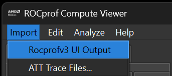{ width=&#34;343&#34; }](../../assets/rocm/thread-trace/uiload.png)

<p align="center">图 1：导入 rocprofv3 UI 输出目录。</p>

## 指令与 Trace Token

!!! note "注"

    对于 AMD RDNA™ 和 AMD Instinct™ MI450 用户，trace 的外观有所不同，但同样适用这套定性分析工作流。

### 左侧：Input 选项卡

使用图 2 中的 Input 选项卡选择目标 Wave，并调整时间线范围。下面这些控件决定了你在其他视图中查看哪些事件。

[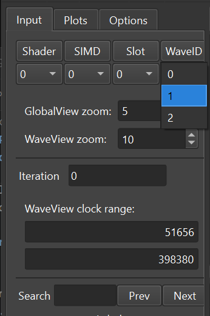{ width=&#34;346&#34; }](../../assets/rocm/thread-trace/input.png)

<p align="center">图 2：Input 选项卡。</p>

- **Shader Engine**、**SIMD**、**Slot** 和 **WID** 用于选择目标 Wave。目标 Wave 决定：

  - 点击 ISA 指令时，RCV 会滚动到哪个线程追踪 token。
  - 使用哪个 Wave 定义循环迭代次数。
  - RCV 使用哪个 Wave 可视化分支目标。
- **WaveView Clock Range** 选择 Compute Unit、Utilization 和 Hotspot 视图使用的周期窗口。
- **WaveView zoom** 和 **GlobalView zoom** 控制局部与全局时间线的缩放比例。
- **Search** 可以跳转到 `ds_*`、`global_*`、`flat_*` 或 `s_waitcnt` 等指令；**History** 可以返回之前选中的 token。

**Options** 选项卡包含其他 Viewer 设置。**Plots** 选项卡将在[计数器可视化](#visualizing-counters)一节中介绍。

### Source 与 ISA 视图

Source 与 ISA 视图将源代码、反汇编后的 ISA 和时间线中的动态事件关联起来。图 3 展示了该视图如何将指令开销放在源码与 ISA 行的旁边。它会显示每条 ISA 指令，以及命中次数和开销列。如果需要源码关联，应在采集 trace 前使用 `hipcc -g` 编译。存在调试信息时，RCV 就可以将 ISA 指令映射到源码行。将鼠标悬停在 ISA 行上，或点击该行，会高亮对应的源码行。点击源码行会固定显示它对应的 ISA 指令，直到选择另一行。

[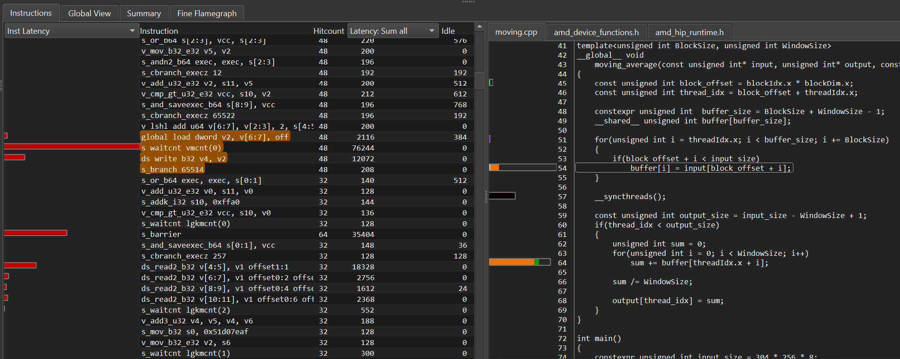{ width=&#34;1100&#34; }](../../assets/rocm/thread-trace/isasource.png)

<p align="center">图 3：按源码行与 ISA 行汇总的延迟。将鼠标悬停在源码行上，或点击该行，会高亮对应的 ISA 指令。颜色含义请参阅 Compute Unit 一节。</p>

将鼠标悬停在指令上，还可以查看其内联源码调用栈。图 4 展示了与 `__syncthreads()` 相关的同步指令的调用栈上下文。

[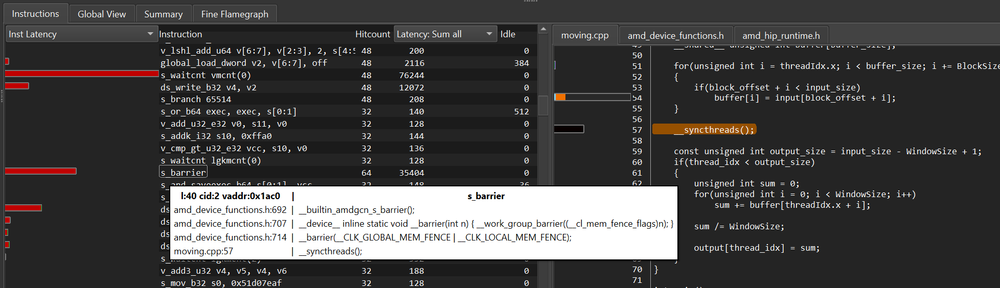{ width=&#34;1100&#34; }](../../assets/rocm/thread-trace/synccode.png)

<p align="center">图 4：将鼠标悬停在指令上时显示的 <code>__syncthreads()</code> 内联调用栈。</p>

!!! note "注"

    应将其视为编译器生成的映射，而非与源码语句一一对应的视图。经过优化的 Kernel 往往会将一行源码映射到多条 ISA 指令；内联函数可以产生源码调用栈；某些 ISA 指令也可能没有可用的源码引用。

#### `s_waitcnt` 依赖

图 5 展示了依赖箭头如何将获取 Kernel 参数的标量加载，与等待这些加载完成的 `s_waitcnt` 指令连接起来。

[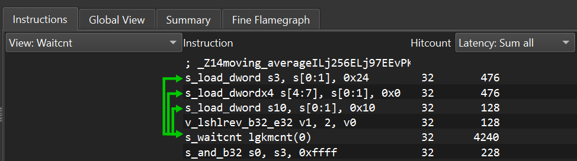{ width=&#34;974&#34; }](../../assets/rocm/thread-trace/waitcnt.png)

<p align="center">图 5：加载 Kernel 参数的 <code>s_load_*</code> 指令，以及随后等待这些加载完成的 <code>s_waitcnt</code> 指令。</p>

从 Wave 的角度看，AMD GPU 内存操作是异步的。发射内存操作后，Wave 可以继续发射独立指令，稍后再通过 `s_waitcnt` 或 `s_wait_*` 指令等待内存操作完成。**View: Waitcnt** 会从发起内存操作的指令，向依赖它们的等待指令绘制箭头。静态分析通常局限于基本块，而线程追踪可以针对每个 Wave，跨越分支和长距离跳转动态追踪等待依赖。

#### 分支目标

图 6 展示了 C++ 循环生成的向后分支，说明 ISA 视图如何帮助你追踪重复执行。

[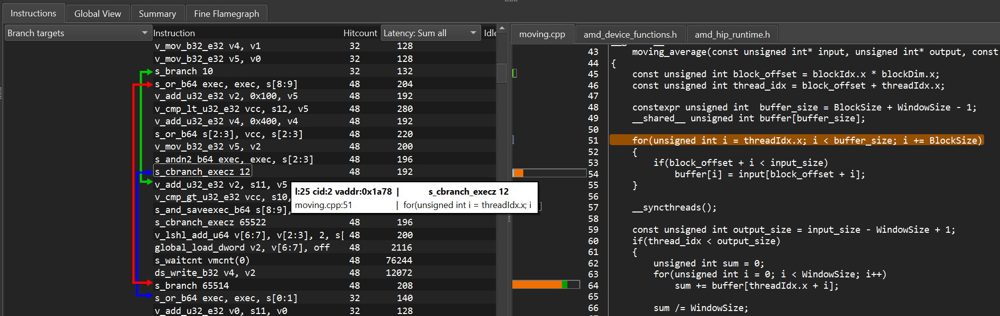{ width=&#34;1100&#34; }](../../assets/rocm/thread-trace/branches.png)

<p align="center">图 6：C++ 循环生成的分支目标。</p>

**Branch targets** 模式会绘制选定 Wave 中实际观察到的分支和跳转指令的控制流目标。向后的箭头通常表示循环，向前的箭头则往往表示跳过代码块，或退出条件分支。未执行或未采用的分支不会绘制出来。

### Hotspot 与 Fine Flamegraph

Hotspot 选项卡以直方图显示指令开销，单位为周期。RCV 会对当前 **WaveView Clock Range** 内的所有 Wave 进行计算，而不只是目标 Wave。因此，改变可见周期范围也会改变直方图。点击某个区间，会高亮该开销范围所对应的第一行和最后一行 ISA。

Hotspot 计算不包含空闲时间，只计入执行和停顿开销。因此，这个直方图适合识别开销较大的指令，但不能直接解释没有 Wave 发射指令的空隙。`s_waitcnt`、`s_barrier` 和 `s_nop` 等 `IMMED` 指令可能显得开销很大，因为多个 Wave 可以同时在相似的指令处等待。

Fine Flamegraph 会沿着可用的源码、内联、标记和 ISA 层级，逐层汇总同样的指令开销。它适合回答“哪个源码区域占据了最多的追踪开销？”，而非“哪一行 ISA 的开销很大？”。存在 SQTT 插桩标记时，标记范围会在源码和 ISA 开销之外，提供额外的分组层级。

#### 延迟

**Latency** 选择器控制 RCV 如何汇总指令开销列。**Latency: Sum all** 和 **Latency: Mean all** 会对当前数据集中的所有被追踪 Wave 进行汇总。**Latency: Sum Wave**、**Latency: Mean Wave** 和 **Latency: Max Wave** 只关注目标 Wave。**Latency: Iteration** 显示当前目标 Wave 中选定的循环迭代。可以使用 Sum 模式查找总开销，使用 Mean 模式查找典型的单次命中开销，使用 Max 或 Iteration 模式检查异常情况。

**Idle** 列与指令延迟分开显示。它表示两条指令之间，Wave 没有发射指令、相关流水线也没有处于忙碌状态的周期数。

RCV 还可以显示一条指令的延迟中，有多少比例与其他有效工作重叠。为简化说明，这个隐藏延迟值也包含被隐藏的空闲时间，而不会单独报告它。火焰图可以显示总延迟，也可以只显示未被隐藏的延迟。图 7 展示了后一种视图，帮助你定位其延迟未被其他工作隐藏的源码区域。

[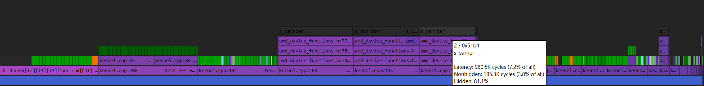{ width=&#34;1100&#34; }](../../assets/rocm/thread-trace/flamegraph.png)

<p align="center">图 7：按未被隐藏的延迟加权显示的火焰图。</p>

!!! note "注"

    当前的隐藏延迟计算使用了基于指令类型的简化优先级顺序：WMMA > VALU > VMEM/LDS/FLAT > SMEM/SALU > OTHERS。例如，VALU 执行可以隐藏 VMEM 延迟，但不能隐藏 WMMA 延迟。RCV 会自动对 gfx10 及更新架构的 trace 执行这项分析；对于 gfx9，也可以通过 **Analyze** > **Hidden Latency** 手动运行。

### Compute Unit 与 Utilization

#### Wave 之间的资源竞争

一个 SIMD 中可以驻留多个活跃 Wave，每个 Wave 占用一个 Wave Slot，并共享该单元的发射和执行资源。根据架构不同，多个 Wave 可以在同一个（四）周期内向不同流水线发射工作；需要同一条流水线的 Wave 则会竞争该资源。当 Wave A 在 `s_waitcnt` 指令或屏障处等待时，调度器通常可以选择已经就绪的 Wave B，从而隐藏 Wave A 的部分或全部延迟。RCV 会汇总这种延迟隐藏行为，而逐周期视图则补充展示指令发射和停顿如何随时间变化。

Compute Unit 选项卡按照 SIMD 和 Slot 划分详细 trace。每一行代表一个 Wave Slot，每个彩色 token 代表占用该 Slot 的 Wave 中的一条指令或一个事件。左键点击 token 会高亮对应的 ISA 行，按住右键拖动可以测量周期数。`A` 和 `D` 键用于水平平移，**WaveView zoom** 或 `Ctrl` + 鼠标滚轮用于调整时间线缩放比例。

在 Compute Unit 时间线中，**stall** 表示 Wave 已经准备好发射指令，但所需流水线无法接收该指令。**Idle** 表示 Wave 尚未准备好尝试执行下一条指令。区分两者，有助于将流水线竞争与 Wave 没有就绪指令可供发射的时段分开。

RCV 使用一致的配色来区分 VMEM、VALU、LDS、标量、消息和内部指令等 token 类型。图 8 展示了每种 token 类别对应的颜色。

[{ width=&#34;689&#34; }](../../assets/rocm/thread-trace/colorcode.png)

<p align="center">图 8：RCV 中指令与 token 类型的颜色图例。</p>

将视图缩小后，Compute Unit 视图会显示每个 Wave 随时间变化的活动原因概况，如图 9 所示。这个视图有助于比较 Wave 的行为，先识别主要活动阶段，再放大查看单条指令。

[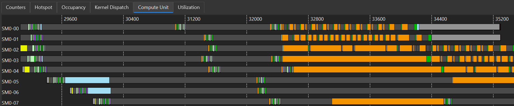{ width=&#34;1100&#34; }](../../assets/rocm/thread-trace/computeunit.png)

<p align="center">图 9：缩小后的 Compute Unit 视图，显示每个 Wave 的活动原因概况。</p>

Utilization 选项卡按照 VALU、VMEM、LDS、SCALAR 和 OTHER 等指令类型，汇总同一份局部 trace。它会隐藏 `IMMED` token，因为多个 Wave 可以并行处理它们；也会隐藏停顿时间，让视图突出活跃的发射和执行资源。Utilization 中的空白区域可以作为执行气泡的候选位置，但需要与 Compute Unit 的各行进行比较，判断当时是没有 Wave、Wave 发生停顿，还是正在执行被该视图隐藏的指令类型。`Ctrl` + 左键点击可以同时保持多个顶层选项卡打开。

图 10 将 Compute Unit 与 Utilization 时间线放在一起，让你能够把 VALU 执行空隙，与 Wave 尝试发射 SALU 指令或等待内存操作的行为关联起来。

[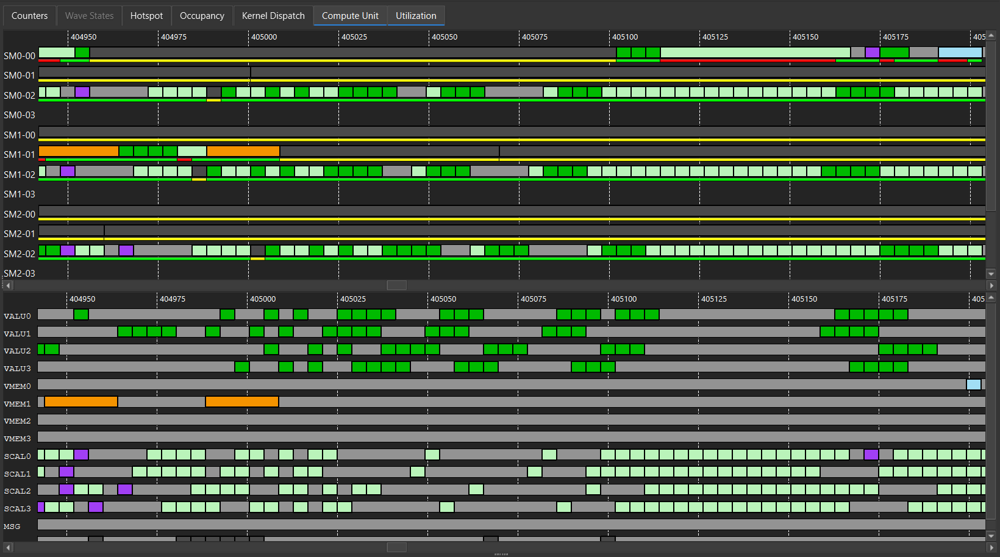{ width=&#34;1100&#34; }](../../assets/rocm/thread-trace/CU_UTIL.png)

<p align="center">图 10：放大后的 Compute Unit 与 Utilization 视图。在这个示例中，所有 Wave 都在尝试发射 SALU 指令或等待内存操作，VALU 执行中因而出现气泡。</p>

#### 循环导航

**Iteration** 输入框是查看同一条指令重复执行情况的最便捷方式。点击 token 会更新选定的 ISA 行和迭代编号。修改迭代编号后，Compute Unit 与 Utilization 时间线会滚动到目标 Wave 中该指令的另一次执行，迭代编号从零开始。

#### FIFO：指令发射停顿示例

图 11 展示了 FIFO 背压造成的 LDS 指令发射停顿，呈现的是单个 Wave 所观察到的 trace：

[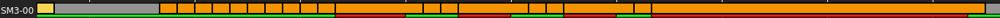{ width=&#34;1100&#34; }](../../assets/rocm/thread-trace/fifo.png)

<p align="center">图 11：FIFO 已满导致的停顿。</p>

前几条 LDS 指令（橙色）很快发射，随后出现较长的停顿。SQTT 记录的是这些指令发射的时间，而非内存操作完成的时间。这些操作会继续在后台进行，Wave 通常会在稍后通过 `s_waitcnt` 与它们同步。当请求 FIFO 已满时，背压会使下一条尝试发射的 LDS 指令停顿。

可以使用 SQTT Perfmon 或 SPM 计数器追踪 LDS 和 VMEM 操作的完成情况。尤其是 FIFO 水位计数器，可以帮助确认这种背压。[计数器可视化](#visualizing-counters)一节将演示这套工作流。

## AMD RDNA™ 和 AMD CDNA™ 5 上其他 SIMD 的活动

AMD RDNA™ 和 AMD CDNA™ 5 每次只对一个 SIMD 提供详细追踪，但有一个例外：SQTT 也会记录另一个 SIMD 发射的 VMEM 和 LDS 指令，这两个 SIMD 共享同一个 VMEM/LDS 单元。虽然只有目标 SIMD 具有完整的详细 trace，这些信息仍有助于追踪这一对 SIMD 的内存流水线利用率。

## 计数器可视化

`rocprofv3` 提供了多种在线程追踪期间采集性能计数器的方法。本节介绍其中两种：SQTT Perfmon 和 Streaming Performance Monitor（SPM）。

!!! note "注"

    SQTT Perfmon 在 MI200 和 MI300 系列上可用，对其他基于 gfx9 的产品提供部分支持。gfx9 产品也可以使用 SPM。在 gfx10 及更新产品上，只有 SPM 可用，而且经过改进，能够覆盖这两种方法所服务的使用场景。

SQTT Perfmon 将 SQ 计数器直接流式写入 trace。SPM 则使用独立的缓冲区进行采集，之后再与 trace 匹配。下表比较了两者：

| 特性                       |   SQTT Perfmon   |           SPM           |
| -------------------------- | :---------------: | :----------------------: |
| SQ 计数器的空间粒度        |     计算单元     |      Shader Engine      |
| 典型稳定轮询间隔           | 约 120 个时钟周期 |   约 4,000 个时钟周期   |
| 与线程追踪的关联精度       |       精确       |           近似           |
| 最大轮询速率下的带宽占用   |        高        |            中            |
| 计数器种类                 |    少：只有 SQ    | 多：SQ、TCP、TCC、TCA 等 |
| 是否支持每个 SIMD 的计数器 |        ✔        |            X            |

SQTT Perfmon 支持更快的计数器采集，而 SPM 提供更丰富的计数器集合，例如可以显示缓存命中率。

### 采集 SQTT Perfmon

| 参数                              | 说明                                                                                                                |
| --------------------------------- | ------------------------------------------------------------------------------------------------------------------- |
| `--att-perfcounter-ctrl`        | 设置采样间隔。值为 `1` 时采样最快：最多四个计数器时，间隔约为 40 个周期；超过八个计数器时，间隔约为 80 个周期。   |
| `--att-perfcounters`            | 指定要采集的 SQ 计数器。                                                                                            |
| `--att-activity`                | `--att-perfcounters` 和 `--att-perfcounter-ctrl` 的简写，按指定采样周期采集一组预定义计数器，用于显示总体活动。 |
| `--att-perfcounter-target-only` | 将计数器采集限制在目标 CU，显著降低带宽占用。建议启用此设置。                                                       |

初次使用时，建议从下面的命令开始：

```bash
rocprofv3 --att-activity 8
```

图 12 将活动计数器显示为与线程追踪对齐的派生计数器曲线，使你能够比较计数器值与指令活动随时间的变化。

[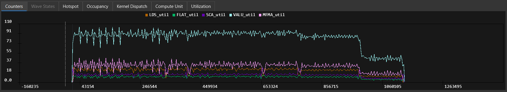{ width=&#34;1100&#34; }](../../assets/rocm/thread-trace/activity.png)

<p align="center">图 12：以派生计数器曲线显示的活动计数器。</p>

下面的示例追踪目标 CU 上的 LDS 和 VMEM FIFO 深度：

```bash
rocprofv3 --att-perfcounter-ctrl 1 --att-perfcounters "SQ_INST_LEVEL_LDS SQ_INST_LEVEL_VMEM" --att-perfcounter-target-only 1
```

下面的示例追踪每个 SIMD 上的 Bank Conflict：

```bash
rocprofv3 --att-perfcounter-ctrl 1 --att-perfcounters "SQ_LDS_BANK_CONFLICT:1 SQ_LDS_BANK_CONFLICT:2 SQ_LDS_BANK_CONFLICT:4 SQ_LDS_BANK_CONFLICT:8" --att-perfcounter-target-only 1
```

!!! note "注"

    `:` 语法定义了每个计数器的 SIMD 掩码。例如，`SQ_LDS_BANK_CONFLICT:0xF` 启用全部四个 SIMD，这也是默认设置；`SQ_LDS_BANK_CONFLICT:2` 则只启用 SIMD 1，因为 `2 = 1 << 1`。

图 13 展示了如何通过 FIFO 深度与 Bank Conflict 曲线，对照尚未完成的内存操作和 LDS Bank Conflict 随时间的变化。这个示例汇总了所有 CU 的计数器；上面的命令则将采集限制在目标 CU。

[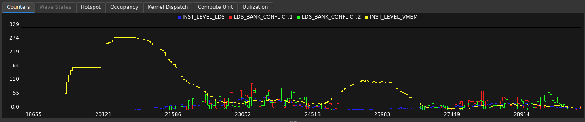{ width=&#34;1100&#34; }](../../assets/rocm/thread-trace/bank_conflict.png)

<p align="center">图 13：VMEM 和 LDS FIFO 深度，以及 SIMD 0 和 SIMD 1 的 LDS Bank Conflict 计数器；数据汇总自所有 CU。</p>

### 使用 SPM 采集基础计数器

Streaming Performance Monitor 可以在线程追踪期间同时采集。更多信息请参阅 [RCV SPM 指南](https://ROCm.docs.amd.com/projects/rocprof-compute-viewer/en/amd-mainline/how-to/using_spm.html)。例如：

```bash
rocprofv3 --att --spm SQ_CYCLES TCC_HIT TCC_MISS TA_TA_BUSY TCP_TOTAL_CACHE_ACCESSES TCP_TCC_WRITE_REQ TCP_TCC_READ_REQ -d test --spm-beta-enabled 1 --spm-sample-interval-unit sclk_cycles --spm-sample-interval 4096 --kernel-include-regex mykernel -f json -- ./a.out
```

需要注意以下要求：

- 必须采集 `SQ_CYCLES`，用于与线程追踪进行时钟对齐。
- 必须指定 `-f json`，因为目前只支持 JSON 输出。
- 强烈建议指定 `--kernel-include-regex` 和 `--kernel-iteration-range`，因为 SPM 会输出到单个 JSON 文件。

### 派生计数器

RCV 支持实时定义和编辑派生计数器。选择 **Edit** > **Derived Counters** > **+ New**，创建派生计数器文件。派生计数器同时适用于 SPM 和 SQTT Perfmon 采样。

使用 `--att-activity` 时，RCV 会在创建派生计数器文件时提供一组初始定义。在编辑器中选择 **Help**，可以查看完整的表达式语法。左侧面板的 **Plots** 菜单显示计数器值，并通过复选框控制各条曲线的显示或隐藏。

图 14 使用了一个专门用于展示 SPM 采样如何与线程追踪对齐的 Kernel。这个 Kernel 包含五个阶段，可以通过 trace 的主要颜色区分：

1. **左侧浅灰色：** 合并程度较差的内存访问，L1 效率和带宽较低，L1/L2 未命中率较高。
2. **约第 153600 个周期附近的绿色：** VALU 利用率较高，没有缓存活动。
3. **约第 256000 个周期附近的深灰色：** 合并良好的内存访问，L1 效率较高，但 L1/L2 命中率较低。
4. **绿色和橙色：** 混合的 VALU、LDS 和内存操作。
5. **约第 665600 个周期附近的青色：** L1 命中率、效率和带宽都较高。

[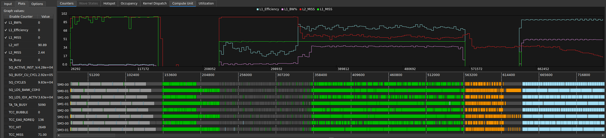{ width=&#34;1100&#34; }](../../assets/rocm/thread-trace/spm_derived.png)

<p align="center">图 14：用于展示 SPM 派生计数器与 trace 对齐情况的 Kernel。</p>

下面的派生计数器文件示例选择了 XCC 0、SE 0 和 CU 1。RCV 将名称以下划线开头的变量视为临时值，不会为它们绘制曲线。这些变量可以用于中间计算。

```text
_cycles := max[select[select[SQ_CYCLES, 0, axis=XCC], 0, axis=SE], axis=CU] + 0.001

_L2_HIT := sum[select[select[TCC_HIT, 0, axis=XCC], 0, axis=SE], axis=CU]
_L2_MISS := sum[select[select[TCC_MISS, 0, axis=XCC], 0, axis=SE], axis=CU]

_TA_BUSY := select[select[select[TA_TA_BUSY, 0, axis=XCC], 0, axis=SE], 1, axis=CU]
_TCP_TOTAL := select[select[select[TCP_TOTAL_CACHE_ACCESSES, 0, axis=XCC], 0, axis=SE], 1, axis=CU]
_TCP_WRITE := select[select[select[TCP_TCC_WRITE_REQ, 0, axis=XCC], 0, axis=SE], 1, axis=CU]
_TCP_READ := select[select[select[TCP_TCC_READ_REQ, 0, axis=XCC], 0, axis=SE], 1, axis=CU]

L2_MISS := 100 * _L2_MISS / (_L2_HIT + _L2_MISS + 30)
L1_MISS := 100 * min((_TCP_READ + _TCP_WRITE) / (_TCP_TOTAL + 1), 1)

TA_Busy := 100 * _TA_BUSY / _cycles
L1_BW% := 50 * _TCP_TOTAL / _cycles

L1_Efficiency := 100 * min(_TCP_TOTAL, _TA_BUSY) / max(_TA_BUSY, 10)
```

## 总结

本文介绍了如何使用 `rocprofv3` 采集线程追踪数据，并在 ROCprof Compute Viewer 中分析。RCV 将源代码和 ISA 与指令时序、分支和等待依赖、Wave 活动、停顿及硬件计数器数据关联起来。这些视图有助于识别开销较大的指令、执行气泡、内存背压，以及被其他工作隐藏的延迟。在更广泛的性能分析已经确定了需要深入分析的 Kernel 之后，线程追踪最能发挥作用。本系列第 2 篇将介绍如何通过 ROCprofiler SDK 和 ROCprof Trace Decoder API 采集与解码线程追踪数据。
