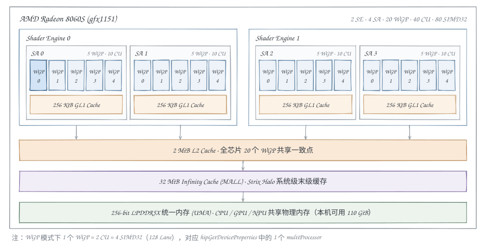
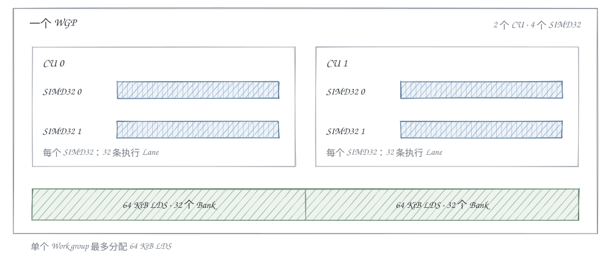
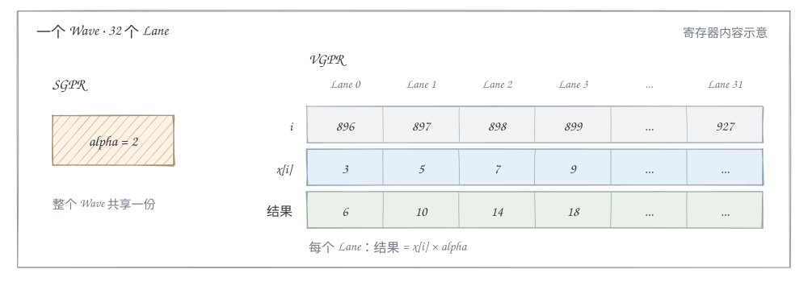
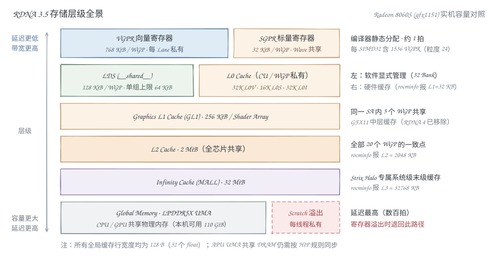
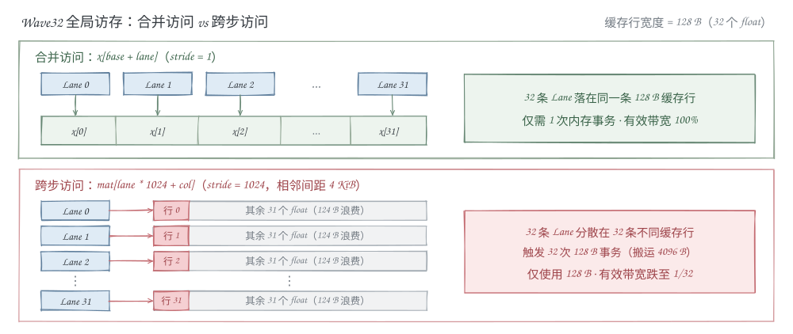
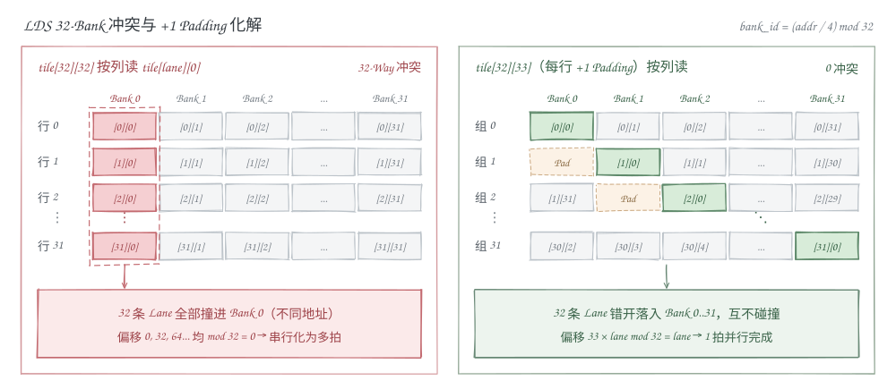
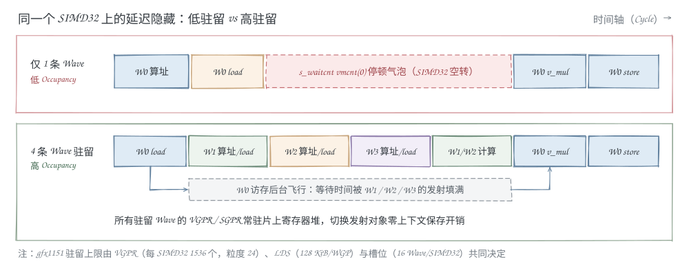

# RDNA3.5 架构与 AMD GPU 基础

写 GPU 代码时，我们在源程序里看到的往往是**单线程视角**——“每个线程读一个元素，乘上同一个系数再写回”；而在 AMD RDNA 3.5 硬件上，实际运行的是**波前（Wavefront）视角**——32 条执行通道（Lane）在 SIMD32 上同拍执行一条向量指令，共享标量寄存器与控制流，各自读写独立的向量寄存器与数据地址。

把这两种视角严丝合缝地对齐，才能真正看懂 GPU 为什么这样组织硬件、为什么 HIP 代码要这样写，以及为什么一行下标顺序或一个寄存器增量就会让性能成倍变化。

??? info "本文的实测平台与官方依据"

    文中涉及的硬件拓扑、`hipGetDeviceProperties` 字段、编译器资源占用（`-Rpass-analysis=kernel-resource-usage`）与 `gfx1151` 反汇编均实测于 **AMD Ryzen AI MAX+ 395 / Radeon 8060S（`gfx1151`，ROCm 7.2.4，`hipcc`）**；架构规格与编程模型定义核对自 [AMD GPU Specifications](https://rocm.docs.amd.com/en/latest/reference/gpu-specs.html)、[AMD RDNA 3.5 ISA](https://gpuopen.com/download/rdna35_instruction_set_architecture.pdf) 与 [HIP Programming Model](https://rocm.docs.amd.com/projects/HIP/en/latest/understand/programming_model.html)。

!!! abstract "贯穿全文的两个最小例子"

    1. **数组缩放 `scale`（`n = 1000`，`block = 128`，`alpha = 2.0f`）**：无跨线程协作，用来打通 Host–Device 编程全流程、Grid/Block/Wave32 映射、`EXEC` 尾部掩码、SGPR 与 VGPR 真实汇编及合并访存。
    2. **块内归约 `block_reduce_sum`**：在数组缩放结果上求和，用来引出 Wave 内寄存器交换（`__shfl_down` / `ds_bpermute_b32`）、`__shared__`（LDS）、Bank Conflict 与 Workgroup 屏障 `__syncthreads()`（`s_waitcnt lgkmcnt(0)` + `s_barrier`）。

---

## 1. 架构谱系、编译目标与芯片拓扑

### 1.1 架构家族、产品型号与 `gfx` 编译目标

接触 AMD GPU 时，必须先区分三个容易混用的层级：**架构家族、产品型号、LLVM 编译目标（`gfx` target）**。

- **RDNA vs CDNA**：**RDNA** 面向图形与通用计算，用于 Radeon 独立显卡与 Ryzen APU，以 **WGP（Work-group Processor）** 为基本计算块，原生支持 **Wave32**（也兼容 Wave64）和 **WMMA** 矩阵指令；**CDNA**（如 Instinct MI300X / MI355X）面向数据中心计算，以 **Wave64** 为原生宽度并使用 **MFMA** 矩阵指令。两者都能运行 HIP Kernel，但微架构资源配比、指令编码和缓存组织差异显著。
- **GFX11 家族与 RDNA 3.5**：RDNA 3（如 RX 7900 XTX 的 `gfx1100`、RX 7800 XT 的 `gfx1101`）与 RDNA 3.5（GFXIP 11.5，用于 Ryzen AI APU）同属 GFX11 指令集主干，共享 Wave32、双发射 VALU 与 16×16×16 WMMA 指令约定；RDNA 4（`gfx1200`/`gfx1201`）则进入 GFX12。
- **同一代架构下的不同 `gfx` 目标也有硬件差异**：同样是 RDNA 3.5，**Strix Halo（`gfx1151`，如 Radeon 8060S / 8050S）** 配备 **768 KiB VGPR/WGP 与 32 MiB Infinity Cache**；而 **Strix Point / Krackan（`gfx1150` / `gfx1152`，如 Radeon 890M / 860M）** 为 **512 KiB VGPR/WGP 且无 Infinity Cache**（详见 [AMD GPU Specifications](https://rocm.docs.amd.com/en/latest/reference/gpu-specs.html)）。编译目标决定可用指令集和 ABI，产品型号则决定 CU 规模、频率与存储子系统，不能一概而论。

如果你此前熟悉 CUDA 或 CDNA，下面这张术语对照表可以直接对齐核心概念：

| 概念维度 | AMD RDNA 3.5（`gfx1151`） | AMD CDNA 3（`gfx942`） | NVIDIA CUDA |
| --- | --- | --- | --- |
| 基本计算大单元 | **WGP**（含 2 CU / 4 SIMD32） | CU（含 4 SIMD16） | **SM**（Streaming Multiprocessor） |
| 向量执行引擎 | **SIMD32**（支持 VOPD 双发射） | SIMD16（4 拍执行 Wave64） | Sub-core / Warp Scheduler |
| 硬件锁步线程组 | **Wavefront（默认 Wave32）** | Wavefront（固定 Wave64） | **Warp**（32 线程） |
| 单个逻辑线程 | **Work-item / Lane** | Work-item / Lane | **Thread / Lane** |
| 可协作线程组 | **Workgroup**（HIP 写 Block） | Workgroup / Block | **Thread Block** |
| 一次内核提交 | **Dispatch / Grid** | Dispatch / Grid | **Grid** |
| 块内高速共享内存 | **LDS**（128 KiB/WGP，单组上限 64 KiB） | LDS（64 KiB/CU） | **Shared Memory** |
| 标量 / 向量寄存器 | **SGPR**（Wave 共享）+ **VGPR**（每 Lane） | SGPR + VGPR + AccVGPR | Uniform Reg + General Reg |
| 硬件矩阵乘加单元 | **WMMA**（Wave32 协作 16×16×16） | **MFMA**（Wave64 协作） | **Tensor Core**（MMA / WGMMA） |

### 1.2 从整颗芯片到执行 Lane：以 Radeon 8060S（`gfx1151`）为例

把一颗 RDNA 3.5 GPU 自顶向下拆开，硬件呈现严格的五级层次：**GPU → 2 个 Shader Engine (SE) → 4 个 Shader Array (SA) → 20 个 WGP → 40 个 CU → 80 个 SIMD32（共 2,560 条执行通道）**，再往下依次经由 SA 级 GL1、芯片级 L2、Strix Halo 专属 32 MiB Infinity Cache（MALL）接入与 CPU 共享的 LPDDR5X 统一内存：

[{ width="820" }](../../assets/rocm/rdna35/rdna35-chip-topology.svg)

在实机 Radeon 8060S 上分别运行 `rocminfo` 与 `hipGetDeviceProperties`，可以看到这颗芯片的精确硬件画像：

| 硬件维度 | `rocminfo` 实测值 | `hipGetDeviceProperties` 实测值 | 对应微架构含义 |
| --- | --- | --- | --- |
| 编译目标 / 架构 | `gfx1151` / `gfx11-generic` | `gcnArchName = gfx1151` | RDNA 3.5（GFXIP 11.5） |
| 计算单元计数 | `Compute Unit: 40`（`2 SE × 2 SA`） | `multiProcessorCount = 20` | 20 个 WGP = 40 个 CU = 80 个 SIMD32 |
| Wave 宽度 | `Wavefront Size: 32` | `warpSize = 32` | 原生 Wave32（可选编译 Wave64） |
| 单块 / 单处理器上限 | `Workgroup Max Size: 1024`，`Max Waves/CU: 32` | `maxThreadsPerBlock = 1024`，`maxThreadsPerMultiProcessor = 2048` | 每 SIMD32 最多 16 Wave32 → 每 CU 32 Wave → 每 WGP 64 Wave（2048 线程） |
| 向量寄存器堆 | — | `regsPerBlock = 196608` | 每 WGP 4 SIMD32 × 1536 VGPR × 32 Lane = 196,608 个 32-bit 槽位（768 KiB） |
| LDS 共享内存 | `GROUP Pool: 64 KB` | `sharedMemPerBlock = 65536` | 每 WGP 物理共 128 KiB（双侧 64 KiB），单 Workgroup 上限 64 KiB |
| 缓存层级 | `L1: 32 KB`，`L2: 2048 KB`，`L3: 32768 KB`（行宽 128 B） | `l2CacheSize = 2097152`（2 MiB） | 对应每 CU 32 KiB L0V、芯片级 2 MiB L2、32 MiB Infinity Cache（MALL） |
| 全局内存与总线 | `Memory Properties: APU`，`GLOBAL: 115,343,360 KB` | `integrated = 1`，`totalGlobalMem = 110.00 GiB`，`memoryBusWidth = 256 bit` | 与 CPU 共享 256-bit LPDDR5X 系统内存（UMA 统一内存） |

!!! question "为什么 `rocminfo` 报 40 个 CU，`hipGetDeviceProperties` 却报 `multiProcessorCount = 20`？"

    因为 RDNA 3 / 3.5 计算 Kernel 默认运行在 **WGP 模式**（汇编元数据 `.amdhsa_workgroup_processor_mode 1`）下：HIP 运行时把 **1 个 WGP（= 2 个 CU = 4 个 SIMD32）** 暴露为 1 个 `multiProcessor`。

    用数字立刻就能验算闭合：

    - `20 WGP × 2 CU/WGP = 40 CU`
    - `maxThreadsPerMultiProcessor = 4 SIMD32 × 16 Wave32/SIMD32 × 32 Lane = 2048` 线程/WGP（正好等于 `rocminfo` 的 `32 Waves/CU × 2 CU = 64 Waves/WGP`）
    - `regsPerBlock = 4 SIMD32 × 1536 VGPR/SIMD32 × 32 Lane = 196,608` 个 32-bit 标量寄存器槽位（`196,608 × 4 B = 768 KiB`，与官方规格表的 `VGPR File = 768 KiB` 逐字节一致）

### 1.3 走进一个 WGP：SIMD32、双发射与 WMMA

WGP 是 RDNA 3.5 最核心的计算与片上存储装配单元。它把 **2 个 CU（4 个 SIMD32）**、标量单元（SALU + 32 KiB SGPR 文件）、访存单元（LSU）以及**两侧合计 128 KiB 的 LDS** 和 L0 缓存紧耦合在一起：

[{ width="820" }](../../assets/rocm/rdna35/rdna35-wgp.svg)

理解 WGP 的内部机制，重点抓住四点：

1. **WGP mode vs CU mode**：在默认的 **WGP mode** 下，同一个 Workgroup 的多个 Wave 可以调度到该 WGP 内全部 4 个 SIMD32，并共同使用两侧拼成的 128 KiB LDS 池（但**单个 Workgroup 最多仍只能申请 64 KiB LDS**，剩余空间可供驻留在同一 WGP 上的其他 Workgroup 使用）；在 **CU mode** 下，Workgroup 被限定在单个 CU 的 2 个 SIMD32 与单侧 64 KiB LDS 内，详见 [RDNA 3.5 ISA §2.3](https://gpuopen.com/download/rdna35_instruction_set_architecture.pdf)。
2. **动态驻留，无固定绑定**：一个 WGP 可同时驻留多个 Workgroup 的 Wave，各自拥有硬件隔离的寄存器切片与 LDS 区间。逻辑 `blockIdx` **不绑定**特定 WGP，逻辑 `wave_id` **也不绑定**特定 SIMD32。
3. **Dual-Issue（VOPD 双发射）**：RDNA 3 / 3.5 的每个 SIMD32 在 Wave32 模式下具备双发射向量管线。当两条相互独立的 32-bit 向量指令（如一条 `v_add_f32` 和一条 `v_and_b32`）满足寄存器端口与编码约束时，编译器会把它们打包成一条 `v_dual_* :: v_dual_*` 指令在同周期并行发射。第 6 节的真实反汇编中能直接看到编译器打出的 `v_dual_add_f32 :: v_dual_and_b32`。
4. **WMMA 矩阵单元**：每个 SIMD32 集成硬件矩阵乘加能力（`v_wmma_*`），让一个 Wave32 通过单条指令协作完成 16×16×16 的 FP16/BF16/INT8 矩阵乘加。普通标量/数组算子走 VALU，而 AI 推理与 GEMM 算子则通过 WMMA 释放峰值算力。

---

## 2. HIP 编程模型与 Host–Device 执行全流程

ROCm 是 AMD GPU 的软件栈，**HIP（Heterogeneous-Compute Interface for Portability）** 是其 C++ 编程接口与运行时，语法与 CUDA 高度一致，通过 `hipcc`（基于 AMD Clang/LLVM）把 Host 代码编译给 CPU、把 Device 代码编译成指定 `gfx` 目标的机器码。

### 2.1 Host 与 Device 的分工及函数限定符

GPU 是协处理器，不能脱离 Host 独立启动。一次完整的 GPU 计算由 Host 按五步编排：**分配设备内存 → 拷入输入数据 → 配置网格并异步提交 Kernel → 同步等待执行完成 → 拷回结果并释放资源**。

HIP 用三个函数限定符明确代码在哪里编译、由谁调用：

| 限定符 | 编译目标 | 谁可以调用 | 典型用途 |
| --- | --- | --- | --- |
| `__global__` | Device（GPU） | Host（或动态并行 Device） | Kernel 入口函数，返回类型必须为 `void` |
| `__device__` | Device（GPU） | 仅 Device | GPU 内部辅助函数（默认倾向内联） |
| `__host__`（默认） | Host（CPU） | 仅 Host | 普通 CPU 函数；可写 `__host__ __device__` 双端复用 |

### 2.2 完整可运行的 HIP 程序：`scale` 端到端示例

下面的程序用 `block = 128` 线程组处理 `n = 1000` 个 `float`，把每个元素乘以 `alpha = 2.0f`。它展示了生产代码所需的全部基本骨架，包括错误检查宏 `HIP_CHECK`、向上取整的网格计算和同步规则：

```cpp
#include <hip/hip_runtime.h>
#include <cstdio>
#include <cstdlib>

#define HIP_CHECK(call)                                                      \
    do {                                                                     \
        hipError_t err = (call);                                             \
        if (err != hipSuccess) {                                             \
            fprintf(stderr, "HIP error %s:%d: %s\n", __FILE__, __LINE__,     \
                    hipGetErrorString(err));                                 \
            exit(EXIT_FAILURE);                                              \
        }                                                                    \
    } while (0)

__global__ void scale(float* __restrict__ x, float alpha, int n) {
    int i = blockIdx.x * blockDim.x + threadIdx.x;
    if (i < n) {
        x[i] *= alpha;
    }
}

int main() {
    constexpr int n = 1000;
    constexpr int block = 128;
    constexpr int grid = (n + block - 1) / block; // ceil(1000 / 128) = 8

    float h_x[n];
    for (int i = 0; i < n; ++i) {
        h_x[i] = static_cast<float>(i);
    }

    float* d_x = nullptr;
    HIP_CHECK(hipMalloc(&d_x, n * sizeof(float)));
    HIP_CHECK(hipMemcpy(d_x, h_x, n * sizeof(float), hipMemcpyHostToDevice));

    scale<<<grid, block>>>(d_x, 2.0f, n);
    HIP_CHECK(hipGetLastError());       // 检查发射配置错误（如 block 超限）
    HIP_CHECK(hipDeviceSynchronize());  // 等待 GPU 完成并捕获异步执行错误

    HIP_CHECK(hipMemcpy(h_x, d_x, n * sizeof(float), hipMemcpyDeviceToHost));
    printf("h_x[0]=%.1f, h_x[999]=%.1f\n", h_x[0], h_x[999]);

    HIP_CHECK(hipFree(d_x));
    return 0;
}
```

在 `gfx1151` 机器上编译、运行、查看资源占用并导出设备汇编的常用命令如下：

```bash
# 1. 针对 gfx1151 编译并运行（输出：h_x[0]=0.0, h_x[999]=1998.0）
hipcc --offload-arch=gfx1151 -O3 -Wall -Wextra scale_demo.cpp -o scale_demo
./scale_demo

# 2. 让编译器直接报告 SGPR / VGPR / LDS / Scratch 与理论 Occupancy
hipcc --offload-arch=gfx1151 -O3 -Rpass-analysis=kernel-resource-usage -c scale_demo.cpp

# 3. 仅导出 gfx1151 设备端真实汇编（用于核对寄存器、EXEC 与 s_waitcnt）
hipcc --offload-arch=gfx1151 -O3 -S --cuda-device-only scale_demo.cpp -o scale_demo.s
```

!!! tip "HIP 异步发射、Stream 与错误排查习惯"

    - **Kernel 发射是异步的**：执行 `scale<<<grid, block, shared_bytes, stream>>>(...)` 时，CPU 只是把内核参数打包进 kernarg 缓冲区，并向 GPU 命令队列写入一个 AQL Dispatch Packet，随后**立刻返回继续执行下一行 CPU 代码**，并不等待 GPU 算完。
    - **Stream 决定顺序与并发**：同一个 `hipStream_t` 内的拷贝与 Kernel 按提交顺序严格串行（FIFO）；提交到不同非阻塞 Stream 的独立任务允许在硬件资源充裕时并发重叠（例如用 `hipMemcpyAsync` 让数据拷贝与计算重叠）。
    - **养成双检错误习惯**：ROCm 7.2 起 HIP 运行时 API 返回值标有 `nodiscard`，漏检会触发编译警告；发射 Kernel 后配合 `hipGetLastError()`（抓同步参数错误）与调试期 `hipDeviceSynchronize()`（抓异步越界或硬件异常），可以避免错误延迟到后面的 `hipMemcpy` 才暴露。

### 2.3 从 1D 到 2D 线程索引与网格跨步循环

`grid` 与 `block` 的完整类型是三维结构体 `dim3(x, y, z)`（省略的维度默认为 `1`），其中每个 Block 的总线程数满足 `blockDim.x * blockDim.y * blockDim.z <= 1024`。

- **1D 数组映射**：`i = blockIdx.x * blockDim.x + threadIdx.x`，适合向量逐元素操作。
- **2D 矩阵/图像映射**：
  ```cpp
  int col = blockIdx.x * blockDim.x + threadIdx.x; // 沿列方向（内存连续维）
  int row = blockIdx.y * blockDim.y + threadIdx.y; // 沿行方向
  if (row < M && col < N) {
      out[row * N + col] = in[row * N + col] * alpha;
  }
  ```
  **关键约定**：在 C/C++ 行主序矩阵中，务必把变化最快的 `threadIdx.x` 映射到列坐标 `col`（而不是行坐标 `row`），这样相邻 Lane 才会访问连续地址（详见第 5.2 节合并访存）。
- **网格跨步循环（Grid-Stride Loop）**：当数据量远大于 Grid 总线程数，或希望固定启动适量 Block 以复用线程初始化开销时，可写成：
  ```cpp
  int idx = blockIdx.x * blockDim.x + threadIdx.x;
  int stride = gridDim.x * blockDim.x;
  for (int i = idx; i < n; i += stride) {
      x[i] *= alpha;
  }
  ```
  这样无论 `grid` 配多少个 Block，代码都能正确覆盖任意长度 `n`，且每次迭代内相邻线程依然连续访存。

---

## 3. 从 Block 到 Wave：SIMT 执行与分支发散

### 3.1 Grid → Block → Wave32 → Lane 的精确对应

继续追踪 `scale` 的例子：`n = 1000`，`block = 128`，因此需要 $\lceil 1000 / 128 \rceil = 8$ 个 Block。

- **Block 0 ～ Block 6**：覆盖下标 `0..895`，所有线程都落在有效范围内。
- **Block 7（尾部 Block）**：覆盖下标 `896..1023`，共 128 个线程槽位，其中 **`896..999` 共 104 个有效，`1000..1023` 最后 24 个越界**。

软件写的是 Block 和 Thread，但硬件真正以 **Wave（Wavefront）** 为单位取指和发射。RDNA 3.5 原生采用 **Wave32**（每 Wave 32 个 Lane），因此一个 128 线程的一维 Block 会被硬件固定切分为 4 个 Wave32：

```cpp
int tid     = threadIdx.x;       // 0..127
int wave_id = tid / warpSize;    // Wave32 下为 0..3（不要硬编码 32！）
int lane_id = tid % warpSize;    // Wave32 下为 0..31
```

在三维 Block 中，硬件先按 `x` 最快、其次 `y`、最后 `z` 展平得到块内线性编号 `tid = (threadIdx.z * blockDim.y + threadIdx.y) * blockDim.x + threadIdx.x`，再每 32 个连续线程编成一条 Wave32。

!!! warning "两个容易踩的 Wave 误区"

    1. **`blockDim.x = 32` 不会自动选择 Wave32**：Wave 宽度由目标架构默认值和编译选项（如 `-mwavefrontsize64`）决定，而不是由启动时的 Block 大小决定。在 RDNA 3.5 上默认编译为 Wave32（汇编含 `.amdhsa_wavefront_size32 1`）；在 Wave64 模式下，一条 Wave64 指令会在 SIMD32 上分两拍（低 32 Lane 与高 32 Lane）执行，仍共享同一份程序计数器与标量状态。
    2. **永远使用 `warpSize` 而非魔数 `32`**：写跨平台 HIP 代码（同时跑在 RDNA Wave32 与 CDNA Wave64 上）时，用内置 `warpSize` 计算 `wave_id`、`lane_id` 与 shuffle 步长，避免把 Wave32 假设写死。

### 3.2 `EXEC` 掩码与分支发散

同一个 Wave 里的 32 个 Lane 共享同一个程序计数器（PC），每一拍执行的是同一条指令；但不同 Lane 的数据和 `if` 条件可以不同。硬件靠一个专门的 **EXEC（Execution Mask）** 位图解决这个矛盾：每个 bit 对应一条 Lane，`1` 表示该 Lane 参与当前向量运算和访存写回，`0` 表示屏蔽（Wave32 使用低 32 位 `exec_lo`，Wave64 使用完整 64 位 `exec`）。

看回 `n = 1000` 的 Block 7：

- **Wave 0（`896..927`）、Wave 1（`928..959`）、Wave 2（`960..991`）**：全部 32 条 Lane 满足 `i < 1000`，`EXEC = 0xffffffff`。
- **Wave 3（`992..1023`）**：仅 Lane 0～7（`992..999`）有效，Lane 8～31 越界。进入 `if (i < n)` 后，`EXEC` 变为 `0x000000ff`：

[{ width="820" }](../../assets/rocm/rdna35/rdna35-wave-exec.svg)

理解 `EXEC` 掩码后，**分支发散（Branch Divergence）** 的代价就一目了然：

- **Wave 内发散（Divergent Branch）**：如果同一条 Wave 里部分 Lane 走 `if`，另一部分走 `else`，硬件不会把活跃 Lane 拆出来跟别的 Wave 重新拼组，而是**先用掩码 `M` 执行 `if` 分支（其余 Lane 空转），再把掩码翻转为 `~M` 执行 `else` 分支，最后恢复原 `EXEC`**。两条路径串行执行，吞吐直接折半。
- **Wave 内一致（Uniform Branch）**：如果整条 Wave 32 条 Lane 的判断结果完全一致（例如 `EXEC` 更新后全为 0），标量分支指令 `s_cbranch_execz` 会让整条 Wave **直接跳过整个分支体**，零空转开销。
- **标量不受 `EXEC` 屏蔽**：`EXEC` 控制向量计算与向量访存；标量指令（SALU / SMEM）按 Wave 粒度始终执行，相关定义见 [RDNA 3.5 ISA §3.2](https://gpuopen.com/download/rdna35_instruction_set_architecture.pdf)。

---

## 4. 标量与向量分离：用真实 `gfx1151` 汇编眼见为实

### 4.1 为什么要把 SGPR/SALU 与 VGPR/VALU 拆开

在任意 GPU Kernel 中，总有一类值在同一条 Wave 的所有 Lane 间完全相同（例如 `scale` 中的基址指针 `x`、系数 `alpha`、长度 `n`、`blockIdx.x`、`blockDim.x` 和循环计数），而另一类值随 Lane 不同而变化（例如 `threadIdx.x`、全局下标 `i`、读出的 `x[i]`）。

如果把“所有 Lane 都一样的值”也复制 32 份放进向量寄存器，会白白浪费 32 倍的寄存器面积和功耗。因此 AMD 架构在硬件上拆出两条并行执行通道：

- **标量路径（SALU + SGPR）**：每个 **SGPR（Scalar General Purpose Register）** 是每 Wave 共享的一份 32-bit 寄存器，用来存放均一值、地址基址、控制流与掩码运算。
- **向量路径（VALU + VGPR）**：每个 **VGPR（Vector General Purpose Register）** 编号在 Wave32 下对应 **32 个 Lane × 32-bit = 128 B**，为每条 Lane 保存独立数值（64-bit 指针或 `double` 占用相邻的两个寄存器编号，如 `v[0:1]`）。

取 Block 7 的 Wave 0，令 `alpha = 2`，前四个输入 `x[896..899]` 为 `3、5、7、9`，标量与向量寄存器的数据组织如下：

[{ width="820" }](../../assets/rocm/rdna35/rdna35-scalar-vector.svg)

注意这里的“标量”和“向量”指的是 **Wave 内的均一性（Uniformity）**，而不是 C++ 变量类型：C++ 里一个普通的 `float tmp = x[i]` 因为每条 Lane 值不同会进入 VGPR；反之，即使不写 `const`，只要编译器能证明某变量在 Wave 内一致，就会放进 SGPR。

### 4.2 实测验证：`scale` 在 `gfx1151` 上的真实反汇编

概念图之外，最直接的验证方式就是看本机 `hipcc --offload-arch=gfx1151 -O3 -S` 对上面 5 行 `scale` 生成的真实机器汇编（`-Rpass-analysis=kernel-resource-usage` 报告：**`TotalSGPRs: 8`，`VGPRs: 3`，`LDS Size: 0`，`ScratchSize: 0`，`Occupancy: 16 waves/SIMD`**）：

```asm
_Z5scalePffi:                           ; 元数据: .amdhsa_wavefront_size32 1
                                        ;         .amdhsa_workgroup_processor_mode 1
; 1) 标量路径：从 kernarg (s[0:1]) 读取 blockDim.x、alpha、n 到 SGPR
    s_clause 0x1
    s_load_b32 s3, s[0:1], 0x1c         ; s3 = blockDim.x (低 16 bit)
    s_load_b64 s[4:5], s[0:1], 0x8      ; s4 = alpha, s5 = n（整条 Wave 共享一份！）
    s_waitcnt lgkmcnt(0)                ; 等待标量访存 (SMEM) 返回
    s_and_b32 s3, s3, 0xffff
    s_delay_alu instid0(SALU_CYCLE_1)   ; GFX11 依赖提示：等 1 拍 SALU 结果

; 2) 向量算址 + EXEC 裁尾：计算 i = blockIdx.x * blockDim.x + threadIdx.x
    v_mad_u64_u32 v[0:1], null, s2, s3, v[0:1] ; s2=blockIdx.x, v0=threadIdx.x → v0=i
    s_mov_b32 s2, exec_lo               ; 备份原 EXEC
    v_cmpx_gt_i32_e64 s5, v0            ; 比较 n > i，并直接把结果写入 EXEC！
    s_cbranch_execz .LBB0_2             ; 若整条 Wave 均越界 (EXEC==0)，直接跳过访存

; 3) 地址字节偏移、全局加载、等待、标量×向量乘法、全局写回
    s_load_b64 s[0:1], s[0:1], 0x0      ; s[0:1] = 基址指针 x（64-bit，占一对 SGPR）
    v_ashrrev_i32_e32 v1, 31, v0        ; 符号扩展 32-bit i 为 64-bit
    s_delay_alu instid0(VALU_DEP_1) | instskip(SKIP_1) | instid1(VALU_DEP_1)
    v_lshlrev_b64 v[0:1], 2, v[0:1]     ; 字节偏移 = i << 2（每个 float 占 4 B）
    s_waitcnt lgkmcnt(0)                ; 等待基址指针 s[0:1] 加载完成
    v_add_co_u32 v0, vcc_lo, s0, v0     ; 64-bit 地址低 32 位相加：&x[i]
    s_delay_alu instid0(VALU_DEP_1)
    v_add_co_ci_u32_e64 v1, null, s1, v1, vcc_lo ; 64-bit 地址高 32 位带进位相加
    global_load_b32 v2, v[0:1], off     ; 异步全局加载：各有效 Lane 读 x[i] → v2
    s_waitcnt vmcnt(0)                  ; 关键等待点！等数据真正落入 v2
    v_mul_f32_e32 v2, s4, v2            ; SGPR s4 (alpha) 直接乘 VGPR v2 (x[i])！
    global_store_b32 v[0:1], v2, off    ; 仅 EXEC=1 的 Lane 写回 x[i]
.LBB0_2:
    s_endpgm
```

短短二十几行汇编，把前面讲过的所有硬件设计全部印证了一遍：

- **只用 3 个 VGPR（`v0..v2`）**：`alpha`、`n`、`x` 基址全留在 SGPR，尤其 `v_mul_f32_e32 v2, s4, v2` 允许 VALU 直接读取一个 SGPR 操作数与 VGPR 相乘，完全不需要把 `alpha` 复制 32 份。
- **硬件直接把分支压进 `EXEC`**：`v_cmpx_gt_i32_e64`（带 `x` 后缀表示直接更新 `EXEC`）一拍完成 `n > i` 比较与掩码更新；紧接着的 `s_cbranch_execz` 在整条 Wave 越界时整组跳出，完全不发全局访存。

!!! note "读懂 RDNA 3.5 的两个异步调度指令：`s_waitcnt` 与 `s_delay_alu`"

    GPU 的内存指令是**异步发射**的——发出 `global_load_b32` 或 `s_load_b64` 后，指令流水线不会立刻卡死，而是继续发射后续不依赖该结果的指令，直到遇到显式等待：

    - **`s_waitcnt vmcnt(N)`**：等待当前 Wave 未完成的**向量全局访存（VMEM）**数量降到 `<= N`（`vmcnt(0)` 表示全部返回）。
    - **`s_waitcnt lgkmcnt(N)`**：等待未完成的 **LDS、标量访存（SMEM）与常量访存**数量降到 `<= N`。
    - **`s_delay_alu`**：GFX11 引入的轻量级静态依赖提示，告诉硬件下一条指令需要等 1～2 拍 VALU/SALU 写回，取代部分昂贵的动态记分板检查。

    高性能 Kernel 优化的核心之一（如双缓冲与预取交错），本质上就是把 `global_load` 提前发射，在它和 `s_waitcnt vmcnt(0)` 之间塞满足够多的独立计算，把等待气泡填平。

---

## 5. 存储层级、合并访存、LDS Bank Conflict 与 APU UMA

GPU 算力极高，但从外部内存取一次数通常需要数百个时钟周期。理解从寄存器到全局内存的每一层容量、访问模式和冲突机制，是写好 GPU Kernel 的分水岭。

### 5.1 RDNA 3.5 存储层级全景（Radeon 8060S 实机对照）

从每 Lane 私有的 VGPR 到全系统共享的 LPDDR5X 统一内存，RDNA 3.5 的存储层级自顶向下呈现明显的“延迟升高、容量扩大”梯度，其中 **LDS 由软件显式控制，L0/GL1/L2/MALL 由硬件自动管理**，而寄存器溢出形成的 Scratch 则会退回到高延迟的全局访存路径：

[{ width="820" }](../../assets/rocm/rdna35/rdna35-memory-hierarchy.svg)

下表汇总了 Radeon 8060S（`gfx1151`）的完整存储层次，同时标出 RDNA 微架构命名与 `rocminfo` 输出的对应关系（数据核对自 [AMD GPU Specifications](https://rocm.docs.amd.com/en/latest/reference/gpu-specs.html) 与实机 `rocminfo`）：

| 存储层级（RDNA 命名） | Radeon 8060S（`gfx1151`）容量 | 作用域与归属 | 管理方式 | `rocminfo` 对应项 / 说明 |
| --- | --- | --- | --- | --- |
| **VGPR / SGPR** | 768 KiB VGPR + 32 KiB SGPR / WGP | VGPR 每 Lane 私有；SGPR 每 Wave 共享 | 编译器静态分配 | 最高带宽、最低延迟；`gfx1150`/`1152` 为 512 KiB VGPR/WGP |
| **LDS（`__shared__`）** | 128 KiB / WGP（单 Workgroup 上限 64 KiB） | Workgroup 内全部线程显式共享 | 软件显式控制 | `GROUP Pool: 64 KB`；两侧各 64 KiB × 32 个 32-bit Bank |
| **L0 缓存（L0V / L0S / L0I）** | 32 KiB L0V（每 CU）+ 16 KiB L0S + 32 KiB L0I（每 WGP） | CU / WGP 私有 | 硬件自动管理 | `rocminfo` 上报的 `L1: 32 KB` 即每 CU 的 L0 Vector Cache；行宽 128 B |
| **Graphics L1（GL1）** | 256 KiB / Shader Array | 同一 SA 内 5 个 WGP 共享 | 硬件自动管理 | GFX11 专属中层缓存（RDNA 4 / GFX12 已取消 GL1 并扩大 L2） |
| **L2 Cache** | 2 MiB（全芯片共享） | 全部 20 个 WGP 共享 | 硬件自动管理 | `rocminfo` 上报 `L2: 2048 KB`；也是不同 WGP 间的数据一致点 |
| **Infinity Cache（MALL）** | 32 MiB（Strix Halo 专属） | 系统级末级缓存 | 硬件自动管理 | `rocminfo` 上报 `L3: 32768 KB`；`gfx1150`/`1152` 无此层级 |
| **Global Memory** | 共享 LPDDR5X 系统内存（本机可用 110 GiB） | 全设备 + Host 物理共享（UMA） | Host/HIP 显式分配 | 256-bit 系统总线；延迟最高、带宽显著低于高端独显 GDDR/HBM |

!!! warning "别把 `rocminfo` 的 L1/L2/L3 标签与 RDNA ISA 的 L0/GL1/L2/MALL 搞混"

    `rocminfo` 按通用 HSA 模型只打印 `L1 / L2 / L3` 三栏，因此在 `gfx1151` 上看到的 `L1 = 32 KB` 对应的是 RDNA 文档中的 **每 CU L0 Vector Cache**，并未单独列出 256 KiB 的 SA 级 GL1，而 `L3 = 32768 KB` 对应的是 **32 MiB Infinity Cache（MALL）**。查阅硬件参数或分析 Profiler 计数器时，请以 [AMD GPU Specifications](https://rocm.docs.amd.com/en/latest/reference/gpu-specs.html) 的逐层定义为准。

### 5.2 Global Memory 与合并访存（Memory Coalescing）

当一条 Wave32 执行 `global_load_b32` 时，硬件会把 32 条活跃 Lane 发出的地址按 **128 B 缓存行**（正好装下 32 个 `float`）合并成最少的内存事务。**访存是否高效，不取决于单个线程读了多少字节，而取决于同一条指令下 32 条 Lane 的地址落在了几条缓存行里**：

- **合并访问（stride = 1）**：`scale` 中 Lane $k$ 读取 `x[base + k]`，32 个 `float` 连续占据 128 B。若首地址 128 B 对齐，硬件只需 **1 次 128 B 缓存行事务**即可喂饱整条 Wave，有效字节利用率 100%。
- **大跨步访问（stride = 1024）**：若在 `M × 1024` 行主序矩阵中错误地让 `threadIdx.x` 沿行方向遍历 `mat[lane * 1024 + col]`，相邻 Lane 地址相距 `4096 B`，32 条 Lane 落在 32 条完全不同的缓存行上，硬件被迫发起 **32 次 128 B 事务（搬运 4096 B 却只用其中 128 B）**，有效带宽瞬间跌到 `1/32`！
- **向量化访存（128-bit Load/Store）**：当单个线程需要连续处理 4 个 `float`（或 8 个 `fp16`）时，用 `float4`（对齐到 16 B）可让编译器生成 `global_load_b128`，在保持合并的同时将访存指令数减少到原来的 1/4。

[{ width="820" }](../../assets/rocm/rdna35/rdna35-memory-coalescing.svg)

### 5.3 APU 统一内存架构（UMA）与独立显卡的边界

独立 GPU（如 Radeon PRO W7800 / RX 7900 XTX）配备高带宽板载 GDDR 显存，数据需经 PCIe 在主存和显存之间搬运；而搭载 Radeon 8060S（`gfx1151`）的 Ryzen AI Max 属于 **APU（`integrated = 1`）**，CPU、GPU 与 NPU 共享同一片 256-bit LPDDR5X 物理系统内存与 32 MiB MALL。

这种架构带来两个鲜明特征：一是 GPU 可用的 Global Memory 池极大（如本机 128 GiB 内存上可分配高达 110 GiB，能直接塞下独显放不下的大模型）；二是其绝对内存带宽受限于系统 LPDDR5X 总线，明显低于高端独显的 GDDR/HBM，因此同一份 Memory-bound Kernel 在 `gfx1151` 上更容易触顶内存带宽。

!!! warning "UMA 共享物理内存 ≠ 可以跳过 HIP 同步与一致性规则"

    在实机 `rocminfo` 输出中，可以看到 `gfx1151` 的 `Coherent Host Access: FALSE`，且 Global 内存池区分 `COARSE GRAINED` 与 `EXTENDED FINE GRAINED`。即使物理 DRAM 同一份，CPU 缓存与 GPU 的 L0/L2 缓存仍有独立一致性边界：

    - 使用标准 `hipMalloc` / `hipMemcpy`、锁页零拷贝（`hipHostMalloc`）或统一内存时，仍必须通过同步原语建立明确的读写先后顺序；
    - 不能把独立显卡的 HBM/GDDR 实测带宽、PCIe 传输比例或 CDNA 加速卡的调优结论直接套用到 RDNA 3.5 APU 上。

### 5.4 LDS（Local Data Share）与 32-Bank 冲突算账

当数据会被同一个 Workgroup 内的多个线程反复读取（如矩阵分块 GEMM、卷积滑窗、矩阵转置），或线程间需要交换中间结果（如归约、前缀和）时，把数据显式搬进 `__shared__` 数组对应的 **LDS**，就能把数百周期的外部访存降到十余周期的片上访存。

RDNA 3.5 每个 WGP 的 **128 KiB LDS** 由两侧各 64 KiB 组成，每侧划分为 **32 个宽度为 32-bit（4 字节）的独立 Bank**。给定字节偏移 `addr_bytes`，其所属 Bank 编号为：

$$\text{bank\_id}(\text{addr\_bytes}) = \left\lfloor \frac{\text{addr\_bytes}}{4} \right\rfloor \bmod 32$$

同一拍内，如果不同 Lane 访问的是**不同 Bank**，32 个 Bank 并行服务，1 拍完成；如果多个 Lane 访问**同一个 Bank 的同一个地址**，硬件通过广播（Broadcast）同样 0 冲突；**只有多个 Lane 访问同一个 Bank 的不同地址时，才会触发 Bank Conflict，硬件被迫把冲突访问串行化拆成多拍执行**。详细机制见 [RDNA 3.5 ISA §12.1](https://gpuopen.com/download/rdna35_instruction_set_architecture.pdf)。

[{ width="820" }](../../assets/rocm/rdna35/rdna35-lds-bank-conflict.svg)

!!! example "手算闭合：32-Way Bank Conflict 如何发生，+1 Padding 怎么一招清零？"

    假设 Workgroup 声明了一个 32×32 的 `float` 分块 `__shared__ float tile[32][32];`（每元素 4 B），现在一条 Wave32（`lane = 0..31`）读取它：

    - **按行读 `tile[0][lane]`**：元素下标为 `lane`，映射到 `bank_id = lane % 32 = 0, 1, ..., 31` → 32 个 Bank 各服务 1 条 Lane，**0 冲突**。
    - **广播读 `tile[0][0]`**：32 条 Lane 读同一地址 `bank 0` → 硬件广播，**0 冲突**。
    - **按列读 `tile[lane][0]`**：元素下标为 `32 * lane`，映射到 `bank_id = (32 * lane) % 32 = 0` → 32 条 Lane 全部撞进 **Bank 0** 且地址各不相同 → 触发最恶劣的 **32-Way Bank Conflict**！

    **解法：每行末尾加 1 个 `float` 填充，改为 `__shared__ float tile[32][33];`**：

    - 此时按列读 `tile[lane][0]` 的元素下标变为 `33 * lane`，映射到：

        $$
        \text{bank\_id} = (33 \times \text{lane}) \bmod 32 = \text{lane}
        $$

    - 32 条 Lane 再次均匀散落到 `bank 0..31`，仅多花 `32 × 4 B = 128 B` 的 LDS，就把 32-Way 冲突彻底清零！在需要对齐向量化访存的复杂 GEMM 分块中，则常采用零额外空间开销的 **XOR Swizzle** 排布。

### 5.5 寄存器堆与 Scratch 溢出

函数内部声明的普通局部变量默认优先放进 VGPR/SGPR，但有两种情况会迫使编译器把它放进 **Scratch（线程私有内存）**：

1. **动态下标访问局部数组**：例如 `float buf[8]; buf[tid % 8] = ...;`——硬件寄存器编号必须在编译期静态编码进指令，无法按运行期索引寻址，只能落到 Scratch。
2. **活跃寄存器超出预算**：单个 Wave 同时存活的变量过多，超出当前目标或 Occupancy 预算时发生 **Register Spill（寄存器溢出）**。

**LDS 的 Local 指 Workgroup 内共享，Scratch 则是每个线程私有的内存空间**，底层走设备内存与缓存路径，一旦大量溢出性能会断崖式下跌。用 `hipcc -Rpass-analysis=kernel-resource-usage` 检查，只要看到 `ScratchSize [bytes/lane]` 非 0（例如后文实测 `N = 200` 的大数组核函数触发 `ScratchSize [bytes/lane]: 272`），就说明已经发生溢出，必须优先排查。

---

## 6. 延迟隐藏、Occupancy 算账与实战线程同步

### 6.1 延迟隐藏与 Occupancy 的四大硬瓶颈

为什么一块 2,560 个通道的 GPU 需要启动成千上万个线程才能跑满？核心答案是 **延迟隐藏（Latency Hiding）**。

当 Wave 0 发出 `global_load_b32` 并停在 `s_waitcnt vmcnt(0)` 等待数据返回时，SIMD32 不必干等——所有已驻留（Resident）在该 SIMD32 上的其他 Wave 的寄存器上下文都**常驻在片上 VGPR/SGPR 文件中**，调度器可以在**零上下文切换开销**下，下一拍立刻切去发射 Wave 1、Wave 2 的指令：

[{ width="820" }](../../assets/rocm/rdna35/rdna35-latency-hiding.svg)

**Occupancy（占用率）** 衡量单个 SIMD32 上同时驻留的 Wave 数占硬件槽位上限的比例。在 RDNA 3.5（`gfx1151`，Wave32 + WGP 模式）上，一个 Kernel 能达到的理论 Occupancy 由四道硬约束取最小值决定：

1. **硬件 Wave 槽位上限**：每 SIMD32 最多 **16 Wave32**（= 每 CU 32 Wave32 = 每 WGP 64 Wave32 = 2,048 线程）。
2. **VGPR 容量与分配粒度上限**：`gfx1151` 每 SIMD32 拥有 **1,536 个 VGPR**（`192 KiB`），Wave32 模式下硬件按 **24 个 VGPR 为粒度**向上取整分配：

    $$
    \text{Waves}_{\text{VGPR}} = \min\!\left(16,\ \left\lfloor \frac{1536}{\lceil V / 24 \rceil \times 24} \right\rfloor\right)
    $$

    下表全部经本机 `hipcc --offload-arch=gfx1151 -O3 -Rpass-analysis=kernel-resource-usage` 实测验证，请特别留意**跨过 96 个 VGPR 的陡峭悬崖**：

    | 每 Wave 实际 VGPR 数 $V$ | 硬件对齐分配量（粒度 24） | 最大驻留 Wave / SIMD32 | 理论 Occupancy |
    | --- | --- | --- | --- |
    | `1 ～ 96`（实测 3、9、68） | `24 ～ 96` | **16** | **100%** |
    | `97 ～ 120`（实测 100、104） | `120` | **12** | **75%**（多 1 个 VGPR 掉 25%！） |
    | `121 ～ 144`（实测 132） | `144` | **10** | **62.5%** |
    | `145 ～ 168`（实测 164） | `168` | **9** | **56.25%** |
    | `169 ～ 192`（实测 192） | `192` | **8** | **50%** |

3. **LDS 容量上限**：每 WGP 共有 **128 KiB LDS**，单 Workgroup 最多申请 64 KiB。若每个 Workgroup 申请 $L$ KiB LDS、包含 $W_{\text{blk}}$ 条 Wave，则每 WGP 最多驻留 $\lfloor 128 / L \rfloor$ 个 Workgroup，折合每 SIMD32 最多 $\lfloor 128 / L \rfloor \times W_{\text{blk}} / 4$ 条 Wave。
4. **Workgroup 槽位与 SGPR 上限**：每个 WGP 能同时跟踪的 Workgroup 数和 SGPR 总池均有硬件上限；如果把 Block 设得过小（例如 `block = 32` 仅 1 条 Wave），很容易先撞满 Workgroup 槽位而吃不满 Wave 槽位，常规推荐 `block = 128` 或 `256`。

!!! example "手算闭合：两个 Kernel 在 `gfx1151` 上的驻留上限"

    - **Kernel A（`scale`，`block = 128` = 4 Wave，3 VGPR，0 B LDS）**：
      VGPR 对齐到 24 → `1536 / 24 = 64`，受槽位上限截断为 **16 Wave/SIMD**；LDS 无约束 → 最终 **16 Wave/SIMD（100% Occupancy）**，与 `hipcc` 资源报告完全一致。
    - **Kernel B（典型分块算子，`block = 256` = 8 Wave，104 VGPR，32 KiB LDS）**：
      - VGPR 约束：$\lceil 104 / 24 \rceil \times 24 = 120 \Rightarrow \lfloor 1536 / 120 \rfloor = \mathbf{12}$ **Wave/SIMD**；
      - LDS 约束：每 WGP 最多驻留 $\lfloor 128 / 32 \rfloor = 4$ 个 Workgroup = $4 \times 8 = 32$ Wave/WGP $\Rightarrow 32 / 4 = \mathbf{8}$ **Wave/SIMD**；
      - 取较小值：最终瓶颈在 LDS，实际驻留 **8 Wave/SIMD（50% Occupancy）**。若此时盲目压榨 VGPR 从 104 降到 96，驻留量并不会增加。

!!! note "Occupancy 不是越高就一定越快"

    区分三个量：**逻辑启动线程数**、**硬件驻留 Wave 数（Occupancy）** 与 **当前真正就绪可发射的 Wave 数**。

    - 在 Memory-bound 算子中，适度提高 Occupancy 有助于藏住长访存延迟；但当系统内存带宽已经打满时，继续拉高 Occupancy 不会再提速。
    - 在 Compute-bound 算子（如 FP16 GEMM）中，多用一些 VGPR 换取更大的寄存器累加块和更强的单 Wave 指令级并行（ILP），常常在 25%～50% Occupancy 下跑得比 100% Occupancy 更快。

### 6.2 例子 2：用 `block_reduce_sum` 打通 Wave 原语、LDS 与 `__syncthreads()`

`scale` 中各线程彼此独立，既不需要 LDS 也不需要同步。为了把线程协作讲透，我们接续 `scale` 的结果（1000 个元素已全部乘以 2.0，总和为 2000.0），写一个完整的两阶段 **Workgroup 归约求和 Kernel**：

1. **阶段 1（Wave 内归约，零 LDS 存储开销）**：每个 Wave32 内的 32 条 Lane 用 `__shfl_down` 经寄存器交换，5 步把 32 个数归约到各自 Wave 的 Lane 0。
2. **阶段 2（跨 Wave 归约，LDS + 屏障）**：4 个 Wave 的 Lane 0 把局部和写入 16 字节的 `__shared__ smem[4]`，调用 `__syncthreads()` 等齐全部 Wave，再由 Wave 0 读回这 4 个局部和完成最终归约，写出当前 Block 的结果。

```cpp
__global__ void block_reduce_sum(const float* __restrict__ x,
                                 float* __restrict__ out, int n) {
    __shared__ float smem[4]; // block = 128，Wave32 下恰好 4 个 Wave
    int tid = threadIdx.x;
    int i   = blockIdx.x * blockDim.x + tid;

    // 关键 1：越界线程绝不能提前 return！必须写入加法中性值 0.0f 后共同到达屏障
    float val = (i < n) ? x[i] : 0.0f;

    // 关键 2：Wave 内归约（步长 16 -> 8 -> 4 -> 2 -> 1），不占 LDS 容量
    for (int offset = warpSize / 2; offset > 0; offset >>= 1) {
        val += __shfl_down(val, offset);
    }

    int lane = tid % warpSize;
    int wave = tid / warpSize;
    if (lane == 0) {
        smem[wave] = val;
    }

    // 关键 3：Workgroup 级屏障，确保全部 Wave 的 LDS 写入完成后再读取
    __syncthreads();

    if (wave == 0) {
        int num_waves = blockDim.x / warpSize;
        float sum = (lane < num_waves) ? smem[lane] : 0.0f;
        for (int offset = warpSize / 2; offset > 0; offset >>= 1) {
            sum += __shfl_down(sum, offset);
        }
        if (lane == 0) {
            out[blockIdx.x] = sum;
        }
    }
}
```

在 `gfx1151` 上用 `hipcc --offload-arch=gfx1151 -O3` 编译运行（对 8 个 Block 的部分和再累加，实测输出 `reduce_total = 2000.0`，资源报告：**`TotalSGPRs: 10`，`VGPRs: 9`，`LDS Size: 16 B`，`Occupancy: 16 waves/SIMD`**），反汇编里的几段真实指令把底层硬件机制暴露得清清楚楚：

```asm
; 1) __shfl_down 编译为 ds_bpermute_b32：借道 LDS 交叉开关在 Lane 寄存器间直接换数
    ds_bpermute_b32 v6, v2, v4
    s_waitcnt lgkmcnt(0)
    v_add_f32_e32 v6, v4, v6
    ...
; 2) RDNA 3.5 双发射实证：编译器把归约加法和 lane_id 取模打包成单周期 VOPD 双发射！
    v_dual_add_f32 v7, v6, v7 :: v_dual_and_b32 v6, 31, v0

; 3) lane == 0 写 LDS，随后 __syncthreads() 展开为 "等 LDS 写完 + 硬件屏障"
    ds_store_b32 v8, v7                 ; smem[wave] = val
.LBB1_4:
    s_or_b32 exec_lo, exec_lo, s3       ; 恢复全部 Lane 的 EXEC 掩码
    s_waitcnt lgkmcnt(0)                ; 保证本 Wave 的 ds_store 已对 LDS 可见
    s_barrier                           ; 硬件屏障：等齐本 Workgroup 全部 4 条 Wave
    ...
    ds_load_b32 v0, v0                  ; Wave 0 安全读回所有 Wave 写入的局部和
```

把同步机制按作用域归纳成三条必须守住的底线：

- **Wave 内同步**：同一条 Wave32 的 32 条 Lane 锁步执行，跨 Lane 交换优先用 `__shfl_down` / `__shfl_xor`（`ds_bpermute_b32`）或 DPP，无需申请 LDS，也不需要 `__syncthreads()`。
- **Workgroup 内同步（`__syncthreads()`）**：底层由 **`s_waitcnt lgkmcnt(0)`（内存序）+ `s_barrier`（执行序）** 共同构成。使用时牢记两条铁律：
  1. **不能在条件分支中让部分线程跳过 `__syncthreads()`**——若尾部越界线程在前面写了 `if (i >= n) return;`，同组中其余 Wave 会永远卡在 `s_barrier` 导致 **GPU 死锁**；
  2. **循环复用同一块 LDS 时必须“双屏障”**——写完读前放一次 `__syncthreads()` 防止“写后读（RAW）”竞争，**读完后下次覆盖前再放一次 `__syncthreads()`** 防止跑得快的 Wave 把慢 Wave 还没读完的旧数据覆盖掉（WAR 竞争）。
- **跨 Block 与 Host–Device 同步**：常规 Dispatch 中不同 Block 的调度顺序与并发度都不确定（当 Block 数多于 WGP 驻留容量时，后续 Block 根本尚未启动），因此**绝不能在 Kernel 内自旋等待其他 Block 的写入结果**。跨 Block 汇总的标准做法是拆成先后两个 Kernel 提交到同一 Stream（或使用全局原子操作 `atomicAdd` / 协作网格启动 `hipLaunchCooperativeKernel`）；Host 端读取最终结果前，则必须经由 `hipDeviceSynchronize()`、`hipStreamSynchronize()` 或默认流同步拷贝确保设备端已完成。

---

!!! tip "沿着这套基础继续深入 ROCm 与 RDNA 计算"

    - 想看 WGP、LDS Bank Conflict、128-bit 访存、WMMA 与双缓冲如何一步步把矩阵乘法优化到逼近 `hipBLASLt` → [AMD RDNA 3 与 RDNA 4 架构上的 FP16 GEMM 优化](./RDNA3与RDNA4上的FP16 GEMM优化.md)
    - 想用 Layout 代数与 MLIR 系统化管理 RDNA 上的线程映射、TiledCopy 与 WMMA 矩阵排布 → [FlyDSL：RDNA 3 的布局与矩阵计算](./FlyDSL：RDNA3的布局与矩阵计算.md)
    - 想在真实硬件时间线上直接观测 Wave 发射、指令依赖与 `s_waitcnt` 气泡 → [Thread Trace 第 1 部分：ROCprof Compute Viewer](./GPU线程追踪（一）：ROCprof Compute Viewer.md)

