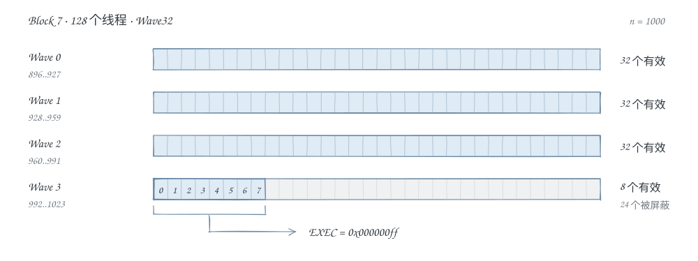

同一个数组缩放 Kernel，在源代码中是“每个线程读取一个元素，再乘上同一个系数”，在 AMD GPU 上则是“一组 Lane 执行同一条指令，各自处理不同的数据”。理解这两种视角如何对应，就能把 RDNA3.5 的执行资源、线程组织和存储层级联系起来。

## RDNA3.5、gfx1151 与 ROCm

AMD 的 **RDNA** 面向图形与通用计算，常见于 Radeon 独立 GPU 和 Ryzen APU；**CDNA** 面向数据中心计算，常见于 Instinct 加速器。两条路线都能运行通用 GPU Kernel，但执行资源和存储组织各有设计。

**RDNA3.5 是硬件架构名称，`gfx1151` 是编译器使用的指令集目标。** Ryzen AI Max 系列中的 Radeon 8050S、8060S 等集成 GPU 使用 RDNA3.5，对应 `gfx1151`；不同产品仍可以拥有不同的 CU 数量和频率。具体配置见 AMD 的[硬件规格表](https://rocm.docs.amd.com/en/latest/reference/gpu-arch-specs.html)。

`gfx1151` 属于 GFX11 家族。RDNA3 的 `gfx1100` 也属于 GFX11，RDNA4 的 `gfx1200/gfx1201` 则属于 GFX12。编译目标决定设备代码可以使用哪些指令，以及遵循哪些资源约定；架构系列、编译目标和产品型号需要分别识别。

**ROCm 是软件栈，HIP 提供编程接口与运行时。** Host 代码在 CPU 上分配数据、提交 Kernel 和接收结果，Device 代码在 GPU 上处理线程各自负责的数据。HIP/Clang 将 Device 部分编译为相应 `gfx` 目标的机器指令，运行时再提交设备代码和启动配置。

## WGP、CU 与 SIMD32

RDNA3.5 的一个 **WGP（Work-group Processor）** 包含两个 **CU（Compute Unit）** ，每个 CU 内有两个 SIMD32。因此，一个 WGP 包含四个 SIMD32；每个 SIMD32 提供 32 条向量执行 Lane。

[{ width="820" }](../../assets/rocm/rdna35/rdna35-wgp.svg)

SIMD32 执行向量指令，CU/WGP 同时组织寄存器、访存路径与 LDS 等资源。图中画的是硬件组成；软件中的线程组还需要由 GPU 安排到这些资源上执行。

一个 Workgroup 可以包含多个 Wave。在 **WGP mode** 下，同一 Workgroup 的 Wave 可以分布到两个 CU 的四个 SIMD32；在 **CU mode** 下，则限定在一个 CU 的两个 SIMD32。执行模式也决定它们可访问的 LDS 范围，相关定义见 [RDNA3.5 ISA §2.3](https://gpuopen.com/download/rdna35_instruction_set_architecture.pdf)。

GPU 根据可用资源安排 Workgroup。同一个 WGP 可以驻留多个 Workgroup 的 Wave，各组使用分别分配的寄存器和 LDS 空间；Block 编号并不指定 WGP 编号，Wave 编号也不指定固定的 SIMD32。

## 从 Block 到 Wave

### 网格、线程组与线程

HIP 沿用 `Grid / Block / Thread` 的写法；AMD 文档中的 **Workgroup 对应 Block，Work-item 对应 Thread** 。一次 Kernel 提交称为 Dispatch，Grid（网格）描述全部工作范围，Block（线程组）划出可以合作和同步的线程集合。

例如，将数组中的每个元素乘上 `alpha`：

```cpp
__global__ void scale(float* x, float alpha, int n) {
    int i = blockIdx.x * blockDim.x + threadIdx.x;
    if (i < n)
        x[i] *= alpha;
}
```

`__global__` 声明在 GPU 上执行的 Kernel。`blockIdx.x` 是当前 Block 的坐标，`threadIdx.x` 是 Block 内的线程坐标，`blockDim.x` 是每个 Block 的线程数。三者组合得到数组下标 `i`。

假设 `n=1000`，每个 Block 有 128 个线程，就需要 $\lceil1000/128\rceil=8$ 个 Block。前七个 Block 处理下标 0～895，最后一个 Block 覆盖 896～1023。**启动范围有 1024 个线程位置，其中最后 24 个没有对应的有效元素。**

### Wave32、Wave64 与 Lane

硬件进一步把线程组成 **Wave（Wavefront，波前）** ，一个 Wave 内的线程共同执行指令；线程在 Wave 内的位置称为 **Lane** 。RDNA3.5 支持 Wave32 和 Wave64，宽度由 Kernel 的编译模式决定。

同样的 128 个线程，在 Wave32 模式下组成四个 Wave，在 Wave64 模式下组成两个 Wave。对已经按 Wave32 编译的一维 Block，可以这样理解线程编号：

```cpp
int tid = threadIdx.x;
int wave_id = tid / 32;  // 0..3
int lane_id = tid % 32;  // 0..31
```

Wave 是线程的执行分组，SIMD32 是硬件执行资源。Wave64 的常见向量指令在 SIMD32 上分两部分处理，整个 Wave 仍共享执行状态。**Block 大小设为 32 的倍数，并不会自动选择 Wave32。**

### EXEC 掩码与分支发散

Wave 共享程序执行位置，各 Lane 的数据和条件却可以不同。**EXEC（Execution Mask）** 用一个 bit 表示某个 Lane 是否参与当前向量操作：1 表示参与，0 表示屏蔽。Wave32 使用低 32 bit，Wave64 使用全部 64 bit。

继续看最后一个 Block。在 Wave32 模式下，前三个 Wave 处理 896～991，全部有效；第四个 Wave 只有 Lane 0～7 对应 992～999。`if (i < n)` 下的缩放操作只保留这八个 Lane，EXEC 的有效位可以写成 `0x000000ff`。

[{ width="820" }](../../assets/rocm/rdna35/rdna35-wave-exec.svg)

被屏蔽的 Lane 仍属于原来的 Wave，不会与其他线程重新分组。如果一个 Wave 中的 Lane 选择不同分支，各条路径会使用相应掩码处理，未选择当前路径的 Lane 暂时不参与。条件在整个 Wave 内一致时，则可以让整组沿同一条路径执行。

EXEC 控制向量计算及相应访存，标量指令仍按 Wave 执行。掩码、程序执行位置与分支的定义见 [RDNA3.5 ISA §3.2](https://gpuopen.com/download/rdna35_instruction_set_architecture.pdf)。

## 标量与向量执行

AMD 将 **Wave 内一致的数据** 与 **Lane 各自的数据** 分开组织：**SGPR（Scalar General Purpose Register）** 保存一份 Wave 共享的标量状态，由 SALU（Scalar ALU）执行相应运算；**VGPR（Vector General Purpose Register）** 为每个 Lane 保存可以不同的值，由 VALU（Vector ALU）执行向量运算。

在 `scale` 中，`alpha`、`n` 和 `blockIdx.x` 在 Wave 内一致，而 `i` 和读到的 `x[i]` 随 Lane 变化。前者可以沿标量路径处理，后者需要各 Lane 独立的数据。

例如，取最后一个 Block 的 Wave 0，令 `alpha=2`，前四个输入 `x[896..899]` 为 `3、5、7、9`。Wave 共享同一个系数，每个 Lane 分别读取自己的元素，产生 `6、10、14、18`：

[{ width="820" }](../../assets/rocm/rdna35/rdna35-scalar-vector.svg)

一个 VGPR 编号为每个 Lane 提供 32 bit，因而可以同时保存一个 Wave 的多份不同数据。单个 Lane 的 FP32 或 32-bit 整数通常占一个槽位，64-bit 数据需要多个槽位；实际分配还会受到指令与分配粒度的影响。

这里的“标量”描述 Wave 内的一致性，“向量”描述各 Lane 的数据组织。C++ 中的单个 `float` 也可以放在 VGPR 中，`const` 也不指定变量必须进入 SGPR。图中展示的是数据如何组织，具体使用哪些寄存器和指令由编译器决定。

## 存储层级与数据共享

### 全局内存、缓存与 APU

`x` 指向 **Global Memory（全局内存）** 地址空间。一次 `x[i] *= alpha` 包含元素读取、乘法和写回；数据可能由缓存满足，也可能需要从物理内存取得。

RDNA3.5 在靠近执行资源的位置区分 **L0 Vector Cache、L0 Scalar Cache 和 L0 Instruction Cache** ，并包含更高层的 Graphics L1 与 L2 缓存。向量数据、标量数据和指令有各自的访问路径，缓存内容由硬件管理；具体容量应按产品和资源层级读取[硬件规格表](https://rocm.docs.amd.com/en/latest/reference/gpu-arch-specs.html)。

对数组缩放，同一条访存指令中，相邻 Lane 访问相邻 `float`，容易形成紧凑的访问。如果各 Lane 跨很大的步长取数，就可能覆盖更多缓存块，降低有效字节利用率。**访存是否紧凑，取决于同一条指令中各 Lane 的地址。**

独立 GPU 的 Global Memory 通常由板载显存支撑。Ryzen AI Max 属于 **APU** ，CPU 和集成 GPU 共享物理系统 DRAM；Global 描述的是设备可访问的地址空间，两种产品可以使用不同的物理内存。CPU/GPU 使用同一份数据时，仍需按 HIP 的分配、映射和同步规则建立正确的访问顺序。

### LDS：线程组内的合作空间

HIP 的 `__shared__` 数组使用 **LDS（Local Data Share）** ，由同一 Workgroup 的线程显式读写。程序决定搬入哪些数据、怎样排列以及何时覆盖，用它来复用输入或交换线程之间的中间结果。

RDNA3.5 的一个 WGP 合计有 **128 KiB LDS** ，分为两侧，每侧 64 KiB、32 个 32-bit bank；**单个 Workgroup 最多分配 64 KiB** 。CU mode 下，Workgroup 使用所属 CU 一侧的 LDS；WGP mode 下，两侧形成 WGP 内可访问的连续空间，Workgroup 的分配上限仍为 64 KiB。

多个 bank 提供并行访问能力。一次内部服务中，若多个访问需要同一个 bank 的不同数据，就可能形成 Bank Conflict，增加处理次数。LDS 的容量、bank 组织与访问方式见 [RDNA3.5 ISA §12.1](https://gpuopen.com/download/rdna35_instruction_set_architecture.pdf)。

数组缩放的线程各自处理一个元素，没有跨线程复用，直接读写 `x[i]` 即可。如果计算改为多个线程反复读取相同数据，或需要交换局部结果，才需要考虑把数据组织到 LDS 中。

### 寄存器与 Scratch

`i` 和读入的 `x[i]` 等临时值通常尽量保存在寄存器中。如果线程局部数组无法全部放入寄存器，或发生寄存器溢出，编译器可能使用 **Scratch** ：它是线程私有的存储空间，由设备可访问的内存支撑，访问经过相应内存路径。

**LDS 的 Local 表示 Workgroup 内共享，Scratch 则保存线程私有的数据。** 两者的共享范围和访问成本不同；变量写在函数内部，也不能据此判断它一定使用寄存器。

## Wave 等待与线程同步

### 驻留资源与延迟隐藏

某个 Wave 发出访存指令后，依赖结果的后续指令需要等待。GPU 可以从其他已经准备好的驻留 Wave 中选择工作，用交错执行隐藏部分等待时间。各 Wave 的寄存器状态保留在片上，切换发射对象时不需要把它们整体存回 Global Memory。

驻留量受到寄存器容量、LDS 分配、Wave slot 和 Workgroup 资源等限制。每线程使用更多 VGPR，或每个 Workgroup 申请更多 LDS，都可能减少同时驻留的工作量。

**逻辑线程数、驻留 Wave 数和能够继续执行的 Wave 数是不同的量。** 驻留更多 Wave 提供了更多可选择的工作；实际效果仍取决于它们的依赖和资源需求。如果所有 Wave 都在等待，或访存带宽已经饱和，单纯增加驻留量也不一定加速。

### 线程组屏障

多个 Wave 可以处于不同执行进度。假设一个 Block 的线程先把数据写入 LDS，线程 0 随后要读线程 96 写入的值；在 Wave32 模式下，它们属于不同 Wave，需要先完成组内同步。

`__syncthreads()` 是 **Workgroup 级屏障** ，让同组线程到达相同位置，并建立屏障前后共享内存访问的顺序。对不完整的尾部 Block，应让越界位置写入适当的中性值，整个 Block 一致经过屏障，再限制输出写回范围。若复用 LDS 装载下一批数据，还要在覆盖之前确保上一批已被全部读完。

`scale` 的线程只更新自己的元素，因此不需要这个屏障。需要合作的数据读写则要遵循相应同步约定，包括同一 Wave 内的跨 Lane 操作。

Block 屏障只协调当前 Workgroup。普通 Kernel 中，各 Block 的执行顺序不确定；跨 Block 的依赖计算常拆为多个 Kernel，通过同一 Stream 中的提交顺序衔接。Host 端读取输出前，还需要等待相应设备工作完成。线程组织与同步规则见 HIP 的[编程模型](https://rocm.docs.amd.com/projects/HIP/en/latest/understand/programming_model.html)。
