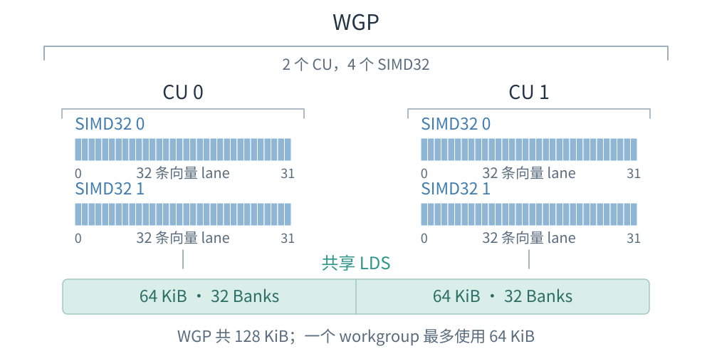
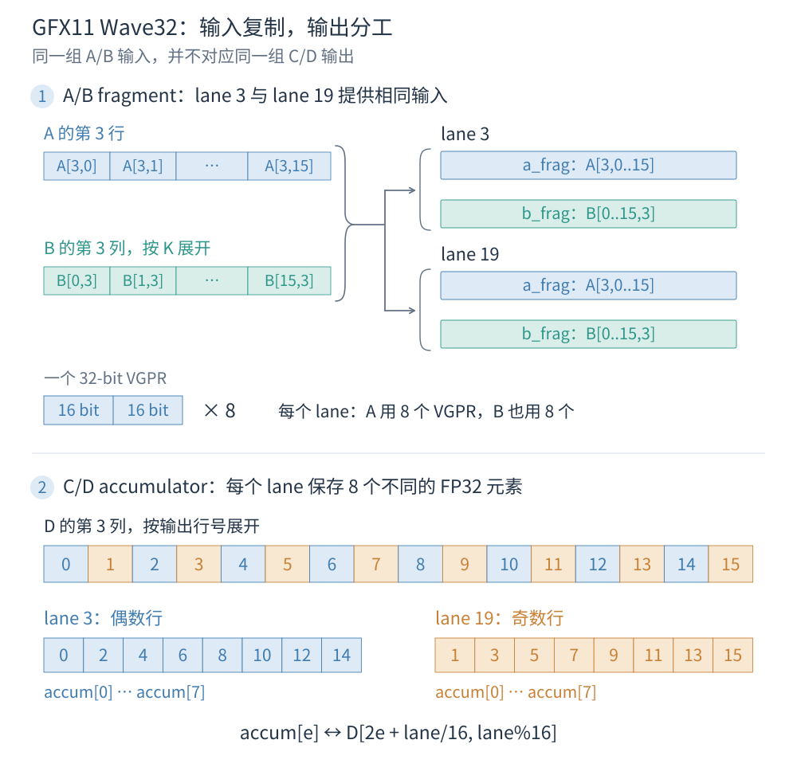

ROCm 是 AMD 的 GPU 软件栈，HIP 提供其中的编程接口与运行时。写过 CUDA Kernel 后，`__global__`、`threadIdx`、`blockIdx` 和 `__shared__` 等写法都很熟悉；真正需要重新理解的是这些线程如何在 AMD GPU 上执行，以及数据放在哪一层资源中。

RDNA3.5 沿用了 RDNA 的 Wave、标量与向量执行路径，并支持 Wave 级矩阵乘加 WMMA。理解 WMMA 之前，先把程序中的线程组与硬件中的计算单元分开看。

## RDNA3.5 的架构与命名

### RDNA3.5 与 gfx1151

**RDNA3.5 是架构名称，`gfx1151` 是编译器使用的指令集目标。** NVIDIA 一侧也有这种区分：Ampere、Ada、Hopper 是架构名称，`sm_80`、`sm_89`、`sm_90` 是相应的编译目标。目标名称说明代码要面向哪一组指令和硬件特性，不表示 GPU 上计算单元的数量。

`gfx1151` 属于 GFX11 家族；RDNA3 的 `gfx1100` 也属于 GFX11，而 RDNA4 的 `gfx1200/gfx1201` 属于 GFX12。这里最直接的影响是矩阵指令的操作数约定：RDNA3.5 使用 GFX11 的 WMMA 布局，不能直接换成 RDNA4 的 builtin 和 fragment。

Ryzen AI Max 系列的不同 GPU 架构、编译目标与具体产品之间的关系可参照 AMD 的[硬件规格表](https://rocm.docs.amd.com/en/latest/reference/gpu-arch-specs.html)。AMD 面向 Instinct 的 CDNA 则是另一条架构路线，矩阵计算通常使用 MFMA；本文讨论的是 RDNA3.5 的 WMMA。

### WGP、CU 与 SIMD32

RDNA3.5 把两个 **CU（Compute Unit）** 组织成一个 **WGP（Work-group Processor）** ，每个 CU 内有两个 SIMD32：

$$
1\ \mathrm{WGP}=2\ \mathrm{CU}=4\ \mathrm{SIMD32}.
$$

SIMD32 提供 32 条向量执行 lane；CU/WGP 在这些执行资源之外，还组织寄存器、访存路径与片上共享存储。它们可以与 NVIDIA 的 SM 作功能上的比较，但 CU、WGP 和 SM 的资源划分、调度边界并非严格一一对应。

{ width="800" }

程序中的一个 Workgroup 可以包含多个 Wave，这些 Wave 被安排在同一个 WGP 内。在 WGP mode 下，它们可以分布到两个 CU 的四个 SIMD32；在 CU mode 下，则限定在一个 CU 的两个 SIMD32。**软件中的 Wave 编号表示线程分组，不指定固定的 SIMD32。** 这些执行层次与模式来自 [RDNA3.5 ISA](https://gpuopen.com/download/rdna35_instruction_set_architecture.pdf)。

## HIP Kernel 中的线程如何执行

### Grid、Workgroup 与 Work-item

HIP 保留了 CUDA 的 Grid、Block、Thread 写法。AMD 文档中的 **Workgroup 对应 Block，Work-item 对应 Thread** ；一次 Kernel 提交称为 Dispatch。Grid 决定逻辑工作范围，Block 划出能合作和同步的线程组，Thread 再用自己的下标确定要处理的数据。

例如，对数组做一次缩放：

```cpp
__global__ void scale(float* x, float alpha, int n) {
    int i = blockIdx.x * blockDim.x + threadIdx.x;
    if (i < n)
        x[i] *= alpha;
}
```

`__global__` 表示在 GPU 上执行的 Kernel，`__device__` 表示供设备端调用的函数。`blockIdx.x` 是当前 Block 的坐标，`threadIdx.x` 是 Block 内的线程坐标，两者组合得到完整数组下标。一个 Block 里的线程使用不同的 `threadIdx.x`，但共享相同的 `blockIdx.x`。

### Wave、Lane 与 EXEC

硬件把线程进一步组成 **Wave（Wavefront）** ，其作用类似 CUDA 的 Warp。CUDA Warp 固定为 32 个线程，RDNA3.5 的 Wave 可以包含 32 或 64 个线程。**Wave 是一起执行指令的线程组，SIMD32 是执行向量指令的硬件资源。** Wave64 的常见向量指令由 SIMD32 分两部分处理，不能据此把一个 Wave64 当成两个独立 Wave32。

在已经按 Wave32 编译的一维 Block 中，128 个线程组成四个 Wave，每个线程在 Wave 内的位置称为 Lane：

```cpp
int tid = threadIdx.x;
int wave_id = tid / 32;  // 0..3
int lane_id = tid % 32;  // 0..31
```

这些下标依赖 Wave32 这个前提。**把 Block 线程数设成 32 的倍数，并不会自动选择 Wave32 模式。** Wave 宽度由 Kernel 的编译模式决定，Wave 级 builtin 也需要与它一致。

一个 Wave 共享程序执行位置，但各 Lane 可以有不同的条件和数据。AMD 使用 **EXEC（Execution Mask）** 记录当前哪些 Lane 参与向量指令。在上面的 `if (i < n)` 中，尾部越界 Lane 可以被屏蔽，其余 Lane 继续处理各自的数组元素。

当同一个 Wave 内的线程选择不同分支时，就出现分支发散：硬件通过不同的 EXEC 掩码处理各条路径，而不是让每条 Lane 自由执行互不相关的指令。普通逐元素计算可以屏蔽越界线程；WMMA 需要整个 Wave 提供相互配合的操作数，因此要让完整 Wave 执行同一次矩阵指令，边界则通过输入补零和输出写回条件处理。

### SGPR/SALU 与 VGPR/VALU

AMD 将 Wave 一致的数据与 Lane 各自的数据分开处理。**SGPR（Scalar General Purpose Register）** 保存一个 Wave 共享的标量状态，**SALU（Scalar ALU）** 对这份标量执行运算；**VGPR（Vector General Purpose Register）** 为每个 Lane 保存可以不同的值，**VALU（Vector ALU）** 对参与执行的 Lane 做相应的向量运算。

在 `scale` 中，`alpha`、`n` 和 `blockIdx.x` 在 Wave 内一致，而 `i` 与 `x[i]` 随 Lane 变化。前者可以沿标量路径处理，后者需要 Lane 各自的数据。这里的“标量”是指 **Wave 一致性** ，并不等于 C++ 类型是 `float` 或 `int`；把一个变量写成 `const`，也不会指定它必须进入 SGPR，最终分配由编译器决定。

一个 VGPR 槽为每个 Lane 提供 32 bit。WMMA 的 FP16 输入可以在一个槽中打包两个 half，FP32 累加器则一个值占一个槽；后面说“每个 Lane 的 fragment”时，指的就是它持有的这部分寄存器数据。

### Global Memory、LDS 与线程私有数据

普通设备指针访问的数据位于 **Global Memory** ，访问会经过相应缓存；`__shared__` 数组使用 **LDS（Local Data Share）** ，作用类似 CUDA Shared Memory，由同一个 Workgroup 的线程显式读写和复用。

**LDS 的 Local 是相对 Workgroup 而言，线程私有的局部变量并不是 LDS。** 私有变量通常尽量保存在寄存器中；局部数组无法全部放入寄存器，或发生寄存器溢出时，可能使用 Scratch。Scratch 属于线程私有存储，但由设备内存支撑，其访问成本与片上 LDS 不同。共享数组、私有数组和寄存器 fragment 因而需要分开理解。

RDNA3.5 一个 WGP 合计有 **128 KiB LDS** ，分为两个 64 KiB 侧；**单个 Workgroup 最多分配 64 KiB** 。硬件总容量不等于某个 Block 可以全部申请的容量。Ryzen AI Max 是 APU，CPU/GPU 共享物理系统内存，但设备地址、访问权限和同步仍由相应内存模型管理，也不意味着任意 Host/Device 指针都能直接互换。

### Wave 合作与 Workgroup 屏障

同一个 Wave 共同执行指令，多个 Wave 之间则可以处于不同进度。如果一个 Block 的线程先合作写入 LDS，再由各 Wave 读取，就需要 `__syncthreads()`：它是 **Workgroup 级屏障** ，让同组线程完成屏障前的工作，并建立共享内存访问的顺序。到达屏障应当是整个 Workgroup 一致的控制流，不能让一部分线程提前退出，另一部分继续进入屏障。

复用同一块 LDS 时，通常有两个同步点：装载后同步，确保其他线程写入的数据可读；消费后同步，确保较慢的 Wave 已经读完，较快的 Wave 才能覆盖下一批数据。Wave 级矩阵指令只能协调本 Wave 的乘加，不能代替多个 Wave 之间的这个屏障。HIP 的[编程模型](https://rocm.docs.amd.com/projects/HIP/en/latest/understand/programming_model.html)也把 Workgroup 合作与 Wave 执行区分开来。

## WMMA 指令：一个 Wave 共同完成矩阵乘加

**WMMA（Wave Matrix Multiply-Accumulate）把一块矩阵乘加交给整个 Wave 完成。** 对 gfx1151，这种指令从多个 lane 的 VGPR 中取得输入，计算后再把输出分配回各 lane 的 VGPR。它不接受矩阵的内存指针，也不替程序完成数据加载和写回；HIP 代码需要先按指令约定准备寄存器中的数据。

先看 FP16 输入、FP32 累加的一次指令。它处理三个输入分块，产生一个输出分块：

$$
D_{16\times16}=A_{16\times16}B_{16\times16}+C_{16\times16}.
$$

A 的形状是 M×K，B 是 K×N，C/D 是 M×N。在这个变体里，M=N=K=16。三个 16 分别表示输出行数、输出列数和内积长度，而不是线程数。对任意输出位置：

$$
D[r,c]=C[r,c]+\sum_{p=0}^{15}A[r,p]B[p,c].
$$

**每个输出仍是 A 的一行与 B 的一列的内积，但持有这行输入的 lane，不一定持有这一输出。** WMMA 按整个 Wave 的约定组合数据，普通 VALU 乘加让各 lane 使用自己的标量操作数；WMMA 则在整个 Wave 内形成所有行列配对。一次调用覆盖 256 个输出，每个输出累加 16 个乘积，共有 4096 个乘积贡献。这个数描述指令的计算形状，执行时间还取决于硬件与流水线。

![一次 WMMA 的矩阵乘加与 D[1,3] 的计算过程](../../assets/rocm/rdna35/wmma-wave-operation.svg){ width="800" }

### 从指令名字到三个 fragment 参数

HIP/Clang 为这条指令提供下面的 builtin：

```cpp
using half16 = _Float16 __attribute__((ext_vector_type(16)));
using float8 = float __attribute__((ext_vector_type(8)));

half16 a_frag, b_frag; // 先按 lane 布局装入有效数据
float8 c_frag = {};   // 本次指令的 FP32 累加器输入

float8 d_frag = __builtin_amdgcn_wmma_f32_16x16x16_f16_w32(
    a_frag, b_frag, c_frag);
```

`__builtin_amdgcn_wmma` 是编译器入口，对应 ISA 中的 `V_WMMA_F32_16X16X16_F16`。名字里的第一个 `f32` 指 C/D 的类型，`16x16x16` 是 M×N×K，后一个 `f16` 指 A/B 的类型，`w32` 指 Wave32。ISA 指令的操作数是寄存器组，builtin 用 C++ 向量类型表达各 lane 需要提供的那一部分寄存器。

这三个参数依次对应 A、B 和已有的 C。`c_frag={}` 表示从零开始；如果 C 已有值，就要先把对应位置装进 `c_frag`。返回的 `d_frag` 是 **FP32** ，`f16` 并不表示输出自动变成 FP16。最后如果需要半精度矩阵，还要在写回时另做一次转换。

**fragment 是一个 lane 持有的矩阵片段。** `half16` 表示这个 lane 有 16 个 half 值，`float8` 表示这个 lane 有 8 个 float 值；它们都不是完整的 16×16 矩阵，也不表示创建了 16 或 8 个线程。同一次 builtin 调用在 Wave 的所有 lane 中执行，每个 lane 传入自己的片段。

在 ISA 层，这次调用可以写成下面的寄存器形式：

```asm
v_wmma_f32_16x16x16_f16 v[0:7], v[8:15], v[16:23], v[0:7]
```

四组操作数依次是输出 D、输入 A、输入 B 和累加器 C；这里把 C 与 D 放在同一组寄存器中，直接更新累加值。`v[8:15]` 表示八个 VGPR，而每个 `v` 都为所有 lane 各保存一个 32-bit 值。下面的输入打包与输出映射，正是为了把矩阵元素放到这些寄存器组的正确位置。

### A/B 的 256 个元素如何交给 32 个 lane

对 GFX11 的这个 Wave32 变体，先令：

```cpp
int lane = threadIdx.x % 32;
int t = lane % 16;
```

把本次指令的矩阵分块记为 `A_tile` 和 `B_tile`，每个 lane 按下面的关系取数：

```cpp
for (int p = 0; p < 16; ++p) {
    a_frag[p] = A_tile[t][p]; // A 的第 t 行，沿 K 取 16 个元素
    b_frag[p] = B_tile[p][t]; // B 的第 t 列，沿 K 取 16 个元素
}
```

lane 0 提供 A 第 0 行与 B 第 0 列，lane 1 提供 A 第 1 行与 B 第 1 列，依此类推到 lane 15。**lane 16～31 再提供同样的 16 组输入：lane t 与 lane t+16 的 A/B fragment 必须相同。** 这就是 GFX11 的输入复制要求。例如 lane 3 与 lane 19 都持有 A 第 3 行、B 第 3 列。

因此，A 分块的 256 个独立元素实际放入 `32×16=512` 个 half 位置，B 也一样。这里多出来的是寄存器中的副本，数学上的矩阵形状仍是 16×16。后半 Wave 不会因为前半 Wave 已经加载过数据，就自动拥有相同的局部变量；上面的 `t=lane%16` 让每个 lane 都明确取得自己所需的输入。

VGPR 的槽位宽度为 32 bit。一个 `half16` 有 16 个 FP16 元素，两个 half 可以打包进一个槽位，因此每个 lane 的 A fragment 和 B fragment **各占 8 个 VGPR 槽位** 。例如 A fragment 的 `p=0/1` 位于第一个槽位的两个半字，`p=2/3` 位于下一个槽位。C/D 使用 FP32，每个 float 单独占一个槽位。

这里的行、列是矩阵元素的逻辑坐标。参考资料有时用“A column-major、B row-major”描述 fragment 在 lane×VGPR 视图中的排列；这与 A/B 在 Global Memory 中采用什么地址布局是两件事。代码中最可靠的依据仍是 `a_frag[p]=A_tile[t][p]`、`b_frag[p]=B_tile[p][t]` 这些元素对应关系。

### C/D 不复制：两半 Wave 分别持有偶数行和奇数行

A/B 输入在两半 Wave 中相同，C/D 的分工却不同。每个 lane 的 FP32 accumulator 有 8 个位置，32 个 lane 合起来恰好覆盖 `32×8=256` 个输出，没有重复。

对 `c_frag[e]` 和返回的 `d_frag[e]`，对应的局部矩阵位置为：

$$
\mathrm{col}=lane\bmod16,\qquad
\mathrm{row}=2e+\left\lfloor\frac{lane}{16}\right\rfloor,
\qquad e=0,\ldots,7.
$$

`lane%16` 选输出列，`lane/16` 选偶数行或奇数行。lane 0～15 分别持有 16 列的偶数行，lane 16～31 分别持有同样 16 列的奇数行。例如 lane 3 的 8 个结果位于列 3、行 0/2/4/…/14；lane 19 的结果位于列 3、行 1/3/5/…/15。

```cpp
for (int e = 0; e < 8; ++e) {
    int row = 2 * e + lane / 16;
    int col = lane % 16;
    c_frag[e] = C_tile[row][col];
}

float8 d_frag = __builtin_amdgcn_wmma_f32_16x16x16_f16_w32(
    a_frag, b_frag, c_frag);

for (int e = 0; e < 8; ++e) {
    int row = 2 * e + lane / 16;
    int col = lane % 16;
    D_tile[row][col] = d_frag[e];
}
```

**同一个 accumulator 下标在调用前后对应同一个矩阵位置。** lane 19 的 `c_frag[0]` 是 C[1,3]，返回的 `d_frag[0]` 就是 D[1,3]。这样才可以把上一次的 D 继续用作下一次的 C。

{ width="800" }

输入与输出的映射可对照 [RDNA3.5 ISA §7.9](https://gpuopen.com/download/rdna35_instruction_set_architecture.pdf)和 AMD [Matrix Instruction Calculator 的 GFX11 布局代码](https://github.com/ROCm/amd_matrix_instruction_calculator/blob/2ef91896bcdc4d26624f952e5c905c787cd9bc9e/matrix_calculator.py#L6237-L6310)。上述公式针对 GFX11、Wave32、FP16 输入和 FP32 C/D。

### 跟踪一个输出：lane 19 为什么用到 lane 1 的输入

用一个简单的 16×16 分块来检查这些对应关系。令所有元素初始为零，只保留：

$$
A[1,0]=1,\quad A[1,1]=2;\qquad
B[0,3]=3,\quad B[1,3]=4;\qquad
C[1,3]=5.
$$

A 第 1 行的非零数据由 lane 1 和 lane 17 提供；B 第 3 列的非零数据由 lane 3 和 lane 19 提供；C[1,3] 则由 lane 19 的 `c_frag[0]` 提供。一次 WMMA 后：

$$
D[1,3]=1\times3+2\times4+5=16,
$$

所以 **lane 19 返回的 `d_frag[0]` 等于 16** 。此时 lane 19 自己的 `a_frag` 是 A 第 3 行，全为零。如果把 WMMA 当成这个 lane 独立计算 `dot(a_frag,b_frag)+c_frag`，只会得到 5，显然错误。

这个例子把两个角色分开了：lane 1/17 是 A 第 1 行的输入持有者，lane 19 是 D[1,3] 的输出持有者。WMMA 从整个 Wave 收集所需的行列组合，并按照输出约定交回结果。其他 A 行为零，其他输出列也没有 B 的非零值，因此除 D[1,3] 外，整个 D 分块都为零。

### 内存布局改变的是取数地址，fragment 映射保持不变

上面用 `A_tile[r][p]` 表示数学元素。实际从内存读取时，还要把这个元素转换为地址。若 A 是行主序，行跨度为 `lda`：

```cpp
a_frag[p] = A[(row0 + t) * lda + k0 + p];
```

若 A 是列主序，列跨度为 `lda`：

```cpp
a_frag[p] = A[(k0 + p) * lda + row0 + t];
```

两个地址表达式都取出 `A[row0+t,k0+p]`，改变的是内存排列方式。对行主序的 B，装入对应列的方式为：

```cpp
b_frag[p] = B[(k0 + p) * ldb + col0 + t];
```

固定 `p` 时，列主序 A 让相邻 lane 读取相邻的 A 行元素；行主序 B 让相邻 lane 读取相邻的 B 列元素。这解释了参考文章[《AMD RDNA 3 与 RDNA 4 GPU 上的 WMMA 编程》](https://zhuanlan.zhihu.com/p/2035105555476373968)为什么选 A 列主序、B 行主序来演示直接加载。A/B 也可以都存成行主序，再经 LDS 调整取数方式，最后仍组装成同一组 WMMA fragment。

**WMMA 只规定指令边界处的寄存器内容；Global Memory 和 LDS 的布局由程序选择。** LDS 是多个线程协作搬运和复用数据的工作空间，并不是调用 WMMA 的必需参数。只要输入片段已经正确准备，也可以直接从 Global Memory 加载到 fragment。

### 不同类型、Wave 宽度与架构不能只改一个后缀

gfx1151 的 WMMA 还提供 BF16 输入/FP32 累加、FP16 或 BF16 累加，以及 INT8/INT4 输入、INT32 累加的变体。它们保留矩阵乘加的含义，但 C++ 向量类型、输入打包和累加器取值需要分别匹配；FP16 与 BF16 都是 16 bit，也不能直接把同一组 bit 当作另一种格式。

FP32 C/D 的 builtin 就是前面的三个参数。**GFX11 的 FP16/BF16 C/D 变体额外带 `OPSEL`** ，它选择每个 32-bit VGPR 槽位中的低半字或高半字作为有效的累加器元素。例如 FP16 变体返回 `half16`，Wave32 下有 8 个有效结果，`OPSEL=false` 时读取 `d_frag[2*e]`，为 true 时读取 `d_frag[2*e+1]`。这与 A/B 两个 half 都有效的紧密打包不同，不能据“结果为 16 bit”就把 8 个输出当成只占 4 个 VGPR。这个约定见 [AMD 的 OPSEL 说明](https://gpuopen.com/learn/wmma_on_rdna3/)。

换成 Wave64 时，A/B 的 16 组输入在四个 16-lane 分组中复制，FP32 C/D 改为每 lane 4 个元素。64 个 lane 仍合计持有 256 个结果，但行对应关系变为 `row=4*e+lane/16`、`col=lane%16`，返回类型也变为 `float4`。因此 `_w32` 改为 `_w64` 时，输入复制、输出下标与 Kernel 的 Wave 编译模式需要一起改变；Block 有多少线程不能替代这些指令约定。

RDNA4/GFX12 又是另一种映射：Wave32 的 FP16 A/B 每 lane 只有 8 个独立元素，取消 GFX11 的两半 Wave 镜像；C/D 的行分工和 builtin 的 `_gfx12` 后缀也改变了。**gfx1151 使用 GFX11 的 builtin 和 fragment 约定。** 移植时若沿用不匹配的数组长度或输出下标，代码即使形式相近，矩阵元素对应关系也会错。

### 沿 K 累加：保持 accumulator，替换 A/B

一次 `16×16×16` 指令只计算 16 个 K 元素的贡献。矩阵的 K 更长时，需要取下一组 A 列和 B 行，再把前一次 D 作为新一次的 C：

$$
D^{(0)}=0,\qquad
D^{(s+1)}=A^{(s)}B^{(s)}+D^{(s)}.
$$

其中每一对 A/B 分块都覆盖当前 16 长度的 K 窗口，D 始终对应同一个输出子块。例如 K=32 时，先处理 p=0～15，再处理 p=16～31，两次结果累加到同一个 FP32 accumulator：

```cpp
float8 accum = {};
// 对每个 K 窗口准备新的 a_frag、b_frag
accum = __builtin_amdgcn_wmma_f32_16x16x16_f16_w32(a0, b0, accum);
accum = __builtin_amdgcn_wmma_f32_16x16x16_f16_w32(a1, b1, accum);
```

这里连续更新的是 C/D，输入 A/B 的寄存器约定也一直不变。如果要把上一次输出当成另一次矩阵乘法的 A 或 B，则需要重新检查类型和元素分布；输出 fragment 不能仅凭向量长度相近就直接代替输入 fragment。rocWMMA 的高层 `fragment/load_matrix_sync/mma_sync` 接口可以封装这些映射，例如 [hgemm_rocwmma_d](https://github.com/ROCm/rocWMMA/blob/9be260f252448b61648a048a1fc2ec1ffa2a804d/samples/simple_hgemm.cpp#L81-L138)沿 K 保留累加器；原生 builtin 则把这些映射直接交给 Kernel 编写者。

## 用 WMMA 实现一个 HGEMM Kernel

将同一个 accumulator 沿 K 反复更新，就可以计算更大的矩阵乘法。这里令 A 为 `M×K`、B 为 `K×N`，最终的 C 为 `M×N`；三者都按行主序存储，A/B 输入和 C 输出为 FP16，累加过程为 FP32：

$$
C[r,c]=\operatorname{FP16}\left(\sum_{p=0}^{K-1}
\operatorname{FP32}(A[r,p])\operatorname{FP32}(B[p,c])\right).
$$

这里最终的 C 是结果矩阵，指令里的 C/D 则是每一步的 FP32 accumulator。最后一次 WMMA 返回后，才把 accumulator 转成 FP16。

一个 Block 只包含一个 Wave32，也就是一维的 32 个线程，负责一个 `16×16` 输出块。`blockIdx.y` 选择输出行块，`blockIdx.x` 选择输出列块；沿 K 每次取 16 个元素，保持 `accum` 不变并替换 A/B fragment。完整的 [Kernel 源码](code/hgemm_wmma.cpp)如下：

```cpp
#include <hip/hip_runtime.h>
#include <hip/hip_fp16.h>

using half16 = _Float16 __attribute__((ext_vector_type(16)));
using float8 = float __attribute__((ext_vector_type(8)));

#if defined(__HIP_DEVICE_COMPILE__) && defined(__AMDGCN__)
static_assert(__AMDGCN_WAVEFRONT_SIZE == 32, "WMMA requires Wave32 here");
#endif

__global__ void hgemm_kernel(const __half* __restrict__ a,
                             const __half* __restrict__ b,
                             __half* __restrict__ c, int m, int n, int k) {
    const int lane = threadIdx.x; // Exactly 32 threads in a one-dimensional block.
    const int t = lane % 16;
    const int row0 = blockIdx.y * 16;
    const int col0 = blockIdx.x * 16;
    float8 accum = {};

    for (int k0 = 0; k0 < k; k0 += 16) {
        half16 a_frag, b_frag;
        #pragma unroll
        for (int e = 0; e < 16; ++e) {
            const int p = k0 + e;
            a_frag[e] = (row0 + t < m && p < k)
                ? static_cast<_Float16>(a[static_cast<size_t>(row0 + t) * k + p])
                : static_cast<_Float16>(0);
            b_frag[e] = (p < k && col0 + t < n)
                ? static_cast<_Float16>(b[static_cast<size_t>(p) * n + col0 + t])
                : static_cast<_Float16>(0);
        }
        accum = __builtin_amdgcn_wmma_f32_16x16x16_f16_w32(a_frag, b_frag, accum);
    }

    #pragma unroll
    for (int e = 0; e < 8; ++e) {
        const int row = row0 + 2 * e + lane / 16;
        const int col = col0 + t;
        if (row < m && col < n)
            c[static_cast<size_t>(row) * n + col] = __float2half(accum[e]);
    }
}
```

`a_frag` 按 `t=lane%16` 装入 A 的一行，`b_frag` 装入 B 的一列；两半 Wave 的镜像输入自然由同一个 `t` 生成。`accum[e]` 写回时继续使用前面推导的 `2*e+lane/16` 与 `lane%16`。从 Global Memory 装入 VGPR 后，整个 Wave 调用一次 WMMA；本例没有线程之间通过 LDS 搬运数据，因此也没有 Workgroup 屏障。

以 `M=19、N=21、K=29` 为例，输出划成四个 `16×16` 块。K 的第一个窗口包含 16 个有效元素，第二个窗口包含 13 个有效元素，剩下三个位置补零。补零只改变输入值，完整 Wave 仍执行相同的两次矩阵乘加。

右下角输出块的起点是 `(16,16)`，有效部分为 3 行、5 列。这里 lane 3 和 lane 19 写回的输出列都是 19：lane 3 保留行 16、18，lane 19 保留行 17，越界的其余行跳过。

这两个 lane 装入的 A 输入行却都是 `16+3=19`，已经越界，会被补零；它们仍然能得到有效输出，因为输出行 16、17、18 所需的 A 数据由其他 lane 提供。**不能按某个 lane 的输入行是否越界，决定它是否参与 WMMA。** 输入补零、完整 Wave 乘加、最后检查输出坐标，这三个动作必须保持各自的作用。
