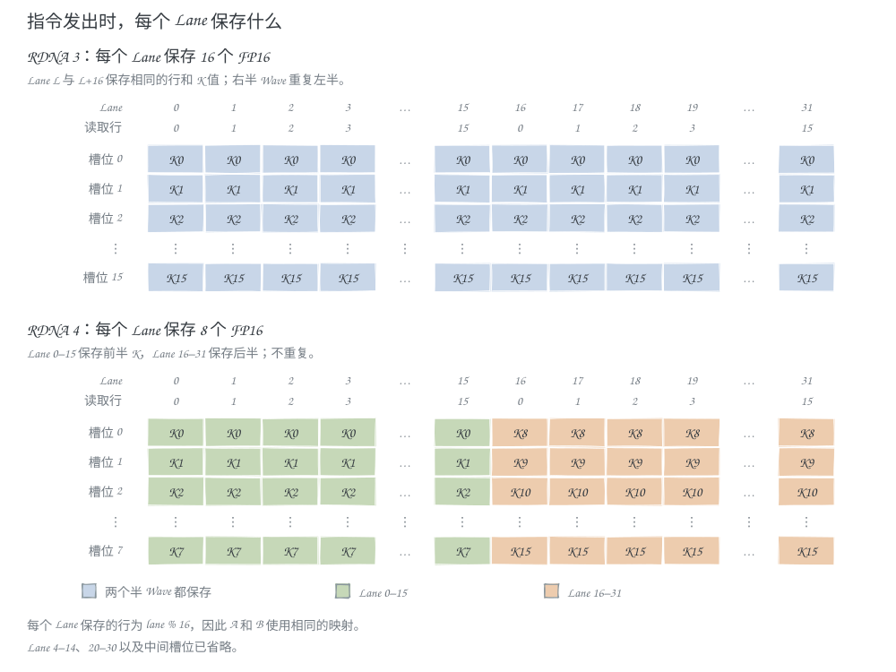
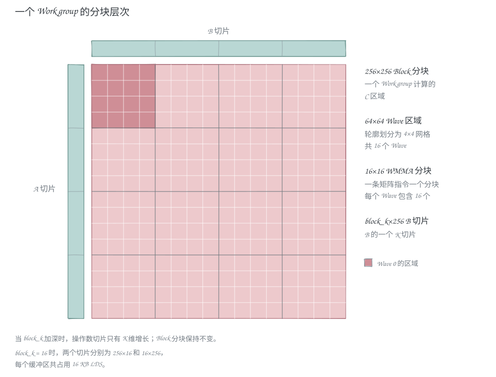
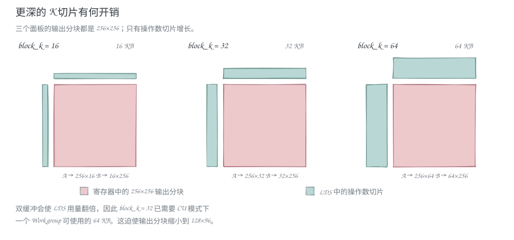
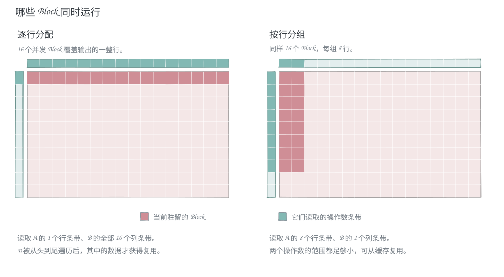
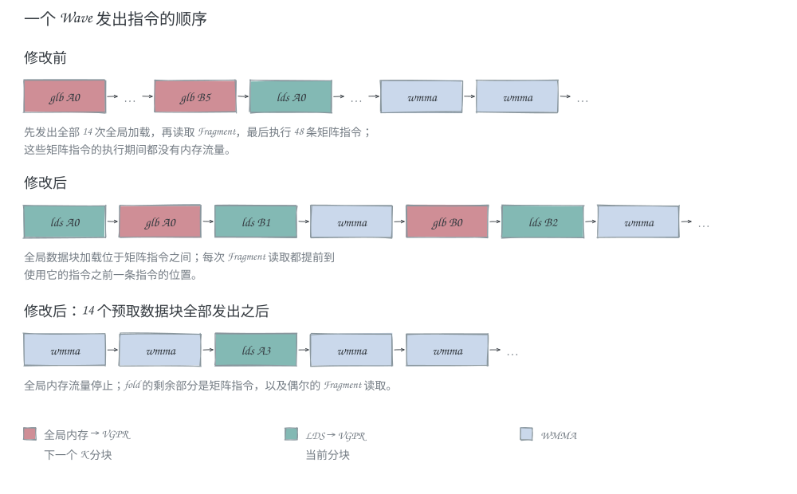

<!---
Copyright (c) 2026 Advanced Micro Devices, Inc. (AMD)

Permission is hereby granted, free of charge, to any person obtaining a copy
of this software and associated documentation files (the "Software"), to deal
in the Software without restriction, including without limitation the rights
to use, copy, modify, merge, publish, distribute, sublicense, and/or sell
copies of the Software, and to permit persons to whom the Software is
furnished to do so, subject to the following conditions:

The above copyright notice and this permission notice shall be included in all
copies or substantial portions of the Software.

THE SOFTWARE IS PROVIDED "AS IS", WITHOUT WARRANTY OF ANY KIND, EXPRESS OR
IMPLIED, INCLUDING BUT NOT LIMITED TO THE WARRANTIES OF MERCHANTABILITY,
FITNESS FOR A PARTICULAR PURPOSE AND NONINFRINGEMENT. IN NO EVENT SHALL THE
AUTHORS OR COPYRIGHT HOLDERS BE LIABLE FOR ANY CLAIM, DAMAGES OR OTHER
LIABILITY, WHETHER IN AN ACTION OF CONTRACT, TORT OR OTHERWISE, ARISING FROM,
OUT OF OR IN CONNECTION WITH THE SOFTWARE OR THE USE OR OTHER DEALINGS IN THE
SOFTWARE.
--->

# AMD RDNA™ 3 与 RDNA™ 4 架构上的 FP16 GEMM 优化

原文：[FP16 GEMM Optimization on AMD RDNA™ 3 and RDNA™ 4 Architectures](https://rocm.blogs.amd.com/software-tools-optimization/rdna-fp16-gemm/README.html) ·

本文将带你为 AMD RDNA™ 3 和 RDNA™ 4 GPU 编写一个快速的 FP16 GEMM Kernel，每次进行一项优化。你将看到哪些技术在各个架构上有效，为什么有些技术能改善一个架构的性能，却会损害另一个架构的性能，以及如何从执行时间、寄存器和 LDS 三方面衡量每次修改的影响，从而将同样的方法应用到自己的 Kernel 中。这是一个两篇文章系列的第一篇。第二篇会将本文的最终 Kernel 移植为 RDNA 4 上的 FP8 版本。

计算 `C = A × B` 是 AI 和 HPC 中使用最频繁的 Kernel 之一。在基于 RDNA 架构的 AMD Radeon™ GPU 上，硬件为此提供了 Wave Matrix Multiply-Accumulate（WMMA，Wave 矩阵乘加）指令：一个 Wave 中的全部 32 个线程通过一条协作指令，共同完成 16×16×16 矩阵块的乘法，并将结果加到累加器中。本文以 WMMA 为基础，逐步构建一个 FP16 GEMM Kernel。我们从一个基础 GEMM Kernel 开始，最终根据架构和 GEMM 形状的不同，达到比 ROCm 中经过调优的 GEMM 库 [hipBLASLt](https://rocm.docs.amd.com/projects/hipBLASLt/en/latest/) 快或慢几个百分点的性能。目标不是构建一个生产级库，而是提供一份逐步讲解：每一步都说明要解决的问题、展示代码修改，并报告这些修改在时间、寄存器和 Local Data Share（LDS）上的开销或节省。LDS 是由同一 Workgroup 内的线程共享的高速片上存储。

Kernel 的构建分为八步，编号与后文的计时表一致。第 1 步是一个最小的起始 Kernel，由一个 Wave 处理一个小块，让你看到朴素 WMMA 循环与目标性能之间的差距。第 2 步一次应用四种标准 GEMM 技术：更大的分块、宽度为 128 bit 的内存复制、双缓冲和暂存后提交。这是唯一同时修改多个方面的一步；这四项修改共同构成了一个常规的分块 Kernel，后续各步都以此为基础。第 3～8 步每次只修改一个方面：

- 避免 LDS Bank Conflict：分块中的连续行可能映射到同一个 LDS bank，导致访问串行化；通过填充或重排布局将访问分散开。
- 使用缓冲区资源描述符进行全局读取：越界地址返回零，因此分块尺寸不必整除矩阵维度。
- 加深 K 切片：一次在 LDS 中保存多个 WMMA 步长的 K 数据，在全局内存复制与屏障之间执行更多计算。
- 重排 Block 以复用缓存：按照能让并发 Block 读取 A、B 重叠区域的顺序启动输出分块。
- 将预取与 WMMA 交错：在矩阵指令之间发出全局读取，让内存延迟隐藏在 Wave 原本就需要执行的计算之后。
- 重新考察双缓冲：在加入交错执行后，测试两个 LDS 缓冲区是否仍值得付出 Occupancy 开销，还是一个缓冲区配合更多驻留 Workgroup 更快。

> **注：** [AMD CDNA™ 4 架构上的 FP8 GEMM 优化](https://rocm.blogs.amd.com/software-tools-optimization/cdna4-gemm-kernels/README.html)介绍了在 CDNA 硬件上以 FP8 执行的相同优化过程。

每一步都在三款 GPU 上进行测量：AMD Radeon™ PRO W7800（gfx1100，RDNA 3）、AMD Radeon™ RX 9070 XT（gfx1201，RDNA 4）和 AMD Radeon™ 8060S（gfx1151，RDNA 3.5）。最后一款使用与 RDNA 3 相同的 WMMA 指令，因此同一个 Kernel 二进制文件可以用于两者；但它通过系统 RAM 而不是专用 GDDR 访问内存，所以即使经过优化，gfx1151 的绝对吞吐量仍然更低。有些优化步骤有利于一个架构，却会损害另一个架构的性能；出现这些情况时，文中会指出。

要运行这些示例，你需要安装包含 hipBLASLt 开发包的 ROCm，拥有一款 RDNA 3、RDNA 3.5 或 RDNA 4 GPU，并熟悉 HIP 和 GEMM 分块的基础知识，即如何将大型矩阵乘法划分为 Block、Wave 和 K 切片。本文所有计时结果都来自 ROCm 10。

下文的大多数代码片段是展示结构和控制流的伪代码。在细节重要的地方，会给出完整 HIP 代码，包括 WMMA 内置函数、缓冲区资源描述符，以及 LDS 重排所涉及的地址运算。每一步的完整实现和基准测试驱动程序都位于[配套仓库](https://github.com/ROCm/rocm-blogs/tree/release/blogs/software-tools-optimization/rdna-fp16-gemm/src)。本系列的第二篇将把相同的优化过程应用于 RDNA 4 上的 FP8。

## 我们计算的是什么

本文的每个 Kernel 都以 FP16 计算 `C = A × B`。矩阵 A 按行主序存储，矩阵 B 按列主序存储。这样的组合是有意选择的：K 是矩阵乘法求和的维度，在这两种布局下，两个操作数沿 K 都是连续的。当 Workgroup 将 A 或 B 的分块复制到 LDS 时，每个 Lane 都可以沿 K 访问连续地址，搬入时不需要转置。本文的所有 LDS 分块都将 K 放在索引的最后一维，A、B 的复制循环彼此对称。基准测试直接按这些布局填充 A 和 B；真实数据可能需要先转置，才能满足 Kernel 的布局要求。Kernel 使用与 hipBLASLt 相同的列主序布局写出 C，主维度（leading dimension）为 M，因此两者的输出可以逐元素对应。

hipBLASLt 将这种组合标记为 TN，后文会反复使用这个名称。

基准测试在计时的同时，还会将每个阶段的结果与 hipBLASLt 进行核对。A、B 的每个元素都随机取 -1 或 +1，两个结果进行不带容差的精确比较：这样每个乘积都是 ±1，每个部分和都是整数。对于随机输入，这些和保持在 ±√K 附近，远在 FP16 可以精确表示的范围内，因此无论两边采用怎样的归约顺序，都不会发生舍入，正确的 Kernel 必须与 hipBLASLt 逐 bit 一致。这项检查在两种基准测试形状上都会运行，因此也覆盖了宽矩阵情形中无法整除的分块。

## RDNA 上的 Wave 矩阵乘加

第 1 节介绍了 WMMA，作为这个 Kernel 的基本构件。在开始优化步骤之前，本节先说明该指令要求寄存器保存什么，以及 RDNA 3 和 RDNA 4 在这方面有何不同。这些差异会在后文体现为寄存器压力、LDS 布局的选择，以及某一步优化更有利于哪个架构。

WMMA 是作用于整个 Wave 的指令：一个 Wave 中全部 32 个 Lane 协作完成一次 16×16×16 矩阵乘加。一条指令将 A 的一个 16×16 分块与 B 的一个 16×16 分块相乘，并将结果加到 C 的一个 16×16 分块中。

两个架构将操作数分布到 Wave 寄存器中的方式不同。在 RDNA 3 上，WMMA 将 32-Lane Wave 视为两个协作的 16-Lane 半部，它们共享操作数数据，但写入 16×16 输出分块的不同部分。因此，操作数 Fragment 会被复制：Lane 0～15 与 Lane 16～31 保存相同的数据，每个 Lane 都保存其所在行的全部 16 个 K 值。即使只使用一半累加器元素，Kernel 仍必须将完整的 K 行加载到每个 Lane 中。在 RDNA 4 上，Wave 的两个半部保存不同的数据：Lane 0～15 保存 K 值 0～7，Lane 16～31 保存 K 值 8～15。如图 1 所示，RDNA 3 的每个 Lane 保存完整 K 范围，而 RDNA 4 的每个半 Wave 保存其中的一半。

[{ width=&#34;1000&#34; }](../../assets/rocm/rdna-fp16-gemm/wmma-lane-view.svg)

<p align="center">图 1：指令要求的操作数布局。A 和 B 采用相同的布局。</p>

在指令发出前，每个 Lane 必须保存正确的元素。LDS 中的 A、B 分块沿 K 连续，因此每个 Lane 只需一次地址计算就能复制自己的 Fragment：

```cpp
// Both operands are read the same way; only the tile pointer differs.
// `row` is the tile row this fragment starts at, `k` the K position within the tile.
const int offset = (row + lane % 16) * stride + k + k_offset(lane);
__builtin_memcpy(&fragment, &tile[offset], sizeof(fragment));
```

`lane % 16` 选择宽度为 16 的分块内的行。在 RDNA 3 上，`k_offset` 为零；在 RDNA 4 上为 `8 * (lane / 16)`，从而将 RDNA 4 的两个半 Wave 分开。Fragment 类型决定复制宽度，所以相同的 `memcpy` 在 RDNA 3 上移动 32 字节，在 RDNA 4 上移动 16 字节。

累加器也按相同方式分布在各 Lane 中。在 RDNA 3 上，设置 `OPSEL = false` 时，Lane L 保存列 `L mod 16`，累加器元素 `2g` 保存行 `2g + L/16`。在 RDNA 4 上，结果紧密打包：Lane L 保存列 `L mod 16`，累加器元素 `g` 保存行 `8*(L/16) + g`。

以下两点对后文很重要：

- RDNA 3 的 Fragment 宽度是 RDNA 4 的两倍。从 LDS 读取它需要两次 128-bit 加载，而不是一次；任何 LDS 地址重排可用于移动数据的位置也只有一半。
- 对于相同的输出分块，RDNA 3 的累加器需要两倍的寄存器。因此，寄存器压力对两个架构的分块形状限制不同。

以下三个常量贯穿整个代码：

```cpp
/// Size of the WMMA instruction's output tile, and of its K step.
constexpr int wmma_tile = 16;
/// FP16 values moved by one 128-bit access: 128 bits / 16 bits per value.
constexpr int elems_per_b128 = 8;
/// Lanes in a wave32 wavefront.
constexpr int wave_size = 32;
```

`elems_per_b128` 对应一个 Lane 能发出的最宽单次加载，并决定每次复制的粒度：RDNA 4 的 Fragment 需要一次这样的访问，RDNA 3 则需要两次。

代码没有维护两个独立 Kernel，而是通过 Policy 隐藏架构差异：每个架构各有一个包含类型和静态函数的结构体，Kernel 以它为模板参数。选择在编译时确定。两个 Policy 在以下四处不同：

|                       | RDNA 3 (gfx11)                | RDNA 4 (gfx12)                |
| --------------------- | ----------------------------- | ----------------------------- |
| Fragment 和累加器宽度 | 16 FP16                       | 8 FP16                        |
| 每个 Lane 读取的 K 值 | 全部 16 个，重复保存          | 0～7 或 8～15，按半 Wave 划分 |
| 使用的累加器元素      | 每隔一个                      | 全部                          |
| 矩阵指令              | `..._w32(a, b, acc, false)` | `..._w32_gfx12(a, b, acc)`  |

<p align="center">表 1：两个 Policy 的差异。Kernel 的其他部分全部共享。</p>

内置函数名称不同，RDNA 3 的调用还带有一个额外参数：

```cpp
// RDNA 3. The trailing false is OPSEL, which selects whether results land in the
// low or high half of each accumulator register. The builtin has no default for it:
// the argument is required, and passing false is what puts the results in the even
// elements described above.
acc = __builtin_amdgcn_wmma_f16_16x16x16_f16_w32(a, b, acc, /*OPSEL=*/false);

// RDNA 4. Same logical operation, different builtin.
acc = __builtin_amdgcn_wmma_f16_16x16x16_f16_w32_gfx12(a, b, acc);
```

每个 Policy 也提供 Fragment 读取和累加器写出操作，因为这两者都依赖上面的 Lane 映射。Kernel 的其他部分感知不到这种差异。

AMD ROCm 优化指南记录了各架构的 Fragment 和累加器布局，以及相应的内置函数：[RDNA3 稠密 WMMA 内置函数](https://rocm-handbook.amd.com/projects/amd-rocm-optimization-guide/en/latest/compiler-builtins/rdna/rdna3-dense-wmma-builtins.html#fragment-layouts)和 [RDNA4 稠密 WMMA 内置函数](https://rocm-handbook.amd.com/projects/amd-rocm-optimization-guide/en/latest/compiler-builtins/rdna/rdna4-dense-wmma-builtins.html#fragment-layouts)。这些指令的入门介绍可参阅 GPUOpen 上的[如何使用 WMMA 加速 RDNA 3 上的 AI 应用](https://gpuopen.com/learn/wmma_on_rdna3/)和[使用 AMD RDNA 4 架构 GPU 的矩阵核心](https://gpuopen.com/learn/using_matrix_core_amd_rdna4/)。编码见 [RDNA 3](https://www.amd.com/content/dam/amd/en/documents/radeon-tech-docs/instruction-set-architectures/rdna3-instruction-set-architecture.pdf) 和 [RDNA 4](https://www.amd.com/content/dam/amd/en/documents/radeon-tech-docs/instruction-set-architectures/rdna4-instruction-set-architecture.pdf) ISA 指南；[AMD 矩阵核心](https://rocm.blogs.amd.com/software-tools-optimization/matrix-cores/README.html)则介绍了在 CDNA 上承担相同作用的 MFMA 指令。

## 目标性能

优化过程的每一步都在同一个问题上与 hipBLASLt 比较计时：A 按行主序、B 按列主序（TN）的 FP16 GEMM，除非另有说明，均采用 `M = N = K = 8192`。吞吐量按 `2MNK / t` TFLOPS/s 报告，其中 `t` 是以秒为单位的 Kernel 平均执行时间。

基准测试直接调用 hipBLASLt，而不通过 rocBLAS。启发式算法要么返回一个方案，要么停止运行。我们的 Kernel 和基线均以 FP16 累加（`HIPBLAS_COMPUTE_16F`），与本文的 WMMA 指令一致。如果请求 `HIPBLAS_COMPUTE_32F`，则会改用 FP32 累加。这在 K 较大时更精确，但不是本文测量的内容。

hipBLASLt 在 `M = N = K = 8192` 时的结果[^1]：

| GPU                         | 平均时间（ms） | 平均吞吐量（TFLOPS/s） |
| --------------------------- | -------------: | ---------------------: |
| Radeon PRO W7800 (gfx1100)  |      `19.34` |              `56.86` |
| Radeon 8060S (gfx1151)      |      `28.14` |              `39.07` |
| Radeon RX 9070 XT (gfx1201) |       `8.05` |             `136.58` |

<p align="center">表 2：hipBLASLt 在 <code>M=N=K=8192</code> 时的吞吐量，是每一步比较所用的基线。</p>

这些数值就是目标范围。下文的每个优化步骤都会与之比较计时。hipBLASLt 针对各个形状和架构进行调优；除非某一步另有说明，我们的 Kernel 在整个优化过程中使用同一种配置。

W7800 的 FP16 峰值吞吐量为 90.4 TFLOPS/s，8060S 为 59.4，9070 XT 为 195。hipBLASLt 达到峰值的 63%～70%。

## CU 模式与 WGP 模式

本文的每个 Kernel 都在 CU 模式下运行，通过在编译时传入 `-mcumode` 编译器选项启用。如果不传这个选项，编译器默认使用 WGP 模式。使用 HIP 运行时编译时，应在传给 `hiprtcCompileProgram()` 的选项数组中加入 `-mcumode`。配套仓库中的基准测试在构建时将同样的标志传给 `amdclang++`。我们没有对 WGP 模式进行基准测试，所以 CU 模式是固定的测试设置，而不是经过调优的参数。

在 RDNA 上，两个计算单元（CU）组成一个 Work-group Processor（WGP），每个 CU 包含两个 SIMD32 单元。模式决定一个 Block 中有多少 Wave 一起执行，以及它们可以使用多少 LDS：

- WGP 模式：一个 Block 的四个 Wave 跨 WGP 的全部四个 SIMD32 执行，使用一块连续的 LDS。
- CU 模式：一个 Block 的两个 Wave 在一个 CU 的两个 SIMD32 上执行，使用 WGP 的一半 LDS。

WGP 模式可以提高 Occupancy，也可能使依赖原子操作或大量 Wave 间通信的 Kernel 性能下降。CU 模式让两个 CU 保持独立，适合避免大量 Wave 间通信的工作负载。无论采用哪种模式，根据 [RDNA 3 ISA 指南](https://www.amd.com/content/dam/amd/en/documents/radeon-tech-docs/instruction-set-architectures/rdna3-instruction-set-architecture.pdf)，一个 Workgroup 最多都可以共享 64 KB LDS，表 9 就以这个容量上限为依据。更多细节见 HIP 文档的 [CU 模式与 WGP 模式](https://rocm.docs.amd.com/projects/HIP/en/latest/how-to/hip_rtc.html#cu-mode-vs-wgp-mode)，以及 AMD ROCm 优化指南中的 [LDS Bank Conflict 分析](https://rocm-handbook.amd.com/projects/amd-rocm-optimization-guide/en/latest/patterns/examples/matrix-multiply-optimization.html#lds-bank-conflict-analysis)，后者解释了各模式如何将 Workgroup 映射到 LDS bank。

## 第 1 步：从简单开始，一个 Wave 和一个分块

第 1 步是后续所有内容比较所用的基线。一个 Wave 负责一个 32×32 输出分块，即由四个累加器保存的 2×2 网格，每格是一个 16×16 WMMA 分块。每次 K 迭代将 A、B 的一个切片复制到 LDS，从 LDS 读取并完成乘法，然后重复。

三个瓶颈主导了执行时间：每个 Block 只运行一个 Wave，每个 Lane 每次只复制一个元素，以及循环每处理 16 个 K 值就需要付出两次屏障的代价。

```cpp
for(int k_tile = 0; k_tile < num_k_tiles; ++k_tile)
{
    // One element per lane per step.
    for(int i = lane; i < block_m * block_k; i += wave_size)
    {
        tile_a[i / block_k][i % block_k] = A[(block_row + i / block_k) * K + k_tile * block_k + i % block_k];
    }
    // ... the same for B ...
    __syncthreads();

    typename Policy::FragmentA a[tiles_m];
    typename Policy::FragmentB b[tiles_n];
    // load_a/load_b are a memcpy from LDS into a vector register: a fixed address calculation
    // per architecture (see the WMMA section above).
    for(int m = 0; m < tiles_m; ++m)
    {
        Policy::load_a(a[m], &tile_a[0][0], m * wmma_tile, 0, lane, block_k);
    }
    for(int n = 0; n < tiles_n; ++n)
    {
        Policy::load_b(b[n], &tile_b[0][0], n * wmma_tile, 0, lane, block_k);
    }
    for(int m = 0; m < tiles_m; ++m)
    {
        for(int n = 0; n < tiles_n; ++n)
        {
            // Policy::mma calls the architecture's WMMA built-in (Table 1) directly, with no
            // inline assembly.
            Policy::mma(acc[m][n], a[m], b[n]);
        }
    }

    // The next iteration overwrites the tiles, so every lane must be done reading.
    __syncthreads();
}
```

`tile_a[m][k]` 和 `tile_b[n][k]` 的索引都将 K 放在最后，与前文 A 的行主序和 B 的列主序布局一致。两个复制循环彼此对称。性能数据如下[^1]：

| GPU     | 平均时间（ms） | hipBLASLt（ms） |
| ------- | -------------: | --------------: |
| gfx1100 |     `148.26` |       `19.34` |
| gfx1151 |     `334.95` |       `28.14` |
| gfx1201 |     `150.12` |        `8.05` |

<p align="center">表 3：第 1 步，每个 Block 一个 Wave，输出分块为 32×32。</p>

这相当于 150 ms，而 hipBLASLt 的目标是 8～28 ms。后续步骤将逐一消除上述开销。

### 测量资源使用

除了计时，每一步还会报告一个 Block 所需的 LDS，以及由此得到的 Occupancy。Occupancy 表示一个 SIMD 能保持驻留的 Wave 数量，编译器根据寄存器和 LDS 的需求推导出这一数值：

```bash
amdclang++ -O3 -std=c++17 --offload-arch=gfx1100 -mcumode \
    -Rpass-analysis=kernel-resource-usage -c your_kernel.hip -o /dev/null
```

[HIP 性能指南](https://rocm.docs.amd.com/projects/HIP/en/latest/how-to/performance_guidelines.html)介绍了 Occupancy 能带来和不能带来什么。AMD ROCm 优化指南进一步讨论了[提高 Occupancy](https://rocm-handbook.amd.com/projects/amd-rocm-optimization-guide/en/latest/conceptual/introduction/guidelines.html#improving-occupancy)，并通过 GEMM Kernel 讲解了[寄存器压力与 Occupancy](https://rocm-handbook.amd.com/projects/amd-rocm-optimization-guide/en/latest/patterns/examples/matrix-multiply-optimization.html#step-6-register-pressure-and-occupancy)。

要用硬件实际启动的情况核对这些数值，可以获取一份 [rocprofv3](https://rocm.docs.amd.com/projects/rocprofiler-sdk/en/latest/how-to/using-rocprofv3.html) Kernel trace：

```bash
rocprofv3 --kernel-trace --output-format csv -d resources -o trace -- ./your_benchmark
```

生成的 `kernel_trace.csv` 为每次 Kernel Dispatch 保存一行记录。`LDS_Block_Size` 列给出每个 Block 分配的 LDS 字节数，除以 1024 即得到 KB。它与编译器报告的数值完全一致，从而确认 Occupancy 的计算。

## 第 2 步：通过分块实现复用，并加入软件流水线

第 1 步每计算 32 个输出，就从全局内存读取 A、B 的 16 个值。第 2 步一次应用四种标准 GEMM 技术，将其变成一个常规的分块 Kernel。这是唯一同时修改多个方面的一步。

1. 更大的分块。现在每个 Block 通过 4×4 的 Wave 网格计算 C 的一块 256×256 区域。每个 Wave 负责一个 4×4 的 WMMA 分块网格，因此需要 16 个累加器。Block 在 LDS 中保存 A 的 256×16 切片和 B 的 16×256 切片，每个元素每计算 256 个输出只需读取一次，而不是每计算 32 个输出读取一次。
2. 更宽的复制。每个 Lane 每次访问移动八个 FP16 值，而不是一个，充分使用 128-bit 加载路径。
3. 双缓冲。每个操作数使用两个 LDS 分块，让 Wave 从一个缓冲区读取并完成乘法的同时，将下一个 K 切片复制到另一个缓冲区。
4. 暂存后提交。新分块先在寄存器中等待，只有当前分块读取完毕后才写入 LDS，从而消除每个 K 步骤的第二次屏障。

第一项修改确立了后文所用的分块层次。图 2 展示了 Block 分块如何划分为 Wave 分块与 WMMA 分块，以及它读取的操作数切片：

[{ width=&#34;1000&#34; }](../../assets/rocm/rdna-fp16-gemm/tile-hierarchy.svg)

<p align="center">图 2：一个 Workgroup 负责的内容。Block 分块是它计算的 C 区域；操作数切片是它保存在 LDS 中的数据。</p>

这四项修改定义了后续每一步都保留的循环：预取、乘法、提交、一次屏障。

```cpp
// Two LDS buffers per operand: one is read while the other is filled.
LdsTile tile[2];
int current = 0, next = 1;

load_tile_to_lds(tile[current], /*k_tile=*/0);
block_sync();

for (int t = 0; t < num_k_tiles - 1; ++t) {
    // Issue the next tile's global reads into registers. They have the whole
    // multiply below to complete in.
    staged = load_tile_to_registers(/*k_tile=*/t + 1);

    multiply_from_lds(tile[current], acc);

    // Only here do those reads have to have landed.
    store_registers_to_lds(tile[next], staged);
    block_sync();
    swap(current, next);
}

// The loop stops one tile short. The last tile is already in LDS and has
// nothing left to overlap with, so it is multiplied on its own.
multiply_from_lds(tile[current], acc);
```

仅有双缓冲并不能解决所有问题。如果没有暂存后提交，循环会在新分块到达后立刻写入 LDS，迫使 Wave 立即等待这次全局读取：

```text
global_load next
wait for global_load          # stall: nothing else was issued to overlap it
ds_write next LDS buffer
ds_read current LDS buffer
wait for ds_read
WMMA
```

将读取结果暂存于寄存器，等当前分块完成乘法后再提交，就把等待移到了实际工作之后，而不是之前：

```text
global_load next
ds_read current LDS buffer
wait for ds_read
WMMA                          # the global load's latency overlaps this
wait for global_load          # much of it is already hidden
ds_write next LDS buffer
wait for ds_write
```

同时应用这四项修改后，与第 1 步比较的计时结果如下[^1]：

| GPU     | 第 1 步（ms） | 平均时间（ms） | 相比第 1 步 | hipBLASLt（ms） |
| ------- | ------------: | -------------: | ----------: | --------------: |
| gfx1100 |    `148.26` |      `36.89` |    `4.0x` |       `19.34` |
| gfx1151 |    `334.95` |      `88.24` |    `3.8x` |       `28.14` |
| gfx1201 |    `150.12` |      `30.25` |    `5.0x` |        `8.05` |

<p align="center">表 4：第 2 步，256×256 输出分块、宽访问复制、双缓冲和暂存后提交。</p>

资源报告显示了更大分块的代价。现在每个 Wave 累加 16 个 WMMA 分块，而不是四个；两个 LDS 缓冲区占用 32 KB：

|        |       LDS | Wave/SIMD |
| ------ | --------: | --------: |
| RDNA 3 | `32 KB` |     `8` |
| RDNA 4 | `32 KB` |    `12` |

<p align="center">表 5：第 2 步的资源使用。对于相同的分块，RDNA 3 的驻留 Wave 更少，因为其累加器宽度是两倍。</p>

Kernel 相同，分块也相同，但 RDNA 3 更宽的累加器提高了寄存器压力。32 KB 的 LDS 用量本来允许更多 Wave 驻留，因此这里的限制来自寄存器，使 RDNA 3 少了四个驻留 Wave。

## 第 3 步：避免 LDS Bank Conflict

当每个 Lane 从 LDS 分块的不同行读取 WMMA Fragment 时，行步长决定每次访问命中哪个 LDS bank。LDS 有 32 个 bank，每个 bank 宽四字节。如果步长使各行对齐到相同 bank，这些访问就会串行化。有关其机制和下文两种解决方式的详细介绍，可参阅[使用 CK-Tile 避免 AMD GPU 上的 LDS Bank Conflict](https://rocm.blogs.amd.com/software-tools-optimization/lds-bank-conflict/README.html)，以及 AMD ROCm 优化指南中的 [LDS Bank Conflict 分析](https://rocm-handbook.amd.com/projects/amd-rocm-optimization-guide/en/latest/patterns/examples/matrix-multiply-optimization.html#lds-bank-conflict-analysis)。

填充（Padding）在每行加入不用的元素，使连续行从不同的 bank 开始：

```cpp
/// Padded row stride: the fix in this step.
constexpr int padded_stride = block_k + lds_pad;   // 16 + 8
```

重排（Permutation）保持分块大小不变，打乱每行内各组元素的存放位置。它由两个量确定。`unit` 是必须保持在一起的连续元素数，即 `Policy::fragment_elems`：RDNA 3 为 16，RDNA 4 为 8。小于这个值就会把一个 Fragment 拆到两个位置。`blocks` 表示每行能容纳多少组这样的元素，即 `block_k / unit`。于是，元素 `(row, k)` 被移到组 `(k / unit) XOR (row % blocks)`：

```cpp
/// Offset of element (row, k) once the row's blocks have been permuted.
auto swizzle = [](int row, int k)
{ return row * block_k + ((k / unit) ^ (row % blocks)) * unit + (k % unit); };
```

在 `block_k = 16` 时，RDNA 3 的一个 Fragment 有 16 个元素，恰好占满一行，因此 `blocks = 1`，重排在 gfx1100 上没有任何效果。这就是表 7 中该 GPU 的两列计时相同的原因。

| `block_k` | RDNA 3 组数 | RDNA 4 组数 |
| ----------: | ----------: | ----------: |
|          16 |       `1` |       `2` |
|          32 |       `2` |       `4` |
|          64 |       `4` |       `8` |

<p align="center">表 6：每个 LDS 行内可用于重排的组数。只有一组时，重排就是恒等变换。</p>

两种布局的计时结果[^1]：

| GPU     | 填充（ms） | 重排（ms） | hipBLASLt（ms） |
| ------- | ---------: | ---------: | --------------: |
| gfx1100 |  `37.02` |  `36.71` |       `19.34` |
| gfx1151 |  `88.90` |  `88.08` |       `28.14` |
| gfx1201 |  `30.25` |  `30.37` |        `8.05` |

<p align="center">表 7：第 3 步，在 256×256 输出分块下比较填充与 XOR 重排。</p>

资源报告显示了填充的代价：

|              |       LDS | Wave/SIMD |
| ------------ | --------: | --------: |
| RDNA 3，填充 | `48 KB` |     `8` |
| RDNA 3，重排 | `32 KB` |     `8` |
| RDNA 4，填充 | `48 KB` |     `8` |
| RDNA 4，重排 | `32 KB` |    `12` |

<p align="center">表 8：第 3 步的资源使用。填充使分块增大一半，令 RDNA 4 少了四个驻留 Wave。</p>

填充增加了 16 KB LDS。用量达到 48 KB 时，64 KB 的容量上限只能容纳一个 Block，使 RDNA 4 的驻留 Wave 从 12 个降至 8 个。重排将分块保持在 32 KB，并维持原有 Occupancy，但在这个分块尺寸下对 RDNA 3 没有效果。

在这个分块形状下，两种方式都没有改变计时：表 7 中填充与重排的数值，与表 4 的 36.89 ms/88.24 ms/30.25 ms 之间的差异都处于测量噪声范围内。这可能是因为这里的 `block_k` 仍为 16，每次屏障之间 LDS 只保存一个 K 切片，并发 LDS 流量很少，Bank Conflict 难以产生影响。我们没有在更深的 `block_k` 上确认这一点；第 5 步加深 K 后，两种方式都可能变得更重要。

后文使用填充。重排与 Fragment 大小有关：不同的 WMMA 分块宽度需要不同的重排模式，而填充只增加不用的列，适用于任何为 Fragment 大小整数倍的宽度。更重要的是，Occupancy 不是影响性能的唯一因素。第 5 步有意将填充增加的 16 KB 重新用于更深的 K 切片，也就是在全局复制之间执行更多计算，而不是将其用于增加驻留 Block。更高的 Occupancy 隐藏延迟，更深的 K 则减少需要隐藏的延迟。数据表明，在这里，增加 K 深度是更好的取舍。

## 第 4 步：使用缓冲区资源描述符进行全局读取

第 1～3 步假设 Block 读取的每个全局地址都在边界内。这迫使分块维度必须整除矩阵：对于 `M = 8192`，一个宽度为 96 的 A 条带会在末尾 Block 中读到已分配空间之外。

第 4 步将全局加载改为使用缓冲区资源描述符。硬件知道分配空间的大小，对于越界地址会返回零，而不是产生错误：

```cpp
/// A plain untyped buffer whose reads are bounds-checked against the size it is given.
/// The field layout is in the ISA guides, under the buffer resource descriptor.
constexpr unsigned buffer_config_word = 0x31004000;

/// Loads issued against this descriptor return zero for out-of-bounds addresses instead
/// of faulting, which is what allows block tiles that do not divide the matrix evenly.
__device__ __forceinline__ __amdgpu_buffer_rsrc_t make_buffer(const void* ptr, unsigned bytes)
{
    return __builtin_amdgcn_make_buffer_rsrc(const_cast<void*>(ptr),
                                             /*stride=*/0,
                                             bytes,
                                             buffer_config_word);
}
```

`bytes` 表示整个分配空间的大小，因为硬件按这个范围执行边界限制。与矩阵边缘重叠的末尾 Block 读取零，不会对结果产生贡献。缓冲区资源描述符的字段布局记录在 [RDNA 3 ISA 指南](https://www.amd.com/content/dam/amd/en/documents/radeon-tech-docs/instruction-set-architectures/rdna3-instruction-set-architecture.pdf)和 [RDNA 4 ISA 指南](https://www.amd.com/content/dam/amd/en/documents/radeon-tech-docs/instruction-set-architectures/rdna4-instruction-set-architecture.pdf)的缓冲区资源描述符章节中。

在分块尺寸相同时，这一步不改变计时：输出分块仍然为 256×256，LDS 仍为 48 KB。它使第 5 步成为可能，后者选择了无法整除 M、N 的 128×96 输出分块。

## 第 5 步：用分块面积换取 K 深度

第 1～4 步每次在 LDS 中保存一个 WMMA 步长的 K 数据：沿 K 的 16 个值，每个累加器执行一条矩阵指令，然后经过屏障，再进行一次新的全局复制。第 5 步改为在 LDS 中保存四个 WMMA 步长的 K 数据。这样将屏障次数降为四分之一，并使每个 Wave 每次复制后执行四轮计算，代价是更宽的操作数切片。

加深 K 会使两个操作数分块变宽，而输出分块保持不变。图 3 展示了 `block_k` 为 16、32 和 64 的情况：

[{ width=&#34;1000&#34; }](../../assets/rocm/rdna-fp16-gemm/operand-slices.svg)

<p align="center">图 3：加深 K 会使操作数切片变宽，而输出分块保持不变。</p>

在 256×256 输出分块下，64 KB 的 LDS 容量很快就会耗尽，因此必须缩小输出分块，才能换取更深的 K：

| 输出分块 | `block_k` |  A 分块 |  B 分块 | 缓冲区数 |                LDS |
| -------- | ----------: | ------: | ------: | -------: | -----------------: |
| 256×256 |          16 | 256×16 | 16×256 |        2 |          `48 KB` |
| 256×256 |          32 | 256×32 | 32×256 |        2 | `80 KB` （过大） |
| 128×128 |          64 | 128×64 | 64×128 |        2 | `72 KB` （过大） |
| 128×96  |          64 | 128×64 |  64×96 |        2 |          `63 KB` |

<p align="center">表 9：操作数分块及其每个 Block 所需的 LDS。64 KB 的容量上限排除了中间两种配置。</p>

这些数值包含第 3 步对每行增加的八元素填充，因此最后一行是 63 KB，而不是仅按元素数量计算出的 56 KB。

宽度为 96 的输出分块之所以可行，完全是因为第 4 步：96 既不能整除 8192，也不能整除 28672，所以如果没有越界限制，末尾 Block 就会读到 A 的边界之外。

与第 3 步填充版本比较的计时结果[^1]：

| GPU     | 平均时间（ms） | 相比第 3 步填充版本 | hipBLASLt（ms） |
| ------- | -------------: | ------------------: | --------------: |
| gfx1100 |      `35.44` |           `1.04x` |       `19.34` |
| gfx1151 |      `72.40` |           `1.23x` |       `28.14` |
| gfx1201 |      `20.81` |           `1.45x` |        `8.05` |

<p align="center">表 10：第 5 步，在 128×96 输出分块下，每个分块包含四个 WMMA 步长的 K 数据。这里与第 3 步填充版本比较，因为第 4 步只改变了读取的发出方式。</p>

这是整个优化过程中最大的资源变化。63 KB 的分块使每个计算单元只能容纳一个 Block，因此 Occupancy 从每个 SIMD 八个驻留 Wave 降为两个。在这个分块尺寸下，两种架构也都接近寄存器上限。尽管 Occupancy 下降，计时仍有改善，但改善程度取决于架构：RDNA 4 收益最大（1.45x），RDNA 3.5 次之（1.23x），RDNA 3 几乎没有改善（1.04x）。每个 Wave 在屏障之间执行的计算量增加到四倍，更大的分块也在每次迭代中从全局内存暂存了成比例增加的数据。寄存器上限阻止了分块进一步增大。

## 第 6 步：通过 Block 调度复用缓存

第 6 步只改变将输出分块分配给 Block 的顺序。Kernel 的其他部分与第 5 步相同。GPU 启动的 Block 数量远多于一次能运行的数量，并按照索引顺序 Dispatch，因此索引连续的 Block 会同时驻留。这些 Block 在输出网格中的位置，决定它们共享多少 A 和 B：如果读取范围重叠，后到的 Block 就能在 L2 中找到数据，而不必再次访问内存。图 4 比较了本步尝试的两种调度方式，展示各方式下 16 个并发 Block 读取的 A、B 条带。

[{ width=&#34;1000&#34; }](../../assets/rocm/rdna-fp16-gemm/block-order.svg)

<p align="center">图 4：相同的 16 个 Block 在两种调度方式下的位置，以及它们共同读取的操作数条带。</p>

逐行分配会让并发 Block 分布在输出的一整行上。它们访问 A 的一个条带，但在 B 的任何数据获得复用之前，会访问 B 的全部列条带。将 Block 分组到一个纵向区域，可以使两个操作数的并发读取都有重叠，从而让更多 A、B 数据在整个组的执行过程中留在 L2 中。

映射只需要几行索引运算。这里的 `tiles_m` 和 `tiles_n` 统计输出网格中的 Block 数，而不是前文每个 Wave 的 WMMA 分块数：

```cpp
// tiles_m, tiles_n: the number of output tiles the grid is divided into, in each dimension.
const int index_n = block % tiles_n;
const int index_m = block / tiles_n;

// The last group is short when the rows do not divide evenly.
const int group_rows = (index_m < tiles_m - tiles_m % GroupSize) ? GroupSize : tiles_m % GroupSize;
const int group      = index_m / GroupSize;
const int local      = index_n + (index_m % GroupSize) * tiles_n;

*tile_row = (local % group_rows + group * GroupSize) * BlockM;
*tile_col = (local / group_rows) * BlockN;
```

这与 Composable Kernel 中 [`block_to_ctile_map.hpp`](https://github.com/ROCm/rocm-libraries/blob/develop/projects/composablekernel/include/ck/tensor_operation/gpu/grid/block_to_ctile_map.hpp) 的 `BlockToCTileMap_M00_N0_M01Adapt` 一致，`GroupSize` 设置为 8。

与第 5 步比较的计时结果[^1]：

| GPU     | 平均时间（ms） | 相比第 5 步 | hipBLASLt（ms） |
| ------- | -------------: | ----------: | --------------: |
| gfx1100 |      `21.66` |   `1.64x` |       `19.34` |
| gfx1151 |      `43.19` |   `1.68x` |       `28.14` |
| gfx1201 |      `11.94` |   `1.74x` |        `8.05` |

<p align="center">表 11：第 6 步，按若干行分组向 Block 分配分块，而不是逐行分配。</p>

资源使用与第 5 步相同：两种架构都是 63 KB LDS，每个 SIMD 两个驻留 Wave。每款 GPU 都提升了 64%～74%。收益完全来自缓存复用。

## 第 7 步：将预取与 WMMA 交错

对于 LDS 中保存的每个 K 分块，Wave 会运行消耗它所需的全部 WMMA 矩阵指令。在这个 Kernel 中，指令数为 48：4×3 的输出分块网格跨四个 K 切片。这与第 7 步在这些指令之间交错安排的预取和 Fragment 读取指令是分开的，具体见下文。实现将这个固定、有序的序列称为 *fold*，展开它的结构体也因此命名为 `FoldStep`。

直到第 6 步，下一个 K 分块的全部全局读取都在 fold 开始之前发出。这让它们离开了关键路径，但也将其集中为一次突发。每个线程要为自己负责的下一个分块部分发出 14 次读取。当这些读取在序列早期完成后，fold 的大部分执行期间都没有其他操作让内存系统持续工作。

第 7 步改为将这些预取分散到 fold 中，每隔一条 WMMA 指令发出一次，并交替读取两个操作数。图 5 比较了前后的指令顺序：

[{ width=&#34;1000&#34; }](../../assets/rocm/rdna-fp16-gemm/interleave.svg)

<p align="center">图 5：一个 K 分块的相同指令，以两种不同顺序发出。<code>A0</code> 和 <code>B5</code> 等标签表示 14 个预取数据块：<code>FoldContext</code> 中 A 的 <code>chunks_a = 8</code>、B 的 <code>chunks_b = 6</code>，并非 WMMA Fragment。省略号表示后续还有同类指令。</p>

每次读取都提前到使用它的指令之前一条指令的位置。读取若紧挨着使用结果的指令，就会使 Wave 停顿；如果中间隔着一条矩阵指令，延迟就能与 Wave 原本要执行的计算重叠。

交错执行只改变全局预取。LDS 的 Fragment 读取仍然稀疏，因为遍历时 `n` 变化最快：Wave 分块网格的每一行只读取一次 A 的 Fragment，B 的 Fragment 只在一个 K 切片的第一行读取，随后在其余行中复用。

14 个预取数据块会在 48 条指令中的第 14 条之前完成，因此 fold 的后三分之二仍然没有全局内存流量。突发被错开了，并没有被消除：

```cpp
// Step 0:  acc[0][0] += A0 * B0
prefetch_a_chunk(0);      // one chunk of the next K tile
read_fragment(b[1]);      // for step 1
matrix_multiply(acc[0][0], a[0], b[0]);

// Step 1:  acc[0][1] += A0 * B1
prefetch_b_chunk(0);
read_fragment(b[2]);
matrix_multiply(acc[0][1], a[0], b[1]);

// Step 2:  acc[0][2] += A0 * B2
prefetch_a_chunk(1);
read_fragment(a[1]);
matrix_multiply(acc[0][2], a[0], b[2]);

// ... 45 more steps.
```

这是一种标准的软件流水线技术，hipBLASLt 等库也使用它，让进行中的内存操作与计算重叠。这里具体的指令级交错调度受到 [HipKittens：快速而强劲的 AMD Kernel](https://arxiv.org/abs/2511.08083) 的启发，后者将整个 Wave 分配给内存操作或数学计算。RDNA 的 32-Lane Wave 和更小的寄存器文件，使逐指令交错比 Wave 级专门化更自然。

`prefetch_a_chunk`/`prefetch_b_chunk` 将每个数据块从全局内存搬入向量寄存器（实际代码中为 `staged_a`/`staged_b`），如图所示与 fold 交错执行。从这些寄存器写入下一个 K 分块的 LDS 缓冲区是单独的一步：它在整个 fold 结束后进行一次批量提交，然后才经过交换缓冲区的屏障。使用两个缓冲区时，写入的目标不是 fold 正在读取的缓冲区，所以写入前无需屏障。使用一个缓冲区时（第 8 步），它会覆盖 fold 刚读取的缓冲区，因此提交之前需要一次屏障，确保每个 Wave 都已完成读取。

要让它工作，需要满足两点。

fold 必须在编译时完全展开。序列中的每一步都会选取向量寄存器中的一个 Fragment 和一个累加器，若在运行时对它们进行动态索引，就无法避免溢出到 Scratch。下面的递归模板将步骤索引作为编译期常量提供：

```cpp
template<typename Policy, int Step, /* tile shape... */>
struct FoldStep
{
    using here = FoldPosition<Step, tiles_m, tiles_n>;
    using next = FoldPosition<Step + 1, tiles_m, tiles_n>;

    __device__ static void run(const Context& ctx)
    {
        constexpr int chunk = Step / 2;
        if constexpr(Step % 2 == 0 && chunk < Context::chunks_a)
        {
            ctx.reader_a.template prefetch<chunk>(ctx.staged_a);
        }
        else if constexpr(Step % 2 == 1 && chunk < Context::chunks_b)
        {
            ctx.reader_b.template prefetch<chunk>(ctx.staged_b);
        }

        if constexpr(Step + 1 < Context::steps)
        {
            if constexpr(next::a_index != here::a_index)
            {
                ctx.reader_a.template read_fragment<next::m, next::slice>(ctx.a[next::a_index]);
            }
            if constexpr(next::b_index != here::b_index)
            {
                ctx.reader_b.template read_fragment<next::n, next::slice>(ctx.b[next::b_index]);
            }
        }

        __builtin_amdgcn_s_setprio(1);
        Policy::mma(ctx.acc[here::m][here::n], ctx.a[here::a_index], ctx.b[here::b_index]);
        __builtin_amdgcn_s_setprio(0);

        if constexpr(Step + 1 < Context::steps)
        {
            FoldStep<Policy, Step + 1, /* ... */>::run(ctx);
        }
    }
};
```

上面的片段经过简化。完整的 `FoldStep` 以及 `FoldContext`、`FoldPosition` 位于配套仓库中的 [`stage07_interleave.hip`](https://github.com/ROCm/rocm-blogs/blob/release/blogs/software-tools-optimization/rdna-fp16-gemm/src/stage07_interleave.hip)。地址计算外提位于 [`gemm_common.hpp`](https://github.com/ROCm/rocm-blogs/blob/release/blogs/software-tools-optimization/rdna-fp16-gemm/src/gemm_common.hpp) 的 `OperandReader` 中。

地址在使用时的计算成本也必须足够低。从 LDS 读取 Fragment 和从全局内存预取数据块，都包含依赖线程的部分与依赖位置的部分。前面的步骤每次读取都会重新计算这两部分，前置突发会将这些计算隐藏在自身的停顿之后。而这里的读取位于两条矩阵指令之间，每次地址计算都会争用一个发射槽位。我们在循环前将依赖线程的部分外提为一个指针，其余部分则折入模板参数。

交错执行将预取和 Fragment 读取放在与矩阵指令相同的发射窗口内，因此它们会争用 Wave 的发射槽位。在 WMMA 前提高 Wave 的调度优先级，之后再降低，会让硬件更倾向于先发出矩阵指令，使交错的读取填充其留下的发射槽位，而不是挤占它的位置：

```cpp
__builtin_amdgcn_s_setprio(1);
Policy::mma(ctx.acc[here::m][here::n], ctx.a[here::a_index], ctx.b[here::b_index]);
__builtin_amdgcn_s_setprio(0);
```

`s_setprio` 是一个运行时提示：当同一 SIMD 上多个驻留 Wave 都准备好发射时，它会影响哪个 Wave 赢得共享执行端口的仲裁。这在这里很重要，因为这个分块尺寸下的 Kernel 每个 SIMD 驻留 2～4 个 Wave（表 13）。我们没有发现为编译器增加显式调度约束（例如 `__builtin_amdgcn_sched_barrier`）有帮助或有必要：编译器已经保持了源代码安排的交错顺序。

两个架构的寄存器使用都下降了，RDNA 3 从 252 个 VGPR 降至 205 个，RDNA 4 从 245 个降至 138 个；但两者的 Occupancy 都没有变化，因为 63 KB 的分块已将其固定为每个 SIMD 两个 Wave（表 13 列出了第 6～8 步的数值）。

与第 6 步比较的计时结果[^1]：

| GPU     | 平均时间（ms） | 相比第 6 步 | hipBLASLt（ms） |
| ------- | -------------: | ----------: | --------------: |
| gfx1100 |      `17.10` |   `1.27x` |       `19.34` |
| gfx1151 |      `31.21` |   `1.38x` |       `28.14` |
| gfx1201 |       `9.85` |   `1.21x` |        `8.05` |

<p align="center">表 12：第 7 步，从 fold 内部发出全局预取，而不是在其开始前集中突发发出。</p>

三款 GPU 都提升了 21%～38%。交错执行暴露了地址运算，外提则将它从调度所争用的发射槽位中移除。

## 第 8 步：重新考察双缓冲

第 2 步为每个操作数引入两个 LDS 缓冲区，使当前 K 切片进行乘法时，下一个切片可以复制进来。第 7 步在整个 fold 中将全局预取与 WMMA 交错。第 8 步提出一个独立的问题：对于 63 KB 的分块，第二个 LDS 缓冲区是否仍值得付出 Occupancy 开销？

Kernel 与第 7 步相同，只是将两个缓冲区改为一个，因此比较只考察这个选择。交错执行保持不变。改变的是第 2 步的双缓冲流水线：使用单缓冲时，提交会覆盖 Wave 刚读取的分块，因此每次写入前都需要一个额外屏障。

```cpp
// With two buffers the commit writes to the tile nobody is reading, so it
// needs one barrier. With one buffer it overwrites the tile just read, so
// every wave has to finish reading first:
block_sync();                  // extra: read-before-write
store_registers_to_lds(tile, staged);
block_sync();
```

在运行任一变体之前，资源取舍就已经可见。双缓冲一行与第 7 步相同。表中也列出第 6 步作为参考，因为寄存器使用是在第 7 步发生变化的。

| 变体            |     每个 Block 的 LDS | 每个 SIMD 的 Wave 数 | VGPR 数，RDNA 3 | VGPR 数，RDNA 4 |
| --------------- | --------------------: | -------------------: | --------------: | --------------: |
| 第 6 步         |   `64512 B` (63 KB) |                `2` |         `252` |         `245` |
| 第 7 步，双缓冲 |   `64512 B` (63 KB) |                `2` |         `205` |         `138` |
| 第 8 步，单缓冲 | `32256 B` (31.5 KB) |                `4` |         `200` |         `133` |

<p align="center">表 13：第 6～8 步的 LDS、Occupancy 和向量寄存器（VGPR）使用，输出分块为 128×96，操作数分块为 128×64 与 64×96。RDNA 3 的数值在 gfx1100 和 gfx1151 上相同。</p>

LDS 减半使两个架构的 Occupancy 都从每个 SIMD 两个 Wave 翻倍到四个。寄存器使用只略有变化，RDNA 3 和 RDNA 4 都减少了 5 个 VGPR，并未改变这次 Occupancy 的跃升。

表 14 对单缓冲变体计时，并与第 7 步（表 12）的最终双缓冲 Kernel 比较[^1]：

| GPU     | 平均时间（ms） | 相比第 7 步 | hipBLASLt（ms） |
| ------- | -------------: | ----------: | --------------: |
| gfx1100 |      `15.50` |   `1.10x` |       `19.34` |
| gfx1151 |      `27.06` |   `1.15x` |       `28.14` |
| gfx1201 |       `8.71` |   `1.13x` |        `8.05` |

<p align="center">表 14：第 8 步，将两个 LDS 缓冲区改为一个。</p>

三款 GPU 都提升了 10%～15%。是否保留第二个缓冲区，需要针对各个目标决定。这一步放在最后，是因为它撤销的是第 2 步的双缓冲流水线，而不是第 7 步的预取调度。

## 最终结果

在整个优化过程所用的方形矩阵形状下，最终 Kernel 与 hipBLASLt 的比较如下[^1]：

| GPU     | 最终版本（ms） | hipBLASLt（ms） | 最终版本（TFLOPS/s） | hipBLASLt（TFLOPS/s） |
| ------- | -------------: | --------------: | -------------------: | --------------------: |
| gfx1100 |      `15.50` |       `19.34` |            `70.92` |             `56.86` |
| gfx1151 |      `27.06` |       `28.14` |            `40.63` |             `39.07` |
| gfx1201 |       `8.71` |        `8.05` |           `126.17` |            `136.58` |

<p align="center">表 15：最终 Kernel 与 hipBLASLt 在 <code>M=N=K=8192</code> 时的比较。</p>

根据架构和 GEMM 形状的不同，这个完全以 HIP 编写的 Kernel 比 hipBLASLt 快或慢几个百分点。

真实工作负载很少是方形矩阵，因此最终 Kernel 也在 `M = 8192`、`N = 28672`、`K = 8192` 下运行。这是一种 N 维较大的宽矩阵形状，类似 Transformer 前馈投影产生的形状[^1]：

| GPU     | 最终版本（ms） | hipBLASLt（ms） | 最终版本（TFLOPS/s） | hipBLASLt（TFLOPS/s） |
| ------- | -------------: | --------------: | -------------------: | --------------------: |
| gfx1100 |      `54.55` |       `67.81` |            `70.55` |             `56.75` |
| gfx1151 |      `93.33` |      `100.52` |            `41.23` |             `38.28` |
| gfx1201 |      `29.55` |       `28.54` |           `130.24` |            `134.82` |

<p align="center">表 16：最终 Kernel 与 hipBLASLt 在 <code>M=8192</code>、<code>N=28672</code>、<code>K=8192</code> 时的比较。</p>

两种形状使用同样的分块配置，没有针对形状进行调优。输出分块的 128 一侧可以整除 `M = 8192`，但 96 一侧不能整除 `N = 28672`；第 4 步的缓冲区描述符通过在末尾 N Block 的越界读取中返回零，使这种情况合法。

两种形状都很大，同一种分块配置可以用于两者。跨四个 K 步长的 128×96 分块假设工作量足以多次填满 GPU。对于瘦长的 GEMM，或能放进缓存的小型 GEMM，这个形状并不合适，而这里没有做任何适配。要覆盖多种规模，需要一组配置，以及从中进行选择的方法。

## 进一步调优

优化过程在第 5 步固定了分块形状，并一直保留到第 8 步，以便独立测量后续每项修改。面向生产的 Kernel 会对这个选择进行调优。三个参数之间存在取舍：

- 分块面积：更宽的分块在每单位输出上读取的 A、B 数据更少，但会消耗 LDS，而 LDS 决定一个计算单元能容纳多少 Block。
- K 深度：更深的切片让屏障开销分摊到更多计算上，但同样会消耗 LDS。
- Wave 网格：每个 Block 的 Wave 越多，每个 Wave 的累加器和寄存器就越少，但每个 Wave 可用于隐藏延迟的计算量也越少。

第 1 步的资源报告可以在运行任何测试前缩小搜索范围，排除无法驻留的组合。

Wave 网格与 WMMA 一节中的 Fragment 宽度相互影响。在 128×96 分块和 2×2 网格下，每个 Wave 保存一个 4×3 的累加器网格；4×2 的 Wave 网格将其减半为 2×3。在 RDNA 4 上，这会释放足够的寄存器，使 Occupancy 提高。在 RDNA 3 上，每个累加器的宽度是两倍，同样的修改从更高的寄存器用量开始，无法达到下一个 Occupancy 档位。

结合这份报告、用于核对它的 Kernel trace，以及少量计时运行，这里的搜索空间足够小，可以手动遍历。

在 gfx1201 上扫描这些参数，可以找到比优化过程最终选择的 128×96 更好的分块。在相同 K 深度下，使用 4×2 Wave 网格和单缓冲的 192×224 分块占用 58.5 KB，满足 64 KB 的容量上限，并在两种形状下都优于第 8 步[^1]：

| 形状                        | 第 8 步 128×96（ms） | 调优后 192×224（ms） | hipBLASLt（ms） | 调优后（TFLOPS/s） |
| --------------------------- | --------------------: | --------------------: | --------------: | -----------------: |
| `M=N=K=8192`              |              `8.71` |              `7.73` |        `8.05` |         `142.30` |
| `M=8192, N=28672, K=8192` |             `29.55` |             `26.64` |       `28.54` |         `144.46` |

<p align="center">表 17：gfx1201 上经过调优的分块与第 8 步及 hipBLASLt 的比较。</p>

优化过程保留 128×96，是因为前面的步骤都以这个分块为基础，本文也围绕它解释资源取舍；在理解这些原因后，针对各架构的参数扫描才会选出更大的分块。第 8 步的单缓冲使这个更大分块能够放下：在四个 K 步长下，192×224 分块采用双缓冲时需要 117 KB，只有采用单缓冲，才会降到 64 KB 容量上限以下。

## 上升一层看同一个问题

本文的每一步都选择了一种配置，其中一些选择在各款 GPU 上产生了不同结果。而一个库需要在所有受支持架构上，面对调用者可能请求的每一种形状、数据类型和布局。

hipBLASLt 为每个架构提供了针对多种规模调优的方案，并在运行时从中选择，这也是本文始终以它为基线的原因。这些方案还可以针对特定规模进一步离线调优，并在运行时应用。

离线参数扫描搜索的参数，就是上文手动调优的那些参数。以下文章介绍了相关工具：

- [hipBLASLt 中的 GEMM 调优——第 1 篇](https://rocm.blogs.amd.com/software-tools-optimization/hipblaslt-offline-tuning-part1/README.html)和[第 2 篇](https://rocm.blogs.amd.com/software-tools-optimization/hipblaslt-offline-tuning-part2/README.html)，介绍如何使用 [hipblaslt-bench](https://rocm.docs.amd.com/projects/hipBLASLt/en/latest/conceptual/hipblaslt-clients.html#hipblaslt-bench) 对一个问题规模进行调优，并在运行时应用结果。
- [hipBLASLt 在线 GEMM 调优](https://rocm.blogs.amd.com/artificial-intelligence/hipblaslt_online_tuning/README.html)，介绍如何在正在运行的框架内部进行调优。

## 总结

本文为 AMD RDNA 3 和 RDNA 4 GPU 构建了一个 FP16 GEMM Kernel，从最小的单 Wave WMMA Kernel（第 1 步）开始，在第 2 步形成常规分块 GEMM。然后又通过六步进一步改进：使用填充避免 LDS Bank Conflict（第 3 步）、使用缓冲区资源描述符进行有边界限制的全局加载（第 4 步）、更深的 K 切片（第 5 步）、通过 Block 排序复用缓存（第 6 步）、将预取与 WMMA 交错（第 7 步），以及为改善 Occupancy 重新考察双缓冲（第 8 步）。在三款 GPU 上，最终 Kernel 与 hipBLASLt 的性能差距都在几个百分点以内。

在这个过程中，你看到了 RDNA 3 和 RDNA 4 的 WMMA Fragment 与累加器布局有何不同，以及一个以 Policy 为模板参数的 Kernel 如何适用于两者。你也看到了，没有一种配置能在所有地方胜出：有些步骤对三款 GPU 的改善程度不同，两个选择——重排与填充、一个 LDS 缓冲区与两个——在不同目标上得出了不同结果。使用编译器资源报告和 `rocprofv3` Kernel trace，先测量再决定的同样方法，也可以应用到你自己的 Kernel 上。

本系列的第二篇将从本文结束处继续。它会将最终 Kernel 移植为 RDNA 4（gfx1201）上的 FP8 版本，并展示更小的元素尺寸如何支持 FP16 时放不进 LDS 的更大分块与更深 K 切片，基准测试采用来自 Transformer 工作负载的 GEMM 形状。

## 补充资源

AMD ROCm 优化指南介绍了本文所用的内置函数和 GEMM 模式：

- [AMD ROCm 优化指南](https://rocm-handbook.amd.com/projects/amd-rocm-optimization-guide/en/latest/)
- [在 HIP 中优化 GEMM](https://rocm-handbook.amd.com/projects/amd-rocm-optimization-guide/en/latest/patterns/examples/matrix-multiply-optimization.html)
- [RDNA3 稠密 WMMA 内置函数](https://rocm-handbook.amd.com/projects/amd-rocm-optimization-guide/en/latest/compiler-builtins/rdna/rdna3-dense-wmma-builtins.html)
- [RDNA4 稠密 WMMA 内置函数](https://rocm-handbook.amd.com/projects/amd-rocm-optimization-guide/en/latest/compiler-builtins/rdna/rdna4-dense-wmma-builtins.html)
- [性能指南](https://rocm-handbook.amd.com/projects/amd-rocm-optimization-guide/en/latest/conceptual/introduction/guidelines.html)

RDNA 的矩阵指令及其背后的架构：

- [如何使用 WMMA 加速 RDNA 3 上的 AI 应用](https://gpuopen.com/learn/wmma_on_rdna3/)
- [使用 AMD RDNA 4 架构 GPU 的矩阵核心](https://gpuopen.com/learn/using_matrix_core_amd_rdna4/)
- [RDNA 3 指令集架构参考指南](https://www.amd.com/content/dam/amd/en/documents/radeon-tech-docs/instruction-set-architectures/rdna3-instruction-set-architecture.pdf)
- [RDNA 4 指令集架构参考指南](https://www.amd.com/content/dam/amd/en/documents/radeon-tech-docs/instruction-set-architectures/rdna4-instruction-set-architecture.pdf)
- [AMD GPU 架构编程文档](https://gpuopen.com/amd-gpu-architecture-programming-documentation/)

有关硬件模型和本文所用编译选项的 HIP 参考资料：

- [HIP 文档](https://rocm.docs.amd.com/projects/HIP/en/latest/)
- [HIP 硬件实现](https://rocm.docs.amd.com/projects/HIP/en/latest/understand/hardware_implementation.html)
- [CU 模式与 WGP 模式](https://rocm.docs.amd.com/projects/HIP/en/latest/how-to/hip_rtc.html#cu-mode-vs-wgp-mode)
- [HIP 性能指南](https://rocm.docs.amd.com/projects/HIP/en/latest/how-to/performance_guidelines.html)

库与性能分析工具：

- [hipBLASLt 文档](https://rocm.docs.amd.com/projects/hipBLASLt/en/latest/)
- [使用 rocprofv3 进行应用跟踪与性能分析](https://rocm.docs.amd.com/projects/rocprofiler-sdk/en/latest/how-to/using-rocprofv3.html)

AMD Instinct™ 硬件上的相同技术；其寄存器文件、Wave 大小和矩阵指令都不同，因此这里的数值不能直接套用：

- [AMD CDNA™ 4 架构上的 FP8 GEMM 优化](https://rocm.blogs.amd.com/software-tools-optimization/cdna4-gemm-kernels/README.html)
- [使用 CK-Tile 避免 AMD GPU 上的 LDS Bank Conflict](https://rocm.blogs.amd.com/software-tools-optimization/lds-bank-conflict/README.html)
- [AMD 矩阵核心](https://rocm.blogs.amd.com/software-tools-optimization/matrix-cores/README.html)

vcc
