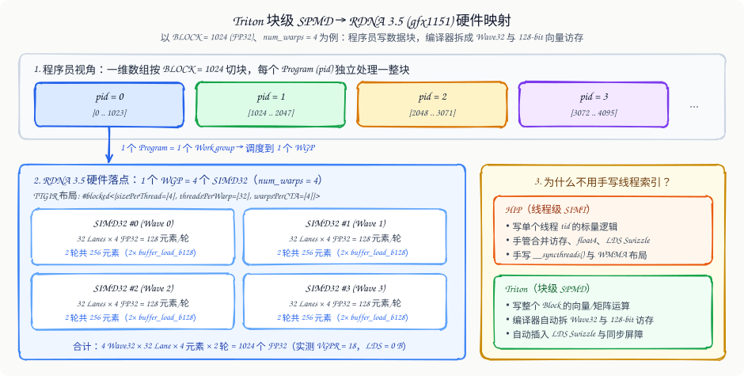
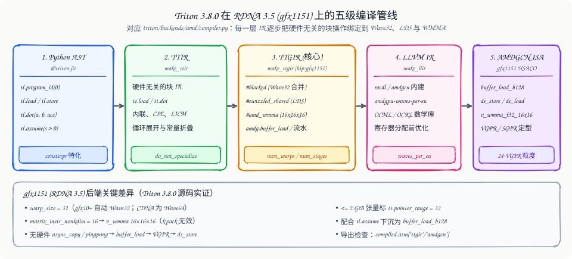

# Triton on ROCm（一）：从零理解块级编程与 RDNA 3.5 编译映射

在上一篇 [RDNA3.5 架构与 AMD GPU 基础](RDNA3.5架构与AMD%20GPU基础.md) 中，我们从 HIP 线程级视角一路拆解到 `gfx1151` 的 WGP、SIMD32、Wave32、LDS Bank Conflict 和 24-VGPR 分配悬崖。写手写 HIP 算子时，哪怕只是一个简单的矩阵乘或归约，程序员也必须亲自操心 128-bit 向量化合并访存、LDS XOR Swizzle、显式 `__syncthreads()` 同步以及 WMMA 寄存器的跨 Lane 排布。

**Triton** 把这层最容易出错的“线程内微观排布”交给了编译器：程序员只需用 Python 写出**单个 Program（对应硬件上的一个 Workgroup）如何搬运和计算一整块张量（Tile）**，由 Triton 编译器自动完成 Wave32 拆分、128-bit 向量访存、LDS 双缓冲与 RDNA 3.5 WMMA 指令生成。

本文围绕 **RDNA 3.5（`gfx1151`）** 从零建立 Triton 编程与 ROCm 后端编译心智模型；下篇 [Triton on ROCm（二）：深度剖析 AITER 的 `gemm_a16w16` 算子](Triton%20on%20ROCm（二）：深度剖析AITER的gemm_a16w16算子.md) 将沿着这套模型，逐行拆解 AMD 官方算子库 `ROCm/aiter` 中支持 `gfx1151` 的生产级矩阵乘算子。

??? info "实测平台与源码依据"

    本文所有可运行代码、IR/ISA 导出结果与性能数据均实测于 **AMD Ryzen AI MAX+ 395 / Radeon 8060S（`gfx1151`，20 WGP / 40 CU，LPDDR5X UMA，32 MiB Infinity Cache）**，软件栈为 **PyTorch 2.12.0+rocm10.1、HIP 7.15、Triton 3.8.0**；后端编译 Pass 核对自本地安装的 `triton/backends/amd/compiler.py`（Triton 3.8.0）。

!!! abstract "贯穿本文的两个递进例子"

    1. **一维向量加法 `add1d_kernel`（`BLOCK = 1024`，`num_warps = 4`）**：用来对齐 Triton Program 与 RDNA 3.5 WGP/SIMD32 的硬件映射，并亲眼验证 `TTGIR` 里的 `#blocked` 布局与 `buffer_load_b128` 汇编。
    2. **融合均方根归一化 `rmsnorm_kernel`（`4096 × 4096`，BF16）**：引入块级归约 `tl.sum`、`tl.rsqrt`、FP32 累加与算子融合，在 `gfx1151` UMA 带宽上实测相对 PyTorch Eager 获得 **9.5× 加速（223.8 GB/s）**。

---

## 1. 为什么需要 Triton：从线程级 SIMT 到块级 SPMD

HIP / CUDA 遵循 **线程级 SIMT（Single Instruction, Multiple Threads）**：你写的是一条线程（一个 Lane）要执行的标量逻辑，通过 `threadIdx.x` 算出自己要读的那一个元素。而 Triton 遵循 **块级 SPMD（Single Program, Multiple Data）**：你写的是一整个 **Program** 要执行的张量块逻辑——一个 Program 在 ROCm 硬件上对应 **1 个 Workgroup**，内部自动展开成 `num_warps` 条 **Wave32**（在 `gfx1151` 上），被派发到某一个 WGP 上执行。

[{ width="920" }](../../assets/rocm/triton-rdna35/triton-spmd-to-rdna35.svg)

| 维度 | HIP（线程级 SIMT） | Triton（块级 SPMD，RDNA 3.5） |
| --- | --- | --- |
| 代码抽象粒度 | 单个线程（Lane）的标量运算 | 单个 Workgroup（Program）的 1D/2D 块运算 |
| 网格与块索引 | `blockIdx.{x,y,z}` + `threadIdx.{x,y,z}` | 只有 `tl.program_id(axis)`，**不存在线程号** |
| 向量化与合并访存 | 手动强转 `float4` 并保证对齐 | 编译器按 `#blocked` 布局自动生成 `buffer_load_b128` |
| LDS 分配与 Bank Conflict | 手写 `__shared__`、Padding 或 XOR Swizzle | 编译器自动插入 `#swizzled_shared` 与 `ds_store/ds_load` |
| Workgroup 内同步 | 手写 `__syncthreads()` 与归约树 | `tl.sum` / `tl.dot` 由编译器自动插入 `s_barrier` 与 `ds_bpermute` |
| 矩阵核心调用 | 手写 WMMA intrinsic 与跨 Lane 布局 | 一行 `tl.dot(a, b, acc=acc)` 自动下沉 `v_wmma_f32_16x16x16` |
| 程序员仍需主导的事 | 全部微观 + 宏观决策 | **切块大小（Tile）、Grid 调度顺序（L2 局部性）、算子融合、Split-K 与调参** |

!!! note "先建立最核心的边界感：Triton 解放的是“块内”，不是“块间”"

    在 Triton 里你完全不用写 `threadIdx.x`、也不用手动做 LDS Bank Padding，但 **Program 之间如何切分矩阵、按什么顺序发射（L2/MALL 命中率）、何时切 K 维填满 20 个 WGP、如何避免 VGPR 溢出** 依然完全取决于你的算法设计和元参数选择。这也是下篇剖析 AITER `gemm_a16w16` 的核心焦点。

---

## 2. 第一个可运行 Triton Kernel：逐行拆解核心原语

我们从最简单的一维向量加法 `out = x + y` 开始，把 Triton 最核心的 6 个语法原语一次对齐：

```python
import torch
import triton
import triton.language as tl

@triton.jit
def add1d_kernel(x_ptr, y_ptr, out_ptr, n, BLOCK: tl.constexpr):
    # 1. 当前 Program 在 Grid 第 0 维的编号（等价于 HIP 的 blockIdx.x）
    pid = tl.program_id(0)
    tl.assume(pid >= 0)

    # 2. 生成长度为 BLOCK 的连续偏移向量 [0, 1, ..., BLOCK - 1]
    offs = pid * BLOCK + tl.arange(0, BLOCK)

    # 3. 尾部越界掩码（类似 HIP 的 if (i < n)，但以布尔向量作用于整块）
    mask = offs < n

    # 4. 块级加载与存储：指针 + 偏移向量 = 指针向量
    x = tl.load(x_ptr + offs, mask=mask, other=0.0)
    y = tl.load(y_ptr + offs, mask=mask, other=0.0)
    tl.store(out_ptr + offs, x + y, mask=mask)

def add1d(x: torch.Tensor, y: torch.Tensor) -> torch.Tensor:
    out = torch.empty_like(x)
    n = x.numel()
    # 5. Grid 定义为返回元组的函数，triton.cdiv(n, BLOCK) 即向上取整除法
    grid = lambda meta: (triton.cdiv(n, meta["BLOCK"]),)
    # 6. 通过方括号 [grid] 发射，并传入编译期常量与 ROCm 调度参数
    add1d_kernel[grid](x, y, out, n, BLOCK=1024, num_warps=4)
    return out
```

把上面 15 行里的关键细节拆开看，每一项背后都有直接的硬件/编译器原因：

1. **为什么 `BLOCK` 必须标注 `tl.constexpr`，且大小必须是 2 的幂？**
   Triton 的每个张量块在编译期都必须有**静态确定的形状**，编译器才能在 `TTGIR` 阶段精确算出每个 Lane 分摊多少个元素、需要多少个 VGPR，以及用移位/掩码实现布局映射。标注 `tl.constexpr` 后，编译器会把 `BLOCK=1024` 折叠为常量并针对该值特化生成一份独立机器码；非 2 的幂会在 `tl.arange(0, BLOCK)` 直接报错。
2. **指针算术的本质是“基址标量 + 偏移张量”**
   传入 `x_ptr` 时，PyTorch 的 `torch.Tensor` 会被 Triton 运行时自动提取为指向其首元素的设备指针。一维场景下 `x_ptr + offs` 得到形状为 `(BLOCK,)` 的指针张量；二维矩阵场景下则利用 NumPy 风格的广播拼出 `(BM, BN)` 的 2D 指针网格：

    ```python
    offs_m = pid_m * BM + tl.arange(0, BM)          # 形状 (BM,)
    offs_n = pid_n * BN + tl.arange(0, BN)          # 形状 (BN,)
    ptrs = a_ptr + offs_m[:, None] * stride_am + offs_n[None, :] * stride_an
    mask = (offs_m[:, None] < M) & (offs_n[None, :] < N)
    ```

    这种显式传 `stride_am`、`stride_an` 的写法极其灵活——**转置一个矩阵只需交换两个 stride，无需任何显存拷贝**（下篇 AITER `gemm_a16w16` 的 `w = w.T` 正是靠这一点做到零拷贝转置）。
3. **`mask` 与 `other` 的分工**
   当数组长度 `n` 不能被 `BLOCK` 整除时，最后一个 Program 会有部分偏移越界。`mask=offs < n` 会禁止越界位置发起实际内存读写；`other=0.0` 则指定被屏蔽位置的填充值——在做纯逐元素写回（`tl.store(..., mask=mask)`）时 `other` 不会被写出，但在做 `tl.sum` 归约或 `tl.dot` 矩阵乘时，**必须设 `other=0.0`**（做 `tl.max` 时设 `other=-float("inf")`），否则越界槽位的未定义垃圾值会直接污染归约结果！

!!! example "实证：上面 15 行 `add1d_kernel` 在 `gfx1151` 上到底编译出了什么？"

    在本机 Radeon 8060S（`gfx1151`，Triton 3.8.0）上以 `BLOCK=1024, num_warps=4`（FP32）运行后，直接读取返回对象 `compiled.asm["ttgir"]` 与 `compiled.asm["amdgcn"]`，能看到非常干净的硬件映射：

    ```mlir
    #blocked = #ttg.blocked<{sizePerThread = [4], threadsPerWarp = [32], warpsPerCTA = [4], order = [0]}>
    module attributes {"ttg.num-ctas" = 1 : i32, "ttg.num-warps" = 4 : i32,
                       ttg.target = "hip:gfx1151", "ttg.threads-per-warp" = 32 : i32} {
      ...
      %x = amdg.buffer_load %x_ptr[%offs_2], %mask_3 {contiguity = 4 : i32} : tensor<1024xf32, #blocked>
      %y = amdg.buffer_load %y_ptr[%offs_2], %mask_3 {contiguity = 4 : i32} : tensor<1024xf32, #blocked>
      %0 = arith.addf %x, %y : tensor<1024xf32, #blocked>
      amdg.buffer_store %0, %out_ptr[%offs_2], %mask_3 {contiguity = 4 : i32} : tensor<1024xf32, #blocked>
    }
    ```

    把 `#blocked` 里的三个数字乘起来，账目严丝合缝闭合：

    - `warpsPerCTA = [4]` × `threadsPerWarp = [32]` = **128 个线程**（恰好占满 1 个 WGP 的 4 个 SIMD32）；
    - `sizePerThread = [4]`：每条 Lane 单次连续吞吐 4 个 `float` = **16 B（128-bit）**，对应汇编中真实的 `buffer_load_b128 v[0:3], v16, s[0:3], 0 offen`；
    - 一轮覆盖 `128 × 4 = 512` 个元素，因此 `BLOCK = 1024` 恰好只需 **2 轮**（共 4 条 `buffer_load_b128` 读 `x/y`，2 条 `buffer_store_b128` 写 `out`）；
    - 最终资源报告：`wavefront_size = 32`，**`VGPR = 18`**（按 24 粒度对齐至 24 → 16 Wave/SIMD = 100% Occupancy），`SGPR = 14`，`LDS = 0 B`，`vgpr_spill = 0`。

---

## 3. ROCm / RDNA 3.5 编译管线与后端专属参数

理解 Triton 在 AMD GPU 上的性能表现，关键是看懂它的**五级编译管线**——你在 Python 里传进去的 `num_warps`、`num_stages`、`waves_per_eu`、`matrix_instr_nonkdim`，各自究竟在哪一层生效？

[{ width="940" }](../../assets/rocm/triton-rdna35/triton-compile-pipeline-rdna35.svg)

### 3.1 五级管线与 `gfx1151` 后端源码实证

核对本机 Triton 3.8.0 的 `triton/backends/amd/compiler.py`，一个 Kernel 从 Python 到 `gfx1151` 二进制（`.hsaco`）依次经过：

1. **Python AST → TTIR（`make_ttir`）**：此时完全**硬件无关**，所有操作仍是抽象的块级 IR（`tt.load`、`tt.dot`、`tt.reduce`），执行内联、公共子表达式消除（CSE）、循环不变量外提（LICM）和常量折叠。
2. **TTIR → TTGIR（`make_ttgir`，最核心的一层）**：绑定到目标 `hip:gfx1151`，自动确定 `warp_size` 并赋予每个张量具体的硬件布局：
   - **自动选择 Wave32**：`HIPOptions.__post_init__` 按架构大版本号决定 Wave 宽度——`gfx_major >= 10`（所有 RDNA，含 `gfx1151`）自动设 `warp_size = 32`，而 CDNA（`gfx942`/`gfx950`）设 `warp_size = 64`。
   - **矩阵指令加速（`add_accelerate_matmul`）**：把 `tt.dot` 转换为 `#ttg.amd_wmma<{version = 1, ...}>` 布局，对应 RDNA 3/3.5 的 `v_wmma_f32_16x16x16_{f16,bf16}`，并在需要共享内存暂存时自动插入 `#ttg.swizzled_shared` 消除 LDS 32-Bank 冲突。
   - **软件流水线（`add_schedule_loops` + `add_pipeline`）**：`compiler.py` 中 `is_async_copy_enabled("gfx1151")` 与 `is_pingpong_schedule_enabled("gfx1151")` 均为 `False`（这两项硬件特性分别面向 `gfx950/gfx1250` 和 `gfx942/gfx950`）。因此在 `gfx1151` 上，`num_stages = 2` 走的是经典的**寄存器预取 + LDS 双缓冲**（`buffer_load_b128` → VGPR → `ds_store` → `ds_load` → `v_wmma`），且启用了 `is_in_thread_transpose_enabled("gfx1151") = True`。
   - **Buffer Ops 转换（`add_convert_to_buffer_ops`）**：AMD GPU 的 `buffer_load` / `buffer_store` 指令使用 128-bit 标量资源描述符（SRD，`s[0:3]`）加 32-bit 偏移，比通用的 64-bit `global_load` 节省每个 Lane 的地址 VGPR，并自带硬件越界清零能力。当张量存储 `<= 2 GiB - 1` 时，`HIPBackend.get_tensor_specialization` 会自动给指针打上 `tt.pointer_range = 32` 标记，让后端将其下沉为 `amdg.buffer_load`。
3. **TTGIR → LLVM IR（`make_llir`）**：把布局化的向量操作展开为 `rocdl` / `amdgcn` 内建函数，链接 AMD 数学库 `ocml.bc` / `ockl.bc`，并把 `waves_per_eu` 写入 LLVM 函数属性 `amdgpu-waves-per-eu`。
4. **LLVM IR → AMDGCN ISA（`make_amdgcn`）→ HSACO（`make_hsaco`）**：由 LLVM AMDGPU 后端完成指令调度、寄存器分配（受 `gfx1151` 24-VGPR 粒度和单 Wave 256-VGPR 硬上限约束）与二进制打包。

!!! tip "零工具依赖的调试技巧：三行 Python 直接查看 TTIR / TTGIR / AMDGCN 汇编"

    调用任意 `@triton.jit` Kernel 时，它会返回 `CompiledKernel` 对象，直接访问 `.asm` 和 `.metadata` 就能核实编译器到底生成了什么，无需额外抓包：

    ```python
    compiled = my_kernel[grid](x, y, out, n, BLOCK=1024, num_warps=4)
    print("Dynamic LDS (bytes):", compiled.metadata.shared)
    print(compiled.asm["ttgir"])    # 检查 #blocked / #swizzled_shared / #amd_wmma / amdg.buffer_load
    print(compiled.asm["amdgcn"])   # 检查 .vgpr_count / .vgpr_spill_count / buffer_load_b128 / v_wmma_*
    ```

    你也可以在命令行设置 `TRITON_PRINT_AUTOTUNING=1` 观察自动调优挑选结果，或设置 `MLIR_ENABLE_DUMP=1` 追踪每一个 Pass 对 IR 的改写。

### 3.2 `tl.assume` 到底有什么用？

阅读 `ROCm/aiter` 等工业级 ROCm Triton 源码时，几乎每个 Kernel 开头都会看到一排：

```python
tl.assume(stride_am > 0)
tl.assume(pid_m >= 0)
```

这并不是防御性断言（它在 GPU 运行期**不产生任何检查指令**），而是写给编译器后端的静态证明提示（在 TTGIR 中表现为 `llvm.intr.assume`）：

- AMD 的 `buffer_load` / `buffer_store` 要求偏移量**非负且不发生 32-bit 有符号回绕**；
- 在较早版本的 Triton、大于 2 GiB 的张量、或者经过 `do_not_specialize` 与 `int64` / 取模运算的复杂偏移场景中，静态值域分析可能无法证明 `pid * stride >= 0`，被迫退化为 64-bit `global_load`，多占 VGPR；
- 即使在 Triton 3.8.0 已对 `<= 2 GiB` 张量默认开启 `buffer_ops_analyze_small_tensor_range` 的今天，显式写出 `tl.assume(stride > 0)` 和 `tl.assume(pid >= 0)` 依然是零成本且跨版本稳妥的好习惯（例如 AITER 的 `_gemm_splitk_reduce_kernel` 明确注释就是为了保证降低到 buffer ops）。

### 3.3 RDNA 3.5（`gfx1151`）vs CDNA（`gfx942/950`）编译参数对照

很多网上的 ROCm Triton 教程默认以数据中心卡 **MI300X（`gfx942`，CDNA3）** 或 **MI350（`gfx950`，CDNA4）** 为例，把它们的参数直接照搬到 RDNA 3.5（`gfx1151`）上往往会踩坑。下表把每个常用参数的 RDNA 3.5 语义与陷阱一次列清：

| 参数 / 机制 | RDNA 3.5（`gfx1151`，Radeon 8060S） | CDNA3 / CDNA4（`gfx942` / `gfx950`） | 调参要点与常见误区 |
| --- | --- | --- | --- |
| `warp_size`（自动） | **Wave32（32 线程）** | Wave64（64 线程） | 同样的 `num_warps=4`，在 `gfx1151` 上是 128 线程，在 MI300X 上是 256 线程 |
| `num_warps` | 常用 **2、4、8** | 常用 4、8 | `gfx1151` 单 WGP 恰好有 **4 个 SIMD32**，`num_warps=4` 正好每个 SIMD32 领 1 条 Wave |
| `num_stages` | 常用 **1 或 2**（无硬件 async copy） | 2～4（`gfx950` 支持 async copy） | `num_stages` 越高 LDS 占用与 VGPR 压力越陡；单 Workgroup LDS 硬上限 64 KiB |
| `waves_per_eu` | 对应每个 SIMD32 的目标最小 Wave 数（常用 **0、1、2**） | 常用 0、1、2、4 | 设得过高会强压编译器削减 VGPR 预算，反而引发严重 Scratch Spill；大 GEMM 常用 `1` |
| `matrix_instr_nonkdim` | **固定 `16`**（WMMA `16×16×16`） | `16` 或 `32`（MFMA `16×16` / `32×32`） | RDNA 3/3.5 没有 32×32 矩阵指令，传 32 不会带来更高吞吐 |
| `kpack` | **无效果** | 仅 `gfx942` 有效（`gfx950` 已废弃） | 遵循 AITER 规范：不要在 RDNA 配置里折腾 `kpack` |
| 硬件 FP8 / FP4 矩阵乘 | **无原生指令**（Triton 软件转 FP16/BF16 再走 WMMA） | `gfx942` 原生 FP8；`gfx950` 原生 FP8/FP4 | `gfx1151` 上主战计算精度是 **BF16 / FP16** |
| `NUM_XCDS`（Chiplet） | **1**（单 XCD，20 WGP 共享 2 MiB L2 + 32 MiB MALL） | 8（多 XCD，各自独立 L2 Slice） | 切忌误用 MI300X 的 `NUM_XCDS=8` 重映射（下篇实测可致性能暴跌 42%！） |

!!! warning "RDNA 3.5 的两大硬件“红线”：256-VGPR 上限与 64 KiB 单块 LDS"

    1. 在 `gfx1151` 上，单条 Wave32 最多使用 **256 个 VGPR**（且按 24 个粒度分配：96→16 Wave/SIMD，97→12 Wave/SIMD）。如果 `BLOCK_M × BLOCK_N` 过大而 `num_warps` 偏小，每个线程背的 FP32 累加器超过 256 VGPR，就会立刻出现 `.vgpr_spill_count > 0`，性能断崖式下滑。
    2. 虽然单个 WGP 共有 128 KiB LDS，但**单个 Workgroup（Program）最多只能申请 64 KiB LDS**，且如果一个 Program 就吃掉 48–64 KiB，同一个 WGP 上能驻留的 Workgroup 数量就会骤降。

---

## 4. 进阶实战：20 行写出 9.5× 加速的 Fused RMSNorm

理解了基础原语和编译管线后，我们来看 Triton 在 LLM 推理中最经典的一类高收益场景：**访存受限（Memory-Bound）算子融合**。

以 Transformer 中每层都要跑两次的 **RMSNorm** 为例，给定输入 $X \in \mathbb{R}^{M \times N}$、缩放权重 $w \in \mathbb{R}^N$ 与平滑项 $\varepsilon$，对每一行 $x \in \mathbb{R}^N$ 计算：

$$
y_j = \frac{x_j}{\sqrt{\frac{1}{N}\sum_{k=0}^{N-1} x_k^2 + \varepsilon}} \cdot w_j
$$

如果用 PyTorch Eager 写成 `xf = x.float(); (xf * torch.rsqrt(xf.pow(2).mean(-1, keepdim=True) + eps)).to(x.dtype) * w`，PyTorch 会依次启动 `cast`、`pow`、`mean`、`add`、`rsqrt`、`mul`、`cast`、`mul` 多个独立 Kernel——每两个 Kernel 之间都要把整张 `(M, N)` 中间张量写回 LPDDR5X UMA 再重新读回来。在带宽约 256 GB/s 的 `gfx1151` APU 上，这几乎把全部时间都浪费在了无谓的往返搬运上。

而用 Triton 把整行规约和逐元素缩放融进**一个 Kernel**，每个 Program 负责一行，只需要把 `x` 从显存读进来 **1 次**，在片上 VGPR 里算完平方和、求 `tl.rsqrt`、乘权重 `w`，再把 `y` 写回 **1 次**：

```python
import torch
import triton
import triton.language as tl

@triton.jit
def rmsnorm_kernel(x_ptr, w_ptr, y_ptr, stride_x, stride_y, N, eps, BLOCK_N: tl.constexpr):
    row = tl.program_id(0)
    tl.assume(row >= 0)
    tl.assume(stride_x > 0)
    tl.assume(stride_y > 0)

    cols = tl.arange(0, BLOCK_N)
    mask = cols < N

    # 读入 BF16 后升到 FP32 累加，防止大隐藏维平方和溢出或精度损失
    x = tl.load(x_ptr + row * stride_x + cols, mask=mask, other=0.0).to(tl.float32)
    w = tl.load(w_ptr + cols, mask=mask, other=0.0).to(tl.float32)

    # 块级归约：编译器自动生成 Wave 内归约 + 跨 Wave LDS/bpermute 汇总
    mean_sq = tl.sum(x * x, axis=0) / N
    rstd = tl.rsqrt(mean_sq + eps)
    y = (x * rstd) * w

    tl.store(y_ptr + row * stride_y + cols, y.to(y_ptr.dtype.element_ty), mask=mask)
```

### 4.1 本机 `gfx1151` 实测数据与编译解析

在 Radeon 8060S（`gfx1151`，ROCm / Triton 3.8.0）上测试 LLM 常见隐藏维 `M = 4096, N = 4096`（BF16，单次读 `x` + 读 `w` + 写 `y` 的最小理论访存量 `≈ 67.1 MB`）：

| 实现方式 | 单次耗时（ms） | 有效带宽（GB/s） | 相对 Eager 加速比 | 编译资源（`gfx1151`） |
| --- | --- | --- | --- | --- |
| PyTorch Eager（多 Kernel 拆分） | `2.856` | `23.5` | `1.00×` | 多次中间张量往返内存 |
| Triton `rmsnorm_kernel`（`num_warps=4`） | `0.307` | `218.3` | **`9.29×`** | `VGPR=69, SGPR=20, LDS=0 B, spill=0` |
| Triton `rmsnorm_kernel`（`num_warps=8`） | **`0.300`** | **`223.8`** | **`9.52×`** | 8 条 `buffer_load_b128` + 4 条 `buffer_store_b128` |

??? note "为什么上面 `rmsnorm_kernel` 实测 `LDS = 0 B` 却出现了 2 条 `ds_*` 指令？"

    `N = 4096` 在 `num_warps = 4` 下每条 Lane 持有 `4096 / 128 = 32` 个元素。`tl.sum(x * x, axis=0)` 先在每条 Lane 寄存器内串行累加这 32 个数，再在 Wave32 内通过 `ds_bpermute` / `v_permlane` 归约到 Lane 0，最后 4 条 Wave 只需通过极小的静态片上同步/汇总完成跨 Wave 求和——不需要分配整行大小的动态 LDS 数组，因此 `metadata.shared = 0`，同时 `VGPR = 69 <= 96` 保持在 100% 满驻留区间，把 Strix Halo 256-bit LPDDR5X 的实际可用带宽几乎吃到了极限。

!!! question "如果单行宽度 `N` 特别大（比如 `N = 65536` 词表级），放不进一个 `BLOCK_N` 怎么办？"

    上面的一趟式写法要求整行放进寄存器（`BLOCK_N = next_power_of_2(N)`）。当 `N` 超过单个 Program 的寄存器上限（例如超过 16384～32768 个元素）时，必须退回到 **两趟分块循环（Blocked / Multi-pass）**：第一趟按 `BLOCK_SIZE` 分块沿列循环累加 `sum_squares`，算完 `rstd` 后第二趟再分块读入归一化并写回。`ROCm/aiter` 的 `aiter/ops/triton/_triton_kernels/normalization/rmsnorm.py` 正是通过 `USE_BLOCKED: tl.constexpr` 在同一份 Kernel 中同时支持这两种路径。

---

## 5. 从“能跑”到“生产级”的三个关键装饰器

写完正确且快的单版本 Kernel 后，面对真实推理服务中千变万化的输入形状（动态 Batch Size `M`、不同隐藏维 `N`），Triton 提供了三件工程武器——下篇读 AITER 源码时每一件都会立刻用到：

1. **`@triton.heuristics`：编译期裁剪边界分支**
   在进入 Kernel 前，根据运行时参数算出布尔型 `tl.constexpr`（例如 `EVEN_K: lambda args: args["K"] % args["BLOCK_SIZE_K"] == 0`）。当 `K` 整除分块大小时，编译器直接把 `if EVEN_K:` 外的 `mask` 掩码计算和分支死代码消除（DCE），让最内层 K 循环变成彻底无分支的纯访存 + WMMA 流水线。
2. **`do_not_specialize`：防止动态形状引发 JIT 重编译风暴**
   默认情况下，Triton 会把所有整型标量参数按“是否等于 1、是否被 16 整除”进行特化编译。在 LLM 推理中，Token 数 `M` 每一拍都在变化（1、3、7、19、128……），如果不加限制，每遇到一个新对齐特征的 `M` 就会触发重编译。在 `@triton.jit(do_not_specialize=["M", "N"])` 中声明不特化 `M` 和 `N`，就能让所有 batch size 复用同一份 HSACO 机器码。
3. **`@triton.autotune` vs 静态 JSON 配置表**
   开发探索阶段可以用 `@triton.autotune(configs=[...], key=["M", "N", "K"])` 让 Triton 在首次调用时自动实测所有候选 `BLOCK_SIZE / num_warps / num_stages / waves_per_eu` 组合并缓存最快者；但在线上推理服务中，首次请求现场跑几十个配置会造成秒级冷启动卡顿。因此像 `ROCm/aiter` 这样的生产库会**离线跑完调优，把最优参数固化到按架构分目录的 JSON 文件**（例如 `configs/gfx1151/triton/gemm/gemm_a16w16/DEFAULT.json`），上线后只做微秒级查表分发。

!!! tip "本篇小结与衔接"

    到这里，你已经掌握了 ROCm / RDNA 3.5 上写好 Triton 的全部地基：块级 SPMD 心智模型、`tl.program_id` / `tl.arange` / `tl.load` / `tl.sum` / `tl.assume` 原语、五级编译管线与 `compiled.asm` 检查方法，以及 `gfx1151` 上 `Wave32`、`WMMA 16×16×16`、`24-VGPR 粒度`、`64 KiB 单块 LDS` 的硬约束。

    接下来在 [Triton on ROCm（二）：深度剖析 AITER 的 `gemm_a16w16` 算子](Triton%20on%20ROCm（二）：深度剖析AITER的gemm_a16w16算子.md) 中，我们将打开 `ROCm/aiter` 源码，看工业级 FP16/BF16 矩阵乘如何把这些基础组件组装成兼顾小 M、大 M、L2 复用、Split-K 与 Epilogue 融合的完整算子，并在 `gfx1151` 上亲自用实测数据挖出两个真实的调优洞察。
