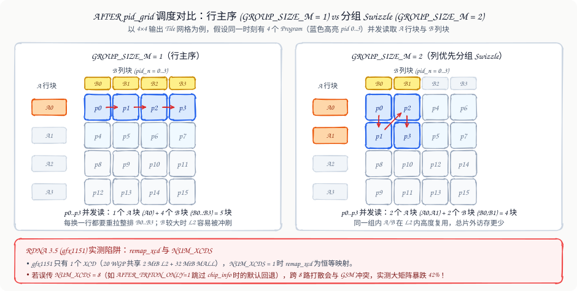
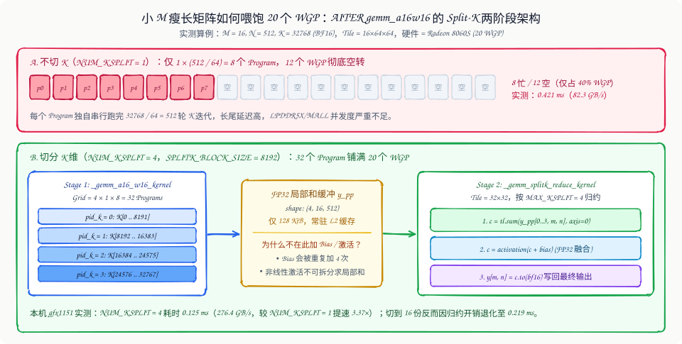

# Triton on ROCm（二）：深度剖析 AITER 的 `gemm_a16w16` 算子

在 [上篇](Triton%20on%20ROCm（一）：从零理解块级编程与RDNA3.5编译映射.md) 中，我们从零建立了 Triton 的块级 SPMD 模型与 RDNA 3.5（`gfx1151`）五级编译管线。但写一个能跑通的 `tl.dot` 教学版矩阵乘只需 30 行代码，离真实 LLM 推理框架里扛住各种 `M / N / K` 形状的生产算子还有很长一段距离：

- 推理 Decode 时 `M = 16`、Prefill 时 `M = 2048`，**同一套 Tile 参数能通吃吗？**
- 几百个输出分块同时发射时，**按什么顺序调度才能不把 L2 和 32 MiB Infinity Cache 冲刷光？**
- 瘦长矩阵（如 `M = 16, N = 512, K = 32768`）只拆出 8 个输出分块，**连 Radeon 8060S 的 20 个 WGP 都填不满一半，怎么办？**
- 加上 Bias 和 SiLU/GELU 激活函数、面对非整除形状和 `torch.compile` 捕图时，**怎样做到不写重复代码、不触发重编译风暴？**

AMD 官方开源算子库 **`ROCm/aiter`** 中的 **`gemm_a16w16`**（16-bit Activation × 16-bit Weight，即 FP16/BF16 GEMM，且在仓库中内置了完整的 **`gfx1151` 专属调优配置**）正是回答这些问题的绝佳标本。本文逐层拆解它的完整源码，并在本机 `gfx1151` 上用真实 TTGIR、AMDGCN 汇编与实测耗时验证每一项设计——顺带展示两个直接影响性能 23%～46% 的真实硬件发现。

??? info "源码版本与实测平台"

    - **AITER 源码基线**：`ROCm/aiter` [`v0.1.30-72-gda016c085`（commit `da016c08`）](https://github.com/ROCm/aiter/tree/da016c0851c6ff255c72d0111e0f34fb4e2a89f8)，下文所有源码链接与行号均锚定至该提交。
    - **实测硬件与软件**：**AMD Radeon 8060S（`gfx1151`，20 WGP / 40 CU，1 XCD，2 MiB L2，32 MiB MALL，LPDDR5X UMA）**，PyTorch 2.12.0+rocm10.1、Triton 3.8.0。

---

## 1. 整体架构与一次 `gemm_a16w16` 调用链

在 AITER 中，一个生产级 Triton 算子并不会把所有代码塞进单个文件，而是清晰地拆成 **入口路由、静态配置表、核心 Kernel、公共调度原语** 四层：

| 层级 | 文件路径（锚定 `da016c08`） | 职责 |
| --- | --- | --- |
| Python 入口与路由 | [`gemm/basic/gemm_a16w16.py`](https://github.com/ROCm/aiter/blob/da016c0851c6ff255c72d0111e0f34fb4e2a89f8/aiter/ops/triton/gemm/basic/gemm_a16w16.py#L78) | 参数校验、`torch.compile` FakeTensor 护栏、backend 选择（`gfx1250` 走 Gluon，其余含 `gfx1151` 走 Triton）、`w = w.T` 零拷贝转置与两阶段发射 |
| 架构专属配置表 | [`configs/gfx1151/triton/gemm/gemm_a16w16/DEFAULT.json`](https://github.com/ROCm/aiter/blob/da016c0851c6ff255c72d0111e0f34fb4e2a89f8/aiter/ops/triton/configs/gfx1151/triton/gemm/gemm_a16w16/DEFAULT.json) | 按 `M_LEQ_*` 桶固化 `gfx1151` 的 Tile、`num_warps`、`num_stages`、`waves_per_eu`、`matrix_instr_nonkdim` 与 `NUM_KSPLIT` |
| 配置装载与 Split-K 计算 | [`utils/gemm_config_utils.py`](https://github.com/ROCm/aiter/blob/da016c0851c6ff255c72d0111e0f34fb4e2a89f8/aiter/ops/triton/utils/gemm_config_utils.py#L140) | 按架构/CU 树查找特化文件或 `DEFAULT.json`，并通过 [`compute_splitk_params`](https://github.com/ROCm/aiter/blob/da016c0851c6ff255c72d0111e0f34fb4e2a89f8/aiter/ops/triton/utils/gemm_config_utils.py#L213) 对齐 `SPLITK_BLOCK_SIZE` |
| 核心计算 Kernel | [`_triton_kernels/gemm/basic/gemm_a16w16.py`](https://github.com/ROCm/aiter/blob/da016c0851c6ff255c72d0111e0f34fb4e2a89f8/aiter/ops/triton/_triton_kernels/gemm/basic/gemm_a16w16.py#L46) | `_gemm_a16_w16_kernel`：实现 XCD 重映射、L2 Swizzle、K 维 WMMA 主循环与 Epilogue 融合 |
| 公共调度与归约原语 | [`common/pid_preprocessing.py`](https://github.com/ROCm/aiter/blob/da016c0851c6ff255c72d0111e0f34fb4e2a89f8/aiter/ops/triton/_triton_kernels/common/pid_preprocessing.py#L27)、[`common/splitk_reduce.py`](https://github.com/ROCm/aiter/blob/da016c0851c6ff255c72d0111e0f34fb4e2a89f8/aiter/ops/triton/_triton_kernels/common/splitk_reduce.py#L22) | `remap_xcd`、`pid_grid`、`_gemm_splitk_reduce_kernel`，供全库所有 GEMM 复用 |

沿着 [`gemm_a16w16`](https://github.com/ROCm/aiter/blob/da016c0851c6ff255c72d0111e0f34fb4e2a89f8/aiter/ops/triton/gemm/basic/gemm_a16w16.py#L706) → [`gemm_a16w16_`](https://github.com/ROCm/aiter/blob/da016c0851c6ff255c72d0111e0f34fb4e2a89f8/aiter/ops/triton/gemm/basic/gemm_a16w16.py#L78) → [`_gemm_a16w16_native`](https://github.com/ROCm/aiter/blob/da016c0851c6ff255c72d0111e0f34fb4e2a89f8/aiter/ops/triton/gemm/basic/gemm_a16w16.py#L203) 往下看，有三个非常值得学习的工程细节：

1. **输入约定是线性层友好的 `Y = X @ W^T`**
   激活 `x` 形状为 `(M, K)`，权重 `w` 形状为 `(N, K)`（与 `torch.nn.Linear` 权重完全一致）。在发射 Triton Kernel 前，[`gemm_a16w16.py#L626`](https://github.com/ROCm/aiter/blob/da016c0851c6ff255c72d0111e0f34fb4e2a89f8/aiter/ops/triton/gemm/basic/gemm_a16w16.py#L626) 只做了一句 **`w = w.T`**——这只交换了 PyTorch 张量的元数据 `(stride_bk, stride_bn) = (1, K)`，**零显存拷贝**！并且转置后 `w_t` 在内存里依然是**沿 K 维连续**（`stride_bk = 1`），这让后文 K 维加载 `B` 分块时也能吃满 `buffer_load_b128` 合并访存。
2. **无缝接入 `torch.compile` 的自定义算子封装**
   `gemm_a16w16_` 外层套了 `@torch_compile_guard(gen_fake=gemm_a16w16_fake_tensor)`，在 PyTorch Dynamo 构图时提供精确的输出形状与 dtype 推导（包括 `skip_reduce=True` 且 `NUM_KSPLIT > 1` 时返回 `(NUM_KSPLIT, M, N)` FP32 局部和），避免图断裂（Graph Break）。
3. **非阻塞的 1D 统一发射网格**
   无论是否开启 Split-K，Stage 1 始终只用一维 Grid：

    ```python
    grid = lambda META: (
        META["NUM_KSPLIT"]
        * triton.cdiv(M, META["BLOCK_SIZE_M"])
        * triton.cdiv(N, META["BLOCK_SIZE_N"]),
    )
    ```

    把 `(pid_m, pid_n, pid_k)` 全部压成单一的 1D `pid_unified`，目的就是让 Kernel 内部可以自由控制重排顺序（`remap_xcd` 与 `pid_grid`），而不受硬件固定三维派发顺序的束缚。

---

## 2. 解读 `gfx1151` 专属调优配置表与真实编译资源

打开 [`configs/gfx1151/triton/gemm/gemm_a16w16/DEFAULT.json`](https://github.com/ROCm/aiter/blob/da016c0851c6ff255c72d0111e0f34fb4e2a89f8/aiter/ops/triton/configs/gfx1151/triton/gemm/gemm_a16w16/DEFAULT.json)，AITER 为 RDNA 3.5（`gfx1151`）按批量大小 `M` 划分了 4 个桶：

```json
{
  "M_LEQ_64":   {"BLOCK_SIZE_M": 32,  "BLOCK_SIZE_N": 16,  "BLOCK_SIZE_K": 256, "GROUP_SIZE_M": 1, "num_warps": 2, "num_stages": 2, "waves_per_eu": 1, "matrix_instr_nonkdim": 16, "NUM_KSPLIT": 1},
  "M_LEQ_256":  {"BLOCK_SIZE_M": 64,  "BLOCK_SIZE_N": 64,  "BLOCK_SIZE_K": 128, "GROUP_SIZE_M": 1, "num_warps": 4, "num_stages": 2, "waves_per_eu": 1, "matrix_instr_nonkdim": 16, "NUM_KSPLIT": 1},
  "M_LEQ_1024": {"BLOCK_SIZE_M": 128, "BLOCK_SIZE_N": 64,  "BLOCK_SIZE_K": 64,  "GROUP_SIZE_M": 1, "num_warps": 4, "num_stages": 2, "waves_per_eu": 1, "matrix_instr_nonkdim": 16, "NUM_KSPLIT": 1},
  "any":        {"BLOCK_SIZE_M": 128, "BLOCK_SIZE_N": 128, "BLOCK_SIZE_K": 64,  "GROUP_SIZE_M": 1, "num_warps": 4, "num_stages": 2, "waves_per_eu": 1, "matrix_instr_nonkdim": 16, "NUM_KSPLIT": 1}
}
```

配置背后的硬件权衡一目了然：

- **小 `M`（`M ≤ 64`，Decode / 小批推理）**：选细长小输出块 `32×16` + 极长 `BLOCK_SIZE_K = 256` + `num_warps = 2`。因为 `M` 很小，输出块切细才能在 `N` 维拉出足够多的 Program（例如 `N=4096` 时拉出 `2 × 256 = 512` 个 Program）填满 20 个 WGP；同时把 `K` 拉长到 256 减少循环次数与 LDS 同步频次。
- **中大 `M`（`M > 64`，Prefill / 训练）**：逐步把 `(BM, BN)` 放大到 `64×64`、`128×64`、`128×128`，同时把 `num_warps` 升到 `4`（正好覆盖 1 个 WGP 的 4 个 SIMD32），提高每个输出块的计算访存比（Arithmetic Intensity = $\frac{2 \cdot BM \cdot BN}{2 \cdot (BM + BN)} = \frac{BM \cdot BN}{BM + BN}$ FLOPs/Byte）。

### 本机 `gfx1151` 实测编译资源：揪出 `"any"` 桶的 VGPR 溢出！

纸上推演完，立刻在本机 Radeon 8060S（`gfx1151`，`N=4096, K=4096`，BF16）上编译这 4 个配置并导出真实汇编统计（`.vgpr_count`、`.vgpr_spill_count`、`metadata.shared` 与 `v_wmma` 计数）：

| 测试 `M`（命中桶） | Tile (`BM×BN×BK`) | `num_warps` | 动态 LDS | VGPR / SGPR | **VGPR Spill** | WMMA 指令数 | `gemm_a16w16` 实测 | `torch.matmul` 对照 |
| --- | --- | --- | --- | --- | --- | --- | --- | --- |
| `32`（`M_LEQ_64`） | `32×16×256` | `2` | `24 KiB` | `241 / 19` | `0` | `32` | `0.124 ms (17.28 TF)`（`M=64`） | `0.135 ms (15.93 TF)`（**反超 1.08×**） |
| `256`（`M_LEQ_256`） | `64×64×128` | `4` | `32 KiB` | `256 / 19` | `2` | `64` | `0.368 ms (23.37 TF)` | `0.321 ms (26.79 TF)` |
| `1024`（`M_LEQ_1024`） | `128×64×64` | `4` | `24 KiB` | `256 / 21` | **`0`** | `64` | `1.239 ms (27.72 TF)` | `1.047 ms (32.82 TF)` |
| `2048`（`any`） | `128×128×64` | `4` | `32 KiB` | `256 / 32` | **`34`** | `128` | **`3.715 ms (18.50 TF)`** | `2.023 ms (33.97 TF)` |

!!! warning "实测发现 #1：为什么 `M=2048` 吞吐反而比 `M=1024` 暴跌三分之一？"

    用我们在上篇学的知识一算就破案了：`M=2048` 命中 `"any"` 桶（`128×128×64, num_warps=4`），单个 Program 有 `4 × 32 = 128` 个线程，需要维护 `128 × 128 = 16,384` 个 FP32 累加器，**仅累加器就平均每线程吃掉 `16,384 / 128 = 128` 个 VGPR**；再叠加双缓冲预取的 A/B 片段与地址寄存器，直接撞破 `gfx1151` 单 Wave **256 VGPR 硬上限**，触发 **34 个 VGPR 溢出到 Scratch 内存**！

    把 `M=2048` 和 `M=4096` 换回零溢出的 **`128×64×64`（`spill = 0`）** 并使用正确的 `NUM_XCDS = 1` 后，本机实测吞吐立刻从 `18.50 / 24.11 TFLOPS` 飙升至 **`28.43 / 29.70 TFLOPS`**（最高提速 **+46%**！）。这说明 `DEFAULT.json` 只是起点，针对具体形状和当前 Triton 编译器版本检查 `vgpr_spill_count` 至关重要。

---

## 3. Program 调度与缓存局部性：`remap_xcd` 与 `pid_grid`

回到 [`_gemm_a16_w16_kernel`](https://github.com/ROCm/aiter/blob/da016c0851c6ff255c72d0111e0f34fb4e2a89f8/aiter/ops/triton/_triton_kernels/gemm/basic/gemm_a16w16.py#L87) 开头，拿到 1D 的 `pid_unified` 后，代码做了两步调度映射：

```python
pid_unified = tl.program_id(axis=0)
num_pid_m = tl.cdiv(M, BLOCK_SIZE_M)
num_pid_n = tl.cdiv(N, BLOCK_SIZE_N)

# 第一步：面向多 XCD Chiplet（如 MI300X 8 XCD）的跨 Die 重排
pid_unified = remap_xcd(
    pid_unified, num_pid_m * num_pid_n * NUM_KSPLIT, NUM_XCDS=NUM_XCDS
)
pid_k = pid_unified % NUM_KSPLIT
pid = pid_unified // NUM_KSPLIT

# 第二步：面向 L2 缓存复用的分组 Swizzle（仅 NUM_KSPLIT == 1 时启用）
if NUM_KSPLIT == 1:
    pid_m, pid_n = pid_grid(pid, num_pid_m, num_pid_n, GROUP_SIZE_M=GROUP_SIZE_M)
else:
    pid_m = pid // num_pid_n
    pid_n = pid % num_pid_n
```

### 3.1 `pid_grid` 如何用 `GROUP_SIZE_M` 提升 L2 复用？

假设输出矩阵 $C$ 切成 `4 × 4` 共 16 个分块，同一时刻 GPU 并发执行前 4 个 Program（`p0..p3`）：

- **行主序（`GROUP_SIZE_M = 1`）**：`p0..p3` 落在第 0 行的 `(0,0), (0,1), (0,2), (0,3)`，需要加载 **1 个 A 行块（`A0`）+ 4 个 B 列块（`B0..B3`）= 5 个输入块**。当矩阵很宽、`B0..B31` 放不进 L2 时，等下一行 `p32..p63` 再读 `B0` 时，早就已经被挤出 L2 了。
- **分组 Swizzle（`GROUP_SIZE_M = 2`）**：[`pid_grid`](https://github.com/ROCm/aiter/blob/da016c0851c6ff255c72d0111e0f34fb4e2a89f8/aiter/ops/triton/_triton_kernels/common/pid_preprocessing.py#L60) 把相邻 `GROUP_SIZE_M` 行编成一组，组内按**列优先**发射——`p0..p3` 变成 `(0,0), (1,0), (0,1), (1,1)`，只需要 **2 个 A 块（`A0, A1`）+ 2 个 B 块（`B0, B1`）= 4 个输入块**，每个 A 块和 B 块都在 L2 中被复用两次！

[{ width="920" }](../../assets/rocm/triton-rdna35/aiter-gemm-pid-swizzle.svg)

手算验证 [`pid_grid`](https://github.com/ROCm/aiter/blob/da016c0851c6ff255c72d0111e0f34fb4e2a89f8/aiter/ops/triton/_triton_kernels/common/pid_preprocessing.py#L71) 在 `num_pid_m = 4, num_pid_n = 4, GROUP_SIZE_M = 2` 下对 `pid = 3` 的映射：

1. `num_pid_in_group = 2 × 4 = 8` → `group_id = 3 // 8 = 0`，`first_pid_m = 0`，`group_size_m = min(4 - 0, 2) = 2`；
2. `pid_m = 0 + (3 % 2) = 1`，`pid_n = (3 % 8) // 2 = 1` → 准确落到 `(1, 1)`，与上图完全闭合！

### 3.2 实测发现 #2：`remap_xcd` 在 `gfx1151` 上的隐蔽大坑！

[`remap_xcd`](https://github.com/ROCm/aiter/blob/da016c0851c6ff255c72d0111e0f34fb4e2a89f8/aiter/ops/triton/_triton_kernels/common/pid_preprocessing.py#L27) 是为 MI300X 这类 **8-XCD Chiplet GPU** 设计的：硬件调度器默认按 `pid % 8` 轮询把连续的 Program 撒到 8 个拥有独立 L2 的 XCD 上，会破坏 `pid_grid` 辛辛苦苦构造的邻域局部性；`remap_xcd` 预先按 `NUM_XCDS` 做一次逆置换，让落在同一个 XCD 上的 Program 恰好对应连续的一批输出块。

但 **RDNA 3.5（`gfx1151`）只有一个统一芯片（`NUM_XCDS = 1`）**！

- 当 `NUM_XCDS = 1` 时，`xcd = pid % 1 = 0`，`local_pid = pid // 1 = pid`，`remap_xcd` 退化为恒等映射，零副作用。
- **然而查看 [`utils/device_info.py#L17`](https://github.com/ROCm/aiter/blob/da016c0851c6ff255c72d0111e0f34fb4e2a89f8/aiter/ops/triton/utils/device_info.py#L17) 源码**：如果你设置了 `AITER_TRITON_ONLY=1`（跳过 C++/HIP JIT 模块，只跑 Triton 算子），`_chip_info_num_xcds()` 会因为 `aiter/jit/utils` 未加入 `sys.path` 而返回 `None`，导致 **`get_num_xcds(default=8)` 静默回退到 `8`（MI300X 的 XCD 数）**！

我们在本机 `gfx1151` 上对比了正确 `NUM_XCDS = 1`（直接查自 `chip_info.get_num_xcds() == 1`）与误回退 `NUM_XCDS = 8` 在 `M=4096, N=4096, K=4096`（BF16，Tile `128×64×64`）上的实测耗时：

| `NUM_XCDS` | `GROUP_SIZE_M` | 单次耗时（ms） | 实测算力（TFLOPS） | 性能变化 |
| --- | --- | --- | --- | --- |
| **`1`（`gfx1151` 真实值）** | **`1`** | **`4.628`** | **`29.70`** | 基准（最高） |
| `1` | `4` | `5.092` | `26.99` | `-9.1%` |
| `8`（`AITER_TRITON_ONLY=1` 误回退） | `1` | `5.372` | `25.58` | `-13.9%` |
| `8`（`AITER_TRITON_ONLY=1` 误回退） | `4` | `8.024` | **`17.13`** | **`-42.3%`（严重退化！）** |

!!! tip "顺便也看懂了为什么 `gfx1151` 的 `DEFAULT.json` 全部填 `GROUP_SIZE_M = 1`"

    在 `M=4096, N=4096, K=4096`（BF16）下，整个权重矩阵 `W` 的大小恰好是 `4096 × 4096 × 2 B = 32 MiB`——刚好装进 Radeon 8060S 整芯共享的 **32 MiB Infinity Cache（MALL）**！在 `NUM_XCDS = 1` 下，行主序（`GSM = 1`）让 20 个 WGP 同时消费同一排 `A` 行块、顺次流过常驻 MALL 的 `W`，反而比强行 `GSM = 4/8` 更快；一旦误用 `NUM_XCDS = 8`，8 路跨步把 `pid` 彻底打散，叠加 `GSM = 4` 后同时撞坏 L2 与 MALL，算力直接腰斩。

---

## 4. K 维主循环、边界优化与 `gfx1151` 真实 WMMA 汇编

继续往下看 [`_gemm_a16_w16_kernel`](https://github.com/ROCm/aiter/blob/da016c0851c6ff255c72d0111e0f34fb4e2a89f8/aiter/ops/triton/_triton_kernels/gemm/basic/gemm_a16w16.py#L106) 的指针构造、K 维主循环与写回 Epilogue，有 5 处极其老道的工业写法：

```python
# 1. 非整除时用取模回绕读取（免除内层 M/N 维掩码），写回时再靠 c_mask 拦截越界！
if EVEN_MN:
    offs_am = pid_m * BLOCK_SIZE_M + tl.arange(0, BLOCK_SIZE_M)
    offs_bn = pid_n * BLOCK_SIZE_N + tl.arange(0, BLOCK_SIZE_N)
else:
    offs_am = (pid_m * BLOCK_SIZE_M + tl.arange(0, BLOCK_SIZE_M)) % M
    offs_bn = (pid_n * BLOCK_SIZE_N + tl.arange(0, BLOCK_SIZE_N)) % N

a_ptrs = a_ptr + (offs_am[:, None] * stride_am + offs_k_split[None, :] * stride_ak)
b_ptrs = b_ptr + (offs_k_split[:, None] * stride_bk + offs_bn[None, :] * stride_bn)

# 2. Epilogue 融合前置：无 Split-K 时直接把 Bias 作为累加器初值，省一次广播加法
if ADD_BIAS and (NUM_KSPLIT == 1 or (SKIP_REDUCE and pid_k == 0)):
    accumulator = tl.broadcast_to(tl.load(bias_ptr + offs_bn).to(acc_dtype)[None, :], (BLOCK_SIZE_M, BLOCK_SIZE_N))
else:
    accumulator = tl.zeros((BLOCK_SIZE_M, BLOCK_SIZE_N), dtype=acc_dtype)

# 3. K 维主循环：@triton.heuristics 编译期算出 EVEN_K，热循环彻底无 mask 分支
for k in range(num_k_iter):
    if EVEN_K:
        a = tl.load(a_ptrs)
        b = tl.load(b_ptrs, cache_modifier=cache_modifier)
    else:
        a = tl.load(a_ptrs, mask=offs_k[None, :] < k_span - k * BLOCK_SIZE_K, other=0.0)
        b = tl.load(b_ptrs, mask=offs_k[:, None] < k_span - k * BLOCK_SIZE_K, other=0.0, cache_modifier=cache_modifier)
    accumulator = tl.dot(a, b, acc=accumulator)
    a_ptrs += BLOCK_SIZE_K * stride_ak
    b_ptrs += BLOCK_SIZE_K * stride_bk

# 4. 仅在完整结果已就绪（NUM_KSPLIT == 1）时应用非线性激活
if use_activation and NUM_KSPLIT == 1:
    accumulator = activation(accumulator)

# 5. 写回阶段显式转 int64 防止大矩阵（含 Split-K 3D 缓冲）偏移溢出
offs_cm = pid_m.to(tl.int64) * BLOCK_SIZE_M + tl.arange(0, BLOCK_SIZE_M)
offs_cn = pid_n.to(tl.int64) * BLOCK_SIZE_N + tl.arange(0, BLOCK_SIZE_N)
c_ptrs = c_ptr + stride_cm * offs_cm[:, None] + stride_cn * offs_cn[None, :] + pid_k.to(tl.int64) * stride_ck
if EVEN_MN:
    tl.store(c_ptrs, accumulator.to(c_ptr.type.element_ty))
else:
    tl.store(c_ptrs, accumulator.to(c_ptr.type.element_ty), mask=(offs_cm[:, None] < M) & (offs_cn[None, :] < N))
```

把这 5 处细节和本机 `gfx1151` 真实编译出的 **TTGIR 布局头** 对照来看，一切都豁然开朗：

!!! example "真实 `gfx1151` TTGIR 解密：Triton 3.8.0 为 `_gemm_a16_w16_kernel` 自动生成的 5 种布局"

    ```mlir
    #blocked  = #ttg.blocked<{sizePerThread = [8, 1], threadsPerWarp = [8, 4], warpsPerCTA = [1, 4], order = [0, 1]}>
    #blocked1 = #ttg.blocked<{sizePerThread = [1, 8], threadsPerWarp = [4, 8], warpsPerCTA = [4, 1], order = [1, 0]}>
    #mma      = #ttg.amd_wmma<{version = 1, isTranspose = true, ctaLayout = {warp = [[0, 1], [1, 0]]}}>
    #shared   = #ttg.swizzled_shared<{vec = 8, perPhase = 1, maxPhase = 8, order = [1, 0]}>
    #shared1  = #ttg.swizzled_shared<{vec = 8, perPhase = 1, maxPhase = 8, order = [0, 1]}>
    ```

    这短短 5 行 IR 就是编译器帮你干的全部“重活”：

    - **`#blocked1`（加载 A）**：A 是行主序 `(M, K)` BF16，`order = [1, 0]` 沿 K 维连续，每条 Lane 一次吞 **8 个 BF16 = 128 bit**（`buffer_load_b128`）；
    - **`#blocked`（加载 B = `w.T`）**：`w` 原为 `(N, K)`，零拷贝转置后沿第 0 维（K 维）连续，因此 `order = [0, 1]`、`sizePerThread = [8, 1]`，同样每条 Lane 一次吞 **8 个 BF16 = 128 bit**！
    - **`#shared` / `#shared1`**：自动把 A/B 从寄存器写入带 XOR Swizzle（`vec = 8, maxPhase = 8`）的 LDS 双缓冲，彻底消除 32-Bank 冲突；
    - **`#mma`**：`ctaLayout = {warp = [[0, 1], [1, 0]]}` 把 4 条 Wave32 排成 `2 × 2` 的 Warp 网格，各自调用 **`v_wmma_f32_16x16x16_bf16`** 完成 FP32 累加。

    再留意两个容易忽略但极其巧妙的细节：

    - **`% M / % N` 回绕读取（第 108 行）**：当 `M` 不能被 `BLOCK_SIZE_M` 整除时，对越界行号取模让它回绕去读合法的第 0 行数据，这样 K 维热循环内就无需额外构造 M/N 维的 2D 掩码；那些被“借读”算出来的冗余行，在最后一步 `tl.store(..., mask=c_mask)` 时会被直接丢弃，既正确又快。
    - **`do_not_specialize=["M", "N"]`（第 44 行）**：注意函数签名中 `%M: i32` 和 `%N: i32` **没有** `{tt.divisibility = 16}` 标记，因为推理时 `M` 随请求动态变化，不特化就能保证全生命周期零重编译。

---

## 5. 小 M 瘦长矩阵的救星：Split-K 与两阶段归约

当 LLM 进入单用户或小批量 Decode 阶段，矩阵形状常常变成**极小的 `M`、中等的 `N` 和极长的 `K`**（例如 `M = 16, N = 512, K = 32768`）。如果只按 `(M, N)` 切分（`BLOCK_M = 16, BLOCK_N = 64`）：

$$
\text{Programs} = \left\lceil \frac{16}{16} \right\rceil \times \left\lceil \frac{512}{64} \right\rceil = 1 \times 8 = 8
$$

Radeon 8060S（`gfx1151`）一共有 **20 个 WGP**，此时整整 **12 个 WGP（60% 算力与访存通道）彻底闲置**，而那 8 个忙碌的 Program 却要各自串行跑完 `32768 / 64 = 512` 轮 K 迭代！

**Split-K 的解法非常直接**：把长长的 `K` 维再切成 `NUM_KSPLIT` 段，让不同 Program 并行算各自那一段的局部矩阵乘，写到一块 **FP32 中间缓冲 `y_pp`（形状 `(NUM_KSPLIT, M, N)`）**，再启动轻量级的 Stage 2 归约核 [`_gemm_splitk_reduce_kernel`](https://github.com/ROCm/aiter/blob/da016c0851c6ff255c72d0111e0f34fb4e2a89f8/aiter/ops/triton/_triton_kernels/common/splitk_reduce.py#L22) 把 `NUM_KSPLIT` 份局部和相加、融合 Bias/激活并转回 BF16。

[{ width="940" }](../../assets/rocm/triton-rdna35/aiter-gemm-splitk-flow.svg)

### 5.1 源码中的三个严谨约束

1. **防越切对齐（[`compute_splitk_params`](https://github.com/ROCm/aiter/blob/da016c0851c6ff255c72d0111e0f34fb4e2a89f8/aiter/ops/triton/utils/gemm_config_utils.py#L213)）**：如果配置的 `NUM_KSPLIT` 把 `SPLITK_BLOCK_SIZE = cdiv(K, NUM_KSPLIT)` 切得比 `BLOCK_SIZE_K` 还小，函数会自动把 `NUM_KSPLIT` 减半，并把 `SPLITK_BLOCK_SIZE` 向上对齐到 `BLOCK_SIZE_K` 的整数倍，确保除最后一段外每一段都满足 `EVEN_K`。
2. **Bias 与非线性激活必须延后到 Stage 2**：
   - 如果在 Stage 1 每个 `pid_k` 都加一遍 `bias`，归约后就会得到 `C + NUM_KSPLIT × bias`（算错！）；
   - 非线性激活满足 $\sigma(a + b) \neq \sigma(a) + \sigma(b)$，只能在最终归约完成后的完整和上执行一次。
   - 唯一的例外是 `SKIP_REDUCE = True`（调用方自己做后续规约）且 `ADD_BIAS = True`：此时源码规定只在 **`pid_k == 0`** 的那一片加上 `bias`，其余片从 `0` 开始累加，确保外层求和后 `bias` 恰好只计一次！
3. **`MAX_KSPLIT` 取 2 的幂做归约**：[`_gemm_splitk_reduce_kernel`](https://github.com/ROCm/aiter/blob/da016c0851c6ff255c72d0111e0f34fb4e2a89f8/aiter/ops/triton/_triton_kernels/common/splitk_reduce.py#L60) 需要用 `tl.arange(0, MAX_KSPLIT)` 沿第 0 维做 `tl.sum(c, axis=0)`，因此发射时传入 `MAX_KSPLIT = triton.next_power_of_2(NUM_KSPLIT)`，再用 `mask = offs_k[:, None, None] < ACTUAL_KSPLIT, other=0.0` 安全处理非 2 的幂切分。

### 5.2 本机 `gfx1151` Split-K 实测：何时大赚，何时反亏？

我们在 Radeon 8060S（20 WGP，32 MiB MALL）上实测 `M = 16, N = 512`（Tile `16×64×64, num_warps=2`，BF16）在两种 `K` 下的真实耗时：

| 形状（权重体积） | `NUM_KSPLIT` | Stage 1 Programs | 耗时（ms） | 等效带宽（GB/s） | 相对 `KSPLIT=1` |
| --- | --- | --- | --- | --- | --- |
| `16×512×32768`（32 MiB，刚装进 MALL） | `1` | `8`（12 WGP 空闲） | `0.421` | `82.3` | `1.00×` |
| `16×512×32768` | `2` | `16` | `0.205` | `168.7` | `2.05×` |
| `16×512×32768` | **`4`** | **`32`（铺满 20 WGP）** | **`0.125`** | **`276.4`** | **`3.37×`**（逼近 `torch.matmul` `0.114 ms`） |
| `16×512×32768` | `8` | `64` | `0.139` | `249.0` | `3.03×` |
| `16×512×32768` | `16` | `128` | `0.219` | `158.2` | `1.92×`（过切反慢） |
| `16×512×65536`（64 MiB，超出 MALL） | `1` | `8` | `2.376` | `29.1` | `1.00×` |
| `16×512×65536` | **`8`** | **`64`** | **`0.735`** | **`94.1`** | **`3.23×`**（`torch.matmul` 为 `0.593 ms`） |

!!! note "Split-K 的收益边界：切到刚好铺满 20 个 WGP 即止"

    - 当 `Programs < 20`（WGP 明显吃不饱）时，Split-K 收益立竿见影（本机实测 **3.2×～3.4×** 加速）。
    - 当 `Programs` 已经足够多（例如 `M=16, N=1024, K=8192` 下 `KSPLIT=1` 已有 16 个 Program 且 16 MiB 权重全命中 MALL，实测 `0.047 ms`），或者切分份数过多（`KSPLIT=16`）时，写读 FP32 `y_pp` 与启动第二个 Reduce Kernel 的额外开销会反超并行收益，耗时反而上升。

---

## 6. 总结：一份面向 RDNA 3.5 的 Triton 工程排查清单

走完从基础块级原语到 AITER 生产级 `gemm_a16w16` 的全链路，把在 `gfx1151` 上写好、调好 Triton 算子的核心检查项收敛为 6 条可直接落地的准则：

1. **先确认向量化与 Buffer Ops**：导出 `compiled.asm["ttgir"]` 和 `["amdgcn"]`，核对连续维是否打满 `buffer_load_b128`，习惯性对正 stride 与非负 `pid` 补齐 `tl.assume(...)`。
2. **紧盯 `vgpr_spill_count` 与 `metadata.shared`**：`gfx1151` 单 Wave 硬顶 256 VGPR、按 24 粒度分配；大 Tile 若触发 Spill（如本文实测 `128×128×64` 的 34 Spill），优先缩小 `BLOCK_N` 或增大 `num_warps` 清零溢出，往往比调其他任何参数收益都大。
3. **按 20 WGP / 4 SIMD32 对齐 `num_warps` 与 Grid**：计算密集算子优先试 `num_warps = 4`（1 WGP = 4 SIMD32）；小 M 导致 `Programs < 20` 时，优先考虑减小 `BLOCK_M / BLOCK_N` 或引入 Split-K。
4. **切忌盲搬 CDNA（MI300X）参数**：RDNA 3.5 是 **Wave32、单 XCD（`NUM_XCDS = 1`）、WMMA `16×16×16`、无 `kpack`、无硬件 async copy**；尤其要确认 `get_num_xcds()` 没有在 `AITER_TRITON_ONLY=1` 下静默回退到 `8`。
5. **用编译期特化换无分支热循环，用 `do_not_specialize` 保零重编译**：对齐特征放进 `@triton.heuristics`，动态批量维度 `M` 放进 `do_not_specialize`。
6. **生产部署用静态配置表替代在线 Autotune**：离线扫出各 `M_LEQ_*` 桶最优配置固化进 JSON，结合 `torch_compile_guard` 接入推理图，兼顾峰值性能与零冷启动抖动。
