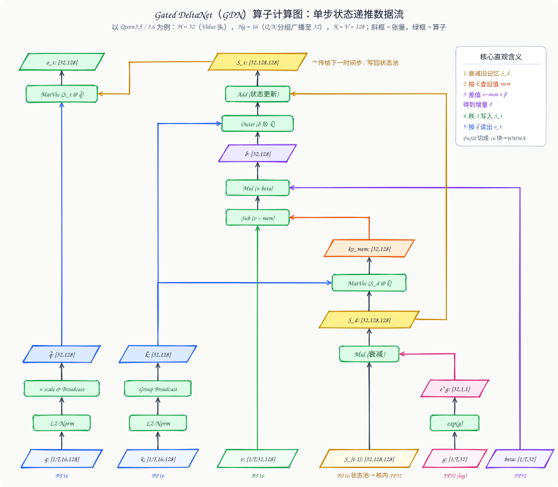
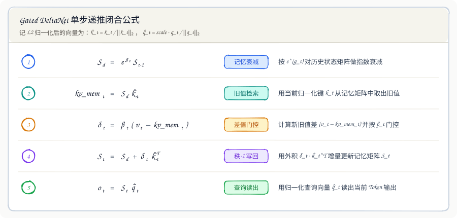
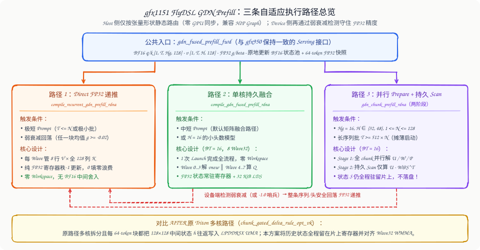
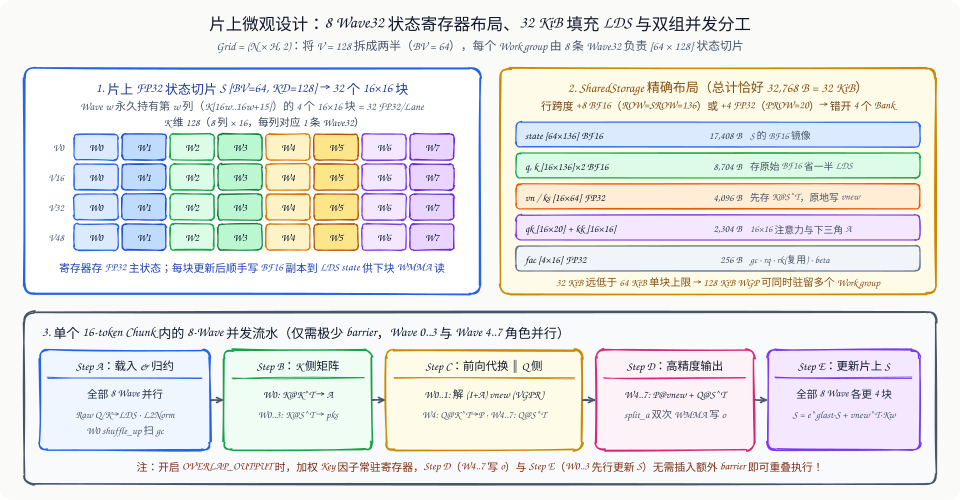
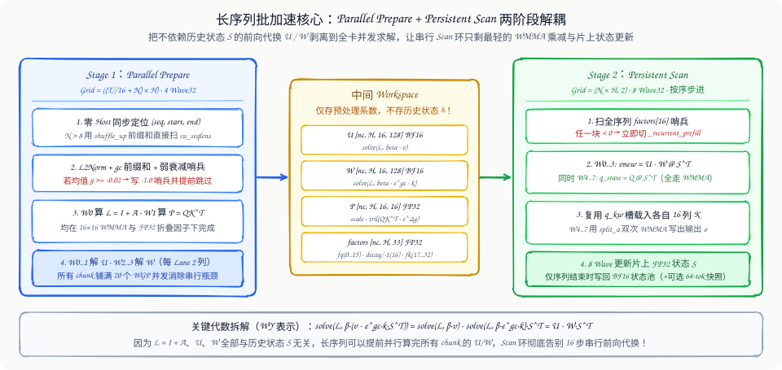

# gfx1151 上的 GDN Prefill 融合算子设计与优化

在 Qwen3.5、Qwen3.6 等混合线性注意力模型中，**Gated DeltaNet（GDN）** 取代了大部分标准 Softmax Attention 层，用一块固定大小的二维矩阵状态 $S \in \mathbb{R}^{V \times K}$ 持续压缩历史上下文（数学原理详见 [Recurrent / Linear Attention：GDN、KDA 与 Mamba-2](../ai-infra/LLM主流模型结构之Recurrent-Linear%20Attention.md)）。

本文围绕 [`ROCm/aiter#8371`](https://github.com/ROCm/aiter/pull/8371) 的实现，先用张量计算图与闭合公式讲清楚 **GDN Prefill 算子到底在算什么、为什么必须走 Chunkwise 矩阵化**，再逐个拆解 **AMD Radeon 8060S（`gfx1151`，RDNA 3.5，Wave32 + BF16 WMMA）** 上用 FlyDSL 编写的核心 Kernel 实现细节——从 `_mm` WMMA 原语、单核持久融合、两阶段 Prepare/Scan 解耦，到弱衰减自动回落的纯 FP32 递推核。

??? info "算子背景与目标架构"

    - **对应实现**：[`ROCm/aiter#8371`](https://github.com/ROCm/aiter/pull/8371)（`gdn_fused_prefill_fwd` 的 `gfx1151` FlyDSL 实现）。
    - **目标硬件**：AMD Radeon 8060S（`gfx1151`，RDNA 3.5，20 WGP / 40 CU，Wave32，单 Workgroup 上限 64 KiB LDS，32 MiB MALL，256 GB/s LPDDR5X UMA）。
    - **前置阅读**：[RDNA3.5 架构与 AMD GPU 基础](RDNA3.5架构与AMD%20GPU基础.md) · [FlyDSL：RDNA 3 的布局与矩阵计算](FlyDSL：RDNA3的布局与矩阵计算.md)。

---

## 1. 这个算子在算什么？从单步张量计算图到 Chunkwise 分块

### 1.1 单步 GDN 的完整张量数据流

与标准 Attention 不断把每个历史 Token 的 $K, V$ 存进 KV Cache 不同，GDN 对每个注意力头只维护一张固定尺寸的**记忆矩阵 $S \in \mathbb{R}^{128\times 128}$**。每来一个新 Token $t$，算子输入未归一化的 $q_t, k_t, v_t$（支持分组头 $H_g \to H$，如 $16 \to 32$）、对数衰减门 $g_t \in \mathbb{R}$ 与写入门 $\beta_t \in (0, 1)$，依次完成五步操作：

[{ width="880" }](../../assets/rocm/flydsl-gdn-prefill/gdn-operator-dataflow.svg)

把计算图中的每一条连线整理为闭合公式：

[{ width="860" }](../../assets/rocm/flydsl-gdn-prefill/gdn-closed-form-equations.svg)

落到真实推理引擎的 Serving 接口（`gdn_fused_prefill_fwd`）时，算子还需要承载三项工程契约：

- **零拷贝变长打包（Varlen Packed）**：输入 `q, k: [1, T, Hg, 128]`、`v: [1, T, H, 128]` 允许直接是打包 QKV 投影的非连续视图（自由 token stride），通过 `cu_seqlens [N + 1]` 切分多条不等长请求。
- **状态池原地更新与 Padding 跳过**：通过 `cache_indices [N]` 定位 `ssm_states [slots, H, 128, 128]`（BF16）中的槽位原地读写；负值或越界槽位视作 padding 跳过，配合可选 `has_initial_state [N]` 区分新请求（零初始化）与续写请求。
- **64-token 边界 FP32 快照**：通过可选 `track_state` / `track_chunk_idx` 在指定 64-token 块之前写出精确的 FP32 状态快照，供 Prefix Cache 复用。

### 1.2 为什么 Prefill 不能逐 Token 算，而要做成 Chunkwise 矩阵形式？

Decode 阶段每次只来 1 个 Token，只能按上图做向量-矩阵乘（`MatVec`）。但 Prefill 阶段一次输入几百到几万个 Token，如果仍逐 Token 递推，会撞上严重的**算术强度瓶颈**：

- 每个 Token 都要完整读写一张 $128\times 128$ 的状态矩阵 $S$（BF16 一读一写即 $64\text{ KiB}$，FP32 达 $128\text{ KiB}$），却只做 2 次 `MatVec` 与 1 次秩-1 外积（约 $6\times 128^2 \approx 98\text{K FLOPs}$），算术强度仅 **~1.5 FLOP/Byte**，完全卡死在 256 GB/s UMA 带宽上，根本喂不饱 GPU 的 **WMMA 矩阵单元**；
- 相邻 Token 存在强递推依赖（$S_t$ 依赖 $S_{t-1}$），无法直接跨时间维并行。

**Chunkwise WY 表示**将序列按长度 $B_T$ 切块，把块内 $B_T$ 步串行递推等价改写为稠密矩阵方程，从而把主体计算全部转成 **WMMA GEMM**。记块内对数衰减前缀和为 $g_{c,t} = \sum_{\tau=0}^{t} g_\tau$（末位置为 $g_{c,\text{last}}$），$\operatorname{tril}_{-1}(\cdot)$ 表示严格下三角（不含主对角线），块内五步方程闭合为：

$$
\begin{aligned}
A &= \operatorname{tril}_{-1}\!\left(\beta_t (\hat{k}_t \cdot \hat{k}_j) e^{g_{c,t} - g_{c,j}}\right) \in \mathbb{R}^{B_T\times B_T}, \\
v_{\text{new}} &= \operatorname{solve}\!\left(I + A,\ \beta \cdot \left(v - e^{g_c} (\hat{k} S^\top)\right)\right) \in \mathbb{R}^{B_T\times V}, \\
P &= \operatorname{scale} \cdot \operatorname{tril}\!\left((\hat{q} \hat{k}^\top) e^{g_{c,t} - g_{c,j}}\right) \in \mathbb{R}^{B_T\times B_T}, \\
o &= \operatorname{scale} \cdot e^{g_c} (\hat{q} S^\top) + P v_{\text{new}}, \\
S &\leftarrow e^{g_{c,\text{last}}} S + v_{\text{new}}^\top \left(\hat{k} \cdot e^{g_{c,\text{last}} - g_c}\right).
\end{aligned}
$$

其中 $I + A$ 是单位下三角矩阵，只需一次前向代换；其余 $\hat{k}\hat{k}^\top$、$\hat{k}S^\top$、$\hat{q}\hat{k}^\top$、$\hat{q}S^\top$、$P v_{\text{new}}$ 与 $v_{\text{new}}^\top \hat{k}_w$ 全部化为稠密矩阵乘！

---

## 2. `gfx1151` 的架构痛点与三路径自适应调度

把上述 Chunkwise 方程落到 `gfx1151`（Radeon 8060S）时，原有两套实现都存在硬伤：

- **AITER 原 Triton 多核路径（`chunk_gated_delta_rule_opt_vk`）**：将 Q/K L2Norm、V 重排、WY 预处理、状态递推与输出拆成多个独立 Kernel，每 64 个 Token 都要把 $128\times 128$ 的中间状态 `h` 反复写回再读出 256 GB/s LPDDR5X UMA，显存流量与核启动开销极高；
- **原有 FlyDSL 单核路径（`gfx950`）**：绑定 CDNA4 的 Wave64、MFMA 与 160 KiB LDS，无法运行在 Wave32、单块仅 64 KiB LDS 的 RDNA 3.5 上。

因此，本方案用 FlyDSL 直接面向 `gfx1151` 的 **Wave32 + BF16 WMMA** 编写融合核，核心原则是**历史状态 $S$ 全程锁在片上 FP32 寄存器中绝不落盘**，并针对不同输入形态设计三条自适应执行路径：

[{ width="940" }](../../assets/rocm/flydsl-gdn-prefill/gdn-prefill-dispatch-arch.svg)

| 执行路径 | 触发条件 | 启动配置 | 片上与显存开销 | 定位 |
| --- | --- | --- | --- | --- |
| **路径 1：Direct FP32 递推**（`_recurrent_prefill`） | 极短 Prompt（如 $T \le N$）或设备端检出弱衰减块（均值 $\ge -0.02$） | 每条 Wave32 管 8 行 $V \times 128$ 列 $K$ | 零 LDS、零 Workspace、纯 FP32 | 极短输入免补零 + 弱衰减精度兜底 |
| **路径 2：单核持久融合**（`Persistent`） | 中短 Prompt，或 $H = 16$ 小头数模型 | `Grid = (N * H, 2)`，8 Wave32（`BV = 64`） | 32 KiB LDS、零 Workspace、1 次启动 | 中短上下文最低延迟 |
| **路径 3：两阶段解耦**（`Prepare + Scan`） | $H_g = 16, H \in \{32, 48\}$ 且 $T \ge 512 N$ | Prepare 4-Wave 全块并行 + Scan 8-Wave 片上递推 | 轻量 $U/W/P$ Workspace，状态 $S$ 零落盘 | 长上下文与大吞吐批 |

!!! note "零 Host 同步路由：天然兼容 HIP / CUDA Graph"

    Host 侧路由判断（`_use_parallel_prefill` / `_use_recurrent_prefill`）只看 Python 静态形状（$T, N, H, H_g$），从不回读 GPU 上的 `cu_seqlens`；变长序列切块定位与弱衰减筛选全部下沉到设备端完成，确保整条调用链可被无损捕获进 Graph。

---

## 3. 片上基石：`BT = 16` 分块、32 KiB LDS 与 `_mm` WMMA 原语

### 3.1 为什么把块长从 `BT = 64` 收到 `BT = 16`？

把块长定为 **`BT = 16`** 是整套 Kernel 适配 RDNA 3.5 的支点：

1. **1:1 对齐 `16×16×16` WMMA**：$K K^\top$ 与 $Q K^\top$ 恰好各为 1 个 `16×16` 瓦片，单条 Wave32 沿 $K_D = 128$ 打 8 拍 WMMA 即可算完。
2. **前向代换全驻寄存器**：解 $(I + A)\,v_{\text{new}} = \text{rhs}$ 只有 16 步，每条 Lane 把已解出的 16 行全留在 VGPR 列表 `solved[0..15]` 中，彻底省去反复回读 LDS。
3. **恰好卡进 32 KiB LDS**：单核路径的 `SharedStorage` 总计 **32,768 B（32 KiB）**，远低于 64 KiB 单块硬上限，且通过行跨度 `+16 B` 填充（`ROW = SROW = 136`, `PROW = 20`）让相邻行错开 4 个 Bank 规避 Bank Conflict，同时让 `pks` 与 `pvn` 原地复用。
4. **无感兼容外部 64-token 快照**：每推进 4 个 16-token 块，在 `(start - bos) % 64 == 0` 时直接从片上 FP32 寄存器写出 `track_state`。

| `SharedStorage` 字段 | 逻辑形状与 dtype | 行跨度（Padding） | 字节占用 | 用途与复用 |
| --- | --- | --- | ---: | --- |
| `q` / `k` | $16 \times 128$ BF16 × 2 | `ROW = 136`（+8 BF16 = +16 B） | `8,704 B` | 存**原始 BF16** 的 `q`/`k`，省一半 LDS 且免二次量化 |
| `state` | $64 \times 128$ BF16 | `SROW = 136`（+8 BF16 = +16 B） | `17,408 B` | 寄存器 FP32 主状态 $S$ 的 BF16 镜像，供下块 WMMA 读 |
| `vn`（`pks = pvn`） | $16 \times 64$ FP32 | `BV = 64` | `4,096 B` | 先存 $K S^\top$，前向代换消费后就地覆写为 $v_{\text{new}}$ |
| `qk` / `kk` | $16 \times 16$ FP32 × 2 | `PROW = 20`（+4 FP32 = +16 B） / `16` | `2,304 B` | 分别存块内注意力 $P$（1,280 B）与下三角 $A$（1,024 B） |
| `fac` | $4 \times 16$ FP32 | `16` | `256 B` | 4 行标量：`gc`、`rq`、`rk`（后复用为加权 key 因子）、`beta` |
| **合计** | — | — | **`32,768 B`** | **恰好 32 KiB**，单 WGP（128 KiB LDS）可并发驻留多块 |

### 3.2 核心矩阵乘原语 `_mm`：Wave32 WMMA 映射与 `split_a` 精度拆分

所有矩阵乘共用一个 `@flyc.jit` 原语 `_mm(a, b, ...)`，计算 `16×16` 结果瓦片 $C = A B^\top$（从 LDS 读取 A/B，累加器留在 FP32 寄存器）：

```python
def _wmma(a, b, acc):
    """gfx11 wave32 16x16x16 BF16 WMMA with FP32 accumulation."""
    ra = fx.make_rmem_tensor(16, fx.BFloat16)
    rb = fx.make_rmem_tensor(16, fx.BFloat16)
    rc = fx.make_rmem_tensor(8, fx.Float32)
    ra.store(a); rb.store(b); rc.store(acc)
    atom = fx.make_mma_atom(fx.rocdl.WMMA(16, 16, 16, fx.BFloat16, fx.Float32))
    fx.gemm(atom, rc, ra, rb, rc)
    return rc.load()

@flyc.jit
def _mm(a, b, ar, br, ast, bst, reduction, lane, adt, bdt,
        bfactor=None, bfactor_is_vector=False, split_a=False):
    acc = fx.Vector.filled(8, 0.0, fx.Float32)
    for kk, carry in range(0, reduction // 16, init=[acc]):
        ki, acc = fx.Int32(kk), fx.Vector(carry[0])
        # 1. 每条 Lane 沿内维取 16 个连续元素（ast[1]==1 时用 2 次 128-bit LDS 宽载入）
        av = _row_fragment(a, (ar + lane % 16) * ast[0] + ki * 16, adt)  # (非连续时逐元素读)
        bv = _row_fragment(b, (br + lane % 16) * bst[0] + ki * 16, bdt)
        # 2. 更新状态 S 时，顺手把衰减权重因子 bfactor 乘到 K 的归约维上
        if const_expr(bfactor is not None):
            factors = bfactor if bfactor_is_vector else fx.Vector.from_elements(
                [_read(bfactor, ki * 16 + j) for j in range(16)], dtype=fx.Float32
            )
            bv = bv.to(fx.Float32) * factors
        # 3. 转为 BF16 送入 WMMA；split_a=True 时拆出残差 al 多打一拍保精度
        ah, bh = av.to(fx.BFloat16), bv.to(fx.BFloat16)
        if const_expr(split_a):
            al = (av.to(fx.Float32) - ah.to(fx.Float32)).to(fx.BFloat16)
            acc = _wmma(al, bh, acc)
        acc = _wmma(ah, bh, acc)
        result = yield [acc]
    return fx.Vector(result)
```

这段 25 行代码里藏着三个直接决定吞吐与精度的硬件细节：

- **Wave32 WMMA 坐标约定**：在 `gfx1151` 上，一条 `16×16×16` WMMA 要求操作数 A/B 的 Lane `l` 持有行 `l % 16` 的全部 16 个元素（前后半波 `0..15` 与 `16..31` 复制相同行），而输出累加器 C 的 8 个 FP32 落在 `[2*i + l // 16, l % 16]`。以 `lane = 17` 为例：它读入 A/B 的第 `1` 行，并拥有输出矩阵第 `1` 列的 8 个奇数行（`1, 3, 5, ..., 15`）——全核所有 LDS 写回 `_store_tile` 与状态更新循环都严格沿用这一布局，零跨 Lane 重排！
- **原始 BF16 入 LDS + 范数倒数后折叠**：`q/k` 搬进 LDS 时**不提前乘 L2Norm 系数**，只顺手用 `shuffle_xor` 算出 `rq = rsqrt(||q||^2 + 1e-6)`、`rk = rsqrt(||k||^2 + 1e-6)` 存入 `fac`，等 `_mm` 产出 FP32 点积后再统一乘回 `rq * rk * exp(gc_r - gc_c)`——既把 `q/k` LDS 占用砍半，又避免归一化后再截断成 BF16 的二次误差。
- **`split_a = True` 高低位残差双次 WMMA**：输出项 $P v_{\text{new}}$ 里，$P \in \mathbb{R}^{16\times 16}$ 是 FP32 且衰减跨度大；拆成 `ah = bf16(P)` 与 `al = bf16(P - fp32(ah))` 连续打两次 WMMA（归约维仅 `BT = 16`，只多 1 条 `v_wmma`），几乎零开销地守住了输出尾数精度。

---

## 4. 深入核内实现：单核持久融合 vs 两阶段解耦

### 4.1 单核持久融合核（`compile_gdn_fused_prefill_rdna`）

单核路径用 **`Grid = (N * H, 2)`**（沿 $V = 128$ 拆成两半 `BV = 64`，把 Workgroup 数翻倍喂饱 20 个 WGP）、每 Block **8 条 Wave32（256 线程）** 完成整条序列：

[{ width="940" }](../../assets/rocm/flydsl-gdn-prefill/gdn-prefill-wave-state-layout.svg)

沿着外层主循环 `for start, carry in range(bos, eos, BT, init=[state]):`，核内精确经历 4 个紧凑阶段：

#### 阶段 1：片上状态绑定、64-token 快照与 `gc` 前缀和

进入循环前，8 条 Wave 按 `tile = wave + j * 8`（`j = 0..3`）瓜分 $64\times 128$ 状态的 32 个 `16×16` 块——**`Wave w` 永久持有第 `w` 列的 4 个块 = 每 Lane 32 个 FP32 寄存器**，同时把 BF16 副本写进 LDS `ps`。每走满 4 块（`(start - bos) % 64 == 0`）若命中 `track_chunk_idx`，直接把寄存器向量 `state` 写出到 FP32 `track_state`。

随后全部 8 条 Wave 并发载入当前 16 个 Token 的原始 BF16 `q/k`（每条 Wave 负责 2 行，每条 Lane 用 4-wide BF16 载入 4 列）并计算 L2Norm 倒数；同时 **Wave 0** 用 4 步 `gpu.shuffle_up` 在单条 Wave 内完成 16 个对数衰减 `g` 的包含前缀和 `gc`：

```python
# Wave 0 单波内 4 步 inclusive scan 计算 16 个 token 的 gc 前缀和
if wave == 0:
    logg = _g_ld(gb[3], (start + lane) * sg + head, 1, fx.Float32)[0]  # (有效范围内)
    bet  = _g_ld(gb[4], (start + lane) * sb + head, 1, fx.Float32)[0]
    for shift in (1, 2, 4, 8):
        previous = gpu.shuffle_up(logg, shift, 32)
        logg = logg + (lane >= shift).select(previous, fx.Float32(0.0))
    if lane < BT:
        _write(pf, lane, logg)          # fac[0]: gc[0..15]
        _write(pf, 3 * BT + lane, bet)  # fac[3]: beta[0..15]
```

#### 阶段 2 & 3：Wave 0..3 前向代换与 Wave 4..7 Q 侧计算并发隐藏

第一次 `gpu.barrier()` 后，**Wave 0** 算 $K K^\top \to A$（严格下三角写入 `pkk`），**Wave 0..3** 算 $K S^\top$ 写入 `pks`（即 `pvn`）。过第二次 `gpu.barrier()` 后，进入整个 Kernel 最精彩的**双组角色并行**：

- **Wave 0..1（共 64 Lane，每 Lane 负责 1 列 $V$）** 先把 16 行的 `v` 批量发完 Global Load（隐藏访存延迟），再在寄存器列表 `solved[0..15]` 中完成 16 步前向代换并就地覆盖写回 `pvn`；
- **同一拍，Wave 4 并发算 $Q K^\top \to P$，Wave 4..7 并发算 $Q S^\top \to q_{\text{state}}$**！

```python
# Wave 0..1：批量预取 16 行 V，再纯寄存器前向代换求解 vnew（原地覆盖 pks -> pvn）
if wave < BV // 32:
    column = wave * 32 + lane
    prefetched = [_g_ld(gb[2], (start + rr) * sv + head * VD + vs + column, 1, fx.BFloat16)[0]
                  for rr in range_constexpr(BT)]  # 省略越界清零分支
    vvalues = fx.Vector.from_elements(prefetched, dtype=fx.BFloat16)
    solved = []
    for rr in range_constexpr(BT):
        rhs = (vvalues[rr].to(fx.Float32)
               - _read(pks, rr * BV + column) * _read(pf, 2 * BT + rr) * _exp(_read(pf, rr)))
        rhs = rhs * _read(pf, 3 * BT + rr)
        for j in range_constexpr(rr):
            rhs = fx.fma(-_read(pkk, rr * BT + j), solved[j], rhs)  # 前序行全在 VGPR！
        solved.append(rhs)
        _write(pvn, rr * BV + column, rhs)

# 与上面完全并行：Wave 4 算 P = scale * tril(Q @ K^T * exp(Δgc))，Wave 4..7 算 Q @ S^T
if wave == 4:
    token_product = _mm(pq, pk, 0, 0, (ROW, 1), (ROW, 1), KD, lane, fx.BFloat16, fx.BFloat16)
    ... # 乘衰减与范数倒数写入 pqk
if wave >= 4:
    q_state = _mm(pq, ps, 0, (wave % 4) * 16, (ROW, 1), (SROW, 1), KD, lane, fx.BFloat16, fx.BFloat16)
```

#### 阶段 4：高精度输出、`OVERLAP_OUTPUT` 省屏障与片上状态更新

过第三次 `gpu.barrier()` 后：

1. **Wave 4..7** 用 `_mm(pqk, pvn, ..., split_a=True)` 算出 $P v_{\text{new}}$，加上缩放后的 `q_state` 直接写出 BF16 输出 `o`；
2. **全部 8 条 Wave** 各自更新手里那 4 个 `16×16` 状态块：`state = state * exp(glast) + _mm(pvn, pk, ..., bfactor=key_factors)`，并同步刷新 LDS `ps` 镜像。

注意一个精巧开关 **`OVERLAP_OUTPUT`**：默认模式会复写共享 `fac` 第 2 行存加权 Key 因子 `rk * exp(glast - gc)`，因此在输出与状态更新之间需要一次 `gpu.barrier()`；而在长批启用 `OVERLAP_OUTPUT = True` 时，每条 Wave 把这 16 个因子直接留在私有寄存器 `key_factors` 里，不改任何共享内存——于是 **Wave 0..3 无需等待 Wave 4..7 写完 `o`，直接提前进入状态更新循环，省掉一次全块屏障！**

---

### 4.2 长批两阶段解耦核（`compile_prepare_gdn_prefill_rdna` + `compile_scan_gdn_prefill_rdna`）

当批大小和长度进入长序列区间（$H_g = 16, H \in \{32, 48\}, T \ge 512 N$）时，单核持久路径里每个 chunk 都要串行跑 L2Norm、$K K^\top$、$Q K^\top$ 与 16 步前向代换。借助 WY 线性拆解：

$$
v_{\text{new}}
= \operatorname{solve}\!\left(L,\ \beta\,(v - e^{g_c} k S^\top)\right)
= \underbrace{\operatorname{solve}(L,\ \beta v)}_{U \in \mathbb{R}^{16\times V}}
- \underbrace{\operatorname{solve}(L,\ \beta e^{g_c} k)}_{W \in \mathbb{R}^{16\times K}} \cdot S^\top,
$$

两阶段路径把状态无关的 $L, U, W, P, \text{factors}$ 彻底剥离出来铺满 20 个 WGP 并行算完，再让 Scan 核专心做极轻的片上状态递推：

[{ width="940" }](../../assets/rocm/flydsl-gdn-prefill/gdn-prefill-two-stage-pipeline.svg)

#### Stage 1（`prepare`，4 Wave32，`Grid = ((T//16 + N) * H,)`）的两个关键 Kernel 技巧

1. **零 Host 同步定位变长序列**：对打包变长批，真实 chunk 总数必满足 $\sum \lceil L_n / 16 \rceil \le \lfloor T / 16 \rfloor + N$。Host 直接按 `nc = T // 16 + N` 分配 Workspace 与 Grid；核内当 `N > 8` 时，32 条 Lane 每组各认领 1 条序列，用 5 步 `gpu.shuffle_up` 算 chunk 前缀和、`shuffle_xor` 广播命中的序列号 `found`，再用 `shuffle_idx` 直接把对应 `start / end` 分发给全波，越界槽位立刻早退：

    ```python
    # N > 8 时：每条 Lane 认领 1 条序列，Wave 内前缀和 O(N/32) 定位当前 chunk 归属
    for group in range_constexpr((N + 31) // 32):
        n = group * 32 + lane
        count = (fx.max(eos - bos, 0) + BT - 1) // BT  # (n < N 时)
        prefix = count
        for shift in (1, 2, 4, 8, 16):
            prior = fx.Int32(gpu.shuffle_up(prefix, shift, 32))
            prefix = prefix + (lane >= shift).select(prior, fx.Int32(0))
        begin = offset + prefix - count
        found = ((chunk >= begin) & (chunk < offset + prefix) & (n < N)).select(n, fx.Int32(-1))
        for shift in (1, 2, 4, 8, 16):
            found = fx.max(found, found.shuffle_xor(shift, 32))
        ...
    ```

2. **4-Wave 双列向量并发解 $U$ 与 $W$**：Wave 0 算 $L = I + A$、Wave 1 并发算 $P = Q K^\top$ 后，进入求解阶段——**Wave 0..1 负责 $U$ 的 128 列，Wave 2..3 负责 $W$ 的 128 列**，每条 Lane 用 2-wide FP32 向量一次同时解两列（`channel = (wave % 2) * 64 + lane * 2`），寄存器列表 `solved[0..15]` 零 LDS 回读，算完转 BF16 写出 Workspace。

#### Stage 2（`scan`，8 Wave32，`Grid = (N * H, 2)`）的极简关键路径与 `q_kw` 复用

Scan 核的循环体内**彻底没有了前向代换和 L2Norm**：

- **前半拍**：Wave 0..3 用 WMMA 算 $W S^\top$ 并从载入的 `U` 中减去，得到 BF16 的 `vnew = U - W @ S^T`；同一拍 Wave 4..7 用 `q_kw` 里的 `Q` 算 $Q S^\top$；
- **后半拍（`q_kw` 分时复用）**：过一次 `gpu.barrier()` 后，`Q` 已经不再需要。每条 Wave **只从显存载入自己那 4 个状态块需要的 16 列 `K`** 覆盖写入 `q_kw`：

```python
# Q 读取已由前序 barrier 退休；每条 Wave 只把各自 4 个状态块所需的 16 列 K 搬入 q_kw
for j in range_constexpr(2):
    rr = lane // 4 + j * 8
    cc = wave * 16 + (lane % 4) * 4
    value = _g_ld(gb[10], (start + rr) * sk + kh * KD + cc, 4, fx.BFloat16)  # 越界补 0
    _lds_st(pq, rr * ROW + cc, value, 4, fx.BFloat16)
```

随后 Wave 4..7 用 `split_a=True` 双次 WMMA 写出 `o`，全部 8 条 Wave 更新片上 FP32 状态 `S` 并刷新 LDS `ps` 镜像——**状态 $S$ 在整个长序列扫描期间依然零落盘！**

---

## 5. 弱衰减精度防线与 Direct FP32 递推核（`_recurrent_prefill`）

!!! warning "为什么近 1 衰减会击穿 BF16 Chunkwise 矩阵路径？"

    常规序列中衰减因子 $e^g < 1$ 会让早期块的微小量化误差随时间指数衰减；但当某一段的对数衰减 $g \to 0$（即 $e^g \approx 1$）时，BF16 矩阵乘操作数引入的舍入误差无法被衰减压掉，而是会在连续多个 chunk 间不断累积放大，导致状态与输出发生漂移。

为此，核内以 **`MIN_MATRIX_DECAY = 0.02`** 为阈值建立了一套零 Host 同步的设备端防线：

- **单核路径**：进入主循环前，`_has_weak_decay` 用半波 `shuffle_xor(1,2,4,8)` 并行统计每个 16-token 块（按实际有效 token 数计）的平均对数衰减；只要**任意一个块均值 $\ge -0.02$**，整条 `(seq, head)` 立刻切入 `_recurrent_prefill`。
- **两阶段路径**：`prepare` 检出弱衰减块时向 `factors[16]` 写入 **`-1.0` 哨兵**并跳过该块 `U/W/P` 写入；`scan` 开头并行扫描整条序列的哨兵，一旦发现 `< 0` 立即整条序列回落，杜绝被截断的矩阵更新污染后续段。

极短 Prompt（如 `T <= N`）也会由 Host 直接路由到同一个 **`_recurrent_prefill`**（避免为 1–4 个 Token 补零跑 `16×16×16` WMMA）。该核把第 1 节的单步张量计算图 **1:1 映射成纯 FP32 寄存器指令**——每条 Wave32 负责 **8 行 V × 全 128 列 K**（每 Lane 持 `8 × 4 = 32` 个 FP32 寄存器，零 LDS、零 Workspace）：

```python
# _recurrent_prefill 核心单步循环：每条 Wave 管 8 行 V × 全部 128 列 K（每 Lane 4 列）
for token, carry in range(bos, eos, init=[state]):
    # 1. L2Norm 归一化 q, k 并求标量内积 q·k（全程 FP32 + Wave32 shuffle_xor 归约）
    qf = _g_ld(q, token * sq + kh * KD + lane * 4, 4, fx.BFloat16).to(fx.Float32)
    kf = _g_ld(k, token * sk + kh * KD + lane * 4, 4, fx.BFloat16).to(fx.Float32)
    ... # shuffle_xor 归一化 qf, kf，并求 qk = dot(qf, kf)
    decay = _exp(_g_ld(g, token * sg + head, 1, fx.Float32)[0])
    bet   = _g_ld(beta, token * sb + head, 1, fx.Float32)[0]
    updated = []
    # 2. 对本 Wave 负责的 8 行 V 逐行执行：衰减 → 查旧值 → 差值门控 → 读出 o → 秩-1 写回 S
    for j in range_constexpr(BV // NUM_WAVES):
        row = vs + wave * (BV // NUM_WAVES) + j
        sd = state_row(j) * decay                       # S_d = e^g * S_{t-1}
        kstate = wave_sum((sd * kf).reduce(ADD))        # kv_mem = S_d @ k_hat
        qstate = wave_sum((sd * qf).reduce(ADD))        # S_d @ q_hat
        delta = (v[row] - kstate) * bet                 # delta = beta * (v - kv_mem)
        # 利用代数恒等式 o = (S_d + delta * k^T) q = S_d q + delta * (q·k)，省一次扫描！
        output = fx.fma(delta, qk, qstate) * scale
        if lane == 0:
            _g_st(out, (token * H + head) * VD + row, output.to(fx.BFloat16), 1, fx.BFloat16)
        updated.extend(fx.fma(kf, fx.Vector.filled(4, delta, fx.Float32), sd))
```

留意上面那行漂亮的代数合并：`output = fx.fma(delta, qk, qstate) * scale`！因为 $S_t \hat{q}_t = (S_d + \delta_t \hat{k}_t^\top)\hat{q}_t = S_d \hat{q}_t + \delta_t (\hat{k}_t^\top \hat{q}_t)$，在同一遍遍历寄存器状态 `sd` 时同时算出 `kstate` 与 `qstate`，就可以在更新 `S` 之前一步产出 `output`，省掉了第二次读状态向量！

---

## 6. 总结：RDNA 3.5 上设计融合线性注意力 Kernel 的四条主线

回看整套算子从单步张量图到 `gfx1151` FlyDSL 落地的演进，真正撑起性能与精度的核心取舍可以收束为四点：

1. **先把状态锁死在寄存器里**：在 256 GB/s UMA 上，用 `BV = 64` 拆半把 $128\times 128$ 状态压到每 Lane 32 个 FP32 寄存器，彻底消灭 per-chunk 显存状态往返。
2. **用硬件原子倒推分块与片上排布**：围绕 Wave32 `16×16×16` WMMA 与 32 KiB 填充 LDS 选定 `BT = 16`，换来 16 步纯寄存器前向代换、无 Bank 冲突 LDS 以及 64-token 外部快照的无缝兼容。
3. **长序列拆出状态无关计算，但守住状态不落盘红线**：用 WY 拆解将 $U/W/P$ 剥离到全卡并行的 `Prepare` 核，配合零 Host 同步前缀和定位与 `Scan` 核内的 `q_kw` 复用，兼顾长上下文并行度与片上递推带宽优势。
4. **用轻量精度技巧守住数值边界**：`Raw BF16 + 范数倒数后折叠`、`split_a` 残差双次 WMMA 与设备端弱衰减 `-1.0` 哨兵回落，在不拖慢主路径的前提下兼顾极端输入的数值稳健性。
