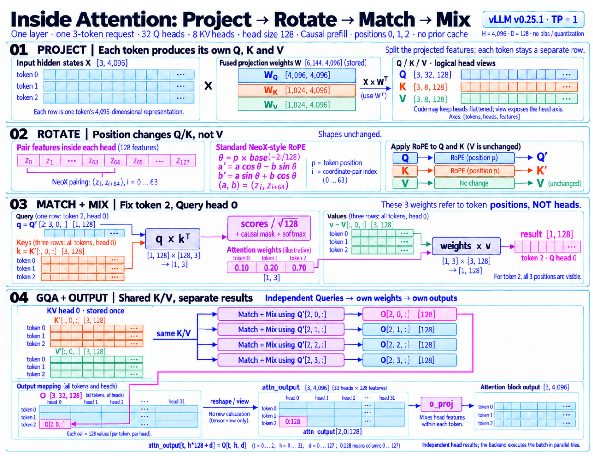
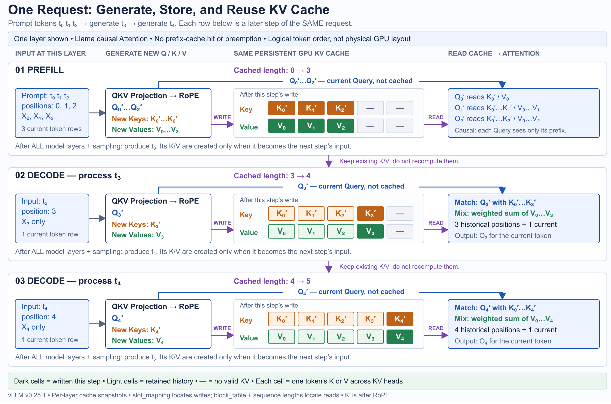
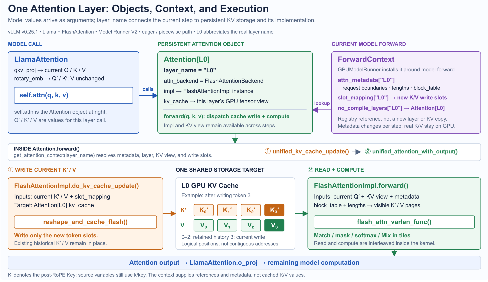

!!! info
    本章沿 Attention 计算 → KV Cache 复用 → qkv_proj 实现 → self.attn 实现展开。

    源码基准为 vLLM v0.25.1，选择 Model Runner V2、Llama、普通 Full Causal Self-Attention 和 FlashAttention。

    模型调用以 eager 为主；特殊 Attention、并行切分及 CUDA Graph 的专用路径不在此展开。

{ width="90%" }

## 一、Attention怎样让一个token获得上下文

第一张图沿同一个没有历史缓存的 3-token Causal Prefill(positions 0、1、2) 展开 Project、 Rotate、Match、Mix：先准备各 token 的 Q/K/V，再固定 token 2 的一个 Query head 完成计算，最后展开 GQA 和全部输出

### 投影产生三种特征，不是把输入切成三份

图中的`H=4096`是 hidden size：每个token在当前层由4096个数表示，并不是上下文长度。Q、K、V都由这行输入经过不同的可学习权重得到：Q 用于发起匹配，K用于参与匹配，V 提供被汇总的内容。

Llama将三组投影合在一次`qkv_proj()`中计算，先变换，再切分结果。图中32个Query heads对应4096维Q，8个KV heads分别对应1024维K和V；四个Query heads 共享一组 KV head，这是本例的Grouped-Query Attention。维度关系见[投影构造](https://github.com/vllm-project/vllm/blob/v0.25.1/vllm/model_executor/models/llama.py#L221-L231)，执行顺序见 [LlamaAttention.forward()](https://github.com/vllm-project/vllm/blob/v0.25.1/vllm/model_executor/models/llama.py#L221-L231) 。图中权重采用PyTorch的`[out_features, in_features]`存储方向，因此写成 $X \times W^T$ 。每一行只与权重相乘，此时还没有读取其他token。

### RoPE 让匹配分数同时感知内容和位置

如果只使用内容投影，同样的特征不会因为所在位置不同而自然产生位置差异。RoPE 因此按 token 的位置，旋转 Q/K 内部的一对对坐标；**V 不旋转，张量形状不变**。图中使用普通、全维度、NeoX-style RoPE：128维 head 配成64对坐标，旋转角度由“位置 × 该坐标对的频率”决定。
!!! tip
    关键不是记住每个三角函数，而是理解：position p 的 Q 与 position r 的 K 做点积时，旋转带来的相对角度由 r−p 决定，匹配因此带有相对位置信息。

    源码先[计算频率和 cos/sin 表](https://github.com/vllm-project/vllm/blob/v0.25.1/vllm/model_executor/layers/rotary_embedding/base.py#L160-L201)，本轮再[按 positions 取值并应用到 Q/K](https://github.com/vllm-project/vllm/blob/v0.25.1/vllm/model_executor/layers/rotary_embedding/base.py#L160-L201)。图中的旋转公式对应 [ApplyRotaryEmb.forward_static()](https://github.com/vllm-project/vllm/blob/v0.25.1/vllm/model_executor/layers/rotary_embedding/common.py#L145-L185)；这是便于理解数学的原生实现，设备路径可以使用融合算子。RoPE 只改变每个 token 自身的 Q/K，仍没有把其他 token 的内容汇总进来。

### Match / Mix：固定一个 token、一个 head，算出一份输出

图中 Q′/K′ 表示经过 RoPE 的向量。先认清形状的三条轴：`Q′ [3,32,128]` 和 `K′/V [3,8,128]` 依次表示 **token 数、head 数、每个 head 的特征维度**。每个 token 都有自己的32个 Q 向量、8个 K 向量和8个 V 向量，并不是三个 token 各负责一种特征。现在只追踪 **token 2 的 Query head 0**。它
需要一份当前 Query，以及三个可见位置的 Key 和 Value：

```Python
q = Q_prime[2:3, 0, :]  # [1,128]：token 2 的 Q head 0
k = K_prime[:, 	 0, :]	# [3,128]：tokens 0、1、2 的 K head 0
v = V[:,		 0, :]  # [3,128]：tokens 0、1、2 的 V head 0
```

`2:3` 只取第2行，但保留长度为1的 token 维； `:` 表示取该维的全部元素。Query 固定一个token，K/V 沿 token 维取三个位置，**head 编号始终为0**。这些切片用来定位参与本次计算的向量。一个 head的完整计算为：

```text
q [==1==,128] × kᵀ [==128==,3] → 分数 [==1==,3]
   → 缩放、causal mask、softmax → 匹配权重 [==1==,3]
   → 权重 [==1==,3] × v [==3==,128] → 输出 [==1==,128]
```

缩放因子 `1/√128` 控制分数尺度；causal mask 屏蔽未来位置；softmax 沿 Key 位置归一化。

因此，中间的三个权重对应 token positions 0、1、2，不是三个 heads（图中的权重仅为示例）。Mix 用这一行权重汇总三个 Value 向量，得到 token 2 的输出 head 0。跨 token 的内容在这里进入输出，而输出仍是一个128维向量。本例的 token 2 能看到全部三个位置；token 0 只能读位置0，token 1 能读位置0、1。可见位置数影响匹配范围，不改变每个 head 的128维输出大小。

Linear、Norm、MLP 等算子通常逐 token 加工表示，与 Attention 在本层新增的跨 token 交互不同。

### GQA：改变 Query head，选择对应的 KV head

一个 head 的计算已经完整，图的第④区再把它展开到其他 heads。本例有32个 Q heads、8个 KV heads，对应规则是 `kv_head = q_head // 4`：固定 token 2，Q heads 0…3 都读取 KV head 0，Q head 4 开始读取 KV head 1，直到 Q head 31 读取 KV head 7。每个 Query head 都独立重复上面的计算；即使读取同一份K/V，也会因 Query 不同而得到各自的权重和输出。

图中 KV head 0 的橙色 Key 和绿色 Value **只画一份**，共同供四条 Match + Mix 路径使用；四条路径各自接收不同的 Query，并分别产生 output heads 0、1、2、3。这体现的是同一层内多个 Query heads 共享 K/V，不是不同请求之间的 Prefix Cache 共享。

这就是 **Grouped-Query Attention（GQA，分组查询注意力）**：共享 K/V，不共享匹配权重和输出。“分组”不是额外的求和、平均或合并操作，也不是请求分组或 KV Cache 管理中的 cache groups。点积要求对齐的是128维特征，而不是 Q 与 K/V 的 head 数。对应规则可见 [FlashAttention 的 GQA 接口说明](https://github.com/vllm-project/vllm/blob/v0.25.1/vllm/vllm_flash_attn/flash_attn_interface.py#L216-L220)

> GQA 的收益是减少 K/V 投影与缓存数据量：相较同样32个 Q heads、但有32个 KV heads 的 MHA，在 token 数、head size 和精度相同时，本例的 K/V 缓存数据量为其四分之一。32个 Q heads 的独立计算仍然存在。它是模型架构的选择，不是 vLLM 临时合并已训练好的 heads。**图中四条分支表示独立的数据依赖和结果，不表示四次串行调用。**

在本章的普通 FlashAttention 路径中，vLLM 将本轮整批 Query（包含全部 Query heads）、K/V 缓存和请求边界等信息一起[交给后端](https://github.com/vllm-project/vllm/blob/v0.25.1/vllm/v1/attention/backends/flash_attn.py#L952-L977)，由后端并行、分块计算；不是按图中的分支逐个执行 Python 循环。请求 batch 决定本轮一起执行哪些请求和 token，GQA 分组决定各 Query heads 读取哪个 KV head，二者不是同一种分组。无论底层怎样划分计算，每个 token、每个Query head 都有自己的128维结果。下面看这些结果在完整输出中的位置。

### 算出的128个数，位于完整输出的哪里

把全部结果记为 `O [3,32,128]`：第一维选择 token，第二维选择 **Query head**，第三维存放该 head 算出的128个数。图中的每个输出格子就是一个128维向量。刚才追踪的是 token 2、Q head 0，因此 `result [1,128]` 中的那一行对应 `O[2,0,:]` 。换成 Q head 1，虽然仍然读取 KV head 0，结果却位于 `O[2,1,:]`，不会覆盖 head 0 的结果。**KV head 编号决定读哪份 K/V；token 和 Query head 编号决定输出落点**。沿图中的粉色高亮向右看，展平 head 与 feature 两条轴后，同一组数变成：

```text
O[==2==,0,:]   → attn_output[==2==,   0:128]  行索引2，前128列
O[==2==,1,:]   → attn_output[==2==, 128:256]  行索引2，下一段128列
O[==2==,31,:]  → attn_output[==2==,3968:4096]  行索引2，最后128列
```

这里均从0编号，切片右端不包含在内；一般关系是 `attn_output[t, h*128+d] = O[t,h,d]` 。所以 `[3,32,128] → [3,4096]`只是换一种方式查看同一份结果，数值和 token 行都不变。

源码也是先把输出存储设为 [按 head 访问的 view](https://github.com/vllm-project/vllm/blob/v0.25.1/vllm/model_executor/layers/attention/attention.py#L523-L538)，让后端填入结果，再 [返回展平后的 view](https://github.com/vllm-project/vllm/blob/v0.25.1/vllm/model_executor/layers/attention/attention.py#L579)；图中的落点映射不意味着先逐 head 生成临时 Tensor，再额外复制拼接。接下来的 [o_proj](https://github.com/vllm-project/vllm/blob/v0.25.1/vllm/model_executor/models/llama.py#L229-L231) 才是新的线性计算：它在每个 token 内混合各 head 的特征。本例输出仍是`[3,4096]`，但数值已经改变，head 0 的贡献也不再局限于前128列。因此，图中的粉色段标记的是`o_proj` **之前的 Attention 输出**，不是整个模型最终的输出。三个 token 的计算已经清楚了。

> 接下来新增 token 3 时，历史位置的 K/V 是否还要再算一次？

## 二、一个请求怎样生成和复用 KV Cache



第二张图把同一个请求从 Prefill 跟踪到两个 Decode steps。中间是**同一层缓存在不同时刻的快照**，不是三份缓存；每格表示一个 token 的 Key 或 Value，不是一个 block。图中的 $X_i$ 是 token 到达当前层时的 hidden state，不是原始 token ID。

### 为什么历史 K/V 可以直接复用

因果 Attention 不允许旧位置看到未来。在模型权重、前缀和位置编码规则不变的条件下，新增 token 3 不会改变 positions 0、1、2 已经得到的 K/V，因此可以复用。

这里缓存的是 **RoPE 后的 K′ 和未经 RoPE 的 V**，不是投影刚输出的 K。历史 Key 不需要再按当前 token 的位置旋转。源码里的变量名仍叫 `k/key` ，但 [rotary_emb()](https://github.com/vllm-project/vllm/blob/v0.25.1/vllm/model_executor/models/llama.py#L226-L229) 已先于 Attention 执行。各层输入和投影权重不同，所以各层保存自己的 K/V；深层 K/V 也可能已经包含前面各层加工过的上下文信息，不能把它们理解成原始词向量的备份。

### 复用历史 K/V，但仍需计算当前 Attention

先看图中两行之间的衔接：positions 0…2 的 Prefill 完成后，模型采样出 position 3的 token。**此时得到的是 token ID，还没有它的 K/V**。 在本章的普通自回归生成中，下一轮将这个 token 作为输入送入模型，才会逐层生成它的 Q′、K′、V。

再沿 Decode 的一行看：本轮只计算 token 3 的 Q′、K′、V，并将新的 K₃′、V₃写入缓存。随后，Q₃′ 与 positions 0…3 的 K′ 计算注意力权重，再对这些位置的 V 加权求和，得到 position 3 的 Attention 输出。参与计算的既有历史 K′、V，也有本轮刚写入的 K₃′、V₃。所选后端的实际调用正是[当前 query 配合key_cache/value_cache](https://github.com/vllm-project/vllm/blob/v0.25.1/vllm/v1/attention/backends/flash_attn.py#L952-L965) 。因此，**缓存省掉了历史 K/V 的重复计算，但没有省掉当前 Query 的匹配与加权汇总**。

图中的无历史 Prefill 同时处理多个 Query，可见区域是 causal 下三角；普通 Decode通常只有一个当前 Query，读取历史和当前位置。二者使用同一套 Attention 机理。Chunked Prefill 或前缀缓存命中时，Prefill 也可以读取历史 K/V：历史部分全部可见

## 三、qkv_proj：把三组投影落实为一次矩阵乘法

前两节已经讲清计算机理和缓存复用。上章说明了模型执行前如何准备 input_ids / positions/ block_tables / slot_mappings ，这里继续看这些结果由谁消费。

上一章的输出分成两个入口进入本章的实现：

| 上章中准备的结果  | 本章的传递与消费位置                                        | 用途                                  |
| :---------------- | :---------------------------------------------------------- | :------------------------------------ |
| `input_ids`     | 模型 Embedding → 各层 hidden states →`qkv_proj`         | 产生本轮输入 token 的 Q/K/V           |
| `positions`     | 随模型调用传到`rotary_emb(positions, q, k)`               | 按各 token 在自己请求中的位置旋转 Q/K |
| `block_tables`  | Runner 构造后端 metadata →`FlashAttentionImpl.forward()` | 指定每个请求读取哪些 KV pages         |
| `slot_mappings` | Runner 建立按层名的索引 →`do_kv_cache_update()`          | 指定本轮新 K/V 分别写到哪里           |

先看 `input_ids` 和 `positions` ，Runner 将这两项放进 [model_inputs](https://github.com/vllm-project/vllm/blob/v0.25.1/vllm/v1/worker/gpu/model_runner.py#L1256-L1264)，随模型调用传入。

下面继续使用第二张图的单请求例子：历史 positions 0…2 已计算完成，本轮输入 token 3。因此 `input_ids` 只有一个 token ID， `positions=[3]` 。 `input_ids` 先经 [LlamaModel.embed_input_ids()](https://github.com/vllm-project/vllm/blob/v0.25.1/vllm/model_executor/models/llama.py#L397-L425) 查词嵌入表，本例得到 `[1, 4096]` 的 hidden states。模型依次调用 Decoder layers；当前层先完成 [input_layernorm](https://github.com/vllm-project/vllm/blob/v0.25.1/vllm/model_executor/models/llama.py#L310-L322) ，再调用 [LlamaAttention](https://github.com/vllm-project/vllm/blob/v0.25.1/vllm/model_executor/models/llama.py#L310-L322) 。进入 `qkv_proj` 的因此是当前层的浮点特征，而不是 token ID；更深的层接收前面层加工后的特征，这一行仍对应当前 token 3。现在进入 [LlamaAttention.forward()](https://github.com/vllm-project/vllm/blob/v0.25.1/vllm/model_executor/models/llama.py#L221-L231) ，沿实际执行顺序，把图中的动作与实现逐项对上：

```Python
qkv, _ = self.qkv_proj(hidden_states) # Project
q, k, v = qkv.split([self.q_size, self.kv_size, self.kv_size], dim=-1)
q, k = self.rotary_emb(positions, q, k) # Rotate
attn_output = self.attn(q, k, v) # 缓存读写 + Match / Mix
```

本节跟进 `qkv_proj` ，下一节跟进 `self.attn`。

### qkv_proj 是一个层对象，内部保存拼接后的投影权重

`self.qkv_proj` 是模型构造时创建的 [QKVParallelLinear](https://github.com/vllm-project/vllm/blob/v0.25.1/vllm/model_executor/models/llama.py#L155-L170) 对象。**Wq、Wk、Wv 仍然是三组不同的权重，只是拼接存放在同一个 `weight` 参数里，并不是共用同一组权重**。 PyTorch 按 `[输出特征数, 输入特征数]` 存储线性层权重，所以这里沿输出维，也就是按行拼接：

```
Wq     [==4096==, 4096]   ← 32 × 128 个输出特征
Wk     [==1024==, 4096]   ← 8 × 128 个输出特征
Wv     [==1024==, 4096]
       按行拼接
weight [==6144==, 4096]   ← 4096 + 1024 + 1024
```

> 为什么可以这样拼？

因为三组投影使用的是**同一份输入 X**，且权重的列数相同。把权重上下拼接后，一次矩阵乘法就能同时得到三个结果：

```Python
分开计算：Q = X × Wqᵀ，K = X × Wkᵀ，V = X × Wvᵀ
合并计算：X × weightᵀ = [X × Wqᵀ | X × Wkᵀ | X × Wvᵀ] = [Q | K | V]
```

这里 `ᵀ` 表示转置， `|` 表示沿输出特征维拼接。本例没有 bias，实际形状为：

```
qkv = hidden_states × weightᵀ
      [==1==, 4096]     × [==4096==, 6144] = [==1==, 6144]
```

第一维的1是**本轮参与计算的 token 数**，不是历史长度。若本轮处理 T 个 token，输入就是 `[T, 4096]` ，输出是 `[T, 6144]` ，权重形状不变；Prefill 和 Decode都使用这套投影。 qkv_proj 先合起来算，下一行 `qkv.split(...)` 再把结果切回 Q、K、V。**合并没有减少参数量，也没有减少三组投影所需的数学运算量**；它减少了独立线性运算的调用，实际性能收益取决于矩阵规模和底层实现。

这些权重在模型加载时就已就位： [QKVParallelLinear.\__init__()](https://github.com/vllm-project/vllm/blob/v0.25.1/vllm/model_executor/layers/linear.py#L986-L1021) 按 head 数确定三段大小，未量化路径的 [create_weights()](https://github.com/vllm-project/vllm/blob/v0.25.1/vllm/model_executor/layers/linear.py#L185-L211) 创建参数，checkpoint 中的三组权重再按[名称映射](https://github.com/vllm-project/vllm/blob/v0.25.1/vllm/model_executor/models/llama.py#L344-L354)加载到对应分段。**forward 直接使用已有的 weight ，不会每轮临时拼接权重**。

### 调用 qkv_proj 时，矩阵乘法实际在哪里执行

`self.qkv_proj(hidden_states)` 是调用一个 `nn.Module` 对象，进入它的 `forward()` 。`QKVParallelLinear` 继承 [ColumnParallelLinear](https://github.com/vllm-project/vllm/blob/v0.25.1/vllm/model_executor/layers/linear.py#L942-L950) ，直接使用父类的 forward。主路径为：

```LaTeX
ColumnParallelLinear.forward(input_) ← self.qkv_proj(hidden_states) 的实现
└─ self.quant_method.apply(self, input_, bias)
   实现：UnquantizedLinearMethod.apply()
   ├─ dispatch_unquantized_gemm() → 返回 default_unquantized_gemm 函数
   └─ 调用返回的函数：default_unquantized_gemm(layer, x, weight, bias)
      └─ torch.nn.functional.linear(x, weight, bias)
```

> 这里的 `quant_method` 名字容易误导：它是线性计算策略， `quant_config=None` 时选择的正是 [UnquantizedLinearMethod](https://github.com/vllm-project/vllm/blob/v0.25.1/vllm/model_executor/layers/linear.py#L220-L228) 。

[ColumnParallelLinear.forward()](https://github.com/vllm-project/vllm/blob/v0.25.1/vllm/model_executor/layers/linear.py#L220-L228) 调用该策略的 [UnquantizedLinearMethod.apply()](https://github.com/vllm-project/vllm/blob/v0.25.1/vllm/model_executor/layers/linear.py#L220-L228) 后，先通过 [dispatch_unquantized_gemm()](https://github.com/vllm-project/vllm/blob/v0.25.1/vllm/model_executor/layers/utils.py#L332-L338) 选择实现，再调用返回的函数。这里选中的是 [default_unquantized_gemm()](https://github.com/vllm-project/vllm/blob/v0.25.1/vllm/model_executor/layers/utils.py#L92-L98) ，它通过 `torch.nn.functional.linear()` 完成上面的矩阵乘法。

> `qkv, _` 中的第二项是线性层接口返回的额外 bias 项；本例为 `None` ，调用方用`_` 忽略它。真正的新特征全部在 `qkv` 中。

### split 和 rotary_emb 把投影结果交给 Attention

矩阵乘法已经得到三组特征，下一行 [qkv.split(..., dim=-1)](https://github.com/vllm-project/vllm/blob/v0.25.1/vllm/model_executor/models/llama.py#L226-L228) 按构造时算好的 `q_size=4096` 、 `kv_size=1024` 拆开最后一维：

```
qkv   [==1==, 6144]
 ├─ q [==1==, 4096]   ← 特征 0…4095
 ├─ k [==1==, 1024]   ← 特征 4096…5119
 └─ v [==1==, 1024]   ← 特征 5120…6143
```

`split` 返回原结果的分段 view，不做新的投影计算。此时 head 维度仍合在最后一维中；例如 q 的4096个数就是32个 head 各128个数。接着`rotary_emb(positions, q, k)`消费输入准备阶段产生的 positions 。本例为 `[3]` ，因此 q、k 的唯一一行按请求内的位置3旋转，而不是按它在当前 Tensor 中的行号0旋转。

普通 RoPE 的 [forward_cuda()](https://github.com/vllm-project/vllm/blob/v0.25.1/vllm/model_executor/layers/rotary_embedding/base.py#L221-L252) 会调用设备旋转算子；常规分支通过`ops.rotary_embedding()` 原地更新 q、k。返回后形状不变，变量仍叫 q/k ，数值已是图中的旋转后 Q′/K′，v 保持不变。到 `self.attn(q, k, v)` 这一行，当前 token 的特征已经准备好，但**这些新 K′/V 此时还没有写入 KV Cache，也还没有读取本层的历史上下文。**

## 四、self.attn：从当前 Q/K/V 到缓存读写与 Attention 计算

{ width="90%" }

> 第三节结束时， `q/k/v` 只有当前 token 3 的 Q′/K′/V。**参数里没有历史 K/V，为什么`self.attn(q, k, v)` 仍然能计算包含历史的 Attention？**

关键是另外两部分数据不靠这三个参数传入：本层缓存挂在层对象上，本轮读写信息由ForwardContext 提供。下面继续追踪同一个请求：历史 positions 0…2 已完成，本轮计算position 3

### 1. 当前 Q/K/V、本层缓存和本轮信息怎样汇合

`LlamaAttention` 中的 `self.attn` 是构造时创建的 [Attention](https://github.com/vllm-project/vllm/blob/v0.25.1/vllm/model_executor/models/llama.py#L203-L219) 对象。它负责组织缓存写入与后端调用；本例真正执行这些操作的是它的 `impl` —— `FlashAttentionImpl` 实例。

先看长期保存的部分。模型构造时， [Attention.\__init__()](https://github.com/vllm-project/vllm/blob/v0.25.1/vllm/model_executor/layers/attention/attention.py#L417-L460) 创建 `impl` ，并把自身按层名登记到 `static_forward_context` ；此时 `kv_cache` 只是占位 Tensor。Worker 准备好 GPU 缓存后， [bind_kv_cache()](https://github.com/vllm-project/vllm/blob/v0.25.1/vllm/v1/worker/utils.py#L516-L519) 才把真实的本层缓存 view 绑定给 `kv_cache` 。后续请求复用这个层对象和存储。

再看每轮变化的部分。模型调用前，Runner 通过 [build_attn_metadata()](https://github.com/vllm-project/vllm/blob/v0.25.1/vllm/v1/worker/gpu/attn_utils.py#L585-L637) 把第17课准备的BlockTable、请求边界和序列长度整理成后端metadata；[build_slot_mappings_by_layer()](https://github.com/vllm-project/vllm/blob/v0.25.1/vllm/v1/worker/gpu/attn_utils.py#L547-L555) 为 slot mapping 建立按层名的索引。随后，Runner 在 [set_forward_context(...) ](https://github.com/vllm-project/vllm/blob/v0.25.1/vllm/v1/worker/gpu/model_runner.py#L1302-L1324)的作用范围内调用模型，让各层都能取到本轮信息，而不必逐层增加这些函数参数。

**层名把这两部分连接起来**。 ForwardContext 的 [no_compile_layers](https://github.com/vllm-project/vllm/blob/v0.25.1/vllm/forward_context.py#L229-L233) 引用已有的层注册表，不是重新创建层，也不复制 GPU 缓存。后续读写函数通过 [get_attention_context(layer_name)](https://github.com/vllm-project/vllm/blob/v0.25.1/vllm/model_executor/layers/attention/attention.py#L748-L766) 取出配套数据。用 L0 简写真实层名，查找关系可简化为：

```Python
ctx = get_forward_context()
layer = ctx.no_compile_layers["L0"]   # 当前 Attention 对象
kv_cache = layer.kv_cache             # 本层 GPU 缓存 view
metadata = ctx.attn_metadata["L0"]    # 本轮请求边界、长度、BlockTable
slots = ctx.slot_mapping["L0"]        # 本轮新 K/V 的写入 slots
```

因此，`layer_name` 确定“哪一层”，metadata 和 slots 确定“本轮请求读写哪些位置”。它们并不替代 Q/K/V：真实的新数值仍由第三节的投影与 RoPE 产生

### 2. 写入新 K′/V：让当前位置也进入可读取的缓存

数据来源明确后，再顺着 `self.attn(q, k, v)` 看执行。 [Attention.forward()](https://github.com/vllm-project/vllm/blob/v0.25.1/vllm/model_executor/layers/attention/attention.py#L523-L538) 先分配输出空间，并用 `view()` 展开 head 维度，供后端按 head 计算：

```
query   [==1==, 4096] → [==1==, 32, 128]
key     [==1==, 1024] → [==1==, 8, 128]
value   [==1==, 1024] → [==1==, 8, 128]
output              [==1==, 32, 128] ← 尚未填入计算结果
```

这一步只整理形状，不重新投影或旋转。接下来需要先让当前 K′/V 进入缓存，因为本例的当前 Query既要关注历史 positions 0…2，也要关注当前位置3。所选 FlashAttention 后端的 [forward_includes_kv_cache_update=False](https://github.com/vllm-project/vllm/blob/v0.25.1/vllm/v1/attention/backends/flash_attn.py#L67-L80) ，因此 `Attention.forward()` 先单独发起写入，再发起计算。普通 CUDA 路径通过 [torch.ops.vllm.unified_kv_cache_update(...) ](https://github.com/vllm-project/vllm/blob/v0.25.1/vllm/model_executor/layers/attention/attention.py#L559-L578)进入以下实现：

```
unified_kv_cache_update(key, value, layer_name)
 ├─ get_attention_context(layer_name) → 本层 KV view、slot mapping、Impl
 └─ FlashAttentionImpl.do_kv_cache_update(...)
    └─ reshape_and_cache_flash(...)
```

[unified_kv_cache_update()](https://github.com/vllm-project/vllm/blob/v0.25.1/vllm/v1/attention/backends/flash_attn.py#L1022-L1042) 负责取数据并调用 Impl； [FlashAttentionImpl.do_kv_cache_update()](https://github.com/vllm-project/vllm/blob/v0.25.1/vllm/v1/attention/backends/flash_attn.py#L1022-L1042) 再把当前 key、value、缓存和 slot mapping 交给写入算子。

为把地址说具体，假设该请求的逻辑 block 0 对应 page ID 5，历史位置0…2已经在该页中。第17课的输入准备会给出 `slot_mapping=[83]` ，因为 `5 × 16 + 3 = 83` 。写入算子将当前 `key/value` 的第0行与 `slot_mapping[0]` 配对，按 [slot / block_size 和 slot % block_size](https://github.com/vllm-project/vllm/blob/v0.25.1/csrc/libtorch_stable/cache_kernels.cu#L326-L344) 找到 page 5、offset 3，写入这一 token 的全部8个 KV heads；历史 offsets 0…2 原地保留。

**slot 指定写到哪里，K′/V 提供写入什么**。 写入算子不重新分配页面，也不负责更新序列长度。本轮metadata 已准备好 `seq_lens=[4]` ；写入完成后，positions 0…3 才都有真实 K′/V 可供本次计算读取。

### 3. 调用 FlashAttention：当前 Q 与缓存中的 K/V 做 Match 和 Mix

写入之后， `Attention.forward()` 调用 `unified_attention_with_output()` 。它再次按层名取出对象、缓存和 metadata，然后调用 [layer.impl.forward(...)](https://github.com/vllm-project/vllm/blob/v0.25.1/vllm/model_executor/layers/attention/attention.py#L827-L840) 。

本例的 Impl 是 `FlashAttentionImpl` ：

```
unified_attention_with_output(query, key, value, ...)
 └─ FlashAttentionImpl.forward(...)
    ├─ 从本层 kv_cache 取得 key_cache、value_cache
    ├─ 从 metadata 取得请求边界、长度和 block_table
    └─ flash_attn_varlen_func(...) → 将计算结果写入 output
```

其中，[ kv_cache.unbind(1)](https://github.com/vllm-project/vllm/blob/v0.25.1/vllm/v1/attention/backends/flash_attn.py#L815-L816) 取出 Key/Value 两个缓存视图；[metadata 的字段读取](https://github.com/vllm-project/vllm/blob/v0.25.1/vllm/v1/attention/backends/flash_attn.py#L840-L846)提供本次调用的请求边界与地址信息。最终的[ flash_attn_varlen_func() ](https://github.com/vllm-project/vllm/blob/v0.25.1/vllm/v1/attention/backends/flash_attn.py#L952-L977)把原理和实现连接起来：

| 实际参数                       | 对应前面图中的什么                                                        |
| :----------------------------- | :------------------------------------------------------------------------ |
| `q=query`                    | 当前 token 3 的 Q₃'                                                      |
| `k=key_cache, v=value_cache` | 本层缓存中的历史 K'/V，以及刚写入的 K₃'/V₃                              |
| `cu_seqlens_q`               | 来自本轮`query_start_loc`，本例 `[0, 1]` 表示一个请求、一个 Query     |
| `seqused_k`                  | 来自本轮`seq_lens`，本例 `[4]` 包含历史3个位置和当前1个位置           |
| `block_table`                | 来自该 group 的`block_tables`，本例有效 page ID 为 5，用来定位请求的 KV |
| `softmax_scale, causal`      | 图中的`1/√128` 缩放和因果约束                                          |
| `out=output`                 | 存放各 Query head 加权汇总 V 后的结果                                     |

这里有一个关键变化：**写入时使用的是当前 `key/value`，计算时传入的 `k/v` 却是 `key_cache/value_cache`**。后者是本层缓存视图，并不是提前取出的“该请求的四个 K/V”。后端用 BlockTable 找到 page 5，再用长度4限制有效位置；页面剩余的 slots 不参与本次计算。

这样，虽然本轮只投影出一个 token 的 K/V，Q₃' 仍能与 K₀'...K₃' 匹配，再按权重汇总 V₀...V₃。第一节的 GQA 配对也在此落实：传入的 Query 有32个 heads，缓存的 K/V 各有8个 heads，由后端[每4个 Query heads 对应1个 KV head](https://github.com/vllm-project/vllm/blob/v0.25.1/vllm/vllm_flash_attn/flash_attn_interface.py#L216-L220)执行，而不是把缓存扩成32份 KV heads。多请求 batch 则由请求边界、长度与 BlockTable共同区分，不能把整个 batch 的 K/V 混在一起读取。

图中的 Match、mask、softmax、Mix 在 FlashAttention 的 GPU 实现中分块完成，因此在 `LlamaAttention.forward()` 中看不到独立的 `q @ k.T` 和 `softmax()` 调用。这里的 `flash_attn_varlen_func()` 是后端计算入口，不意味着底层一定只启动一个 kernel。

最后，后端填好的 `output [1, 32, 128]` 被 [Attention.forward()](https://github.com/vllm-project/vllm/blob/v0.25.1/vllm/model_executor/layers/attention/attention.pya#L579) 恢复为 `[1, 4096]`，作为当前 token 的 `attn_output` 返回。`LlamaAttention.forward()` 再调用 [self.o_proj(attn_output)](https://github.com/vllm-project/vllm/blob/v0.25.1/vllm/model_executor/models/llama.py#L229-L231)，将多头结果投影回模型的 hidden 维度，交给后续计算；缓存中的 K'/V 则继续保留。

!!! tip

	Attention 用当前 Query 重新决定如何读取上下文；KV Cache 让历史 K/V 不必重复生成。vLLM 则把长期缓存与每轮路由分开管理，在当前层执行时将它们连接起来。
