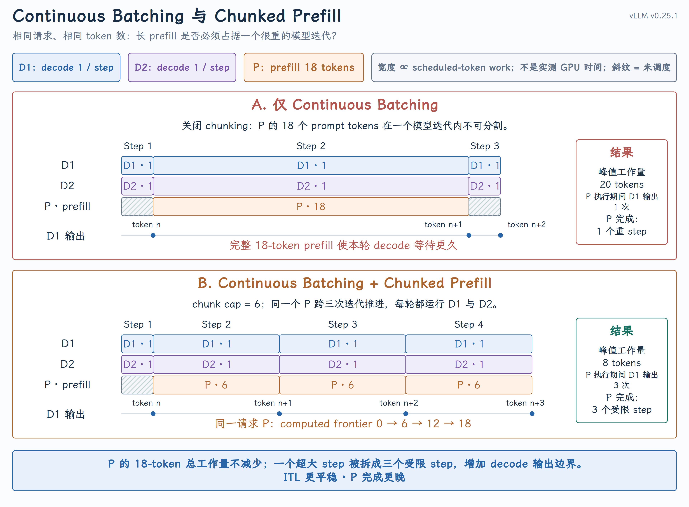

# Chunked Prefill

## 课程回顾

Continuous Batching：每次模型迭代结束，Scheduler 都可以根据最新状态重组下一批请求。

但它还有一个没有回答的问题：如果新来的 prompt 很长，一次 prefill 本身就形成了一个很重的模型迭代，已经在生成的请求该怎么办？这正是 Chunked Prefill 要解决的问题。

{ width="100%" }

先读懂图里的共同输入：

- `D1`、`D2` 是两个正在 decode 的请求，每轮各需要计算 1 个 token；

- `P` 是新来的长 prompt，还有 18 个 token 需要 prefill；

- 上半部分只使用 Continuous Batching，`P18` 被放进一个模型迭代；

- 下半部分再加 Chunked Prefill，把同一个 `P18` 拆成 `P6 + P6 + P6`。

上半部分不是不能动态组批。真正的问题是：动态组批只能发生在模型迭代的边界，Scheduler 不能在一次 `execute_model()` 的中间重新插入请求。 当 18-token prefill 与两个 decode token 一起执行时，这一轮的工作量是 20；`D1` 和 `D2` 必须等这次重迭代结束，才能拿到下一次输出。

下半部分把长 prefill 分摊到三个迭代，每轮工作量变成 `1 + 1 + 6 = 8`。decode 请求可以在每个较短的迭代边界继续产出 token。代价也很明确：`P` 的总计算量没有减少，而且要到第三轮才完成 prefill。

图中的方块宽度表示 scheduled-token work，不是实测毫秒数。真实耗时还受 batch shape、算子、显存带宽、CUDA Graph 和硬件影响。

## 一、Continuous Batching 为什么还不够

Continuous Batching 解决的是 batch membership：哪些请求参加下一轮计算。

Chunked Prefill 解决的是 per-request work granularity：一个长 prompt 在这一轮最多推进多少 token。

| 机制 | 改变什么 | 不改变什么 |
| --- | --- | --- |
| Continuous Batching | 每个迭代边界重新选择请求集合 | 单个请求在本轮承担多少 prefill work |
| Chunked Prefill | 把同一请求的长 prefill 切成多轮推进 | 请求身份、prompt 内容、KV Cache 布局 |

源码里的迭代边界非常清楚。每次 [EngineCore.step()](https://github.com/vllm-project/vllm/blob/v0.25.1/vllm/v1/engine/core.py#L479-L508) 都依次完成：

```python
scheduler_output = self.scheduler.schedule(...)
model_output = self.model_executor.execute_model(scheduler_output)
engine_core_outputs = self.scheduler.update_from_output(
    scheduler_output, model_output
)
```

只有当前 `execute_model()` 返回以后，下一次 `schedule()` 才会重组执行批次。因此，一个过大的 prefill 会拉长这一轮所有 decode 请求的等待时间；Chunked Prefill 的意义，就是让长 prefill 也能在迭代边界让出调度机会。

## 二、论文提出了什么思想

[SARATHI](https://arxiv.org/abs/2308.16369) 把长 prefill 切成多个 chunk，再让 decode 请求搭载在这些 prefill chunk 上共同执行。论文称这种组织为 decode-maximal batching：先放一个受控大小的 prefill chunk，再尽量用 decode 填充批次。目标不是消灭 prefill 计算，而是让批次工作量更均匀，减少 decode stall 和 Pipeline Parallelism 中的 bubble。

后续的 [Sarathi-Serve](https://arxiv.org/abs/2403.02310) 进一步把问题表述为吞吐与延迟的权衡：通过 chunked-prefills 和 stall-free scheduling，在扩大 batch、提高吞吐的同时，限制长 prefill 对正在 decode 的请求造成的延迟干扰。

这里要区分“论文思想”和“vLLM 实现”：

- vLLM V1 采用了 Chunked Prefill 这一机制；

- vLLM 没有照搬一套独立的 Sarathi-Serve 调度器，而是把它收进统一的 token-gap 调度模型；

- 因此不能把 Sarathi-Serve 论文里的完整策略、SLO 和实验结论，直接等同为 vLLM 的默认行为。

iteration-level scheduling 可以追溯到 [ORCA](https://www.usenix.org/conference/osdi22/presentation/yu)：它允许每个模型迭代重新组批。SARATHI/Sarathi-Serve 继续向前一步，把长 prefill 也变成可跨迭代推进的工作。

## 三、vLLM 如何把 prefill 和 decode 统一起来

[Scheduler.schedule()](https://github.com/vllm-project/vllm/blob/v0.25.1/vllm/v1/core/sched/scheduler.py#L396-L407) 开头的注释给出了 V1 调度器最重要的抽象：Scheduler 内部没有两条互斥的“prefill phase” 和 “decode phase”。每个请求只有两个进度：

```text
known frontier    = num_tokens_with_spec + num_output_placeholders
computed frontier = num_computed_tokens
work gap          = known frontier - computed frontier
```

于是：

- decode-like 请求的 `work gap` 通常是 1；

- 未完成 prefill 的请求可能还有几十、几百或几千；

- Prefix Cache 命中会抬高 `computed frontier`，从而缩小 gap；

- Chunked Prefill 再把过大的 gap 裁成这一轮允许执行的大小。

把 RUNNING 和 WAITING 两条源码路径压缩成下面这段伪代码，更容易看出 Chunked Prefill 到底发生在哪里：

```python
token_budget = max_num_scheduled_tokens

for request in running_then_waiting:
    work_gap = known_tokens(request) - computed_tokens(request)

    candidate_work = work_gap
    if is_long_prefill(request):
        candidate_work = min(candidate_work, long_prefill_token_threshold)

    # A new WAITING request may enter only partially when chunking is enabled.
    if request.is_waiting and not enable_chunked_prefill:
        if candidate_work > token_budget:
            break

    scheduled = min(candidate_work, token_budget)

    # ★ CHUNKED PREFILL HAPPENS HERE
    is_chunked_prefill = (
        request.is_still_prefilling
        and 0 < scheduled < work_gap
    )

    scheduler_output[request.id] = scheduled
    token_budget -= scheduled

execute_model(scheduler_output)

for request in scheduler_output:
    request.num_computed_tokens += scheduler_output[request.id]
```

为了突出本课主题，伪代码省略了 KV slots、encoder input、speculative decoding 等准入条件；这些条件不会改变星号处对 Chunked Prefill 的定义。

星号这一行就是定义：请求还处于 prefill，并且本轮只调度了剩余 prefill work 的一部分。

不要把所有 `min(..., token_budget)` 都叫 Chunked Prefill。decode 请求的 `work_gap = 1`，本轮完整计算这 1 个 token，不是 chunk；只有 `0 < scheduled < work_gap` 且 prompt 尚未完成，才是在切 prefill。

伪代码与 v0.25.1 源码的对应位置是：

| 伪代码 | vLLM V1 源码 |
| --- | --- |
| 计算并裁剪 RUNNING 请求的 `work_gap` | [scheduler.py#L473-L489](https://github.com/vllm-project/vllm/blob/v0.25.1/vllm/v1/core/sched/scheduler.py#L473-L489) |
| 决定 WAITING 请求能否只进入一部分 | [scheduler.py#L828-L843](https://github.com/vllm-project/vllm/blob/v0.25.1/vllm/v1/core/sched/scheduler.py#L828-L843) |
| 本轮结束后推进 computed frontier | [scheduler.py#L1164-L1189](https://github.com/vllm-project/vllm/blob/v0.25.1/vllm/v1/core/sched/scheduler.py#L1164-L1189) |

这里还有一个状态转换要说清楚：`enable_chunked_prefill` 的关键作用，是允许一个新的 WAITING prefill 在本轮只拿到部分 budget。它执行完第一个 chunk 后就成为 RUNNING，但仍未完成 prompt；后续每轮继续走 RUNNING 路径，用同一个 `work_gap → scheduled` 公式向前推进。

## 四、同一个请求如何跨多轮推进

仍使用开头的 `P18`，假设每轮最多给它 6 个 token：

```text
Step 1: P.num_computed_tokens  0 →  6
Step 2: P.num_computed_tokens  6 → 12
Step 3: P.num_computed_tokens 12 → 18
```

每轮调度完成后， [Scheduler._update_after_schedule()](https://github.com/vllm-project/vllm/blob/v0.25.1/vllm/v1/core/sched/scheduler.py#L1164-L1189) 都会推进同一个 `Request`：

```python
request.num_computed_tokens += num_scheduled_token
request.is_prefill_chunk = request.num_computed_tokens < (
    request.num_tokens + request.num_output_placeholders
)
```

因此 `P6 + P6 + P6` 的准确含义是：

- 不是三个请求，而是一个 `request_id`；

- 不是三份 prompt，而是同一 prompt 的 computed frontier 逐步前移；

- 不是三套 KV Cache，而是同一个请求的 Block Table 持续获得后续 token slots；

- 在正常连续执行路径上，前一个 chunk 产生的 KV 会被后一个 chunk 继续使用，不会每轮从头计算。

Prefix Cache 位于 chunking 之前。例如 prompt 为 60，命中 8 个 cached tokens，本轮剩余 budget 为 15：

```text
remaining work = 60 - 8 = 52
scheduled now  = min(52, 15) = 15
computed       = 8 → 23
```

缓存命中减少的是本次真正需要计算的工作量；Chunked Prefill 决定的是剩余工作如何分摊到多个 step。

## 五、Chunked Prefill 没有改变什么

Chunked Prefill 只改变 prefill work 在时间轴上的切分方式，不要把它扩大成其他机制：

- 它不减少 prompt 的总 token 数，也不减少理论上的总 prefill FLOPs；

- 它不创建多个 Request，多个 chunk 仍属于同一个 `request_id`；

- 它不改变 KV Cache 的 page 布局，前面 chunk 的 KV 仍供后面 chunk 使用；

- 它不等于 Prefix Cache：Prefix Cache 减少需要重新计算的前缀，Chunked Prefill 切分剩余工作；

- 它不等于 P/D 分离：Chunked Prefill 仍在同一个 Engine 内交错 prefill 与 decode。

真实的 Scheduler 在确定 `scheduled` 后还会检查 KV slots 等资源条件，但那属于调度准入和资源恢复，不在本课展开。

## 六、参数和性能权衡

核心配置定义在 [SchedulerConfig](https://github.com/vllm-project/vllm/blob/v0.25.1/vllm/config/scheduler.py#L49-L90)：

| 配置 | 控制什么 |
| --- | --- |
| `max_num_batched_tokens` | 单个模型迭代能够处理的 token 上限；通常决定调度 token budget |
| `enable_chunked_prefill` | WAITING prefill 是否允许只执行剩余 budget 能容纳的部分 |
| `long_prefill_token_threshold` | 单个长 prefill 请求在一轮中的额外工作上限；0 表示关闭该 cap |

调优时不要只记“chunk 越小，延迟越低”：

- chunk 太大：单轮 prefill 很重，decode 的 ITL/TPOT 尾部更容易抖动；

- chunk 太小：长 prompt 需要更多 step，调度与模型调用开销增加，prefill 完成和 TTFT 可能更晚；

- Chunked Prefill 不减少 prompt 的总 FLOPs，只重新安排这些计算发生在哪些迭代；

- 合适的 chunk 大小是在 decode latency、prefill efficiency 和调度开销之间折中，不存在对所有模型和负载都最优的固定值。

看到性能现象时，可以先这样定位：

| 现象 | 优先检查 |
| --- | --- |
| 长 prompt 到来后 decode 输出出现长间隔 | scheduled tokens/step、chunk size、long-prefill threshold |
| 长 prompt 的 TTFT 明显变差 | chunk 是否过小、是否被多轮 decode 持续穿插 |
| GPU 利用率下降且 prefill 完成变慢 | chunk 是否过小、每轮 scheduled tokens 是否不足 |
| Prefix Cache 命中很多但仍要跨多轮 prefill | 命中后剩余 work gap 与本轮 token budget |

## 本课小结

```text
Continuous Batching
    decides who runs at the next iteration boundary

Chunked Prefill
    decides how much of a long prompt runs in that iteration
```

Chunked Prefill 仍然是在一个 Engine 内做时间切片。
