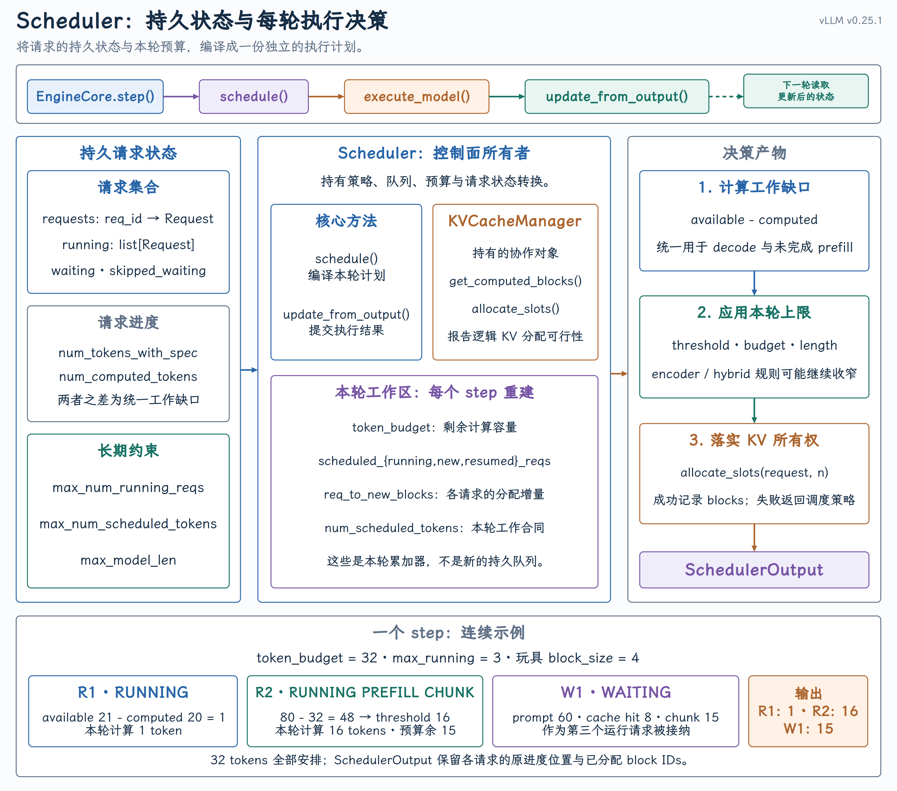
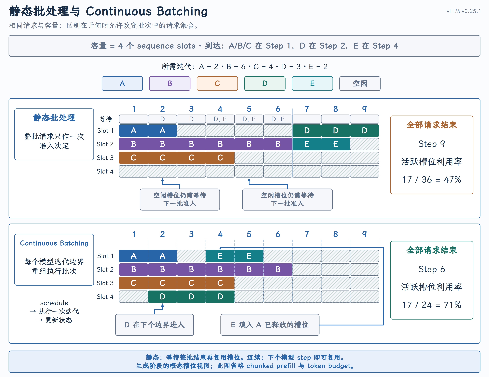
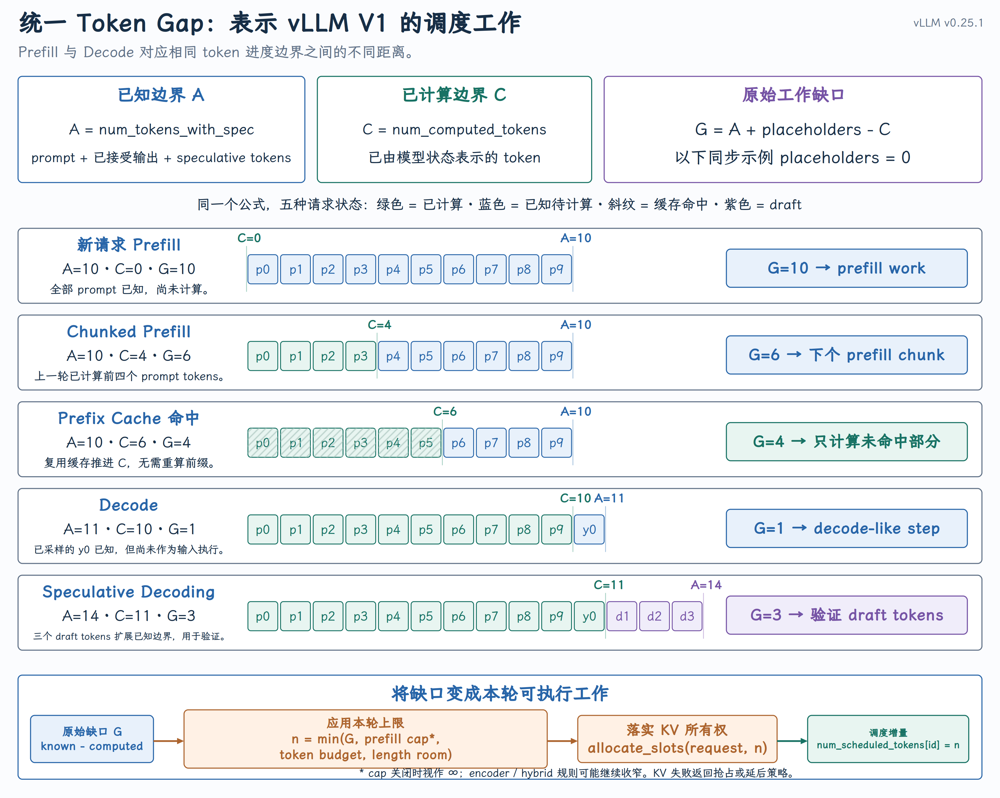

# Continuous Batching：动态更新执行批次

{ width="100%" }

## 课程回顾

前面课程已经把 vLLM V1 的初始化主线串了起来：API 进程创建配置，EngineCore 完成逻辑 KV 资源初始化，Worker 建好 GPU KV Cache，最后发布 READY。

READY 之后，系统从“准备资源”进入“持续处理请求”。EngineCore 反复执行：

```text
schedule()
→ execute_model()
→ update_from_output()
→ next schedule()
```

## 一、从静态批处理到 Continuous Batching

{ width="100%" }

静态批处理会先固定一组请求，通常要等整批请求都结束后，才接纳下一批。生成式推理中，不同请求的 prompt 长度和生成长度差异很大：短请求已经结束，长请求仍在执行，如果批次不能变化，就会留下空闲计算位置。

Continuous Batching 的论文来源是 ORCA 提出的 iteration-level scheduling：调度器不再一次决定请求从开始到结束的全部执行，而是在模型迭代边界重新决定下一轮的请求集合。

因此，Continuous Batching 的核心不是“把请求凑成一批”，而是：

每轮模型执行前，都可以重新选择参与执行的请求；已完成请求退出，新请求可以进入，未完成请求继续前进。

vLLM 中没有一个名为 `ContinuousBatcher` 的类。这个机制由 EngineCore 循环、`Scheduler.schedule()`、`SchedulerOutput` 和执行后的状态更新共同实现。

参考论文：[Orca: A Distributed Serving System for Transformer-Based Generative Models](https://www.usenix.org/conference/osdi22/presentation/yu)

## 二、每个 step 都会重新选择请求

在一次同步的 EngineCore step 中，调度、执行和状态更新首尾相接：

源码：[EngineCore.step()](https://github.com/vllm-project/vllm/blob/v0.25.1/vllm/v1/engine/core.py#L479-L508)

```python
scheduler_output = self.scheduler.schedule(...)
future = self.model_executor.execute_model(
    scheduler_output,
    non_block=True,
)
model_output = future.result()
engine_core_outputs = self.scheduler.update_from_output(
    scheduler_output,
    model_output,
)
```

它形成下面这个循环：

```text
latest scheduler state
→ schedule()
→ execute this step
→ update request state
→ next schedule()
```

`schedule()` 读取当前的请求与资源状态，生成本轮执行计划；`update_from_output()` 消费执行结果，更新 token、停止状态和资源所有权。下一轮 `schedule()` 看到的已经是最新状态。

这就是 Continuous Batching 在代码中的调度边界。

## 三、Scheduler 根据什么做决策

### 1. 请求处于什么状态

Scheduler 长期维护请求索引、等待队列和运行集合。

源码：[Scheduler 中的请求集合](https://github.com/vllm-project/vllm/blob/v0.25.1/vllm/v1/core/sched/scheduler.py#L171-L193)

| 结构 | 含义 |
| --- | --- |
| `requests` | `req_id → Request` 的完整索引 |
| `waiting` | 尚未进入运行集合的候选请求 |
| `skipped_waiting` | 因异步依赖或约束暂时跳过、后续仍要重试的请求 |
| `running` | 已进入运行状态、下一轮仍可能继续前进的请求 |

请求新到达时进入 `waiting`；被调度后进入 `running`；完成后被移出并释放对应资源。

### 2. 请求还差多少 token

V1 没有为 prefill 和 decode 分别维护两套调度主循环，而是把请求统一表示为“已经计算多少”和“当前一共有多少可计算 token”。

源码：[Scheduler.schedule() 的算法说明](https://github.com/vllm-project/vllm/blob/v0.25.1/vllm/v1/core/sched/scheduler.py#L396-L407)

对普通路径，可以先把工作缺口理解为：

```text
required_tokens = num_tokens_with_spec - num_computed_tokens
```

{ width="100%" }

同一套缺口模型可以表示：

- prompt 尚未算完：缺口较大，对应 prefill 或 chunked prefill；

- Prefix Cache 命中：一部分 token 已经由缓存补入 `num_computed_tokens`。

- prompt 已算完且刚生成一个 token：缺口通常为 1，对应普通 decode；

- 存在 draft tokens：缺口包含 speculative tokens；

- RUNNING 请求的实际代码还会考虑 async scheduling 使用的 `num_output_placeholders`：

    [RUNNING 请求的 num_new_tokens](https://github.com/vllm-project/vllm/blob/v0.25.1/vllm/v1/core/sched/scheduler.py#L473-L489)

### 3. 本轮还有多少资源

请求希望前进的 token 数还要经过多项约束：

| 约束 | 回答的问题 |
| --- | --- |
| `token_budget` | 本轮还能计算多少 token |
| `max_num_running_reqs` | 还能否接纳更多运行请求 |
| `max_model_len` | 单个请求还能前进到什么位置 |
| KV slots | 新 token 所需的 KV Cache block 能否落实 |
| scheduling policy | 候选请求和抢占对象如何排序 |

每次调用 `schedule()`，token budget 都从本轮上限重新开始：

源码：

- [初始化约束](https://github.com/vllm-project/vllm/blob/v0.25.1/vllm/v1/core/sched/scheduler.py#L107-L114)

- [初始化本轮 token budget](https://github.com/vllm-project/vllm/blob/v0.25.1/vllm/v1/core/sched/scheduler.py#L409-L432)

KV Cache 容量则不是一个简单的静态整数预算。Scheduler 会针对具体请求调用 `KVCacheManager.allocate_slots()`，根据当时的 block 所有权和空闲队列判断是否能够分配：

源码：[KVCacheManager.allocate_slots() 的调用](https://github.com/vllm-project/vllm/blob/v0.25.1/vllm/v1/core/sched/scheduler.py#L532-L543)

## 四、一次 schedule() 如何形成执行批次

### 1. 先处理 RUNNING 请求

Scheduler 先遍历上一轮仍在运行的请求，计算每个请求希望前进多少 token，再用 token budget、模型长度和其他约束进行裁剪。

源码：[调度 RUNNING 请求](https://github.com/vllm-project/vllm/blob/v0.25.1/vllm/v1/core/sched/scheduler.py#L440-L590)

如果 KV slots 不足，Scheduler 会按调度策略抢占运行请求，释放它占用的 KV Cache block，并将其放回等待队列。

### 2. 再接纳 WAITING 请求

RUNNING 请求处理完成后，如果没有发生抢占并且仍有 token、request slot 和 KV slots，Scheduler 才从 WAITING 队列接纳新请求。

源码：[调度 WAITING 请求](https://github.com/vllm-project/vllm/blob/v0.25.1/vllm/v1/core/sched/scheduler.py#L636-L645)

这个顺序避免了“刚抢占旧请求，又马上接纳新请求”造成的资源震荡。

### 3. 核心伪代码

下面的伪代码隐藏了多模态、LoRA、KV Transfer、Mamba 和 speculative decoding 等可选路径，只保留普通 decoder-only 请求的调度骨架：

```python
def schedule():
    token_budget = max_tokens_per_step
    execution_batch = {}

    for request in running:
        num_required_tokens = (
            request.num_target_tokens
            - request.num_computed_tokens
        )
        num_scheduled_tokens = min(
            num_required_tokens,
            token_budget,
        )

        if kv_cache_manager.can_allocate(
            request,
            num_scheduled_tokens,
        ):
            execution_batch[request.id] = num_scheduled_tokens
            token_budget -= num_scheduled_tokens
        else:
            preempt_low_priority_request()

    for request in waiting:
        num_cached_tokens = find_cached_prefix(request)
        num_required_tokens = (
            request.num_tokens
            - num_cached_tokens
        )
        num_scheduled_tokens = min(
            num_required_tokens,
            token_budget,
        )

        if kv_cache_manager.can_allocate(
            request,
            num_scheduled_tokens,
        ):
            waiting.remove(request)
            running.append(request)
            execution_batch[request.id] = num_scheduled_tokens
            token_budget -= num_scheduled_tokens

    return execution_batch
```

伪代码中的 `execution_batch` 对应真实代码里的 `SchedulerOutput.num_scheduled_tokens`。它不是固定请求列表，而是：

```text
request_id → number of tokens scheduled in this step
```

### 4. 请求抢占

牺牲者由调度策略决定：FCFS 路径从 RUNNING 尾部取请求，PRIORITY 路径按 priority 与 arrival time 选择最低优先级者。资源管理器只报告失败，不负责决定牺牲谁。

真正的状态回退发生在：[`Scheduler._preempt_request()`](https://github.com/vllm-project/vllm/blob/v0.25.1/vllm/v1/core/sched/scheduler.py#L1140-L1162)

```python
self._free_request_blocks(request)
request.status = RequestStatus.PREEMPTED
request.num_computed_tokens = 0
self.waiting.prepend_request(request)
```

它做了四件事：

1. 释放请求对逻辑 KV blocks 的所有权；

2. 将可复用计算进度重置为 0；

3. 保留 prompt、output token、采样参数和 request_id；

4. 把请求放回等待队列，之后按正常准入流程恢复。

这里“释放 blocks”不是释放初始化阶段创建的 GPU KV Tensor。物理大 Tensor 仍在，回到 BlockPool 的只是 block IDs 的可分配资格。被抢占请求以后可能通过 Prefix Cache 重新发现部分历史 KV，但这不是原地接着旧 Block Table 继续，也不能保证一定命中。

## 五、SchedulerOutput：本轮执行计划

完成选择后，Scheduler 构造 `SchedulerOutput`：

源码：[SchedulerOutput 的构造](https://github.com/vllm-project/vllm/blob/v0.25.1/vllm/v1/core/sched/scheduler.py#L1022-L1109)

其中最重要的字段是：

```python
num_scheduled_tokens: dict[str, int]
```

例如：

```python
{
    "R1": 1,
    "R2": 16,
    "W1": 15,
}
```

它表示本轮让 R1 计算 1 个 token、R2 计算 16 个 token、W1 计算 15 个 token。

另外两个关键字段是：

- `scheduled_new_reqs`：第一次进入执行计划的请求，需要向 Worker 发送完整请求数据；

- `scheduled_cached_reqs`：Worker 已缓存状态的请求，只需发送本轮变化。

源码：[SchedulerOutput 定义](https://github.com/vllm-project/vllm/blob/v0.25.1/vllm/v1/core/sched/output.py#L180-L245)

因此，`SchedulerOutput` 是 Scheduler 交给执行侧的每轮控制面协议，不是模型输出，也不保存真实 K/V。Worker 如何将它变成 GPU 输入，留到第四部分展开。

## 六、执行批次如何跨 step 变化

假设参数如下：

```text
max_tokens_per_step = 32
long_prefill_token_threshold = 16
block_size = 4
```

Step N 开始时：

- R1 已在 RUNNING，普通 decode 还差 1 个 token；

- R2 已在 RUNNING，未完成 prefill 还差 48 个 token；

- W1 位于 WAITING，prompt 共 31 个 token，其中 Prefix Cache 命中 8 个。

Scheduler 先处理 RUNNING：

```text
R1: min(1, 32) = 1
R2: min(48, 16, 31) = 16
remaining token budget = 15
```

随后接纳 W1：

```text
W1 required = 31 - 8 = 23
W1 scheduled = min(23, 15) = 15
```

本轮执行计划是：

```python
{
    "R1": 1,
    "R2": 16,
    "W1": 15,
}
```

如果本轮结束后 R1 生成 EOS，同时新请求 W2 到达，那么下一轮：

- R1 从 RUNNING 移除；

- R2 和 W1 继续前进；

- W2 进入 WAITING，并可能使用剩余预算加入；

- `schedule()` 重新生成新的 `num_scheduled_tokens`。

```text
Step N      R1 + R2 + W1
                 │
                 ├─ R1 finishes
                 └─ W2 arrives
                 ↓
Step N+1        R2 + W1 + W2
```

所谓“连续”，连续的是请求在不同 step 之间进入、退出和继续执行；所谓“batching”，是把本轮选中的请求及其 token 数合并成一次模型执行。

## 本课小结

1. Continuous Batching 的调度边界是一次模型 step；每个 step 都会重新选择参与执行的请求。

2. `schedule()` 用统一的 token 缺口模型描述 prefill、decode、Prefix Cache 和 speculative decoding。

3. `SchedulerOutput.num_scheduled_tokens` 表示本轮执行计划：哪些请求前进，以及各自前进多少 token。

4. 下一课继续讨论当长 prompt 超过本轮预算，或者 KV Cache 无法满足当前计划时，Chunked Prefill 和请求抢占如何改变调度结果。

## 参考文献

- [Orca: A Distributed Serving System for Transformer-Based Generative Models](https://www.usenix.org/conference/osdi22/presentation/yu)
