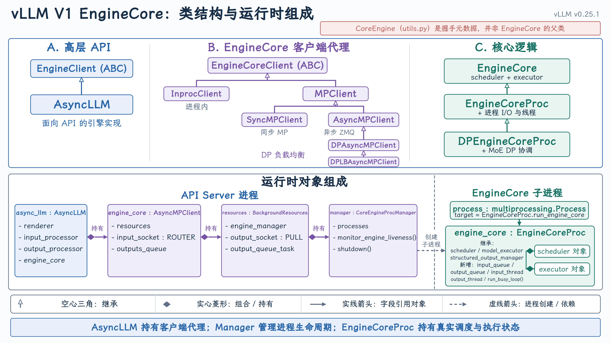
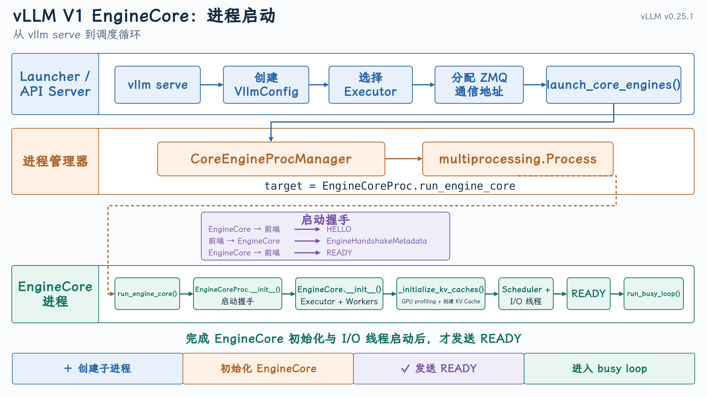
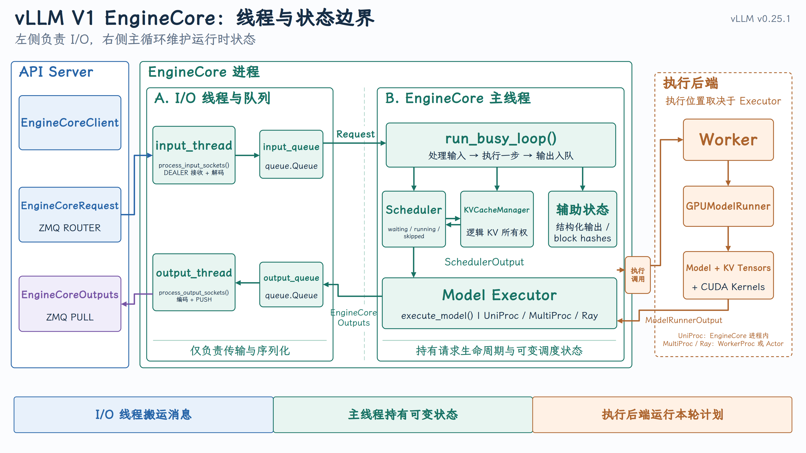
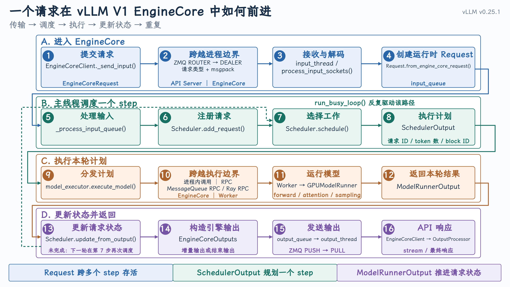

# EngineCore

{ width="100%" }

{ width="100%" }

{ width="100%" }

{ width="100%" }

## 一、EngineCore 为什么要单独运行

API Server 面向用户，负责 HTTP、协议转换、分词和流式输出；EngineCore 面向推理系统，负责调度、KV Cache 和模型执行。二者的工作负载差异很大：

- API Server 是异步 I/O 密集型；
- EngineCore 是状态管理和调度密集型；
- GPU Worker 是计算和显存密集型。

如果将这些工作全部放进一个 asyncio 事件循环，模型初始化、调度循环、序列化和异常处理会相互干扰。因此，vLLM 在线服务的主路径把 EngineCore 放入独立后台进程，通过 ZMQ 与 API Server 通信。

## 二、图一：EngineCore 的创建与启动

### 1. 从 API Server 进入 AsyncLLM

OpenAI API Server 启动时，通过 [build_async_engine_client()](https://github.com/vllm-project/vllm/blob/v0.25.1/vllm/entrypoints/openai/api_server.py#L78-L154) 创建 `VllmConfig`，然后调用：

```python
AsyncLLM.from_vllm_config(...)
```

[AsyncLLM.from_vllm_config()](https://github.com/vllm-project/vllm/blob/v0.25.1/vllm/v1/engine/async_llm.py#L203-L230) 主要做两件事：

```python
executor_class = Executor.get_class(vllm_config)
return AsyncLLM(vllm_config, executor_class, ...)
```

第一件事是根据并行配置选择执行后端；第二件事是构造 API Server 侧的异步推理入口。

[Executor.get_class()](https://github.com/vllm-project/vllm/blob/v0.25.1/vllm/v1/executor/abstract.py#L37-L92) 会根据 `distributed_executor_backend` 选择：

- `UniProcExecutor`
- `MultiprocExecutor`
- `RayDistributedExecutor`
- 外部 Launcher Executor

因此，Executor 的类型在 EngineCore 启动前就已经确定，但具体 Executor 对象是在 EngineCore 中创建的。

### 2. EngineCoreClient 仍属于 API Server

[AsyncLLM.__init__()](https://github.com/vllm-project/vllm/blob/v0.25.1/vllm/v1/engine/async_llm.py#L73-L200) 创建三个关键组件：

```python
self.input_processor = InputProcessor(...)
self.output_processor = OutputProcessor(...)
self.engine_core = EngineCoreClient.make_async_mp_client(...)
```

这里容易产生一个误解：`EngineCoreClient` 不是 EngineCore 进程，它是位于 API Server 进程中的代理。

它向下发送 `EngineCore[Request](https://github.com/vllm-project/vllm/blob/v0.25.1/vllm/v1/request.py#L59-L195)`，向上接收 `EngineCoreOutputs`，让 `AsyncLLM` 不必关心 EngineCore 是本地进程、数据并行实例还是远端执行环境。

### 3. 先建立通信端点，再启动子进程

[MPClient](https://github.com/vllm-project/vllm/blob/v0.25.1/vllm/v1/engine/core_client.py#L480-L649) 首先创建：

```text
API Server ZMQ ROUTER  -> 请求发送端
API Server ZMQ PULL    -> 结果接收端
```

之后调用 [launch_core_engines()](https://github.com/vllm-project/vllm/blob/v0.25.1/vllm/v1/engine/utils.py#L1072-L1222)。

[CoreEngineProcManager](https://github.com/vllm-project/vllm/blob/v0.25.1/vllm/v1/engine/utils.py#L120-L253) 使用 Python multiprocessing 创建 EngineCore 子进程。子进程入口为 [run_engine_core()](https://github.com/vllm-project/vllm/blob/v0.25.1/vllm/v1/engine/core.py#L1154-L1242)。

这里先创建通信地址，再创建进程，是因为子进程启动后必须知道应该连接哪个 API Server Socket。

### 4. EngineCoreProc 是“核心逻辑 + 进程外壳”

子进程中创建的是 [EngineCoreProc](https://github.com/vllm-project/vllm/blob/v0.25.1/vllm/v1/engine/core.py#L896-L1020)：

```python
class EngineCoreProc(EngineCore):
    ...
```

两者的区别是：

```text
EngineCore
  Scheduler、Executor、KV Cache 初始化、step()

EngineCoreProc
  EngineCore + ZMQ + I/O 线程 + 队列 + 握手 + 进程生命周期
```

`EngineCoreProc` 先创建 `input_queue` 和 `output_queue`，进入握手上下文，然后调用 `super().__init__()` 初始化真正的 EngineCore。

### 5. EngineCore 初始化顺序为什么重要

[EngineCore.__init__()](https://github.com/vllm-project/vllm/blob/v0.25.1/vllm/v1/engine/core.py#L96-L237) 的主要顺序是：

```text
创建 Executor
     ↓
查询模型的 KV Cache 规格
     ↓
执行 GPU 显存 profiling
     ↓
规划并创建物理 KV Cache
     ↓
创建 Scheduler
     ↓
创建 Prefix Cache block hasher 等辅助状态
```

其中 [_initialize_kv_caches()](https://github.com/vllm-project/vllm/blob/v0.25.1/vllm/v1/engine/core.py#L240-L348) 会调用 Executor：

```python
kv_cache_specs = self.model_executor.get_kv_cache_specs()
available_memory = self.model_executor.determine_available_memory()
kv_cache_configs = get_kv_cache_configs(...)
self.model_executor.initialize_from_config(kv_cache_configs)
```

所以 Scheduler 不是先随便创建一个 BlockPool，再让 GPU 适配它。真实顺序是先从模型和 GPU 得到可用容量，再生成 Scheduler 使用的 KV Cache 配置。

### 6. READY 到底表示什么

完成 EngineCore、Executor、KV Cache 初始化后，`EngineCoreProc` 才启动输入线程和输出线程。输入线程连接 API Server，并通过握手报告可用的：

- `max_model_len`
- `num_gpu_blocks`
- `block_size`
- 数据类型和并行规模

因此，READY 表示整个运行时已经可服务，而不只是子进程执行到了第一行。握手完成后，`run_engine_core()` 才调用 `[run_busy_loop()](https://github.com/vllm-project/vllm/blob/v0.25.1/vllm/v1/engine/core.py#L1259-L1267)`。

## 三、图二：EngineCore 内部的线程与状态边界

EngineCore 内部结构：I/O 线程负责搬运，主线程负责决策，Executor 负责执行。

### 1. 输入线程负责把外部消息变成内部事件

[process_input_sockets()](https://github.com/vllm-project/vllm/blob/v0.25.1/vllm/v1/engine/core.py#L1484-L1588) 持有 ZMQ DEALER Socket，接收 API Server ROUTER 发来的消息。

对于新增请求，它执行：

```text
ZMQ multipart bytes
    ↓ MsgpackDecoder
EngineCoreRequest
    ↓ preprocess_add_request()
Request
    ↓
input_queue
```

[preprocess_add_request()](https://github.com/vllm-project/vllm/blob/v0.25.1/vllm/v1/engine/core.py#L855-L875) 调用 `Request.from_engine_core_request()`，并初始化 Prefix Cache block hash、结构化输出等请求级状态。

需要注意：输入线程可以构造 `Request`，但它不会直接修改 Scheduler 的 waiting/running 队列。

### 2. input_queue 是线程所有权的交接点

输入线程把 `(request_type, request)` 放进 `input_queue`。主线程从队列中取出消息，再通过 [_handle_client_request()](https://github.com/vllm-project/vllm/blob/v0.25.1/vllm/v1/engine/core.py#L1372-L1432) 分发：

```text
ADD     -> add_request()
ABORT   -> abort_requests()
UTILITY -> 调用 EngineCore 工具方法
```

新增请求最终进入 [Scheduler.add_request()](https://github.com/vllm-project/vllm/blob/v0.25.1/vllm/v1/core/sched/scheduler.py#L2012-L2035)。

这条边界很重要：Scheduler、请求队列和 KV Cache 逻辑状态主要由主线程操作，从而减少多线程共享调度状态所需的锁。

### 3. 主线程维护的不是一个请求，而是整个系统状态

主线程中的核心对象包括：

- `Scheduler`：维护 waiting、running、skipped 等请求集合；
- `Request`：记录 token、状态、优先级和计算进度；
- `KVCacheManager`：维护请求与逻辑 KV block 的关系；
- `StructuredOutputManager`：维护 grammar 等约束状态；
- `Executor`：执行本轮 SchedulerOutput。

这里必须区分逻辑状态与物理存储：

```text
EngineCore / Scheduler
 管理 block ID、请求所有权、缓存命中等元数据

GPU Worker
 持有真正存储 K/V 数值的 GPU Tensor
```

因此，EngineCore 负责决定请求“应当使用哪些 KV block”，但不会在 Python 主线程中保存每一层的真实 K/V 数据。

### 4. Executor 把控制平面与执行位置解耦

EngineCore 调用统一的：

```python
self.model_executor.execute_model(scheduler_output)
```

但调用最终在哪里执行，取决于 Executor：

- UniProc：Worker 和 GPUModelRunner 可以在 EngineCore 进程内；
- MultiProc：Executor 通过 MessageQueue RPC 调用 WorkerProc；
- Ray：Executor 通过 Ray RPC 调用 Ray Worker Actor。

所以图中的 Execution Backend 是条件边界，而不是固定的独立进程。不能笼统地说“EngineCore 一定通过 Socket 调 GPU Worker”。

### 5. 输出线程完成反向交接

主线程生成 `EngineCoreOutputs` 后放入 `output_queue`。[process_output_sockets()](https://github.com/vllm-project/vllm/blob/v0.25.1/vllm/v1/engine/core.py#L1589-L1654) 对结果编码，再通过 ZMQ PUSH 发送给 API Server 的 PULL Socket。

完整线程通路是：

```text
API Server
  -> ZMQ -> input_thread
  -> input_queue -> EngineCore main thread
  -> output_queue -> output_thread
  -> ZMQ -> API Server
```

I/O 线程使反序列化、序列化和 Socket 等待可以与 GPU 执行部分重叠，但请求状态的核心推进仍集中在主线程。

## 四、图三：请求在 EngineCore 中如何前进一步

这张图描述的不是请求从开始到结束的一次性流水线，而是 EngineCore 每一轮迭代所执行的闭环。

### 1. Request 是跨多个 step 存活的状态对象

`EngineCoreRequest` 是传输对象；Request 是运行时对象。

它持续记录：

```text
prompt_token_ids
output_token_ids
spec_token_ids
num_computed_tokens
status
max_tokens
priority
block_hashes
```

请求不会在一次 `step()` 中被全部处理完。尤其是 decode 阶段，通常每个 step 只向前生成一个或少量 token。

### 2. run_busy_loop 是外循环

run_busy_loop() 每轮先处理新输入，再调用一次 EngineCore step：

```python
while self._handle_shutdown():
    self._process_input_queue()
    self._process_engine_step()
```

这样设计意味着新请求只能在清晰的 step 边界进入 Scheduler，而不会在 Scheduler 正遍历 running 队列时突然修改内部集合。

### 3. SchedulerOutput 是当前 step 的不可持久执行计划

[EngineCore.step()](https://github.com/vllm-project/vllm/blob/v0.25.1/vllm/v1/engine/core.py#L479-L508) 首先调用：

```python
scheduler_output = self.scheduler.schedule(...)
```

[Scheduler.schedule()](https://github.com/vllm-project/vllm/blob/v0.25.1/vllm/v1/core/sched/scheduler.py#L396-L1133) 综合考虑：

- running 请求尚未计算的 token；
- waiting 请求是否可以加入；
- 当前 token budget；
- KV Cache 是否有足够 block；
- Prefix Cache 命中；
- encoder budget、LoRA、优先级和抢占。

它产生的 [SchedulerOutput](https://github.com/vllm-project/vllm/blob/v0.25.1/vllm/v1/core/sched/output.py#L181-L245) 描述：

```text
本轮执行哪些新请求
哪些已有请求继续执行
每个请求执行多少 token
使用哪些 KV block
哪些请求被抢占
```

它不是请求状态，也不是模型结果，只是本轮 GPU 执行所需的计划。

### 4. Executor 消费计划，GPUModelRunner 执行计划

EngineCore 将 `SchedulerOutput` 交给 Executor：

```python
future = self.model_executor.execute_model(
    scheduler_output,
    non_block=True,
)
model_output = future.result()
```

Executor 负责把计划分发到正确的 Worker。Worker 中的 [GPUModelRunner.execute_model()](https://github.com/vllm-project/vllm/blob/v0.25.1/vllm/v1/worker/gpu_model_runner.py#L4070-L4438) 随后：

1. 更新 Worker 侧的请求状态；
2. 根据 block ID 更新 BlockTable；
3. 构造 input IDs、positions、slot mapping 等 GPU Tensor；
4. 执行模型 forward；
5. 调用 Attention Backend；
6. 执行采样；
7. 返回 `ModelRunnerOutput`。

这一步才是真正的模型执行层。

### 5. ModelRunnerOutput 还不是客户端输出

`ModelRunnerOutput` 包含本轮生成 token、logprob 等执行结果，但 Scheduler 还必须将它与原有 `Request` 状态合并。

[Scheduler.update_from_output()](https://github.com/vllm-project/vllm/blob/v0.25.1/vllm/v1/core/sched/scheduler.py#L1499-L1851) 会：

- 将新 token 写入请求；
- 推进 `num_computed_tokens`；
- 处理 speculative token 接受结果；
- 判断 EOS、长度限制和停止条件；
- 释放已完成请求的 KV Cache；
- 构造返回前端的 `EngineCoreOutputs`。

因此，请求状态的权威版本仍在 EngineCore，而不是 GPU Worker。

## 五、三张图之间的逻辑关系

第一张图讲的是 生命周期起点：EngineCore 怎样从 API Server 启动为可服务的推理运行时。

第二张图讲的是 静态结构与所有权：通信线程、主线程、Executor 和 GPU Worker 分别负责什么。

第三张图讲的是 动态行为：请求如何在一次次调度和执行闭环中前进。

最终可以把 EngineCore 总结为下面这条主线：

```text
接收请求
   -> 转换为运行时 Request
   -> Scheduler 制定本轮计划
   -> Executor 调用 Worker
   -> GPUModelRunner 执行模型
   -> Scheduler 合并结果并更新状态
   -> 返回增量输出
   -> 未完成请求进入下一轮
```

这条闭环既是 EngineCore 的主循环，也是后续理解 Scheduler、KVCacheManager、continuous batching 和模型执行层的共同入口。
