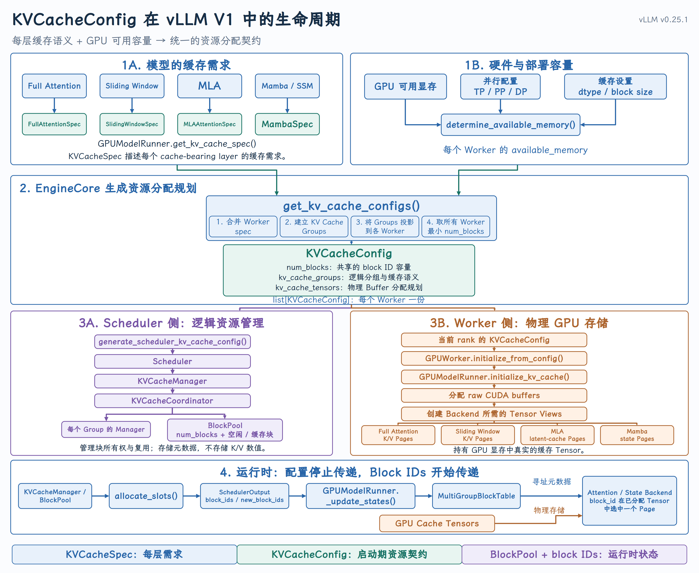

# KVCacheConfig

{ width="100%" }

## 课程回顾

前面课程始终沿着“请求线”向前推进：

```text
Client
→ ChatCompletionRequest
→ EngineInput
→ EngineCoreRequest
→ Request
→ waiting queue
→ Scheduler
```

经过前处理和数据结构转换，用户请求最终变成了 Scheduler 可以管理的 `Request`。`Request` 记录了 prompt、已计算 token 数、输出 token 数和当前状态，因此它回答的是：

这个请求还有多少工作需要完成？

但 Scheduler 要决定请求能否继续运行，只有请求状态还不够。它还必须知道：系统究竟准备了多少 KV Cache 资源？

## 一、KVCacheConfig 在系统中的位置

`KVCacheConfig` 的主线集中在 `EngineCore._initialize_kv_caches()` 中。先不进入每个函数的细节，只看它们在架构上的关系。

源码：[`EngineCore._initialize_kv_caches()`](https://github.com/vllm-project/vllm/blob/v0.25.1/vllm/v1/engine/core.py#L240-L348)

```python
kv_cache_specs = self.model_executor.get_kv_cache_specs()
available_gpu_memory = self.model_executor.determine_available_memory()

kv_cache_configs = get_kv_cache_configs(
    vllm_config, kv_cache_specs, available_gpu_memory
)

scheduler_kv_cache_config = generate_scheduler_kv_cache_config(
    kv_cache_configs
)

self.model_executor.initialize_from_config(kv_cache_configs)
return scheduler_kv_cache_config
```

这段代码展示了五个连续动作：

```text
Collect model cache requirements
→ Determine available device memory
→ Build per-Worker KVCacheConfig
→ Derive the Scheduler's logical view
→ Initialize physical cache storage on Workers
```

这里最关键的不是调用顺序，而是 `KVCacheConfig` 所在的架构边界：

```text
Requirements + Capacity
           ↓
     KVCacheConfig
       ┌─────┴─────┐
       ↓           ↓
  EngineCore       GPU Worker
  logical view     physical view
```

`get_kv_cache_configs()` 产生的是每个 Worker 的配置。Worker 的设备和并行分片可能不同，因此这里的结果是 `list[KVCacheConfig]`。

Scheduler 却是中心化地分配 block_id，所以 `generate_scheduler_kv_cache_config()` 还会从各 Worker 的配置中得到一份 Scheduler 使用的逻辑资源视图。

源码：[`get_kv_cache_configs()`](https://github.com/vllm-project/vllm/blob/v0.25.1/vllm/v1/core/kv_cache_utils.py#L2005-L2153) 与 [`generate_scheduler_kv_cache_config()`](https://github.com/vllm-project/vllm/blob/v0.25.1/vllm/v1/core/kv_cache_utils.py#L1766-L1785)

因此，`KVCacheConfig` 不是每轮调度传递的消息，而是启动阶段建立的资源规划协议。

## 二、统一资源契约：容量、分组与存储

v0.25.1 中，`KVCacheConfig` 的定义非常简洁：

源码：[`KVCacheConfig`](https://github.com/vllm-project/vllm/blob/v0.25.1/vllm/v1/kv_cache_interface.py#L920-L936)

```python
@dataclass
class KVCacheConfig:
    num_blocks: int
    kv_cache_tensors: list[KVCacheTensor]
    kv_cache_groups: list[KVCacheGroupSpec]
```

三个字段分别回答三个问题：

| 字段 | 资源视图 | 回答的问题 |
| --- | --- | --- |
| `num_blocks` | 容量 | 规划出的 block_id 空间有多大？ |
| `kv_cache_groups` | 逻辑分组 | 哪些层共享同一种块表与管理语义？ |
| `kv_cache_tensors` | 物理存储规划 | Worker 要为哪些层准备多大的底层缓冲区？ |

可以把它记成：

```text
KVCacheConfig
= block capacity
+ cache grouping
+ storage layout
```

### 1. `num_blocks`：block_id 空间的容量

`num_blocks` 定义这份配置所规划的块容量。从契约的角度，Core 和 Worker 都要按照同一个 block_id 上界建立自己的数据结构。

```text
planned block_id space: [0, num_blocks)
```

它表达的是“多少个块”，而不是“多少字节”。

### 2. `kv_cache_groups`：模型层的逻辑分组

`KVCacheGroupSpec` 描述一组共享同一份 KV Cache Block Table 的模型层。

源码：[`KVCacheGroupSpec`](https://github.com/vllm-project/vllm/blob/v0.25.1/vllm/v1/kv_cache_interface.py#L904-L916)

```python
@dataclass
class KVCacheGroupSpec:
    layer_names: list[str]
    kv_cache_spec: KVCacheSpec
    is_eagle_group: bool = False
```

- `layer_names` 说明这一组包含哪些层；

- `kv_cache_spec` 保留这组层的缓存语义；

- `is_eagle_group` 用于标识 EAGLE/MTP draft attention 相关的分组。

对于只有一种 Attention 类型的模型，通常只有一个 group。如果模型同时包含多种缓存语义，就可能需要多个 group。

### 3. `kv_cache_tensors`：Worker 的物理存储规划

`KVCacheTensor` 描述 Worker 应该如何准备底层缓冲区。

源码：[`KVCacheTensor`](https://github.com/vllm-project/vllm/blob/v0.25.1/vllm/v1/kv_cache_interface.py#L892-L901)

```python
@dataclass
class KVCacheTensor:
    size: int
    shared_by: list[str]
    offset: int = 0
    block_stride: int = 0
```

- `size` 是这份底层存储的字节数；

- `shared_by` 说明哪些层使用这份存储；

- `offset` 和 `block_stride` 表达 packed layout 中的布局信息。

需要特别注意：`KVCacheTensor` 仍然是一份“存储规划”，不是真实的 `torch.Tensor`。真实 GPU 存储只会在 Worker 消费这份配置时创建。

## 三、规划的两个输入

`KVCacheConfig` 不能只从模型结构推导，也不能只看 GPU 还剩多少显存。它同时依赖模型语义和设备容量。

### 1. 模型侧：`KVCacheSpec`

Model Runner 遍历模型中的 cache-bearing layers，收集每一层的 `KVCacheSpec`。

源码：[`GPUModelRunner.get_kv_cache_spec()`](https://github.com/vllm-project/vllm/blob/v0.25.1/vllm/v1/worker/gpu_model_runner.py#L7561-L7598)

`KVCacheSpec` 的职责是表达“一层需要什么样的缓存”。例如，Full Attention、Sliding Window Attention、MLA 和 Mamba 对缓存的结构和管理语义并不相同。

因此，`KVCacheSpec` 是每层需求，`KVCacheConfig` 是全局资源规划：

```text
KVCacheSpec    = what each cache-bearing layer needs
KVCacheConfig  = how the engine plans the whole cache space
```

### 2. Worker 侧：`available_gpu_memory`

Worker 通过 `determine_available_memory()` 判定能够用于 KV Cache 的设备内存容量。

源码：[`GPUWorker.determine_available_memory()`](https://github.com/vllm-project/vllm/blob/v0.25.1/vllm/v1/worker/gpu_worker.py#L430-L555)

这个结果只回答“可以拿出多少字节”，它本身还不是 Scheduler 能够分配的 KV Block。

比如，同样是 1 GB 可用显存：

- 如果每个 KV Block 更大，能容纳的 block 就更少；

- 如果模型中需要缓存的层更多，同一 block_id 背后的整体存储成本就更高；

- 如果 KV dtype 不同，每个元素的字节数也不同。

所以系统必须同时拿到 `KVCacheSpec` 和 `available_gpu_memory`，才能由 `get_kv_cache_configs()` 形成 `KVCacheConfig`。

## 四、EngineCore 与 Worker 的两种视图

`KVCacheConfig` 之所以称为“契约”，是因为 EngineCore 和 Worker 都依赖它，但两侧消费的信息不同。

|  | EngineCore / Scheduler 侧 | Worker / GPUModelRunner 侧 |
| --- | --- | --- |
| 主要视图 | 逻辑资源 | 物理存储 |
| 关心的问题 | 有多少块，层如何分组 | 需要准备哪些设备缓冲区 |
| 运行时职责 | 管理 block_id、请求所有权与复用状态 | 保存真实 K/V 数据，供模型执行读写 |
| 内存位置 | CPU 内存 | GPU 显存 |

### 1. EngineCore 侧：建立逻辑块管理

EngineCore 把 Scheduler 视图下的 `KVCacheConfig` 传入 `Scheduler`，Scheduler 再用它创建 `KVCacheManager`。

源码：`Scheduler` [创建](https://github.com/vllm-project/vllm/blob/v0.25.1/vllm/v1/core/sched/scheduler.py#L262-L276) `KVCacheManager`

```python
self.kv_cache_manager = KVCacheManager(
    kv_cache_config=kv_cache_config,
    max_model_len=self.max_model_len,
    ...
)
```

`KVCacheManager` 以及它下游的 `BlockPool` 保存的是 CPU 侧元数据，例如 block_id、引用状态、空闲队列和 Prefix Cache 哈希。

这一侧管理的是“哪个请求拥有哪些块”，不保存 K/V 数值本身。

### 2. Worker 侧：落地物理存储

EngineCore 通过 Model Executor 把每个 Worker 对应的 `KVCacheConfig` 传给 `GPUWorker.initialize_from_config()`：

源码：[`GPUWorker.initialize_from_config()`](https://github.com/vllm-project/vllm/blob/v0.25.1/vllm/v1/worker/gpu_worker.py#L695-L721)

```python
def initialize_from_config(self, kv_cache_config: KVCacheConfig) -> None:
    self.cache_config.num_gpu_blocks = kv_cache_config.num_blocks

    with self._maybe_get_memory_pool_context(tag="kv_cache"):
        self.model_runner.initialize_kv_cache(kv_cache_config)
```

Worker 沿着 `kv_cache_tensors` 中的存储规划创建真实的 GPU KV Cache，并把它交给具体的 Attention 或 State Backend 使用。

Worker 在启动时准备真实的 GPU KV Cache 存储；EngineCore 在运行时管理 block_id 以及请求对这些块的逻辑所有权。

### 3. CPU 元数据不等于 GPU K/V 数据

| CPU 内存 / 主机内存 | GPU 显存 |
| --- | --- |
| `Request` | 模型权重 |
| `Scheduler` | 激活值 |
| `KVCacheManager` | 真实 KV Cache Tensor |
| `BlockPool` | GPU Block Table |
| `KVCacheBlock` 元数据 | Attention / State Backend 使用的设备数据 |

因此，“`BlockPool` 分配 GPU 显存”是不准确的。更准确的说法是：

Worker 启动时按照 `KVCacheConfig` 准备 GPU KV Cache Tensor；`BlockPool` 运行时分配 block_id，并管理逻辑块的所有权与复用状态。

## 五、block_id 如何连接调度与执行

Core 管理逻辑元数据，Worker 保存真实 K/V 数据，那么两侧如何指向同一个缓存页面？

答案是 `block_id`。

假设资源规划得到：

```text
num_blocks = 1024
```

那么 Core 侧会围绕这一容量建立逻辑块元数据，Worker 侧则会准备能够由这一 block_id 空间定位的物理页面。

```text
Scheduler / KVCacheManager               GPU Worker

block_id = 37                            page selected by block_id 37
request owns block 37        ──────────▶ real K/V values
```

Scheduler 不需要知道某个 Tensor 的 GPU 指针，Worker 也不需要重新实现一套请求所有权管理。两侧只要对容量、分组以及 block_id 的解释保持一致，逻辑管理和物理存储就可以解耦。

对于多个 KV Cache Group，每个 group 都有自己的 block table，一个请求在不同 group 中拿到的 block_id 不一定相同。但这些 block_id 都来自 Core 与 Worker 共同约定的 ID 范围；Worker 使用“group + block_id”定位对应的物理页面。`kv_cache_groups` 正是为了保留这层分组语义。

## 六、启动期规划与运行期状态

`KVCacheConfig` 的最后一个重要特征是：它建立于启动阶段，不是每轮调度都会变化的运行时状态。

```text
Startup
│
├─ Collect KVCacheSpec
├─ Determine available memory
├─ Build KVCacheConfig
├─ Create Core-side logical managers
└─ Initialize Worker-side physical storage
     ↓
Runtime
│
└─ Requests acquire, use, reuse and release block IDs
```

源码中，这条边界就体现在 [`EngineCore._initialize_kv_caches()`](https://github.com/vllm-project/vllm/blob/v0.25.1/vllm/v1/engine/core.py#L240-L348) 完成配置生成和 Worker 初始化，然后才把 Scheduler 视图的配置交给后续引擎组件。

四类对象的生命周期不要混淆：

| 对象 | 它描述什么 | 主要阶段 |
| --- | --- | --- |
| `KVCacheSpec` | 单层缓存需求 | 启动期规划输入 |
| `KVCacheConfig` | 容量、分组和存储布局契约 | 启动期规划结果 |
| `KVCacheBlock` / `BlockPool` | block_id 与所有权等 CPU 元数据 | 运行期状态管理 |
| GPU KV Cache Tensor | 真实 K/V 或 state 数据 | 启动时准备，运行时读写 |

这个区分解释了为什么 Scheduler 每一轮不需要再去询问 GPU 还剩多少字节：启动期已经把字节容量转换成了统一的块空间；运行时 Scheduler 关心的是块的占用、复用与回收状态。
